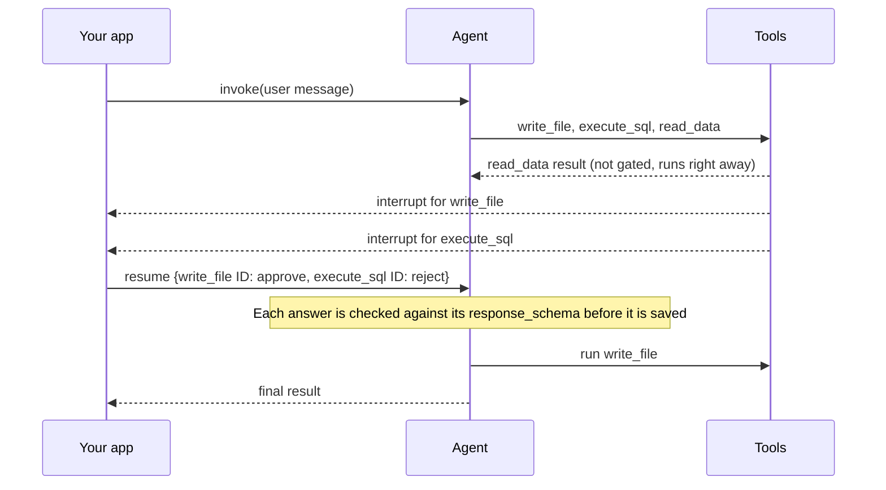

import HitlDecisionTypesTable from '/langchain/snippets/oss/hitl-decision-types-table.mdx';

人机交互（HITL）在智能体执行工具调用前暂停，以便人工审核。审核者可以批准调用、编辑其参数、使用反馈拒绝调用，或代替工具进行响应。适用于难以撤销或需要批准的操作，例如删除记录、发送邮件或写入文件。

:::python
您通过 @[`HumanInTheLoopMiddleware`] 在 [LangChain](/langchain/oss/langchain/human-in-the-loop)中添加审核，或通过 [Deep Agents](/langchain/oss/deepagents/human-in-the-loop)中的 `interrupt_on` 参数添加。中间件以两种模式之一暂停：
:::

:::js
您通过 @[`humanInTheLoopMiddleware`] 在 [LangChain](/langchain/oss/langchain/human-in-the-loop)中添加审核，或通过 [Deep Agents](/langchain/oss/deepagents/human-in-the-loop)中的 `interruptOn` 参数添加。中间件以两种模式之一暂停：
:::

- **按调用暂停**：每个需要审核的工具调用暂停一次。
- **批量暂停**：每个模型回合暂停一次，涵盖该回合中的所有工具调用。批量模式是当前默认模式。

:::python
<Note>
按调用模式需要 `langchain>=1.4.6`。Deep Agents 使用批量模式。
</Note>
:::

:::js
<Note>
按调用模式需要 `langchain>=1.5.18`。Deep Agents 使用批量模式。
</Note>
:::

## 从暂停到恢复的审批流程

无论哪种模式，每个审批都遵循相同的步骤：

:::python
1. 模型提出一个或多个工具调用。
2. 中间件根据您的 `interrupt_on` 政策检查每个调用。需要审核的调用会暂停智能体并使用 @[interrupt]。
3. [checkpointer](/langchain/oss/langgraph/persistence) 保存智能体的状态，以便运行可以停止并在稍后（甚至另一个进程中）恢复。
4. 您的应用程序向审核者展示待处理的调用，并收集每个调用的决策。
5. 您使用 `Command(resume=...)` 恢复智能体。中间件应用每个决策，智能体继续执行。
:::

:::js
1. 模型提出一个或多个工具调用。
2. 中间件根据您的 `interruptOn` 政策检查每个调用。需要审核的调用会暂停智能体并使用 @[interrupt]。
3. [checkpointer](/langchain/oss/langgraph/persistence) 保存智能体的状态，以便运行可以停止并在稍后（甚至另一个进程中）恢复。
4. 您的应用程序向审核者展示待处理的调用，并收集每个调用的决策。
5. 您使用 `new Command({ resume })` 恢复智能体。中间件应用每个决策，智能体继续执行。
:::

决策有四种类型：

<HitlDecisionTypesTable />

本页的示例使用一个具有三个工具的智能体。`write_file` 允许所有决策类型。`execute_sql` 仅允许 `approve` 和 `reject`。`read_data` 无需审核运行。在一个回合中，模型调用所有三个工具。

## 分别审核每个工具调用

在按调用模式下，每个需要审核的工具调用在开始时独立暂停：



每个中断值描述一个调用，并具有 `type: "tool_approval"`。`execute_sql` 中断如下所示：

:::python
```python
{
    "type": "tool_approval",
    "tool_call_id": "call_sql",
    "name": "execute_sql",
    "args": {"query": "DELETE FROM orders WHERE created_at < '2025-01-01'"},
    "description": "Tool execution requires approval\n\nTool: execute_sql\nArgs: {'query': \"DELETE FROM orders WHERE created_at < '2025-01-01'\"}",
}
```
:::

:::js
```ts
{
  type: "tool_approval",
  tool_call_id: "call_sql",
  name: "execute_sql",
  args: { query: "DELETE FROM orders WHERE created_at < '2025-01-01'" },
  description: "Tool execution requires approval\n\nTool: execute_sql\nArgs: {\n  \"query\": \"DELETE FROM orders WHERE created_at < '2025-01-01'\"\n}",
}
```
:::

每个中断还携带一个 [`response_schema`](/langchain/oss/langgraph/interrupts#定义中断响应模式)，即调用接受的答案的 JSON 架构。对于 `execute_sql`，架构允许 `approve` 和 `reject`。对于 `write_file`，它还允许 `respond` 和 `edit`。`edit` 分支包含 `write_file` 自身的参数架构。客户端可以从架构渲染表单，而不是硬编码决策类型。[LangChain 指南](/langchain/oss/langchain/human-in-the-loop#读取响应模式) 显示每种决策类型的架构。

您使用中断的 ID 作为键，对每个中断进行一个决策：

:::python
```python
Command(resume={
    write_file_interrupt.id: {"type": "approve"},
    execute_sql_interrupt.id: {"type": "reject", "message": "Archive the rows before deleting them."},
})
```
:::

:::js
```ts
new Command({
  resume: {
    [writeFileInterrupt.id]: { type: "approve" },
    [executeSqlInterrupt.id]: { type: "reject", message: "Archive the rows before deleting them." },
  },
});
```
:::

LangGraph 在保存无效答案之前拒绝它，以便审核者可以更正并再次回答。未回答的中断保持待处理状态，允许审核者逐个回答。

## 一次性审核整个回合

:::python
在批量模式下，中间件在模型响应后、任何工具运行前暂停一次。`read_data` 等待审核，即使它不受限制。一个中断在 `action_requests` 中列出所有受限制的调用，并在单独的 `review_configs` 列表中列出每个调用的允许决策：

```python
{
    "action_requests": [
        {"name": "write_file", "args": {"path": "orders_archive.csv", "content": "id,total\n1,20\n"}, "description": "..."},
        {"name": "execute_sql", "args": {"query": "DELETE FROM orders WHERE created_at < '2025-01-01'"}, "description": "..."},
    ],
    "review_configs": [
        {"action_name": "write_file", "allowed_decisions": ["approve", "edit", "reject", "respond"]},
        {"action_name": "execute_sql", "allowed_decisions": ["approve", "reject"]},
    ],
}
```

您使用与 `action_requests` 相同顺序的一个决策列表进行回答：

```python
Command(resume={"decisions": [
    {"type": "approve"},
    {"type": "reject", "message": "Archive the rows before deleting them."},
]})
```
:::

:::js
在批量模式下，中间件在模型响应后、任何工具运行前暂停一次。`read_data` 等待审核，即使它不受限制。一个中断在 `actionRequests` 中列出所有受限制的调用，并在单独的 `reviewConfigs` 列表中列出每个调用的允许决策：

```ts
{
  actionRequests: [
    { name: "write_file", args: { path: "orders_archive.csv", content: "id,total\n1,20\n" }, description: "..." },
    { name: "execute_sql", args: { query: "DELETE FROM orders WHERE created_at < '2025-01-01'" }, description: "..." },
  ],
  reviewConfigs: [
    { actionName: "write_file", allowedDecisions: ["approve", "edit", "reject", "respond"] },
    { actionName: "execute_sql", allowedDecisions: ["approve", "reject"] },
  ],
}
```

您使用与 `actionRequests` 相同顺序的一个决策列表进行回答：

```ts
new Command({
  resume: {
    decisions: [
      { type: "approve" },
      { type: "reject", message: "Archive the rows before deleting them." },
    ],
  },
});
```
:::

中断没有 `response_schema`。中间件仅在应用决策后、LangGraph 保存答案时检查每个决策。

## 对比批量模式问题

批量模式通过位置匹配答案与调用，并在保存答案后检查每个答案。每一行显示示例智能体在批量模式下遇到的问题，以及按调用模式如何避免这些问题：

:::python
| 在批量模式下 | 发生什么 | 在按调用模式下 |
| --- | --- | --- |
| 决策与调用按位置匹配 | 审核者打算批准 `write_file` 并拒绝 `execute_sql`，但发送了 `[reject, approve]`。`DELETE` 运行。 | 每个决策由其调用的中断 ID 作为键。 |
| 允许的决策存在于 `review_configs` | 客户端通过位置配对两个列表，并为每种决策类型硬编码按钮。 | 每个中断的 `response_schema` 列出其决策和编辑参数。 |
| 答案在检查前保存 | 两个调用的一个决策引发 `ValueError: Number of human decisions (1) does not match number of hanging tool calls (2).`。更正后的答案随后因相同错误失败，因此线程保持卡住。 | 首先检查答案。修复它并再次回答。 |
| 编辑的参数未检查 | 未使用 `content` 对 `write_file` 进行编辑仍会运行工具，模型会收到一个它从未执行的调用的错误。 | 使用 `edit.edited_action.args.content Field required` 拒绝编辑。 |

:::js
| 批量模式 | 发生什么 | 单次调用模式 |
| --- | --- | --- |
| 决策按位置匹配调用 | 审核者打算批准 `write_file` 并拒绝 `execute_sql`，但发送了 `[reject, approve]`。拒绝操作发送到 `write_file`。 | 每个决策按其调用的中断 ID 键值关联。 |
| 允许的决策存储在 `reviewConfigs` | 客户按位置匹配两个列表，并为每种决策类型硬编码一个按钮。 | 每个中断的 `response_schema` 列表包含其决策和编辑参数。 |
| 响应在检查前保存 | 两个调用对应一个决策会抛出 `Error: Number of human decisions (1) does not match number of hanging tool calls (2).`。修正后的响应会以相同错误失败，因此线程仍然卡住。 | 先检查响应。修正后再次回答。 |
| 编辑参数不进行检查 | 未使用 `content` 对 `write_file` 进行编辑仍会运行工具，模型会收到一个它从未发起的调用的错误。 | 编辑会被 `edited_action.args.content Invalid input: expected string, received undefined` 拒绝。 |
| 一个 `reject` 停止整个回合 | 批准 `write_file` 并拒绝 `execute_sql` 既不运行工具，也不运行未受限制的 `read_data`。模型只收到拒绝信息。 | 每个调用独立运行或被拒绝。 |
:::

## 选择中断模式

:::python
| | 单次调用 | 批量（默认） |
| --- | --- | --- |
| **何时暂停** | 每个受限制工具调用开始时 | 模型响应后，任何工具运行前 |
| **每回合中断次数** | 每个受限制工具调用一个 | 整个回合一个 |
| **回合中未受限制调用** | 立即运行 | 等待审核 |
| **响应** | 每个中断一个决策，按中断 ID 键值关联 | 决策列表，按位置匹配 |
| **最适合** | 新智能体，每个调用一个审批卡片或消息，基于模式构建的表单 | 已读取 `action_requests` 的审批 UI |
:::

:::js
| | 单次调用 | 批量（默认） |
| --- | --- | --- |
| **何时暂停** | 每个受限制工具调用开始时 | 模型响应后，任何工具运行前 |
| **每回合中断次数** | 每个受限制工具调用一个 | 整个回合一个 |
| **回合中未受限制调用** | 立即运行 | 等待审核 |
| **响应** | 每个中断一个决策，按中断 ID 键值关联 | 决策列表，按位置匹配 |
| **最适合** | 新智能体，每个调用一个审批卡片或消息，基于模式构建的表单 | 已读取 `actionRequests` 的审批 UI |
:::

为新智能体使用单次调用模式。LangChain 计划在下一个主要版本中将此模式设为默认。

在您的审批 UI 读取批量格式（例如使用 [`useStream` 审批模式](/langchain/oss/langchain/frontend/human-in-the-loop) 构建的格式）时保持批量模式。

单次调用模式也会改变中间件顺序和多响应续传的行为。切换前，请阅读 [为单次调用审核排序中间件](/langchain/oss/langchain/human-in-the-loop#为每次调用设置审查的中间件顺序) 和 [按 ID 续传每个调用](/langchain/oss/langchain/human-in-the-loop#通过-id-恢复每个调用)。

## 参考文档

- [LangChain 中的人机协作](/langchain/oss/langchain/human-in-the-loop)：配置中间件并回答每种决策类型。
- [Deep Agents 中的人机协作](/langchain/oss/deepagents/human-in-the-loop)：深度智能体及其子智能体的审批。
- [定义中断响应模式](/langchain/oss/langgraph/interrupts#定义中断响应模式)：LangGraph 如何检查续传值。

---

> 官方原文：[src/oss/concepts/human-in-the-loop.mdx](https://github.com/langchain-ai/docs/blob/main/src/oss/concepts/human-in-the-loop.mdx) · 译文由 AI 生成，以英文原文为准。
