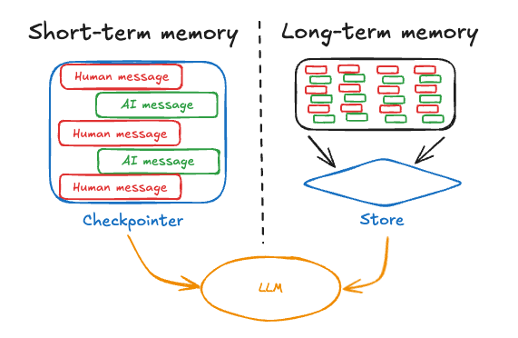
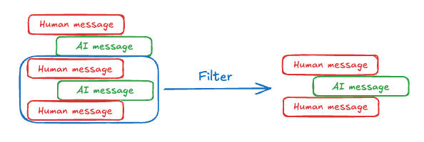
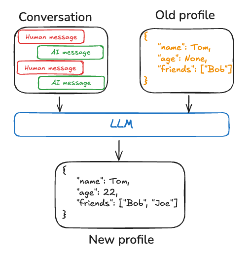
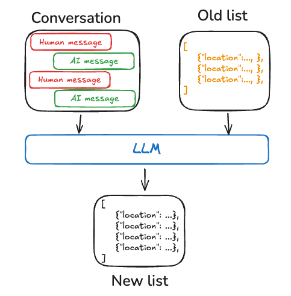
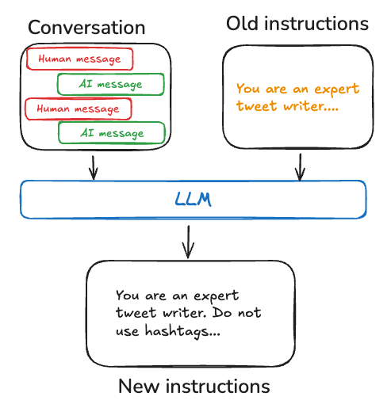
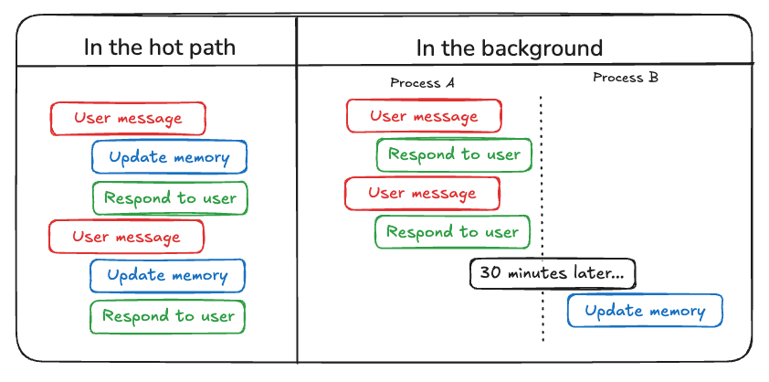

[记忆](/langchain/oss/langgraph/add-memory)是一个能够记住先前交互信息的系统。对于智能体而言，记忆至关重要，因为它能让智能体记住之前的交互、从反馈中学习并适应用户偏好。随着智能体处理更复杂的任务和大量用户交互，这种能力对于效率和用户满意度都变得不可或缺。

本概念指南涵盖了两种基于召回范围的记忆类型：

* [短期记忆](#短期记忆)，或[线程](/langchain/oss/langgraph/checkpointers#线程)范围记忆，通过在会话中维护消息历史来跟踪正在进行的对话。LangGraph将短期记忆作为智能体[状态](/langchain/oss/langgraph/graph-api#状态)的一部分进行管理。状态使用[检查点](/langchain/oss/langgraph/checkpointers#检查点)持久化到数据库中，以便随时可以恢复线程。当图被调用或步骤完成时，短期记忆会更新，并在每个步骤开始时读取状态。
* [长期记忆](#长期记忆)存储跨会话的用户特定或应用级数据，并在所有对话线程中共享。它可以随时在任何线程中被召回。记忆可以限定在任何自定义命名空间中，而不仅限于单个线程ID。LangGraph提供[存储](/langchain/oss/langgraph/stores)([参考文档](https://reference.langchain.com/python/langgraph.store/base/BaseStore))来让您保存和召回长期记忆。



## 短期记忆

[短期记忆](/langchain/oss/langgraph/add-memory#添加短期能力)让您的应用程序能够记住单个[线程](/langchain/oss/langgraph/checkpointers#线程)或对话中的先前交互。一个[线程](/langchain/oss/langgraph/checkpointers#线程)将会话中的多个交互组织起来，类似于电子邮件将消息组织在单个对话中的方式。

LangGraph将短期记忆作为智能体状态的一部分进行管理，通过线程范围的检查点进行持久化。此状态通常包括对话历史以及其他有状态数据，例如上传的文件、检索的文档或生成的工件。通过将它们存储在图中状态中，机器人可以在保持不同线程之间隔离的同时访问给定对话的完整上下文。

### 管理短期记忆

对话历史是最常见的短期记忆形式，而长对话对当今的LLM来说是一个挑战。完整的历史可能无法适应LLM的上下文窗口，导致不可恢复的错误。即使您的LLM支持完整上下文长度，大多数LLM在长上下文中仍然表现不佳。它们会被陈旧或离题的内容“分心”，同时遭受响应时间变慢和成本更高的困扰。

对话模型使用消息接受上下文，其中包含开发者提供的指令（系统消息）和用户输入（人类消息）。在对话应用程序中，消息在人类输入和模型响应之间交替，导致消息列表随着时间的推移而变长。由于上下文窗口有限，而富含Token的消息列表可能成本高昂，因此许多应用程序可以从手动删除或忘记陈旧信息的技术中受益。



有关管理消息的常见技术的更多信息，请参阅[添加和管理记忆](/langchain/oss/langgraph/add-memory#管理短期记忆)指南。

## 长期记忆

LangGraph中的[长期记忆](/langchain/oss/langgraph/add-memory#添加长期记忆)允许系统在不同对话或会话中保留信息。与短期记忆（**线程范围**）不同，长期记忆保存在自定义“命名空间”中。

长期记忆是一个复杂的挑战，没有一刀切的解决方案。然而，以下问题提供了一个框架，帮助您导航不同的技术：

* 记忆的类型是什么？人类使用记忆来记住事实（[语义记忆](#语义记忆)）、经历（[情景记忆](#情景记忆)）和规则（[程序记忆](#程序记忆)）。智能体可以使用记忆的方式相同。例如，智能体可以使用记忆来记住有关用户的特定事实以完成任务。
* [您希望在何时更新记忆?](#编写记忆) 记忆可以作为智能体应用逻辑的一部分更新（例如，“在热点路径上”）。在这种情况下，智能体通常在响应用户之前决定记住事实。或者，记忆可以作为后台任务更新（在后台/异步运行并生成记忆）。我们在[下一段落](#编写记忆)中解释了这两种方法之间的权衡。

不同的应用程序需要不同类型的记忆。尽管类比并不完美，但研究[人类记忆类型](https://www.psychologytoday.com/us/basics/memory/types-of-memory?ref=blog.langchain.dev)可以提供有价值的见解。一些研究（例如，[CoALA论文](https://arxiv.org/pdf/2309.02427)）甚至已经将这些人类记忆类型映射到智能体使用的记忆类型。

| 记忆类型 | 存储的内容 | 人类示例 | 智能体示例 |
|-------------|----------------|---------------|---------------|
| [语义](#语义记忆) | 事实 | 我在学校学到的东西 | 有关用户的事实 |
| [情景](#情景记忆) | 经历 | 我做过的事情 | 过去的智能体操作 |
| [程序](#程序记忆) | 指令 | 本能或运动技能 | 智能体系统提示 |

### 语义记忆

人类和智能体中的[语义记忆](https://en.wikipedia.org/wiki/Semantic_memory)涉及特定事实和概念的保留。在人类中，它可以包括在学校学到的信息以及对概念及其关系的理解。对于智能体而言，语义记忆通常用于通过记住过去交互中的事实或概念来个性化应用程序。

<Note>
语义记忆与“语义搜索”不同，后者是一种使用“含义”（通常作为嵌入）来查找相似内容的技巧。语义记忆是心理学中的一个术语，指的是存储事实和知识，而语义搜索是一种基于含义而不是精确匹配来检索信息的方法。
</Note>

语义记忆可以以不同的方式管理：

#### 个人资料

记忆可以是一个连续更新的“个人资料”，包含关于用户、组织或其他实体（包括智能体本身）的特定且范围明确的信息。个人资料通常只是一个包含您选择的表示您领域的各种键值对的JSON文档。

在记忆一个档案时，你需要确保每次都在**更新**该档案。因此，你需要传入之前的档案并[让模型生成新的档案](https://github.com/langchain-ai/memory-template)（或一些[JSON 补丁](https://github.com/hinthornw/trustcall)应用于旧档案）。随着档案的增大，这可能会变得容易出错，并且可能受益于将档案拆分为多个文档或在生成文档时进行**严格**解码，以确保记忆模式保持有效。



#### 集合

或者，记忆可以是一组文档的集合，这些文档会随着时间的推移不断更新和扩展。每个单独的记忆可以更狭隘的范围，并且更容易生成，这意味着你不太可能随着时间的推移**丢失**信息。对于 LLM 来说，生成新对象以添加新信息比将新信息与现有档案进行协调更容易。因此，文档集合往往会带来[下游更高的召回率](https://en.wikipedia.org/wiki/Precision_and_recall)。

然而，这也将一些复杂性转移到了记忆更新上。模型现在必须删除或更新列表中的现有项目，这可能很棘手。此外，某些模型可能会默认过度插入，而其他模型可能会默认过度更新。请参阅[Trustcall](https://github.com/hinthornw/trustcall)包以了解管理这种方法的一种方式，并考虑使用[LangSmith](https://docs.langchain.com/langsmith/evaluation)等工具进行评估，以帮助你调整行为。

处理文档集合也将复杂性转移到了对列表的记忆**搜索**上。`Store`目前支持[语义搜索](https://reference.langchain.com/python/langgraph.store/base/SearchOp/query)和[按内容过滤](https://reference.langchain.com/python/langgraph.store/base/SearchOp/filter)。

最后，使用一组记忆可能会使向模型提供全面上下文变得具有挑战性。虽然单独的记忆可能遵循特定的模式，但这种结构可能无法捕获记忆的完整上下文或关系。因此，当使用这些记忆生成响应时，模型可能缺乏统一档案方法中更容易获得的上下文信息。



无论记忆管理方法如何，核心要点是智能体将使用语义记忆来[支撑其响应](/langchain/oss/deepagents/retrieval)，这通常会导致更个性化和相关的交互。

### 情景记忆

[情景记忆](https://en.wikipedia.org/wiki/Episodic_memory)，在人类和 AI 智能体中，都涉及回忆过去的事件或行动。[CoALA 论文](https://arxiv.org/pdf/2309.02427)很好地阐述了这一点：事实可以写入语义记忆，而*体验*可以写入情景记忆。对于 AI 智能体，情景记忆通常用于帮助智能体记住如何完成任务。

:::python
在实践中，情景记忆通常通过少样本示例提示实现，智能体通过过去序列学习来正确执行任务。有时“展示”比“说明”更容易，而 LLM 很好地从示例中学习。少样本学习让你通过用输入-输出示例更新提示来[“编程”](https://x.com/karpathy/status/1627366413840322562)你的 LLM，以说明预期行为。虽然可以使用各种最佳实践来生成少样本示例，但挑战通常在于根据用户输入选择最相关的示例。
:::

:::js
在实践中，情景记忆通常通过少样本示例提示实现，智能体通过过去序列学习来正确执行任务。有时“展示”比“说明”更容易，而 LLM 很好地从示例中学习。少样本学习让你通过用输入-输出示例更新提示来[“编程”](https://x.com/karpathy/status/1627366413840322562)你的 LLM，以说明预期行为。虽然可以使用各种最佳实践来生成少样本示例，但挑战通常在于根据用户输入选择最相关的示例。
:::

:::python
请注意，记忆[存储](/langchain/oss/langgraph/stores)只是存储少样本示例数据的一种方式。如果你希望有更多的开发者参与，或者将少样本更紧密地与你的评估框架关联，你也可以使用[LangSmith 数据集](https://docs.langchain.com/langsmith/manage-datasets)来存储你的数据，并实现你自己的检索逻辑，根据用户输入选择最相关的示例。

查看这篇[博客文章](https://blog.langchain.dev/few-shot-prompting-to-improve-tool-calling-performance/)，展示如何使用少样本提示来提高工具调用性能，以及这篇[博客文章](https://blog.langchain.dev/aligning-llm-as-a-judge-with-human-preferences/)，使用少样本示例将 LLM 与人类偏好保持一致。
:::

:::js
请注意，记忆[存储](/langchain/oss/langgraph/stores)只是存储少样本示例数据的一种方式。如果你希望有更多的开发者参与，或者将少样本更紧密地与你的评估框架关联，你也可以使用 LangSmith 数据集来存储你的数据，并实现你自己的检索逻辑，根据用户输入选择最相关的示例。

查看这篇[博客文章](https://blog.langchain.dev/few-shot-prompting-to-improve-tool-calling-performance/)，展示如何使用少样本提示来提高工具调用性能，以及这篇[博客文章](https://blog.langchain.dev/aligning-llm-as-a-judge-with-human-preferences/)，使用少样本示例将 LLM 与人类偏好保持一致。
:::

### 程序记忆

[程序记忆](https://en.wikipedia.org/wiki/Procedural_memory)，在人类和 AI 智能体中，都涉及记住执行任务所使用的规则。在人类中，程序记忆就像执行任务的内部知识，例如通过基本运动技能和平衡感骑自行车。另一方面，情景记忆涉及回忆特定的体验，例如第一次没有训练轮成功骑自行车或一次难忘的风景路线骑行。对于 AI 智能体，程序记忆是模型权重、智能体代码和智能体提示的组合，这些共同决定了智能体的功能。

在实践中，智能体修改其模型权重或重写其代码的情况相对不常见。然而，智能体修改自己的提示则更为常见。

一种改进智能体指令的有效方法是使用["反思"](https://blog.langchain.dev/reflection-agents/)或元提示词。这涉及向智能体提供其当前指令（例如系统提示词）以及最近的对话或明确用户反馈。智能体根据这些输入来优化自身的指令。这种方法特别适用于指令难以预先指定的任务，因为它允许智能体从其交互中学习和适应。

例如，我们使用外部反馈和提示词重写构建了一个[Tweet生成器](https://www.youtube.com/watch?v=Vn8A3BxfplE)，用于为Twitter生成高质量的论文摘要。在这种情况下，具体的摘要提示词难以预先指定，但用户可以批评生成的推文并提供关于如何改进摘要过程的反馈。

下面的伪代码展示了如何使用LangGraph记忆[store](/langchain/oss/langgraph/stores)实现这种方法，使用store保存提示词，使用`update_instructions`节点获取当前提示词（以及`state["messages"]`中捕获的用户对话反馈），更新提示词，并将新提示词保存回store。然后，`call_model`从store获取更新后的提示词并使用它来生成响应。

:::python
```python
# Node that *uses* the instructions
def call_model(state: State, store: BaseStore):
    namespace = ("agent_instructions", )
    instructions = store.get(namespace, key="agent_a")[0]
    # Application logic
    prompt = prompt_template.format(instructions=instructions.value["instructions"])
    ...

# Node that updates instructions
def update_instructions(state: State, store: BaseStore):
    namespace = ("instructions",)
    instructions = store.search(namespace)[0]
    # Memory logic
    prompt = prompt_template.format(instructions=instructions.value["instructions"], conversation=state["messages"])
    output = llm.invoke(prompt)
    new_instructions = output['new_instructions']
    store.put(("agent_instructions",), "agent_a", {"instructions": new_instructions})
    ...
```
:::

:::js
```typescript
// Node that *uses* the instructions
const callModel = async (state: State, store: BaseStore) => {
    const namespace = ["agent_instructions"];
    const instructions = await store.get(namespace, "agent_a");
    // Application logic
    const prompt = promptTemplate.format({
        instructions: instructions[0].value.instructions
    });
    // ...
};

// Node that updates instructions
const updateInstructions = async (state: State, store: BaseStore) => {
    const namespace = ["instructions"];
    const currentInstructions = await store.search(namespace);
    // Memory logic
    const prompt = promptTemplate.format({
        instructions: currentInstructions[0].value.instructions,
        conversation: state.messages
    });
    const output = await llm.invoke(prompt);
    const newInstructions = output.new_instructions;
    await store.put(["agent_instructions"], "agent_a", {
        instructions: newInstructions
    });
    // ...
};
```
:::



### 编写记忆

智能体编写记忆主要有两种方法：["在热路径中"](#在热路径中)和["在后台"](#在后台)。



#### 在热路径中

在运行时创建记忆既带来优势也带来挑战。从积极方面来看，这种方法允许实时更新，使新记忆可以立即用于后续交互。它还支持透明性，因为用户可以在记忆创建和存储时收到通知。

然而，这种方法也存在挑战。如果智能体需要新工具来决定要提交到记忆中的内容，可能会增加复杂性。此外，推理要保存到记忆中的内容的过程会影响智能体延迟。最后，智能体必须在记忆创建和其他职责之间多任务处理，这可能会影响创建的记忆的数量和质量。

例如，ChatGPT使用[save_memories](https://openai.com/index/memory-and-new-controls-for-chatgpt/)工具将记忆作为内容字符串进行Upsert，并决定如何使用该工具与每个用户消息。参考我们的[memory-agent](https://github.com/langchain-ai/memory-agent)模板。

#### 在后台

将记忆创建为单独的后台任务提供了几个优势。它消除了主要应用程序中的延迟，将应用程序逻辑与记忆管理分离，并允许智能体更专注于任务完成。这种方法还提供了在避免重复工作的情况下创建记忆的时间灵活性。

然而，这种方法也有其挑战。确定记忆写入的频率至关重要，因为不频繁的更新可能会使其他线程缺乏新上下文。决定何时触发记忆形成也很重要。常见的策略包括在设定的时间段后调度（如果有新事件发生则重新调度）、使用cron计划或允许用户或应用程序逻辑手动触发。

参考我们的[memory-service](https://github.com/langchain-ai/memory-template)模板。

### 记忆存储

LangGraph将长期记忆作为JSON文档存储在[store](/langchain/oss/langgraph/stores)中。每个记忆都组织在自定义的`namespace`（类似于文件夹）和唯一的`key`（类似于文件名）下。命名空间通常包含用户或组织ID或其他标签，使信息组织更方便。这种结构支持记忆的分层组织。通过内容过滤器支持跨命名空间搜索。

:::python
```python
from langgraph.store.memory import InMemoryStore


def embed(texts: list[str]) -> list[list[float]]:
    # Replace with an actual embedding function or LangChain embeddings object
    return [[1.0, 2.0] * len(texts)]


# InMemoryStore saves data to an in-memory dictionary. Use a DB-backed store in production use.
store = InMemoryStore(index={"embed": embed, "dims": 2})
user_id = "my-user"
application_context = "chitchat"
namespace = (user_id, application_context)
store.put(
    namespace,
    "a-memory",
    {
        "rules": [
            "User likes short, direct language",
            "User only speaks English & python",
        ],
        "my-key": "my-value",
    },
)
# get the "memory" by ID
item = store.get(namespace, "a-memory")
# search for "memories" within this namespace, filtering on content equivalence, sorted by vector similarity
items = store.search(
    namespace, filter={"my-key": "my-value"}, query="language preferences"
)
```
:::

:::js
```typescript
import { InMemoryStore } from "@langchain/langgraph";

const embed = (texts: string[]): number[][] => {
    // Replace with an actual embedding function or LangChain embeddings object
    return texts.map(() => [1.0, 2.0]);
};

// InMemoryStore saves data to an in-memory dictionary. Use a DB-backed store in production use.
const store = new InMemoryStore({ index: { embed, dims: 2 } });
const userId = "my-user";
const applicationContext = "chitchat";
const namespace = [userId, applicationContext];

await store.put(
    namespace,
    "a-memory",
    {
        rules: [
            "User likes short, direct language",
            "User only speaks English & TypeScript",
        ],
        "my-key": "my-value",
    }
);

// get the "memory" by ID
const item = await store.get(namespace, "a-memory");

// search for "memories" within this namespace, filtering on content equivalence, sorted by vector similarity
const items = await store.search(
    namespace,
    {
        filter: { "my-key": "my-value" },
        query: "language preferences"
    }
);
```
:::

有关记忆存储的更多信息，请参阅[Persistence](/langchain/oss/langgraph/stores)指南。

## 了解更多

- [上下文概念概述](/langchain/oss/concepts/context)
- [LangChain中的短期记忆](/langchain/oss/langchain/short-term-memory)
- [LangGraph中的记忆](/langchain/oss/langgraph/add-memory)

---

> 官方原文：[src/oss/concepts/memory.mdx](https://github.com/langchain-ai/docs/blob/main/src/oss/concepts/memory.mdx) · 译文由 AI 生成，以英文原文为准。
