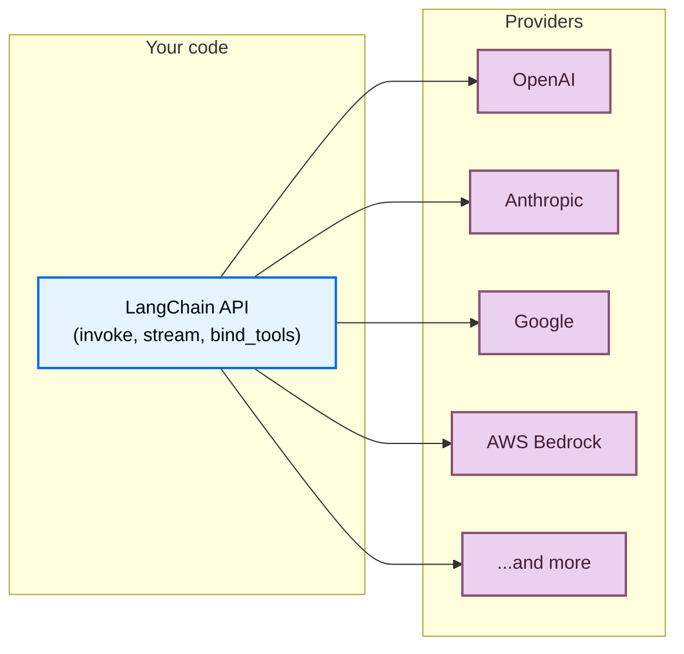

LangChain 为您提供了一个统一的 API 来使用来自任何提供商的模型。安装一个提供商包，选择一个模型名称，然后开始构建——无论您使用 OpenAI、Anthropic、Google 还是其他任何受支持的提供商，相同的代码都能正常工作。



## 任何模型的单一 API

无论提供商如何，每个 LangChain 对话模型都实现了相同的接口。这意味着您可以：

- **无需重写应用程序逻辑即可切换提供商**
- **使用相同的代码并排比较模型**
- **跨所有提供商使用高级功能**，如 [工具调用](/langchain/oss/langchain/tools)、[结构化输出](/langchain/oss/langchain/structured-output) 和 [流式输出](/langchain/oss/langchain/streaming)

:::python
```python
from langchain.chat_models import init_chat_model

openai_model = init_chat_model("openai:gpt-5.5")
anthropic_model = init_chat_model("anthropic:claude-opus-4-8")
google_model = init_chat_model("google-genai:gemini-3.1-pro-preview")

for model in [openai_model, anthropic_model, google_model]:
    response = model.invoke("Explain quantum computing in one sentence.")
    print(response.text)
```
:::

:::js
```typescript
import { initChatModel } from "langchain/chat_models/universal";

const openaiModel = await initChatModel("openai:gpt-5.5");
const anthropicModel = await initChatModel("anthropic:claude-opus-4-8");
const googleModel = await initChatModel("google:gemini-3.1-pro-preview");

for (const model of [openaiModel, anthropicModel, googleModel]) {
    const response = await model.invoke("Explain quantum computing in one sentence.");
    console.log(response.text);
}
```
:::

## 什么是提供商？

**提供商** 是托管 AI 模型并通过 API 暴露它们的公司或平台。例如 OpenAI、Anthropic、Google 和 AWS Bedrock。

在 LangChain 中，每个提供商都有一个专门的 **集成包**（例如 `langchain-openai`、`langchain-anthropic`），该包实现了该提供商模型的 LangChain 标准接口。这意味着：

- **每个提供商都有专门的包**，具有正确的版本控制和依赖管理
- **当您需要时，可以使用提供商特定的功能**（例如 OpenAI 的响应 API、Anthropic 的扩展推理）
- **通过环境变量自动处理 API 密钥**

:::python
```shell
uv add langchain-openai       # For OpenAI models
uv add langchain-anthropic    # For Anthropic models
uv add langchain-google-genai # For Google models
```
:::

:::js
```bash
npm install @langchain/openai       # For OpenAI models
npm install @langchain/anthropic    # For Anthropic models
npm install @langchain/google       # For Google models
```
:::

有关所有提供商包的完整列表，请参阅 [集成页面](/langchain/oss/python/integrations/providers/overview)。

## 查找模型名称

每个提供商支持特定的模型名称，您在初始化对话模型时传递这些名称。指定模型有两种方法：

:::python
<CodeGroup>
    ```python Provider prefix format
    from langchain.chat_models import init_chat_model

    model = init_chat_model("openai:gpt-5.5")
    ```

    ```python Direct class instantiation
    from langchain_openai import ChatOpenAI

    model = ChatOpenAI(model="gpt-5.5")
    ```
</CodeGroup>
:::

:::js
    <CodeGroup>
    ```typescript Provider prefix format
    import { initChatModel } from "langchain/chat_models/universal";

    const model = await initChatModel("openai:gpt-5.5");
    ```

    ```typescript Direct class instantiation
    import { ChatOpenAI } from "@langchain/openai";

    const model = new ChatOpenAI({ model: "gpt-5.5" });
    ```
    </CodeGroup>
:::

当使用 @[`init_chat_model`] 与 `provider:model` 格式时，LangChain 会自动解析提供商并加载正确的集成包。如果模型名称是明确的，也可以省略提供商前缀（例如 `"gpt-5.5"` 解析为 OpenAI）。

要查找提供商的可用模型名称，请参阅提供商自己的文档。以下是一些流行的提供商：

| 提供商 | 查找模型名称的位置 |
| :--- | :--- |
| [OpenAI](/langchain/oss/python/integrations/providers/openai) | [OpenAI 模型页面](https://platform.openai.com/docs/models) |
| [Anthropic](/langchain/oss/python/integrations/providers/anthropic) | [Anthropic 模型页面](https://docs.anthropic.com/en/docs/about-claude/models) |
| [Google](/langchain/oss/python/integrations/providers/google) | [Google AI 模型页面](https://ai.google.dev/gemini-api/docs/models) |
| [AWS Bedrock](/langchain/oss/python/integrations/providers/aws) | [Bedrock 支持的模型](https://docs.aws.amazon.com/bedrock/latest/userguide/models-supported.html) |
:::python
| [Ollama](/langchain/oss/python/integrations/providers/ollama) | [Ollama 模型库](https://ollama.com/library) |
| [Groq](/langchain/oss/python/integrations/providers/groq) | [Groq 支持的模型](https://console.groq.com/docs/models) |
:::

## 立即使用新模型

由于 LangChain 提供商包直接将模型名称传递给提供商的 API，因此当提供商发布新模型时，您可以立即使用它们（无需 LangChain 更新）。只需传递新的模型名称：

:::python
```python
model = init_chat_model("google_genai:gemini-mythos")
```
:::

:::js
```typescript
const model = await initChatModel("google:gemini-mythos");
```
:::

只要您的提供商包版本支持模型所需的 API 版本，新模型名称就会立即生效。在大多数情况下，模型发布是向后兼容的，无需更新包。

## 模型功能

不同的提供商和模型支持不同的功能。
要查看聊天模型集成及其功能列表，请参阅 [聊天模型集成页面](/langchain/oss/python/integrations/chat)。

## 路由器和代理

**路由器**（也称为代理或网关）通过单个 API 和凭证提供对来自多个提供商的模型的访问。它们可以简化计费，让您在不更改集成的情况下切换模型，并提供自动回退和负载均衡等功能。

| 提供商 | 集成 | 描述 |
| :------- | :---------- | :---------- |
| [OpenRouter](https://openrouter.ai/) | [`ChatOpenRouter`](/langchain/oss/python/integrations/chat/openrouter) | 统一访问 OpenAI、Anthropic、Google、Meta 等模型的接口 |
:::python
| [LiteLLM](https://www.litellm.ai/) | [`ChatLiteLLM`](/langchain/oss/python/integrations/chat/litellm) | 统一接口，支持 100+ 提供商，具有路由、回退和支出跟踪功能 |
:::

当您需要时，路由器很有用：

- **使用单个 API 密钥和计费账户访问许多提供商**
- **动态切换模型**，而无需管理多个提供商凭证
- **使用回退模型**，如果主要模型失败，则自动重试不同的模型

:::python
```python
from langchain.chat_models import init_chat_model

model = init_chat_model("openrouter:anthropic/claude-sonnet-4-6")
response = model.invoke("Hello!")
```
:::

:::js
```typescript
import { initChatModel } from "langchain/chat_models/universal";

const model = await initChatModel("openrouter:anthropic/claude-sonnet-4-6");
const response = await model.invoke("Hello!");
```
:::

## OpenAI 兼容端点

许多提供商提供与 OpenAI 的 [聊天完成 API](https://platform.openai.com/docs/api-reference/chat) 兼容的端点。您可以使用 [`ChatOpenAI`](/langchain/oss/python/integrations/chat/openai) 并使用自定义 `base_url` 连接到这些端点：

:::python
```python
from langchain_openai import ChatOpenAI

model = ChatOpenAI(
    base_url="https://your-provider.com/v1",
    api_key="your-api-key",
    model="provider-model-name",
)
```
:::

:::js
```typescript
import { ChatOpenAI } from "@langchain/openai";

const model = new ChatOpenAI({
    configuration: { baseURL: "https://your-provider.com/v1" },
    apiKey: "your-api-key",
    model: "provider-model-name",
});
```
:::

<Warning>
    `ChatOpenAI` 仅针对 [官方 OpenAI API 规范](https://github.com/openai/openai-openapi)。来自第三方提供商的非标准响应字段不会被提取或保留。当您需要访问非标准功能时，请使用专门的提供商包或路由器。
</Warning>

## 下一步

<CardGroup cols={2}>
    <Card title="Models guide" icon="cpu" href="/langchain/oss/langchain/models">
        学习如何使用模型：调用、流式输出、批量处理、工具调用等。
    </Card>
    <Card title="Chat model integrations" icon="message" href="/langchain/oss/python/integrations/chat">
        浏览所有聊天模型集成及其功能。
    </Card>
    <Card title="All providers" icon="grid-dots" href="/langchain/oss/python/integrations/providers/overview">
        查看所有提供商包和集成的完整列表。
    </Card>
    <Card title="Agents" icon="robot" href="/langchain/oss/langchain/agents">
        构建使用模型作为推理引擎的智能体。
    </Card>
</CardGroup>

---

> 官方原文：[src/oss/concepts/providers-and-models.mdx](https://github.com/langchain-ai/docs/blob/main/src/oss/concepts/providers-and-models.mdx) · 非官方翻译，译文由 AI 生成，以英文原文为准。
