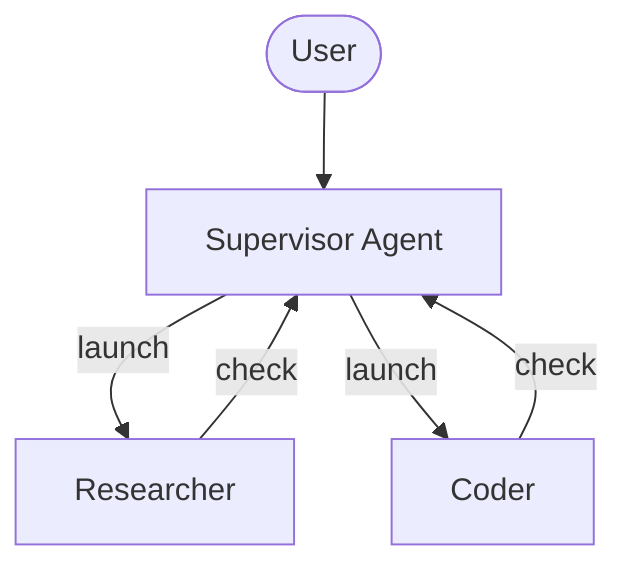
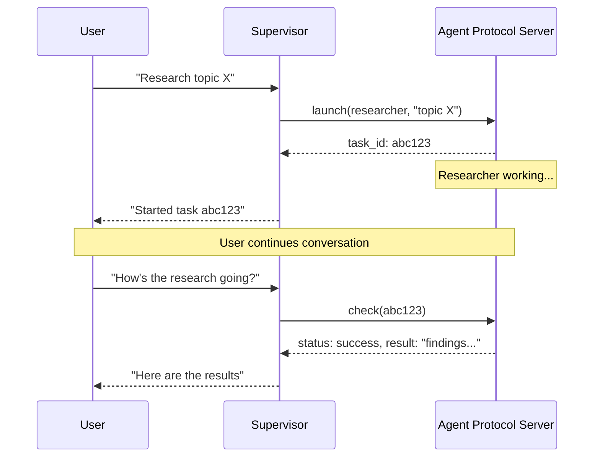

import AsyncSubagentsConfigurePy from '/langchain/snippets/code-samples/async-subagents-configure-py.mdx';
import AsyncSubagentsConfigureJs from '/langchain/snippets/code-samples/async-subagents-configure-js.mdx';
import AsyncSubagentsHttpTransportPy from '/langchain/snippets/code-samples/async-subagents-http-transport-py.mdx';
import AsyncSubagentsHybridPy from '/langchain/snippets/code-samples/async-subagents-hybrid-py.mdx';
import AsyncSubagentsHybridJs from '/langchain/snippets/code-samples/async-subagents-hybrid-js.mdx';
import AsyncSubagentsDescriptionsGoodPy from '/langchain/snippets/code-samples/async-subagents-descriptions-good-py.mdx';
import AsyncSubagentsDescriptionsBadPy from '/langchain/snippets/code-samples/async-subagents-descriptions-bad-py.mdx';
import AsyncSubagentsDescriptionsJs from '/langchain/snippets/code-samples/async-subagents-descriptions-js.mdx';
import AsyncSubagentsTroubleshootingPollingPy from '/langchain/snippets/code-samples/async-subagents-troubleshooting-polling-py.mdx';
import AsyncSubagentsTroubleshootingPollingJs from '/langchain/snippets/code-samples/async-subagents-troubleshooting-polling-js.mdx';
import AsyncSubagentsNotificationsPy from '/langchain/snippets/code-samples/async-subagents-notifications-py.mdx';
import AsyncSubagentsAnswerWaitingPy from '/langchain/snippets/code-samples/async-subagents-answer-waiting-py.mdx';
import AsyncSubagentsParentThreadPy from '/langchain/snippets/code-samples/async-subagents-parent-thread-py.mdx';
import AsyncSubagentsNotificationsJs from '/langchain/snippets/code-samples/async-subagents-notifications-js.mdx';
import AsyncSubagentsAnswerWaitingJs from '/langchain/snippets/code-samples/async-subagents-answer-waiting-js.mdx';
import AsyncSubagentsParentThreadJs from '/langchain/snippets/code-samples/async-subagents-parent-thread-js.mdx';
import AsyncSubagentsDeliverResultsPy from '/langchain/snippets/code-samples/async-subagents-deliver-results-py.mdx';
import AsyncSubagentsDeliverResultsJs from '/langchain/snippets/code-samples/async-subagents-deliver-results-js.mdx';

异步子智能体允许监督智能体启动后台任务并立即返回，这样监督智能体可以在子智能体并发工作的同时继续与用户交互。监督智能体可以在任何时候检查进度、发送后续指令或取消任务。

这建立在 [子智能体](/langchain/oss/deepagents/subagents) 的基础上，后者同步运行并阻塞监督智能体直到完成。当任务为长时运行、可并行化或需要在飞行中调整时，使用异步子智能体。

在智能体服务器上，监督智能体也会学习任务何时完成、失败或需要输入，因此它不必检查。



<Note>
异步子智能体与实现 [智能体协议](https://github.com/langchain-ai/agent-protocol) 的任何服务器通信。您可以使用 [LangSmith 部署](https://docs.langchain.com/langsmith/deployment)，或自托管任何兼容智能体协议的服务器。每个子智能体独立于监督智能体运行，监督智能体通过 SDK 控制它们以启动、检查、更新和取消。

</Note>

## 何时使用异步子智能体

| 维度            | 同步子智能体                                                  | 异步子智能体                                                   |
|----------------------|-----------------------------------------------------------------|-------------------------------------------------------------------|
| **执行模型**  | 监督智能体阻塞直到子智能体完成                      | 立即返回作业 ID；监督智能体继续                  |
| **并发性**      | 并行但阻塞                                           | 并行且非阻塞                                         |
| **任务中更新** | 不可能                                                    | 通过 `update_async_task` 发送后续指令           |
| **取消**     | 不可能                                                    | 通过 `cancel_async_task` 取消运行任务                  |
| **状态持续性**     | 无状态 -- 调用之间没有持久状态            | 有状态 -- 在自己的线程上跨交互维护状态 |
| **适用场景**         | 智能体应在继续之前等待结果的任务                  | 长时运行、复杂的管理交互式聊天的任务       |

## 配置异步子智能体

将异步子智能体定义为指向智能体协议服务器的 @[`AsyncSubAgent` 规格列表：

:::python
<AsyncSubagentsConfigurePy />

| 字段 | 类型 | 描述 |
|-------|------|-------------|
| `name` | `str` | 必填。唯一标识符。监督智能体在启动任务时使用此字段。 |
| `description` | `str` | 必填。此子智能体执行的操作。监督智能体使用此字段来决定将哪个智能体委托出去。 |
| `graph_id` | `str` | 必填。智能体协议服务器上的图 ID（或助手 ID）。对于基于 LangGraph 的部署，此字段必须与 `langgraph.json` 中注册的图匹配。 |
| `url` | `str` | 可选。如果省略，则使用 ASGI 传输（进程内）。如果设置，则使用 HTTP 传输到远程智能体协议服务器。 |
| `headers` | `dict[str, str]` | 可选。用于远程服务器请求的自定义认证的附加标头。用于自托管的智能体协议服务器。 |
| `mode` | `"isolated" \| "fork"` | 可选。控制子智能体在启动时接收的对话上下文。默认为 `"isolated"`。参见 [选择启动模式](#选择启动模式)。 |
| `update_strategy` | `"interrupt" \| "enqueue"` | 可选。如何在运行活动时 `update_async_task` 发送后续指令。默认为 `"interrupt"`。参见 [理解生命周期](#理解生命周期)。 |
| `webhook` | `str` | 可选。当此子智能体的运行完成时，智能体服务器调用的 URL。参见 [通过您的应用程序交付结果](#通过您的应用程序传递结果)。 |
| `notify_parent` | `bool` | 可选。当监督智能体空闲时，子智能体完成时是否可以唤醒监督智能体。默认为 `True`。 |
:::

:::js
<AsyncSubagentsConfigureJs />

| 字段 | 类型 | 描述 |
|-------|------|-------------|
| `name` | `string` | 必填。唯一标识符。监督者（supervisor）在启动任务时使用此标识符。 |
| `description` | `string` | 必填。此智能体（subagent）的功能。监督者（supervisor）使用此信息决定委托给哪个智能体（agent）。 |
| `graphId` | `string` | 必填。Agent 协议服务器上的图 ID（graph ID）或助手 ID（assistant ID）。对于基于 LangGraph 的部署，此 ID 必须与 `langgraph.json` 中注册的图匹配。 |
| `url` | `string` | 可选。省略时，与相同的 Agent 服务器部署通信（服务器为运行中的图提供的地址）。设置 `url` 以连接远程服务器，或当您的 Agent 服务器尚未提供该地址时。参见 [选择传输方式](#选择传输方式)。 |
| `headers` | `Record<string, string>` | 可选。远程服务器请求的附加标头。用于与自托管 Agent 协议服务器进行自定义认证。 |
| `mode` | `"isolated" \| "fork"` | 可选。控制智能体（subagent）在启动时接收的对话上下文。默认值为 `"isolated"`。参见 [选择启动模式](#选择启动模式)。 |
| `updateStrategy` | `"interrupt" \| "enqueue"` | 可选。`update_async_task` 在运行活动时如何发送后续指令。默认值为 `"interrupt"`。参见 [理解生命周期](#理解生命周期)。 |
| `webhook` | `string` | 可选。Agent 服务器在智能体（subagent）的运行结束时调用的 URL。参见 [通过您的应用程序交付结果](#通过您的应用程序传递结果)。 |
| `notifyParent` | `boolean` | 可选。当监督者（supervisor）空闲时，智能体（subagent）完成时是否可以唤醒监督者。默认值为 `true`。 |
:::

对于基于 LangGraph 的部署，在相同的 `langgraph.json` 中注册所有图，用于协同部署：

```json
{
  "graphs": {
    "supervisor": "./src/supervisor.py:graph",
    "researcher": "./src/researcher.py:graph",
    "coder": "./src/coder.py:graph"
  }
}
```

## 使用异步智能体工具

当配置异步智能体时，[Deep Agents 堆栈](/langchain/oss/deepagents/customization#deep-agents-堆栈) 中包含的 @[`AsyncSubAgentMiddleware`] 为监督者（supervisor）提供五个工具：

| 工具 | 目的 | 返回值 |
|------|---------|---------|
| `start_async_task` | 启动新的后台任务 | 任务 ID（立即） |
| `check_async_task` | 获取任务当前状态和结果 | 状态 + 结果（如果已完成） |
| `update_async_task` | 向正在运行的任务发送新指令 | 确认 + 更新状态 |
| `cancel_async_task` | 停止正在运行的任务 | 确认 |
| `list_async_tasks` | 列出所有具有实时状态的已跟踪任务 | 所有任务的摘要 |

监督者的 LLM 像调用任何其他工具一样调用这些工具。中间件自动处理线程创建、运行管理和状态持久化。

### 理解生命周期

典型的交互遵循以下顺序：



- **启动** 在服务器上创建新线程并开始运行，输入由 [启动模式](#选择启动模式) 确定。隔离模式仅发送任务描述；分叉模式还会发送父智能体的有效对话历史。线程 ID 作为任务 ID 返回。监督者向用户报告此 ID 并不轮询完成状态。
- **检查** 获取当前运行状态。如果运行成功，它检索线程状态以提取子智能体的最终输出。如果仍在运行，它向用户报告运行状态。
- **更新** 在同一线程上创建新运行。默认情况下它会中断先前运行，子智能体使用完整的对话历史和新指令重新启动。任务 ID 保持不变。
- **取消** 调用 `runs.cancel()` 并将任务标记为 `"cancelled"`。
- **列出** 遍历所有跟踪的任务。对于非终端任务，它并行从服务器获取实时状态。终端状态（`success`、`error`、`cancelled`）从缓存返回。

:::python
要让后续任务等待，设置 `update_strategy="enqueue"`。**更新** 然后在当前任务后排队新运行，任务在启动前保持 `pending` 状态。取消任务也会取消仍在活动的先前运行。
如果当前运行在后续任务开始前因输入或审批而暂停，后续任务仍会启动，该请求将被丢弃。

<Note>
`update_strategy` 需要 `deepagents>=0.7.30`。它处于 [**beta**](/langchain/oss/versioning) 状态；API 和行为可能在版本之间发生变化。
</Note>
:::

:::js
要让后续任务等待，设置 `updateStrategy: "enqueue"`。**更新** 然后在当前任务后排队新运行，任务在启动前保持 `pending` 状态。取消任务也会取消仍在活动的先前运行。
如果当前运行在后续任务开始前因输入或审批而暂停，后续任务仍会启动，该请求将被丢弃。

<Note>
`updateStrategy` 需要 `deepagents>=1.16.0`。它处于 [**beta**](/langchain/oss/versioning) 状态；API 和行为可能在版本之间发生变化。
</Note>
:::

如果子智能体因输入或审批而暂停，**检查** 和 **列出** 会将其报告为 `waiting`。更新 `waiting` 任务会丢弃其挂起请求，取消一个任务仅将其标记为 `"cancelled"`，因为它没有活动的运行。参见 [处理等待输入的子智能体](#处理等待输入的子智能体)。

在 [智能体协议](https://github.com/langchain-ai/agent-protocol) 服务器上运行时，子智能体在完成时会自动更新监督者。如果使用 [单部署](#单一部署) 为监督者和子智能体，子智能体会在监督者空闲时唤醒它；否则它会在下一次运行开始时接收更新。

<Note>
:::python
任务通知需要 `deepagents>=0.7.26`。它们处于 [**beta**](/langchain/oss/versioning) 状态；API 和行为可能在版本之间发生变化。
:::
:::js
任务通知需要 `deepagents>=1.16.0`。它们处于 [**beta**](/langchain/oss/versioning) 状态；API 和行为可能在版本之间发生变化。
:::
</Note>

:::python
通知作为 `HumanMessage` 返回给监督者。它们可以包含图像和其他多模态媒体。消息在 `additional_kwargs["deepagents_notification"]` 中携带 @[`TaskEvent`]（`task_id`、`agent_name`、`status`、`run_id`），因此您的应用可以与用户消息不同地显示通知：

<AsyncSubagentsNotificationsPy />
:::

:::js
通知以 `HumanMessage` 的形式返回给主管。它们可以包含图像和其他多模态媒体。消息在 `additional_kwargs.deepagents_notification` 中携带 `TaskEvent`（`task_id`、`agent_name`、`status`、`run_id`），因此您的应用程序可以与用户消息不同地显示通知：

<AsyncSubagentsNotificationsJs />
:::

### 通过您的应用程序传递结果

<Note>
:::python
`webhook` 和 `notify_parent` 需要 `deepagents>=0.7.30`。`notify_parent` 处于 [**beta**](/langchain/oss/versioning) 状态；API 和行为可能在版本之间发生变化。
:::
:::js
`webhook` 和 `notifyParent` 需要 `deepagents>=1.16.0`。`notifyParent` 处于 [**beta**](/langchain/oss/versioning) 状态；API 和行为可能在版本之间发生变化。
:::
</Note>

将 `webhook` 设置为当子智能体的运行结束时，智能体服务器会调用您的应用程序。调用包括运行的线程 ID、运行 ID、状态和元数据，包括 `parent_thread_id` 和 `subagent_name`。要改为通过您的应用程序传递结果而不是唤醒主管，请关闭父通知。在子智能体运行时，主管仍然会接收其更新。

:::python
<AsyncSubagentsDeliverResultsPy />
:::

:::js
<AsyncSubagentsDeliverResultsJs />
:::

## 处理等待输入的子智能体

<Note>
:::python
`waiting` 状态需要 `deepagents>=0.7.26`。它处于 [**beta**](/langchain/oss/versioning) 状态；API 和行为可能在版本之间发生变化。
:::
:::js
`waiting` 状态需要 `deepagents>=1.16.0`。它处于 [**beta**](/langchain/oss/versioning) 状态；API 和行为可能在版本之间发生变化。
:::
</Note>

当子智能体使用 `interrupt()` 或 [human-in-the-loop](/langchain/oss/deepagents/human-in-the-loop) 暂停等待输入或批准时，**check** 和 **list** 工具会将其报告为 `waiting` 并附带其挂起的中断。主管无法代表用户回答或批准。请求是针对用户的。

您的应用程序在子智能体自己的线程上回答它。任务 ID 是子智能体的线程 ID：

:::python
<AsyncSubagentsAnswerWaitingPy />
:::

:::js
<AsyncSubagentsAnswerWaitingJs />
:::

当子智能体在回答后完成时，主管会像往常一样收到通知。如果子智能体需要从主管而不是用户那里获取信息，请让它在其结果中询问。主管会以 `update_async_task` 回复。

## 理解状态管理

:::python
任务元数据存储在主管图的专用状态通道（`async_tasks`）中，与消息历史分开。这至关重要，因为深度智能体在上下文窗口填满时会 [压缩其消息历史](/langchain/oss/deepagents/context-engineering#摘要)。如果任务 ID 仅在工具消息中，它们会在压缩过程中丢失。专用通道确保主管可以通过 `list_async_tasks` 始终回忆其任务，即使在多次摘要之后。

每个跟踪的任务记录任务 ID、智能体名称、线程 ID、运行 ID、状态和时间戳（`created_at`、`last_checked_at`、`last_updated_at`）。

### 查找主管的子智能体线程

<Note>
    线程标记需要 `deepagents>=0.7.26`。它处于 [**beta**](/langchain/oss/versioning) 状态；API 和行为可能在版本之间发生变化。
</Note>

`start_async_task` 使用 `metadata={"parent_thread_id": ...}`（主管的线程 ID）为每个子智能体创建线程。使用它来查找主管的子智能体线程，或要在子智能体的图工厂中读取主管的线程：

<AsyncSubagentsParentThreadPy />

例如，子智能体可以通过使用 `parent_thread_id` 查找它来重用主管的 [线程范围沙盒](/langchain/oss/deepagents/sandboxes#线程作用域（默认）)。首先检查调用者是否有权访问该线程，因为任何有权访问该线程的人都可以编辑其元数据。

:::js
任务元数据存储在主管图上的专用状态通道（`asyncTasks`）中，与消息历史分开。这是至关重要的，因为当上下文窗口填满时，深度智能体会[压缩其消息历史](/langchain/oss/deepagents/context-engineering#摘要)。如果任务 ID 仅在工具消息中，它们会在压缩过程中丢失。专用通道确保主管可以通过 `list_async_tasks` 始终回忆其任务，即使在多次摘要之后。

每个跟踪的任务记录任务 ID、智能体名称、线程 ID、运行 ID、状态和时间戳（`createdAt`、`checkedAt`、`updatedAt`）。

### 查找主管的子智能体线程

<Note>
    线程标记需要 `deepagents>=1.16.0`。
</Note>

`start_async_task` 使用 `metadata: { parent_thread_id }`（主管的线程 ID）为每个子智能体线程创建线程。用它来查找主管的子智能体线程，或读取子智能体图工厂中的主管线程：

<AsyncSubagentsParentThreadJs />
:::

## 选择传输方式

:::python
### ASGI 传输（共部署）

当子智能体规范省略 `url` 字段时，LangGraph SDK 使用 ASGI 传输——SDK 调用通过进程内函数调用进行路由，而不是 HTTP。对于基于 LangGraph 的部署，这要求两个图都注册在同一个 `langgraph.json` 中。

ASGI 传输消除了网络延迟，且无需额外的认证配置。子智能体仍然作为单独的线程运行，拥有自己的状态。这是推荐的默认选项。
:::

:::js
### 同部署（省略 `url`）

当子智能体规范省略 `url` 字段时，LangGraph SDK 与运行此图的 Agent Server 通信，使用该服务器提供的地址。否则，SDK 默认为 `http://localhost:8123`。对于基于 LangGraph 的部署，在同一个 `langgraph.json` 中注册两个图。

已部署的 Agent Server 从版本 0.18.0 开始提供此地址（`langgraph dev` 已经这样做）。在早期版本中，将 `url` 设置为部署 URL。
:::

### HTTP 传输（远程）

添加 `url` 字段以切换到 HTTP 传输，其中 SDK 调用通过网络连接到远程 Agent Protocol 服务器：

:::python
<AsyncSubagentsHttpTransportPy />
:::

:::js
```typescript
{
  name: "researcher",
  description: "Research agent",
  graphId: "researcher",
  url: "https://my-research-deployment.langsmith.dev",
}
```
:::

对于 LangGraph 部署，认证由 LangGraph SDK 使用环境变量中的 `LANGSMITH_API_KEY`（或 `LANGGRAPH_API_KEY`）处理。自托管的 Agent Protocol 服务器可能使用不同的认证机制。

当子智能体需要独立扩展、不同的资源配置或由不同团队维护时，使用 HTTP 传输。

## 选择启动模式

每个 @[`AsyncSubAgent`] 规范上的 `mode` 字段控制任务启动时子智能体接收的对话上下文。

| 模式 | 行为 |
|------|----------|
| `"isolated"`（默认） | 仅发送委派的任务描述。子智能体以全新状态启动，不了解父智能体的对话历史。 |
| `"fork"` | 在启动时发送父智能体对话的快照，然后发送任务描述。子智能体可以在后台工作时使用该上下文。 |

`"isolated"` 是大多数任务的最佳选择。当子智能体需要已建立的上下文时使用 `"fork"`——例如，一个背景起草智能体，它应该使用对话中已设置的风格和声音来写作。

### 分叉模式

<Warning>
:::python
分叉模式是实验性的，可能在未来的版本中发生变化。
:::
:::js
分叉模式需要 `deepagents>=1.16.0`。它是实验性的，可能在未来的版本中发生变化。
:::
</Warning>

:::python

在任何 `AsyncSubAgent` 规范上设置 `mode="fork"`：

```python
async_subagents=[
    {
        "name": "drafter",
        "description": "Drafts documents based on the conversation context",
        "graph_id": "drafter",
        "mode": "fork",
    }
]
```

:::

:::js

在任何 `AsyncSubAgent` 规范上设置 `mode: "fork"`：

```typescript
const asyncSubagents: AsyncSubAgent[] = [
  {
    name: "drafter",
    description: "Drafts documents based on the conversation context",
    graphId: "drafter",
    mode: "fork",
  },
];
```

:::

启动时，`start_async_task` 向子智能体发送父智能体的有效对话历史记录的快照，然后发送任务描述。如果父智能体已经压缩了历史记录，则快照包含压缩后的上下文，而不是每个原始消息。父智能体稍后的消息不会被转发给子智能体。

子智能体在新的服务器线程上启动。分叉模式将对话消息作为运行输入发送；它不会复制父智能体的检查点历史记录或所有父状态。元数据可以将新线程与其主管关联起来，但这种关联本身不会传递对话上下文。

**提示词缓存重用。** 要在分叉的对话前缀上获得缓存命中，请将远程智能体配置与父智能体相同的模型、系统提示词、工具和提示词处理中间件。分叉模式复制对话历史记录；它不会同步这些设置。匹配的配置是必要的但不充分：渲染的前缀必须匹配，并且缓存命中取决于提供者。

:::js
**离线媒体。** 如果父智能体使用 `offloadBinaryContent` 离线媒体，分叉模式发送指向它的引用，而不是媒体本身。子智能体必须是深度智能体，共享父智能体的后端才能查看媒体；其他深度智能体会收到一条消息说明它不可用，其他图无法使用这些消息。
:::

## 选择部署拓扑

### 单一部署

:::python
单一部署意味着所有智能体都使用 ASGI 传输在同一服务器上协同部署。对于基于 LangGraph 的部署，将所有图注册在一个 `langgraph.json` 中。这是推荐的起点——一个服务器来管理，智能体之间零网络延迟。
:::

:::js
单一部署意味着所有智能体都使用 Agent Server 协同部署在同一服务器上。省略 `url`，以便每个图通过该服务器到达其他图。对于基于 LangGraph 的部署，将所有图注册在一个 `langgraph.json` 中。这是推荐的起点——一个服务器来管理。
:::

### 分离部署

主管在一个服务器上，子智能体通过 HTTP 传输在另一个服务器上。当子智能体需要不同的计算配置文件或独立扩展时使用。

### 混合

:::python
在混合部署中，一些子智能体通过 ASGI 协同部署，其他通过 HTTP 远程部署：

<AsyncSubagentsHybridPy />
:::

:::js
在混合部署中，一些子智能体省略 `url`（同一 Agent Server），其他设置 `url` 以指向远程服务器：

<AsyncSubagentsHybridJs />
:::

## 最佳实践

### 为本地开发调整工作线程池大小

当在本地使用 `langgraph dev` 运行时，增加工作池以适应并发子智能体运行。每个活动运行占用一个工作槽位。一个具有 3 个并发子智能体任务的监督者需要 4 个槽位（1 个监督者 + 3 个子智能体）。资源不足会导致启动排队。

```bash
langgraph dev --n-jobs-per-worker 10
```

### 编写清晰的子智能体描述

监督者使用描述来决定启动哪个子智能体。要具体且以行动为导向：

:::python
<CodeGroup>
    <AsyncSubagentsDescriptionsGoodPy />
    <AsyncSubagentsDescriptionsBadPy />
</CodeGroup>
:::

:::js
<AsyncSubagentsDescriptionsJs />
:::

### 使用线程 ID 进行跟踪

在使用基于 LangGraph 的部署时，每个异步子智能体运行都是标准的 LangGraph 运行，完全可见于 LangSmith。监督者的跟踪显示了 `launch`、`check`、`update`、`cancel` 和 `list` 的工具调用。每个子智能体运行都显示为单独的跟踪，通过线程 ID 链接。使用线程 ID（任务 ID）将监督者编排跟踪与子智能体执行跟踪关联起来。

## 故障排除

### 监督者在启动后立即轮询

**问题**：监督者在启动后立即在循环中调用 `check`，将异步执行转换为阻塞。

**解决方案**：中间件注入系统提示词规则以防止这种情况。如果轮询仍然存在，请在监督者的系统提示词中加强此行为：

:::python
<AsyncSubagentsTroubleshootingPollingPy />
:::

:::js
<AsyncSubagentsTroubleshootingPollingJs />
:::

### 监督者报告陈旧状态

**问题**：监督者参考对话历史中早先的任务状态，而不是执行新的 `check` 调用。

**解决方案**：中间件提示词指示模型“对话历史中的任务状态总是陈旧的。”如果仍然发生这种情况，请在报告状态之前添加明确的指令，始终调用 `check` 或 `list`。

### 任务 ID 查找失败

**问题**：监督者截断或重新格式化任务 ID，导致 `check` 或 `cancel` 失败。

**解决方案**：中间件提示词指示模型始终使用完整的任务 ID。如果截断仍然存在，这通常是一个特定于模型的问题——尝试使用不同的模型或在系统提示词中添加“始终显示完整的 task_id，不要截断或缩写它”。

### 子智能体启动排队而不是运行

**问题**：启动子智能体挂起或启动时间过长。

**解决方案**：工作池可能已满。使用 `--n-jobs-per-worker` 增加池大小。参见 [调整工作池大小](#为本地开发调整工作线程池大小)。

## 参考实现

[async-deep-agents](https://github.com/langchain-ai/async-deep-agents) 存储库包含 Python 和 TypeScript 的工作示例，这些示例部署到 LangSmith 部署。它演示了一个具有研究人员和编码器子智能体的监督者，这些子智能体作为后台任务运行。

---

> 官方原文：[src/oss/deepagents/async-subagents.mdx](https://github.com/langchain-ai/docs/blob/main/src/oss/deepagents/async-subagents.mdx) · 译文由 AI 生成，以英文原文为准。
