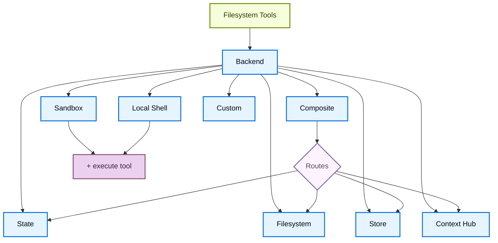

import BackendStatePy from '/langchain/snippets/code-samples/backend-state-py.mdx';
import BackendStateJs from '/langchain/snippets/code-samples/backend-state-js.mdx';
import BackendFilesystemPy from '/langchain/snippets/code-samples/backend-filesystem-py.mdx';
import BackendFilesystemJs from '/langchain/snippets/code-samples/backend-filesystem-js.mdx';
import BackendLocalShellPy from '/langchain/snippets/code-samples/backend-local-shell-py.mdx';
import BackendLocalShellJs from '/langchain/snippets/code-samples/backend-local-shell-js.mdx';
import BackendStorePy from '/langchain/snippets/code-samples/backend-store-py.mdx';
import BackendStoreJs from '/langchain/snippets/code-samples/backend-store-js.mdx';
import BackendContextHubPy from '/langchain/snippets/code-samples/backend-context-hub-py.mdx';
import BackendCompositePy from '/langchain/snippets/code-samples/backend-composite-py.mdx';
import BackendCompositeJs from '/langchain/snippets/code-samples/backend-composite-js.mdx';

:::python
深度智能体通过`ls`、`read_file`、`write_file`、`edit_file`、`delete`、`glob`和`grep`等工具向智能体暴露文件系统接口。这些工具通过可插拔的后端运行。`read_file`工具原生支持所有后端中的图像文件（`.png`、`.jpg`、`.jpeg`、`.gif`、`.webp`），并将其作为多模态内容块返回。
:::

:::js
深度智能体通过`ls`、`read_file`、`write_file`、`edit_file`、`glob`和`grep`等工具向智能体暴露文件系统接口。这些工具通过可插拔的后端运行。`read_file`工具原生支持所有后端中的二进制文件（图像、PDF、音频、视频），并返回一个`ReadResult`，其中包含类型的`content`和`mimeType`。
:::

沙盒和@[`LocalShellBackend`]也提供`execute`工具。
本页面解释如何：

- [选择后端](#指定后端)
- [将不同路径路由到不同后端](#路由到不同后端)
- [实现自定义后端](#自定义后端)
- [设置文件系统访问权限](#权限)
:::js
- [添加策略钩子](#添加策略钩子)
- [处理二进制和多模态文件](#多模态和二进制文件)
:::
- [遵守后端协议](#协议参考)
:::js
- [将现有后端更新到v2](#将现有后端更新到-v2)
:::

<Tip>
当你部署在[LangSmith部署](https://docs.langchain.com/langsmith/deployment)时，会自动配置一个存储。使用[LangSmith](https://docs.langchain.com/langsmith/observability)跟踪来调试文件路径、权限拒绝和跨线程存储。请遵循[可观察性快速入门](https://docs.langchain.com/langsmith/observability-quickstart)来设置。

我们建议你同时设置[LangSmith引擎](https://docs.langchain.com/langsmith/engine)，它监控你的跟踪、检测问题并建议修复。
</Tip>

<Tip>
要生成智能体可以通过文件系统工具读取的持久化仓库维基，请参阅[OpenWiki](/langchain/oss/openwiki/overview)。
</Tip>

## 快速入门

这里有一些你可以快速与深度智能体一起使用的预构建文件系统后端：

| 内置后端 | 描述 |
|---|---|
| [默认](#statebackend) | `agent = create_deep_agent(model="google_genai:gemini-3.6-flash")` <br></br> 线程范围。智能体的默认文件系统后端存储在`langgraph`状态中。文件在同一个线程的多个回合中持续存在（通过你的检查点器），并且不会跨线程共享。 |
| [本地文件系统持久化](#filesystembackend（本地磁盘）) | `agent = create_deep_agent(model="google_genai:gemini-3.6-flash", backend=FilesystemBackend(root_dir="/Users/nh/Desktop/"))` <br></br> 这使深度智能体能够访问你的本地机器的文件系统。你可以指定智能体可以访问的根目录。请注意，任何提供的`root_dir`必须是绝对路径。通常，将其包装在[CompositeBackend](#compositebackend（路由器）)中，以将内部智能体数据（离线工具结果、对话历史）与你的项目文件分开。 |
| [持久存储（LangGraph存储）](#storebackend-langgraph-存储) | `agent = create_deep_agent(model="google_genai:gemini-3.6-flash", backend=StoreBackend())` <br></br> 这使智能体能够访问持久化跨线程的长期存储。这对于存储智能体在多次执行中适用的长期记忆或指令非常棒。 |
| [上下文Hub](#contexthubbackend) | `agent = create_deep_agent(model="google_genai:gemini-3.6-flash", backend=ContextHubBackend("my-agent"))` <br></br> 将文件持久存储在LangSmith Hub仓库中，而无需配置单独的LangGraph存储。 |
| [沙盒](/langchain/oss/deepagents/sandboxes) | `agent = create_deep_agent(model="google_genai:gemini-3.6-flash", backend=sandbox)` <br></br> 在隔离环境中执行代码。沙盒提供文件系统工具，以及`execute`工具用于运行shell命令。选择LangSmith、AgentCore、Daytona或其他[sandbox集成](/langchain/oss/python/integrations/sandboxes)。 |
| [本地shell](#localshellbackend-本地-shell) | `agent = create_deep_agent(model="google_genai:gemini-3.6-flash", backend=LocalShellBackend(root_dir=".", env={"PATH": "/usr/bin:/bin"}))` <br></br> 直接在主机上执行文件系统和shell。没有隔离——仅在受控的开发环境中使用。请参阅下方的[安全注意事项](#localshellbackend-本地-shell)。 |
| [Composite](#compositebackend（路由器）) | 默认为线程范围，`/memories/`跨线程持久化。Composite后端具有最大的灵活性。你可以指定文件系统中的不同路由指向不同的后端。请参阅Composite路由下方的一个现成粘贴示例。 |



## 内置后端

### StateBackend

:::python
<BackendStatePy />
:::

:::js
<BackendStateJs />
:::

**工作原理：**
- 通过@[`StateBackend`]将文件存储在当前线程的LangGraph智能体状态中。
- 通过检查点器跨多个智能体回合持久化。文件不会跨线程共享。

<Warning>
设计为在图内部使用。在图运行之外调用后端方法（例如，`state_backend.upload_files(...)`）不会立即生效，直到图执行。
</Warning>

**适用场景：**
- 作为智能体的草稿板来写入中间结果。
- 自动驱逐大型工具输出，智能体可以逐块读取。

请注意，此后端在监督智能体和子智能体之间共享，并且子智能体写入的任何文件在子智能体执行完成后仍将保留在LangGraph智能体状态中
这些文件将继续对监督智能体和其他子智能体可用。

### FilesystemBackend（本地磁盘）

@[`FilesystemBackend`]在可配置的根目录下读取和写入真实文件。

<Warning>
此后端授予智能体直接文件系统读写访问权限。
谨慎使用，仅在适当的环境中使用。

**适用场景：**
- 本地开发CLI（编码助手、开发工具）
- CI/CD管道（请参阅下方的安全注意事项）

**不适用场景：**
- Web服务器或HTTP API - 使用`StateBackend`、`StoreBackend`或[sandbox后端](/langchain/oss/deepagents/sandboxes)代替

**安全风险：**
- 智能体可以读取任何可访问的文件，包括秘密（API密钥、凭证、`.env`文件）
- 结合网络工具，秘密可能通过SSRF攻击被窃取
- 文件修改是永久且不可逆的

**推荐的安全措施：**
1. 启用 [人工审核中间件](/langchain/oss/deepagents/human-in-the-loop) 来审核敏感操作。
1. 将密钥排除在可访问的文件系统路径之外（尤其是在 CI/CD 环境中）。
1. 使用 [沙盒后端](/langchain/oss/deepagents/sandboxes) 为需要文件系统交互的生产环境提供支持。
1. **始终**使用 `virtual_mode=True` 与 `root_dir` 结合，以启用基于路径的访问限制（阻止 `..`、`~` 以及根目录外的绝对路径）。

    注意，默认设置（`virtual_mode=False`）即使设置了 `root_dir` 也无法提供安全性。
</Warning>

:::python
<BackendFilesystemPy />
:::

:::js
<BackendFilesystemJs />
:::

**工作原理：**
- 在可配置的 `root_dir` 下读写真实文件。
- 您可以选择将 `virtual_mode=True` 设置为沙盒，并在 `root_dir` 下规范化路径。
- 使用安全的路径解析，在可能的情况下防止不安全的符号链接遍历，可以使用 ripgrep 进行快速的 `grep`。

**最适用于：**
- 您机器上的本地项目
- CI 沙盒
- 挂载的持久卷

对于智能体可以使用这些文件系统工具（来自 `openwiki/`）读取的持久化仓库 wiki，请参阅 [OpenWiki](/langchain/oss/openwiki/overview)。

<Tip>
**将 `FilesystemBackend` 封装在 `CompositeBackend`** 中以适用于大多数用例。深度智能体会自动将内部数据写入后端，包括卸载的大型工具结果（在 `/large_tool_results/` 下）和对话历史记录（在 `/conversation_history/` 下）。当您单独使用 `FilesystemBackend` 时，这些内部文件会写入真实磁盘（在 `root_dir` 下），将智能体工件与您的项目文件混合。

使用 `CompositeBackend` 将您的项目目录路由到 `FilesystemBackend`，同时将内部路径保留在临时 `StateBackend` 存储中：

:::python
```python
from deepagents import create_deep_agent
from deepagents.backends import CompositeBackend, StateBackend, FilesystemBackend

agent = create_deep_agent(
    backend=CompositeBackend(
        default=StateBackend(),
        routes={
            "/workspace/": FilesystemBackend(root_dir="/path/to/project", virtual_mode=True),
        },
    )
)
```
:::

:::js
```typescript
import { createDeepAgent, CompositeBackend, FilesystemBackend, StateBackend } from "deepagents";

const agent = createDeepAgent({
  backend: new CompositeBackend(
    new StateBackend(),
    {
      "/workspace/": new FilesystemBackend({ rootDir: "/path/to/project", virtualMode: true }),
    },
  ),
});
```
:::

这样，智能体在 `/workspace/` 下的读取和写入会写入真实磁盘，而卸载的工具结果和其他内部数据会保持临时状态。更多路由模式请参阅 [路由到不同的后端](#路由到不同后端)。
</Tip>

### LocalShellBackend (本地 Shell)

<Warning>
此后端授予智能体直接文件系统读写访问权限 **并且** 在主机上无限制地执行 Shell 命令。
谨慎使用，仅在适当的环境中使用。

**适用场景：**
- 本地开发 CLI（编码助手、开发工具）
- 您信任智能体代码的个人开发环境
- 具备适当密钥管理的 CI/CD 管道

**不适用场景：**
- 生产环境（例如 Web 服务器、API、多租户系统）
- 处理不受信任的用户输入或执行不受信任的代码

**安全风险：**
- 智能体可以以您的用户权限执行**任意 Shell 命令**
- 智能体可以读取任何可访问的文件，包括密钥（API 密钥、凭证、`.env` 文件）
- 密钥可能被泄露
- 文件修改和命令执行是**永久且不可逆的**
- 命令直接在您的宿主机系统上运行
- 命令可以消耗无限量的 CPU、内存、磁盘

**推荐的安全措施：**
1. 启用 [人工审核中间件](/langchain/oss/deepagents/human-in-the-loop) 在执行前审核并批准操作。这**强烈推荐**。
2. 仅在专用开发环境中运行。切勿在共享或生产系统上使用。
3. 对于需要 Shell 执行的生产环境，使用 [沙盒后端](/langchain/oss/deepagents/sandboxes)。

**注意：** `virtual_mode=True` 在启用 Shell 访问时无法提供安全性，因为命令可以访问系统上的任何路径。
</Warning>

:::python
<BackendLocalShellPy />
:::

:::js
<BackendLocalShellJs />
:::

**工作原理：**
- 扩展 `FilesystemBackend` 并使用 `execute` 工具在主机上运行 Shell 命令。
- 命令直接在您的机器上使用 `subprocess.run(shell=True)` 运行，没有任何沙盒。
- 支持 `timeout`（默认 120 秒）、`max_output_bytes`（默认 100,000）、`env` 和 `inherit_env` 用于环境变量。
- Shell 命令使用 `root_dir` 作为工作目录，但可以访问系统上的任何路径。

**最适用于：**
- 本地编码助手和开发工具
- 开发过程中的快速迭代，当您信任智能体时

### StoreBackend (LangGraph 存储)

:::python
<BackendStorePy />
:::

:::js
<BackendStoreJs />
:::

<Note>
    部署到 [LangSmith 部署](https://docs.langchain.com/langsmith/deployment) 时，省略 `store` 参数。平台会自动为您的智能体配置存储。
</Note>

<Tip>
    `namespace` 参数控制数据隔离。对于多用户部署，始终设置一个 [命名空间工厂](/langchain/oss/deepagents/backends#命名空间工厂) 以按用户或租户隔离数据。
</Tip>

**工作原理：**
- @[`StoreBackend`] 将文件存储在由运行时提供的 LangGraph @[`BaseStore`] 中，实现跨线程持久化存储。

**最适用于：**
- 当您已经使用配置好的 LangGraph 存储运行时（例如 Redis、Postgres 或 @[`BaseStore`] 背后的云实现）。
- 当您通过 [LangSmith 部署](https://docs.langchain.com/langsmith/deployment) 部署智能体时（会自动为您的智能体配置存储）。

#### 命名空间工厂

命名空间工厂控制 `StoreBackend` 读取和写入数据的位置。它接收一个 LangGraph @[`Runtime`] 并返回一个用作存储命名空间的字符串元组。使用命名空间工厂在用户、租户或助手之间隔离数据。

在构造 `StoreBackend` 时将命名空间工厂传递给 `namespace` 参数：

```python
NamespaceFactory = Callable[[Runtime], tuple[str, ...]]
```

`Runtime` 提供：
- `rt.context`—通过 LangGraph 的 [上下文模式](/langchain/oss/langgraph/graph-api#运行时上下文) 传递的用户提供的上下文（例如 `user_id`）
:::python
- `rt.server_info`—在 LangGraph 服务器上运行时的服务器特定元数据（助手 ID、图 ID、认证用户）
- `rt.execution_info`—执行身份信息（线程 ID、运行 ID、检查点 ID）
:::
:::js
- `rt.serverInfo`—在 LangGraph 服务器上运行时的服务器特定元数据（助手 ID、图 ID、认证用户）
- `rt.executionInfo`—执行身份信息（线程 ID、运行 ID、检查点 ID）
:::

:::python
<Note>
`Runtime` 参数在 `deepagents>=0.5.2` 中可用。早期 0.5.x 版本传递了一个 `BackendContext` 而不是—请参阅 [从 `BackendContext` 迁移](#从-backendcontext-迁移) 下的说明。`rt.server_info` 和 `rt.execution_info` 需要 `deepagents>=0.5.0`。
</Note>
:::

:::js
<Note>
`Runtime` 参数在 `deepagents>=1.9.1` 中可用。早期 1.9.x 版本传递了一个 `BackendContext` 而不是—请参阅 [从 `BackendContext` 迁移](#从-backendcontext-迁移) 下的说明。`rt.serverInfo` 和 `rt.executionInfo` 需要 `deepagents>=1.9.0`。
</Note>
:::

**常见的命名空间模式：**

:::python
```python
from deepagents.backends import StoreBackend

# Per-user: each user gets their own isolated storage
backend = StoreBackend(
    namespace=lambda rt: (rt.server_info.user.identity,),  # [!code highlight]
)

# Per-assistant: all users of the same assistant share storage
backend = StoreBackend(
    namespace=lambda rt: (
        rt.server_info.assistant_id,  # [!code highlight]
    ),
)

# Per-thread: storage scoped to a single conversation
backend = StoreBackend(
    namespace=lambda rt: (
        rt.execution_info.thread_id,  # [!code highlight]
    ),
)
```
:::

:::js
```typescript
import { StoreBackend } from "deepagents";

// Per-user: each user gets their own isolated storage
const backend = new StoreBackend({
  namespace: (rt) => [rt.serverInfo.user.identity],  // [!code highlight]
});

// Per-assistant: all users of the same assistant share storage
const backend = new StoreBackend({
  namespace: (rt) => [rt.serverInfo.assistantId],  // [!code highlight]
});

// Per-thread: storage scoped to a single conversation
const backend = new StoreBackend({
  namespace: (rt) => [rt.executionInfo.threadId],  // [!code highlight]
});
```
:::

您可以将多个组件组合起来创建更具体的范围—for例如，`(user_id, thread_id)` 用于按用户按对话隔离，或者追加后缀如 `"filesystem"` 以在相同范围使用多个存储命名空间时消除歧义。

命名空间组件必须仅包含字母数字字符、连字符、下划线、点、`@`、`+`、冒号和波浪号。通配符（`*`、`?`）被拒绝以防止glob注入。

:::python
<Warning>
    `namespace`参数将在v0.5.0中**必须**设置。新代码中始终显式设置它。
</Warning>
:::
:::js
<Warning>
    `namespace`参数将在v1.9.0中**必须**设置。新代码中始终显式设置它。
</Warning>
:::

<Note>
    当未提供命名空间工厂时，遗留默认使用LangGraph配置元数据中的`assistant_id`。这意味着所有使用相同[智能体](https://docs.langchain.com/langsmith/assistants)的用户共享相同的存储。对于多用户[即将投入生产](/langchain/oss/deepagents/going-to-production)，始终提供一个命名空间工厂。
</Note>

### ContextHubBackend

<Note>
**开始前：** `ContextHubBackend`需要在LangSmith中设置Context Hub仓库。如果您不熟悉智能体仓库和技能仓库，请先阅读[Context Hub概念](https://docs.langchain.com/langsmith/context-engineering-concepts)页面。
</Note>

`ContextHubBackend`将您的智能体的文件系统存储在LangSmith Context Hub仓库中。它可以使用独立仓库或链接到技能仓库的智能体仓库。

**仓库结构：** 在Context Hub中，一个_智能体仓库_包含智能体的顶层指令和配置（例如，`AGENTS.md`、`tools.json`）。它可以链接到一个或多个_技能仓库_，每个技能仓库作为一个可重用的能力打包（例如，一个`SKILL.md`，包含电子邮件格式化或代码审查的指令）。当您传递`ContextHubBackend("my-agent")`时，后端将智能体仓库挂载到文件系统根目录；链接的技能仓库作为`/skills/`下的子目录出现。

这意味着您的智能体的上下文有意分布在多个仓库中：每个智能体一个仓库，每个技能一个独立仓库。这种分离允许技能独立地进行版本控制、共享和重用。如果感觉碎片化，请参阅[链接仓库](https://docs.langchain.com/langsmith/context-engineering-concepts#linked-repos)了解原因。

:::python
<BackendContextHubPy />
:::

使用`owner/name`或`name`格式的仓库标识符构建它。

<Note>
在使用`ContextHubBackend`之前设置`LANGSMITH_API_KEY`。
</Note>

**工作原理：**
- 在首次使用时惰性拉取Hub仓库树，然后从内存缓存中提供读取。
- 持久化写入和编辑为Hub提交，并在成功提交后更新缓存。
- 使用乐观父提交写入（`parent_commit`）：每次推送都针对最新的已知提交哈希。

**行为和限制：**
- 如果仓库不存在，首次拉取被视为空；第一个成功的写入可以创建仓库。
- 如果其他写入者首先推进仓库，您的过时父提交写入可能会失败。重新拉取并在冲突时重试。
- `upload_files()`接受UTF-8文本。非UTF-8文件按路径被`invalid_path`拒绝。

**最适合：**
- 无需单独配置LangGraph `BaseStore`的LangSmith原生持久文件系统。
- 从文件系统更改中受益于Hub提交历史的用例。

### CompositeBackend（路由器）

:::python
<BackendCompositePy />
:::

:::js
<BackendCompositeJs />
:::

**工作原理：**
- @[`CompositeBackend`]根据路径前缀将文件操作路由到不同的后端。
- 在列表和搜索结果中保留原始路径前缀。

**最适合：**
- 当您希望为智能体提供线程范围和跨线程存储时，一个`CompositeBackend`允许您提供`StateBackend`和`StoreBackend`
- 当您有多个信息源，希望作为单个文件系统提供给智能体时。
    - 例如。您在一个Store下`/memories/`存储长期记忆，并且您还有一个自定义后端，其中文档可通过/docs访问。

## 指定后端

:::python
- 将后端实例传递给`create_deep_agent(model=..., backend=...)`。文件系统中间件使用它进行所有工具操作。
- 后端必须实现`BackendProtocol`（例如，`StateBackend()`、`FilesystemBackend(root_dir=".")`、`StoreBackend()`、`ContextHubBackend("my-agent")`）。
- 如果省略，默认为`StateBackend()`。
:::

:::js
- 将后端实例传递给`createDeepAgent({ backend: ... })`。文件系统中间件使用它进行所有工具操作。
- 后端必须实现`AnyBackendProtocol`（`BackendProtocolV1`或`BackendProtocolV2`）—例如，`new StateBackend()`、`new FilesystemBackend({ rootDir: "." })`、`new StoreBackend()`。
- 如果省略，默认为`new StateBackend()`。

<Note>
在1.9.0版本之前，仅支持`BackendProtocol`，现在为`BackendProtocolV1`。V1后端通过`adaptBackendProtocol()`在运行时自动适配为V2。无需代码更改即可继续使用现有的V1后端。要更新到v2，请参阅[将现有后端更新到v2](#将现有后端更新到-v2)。
</Note>
:::

## 路由到不同后端

将命名空间的一部分路由到不同的后端。通常用于跨线程持久化`/memories/*`，同时保持其他内容线程范围。

:::python
```python
from deepagents import create_deep_agent
from deepagents.backends import CompositeBackend, StateBackend, FilesystemBackend

agent = create_deep_agent(
    model="google_genai:gemini-3.6-flash",
    backend=CompositeBackend(
        default=StateBackend(),
        routes={
            "/memories/": FilesystemBackend(root_dir="/deepagents/myagent", virtual_mode=True),
        },
    )
)
```
:::

:::js
```typescript
import { createDeepAgent, CompositeBackend, FilesystemBackend, StateBackend } from "deepagents";

const agent = createDeepAgent({
  backend: new CompositeBackend(
    new StateBackend(),
    {
      "/memories/": new FilesystemBackend({ rootDir: "/deepagents/myagent", virtualMode: true }),
    },
  ),
});
```
:::

行为：
- `/workspace/plan.md` → `StateBackend`（线程范围）
- `/memories/agent.md` → `FilesystemBackend`在`/deepagents/myagent`下
- `ls`、`glob`、`grep`聚合结果并显示原始路径前缀。

注意：
- 更长的前缀优先（例如，路由`"/memories/projects/"`可以覆盖`"/memories/"`）。
- 对于StoreBackend路由，请确保通过`create_deep_agent(model=..., store=...)`提供存储或由平台配置。
- 深度智能体将内部数据（离线工具结果、对话历史）写入默认后端。使用`StateBackend`作为默认值，以保持这些工件是暂时的，避免将它们写入磁盘或持久化存储。请参阅[文件系统后端技巧](#filesystembackend（本地磁盘）)以获取完整示例。

## 离线二进制内容

二进制内容离线存储将内联媒体存储在后端，而不是在消息历史中保留base64有效负载。这减少了读取二进制文件或接收用户消息中内联媒体的智能体的检查点大小。离线存储是可选的，默认禁用。

:::python
<Note>
二进制内容离线存储需要`deepagents>=0.7.21`。
</Note>

在`FilesystemMiddleware`上设置`offload_binary_content=True`，并将其作为`middleware`列表传递给`create_deep_agent`。使用相同的后端为智能体和中间件。

有效负载默认存储在`/blobs/<sha256>`下。如果您在中间件上设置`artifacts_root`，则blob存储在该根目录下。
:::

:::js
在`createFilesystemMiddleware`中设置`offloadBinaryContent: true`，并将中间件作为`middleware`数组传递给`createDeepAgent`。使用相同的后端为智能体和中间件。

有效负载默认存储在`/blobs/<sha256>`下。
:::

消息历史保留内容寻址引用。在每次模型调用之前，中间件从其缓存或后端恢复原始媒体。重新读取未更改的内容会重用相同的blob；更改的内容会创建新的blob。

使用一个将 blob 存储在图状态之外的后端，例如沙盒或 `FilesystemBackend`。当 blob 路径路由到 `StateBackend` 时（包括通过 `CompositeBackend`），卸载操作无效。如果你将 `StateBackend` 作为默认后端保留，请将 blob 目录路由到外部存储。

<Note>
用户消息中的内联媒体在下次模型调用时会被替换。原始输入负载仍然出现在早期的检查点中。在恢复线程时保持 blob 存储可用，以便中间件可以恢复其媒体。
</Note>

## 自定义后端

实现一个自定义后端，以连接深度智能体到数据库、对象存储和远程文件系统等存储系统。参见 [社区构建的后端](/langchain/oss/integrations/backends) 获取示例。

### 实现后端协议

:::python
继承 @[`BackendProtocol`] 并实现以下方法：

| 方法 | 签名 | 功能 |
|------|------|------|
| `ls` | `(path: str) -> LsResult` | 列出给定路径下的文件和目录。 |
| `read` | `(file_path: str, offset: int, limit: int) -> ReadResult` | 返回文件内容，可选分页。 |
| `write` | `(file_path: str, content: str) -> WriteResult` | 创建或覆盖文件。 |
| `edit` | `(file_path: str, old_string: str, new_string: str, replace_all: bool) -> EditResult` | 在现有文件中查找并替换。 |
| `glob` | `(pattern: str, path: str | None) -> GlobResult` | 返回匹配 glob 模式的路径。 |
| `grep` | `(pattern: str, path: str | None, glob: str | None) -> GrepResult` | 在文件内容中搜索字面字符串。 |
| `delete` | `(file_path: str) -> DeleteResult` | 可选。删除文件或递归删除目录。如果后端不支持删除，该工具在请求时对模型自动隐藏。 |

要同时支持 `execute` 工具（运行 shell 命令），请实现 @[`SandboxBackendProtocol`] 而不是 `BackendProtocol`，它通过一个 `execute` 方法扩展了 `BackendProtocol`。

始终在失败情况下返回结构化结果类型，并包含一个 `error` 字段。不要抛出异常。
:::

:::js
实现 @[`BackendProtocol`] (`BackendProtocolV2`) 并提供以下方法：

| 方法 | 签名 | 功能 |
|------|------|------|
| `ls` | `(path: string) => Promise<LsResult>` | 列出给定路径下的文件和目录。 |
| `read` | `(filePath: string, offset?, limit?) => Promise<ReadResult>` | 返回文件内容，可选分页。二进制文件返回 `Uint8Array` 内容并附带 `mimeType`。 |
| `readRaw` | `(filePath: string) => Promise<ReadRawResult>` | 返回原始 `FileData`（由框架内部使用）。 |
| `write` | `(filePath: string, content: string) => Promise<WriteResult>` | 创建或覆盖文件。 |
| `edit` | `(filePath: string, oldString: string, newString: string, replaceAll?: boolean) => Promise<EditResult>` | 在现有文件中查找并替换。 |
| `glob` | `(pattern: string, path?: string) => Promise<GlobResult>` | 返回匹配 glob 模式的路径。 |
| `grep` | `(pattern: string, path?, glob?) => Promise<GrepResult>` | 在文件内容中搜索字面字符串。 |

要同时支持 `execute` 工具（运行 shell 命令），请实现 @[`SandboxBackendProtocol`] 而不是 `BackendProtocolV2`，它通过一个 `execute` 方法扩展了 `BackendProtocolV2`。

所有方法必须返回结构化的 Result 对象，并包含可选的 `error` 字段——在缺少文件或无效模式时不抛出异常。
:::

<Accordion title="Example: S3-style backend skeleton">

这个骨架将文件系统路径映射到对象键。用你的存储客户端的列、读、搜索、上传和读改写操作填充每个方法。

:::python
```python
from deepagents.backends.protocol import (
    BackendProtocol,
    EditResult,
    GlobResult,
    GrepResult,
    LsResult,
    ReadResult,
    WriteResult,
)

class S3Backend(BackendProtocol):
    def __init__(self, bucket: str, prefix: str = ""):
        self.bucket = bucket
        self.prefix = prefix.rstrip("/")

    def _key(self, path: str) -> str:
        return f"{self.prefix}{path}"

    def ls(self, path: str) -> LsResult:
        ...

    def read(self, file_path: str, offset: int = 0, limit: int = 2000) -> ReadResult:
        ...

    def grep(self, pattern: str, path: str | None = None, glob: str | None = None) -> GrepResult:
        ...

    def glob(self, pattern: str, path: str | None = None) -> GlobResult:
        ...

    def write(self, file_path: str, content: str) -> WriteResult:
        ...

    def edit(self, file_path: str, old_string: str, new_string: str, replace_all: bool = False) -> EditResult:
        ...
```
:::

:::js
```typescript
import {
  type BackendProtocolV2,
  type EditResult,
  type GlobResult,
  type GrepResult,
  type LsResult,
  type ReadRawResult,
  type ReadResult,
  type WriteResult,
} from "deepagents";

class S3Backend implements BackendProtocolV2 {
  constructor(private bucket: string, private prefix: string = "") {
    this.prefix = prefix.replace(/\/$/, "");
  }

  private key(path: string): string {
    return `${this.prefix}${path}`;
  }

  async ls(path: string): Promise<LsResult> {
    ...
  }

  async read(filePath: string, offset?: number, limit?: number): Promise<ReadResult> {
    ...
  }

  async readRaw(filePath: string): Promise<ReadRawResult> {
    ...
  }

  async grep(pattern: string, path?: string | null, glob?: string | null): Promise<GrepResult> {
    ...
  }

  async glob(pattern: string, path = "/"): Promise<GlobResult> {
    ...
  }

  async write(filePath: string, content: string): Promise<WriteResult> {
    ...
  }

  async edit(filePath: string, oldString: string, newString: string, replaceAll?: boolean): Promise<EditResult> {
    ...
  }
}
```
:::

</Accordion>

## 权限

使用 [权限](/langchain/oss/deepagents/permissions) 声明式地控制智能体可以读取或写入哪些文件和目录。权限适用于内置的文件系统工具，并在调用后端之前进行评估。

:::python
```python
from deepagents import create_deep_agent, FilesystemPermission

agent = create_deep_agent(
    model="google_genai:gemini-3.6-flash",
    backend=CompositeBackend(
        default=StateBackend(),
        routes={
            "/memories/": StoreBackend(
                namespace=lambda rt: (rt.server_info.user.identity,),
            ),
            "/policies/": StoreBackend(
                namespace=lambda rt: (rt.context.org_id,),
            ),
        },
    ),
    permissions=[
        FilesystemPermission(
            operations=["write"],
            paths=["/policies/**"],
            mode="deny",
        ),
    ],
)
```
:::

有关完整的选项集，包括规则排序、子智能体权限和复合后端交互，请参阅 [权限指南](/langchain/oss/deepagents/permissions)。

## 添加策略钩子

对于基于路径的允许/拒绝规则之外的定制验证逻辑（速率限制、审计日志、内容检查），通过继承或包装后端来执行企业规则。

在选定的前缀下阻止写入/编辑（继承）：

:::python
```python
from deepagents.backends.filesystem import FilesystemBackend
from deepagents.backends.protocol import WriteResult, EditResult

class GuardedBackend(FilesystemBackend):
    def __init__(self, *, deny_prefixes: list[str], **kwargs):
        super().__init__(**kwargs)
        self.deny_prefixes = [p if p.endswith("/") else p + "/" for p in deny_prefixes]

    def write(self, file_path: str, content: str) -> WriteResult:
        if any(file_path.startswith(p) for p in self.deny_prefixes):
            return WriteResult(error=f"Writes are not allowed under {file_path}")
        return super().write(file_path, content)

    def edit(self, file_path: str, old_string: str, new_string: str, replace_all: bool = False) -> EditResult:
        if any(file_path.startswith(p) for p in self.deny_prefixes):
            return EditResult(error=f"Edits are not allowed under {file_path}")
        return super().edit(file_path, old_string, new_string, replace_all)
```
:::

:::js
```typescript
import { FilesystemBackend, type WriteResult, type EditResult } from "deepagents";

class GuardedBackend extends FilesystemBackend {
  private denyPrefixes: string[];

  constructor({ denyPrefixes, ...options }: { denyPrefixes: string[]; rootDir?: string }) {
    super(options);
    this.denyPrefixes = denyPrefixes.map(p => p.endsWith("/") ? p : p + "/");
  }

  async write(filePath: string, content: string): Promise<WriteResult> {
    if (this.denyPrefixes.some(p => filePath.startsWith(p))) {
      return { error: `Writes are not allowed under ${filePath}` };
    }
    return super.write(filePath, content);
  }

  async edit(filePath: string, oldString: string, newString: string, replaceAll = false): Promise<EditResult> {
    if (this.denyPrefixes.some(p => filePath.startsWith(p))) {
      return { error: `Edits are not allowed under ${filePath}` };
    }
    return super.edit(filePath, oldString, newString, replaceAll);
  }
}
```
:::

通用包装器（适用于任何后端）：

:::python
```python
from deepagents.backends.protocol import (
    BackendProtocol, WriteResult, EditResult, LsResult, ReadResult, GrepResult, GlobResult,
)

class PolicyWrapper(BackendProtocol):
    def __init__(self, inner: BackendProtocol, deny_prefixes: list[str] | None = None):
        self.inner = inner
        self.deny_prefixes = [p if p.endswith("/") else p + "/" for p in (deny_prefixes or [])]

    def _deny(self, path: str) -> bool:
        return any(path.startswith(p) for p in self.deny_prefixes)

    def ls(self, path: str) -> LsResult:
        return self.inner.ls(path)

    def read(self, file_path: str, offset: int = 0, limit: int = 2000) -> ReadResult:
        return self.inner.read(file_path, offset=offset, limit=limit)
    def grep(self, pattern: str, path: str | None = None, glob: str | None = None) -> GrepResult:
        return self.inner.grep(pattern, path, glob)
    def glob(self, pattern: str, path: str | None = None) -> GlobResult:
        return self.inner.glob(pattern, path)
    def write(self, file_path: str, content: str) -> WriteResult:
        if self._deny(file_path):
            return WriteResult(error=f"Writes are not allowed under {file_path}")
        return self.inner.write(file_path, content)
    def edit(self, file_path: str, old_string: str, new_string: str, replace_all: bool = False) -> EditResult:
        if self._deny(file_path):
            return EditResult(error=f"Edits are not allowed under {file_path}")
        return self.inner.edit(file_path, old_string, new_string, replace_all)
```
:::

:::js
```typescript
import {
  type BackendProtocolV2,
  type LsResult,
  type ReadResult,
  type ReadRawResult,
  type GrepResult,
  type GlobResult,
  type WriteResult,
  type EditResult,
} from "deepagents";

class PolicyWrapper implements BackendProtocolV2 {
  private denyPrefixes: string[];

  constructor(private inner: BackendProtocolV2, denyPrefixes: string[] = []) {
    this.denyPrefixes = denyPrefixes.map(p => p.endsWith("/") ? p : p + "/");
  }

  private isDenied(path: string): boolean {
    return this.denyPrefixes.some(p => path.startsWith(p));
  }

  ls(path: string): Promise<LsResult> { return this.inner.ls(path); }
  read(filePath: string, offset?: number, limit?: number): Promise<ReadResult> { return this.inner.read(filePath, offset, limit); }
  readRaw(filePath: string): Promise<ReadRawResult> { return this.inner.readRaw(filePath); }
  grep(pattern: string, path?: string | null, glob?: string | null): Promise<GrepResult> { return this.inner.grep(pattern, path, glob); }
  glob(pattern: string, path?: string): Promise<GlobResult> { return this.inner.glob(pattern, path); }

  async write(filePath: string, content: string): Promise<WriteResult> {
    if (this.isDenied(filePath)) return { error: `Writes are not allowed under ${filePath}` };
    return this.inner.write(filePath, content);
  }

  async edit(filePath: string, oldString: string, newString: string, replaceAll = false): Promise<EditResult> {
    if (this.isDenied(filePath)) return { error: `Edits are not allowed under ${filePath}` };
    return this.inner.edit(filePath, oldString, newString, replaceAll);
  }
}
```
:::

:::js
## 多模态和二进制文件

<Note>
多模态文件支持（PDF、音频、视频）需要 `deepagents>=1.9.0`。
</Note>

V2 后端原生支持二进制文件。当 `read()` 遇到二进制文件（通过文件扩展名确定的 MIME 类型判定）时，它返回一个 `ReadResult`，包含 `Uint8Array` 内容和相应的 `mimeType`。文本文件返回 `string` 内容。

### 支持的 MIME 类型

| 类别 | 扩展名 | MIME 类型 |
|------|--------|----------|
| 图像 | `.png`, `.jpg`/`.jpeg`, `.gif`, `.webp`, `.svg`, `.heic`, `.heif` | `image/png`, `image/jpeg`, `image/gif`, `image/webp`, `image/svg+xml`, `image/heic`, `image/heif` |
| 音频 | `.mp3`, `.wav`, `.aiff`, `.aac`, `.ogg`, `.flac` | `audio/mpeg`, `audio/wav`, `audio/aiff`, `audio/aac`, `audio/ogg`, `audio/flac` |
| 视频 | `.mp4`, `.webm`, `.mpeg`/`.mpg`, `.mov`, `.avi`, `.flv`, `.wmv`, `.3gpp` | `video/mp4`, `video/webm`, `video/mpeg`, `video/quicktime`, `video/x-msvideo`, `video/x-flv`, `video/x-ms-wmv`, `video/3gpp` |
| 文档 | `.pdf`, `.ppt`, `.pptx` | `application/pdf`, `application/vnd.ms-powerpoint`, `application/vnd.openxmlformats-officedocument.presentationml.presentation` |
| 文本 | `.txt`, `.html`, `.json`, `.js`, `.ts`, `.py`, 等. | `text/plain`, `text/html`, `application/json`, 等. |

### 读取二进制文件

```typescript
const result = await backend.read("/workspace/screenshot.png");

if (result.error) {
  console.error(result.error);
} else if (result.content instanceof Uint8Array) {
  // Binary file — content is Uint8Array, mimeType is set
  console.log(`Binary file: ${result.mimeType}`); // "image/png"
} else {
  // Text file — content is string
  console.log(`Text file: ${result.mimeType}`); // "text/plain"
}
```

### FileData 格式

`FileData` 是用于在状态和存储后端中存储文件内容的数据类型。

```typescript
type FileData =
  // Current format (v2)
  | {
      content: string | Uint8Array; // string for text, Uint8Array for binary
      mimeType: string;             // e.g. "text/plain", "image/png"
      created_at: string;           // ISO 8601 timestamp
      modified_at: string;          // ISO 8601 timestamp
    }
  // Legacy format (v1)
  | {
      content: string[];            // array of lines
      created_at: string;           // ISO 8601 timestamp
      modified_at: string;          // ISO 8601 timestamp
    };
```

后端在从状态或存储读取时可能遇到这两种格式。框架透明地处理这两种格式。新写入默认为 v2 格式。在滚动部署期间，如果需要旧版本读取器使用传统格式，请将 `fileFormat: "v1"` 传递给后端构造函数（例如，`new StoreBackend({ fileFormat: "v1" })`）。
:::

## 从后端工厂迁移

<Warning>
:::python
自 `deepagents` 0.5.0 起，后端工厂模式已**弃用**。直接传递预构建的后端实例，而不是工厂函数。
:::
:::js
自 `deepagents` 1.9.0 起，后端工厂模式已**弃用**。直接传递预构建的后端实例，而不是工厂函数。
:::
</Warning>

以前，像 `StateBackend` 和 `StoreBackend` 这样的后端需要一个接收运行时对象的工厂函数，因为它们需要运行时上下文（状态、存储）才能操作。现在后端通过 LangGraph 的 `get_config()`、`get_store()` 和 `get_runtime()` 辅助函数内部解析此上下文，因此你可以直接传递实例。

### 变更内容

| 之前（已弃用） | 之后 |
|---|---|
| `backend=lambda rt: StateBackend(rt)` | `backend=StateBackend()` |
| `backend=lambda rt: StoreBackend(rt)` | `backend=StoreBackend()` |
| `backend=lambda rt: CompositeBackend(default=StateBackend(rt), ...)` | `backend=CompositeBackend(default=StateBackend(), ...)` |
| `backend: (config) => new StateBackend(config)` | `backend: new StateBackend()` |
| `backend: (config) => new StoreBackend(config)` | `backend: new StoreBackend()` |

### 弃用的 API

:::python

| 已弃用 | 替换 |
|---|---|
| 在 `create_deep_agent` 中将可调用对象传递给 `backend=` | 直接传递后端实例 |
| 在 `StateBackend(runtime)` 上的 `runtime` 构造函数参数 | `StateBackend()`（不需要参数） |
| 在 `StoreBackend(runtime)` 上的 `runtime` 构造函数参数 | `StoreBackend()` 或 `StoreBackend(namespace=..., store=...)` |
| 在 `WriteResult` 和 `EditResult` 上的 `files_update` 字段 | 状态写入现在由后端内部处理 |
| 在中间件写入/编辑工具中包装 `Command` | 工具返回纯字符串；不需要 `Command(update=...)` |

:::

:::js

| 已弃用 | 替换 |
|---|---|
| `BackendFactory` 类型 | 直接传递后端实例 |
| `BackendRuntime` 接口 | 后端内部解析上下文 |
| `StateBackend(runtime, options?)` 构造函数重载 | `new StateBackend(options?)` |
| `StoreBackend(stateAndStore, options?)` 构造函数重载 | `new StoreBackend(options?)` |
| 在 `WriteResult` 和 `EditResult` 上的 `filesUpdate` 字段 | 状态写入现在由后端内部处理 |

:::

<Note>
工厂模式在运行时仍然有效，并发出弃用警告。请在下一个主要版本之前更新您的代码以使用直接实例。
</Note>

### 迁移示例

:::python
```python
# Before (deprecated)
from deepagents import create_deep_agent
from deepagents.backends import CompositeBackend, StateBackend, StoreBackend

agent = create_deep_agent(
    model="google_genai:gemini-3.6-flash",
    backend=lambda rt: CompositeBackend(
        default=StateBackend(rt),
        routes={"/memories/": StoreBackend(rt, namespace=lambda rt: (rt.server_info.user.identity,))},
    ),
)

# After
agent = create_deep_agent(
    model="google_genai:gemini-3.6-flash",
    backend=CompositeBackend(
        default=StateBackend(),
        routes={"/memories/": StoreBackend(namespace=lambda rt: (rt.server_info.user.identity,))},
    ),
)
```
:::

:::js
```typescript
// Before (deprecated)
import { createDeepAgent, CompositeBackend, StateBackend, StoreBackend } from "deepagents";

const agent = createDeepAgent({
  backend: (config) => new CompositeBackend(
    new StateBackend(config),
    { "/memories/": new StoreBackend(config, {
      namespace: (rt) => [rt.serverInfo.user.identity],
    }) },
  ),
});

// After
const agent = createDeepAgent({
  backend: new CompositeBackend(
    new StateBackend(),
    { "/memories/": new StoreBackend({
      namespace: (rt) => [rt.serverInfo.user.identity],
    }) },
  ),
});
```
:::

### 从 `BackendContext` 迁移

在 `deepagents>=0.5.2`（Python）和 `deepagents>=1.9.1`（TypeScript）中，命名空间工厂直接接收 LangGraph @[`Runtime`]，而不是 `BackendContext` 包装器。旧的 `BackendContext` 形式仍然通过向后兼容的 `.runtime` 和 `.state` 访问器工作，但这些访问器会发出弃用警告，并在 `deepagents>=0.7` 中被移除。

**变更内容：**

- 工厂参数现在是一个 `Runtime`，而不是 `BackendContext`。
- 移除 `.runtime` 访问器—for example, `ctx.runtime.context.user_id` 变为 `rt.server_info.user.identity`。
- 没有直接替换 `ctx.state`。命名空间信息应该是只读的并且在运行期间保持稳定，而状态是可变的并且按步骤变化—从状态派生命名空间有数据最终可能出现在不一致的键下。如果您有需要读取智能体状态的用例，请 [打开问题](https://github.com/langchain-ai/deepagents/issues)。

:::python
```python
# Before (deprecated, removed in v0.7)
StoreBackend(
    namespace=lambda ctx: (ctx.runtime.context.user_id,),  # [!code --]
)

# After
StoreBackend(
    namespace=lambda rt: (rt.server_info.user.identity,),  # [!code ++]
)
```
:::

:::js
```typescript
// Before (deprecated, removed in v0.7)
new StoreBackend({
  namespace: (ctx) => [ctx.runtime.context.userId],  // [!code --]
});

// After
new StoreBackend({
  namespace: (rt) => [rt.serverInfo.user.identity],  // [!code ++]
});
```
:::

## 协议参考

后端必须实现 @[`BackendProtocol`]。

必需方法：
- `ls(path: str) -> LsResult`
    - 返回至少包含 `path` 的条目。当可用时，包含 `is_dir`、`size`、`modified_at`。按 `path` 排序以获得确定性输出。
- `read(file_path: str, offset: int = 0, limit: int = 2000) -> ReadResult`
    - 成功时返回文件数据。文件不存在时，返回 `ReadResult(error="Error: File '/x' not found")`。
- `grep(pattern: str, path: Optional[str] = None, glob: Optional[str] = None) -> GrepResult`
    - 返回结构化匹配。出错时，返回 `GrepResult(error="...")`（不要抛出异常）。
- `glob(pattern: str, path: Optional[str] = None) -> GlobResult`
    - 返回匹配的文件作为 `FileInfo` 条目（如果没有，则为空列表）。
- `write(file_path: str, content: str) -> WriteResult`
    - 只读操作。冲突时，返回 `WriteResult(error=...)`。成功时，设置 `path`；对于状态后端，设置 `files_update={...}`；外部后端应使用 `files_update=None`。
- `edit(file_path: str, old_string: str, new_string: str, replace_all: bool = False) -> EditResult`
    - 强制 `old_string` 的唯一性，除非 `replace_all=True`。如果未找到，返回错误。成功时包含 `occurrences`。

支持类型：
- `LsResult(error, entries)`—`entries` 成功时是 `list[FileInfo]`，失败时是 `None`。
- `ReadResult(error, file_data)`—`file_data` 成功时是 `FileData` 字典，失败时是 `None`。
- `GrepResult(error, matches)`—`matches` 成功时是 `list[GrepMatch]`，失败时是 `None`。
- `GlobResult(error, matches)`—`matches` 成功时是 `list[FileInfo]`，失败时是 `None`。
- `WriteResult(error, path, files_update)`
- `EditResult(error, path, files_update, occurrences)`
- `FileInfo`，字段：`path`（必需），可选 `is_dir`、`size`、`modified_at`。
- `GrepMatch`，字段：`path`、`line`、`text`。
- `FileData`，字段：`content`（str）、`encoding`（`"utf-8"` 或 `"base64"`）、`created_at`、`modified_at`。
:::

:::js
后端实现 `BackendProtocolV2`。所有查询方法返回结构化的 Result 对象，包含 `{ error?: string, ...data }`。

### 必需方法

- **`ls(path: string) → LsResult`**
    - 列出指定目录中的文件和目录（非递归）。目录的路径以 `/` 结尾，并具有 `is_dir=true`。当可用时，包含 `is_dir`、`size`、`modified_at`。

- **`read(filePath: string, offset?: number, limit?: number) → ReadResult`**
    - 读取文件内容。对于文本文件，内容按行偏移/限制分页（默认偏移 0，限制 500）。对于二进制文件，返回完整的原始 `Uint8Array` 内容，并设置 `mimeType` 字段。文件不存在时，返回 `{ error: "File '/x' not found" }`。

- **`readRaw(filePath: string) → ReadRawResult`**
    - 读取文件内容作为原始 `FileData`。返回完整的文件数据，包括时间戳。

- **`grep(pattern: string, path?: string | null, glob?: string | null) → GrepResult`**
    - 搜索文件内容中的字面文本模式。根据 MIME 类型确定的二进制文件被跳过。失败时，返回 `{ error: "..." }`。

- **`glob(pattern: string, path?: string) → GlobResult`**
    - 返回匹配 glob 模式的文件作为 `FileInfo` 条目。

- **`write(filePath: string, content: string) → WriteResult`**
    - 只读操作。冲突时，返回 `{ error: "..." }`。成功时，设置 `path`；对于状态后端，设置 `filesUpdate={...}`；外部后端应使用 `filesUpdate=null`。

- **`edit(filePath: string, oldString: string, newString: string, replaceAll?: boolean) → EditResult`**
    - 强制 `oldString` 的唯一性，除非 `replaceAll=true`。如果未找到，返回错误。成功时包含 `occurrences`。

### 可选方法

- **`uploadFiles(files: Array<[string, Uint8Array]>) → FileUploadResponse[]`**—上传多个文件（用于沙盒后端）。
- **`downloadFiles(paths: string[]) → FileDownloadResponse[]`**—下载多个文件（用于沙盒后端）。

### 结果类型

| 类型 | 成功字段 | 错误字段 |
|------|----------------|-------------|
| `ReadResult` | `content?: string \| Uint8Array`, `mimeType?: string` | `error` |
| `ReadRawResult` | `data?: FileData` | `error` |
| `LsResult` | `files?: FileInfo[]` | `error` |
| `GlobResult` | `files?: FileInfo[]` | `error` |
| `GrepResult` | `matches?: GrepMatch[]` | `error` |
| `WriteResult` | `path?: string` | `error` |
| `EditResult` | `path?: string`, `occurrences?: number` | `error` |

### 支持类型

- **`FileInfo`**—`path`（必需），可选 `is_dir`、`size`、`modified_at`。
- **`GrepMatch`**—`path`, `line`（1索引），`text`。
- **`FileData`**—带时间戳的文件内容。参见 [FileData 格式](#filedata-格式)。

### 沙盒扩展

`SandboxBackendProtocolV2` 扩展 `BackendProtocolV2`，包含：

- **`execute(command: string) → ExecuteResponse`**—在沙盒中运行 shell 命令。
- **`readonly id: string`**—沙盒实例的唯一标识符。
:::

:::js
## 将现有后端更新到 V2

<Accordion title="Migration guide">

### 方法重命名

| V1 方法 | V2 方法 | 返回类型变更 |
|-----------|-----------|-------------------|
| `lsInfo(path)` | `ls(path)` | `FileInfo[]` → `LsResult` |
| `read(filePath, offset, limit)` | `read(filePath, offset, limit)` | `string` → `ReadResult` |
| `readRaw(filePath)` | `readRaw(filePath)` | `FileData` → `ReadRawResult` |
| `grepRaw(pattern, path, glob)` | `grep(pattern, path, glob)` | `GrepMatch[] \| string` → `GrepResult` |
| `globInfo(pattern, path)` | `glob(pattern, path)` | `FileInfo[]` → `GlobResult` |
| `write(...)` | `write(...)` | 未变更（`WriteResult`） |
| `edit(...)` | `edit(...)` | 未变更（`EditResult`） |

### 类型重命名

| V1 类型 | V2 类型 |
|---------|---------|
| `BackendProtocol` | `BackendProtocolV2` |
| `SandboxBackendProtocol` | `SandboxBackendProtocolV2` |

### 适配工具

如果您有现有的 V1 后端需要与仅支持 V2 的代码一起使用，请使用适配函数：

```typescript
import { adaptBackendProtocol, adaptSandboxProtocol } from "deepagents";

// Adapt a V1 backend to V2
const v2Backend = adaptBackendProtocol(v1Backend);

// Adapt a V1 sandbox to V2
const v2Sandbox = adaptSandboxProtocol(v1Sandbox);
```

<Note>
框架自动适配传递给 `createDeepAgent()` 的 V1 后端。直接调用协议方法时才需要手动适配。
</Note>

</Accordion>
:::

## 参考文档

- [OpenWiki](/langchain/oss/openwiki/overview)：通过文件系统工具生成智能体读取的持久化仓库 Markdown
- [Memory](/langchain/oss/deepagents/memory)：文件系统支持的长期记忆
- [Sandboxes](/langchain/oss/deepagents/sandboxes)：隔离的文件系统和 shell 执行

---

> 官方原文：[src/oss/deepagents/backends.mdx](https://github.com/langchain-ai/docs/blob/main/src/oss/deepagents/backends.mdx) · 译文由 AI 生成，以英文原文为准。
