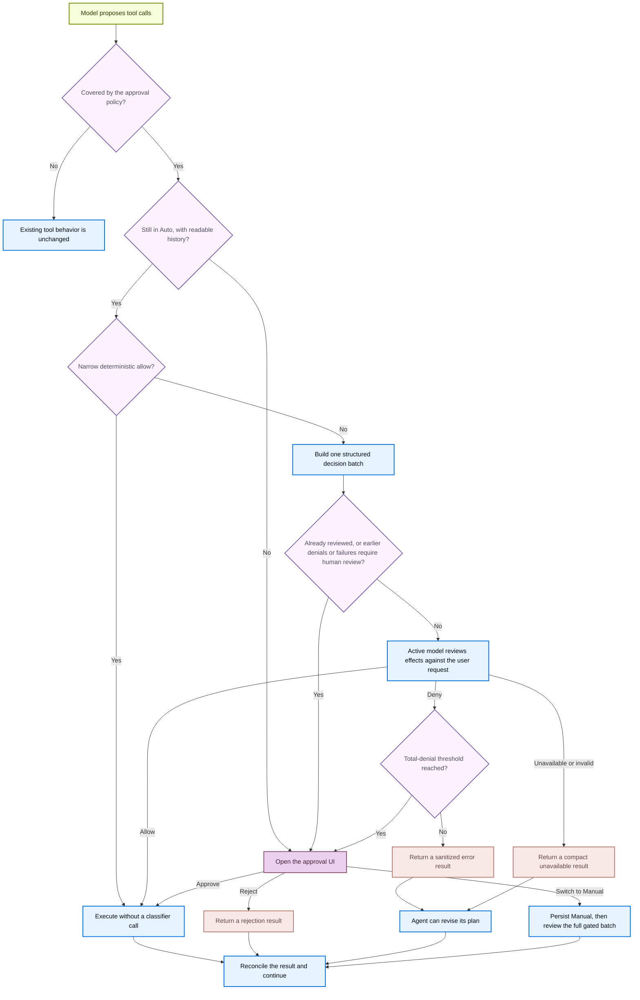

默认情况下，Deep Agents Code 在执行可能产生重大影响的操作前会请求您的批准。这些操作被称为 **受控操作**，包括：

- 编辑或删除文件 (`write_file`, `edit_file`, `delete`)
- 运行 Shell 命令 (`execute`)
- 发起网络请求 (`web_search`, `fetch_url`)
- 将任务委托给子智能体 (`task`)

只读工具，如 `ls`、`read_file`、`glob` 和 `grep`，始终无需提示即可运行。批准模式让您可以选择每个会话对受控操作所需的监督程度。

## 选择模式

| 模式 | 它的作用 |
|---|---|
| **手动**（默认） | 在每个受控操作前请求批准 |
| **自动** | 自动批准常规操作；请求模型审查不确定的情况；在重复拒绝或失败后回退到人工审查 |
| **快速运行** | 完全无需审查即可运行受控操作 |

<Warning>
    Auto 是本地编码智能体的授权启发式算法。它不是沙盒隔离、操作系统边界，也不是模型生成操作安全的保证。
</Warning>

## 启用 Auto

Auto 仅在交互式、无沙盒的会话中适用。

<Steps>

    <Step title="Launch with Auto" icon="terminal">
        ```bash
        dcode -y
        ```

        或在 `~/.deepagents/config.toml` 中将其设置为默认值：

        ```toml
        [startup]
        mode = "auto"
        ```

        您也可以在会话中途使用 `Shift+Tab` 切换到 Auto。
    </Step>
</Steps>

## 启用 YOLO

YOLO 完全无需审查即可运行受控操作。仅在您接受智能体可以无需询问即可执行任何操作时使用它。

<Steps>

    <Step title="Launch with YOLO" icon="terminal">
        ```bash
        dcode --yolo
        ```

        当提示时接受一次性风险确认。确认信息存储在本地，因此您在后续启动时不会再次看到它。

        或在 `~/.deepagents/config.toml` 中将其设置为默认值：

        ```toml
        [startup]
        mode = "yolo"
        ```
    </Step>
</Steps>

按 `Shift+Tab` 循环切换 YOLO → 手动 → 自动 → YOLO。设置 [`startup.yolo_switcher = false`](/langchain/oss/deepagents/code/config-file#启动审批模式) 以跳过 YOLO 循环。

## Auto 的工作原理

Auto 保留与手动相同的受控操作规则，但改变了这些操作的审查方式。它使用两个阶段：

1. **常规操作自动运行。** 对源文件（如 `src/parser.py`）的写入或只读 Git 命令（如 `git status`）无需提示即可进行。敏感目标（如 `.github/workflows/ci.yml`）或修改命令（如 `git commit`）进入下一阶段。
2. **模型审查其余部分。** 对于任何不明确是常规操作的情况，活动模型检查该操作是否与您请求的结果匹配。即使您没有指定每个实现细节，合理的普通步骤也可以在您未命名的情况下继续进行。高风险影响，例如将本地内容发送到未配置的目标，仍然需要明确授权。如果模型拒绝调用，智能体将获得错误结果并可以修订其计划。

在重复拒绝或分类器失败后，Auto 会停止并显示下一个批次的正常批准提示，然后继续以 Auto 模式运行。

<Accordion title="Auto decision flow" icon="flow">


</Accordion>

### 选择分类器模型

如果您未配置 Auto 分类器，Deep Agents Code 会根据主模型的提供者选择低延迟的默认值：

| 主模型提供者 | 默认分类器 |
|---|---|
| Anthropic | `anthropic:claude-sonnet-5-5` |
| Google AI | `google_genai:gemini-3.8-flash` |
| Google Vertex AI | `google_vertexai:gemini-3.8-flash` |
| OpenAI | `openai:gpt-5.6-luna` |
| OpenAI Codex | `openai_codex:gpt-5.6-luna` |

对于其他提供者，分类器使用主智能体模型。您可以选择不同的模型来控制 Auto 审查期间的成本和延迟。

通过以下任何来源设置分类器模型：

<Tabs>
    <Tab title="TUI command">
        运行 `/auto model` 打开交互式模型选择器并选择当前会话的分类器模型。要直接指定模型，请将其作为参数传递：

        ```txt
        /auto model openai:gpt-5.6-luna
        /auto model clear
        ```

        使用 `/auto model clear` 回退到继承主模型。
    </Tab>
    <Tab title="CLI flag">
        ```bash
        dcode -y --auto-classifier-model openai:gpt-5.6-luna
        ```

        `--auto-classifier-model` 仅在交互式 TUI 会话中接受。
    </Tab>
    <Tab title="Environment variable">
        ```bash
        export DEEPAGENTS_CODE_AUTO_CLASSIFIER_MODEL="openai:gpt-5.6-luna"
        ```

        <Warning>
            **项目 `.env`** 无法设置 `DEEPAGENTS_CODE_AUTO_CLASSIFIER_MODEL`。只有 shell 导出、`~/.deepagents/.env`、CLI 标志和 `/auto model` 有效。
        </Warning>
    </Tab>
    <Tab title="config.toml">
        ```toml title="~/.deepagents/config.toml"
        [models]
        auto_classifier = "openai:gpt-5.6-luna"
        ```
    </Tab>
</Tabs>
<br />
<Accordion title="Precedence order">
    1. **`/auto model` TUI 命令**：立即对当前会话生效。
    2. **`--auto-classifier-model` 标志**：在启动时设置分类器（仅限交互式 TUI 会话）。
    3. **`DEEPAGENTS_CODE_AUTO_CLASSIFIER_MODEL` 环境变量**：在启动时应用。
    4. **`[models].auto_classifier` 在 `config.toml` 中**：您的持久默认值。
    5. **提供者默认**：当主模型使用受支持的提供者时，使用上面列出的低延迟模型。
    6. **继承**：对于没有内置默认值的提供者，使用主智能体模型。

    未设置值会回退到下一个来源。使用 `/auto model clear` 或空 CLI 标志显式清除分类器会选择主智能体模型而不是提供者默认值。
</Accordion>

TUI 在 Auto 启用时以及 `/auto model` 输出中显示正在审查的模型。

### 在产生副作用前重新验证

决策计划绑定到线程、模式、批次和精确的受控调用。缺失或无效的状态、模式竞争或重放会回退到人工审查。例如，如果您在分类器审查进行中切换到手动模式，先前的 Auto 决策不能无声执行；相反，会打开正常批准 UI。

### 理解范围和限制

- 手动审批菜单可以启用当前线程的自动模式。阈值回退可以永久切换到手动模式，或在保持自动模式启用的情况下执行一次性审查。
- 活跃模型不是独立的安全授权机构。[MCP只读注释](/langchain/oss/deepagents/code/mcp-tools#自动模式下只读工具注解)被视为有意为之的beta权衡。
- 父级自动审查不涵盖在委托子智能体或更广泛的显式配置`js_eval`分叉中执行的操作。即使TUI隐藏了它们，模型提供者和跟踪后端仍然可以观察到分类器输入和输出。

## Auto和YOLO可用时

Auto和YOLO是交互模式功能。Auto仅在交互式、无沙盒会话中适用；远程`--sandbox`强制其切换到手动模式。YOLO也仅限于交互式，无论沙盒如何都需要风险确认。无头运行使用失败关闭的MCP路由和`--shell-allow-list`用于shell访问。

在非交互模式（`-n`或管道stdin）中，`-y`/`--auto-approve`和`--yolo`被忽略。无头运行使用失败关闭的MCP路由和`--shell-allow-list`用于shell访问。

### 跨会话记住最后模式

当没有标志或配置模式适用时，Deep Agents Code恢复最后选择的手动或自动模式。YOLO必须明确选择。参见[启动审批模式](/langchain/oss/deepagents/code/config-file#启动审批模式)。

有关标志和配置优先级，参见[启动审批模式](/langchain/oss/deepagents/code/config-file#启动审批模式)。

## 参见

- [CLI参考](/langchain/oss/deepagents/code/cli-reference)
- [配置](/langchain/oss/deepagents/code/configuration)
- [远程沙盒](/langchain/oss/deepagents/code/remote-sandboxes)

---

> 官方原文：[src/oss/deepagents/code/approval-modes.mdx](https://github.com/langchain-ai/docs/blob/main/src/oss/deepagents/code/approval-modes.mdx) · 非官方翻译，译文由 AI 生成，以英文原文为准。
