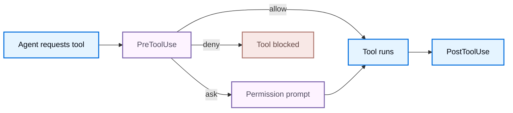

钩子允许外部程序观察和控制 Deep Agents Code 的生命周期事件。

当事件触发时，Deep Agents Code 查找匹配的处理器，通过标准输入向每个处理器发送 JSON 负载，并组合它们的退出码和标准输出。使用该响应来允许、拒绝、注入上下文或继续一个回合。下文将涵盖配置、[事件](#事件)、[输入负载](#输入负载) 和 [处理器输出](#处理程序输出)。

钩子以您的用户权限运行，并执行来自您配置的任意代码。将钩子配置视为可执行代码，并且仅从您信任的来源安装钩子。

## 设置

为适用于所有项目的钩子创建 `~/.deepagents/hooks.json`，或为项目范围的钩子创建 `{project_root}/.deepagents/hooks.json`（在您授信 [工作区信任](#授信项目钩子) 后）。处理器嵌套在三个层级：事件名称、匹配器组，然后是运行该组的处理器。

```json title="~/.deepagents/hooks.json"
{
  "hooks": {
    "PreToolUse": [
      {
        "matcher": "Bash",
        "hooks": [
          {
            "type": "command",
            "command": "~/.deepagents/hooks/block-rm.sh",
            "timeout": 600
          }
        ]
      }
    ],
    "SessionStart": [
      {
        "matcher": "startup|resume",
        "hooks": [
          {
            "type": "command",
            "command": "~/.deepagents/hooks/load-context.sh"
          }
        ]
      }
    ]
  }
}
```

Deep Agents Code 按优先级顺序加载钩子配置：

1. 授信后从 `{project_root}/.deepagents/hooks.json` 加载的项目钩子。
2. 从 `~/.deepagents/hooks.json` 加载的用户钩子。
3. 由已启用插件贡献的钩子。

每个匹配的处理器并发运行，并且它们的优先级顺序组合结果。优先级决定哪个答案获胜，而不是哪个处理器执行：优先级较低的处理器仍然运行，并且其副作用仍然发生，即使优先级较高的处理器阻止了事件。

运行 `dcode config path` 以检查单独的项目和用户钩子位置以及工作区信任存储。

钩子配置在 `/reload` 或新会话之前快照。在回合期间编辑 `hooks.json` 不会更改活动快照。启用或禁用插件也会更改快照，因此运行 `/reload` 以获取其钩子。

### 授信项目钩子

项目钩子来自仓库，因此它们仅在授信工作区后才加载：

- 交互式会话在未授信的工作区包含 `.deepagents/hooks.json` 时提示。授信工作区将此决策持久化到该项目根目录下的 `~/.deepagents/.state/hooks_trust.json`。
- 拒绝提示会跳过该会话的项目钩子，并继续使用用户和插件钩子。
- 使用 `Esc` 或 `Ctrl+D` 取消提示会中止启动。
- 头部和无头以及 CI 运行从不提示。将 `--trust-project-hooks` 传递给该运行以选择加入。

### 插件钩子

已启用的插件贡献相同的配置形状来自 `hooks/hooks.json`、一个清单 `hooks` 路径或一个内联清单对象。安装和启用插件是授信门槛：工作区信任仅控制项目钩子，因此它既不授予也不撤销插件的钩子。在启用插件之前审查它，并检查插件管理器中声明的 [事件](/langchain/oss/deepagents/code/plugins#添加钩子)。

服务器拥有的事件在会话开始时固定，因此新启用的插件钩子在下次启动或 `/reload` 时激活。

插件处理器可以通过这些变量引用它们自己的安装路径：

| 变量 | 值 |
| --- | --- |
| `${CLAUDE_PLUGIN_ROOT}`, `${PLUGIN_ROOT}` | 安装的插件目录 |
| `${CLAUDE_PLUGIN_DATA}`, `${PLUGIN_DATA}` | 插件的可写数据目录 |
| `${CLAUDE_PROJECT_DIR}` | 项目根目录 |

在 `command` 字符串中引用这些变量，因为安装路径可以包含空格：`"command": "\"${CLAUDE_PLUGIN_ROOT}/scripts/format.sh\""`。当可以时，优先使用可选的 `argv` 字段：Deep Agents Code 在启动前解析变量并跳过 shell，因此您不需要引用。

无效的插件钩子文档会单独被跳过并报告为配置诊断。其他插件、项目钩子和用户钩子仍然正常工作。

### 处理器字段

matcher 组的 `hooks` 数组中的每个条目都是一个命令处理器：

<ResponseField name="type" type="string" required>
    处理器类型。仅支持 `command`。命令处理器运行一个子进程，该子进程通过标准输入接收事件 JSON。
</ResponseField>

<ResponseField name="command" type="string" required>
    要运行的 shell 命令。始终必需。支持管道、重定向、通配符和环境变量扩展。事件负载作为 JSON 写入标准输入，永远不会插值到参数中。当 `argv` 也设置时，此字符串不会通过 shell 执行。
</ResponseField>

<ResponseField name="argv" type="list[string]" post={["optional"]}>
    直接执行参数列表而不是通过 shell 解释 `command`。用于显式可执行路径和参数。
</ResponseField>

<ResponseField name="timeout" type="number" post={["optional"]}>
    每个处理器的秒级超时。默认值为 600 秒，`UserPromptSubmit` 默认为 30 秒。超时是一种非阻塞失败。
</ResponseField>

<ResponseField name="statusMessage" type="string" post={["optional"]}>
    处理器运行时在 UI 中显示的临时消息。
</ResponseField>

配置不支持的处理器类型或 `"async": true` 会导致可见的配置错误。

### 处理器环境

处理器在负载中报告为 `cwd` 的工作目录中启动，并继承会话环境，但移除了看起来像凭证的变量：任何包含 `KEY`、`TOKEN`、`SECRET`、`PASSWORD` 或 `APIKEY` 的名称在启动前都会被移除。需要凭证的处理器必须从文件或密钥管理器中读取，而不是继承的环境。插件处理器还会接收它们自己的 [插件路径变量](#插件钩子)。

### 匹配器

匹配器过滤是否处理器组针对给定事件运行。每个事件针对一个字段进行匹配（见 [事件](#事件)）：

- 省略、空或 `*` 匹配该事件的全部值。
- 简单名称精确匹配（`Bash`）。
- `|` 或 `,` 分隔精确替代（`Edit|Write`）。
- 其他任何值被视为无锚点的正则表达式（`mcp__.*`）。

`UserPromptSubmit` 和 `Stop` 没有匹配器字段。省略 `matcher` 对于这些事件，或将其设置为 `*`；配置加载时任何其他值都会被拒绝。

编译错误会使该组无效，并在会话运行前产生用户可见的配置诊断。

## 事件

Deep Agents Code 发射以下事件。客户端拥有的事件在 CLI 进程中运行。服务器拥有的事件源自代理执行路径，并绕回客户端，因此命令处理器在您的配置所在位置运行。

| 事件 | 所有者 | 退出码2效果 | 匹配 |
| --- | --- | --- | --- |
| `SessionStart` | 客户端 | 诊断 | `source` |
| `UserPromptSubmit` | 客户端 | 阻塞提示词 | 无 |
| `SessionEnd` | 客户端 | 诊断 | `reason` |
| `PermissionRequest` | 客户端 | 拒绝 | `tool_name` |
| `Notification` | 客户端 | 诊断 | `notification_type` |
| `PreToolUse` | 服务器 | 拒绝 | `tool_name` |
| `PostToolUse` | 服务器 | 反馈 | `tool_name` |
| `PreCompact` | 服务器 | 阻塞合并 | `trigger` |
| `Stop` | 服务器 | 继续回合 | 无 |
| `SubagentStart` | 服务器 | 诊断 | `agent_type` |
| `SubagentStop` | 服务器 | 添加上下文 | `agent_type` |

`PreToolUse` 在权限提示之前和工具执行之前运行，因此它是允许或拒绝工具的主要位置。 `Stop` 在终端模型响应提交之前运行。



该图仅涵盖工具调用路径。 `PermissionRequest` 是当深度智能体代码即将显示权限提示时，属于客户端拥有的事件。

### 提示词缓存过期前通知

`cache_expiring` 通知在跟踪的提示词缓存保留窗口结束前发出。使用它来触发在下一个回合开始前提醒自己的操作，以避免缓存未命中。

在 `hooks.json` 中，在 `Notification` 下添加一个处理程序组，将 `matcher` 设置为 `cache_expiring`。深度智能体代码在每个线程和缓存窗口的最后60秒内发出一次。负载包括 `notification_type`、`message` 和 `title`。

## 输入负载

每个处理程序在 stdin 上接收一个 JSON 对象。所有事件共享一个通用信封，加上事件特定的字段。

### 通用字段

| 字段 | 描述 |
| --- | --- |
| `session_id` | 会话标识符 |
| `transcript_path` | 当可用时，对话文本的路径 |
| `cwd` | 当挂钩被调用时的工作目录 |
| `hook_event_name` | 触发的事件的名称 |
| `prompt_id` | 当可用时，当前用户提示的 UUID |
| `permission_mode` | 当有意义时，权限模式（`default`、`plan`、`acceptEdits`、`auto`、`dontAsk`、`bypassPermissions`） |
| `effort` | 当可用时，对象，例如 `{ "level": "medium" }`，其中级别是 `none`、`low`、`medium`、`high`、`xhigh` 或 `max` |
| `agent_id`、`agent_type` | 当可用时，子智能体的身份 |

`transcript_path` 指向在 `~/.deepagents/transcripts` 下写入的对话的 JSONL 投影。子智能体事件还携带 `agent_transcript_path` 用于子智能体自己的文本。这两个文件在匹配的处理程序运行之前被刷新，因此处理程序可以读取到当前事件的对话。

### 事件特定字段

| 事件 | 字段 |
| --- | --- |
| `SessionStart` | `source`（`startup`、`resume`、`clear`、`compact`），当可用时，`model` |
| `UserPromptSubmit` | `prompt` |
| `SessionEnd` | `reason`（`clear`、`resume`、`prompt_input_exit`、`other`） |
| `PermissionRequest` | `tool_name`、`tool_input`、`permission_suggestions`（目前为空） |
| `Notification` | `message`、`notification_type`，当可用时 `title` |
| `PreToolUse` | `tool_name`、`tool_input`、`tool_use_id` |
| `PostToolUse` | `tool_name`、`tool_input`、`tool_response`、`tool_use_id`，当可用时 `duration_ms` |
| `PreCompact` | `trigger`（`manual`、`auto`）、`custom_instructions` |
| `Stop` | `stop_hook_active`、`last_assistant_message`、`background_tasks`、`session_crons` |
| `SubagentStart` | `agent_id`、`agent_type` |
| `SubagentStop` | `stop_hook_active`、`agent_id`、`agent_type`、`agent_transcript_path`、`last_assistant_message`、`background_tasks`、`session_crons` |

示例 `PreToolUse` 负载：

```json
{
  "session_id": "abc123",
  "transcript_path": "/Users/you/.deepagents/.../transcript.jsonl",
  "cwd": "/Users/you/my-project",
  "permission_mode": "default",
  "hook_event_name": "PreToolUse",
  "tool_name": "Bash",
  "tool_input": {
    "command": "rm -rf /tmp/build"
  },
  "tool_use_id": "toolu_01ABC"
}
```

### 工具名称

挂钩脚本看到的是稳定的公共工具名称和参数形状，而不是内部深度智能体代码的工具名称。在 `PreToolUse`、`PostToolUse` 和 `PermissionRequest` 中匹配和读取这些名称：

| 公共工具名称 | 值得注意的输入字段 |
| --- | --- |
| `Bash` | `command`，可选 `timeout` 毫秒 |
| `Write` | `file_path`、`content` |
| `Edit` | `file_path`、`old_string`、`new_string`、`replace_all` |
| `Read` | `file_path`、`limit`、`offset` |
| `Glob` | `pattern`、`path` |
| `Grep` | `pattern`、`path`、`glob`、`output_mode`、`head_limit` |
| `LS` | `path` |
| `mcp__<server>__<tool>` | 工具特定的 JSON |

## 处理程序输出

命令处理程序通过它们的退出码、stdout 和 stderr 传达结果。

| 退出码 | 含义 |
| --- | --- |
| `0` | 成功。当 stdout 包含 JSON 时，它将被解析并应用。 |
| `2` | 那个事件的阻塞或反馈路径。参见 [事件](#事件) 表格退出码2效果列。忽略 stdout JSON，stderr 是主要的反馈通道。 |
| 其他非零 | 非阻塞错误。深度智能体代码记录一个诊断并继续。 |

JSON 输出仅在退出 `0` 时处理，并且 stdout 上必须只包含此内容。成功的非 JSON stdout 成为 `SessionStart` 和 `UserPromptSubmit` 的附加上下文；对于其他事件，它产生一个诊断。stdout 和 stderr 各自保留最多 100,000 字节。

### 通用输出字段

任何处理程序都可以返回这些顶层字段：

```json
{
  "continue": true,
  "stopReason": "optional user-facing reason when continue is false",
  "suppressOutput": false,
  "systemMessage": "optional message shown to the user",
  "terminalSequence": "optional restricted terminal control sequence",
  "hookSpecificOutput": {
    "hookEventName": "PreToolUse"
  }
}
```

所有匹配的处理程序在结果组合之前完成。返回 `"continue": false` 将减少的决策标记为停止，但不会阻止其他匹配的处理程序运行。`stopReason` 在配置顺序中获胜。`suppressOutput` 仅抑制该处理程序的 `systemMessage`。

事件特定的控制位于 `hookSpecificOutput`（用于工具和权限事件）或位于顶层 `decision` 和 `reason`（用于 `Stop`）。

### 使用 `PreToolUse` 控制工具执行

返回一个权限决策，允许、拒绝或在工具运行前强制提示：

```json
{
  "hookSpecificOutput": {
    "hookEventName": "PreToolUse",
    "permissionDecision": "deny",
    "permissionDecisionReason": "Destructive command blocked by hook"
  }
}
```

当多个挂钩匹配时，决策按 `deny > ask > allow` 的优先级组合。拒绝会中断权限提示之前的执行，并将其理由传递给模型。询问会强制权限提示。允许会抑制普通提示，但不会覆盖单独的拒绝或询问。任何 `additionalContext` 值按配置顺序传递。

您也可以使用退出码 `2` 进行阻塞，并将原因写入 stderr。

### 使用 `PermissionRequest` 允许或拒绝

返回一个决策，代表用户回答权限提示：

```json
{
  "hookSpecificOutput": {
    "hookEventName": "PermissionRequest",
    "decision": {
      "behavior": "deny",
      "message": "Not allowed in this environment"
    }
  }
}
```

任何拒绝都会获胜。如果没有挂钩拒绝，并且至少有一个允许，则操作将被允许。如果没有挂钩决定，则显示正常的权限提示。

### 使用 `Stop` 继续回合

返回一个阻塞决策，使智能体继续工作而不是结束回合：

```json
{
  "decision": "block",
  "reason": "Tests are still failing; keep working"
}
```

阻塞会使用您的反馈继续智能体回合。`Stop.hookSpecificOutput.additionalContext` 具有相同的延续效果。为了避免无限循环，在负载中检查 `stop_hook_active`，并在满足您的条件后停止阻塞。深度智能体代码还强制执行连续八次的硬限制。

### 注入上下文

`SessionStart`、`UserPromptSubmit` 和 `SubagentStart` 可以向模型添加上下文：

```json
{
  "hookSpecificOutput": {
    "hookEventName": "SessionStart",
    "additionalContext": "Current sprint: ENG-1421. Prefer the staging database."
  }
}
```

`UserPromptSubmit` 也支持 `suppressOriginalPrompt`。`PostToolUse` 和 `SubagentStop` 可以向模型追加 `additionalContext`，但不能撤销已经运行的操作。

## 不支持的输出字段

以下兼容性字段被识别但未应用。Deep Agents Code 会发出诊断信息并在结果列中继续使用后备方案。对于工具和权限行，这意味着普通的 [PreToolUse](#使用-pretooluse-控制工具执行) 或 [PermissionRequest](#使用-permissionrequest-允许或拒绝) 决策路径，不会修改工具输入或延迟。

| 字段或行为 | 结果 |
| --- | --- |
| `SessionStart.initialUserMessage`, `sessionTitle`, `watchPaths`, `reloadSkills` | 解析，未应用 |
| `UserPromptSubmit.sessionTitle` | 解析，未应用 |
| `PreToolUse.updatedInput` | 忽略修改；`allow` 或 `ask` 使用普通的 [PreToolUse](#使用-pretooluse-控制工具执行) 决策 |
| `PreToolUse.defer` | 使用普通的 [PreToolUse](#使用-pretooluse-控制工具执行) 决策；永远不会被视为允许 |
| `PostToolUse.updatedToolOutput`, `updatedMCPToolOutput` | 解析，未应用 |
| `PermissionRequest.updatedInput` | 忽略修改；一个 `allow` 使用普通的 [PermissionRequest](#使用-permissionrequest-允许或拒绝) 决策 |
| `PermissionRequest.updatedPermissions` | 解析，未应用（无权限规则存储） |
| `SubagentStop` 块 | [仅上下文](#注入上下文)；完成的子智能体不能被恢复 |

## 示例

<Accordion title="Block destructive Bash commands (PreToolUse)">
```bash title="~/.deepagents/hooks/block-rm.sh"
#!/usr/bin/env bash
command=$(jq -r '.tool_input.command // ""')

if printf '%s' "$command" | grep -Eq 'rm[[:space:]]+.*-[a-zA-Z]*[rf]'; then
  cat <<'JSON'
{
  "hookSpecificOutput": {
    "hookEventName": "PreToolUse",
    "permissionDecision": "deny",
    "permissionDecisionReason": "Recursive or forced rm is blocked by policy"
  }
}
JSON
fi
```

```json title="~/.deepagents/hooks.json"
{
  "hooks": {
    "PreToolUse": [
      {
        "matcher": "Bash",
        "hooks": [
          { "type": "command", "command": "~/.deepagents/hooks/block-rm.sh" }
        ]
      }
    ]
  }
}
```
</Accordion>

<Accordion title="Load project context on session start (SessionStart)">
```bash title="~/.deepagents/hooks/load-context.sh"
#!/usr/bin/env bash
context=$(git -C "$(jq -r '.cwd')" log --oneline -5 2>/dev/null)

jq -n --arg ctx "$context" '{
  hookSpecificOutput: {
    hookEventName: "SessionStart",
    additionalContext: ("Recent commits:\n" + $ctx)
  }
}'
```

```json title="~/.deepagents/hooks.json"
{
  "hooks": {
    "SessionStart": [
      {
        "matcher": "startup|resume",
        "hooks": [
          { "type": "command", "command": "~/.deepagents/hooks/load-context.sh" }
        ]
      }
    ]
  }
}
```
</Accordion>

<Accordion title="Desktop notification when the turn ends on macOS (Stop)">
```json title="~/.deepagents/hooks.json"
{
  "hooks": {
    "Stop": [
      {
        "hooks": [
          {
            "type": "command",
            "command": "osascript -e 'display notification \"Agent finished\" with title \"Deep Agents Code\"'"
          }
        ]
      }
    ]
  }
}
```
</Accordion>

<Accordion title="Python handler that reads the payload">
```python title="~/.deepagents/hooks/handler.py"
import json
import sys


def handle(payload: dict[str, object]) -> None:
    event = payload["hook_event_name"]
    if event == "PreToolUse":
        tool_name = payload["tool_name"]
        print(f"About to run {tool_name}", file=sys.stderr)


if __name__ == "__main__":
    handle(json.load(sys.stdin))
```

```json title="~/.deepagents/hooks.json"
{
  "hooks": {
    "PreToolUse": [
      {
        "matcher": "*",
        "hooks": [
          {
            "type": "command",
            "command": "python3 ~/.deepagents/hooks/handler.py"
          }
        ]
      }
    ]
  }
}
```
</Accordion>

## 故障排除钩子

钩子活动在会话中可见，而不仅限于日志：

- 运行的处理器显示其 `statusMessage`，或在设置无时显示 `Running <event> hook`。并发处理器共享一个状态槽，因此显示最最近的一个，直到其完成。
- 处理器的 `systemMessage` 显示为信息通知。
- 配置错误、非零退出、超时和不支持的输出字段作为 `Hook warning` 或 `Hook error` 通知出现，每个调用一次。
- 钩子提供的权限答案归因于钩子，例如 `PermissionRequest hook denied Bash`。
- 设置 `DEEPAGENTS_CODE_DEBUG=1` 以捕获所有诊断信息，包括调试级别的条目，这些条目永远不会作为通知显示。

## 传统配置

旧的列表形 `hooks.json` 文件已弃用但仍受支持。Deep Agents Code 自动迁移等效事件；没有安全映射的事件会带诊断信息被跳过。

## 安全

钩子遵循与 Git 钩子或 shell 别名相同的信任模型：任何可以写入 `hooks.json` 的进程都可以以您的权限运行任意命令。

- 负载数据作为 JSON 流到 stdin，永远不会插值到命令参数中。
- 看起来像凭证的环境变量从处理器环境中被移除。
- 钩子配置在 `/reload` 或新会话之前保持固定。
- 优先选择您控制的显式 shell 可执行文件，而不是 shell 包装器。
- 仅从您信任的来源安装钩子。

<Warning>
    钩子以您的用户权限运行。将钩子配置视为可执行代码。
</Warning>

## 参见

- [配置](/langchain/oss/deepagents/code/configuration)
- [插件和市场](/langchain/oss/deepagents/code/plugins)
- [数据位置](/langchain/oss/deepagents/code/configuration#数据位置)
- [CLI 参考](/langchain/oss/deepagents/code/cli-reference)

---

> 官方原文：[src/oss/deepagents/code/hooks.mdx](https://github.com/langchain-ai/docs/blob/main/src/oss/deepagents/code/hooks.mdx) · 非官方翻译，译文由 AI 生成，以英文原文为准。
