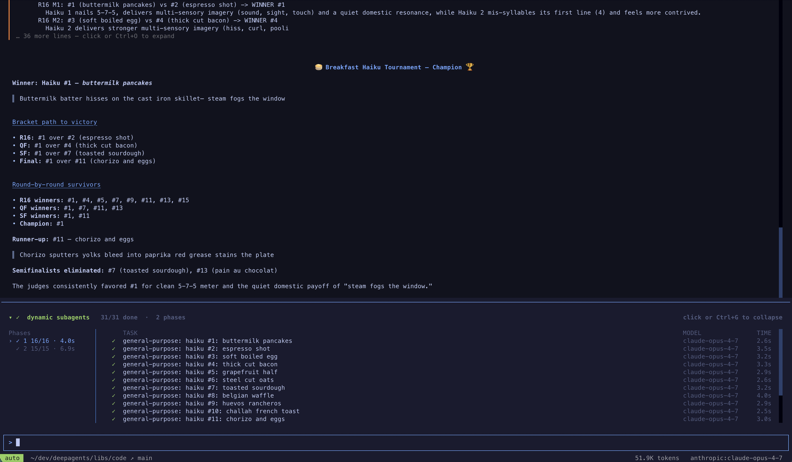

将自定义同步 [智能体](/langchain/oss/deepagents/subagents) 定义为 Markdown 文件，以便 Deep Agents Code 可以将专业任务委托给它们。

<Note>
    异步智能体当前在 Deep Agents Code 中不可用。
</Note>

每个智能体都位于其自己的文件夹中，并包含一个 `AGENTS.md` 文件：

```text
.deepagents/agents/{subagent-name}/AGENTS.md   # Project-level
~/.deepagents/{agent}/agents/{subagent-name}/AGENTS.md  # User-level
```

项目智能体会覆盖同名的用户智能体（请参阅 [优先级规则](/langchain/oss/deepagents/code/configuration#子智能体)）。

## 继续父级对话

内置的 `general-purpose` 智能体会继承父级智能体的对话和系统提示词。这种上下文允许委托的工作在不重复父级对话中已建立的调查、决策或其他细节的情况下继续。

要在隔离模式下运行内置的 `general-purpose` 智能体，请在您的 shell 或全局 `~/.deepagents/.env` 中设置以下变量：

```bash
export DEEPAGENTS_CODE_FORKED_SUBAGENTS=false
```

前置文本需要 `name` 和 `description`（与 [`SubAgent` 字典规范](/langchain/oss/deepagents/subagents#子智能体（基于字典）) 相同）。Markdown 正文成为智能体的 `system_prompt`。除了基本规范外，`AGENTS.md` 文件支持可选的 `model` 前置文本字段，该字段会覆盖此智能体使用的主要智能体的模型。使用 `provider:model-name` 格式（例如，`anthropic:claude-opus-4-8`、`openai:gpt-5.5`）。省略它以继承主要智能体的模型。

<Note>
    其他 `SubAgent` 字段（`tools`、`middleware`、`interrupt_on`、`skills`）当前无法通过 `AGENTS.md` 前置文本进行配置——以这种方式定义的自定义智能体会继承主要智能体的工具。使用 SDK 以获得完全控制。

</Note>

## 文件格式

智能体 `AGENTS.md` 文件使用 YAML 前置文本，后跟 Markdown 正文：

```markdown
---
name: researcher
description: Research topics on the web before writing content
model: anthropic:claude-haiku-5-5
---

You are a research assistant with access to web search.

## Your Process
1. Search for relevant information
2. Summarize findings clearly
```

## 动态智能体

`dcode` 预装了代码解释器，因此 [动态智能体](/langchain/oss/deepagents/dynamic-subagents) 可以即用即走。

要触发动态智能体，请要求一个“工作流”。智能体不会自己执行工作或通过其原生 `task` 工具管理分支，而是编写一个编排脚本，调用内置的 `task()` 全局并在代码解释器中运行它。例如：“运行一个工作流来审查 src/ 中的每个文件是否存在 SQL 注入。”

随着智能体的生成，`dcode` 在动态智能体面板中实时显示它们，按调度分组。

<Frame>
  
</Frame>

您也可以在您选择的编码智能体中使用动态智能体，例如通过 [ACP](/langchain/oss/deepagents/acp)（例如，Zed）。

## 示例：成本高效的智能体

为简单的委托任务使用更便宜、更快的模型，同时保持主要智能体在更强大的模型上：

```markdown
---
name: general-purpose
description: General-purpose agent for research and multi-step tasks
model: anthropic:claude-haiku-5-5
---

You are a general-purpose assistant. Complete the task efficiently and return a concise summary.
```

这会覆盖内置的通用智能体，将所有委托任务路由到更便宜的模型。有关更多信息，请参阅 [覆盖通用智能体](/langchain/oss/deepagents/subagents#覆盖通用子智能体)。

---

> 官方原文：[src/oss/deepagents/code/subagents.mdx](https://github.com/langchain-ai/docs/blob/main/src/oss/deepagents/code/subagents.mdx) · 非官方翻译，译文由 AI 生成，以英文原文为准。
