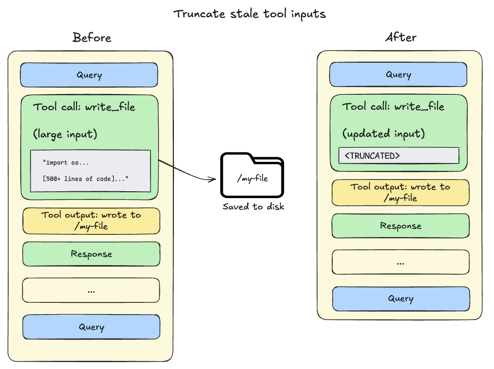
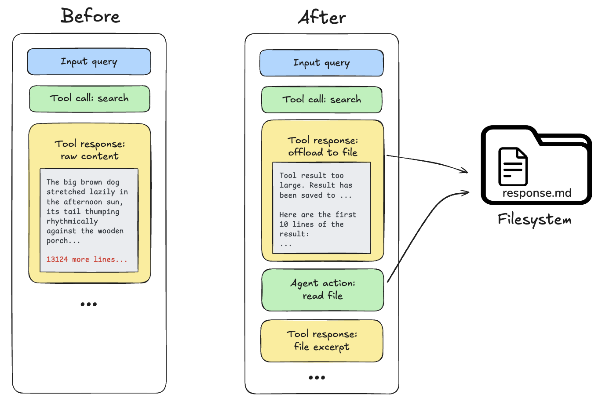
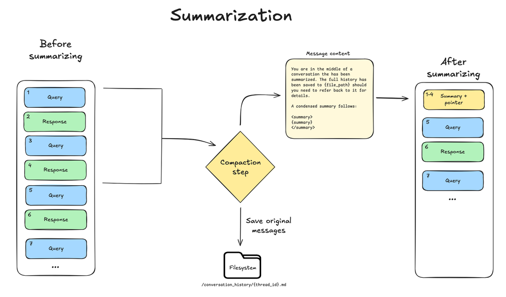

import ContextEngineeringSystemPromptPy from '/langchain/snippets/code-samples/context-engineering-system-prompt-py.mdx';
import ContextEngineeringSystemPromptJs from '/langchain/snippets/code-samples/context-engineering-system-prompt-js.mdx';
import ContextEngineeringMemoryPy from '/langchain/snippets/code-samples/context-engineering-memory-py.mdx';
import ContextEngineeringMemoryJs from '/langchain/snippets/code-samples/context-engineering-memory-js.mdx';
import ContextEngineeringSkillsPy from '/langchain/snippets/code-samples/context-engineering-skills-py.mdx';
import ContextEngineeringSkillsJs from '/langchain/snippets/code-samples/context-engineering-skills-js.mdx';
import ContextEngineeringToolPromptsPy from '/langchain/snippets/code-samples/context-engineering-tool-prompts-py.mdx';
import ContextEngineeringToolPromptsJs from '/langchain/snippets/code-samples/context-engineering-tool-prompts-js.mdx';
import ContextEngineeringRuntimeContextPy from '/langchain/snippets/code-samples/context-engineering-runtime-context-py.mdx';
import ContextEngineeringRuntimeContextJs from '/langchain/snippets/code-samples/context-engineering-runtime-context-js.mdx';
import ContextEngineeringStateSchemaPy from '/langchain/snippets/code-samples/context-engineering-state-schema-py.mdx';
import ContextEngineeringSummarizationToolPy from '/langchain/snippets/code-samples/context-engineering-summarization-tool-py.mdx';
import ContextEngineeringResearchSubagentPy from '/langchain/snippets/code-samples/context-engineering-research-subagent-py.mdx';
import ContextEngineeringResearchSubagentJs from '/langchain/snippets/code-samples/context-engineering-research-subagent-js.mdx';
import ContextEngineeringLongTermMemoryPy from '/langchain/snippets/code-samples/context-engineering-long-term-memory-py.mdx';
import ContextEngineeringLongTermMemoryJs from '/langchain/snippets/code-samples/context-engineering-long-term-memory-js.mdx';

上下文工程是为您的深度智能体在正确的格式下提供正确的信息和工具，以便其可靠地完成任务。

深度智能体可以访问多种类型的上下文。
一些来源在智能体启动时提供给智能体；其他来源在运行时变得可用，例如用户输入。
深度智能体包括跨长时间运行会话管理上下文的内置机制。

本页面概述了您的深度智能体可以访问并管理的不同类型的上下文。

<Tip>
对上下文工程不熟悉？请参阅关于不同类型上下文及其使用场景的[概念概述](/langchain/oss/concepts/context)。
</Tip>

## 上下文类型

| 上下文类型 | 您控制的内容 | 范围 |
|--------------|------------------|-------|
| **[输入上下文](#输入上下文)** | 启动时输入到智能体提示词中的内容（系统提示词、记忆、技能） | 静态，每次运行时应用 |
| **[运行时上下文](#运行时上下文)** | 调用时传递的静态配置（用户元数据、API 密钥、连接） | 每次运行，传播到子智能体 |
| **[上下文压缩](#上下文压缩)** | 内置卸载和摘要功能，以保持上下文在窗口限制内 | 自动，当接近限制时 |
| **[上下文隔离](#子智能体的上下文隔离)** | 使用子智能体隔离繁重工作，仅将结果返回给主智能体 | 每个子智能体，当被委托时 |
| **[长期记忆](#长期记忆)** | 使用虚拟文件系统跨线程进行持久化存储 | 跨对话持久化 |

## 输入上下文

输入上下文是在启动时提供给您的深度智能体并成为其系统提示词一部分的信息。最终的提示词由多个来源组成：

<CardGroup cols={2}>
  <Card title="System prompt" icon="message-2" href="#system-prompt">
    您提供的自定义指令加上内置智能体指导。
  </Card>
  <Card title="Memory" icon="database" href="#memory">
    持久化 `AGENTS.md` 文件在配置时始终加载。
  </Card>
  <Card title="Skills" icon="tool" href="#skills">
    在相关时按需加载的功能（渐进式披露）。
  </Card>
  <Card title="Tool prompts" icon="list" href="#tool-prompts">
    使用内置工具或自定义工具的说明。
  </Card>
</CardGroup>

### 系统提示词

您的自定义系统提示词会添加到内置系统提示词之前，内置系统提示词包含对文件系统工具和子智能体的指导。使用它来定义智能体的角色、行为和知识：

:::python
<ContextEngineeringSystemPromptPy />
:::

:::js
<ContextEngineeringSystemPromptJs />
:::

:::python
`system_prompt` 参数是静态的，这意味着它不会在每次调用时改变。
对于某些用例，您可能希望使用动态提示词：例如，告诉模型“您具有管理员访问权限”与“您具有只读访问权限”，或从 [长期记忆](#长期记忆)注入用户偏好，如“用户倾向于简洁的回复”。
如果您的提示词依赖于上下文或 `runtime.store`，请使用 `@dynamic_prompt`构建上下文感知指令。您的中间件可以读取 `request.runtime.context` 和 `request.runtime.store`。
参见 [自定义化](/langchain/oss/deepagents/customization#中间件)，了解 [深度智能体堆栈](/langchain/oss/deepagents/customization#deep-agents-堆栈)，以及添加 [自定义中间件](/langchain/oss/langchain/middleware)。参见 [LangChain 上下文工程](/langchain/oss/langchain/context-engineering#系统提示词)指南获取示例。

当工具单独使用上下文或 `runtime.store`时，您**不需要**中间件；工具直接接收 @[ToolRuntime] 对象（包括 `runtime.context` 和 `runtime.store`）。仅当工具应与系统提示词的更新一起打包时才添加中间件。

:::js
`systemPrompt` 参数是静态的，这意味着它不会在每次调用时改变。
对于某些用例，您可能需要一个动态提示词：例如，告诉模型“您有管理员访问权限”与“您有只读访问权限”，或者从 [长期记忆](#长期记忆) 注入用户偏好，如“用户倾向于简洁的回复”。
如果您的提示词依赖于上下文或 `runtime.store`，请使用 `dynamicSystemPromptMiddleware` 来构建上下文感知指令。
您的中间件可以读取 `request.runtime.context` 和 `request.runtime.store`。
参见 [自定义](/langchain/oss/deepagents/customization#中间件)，适用于 [深度智能体堆栈](/langchain/oss/deepagents/customization#deep-agents-堆栈) 和添加 [自定义中间件](/langchain/oss/langchain/middleware)。参见 [LangChain 上下文工程](/langchain/oss/langchain/context-engineering#系统提示词) 指南获取示例。

当工具单独使用上下文或 `runtime.store` 时，您**不需要**中间件；工具直接接收 `runtime` 对象（包括 `runtime.context` 和 `runtime.store`）。仅在系统提示词本身必须按请求变化时才添加中间件。
:::

<Tip>
    要调整特定提供者或模型的组装系统提示词，请使用 [适配器配置文件](/langchain/oss/deepagents/profiles#链配置)：`base_system_prompt` 完全替换基础提示词，而 `system_prompt_suffix` 附加到其上。
</Tip>

### 记忆

记忆文件（[`AGENTS.md`](https://agents.md/)）提供持久上下文，该上下文**始终**加载到系统提示词中。用于项目规范、用户偏好和应适用于每个对话的关键指南的记忆：

:::python
<ContextEngineeringMemoryPy />
:::

:::js
<ContextEngineeringMemoryJs />
:::

与技能不同，记忆始终被注入——没有渐进式披露。保持记忆最小化以避免上下文过载；使用 [技能](/langchain/oss/deepagents/skills) 处理详细工作流和特定领域内容。参见 [记忆](/langchain/oss/deepagents/customization#记忆) 获取配置详情。

要生成编码智能体通过 `AGENTS.md` 发现的仓库维基，请参见 [OpenWiki](/langchain/oss/openwiki/overview)。

### 技能

技能提供 **按需** 功能。智能体在启动时读取每个 `SKILL.md` 的前文，然后仅在确定技能相关时加载完整技能内容。这减少了 Token 使用量，同时仍然提供专业工作流：

:::python
<ContextEngineeringSkillsPy />
:::

:::js
<ContextEngineeringSkillsJs />
:::

确保每个技能专注于单个工作流或领域；范围过广或重叠的技能会降低相关性，并在加载时膨胀上下文。在技能内，保持主内容简洁，并将详细参考材料移至技能文件中引用的单独文件。将始终相关的规范放入 [记忆](#记忆)。参见 [技能](/langchain/oss/deepagents/skills) 获取编写和配置。

### 工具提示词

[工具](/langchain/oss/langchain/tools) 提示词是塑造模型如何使用工具的指令。所有工具都暴露模型在提示词中看到的元数据——通常是模式（schema）和描述。通过 `tools` 参数传递的工具会向模型展示该工具的元数据（模式和描述）。深度智能体的内置工具打包在 [深度智能体堆栈](/langchain/oss/deepagents/customization#deep-agents-堆栈) 中，并且通常还会使用更多指导更新系统提示词。

**内置工具**：自动添加 harness 功能（文件系统、子智能体和可选规划）的中间件，会将特定工具的指令附加到系统提示词中，创建解释如何有效使用这些工具的工具提示词。参见 [自定义](/langchain/oss/deepagents/customization#中间件) 获取完整列表：

:::python
- 文件系统提示词：`ls`、`read_file`、`write_file`、`edit_file`、`delete`、`glob`、`grep`（使用沙盒后端时包含 `execute`）
:::
:::js
- 文件系统提示词：`ls`、`read_file`、`write_file`、`edit_file`、`glob`、`grep`（使用沙盒后端时包含 `execute`）
:::
- 子智能体提示词：使用 `task` 工具分配工作的指南
- 人机交互提示词：在指定工具调用处暂停的使用方法（当 `interrupt_on` 设置时）
- 本地上下文提示词：当前目录和项目信息（仅 Deep Agents 代码）

**您提供的工具**：通过 `tools` 参数传递的工具，其描述（来自工具模式）会被发送给模型。您还可以添加 [自定义中间件](/langchain/oss/langchain/middleware)，该中间件会添加工具并附加其自身的系统提示词指令。

对于您提供的工具，请确保提供清晰的名称、描述和参数描述。这些内容指导模型推理何时以及如何使用工具。在描述中包含 *何时* 使用工具，并说明每个参数的作用。

:::python
<ContextEngineeringToolPromptsPy />
:::

:::js
<ContextEngineeringToolPromptsJs />
:::

<Tip>
    要为特定提供者或模型覆盖内置或用户提供的工具的描述，请使用 [harness profile](/langchain/oss/deepagents/profiles#链配置) 的 `tool_description_overrides`（按工具名称键值对）。

    未使用的内置工具在每个回合中仍会发送其完整模式。使用 `excluded_tools` 移除智能体应永远不会调用的工具（例如，对只读智能体使用 `write_file` 或 `execute`）。这会缩小整个运行的基础提示词大小。这是配置，而不是 [上下文压缩](#上下文压缩) 中的自动卸载或摘要。

    参见 [Harness profiles](/langchain/oss/deepagents/profiles#链配置) 和 [不使用默认文件系统工具](/langchain/oss/deepagents/overview#虚拟文件系统访问)。

    如果一个工具与一项技能相关，您可以在需要该技能时才将工具的模式包含在提示词中。更多信息，请参见 [向技能添加工具](/langchain/oss/deepagents/skills#向技能添加工具)。
</Tip>

参见 [概述](/langchain/oss/deepagents/overview#执行环境) 获取内置功能，参见 [自定义](/langchain/oss/deepagents/customization#工具) 了解如何直接传递工具。

### 完整系统提示词

深度智能体的系统消息——模型在运行开始时接收到的组装系统提示词——由以下部分组成：

1. 自定义 `system_prompt`（如果提供）
1. [基础智能体提示词](https://github.com/langchain-ai/deepagents/blob/e18e9dcd0e6edc72c0a4a5b76ae752c4bc539752/libs/deepagents/deepagents/graph.py#L37)
1. 记忆提示词：`AGENTS.md` + 记忆使用指南（仅当提供 `memory` 时）
1. 技能提示词：技能位置 + 技能列表（含 frontmatter 信息）+ 使用方法（仅当提供技能时）
1. 虚拟文件系统提示词（文件系统 + 执行工具文档，如适用）
1. 子智能体提示词：任务工具使用
1. 用户提供的中间件提示词（如果提供自定义中间件）
1. 人机交互提示词（当 `interrupt_on` 设置时）

## 运行时上下文

运行时上下文是您在调用智能体时传递的每次运行配置。它不会自动包含在模型提示词中；模型只有在工具、中间件或其他逻辑读取它并将其添加到消息或系统提示词中时才能看到它。使用运行时上下文来传递用户元数据（ID、偏好设置、角色）、API 密钥、数据库连接、功能标志或其他您的工具和框架需要的值。

:::python
使用 `context_schema` 定义该数据的结构：使用 `dataclasses.dataclass` 或 `typing.TypedDict` 类。通过 **`context`** 参数传递值给 `invoke` / `ainvoke`。有关详细信息，请参阅 [运行时](/langchain/oss/langchain/runtime) 和 [LangGraph 运行时上下文](/langchain/oss/langgraph/graph-api#运行时上下文)。

在工具内部，从注入的 @[ToolRuntime] 中读取上下文：

<ContextEngineeringRuntimeContextPy />
:::

:::js
使用 `contextSchema` 定义该数据的结构，通常是一个 Zod 对象模式（例如 `z.object({ ... })`）。在传递给 `invoke` / `ainvoke` 的选项对象中，在 **`context`** 字段中传递运行时值。有关详细信息，请参阅 [运行时](/langchain/oss/langchain/runtime) 和 [LangGraph 运行时上下文](/langchain/oss/langgraph/graph-api#运行时上下文)。

在工具内部，从作为工具处理程序的 `runtime` 参数提供的 `ToolRuntime` 实例中读取 `runtime.context`：

<ContextEngineeringRuntimeContextJs />
:::

运行时上下文 **传播到所有子智能体**。当子智能体运行时，它将接收与父智能体相同的运行时上下文。有关每个子智能体的上下文（命名空间键），请参阅 [子智能体](/langchain/oss/deepagents/subagents#上下文管理)。

:::python
## 自定义状态模式

<Note>
    自定义状态模式需要 `deepagents>=0.6.6`。
</Note>

当您的智能体或中间件需要跟踪必须在整个智能体生命周期中持续存在并存活于检查点中的数据时，请使用自定义状态模式。自定义状态允许您：

- **跨整个运行跟踪状态**：维护计数器、标志或累积值，这些值在模型调用和工具调用之间存活
- **在工具和中间件之间共享数据**：一个工具可以将值写入状态，而中间件挂钩可以读取它，反之亦然
- **实现横切关注点**：添加如速率限制、使用跟踪或审计日志等功能，而无需修改核心智能体逻辑
- **在调用时传递初始值**：在每次运行的开始处初始化状态字段，然后在执行过程中让智能体更新它们

当数据必须是智能体的可变图状态的一部分，与线程一起检查点，或通过 `runtime.state` 可用时，请使用 `state_schema`。对于不可变的每次运行输入，如用户 ID、凭证或功能标志，请优先使用 [运行时上下文](#运行时上下文)。

自定义状态模式必须继承 @[DeepAgentState]。这保留了 `messages` 上的内置 `DeltaChannel` 状态管理器，该状态管理器使检查点增长随着对话的变长而保持线性。

<ContextEngineeringStateSchemaPy />

该模式与中间件贡献的状态模式合并。传递给 `subagents=` 的声明式 @[SubAgent] 规范在 Deep Agents 编译它们用于 `task` 工具时继承父 `state_schema`。@[CompiledSubAgent] 运行able 和远程 @[AsyncSubAgent] 规范不继承它，因为它们的图已经编译或单独托管。如果它们需要相同的状态字段，请使用兼容的模式编译这些图。
:::

## 上下文压缩

每个 `create_deep_agent` 调用都包含内置的上下文压缩。您不需要添加中间件来实现卸载或摘要功能。

长时间运行的任务会产生大量的工具输出和长对话历史记录。
上下文压缩在保留与任务相关的详细信息的同时，减少了智能体工作内存中信息的大小。
以下技术是确保传递给 LLM 的上下文保持在它的上下文窗口限制内的内置机制：

<CardGroup cols={2}>
  <Card title="Offloading" icon="file-export" href="#offloading">
    大型工具输入和结果存储在文件系统中，并用引用替换。
  </Card>
  <Card title="Summarization" icon="article" href="#summarization">
    当接近限制时，旧消息会被压缩成一个 LLM 生成的摘要。
  </Card>
</CardGroup>

为了在压缩运行之前缩小每次轮询发送的工具模式，通过 [harness profile](/langchain/oss/deepagents/profiles#链配置) (`excluded_tools`) 排除未使用的内置工具。参见 [Tool prompts](#工具提示词)。

### 卸载

深度智能体使用 [内置文件系统工具](/langchain/oss/deepagents/overview#虚拟文件系统访问) 自动卸载内容，并在需要时搜索和检索卸载的内容。
当工具调用输入或结果超过 Token 阈值（默认 20,000）时会发生内容卸载：

1. **工具调用输入超过 20,000 个 Token**：文件写入和编辑操作会在智能体的对话历史记录中留下包含完整文件内容的工具调用。
    由于这些内容已经持久化到文件系统中，因此通常冗余。
    当会话上下文跨越模型可用窗口的 85% 时，深度智能体会截断旧的工具调用，用指向磁盘上文件的指针替换它们，并减小活动上下文的大小。

    

2. **工具调用结果超过 20,000 个 Token**：当发生这种情况时，深度智能体会将响应卸载到配置的后端，并用文件路径引用和前 10 行的预览替换它。智能体可以根据需要重新读取或搜索内容。

    

<Note>
内置上下文压缩不会调整图像大小、降低图像分辨率或生成视觉嵌入。对于多模态输入、工具输出以及压缩与媒体交互的方式，参见 [Multimodal](/langchain/oss/deepagents/multimodal)。
</Note>

### 摘要

:::js
<Note>
当前的摘要行为（通过 `wrapModelCall` 在模型中摘要、精确的 Token 计数和自动 `ContextOverflowError` 回退）需要 `deepagents>=1.6.0`。
</Note>
:::

每个 `create_deep_agent` 调用都在 [裸栈](/langchain/oss/deepagents/customization#裸栈模式) 中包含 @[`SummarizationMiddleware`]。当上下文大小跨越模型的上下文窗口限制（例如 `max_input_tokens` 的 85%）并且没有更多符合条件的上下文可供卸载时，深度智能体会自动摘要消息历史记录。

这个过程有两个组成部分：

- **上下文摘要**: 大语言模型（LLM）生成对话的结构化摘要，包括会话意图、创建的工件和下一步行动——这取代了智能体工作记忆中的完整对话历史。
- **文件系统保存**: 原始对话消息的文本渲染形式被写入文件系统作为规范记录。

这种双重方法确保智能体能够保持对其目标和进展的意识（通过摘要），同时在需要时能够通过文件系统搜索恢复文本细节。



**配置:**
- 在模型达到其 [模型配置](/langchain/oss/langchain/models#模型配置文件) 的 85%`max_input_tokens` 时触发
- 保留最近 10% 的 Token 作为上下文
- 如果模型配置不可用，则回退到 170,000-Token 触发 / 保留 6 条消息
- 如果任何模型调用引发标准 @[上下文溢出错误]，深度智能体会立即回退到摘要并重试，同时保留摘要和最近消息
- 较旧的消息由模型进行摘要

:::python
要通过不同的（通常更便宜）模型或自定义可调用项进行摘要，请在 [覆盖摘要中间件](/langchain/oss/deepagents/customization#覆盖默认中间件实例) 时传递 `summarizer=`。主要的 `model` 仍然提供配置和 Token 计数。需要 `deepagents>=0.7.26`。

<Tip>
[从智能体流式传输的 Token](/langchain/oss/deepagents/streaming#llm-token) 通常会包含摘要步骤生成的 Token。您可以使用其关联元数据过滤掉这些 Token：
```python
for token, metadata in agent.stream(
    {"messages": [...]},
    stream_mode="messages",
):
    if metadata.get("lc_source") == "summarization":  # [!code highlight]
        continue
    else:
        ...
```
</Tip>
:::

:::js
<Tip>
[从智能体流式传输的 Token](/langchain/oss/deepagents/streaming#llm-token) 通常会包含摘要步骤生成的 Token。您可以使用其关联元数据过滤掉这些 Token：
```typescript
for await (const [message, metadata] of await agent.stream(
  { messages: [...] },
  { streamMode: "messages" },
)) {
  if (metadata?.lcSource === "summarization") {  // [!code highlight]
    continue;
  } else {
    ...
  }
}
```
</Tip>
:::

:::python
##### 按需压缩工具

默认情况下，当上下文阈值达到时，自动摘要会运行。
另外，您可以给智能体一个 `compact_conversation` [工具](/langchain/oss/langchain/tools)，以便它可以按需触发压缩，例如在任务之间，而不是等待 85% 的阈值。

通过在 `create_deep_agent` 上使用 `middleware` 参数传递 @[`create_summarization_tool_middleware`] 来启用该工具。自定义中间件会在 @[`PatchToolCallsMiddleware` 后插入到 [深度智能体堆栈](/langchain/oss/deepagents/customization#deep-agents-堆栈) 中：

<ContextEngineeringSummarizationToolPy />

添加压缩工具不会在模型上下文限制的 85% 时禁用自动摘要。两者共享相同的摘要引擎和状态。

有关详细信息，请参阅 API 参考中的 @[`SummarizationToolMiddleware`] 和 @[`create_summarization_tool_middleware`]。

:::

## 子智能体的上下文隔离

子智能体解决了 **上下文膨胀问题**。当主智能体使用具有大输出的工具（网络搜索、文件读取、数据库查询）时，上下文窗口会很快填满。子智能体将这项工作隔离——主智能体只接收最终结果，而不是产生它的几十个工具调用。您还可以将每个子智能体与主智能体分开配置（例如，模型、工具、系统提示词和技能）。

**工作原理:**

- 主智能体有一个 `task` 工具用于委派工作
- 子智能体在其自己的全新上下文中运行
- 子智能体自主执行直至完成
- 子智能体向主智能体返回一个单一最终报告
- 主智能体的上下文保持干净

**最佳实践：**

1. **委派复杂任务**：使用子智能体处理多步骤工作，避免使主智能体的上下文变得杂乱。
2. **保持子智能体响应简洁**：指示子智能体返回摘要，而不是原始数据：

    :::python
    <ContextEngineeringResearchSubagentPy />
    :::

    :::js
    <ContextEngineeringResearchSubagentJs />
    :::

3. **使用文件系统处理大量数据**：子智能体可以将结果写入文件；主智能体读取所需内容。

参见 [子智能体](/langchain/oss/deepagents/subagents) 的配置和 [上下文管理](/langchain/oss/deepagents/subagents#上下文管理) 以了解运行时上下文传播和每个子智能体的命名空间。

## 长期记忆

当使用默认文件系统时，您的深度智能体将其工作内存文件存储在智能体状态中，该状态仅在单个线程内持久存在。
长期记忆使您的深度智能体能够在不同的线程和对话之间持久化信息。
深度智能体可以使用长期记忆来存储用户偏好、累积知识、研究进度或任何应在单个会话之外持续的信息。

要使用长期记忆，您必须使用一个 `CompositeBackend`，该工具将特定路径（通常是 `/memories/`）路由到 LangGraph Store，后者提供持久的跨线程持久性。
`CompositeBackend` 是一个混合存储系统，其中一些文件永久持久化，而其他文件仅限于单个线程。

:::python
<ContextEngineeringLongTermMemoryPy />
:::

:::js
<ContextEngineeringLongTermMemoryJs />
:::

您无需预先用文件填充 `/memories/`。
您提供后端配置、存储和系统提示指令，告诉智能体 *要保存什么* 以及 *在哪里*。
例如，您可以提示智能体将偏好保存到 `/memories/preferences.txt`。
路径初始为空，当用户分享值得记住的信息时，智能体会使用其文件系统工具（`write_file`、`edit_file`）按需创建文件。

要在 LangSmith 上部署时预填充记忆，请使用 [Store API](https://docs.langchain.com/langsmith/custom-store)。
参见 [长期记忆](/langchain/oss/deepagents/memory) 了解设置和用例。

## 最佳实践

1. **从正确的输入上下文开始**：保持记忆最小化以始终符合相关规范；使用专注的技能来执行特定任务的能力。
2. **利用子智能体处理繁重工作**：将多步骤、输出密集型任务委托给子智能体，以保持主智能体的上下文清晰。
3. **在配置中调整子智能体的输出**：如果在调试时发现子智能体生成长输出，你可以向子智能体的 `system_prompt` 添加指导，以创建摘要和综合发现。
4. **使用文件系统**：将大型输出持久化到文件（例如子智能体写入或 [自动卸载](#卸载)），以保持活动上下文的大小；模型可以在需要详细信息时使用 `read_file` 和 `grep` 拉取片段。
5. **记录长期记忆结构**：告诉智能体 `/memories/` 中存储的内容以及如何使用它。
6. **为工具传递运行时上下文**：使用 `context` 来传递用户元数据、API 密钥和其他工具需要的静态配置。

## 相关资源

- [Harness](/langchain/oss/deepagents/overview)：上下文管理概述、卸载、摘要
- [Multimodal](/langchain/oss/deepagents/multimodal)：图像、音频、视频和多模态工具输出
- [Subagents](/langchain/oss/deepagents/subagents)：上下文隔离、运行时上下文传播
- [Long-term memory](/langchain/oss/deepagents/memory)：跨线程持久化
- - [OpenWiki](/langchain/oss/openwiki/overview)：编码智能体通过 `AGENTS.md` 发现的存储库维基
- [Skills](/langchain/oss/deepagents/skills)：渐进式披露和技能编写
- [Backends](/langchain/oss/deepagents/backends)：文件系统后端和 CompositeBackend
- [Context 概念概述](/langchain/oss/concepts/context)：上下文类型和生命周期

---

> 官方原文：[src/oss/deepagents/context-engineering.mdx](https://github.com/langchain-ai/docs/blob/main/src/oss/deepagents/context-engineering.mdx) · 非官方翻译，译文由 AI 生成，以英文原文为准。
