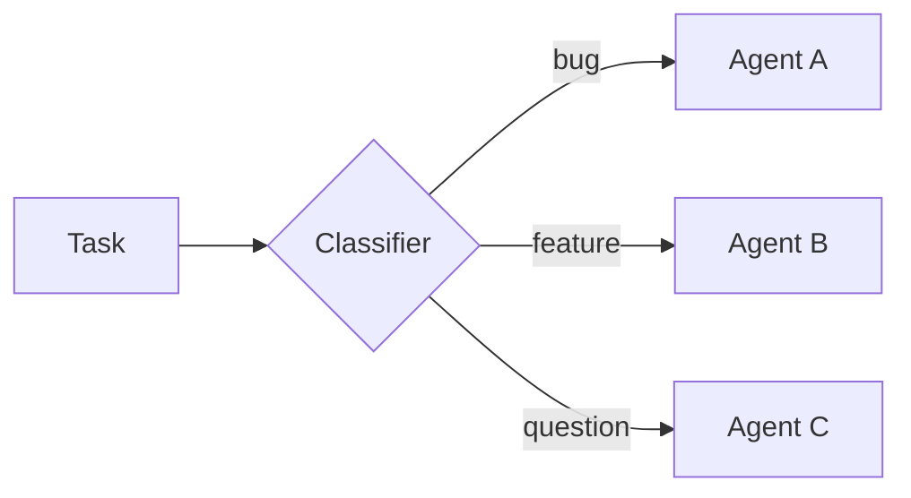
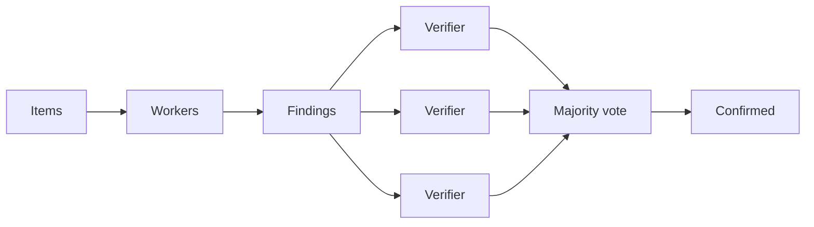
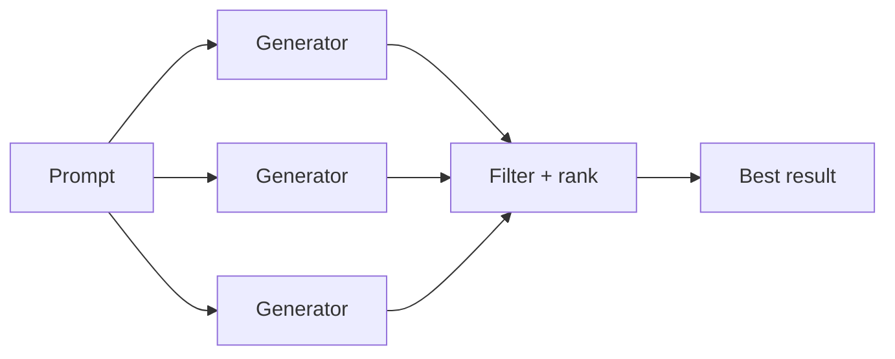
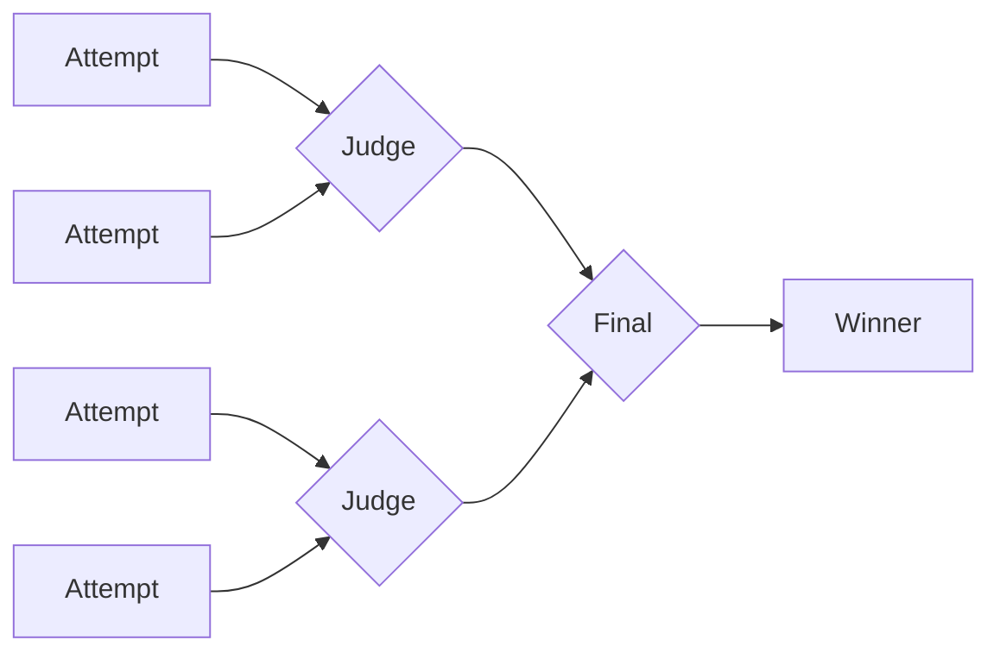
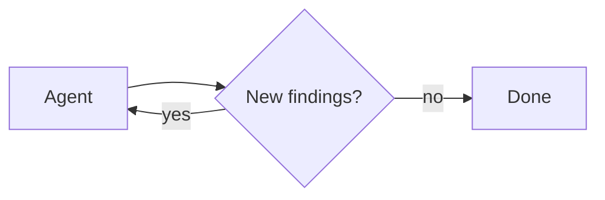

import DynamicSubagentsQuickstartPy from '/langchain/snippets/code-samples/dynamic-subagents-quickstart-py.mdx';
import DynamicSubagentsQuickstartJs from '/langchain/snippets/code-samples/dynamic-subagents-quickstart-js.mdx';
import DynamicSubagentsInvokePy from '/langchain/snippets/code-samples/dynamic-subagents-invoke-py.mdx';
import DynamicSubagentsInvokeJs from '/langchain/snippets/code-samples/dynamic-subagents-invoke-js.mdx';
import DynamicSubagentsTaskApiEvalJs from '/langchain/snippets/code-samples/dynamic-subagents-task-api-eval-js.mdx';
import DynamicSubagentsClassifyConfigurePy from '/langchain/snippets/code-samples/dynamic-subagents-classify-configure-py.mdx';
import DynamicSubagentsClassifyConfigureJs from '/langchain/snippets/code-samples/dynamic-subagents-classify-configure-js.mdx';
import DynamicSubagentsClassifyEvalJs from '/langchain/snippets/code-samples/dynamic-subagents-classify-eval-js.mdx';
import DynamicSubagentsFanoutConfigurePy from '/langchain/snippets/code-samples/dynamic-subagents-fanout-configure-py.mdx';
import DynamicSubagentsFanoutConfigureJs from '/langchain/snippets/code-samples/dynamic-subagents-fanout-configure-js.mdx';
import DynamicSubagentsFanoutEvalJs from '/langchain/snippets/code-samples/dynamic-subagents-fanout-eval-js.mdx';
import DynamicSubagentsAdversarialConfigurePy from '/langchain/snippets/code-samples/dynamic-subagents-adversarial-configure-py.mdx';
import DynamicSubagentsAdversarialConfigureJs from '/langchain/snippets/code-samples/dynamic-subagents-adversarial-configure-js.mdx';
import DynamicSubagentsAdversarialEvalJs from '/langchain/snippets/code-samples/dynamic-subagents-adversarial-eval-js.mdx';
import DynamicSubagentsGenerateConfigurePy from '/langchain/snippets/code-samples/dynamic-subagents-generate-configure-py.mdx';
import DynamicSubagentsGenerateConfigureJs from '/langchain/snippets/code-samples/dynamic-subagents-generate-configure-js.mdx';
import DynamicSubagentsGenerateEvalJs from '/langchain/snippets/code-samples/dynamic-subagents-generate-eval-js.mdx';
import DynamicSubagentsTournamentConfigurePy from '/langchain/snippets/code-samples/dynamic-subagents-tournament-configure-py.mdx';
import DynamicSubagentsTournamentConfigureJs from '/langchain/snippets/code-samples/dynamic-subagents-tournament-configure-js.mdx';
import DynamicSubagentsTournamentEvalJs from '/langchain/snippets/code-samples/dynamic-subagents-tournament-eval-js.mdx';
import DynamicSubagentsLoopConfigurePy from '/langchain/snippets/code-samples/dynamic-subagents-loop-configure-py.mdx';
import DynamicSubagentsLoopConfigureJs from '/langchain/snippets/code-samples/dynamic-subagents-loop-configure-js.mdx';
import DynamicSubagentsLoopEvalJs from '/langchain/snippets/code-samples/dynamic-subagents-loop-eval-js.mdx';
import DynamicSubagentsDisablePy from '/langchain/snippets/code-samples/dynamic-subagents-disable-py.mdx';
import DynamicSubagentsDisableJs from '/langchain/snippets/code-samples/dynamic-subagents-disable-js.mdx';

动态子智能体允许智能体从解释器代码中[分发](/langchain/oss/deepagents/subagents)子智能体。与每次要求模型选择一个子智能体调用不同，智能体可以使用JavaScript循环、分支和并行批次来路由工作到配置的子智能体，并合成结果。

使用此模式适用于工作跨越多个独立单元、需要多种视角，或从递归分析中受益的场景。对于通用解释器设置，请参考[解释器](/langchain/oss/deepagents/interpreters)。

<Warning>
    动态子智能体使用解释器运行时，该运行时处于[**beta**](/langchain/oss/versioning)。API和生命周期行为可能在版本间发生变化。
</Warning>

:::python
<Note>
    解释器需要 `langchain-quickjs>=0.2.0` 和Python 3.11或更高版本。
</Note>
:::

:::js
<Note>
    解释器需要 `@langchain/quickjs`。
</Note>
:::

## 快速开始

动态子智能体需要[解释器](/langchain/oss/deepagents/interpreters)中间件。先安装并配置解释器。内置的[通用用途子智能体](/langchain/oss/deepagents/subagents#默认子智能体)可处理基本分发无需额外配置。

:::python
<DynamicSubagentsQuickstartPy />
:::

:::js
<DynamicSubagentsQuickstartJs />
:::

安装步骤和解释器配置请参考[解释器](/langchain/oss/deepagents/interpreters#快速入门)。

对于专业场景，[配置自定义](/langchain/oss/deepagents/subagents)子智能体，并为它们指定名称、描述和系统提示词。子智能体的名称和描述将作为信息供智能体评估其应承担的角色。

要触发动态子智能体，向智能体输入单词"workflow"：

:::python
<DynamicSubagentsInvokePy />
:::

:::js
<DynamicSubagentsInvokeJs />
:::

<Tip>
    **"workflow"是一个实用触发词。** 解析器系统提示词将"workflow"视为组织工作的信号，通过解析器从代码中`task()`调度子智能体，而非逐项执行模型选择的工具调用。将请求表述为"workflow"是主动调用动态编排机制的手柄。对于单次直接委派，建议直接表述请求。

</Tip>

<Note>
    使用动态子智能体`dcode`，LangChain终端编码智能体`dcode`内置了代码解析器，因此动态子智能体可即插即用。请参考[dcode子智能体页面](/langchain/oss/deepagents/code/subagents)查看配置和使用细节。
</Note>

## 工作原理

[当智能体包含](/langchain/oss/deepagents/subagents)子智能体和解析器中间件时，解析器会暴露内置的`task()`全局变量用于从代码中调度子智能体。处理跨多个独立单元的任务（如遍历目录中的所有文件、分批处理工单）会形成循环，将工作均匀分布以实现确定性执行，而非逐次执行模型选择的工具调用。

子智能体编排还支持递归语言模型（RLM）工作流，该方案详见[递归语言模型论文](https://arxiv.org/abs/2512.24601)：保持工作集在解析器变量中，选择切片，通过`task()`调用子智能体，并合成结果。

许多编排工作流结合动态子智能体与[程序化工具调用（PTC）](/langchain/oss/deepagents/interpreters#程序化工具调用-ptc)：使用`tools.*`从解析器代码中获取输入或过滤输入，再通过`task()`调度子智能体。PTC默认关闭；需在解析器中间件中显式启用白名单。

`task()`是子智能体执行的桥梁能力，类似PTC对工具的作用。关于隔离默认值、审批边界和中间件选项，请参考[安全](/langchain/oss/deepagents/interpreters#安全)和[配置](/langchain/oss/deepagents/interpreters#配置)。

:::python
<Note>
    多轮编排可以在使用 `mode="thread"`（默认值）时持久化解释器变量。请参阅[解释器](/langchain/oss/deepagents/interpreters#持久化)页面中的持久化说明。
</Note>
:::

`task()` 接受以下输入：

- `description`: 子智能体的提示词
- `subagentType`: 要运行的配置子智能体
- `responseSchema`（可选）：结构化输出

一个 `task()` 会运行完整的智能体循环，并解析为子智能体的结果：

<DynamicSubagentsTaskApiEvalJs />

当传递 `responseSchema` 时，解析值已经是类型化的JavaScript对象；只有当子智能体有意返回JSON字符串时才调用 `JSON.parse`。

## 模式

智能体根据任务的形态选择策略；这些策略源于解释器代码的编写方式，而非配置，而可用的子智能体决定了它能实现的功能。所有模式都采用相同的编排方式：在JavaScript变量中暂存工作，通过 `task()` 分发子智能体，并在代码中合并结果。下方图表展示了常见形态，每个形态都配有可运行的示例。

### 分类与执行

首先对项目进行分类，然后根据分类结果为每个项目分配专精的子智能体处理。这适用于需要不同处理方式的混合输入场景。

**应用场景：** 支持工单分诊、错误日志分析、用户反馈处理，或任何需按类型差异化处理的批次项目。

<Accordion title="Example: classify and act">

**需配置的内容**

:::python
<DynamicSubagentsClassifyConfigurePy />
:::

:::js
<DynamicSubagentsClassifyConfigureJs />
:::

**智能体生成的代码**

<DynamicSubagentsClassifyEvalJs />
</Accordion>

### 并行分发与聚合

智能体对多个项目并行分发相同类型的工作，并在完成后聚合结果。

**应用场景：** 跨目录代码审查、批量文档分析、日志文件处理、对多个服务执行相同检查。

从解释器代码中获取文件需启用[程序化工具调用（PTC）](/langchain/oss/deepagents/interpreters#程序化工具调用-ptc)。在解释器中间件中为PTC设置允许列表 `glob`。

<Accordion title="Example: fan-out and synthesize">

**需配置的内容**

:::python
<DynamicSubagentsFanoutConfigurePy />
:::

:::js
<DynamicSubagentsFanoutConfigureJs />
:::

**智能体生成的代码**

<DynamicSubagentsFanoutEvalJs />
</Accordion>

### 对抗性验证

两阶段模式。第一阶段生成检测项，第二阶段将每个检测项发送给独立验证者，仅通过一致性验证的项被保留。当置信度比速度更重要时，此模式可减少误报。

**应用场景：** 安全审计（误报成本高）、合规检查、需高置信度的审查场景。

<Accordion title="Example: adversarial verification">

**需配置的内容**

:::python
<DynamicSubagentsAdversarialConfigurePy />
:::

:::js
<DynamicSubagentsAdversarialConfigureJs />
:::

**智能体生成的代码**

<DynamicSubagentsAdversarialEvalJs />
</Accordion>

### 生成与筛选

多个子智能体独立生成同一问题的解决方案，智能体通过代码进行对比、评分和筛选，仅保留最佳结果。

**应用场景：** 架构提案、重构策略、内容变体生成、需多方案探索后再决策的任务。

<Accordion title="Example: generate and filter">

**需配置的内容**

:::python
<DynamicSubagentsGenerateConfigurePy />
:::

:::js
<DynamicSubagentsGenerateConfigureJs />
:::

**智能体生成的代码**

<DynamicSubagentsGenerateEvalJs />
</Accordion>

### 淘汰赛

多个方案通过评委子智能体进行一对一比拼，胜者进入下一轮 elimination 轮次。

**应用场景：** 主观标准下的优化、风格选择、实现方案竞争性评估。

<Accordion title="Example: tournament">

**需配置的内容**

:::python
<DynamicSubagentsTournamentConfigurePy />
:::

:::js
<DynamicSubagentsTournamentConfigureJs />
:::

**智能体生成的代码**

<DynamicSubagentsTournamentEvalJs />
</Accordion>

### 循环直到完成

智能体执行发现循环，通过去重机制确保不重复结果，直至无新结果产生。适用于任务范围不明确的前置条件。

**应用场景：** 全量搜索、死代码检测、依赖审计、追求完整性的全面扫描。

<Accordion title="Example: loop until done">

**需配置的内容**

:::python
<DynamicSubagentsLoopConfigurePy />
:::

:::js
<DynamicSubagentsLoopConfigureJs />
:::

**智能体生成的代码**

<DynamicSubagentsLoopEvalJs />
</Accordion>

:::python
<Warning>
    `task()` 在已运行的 `eval` 调用内部分发。它不经过常规工具调用路径，因此父智能体的 `interrupt_on` 审批工作流对每个分发不生效。若需在编排前审批，需对 `eval` 工具本身设置权限门禁。
</Warning>
:::
:::js
<Warning>
    `task()` 在已运行的 `eval` 调用内部分发。它不经过常规工具调用路径，因此父智能体的 `interruptOn` 审批工作流对每个分发不生效。若需在编排前审批，需对 `eval` 工具本身设置权限门禁。
</Warning>
:::

## 禁用动态子智能体

智能体默认在包含子智能体时启用分发。若需仅通过常规 `task` 工具路径访问子智能体，可禁用此功能。其他中间件配置请参阅[解释器](/langchain/oss/deepagents/interpreters#配置)页面中的配置说明。

:::python
<DynamicSubagentsDisablePy />
:::

:::js
<DynamicSubagentsDisableJs />
:::

## 参考文档

- [解释器](/langchain/oss/deepagents/interpreters)：QuickJS配置、程序化工具调用、持久化、安全设置与中间件配置
- [子智能体](/langchain/oss/deepagents/subagents)：配置子智能体名称、描述和系统提示词
- [事件流式输出](/langchain/oss/deepagents/event-streaming)：从协调者和委派子智能体接收更新流

---

> 官方原文：[src/oss/deepagents/dynamic-subagents.mdx](https://github.com/langchain-ai/docs/blob/main/src/oss/deepagents/dynamic-subagents.mdx) · 非官方翻译，译文由 AI 生成，以英文原文为准。
