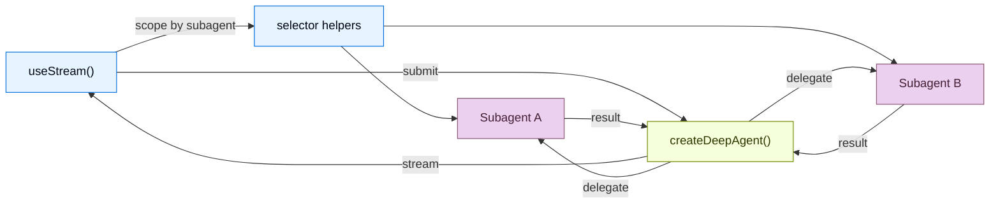

import FrontendOverviewBackendPy from '/langchain/snippets/code-samples/frontend-overview-backend-py.mdx';
import FrontendOverviewBackendJs from '/langchain/snippets/code-samples/frontend-overview-backend-js.mdx';

构建可视化深度智能体工作流的实时前端。这些模式展示了如何渲染子智能体进度、任务规划、流式内容以及从`createDeepAgent`创建的智能体提供的 IDE 式沙盒体验。

深度智能体在 UI 使委托可见时最有用。与显示单个不透明的助手气泡不同，LangChain SDK 将协调器、子智能体发现、自定义状态和沙盒支持的工件暴露出来，以便用户可以检查一个长时间运行的任务是如何被分解和完成的。

<Note>
这些模式使用 v1 前端 SDK 包。如果你使用的是早期版本，请参阅 [React](https://github.com/langchain-ai/langgraphjs/blob/main/libs/sdk-react/docs/v1-migration.md)、[Vue](https://github.com/langchain-ai/langgraphjs/blob/main/libs/sdk-vue/docs/v1-migration.md)、[Svelte](https://github.com/langchain-ai/langgraphjs/blob/main/libs/sdk-svelte/docs/v1-migration.md) 和 [Angular](https://github.com/langchain-ai/langgraphjs/blob/main/libs/sdk-angular/docs/v1-migration.md) 的迁移指南。
</Note>

## 架构

深度智能体使用协调器-工作器架构。主智能体规划任务并将任务委托给独立运行的专用子智能体。在前端，v1 流处理程序在根流上表面协调器消息，并暴露子智能体发现快照以供作用域子智能体视图使用。



:::python

<FrontendOverviewBackendPy />

:::

:::js

<FrontendOverviewBackendJs />

:::

在前端，与 @[`useStream`] 的方式与 `createAgent` 相同。传递 [类型参数](/langchain/oss/langchain/frontend/overview) 以实现类型安全的流状态。深度智能体模式使用 `stream.subagents`、选择器辅助工具（如 `useMessages(stream, subagent)`）和自定义状态值（如 `stream.values.todos`）来渲染特定于子智能体的 UI。

```ts
import { useStream } from "@langchain/react";

function App() {
  const stream = useStream<typeof agent>({
    apiUrl: "http://localhost:2024",
    assistantId: "agent",
  });

  // Deep agent state beyond messages
  const todos = stream.values?.todos;
  const subagents = [...stream.subagents.values()];
}
```

## SDK 暴露的内容

深度智能体 UI 通常需要比最终答案更多的内容。前端 SDK 为用户关心的运行部分提供结构化投影：

| 投影 | 用于 |
| --- | --- |
| `stream.messages` | 协调器对话和最终综合。 |
| `stream.subagents` | 实时发现专业工作者，包括状态和任务元数据。 |
| `stream.values` | 共享状态，如待办事项、计划、报告部分、沙盒元数据或智能体写入的任何自定义键。 |
| 工具调用状态 | 将文件系统、搜索、浏览器或领域工具作为带有进度和结果的卡片进行渲染。 |
| 中断 | 暂停委托的工作以供用户批准或缺少输入，而不会丢失运行状态。 |

这使你能够构建更接近 IDE、任务板或工作流监控器的界面，而不是纯聊天记录。

## 模式

<CardGroup cols={3}>
  <Card title="Subagent streaming" icon="arrows-split" href="/langchain/oss/deepagents/frontend/subagent-streaming">
    使用流式内容、进度跟踪和可折叠卡片显示专业子智能体。
  </Card>
  <Card title="Todo list" icon="list-check" href="/langchain/oss/deepagents/frontend/todo-list">
    当智能体选择任务规划时，使用实时待办事项列表跟踪进度。
  </Card>
  <Card title="Sandbox" icon="code" href="/langchain/oss/deepagents/frontend/sandbox">
    构建一个由沙盒支持的 IDE 式 UI，包含文件浏览器、代码查看器和差异面板。
  </Card>
</CardGroup>

## 相关模式

[LangChain 前端模式](/langchain/oss/langchain/frontend/overview)，包括 markdown 消息、工具调用和人在回路，也适用于深度智能体。深度智能体基于相同的 LangGraph 运行时构建，因此 `useStream` 提供相同的核心 API。

对于低级别的图可视化，请参阅 [LangGraph 前端模式](/langchain/oss/langgraph/frontend/overview)。它们展示了如何将图节点和状态键直接映射到 UI 组件。

---

> 官方原文：[src/oss/deepagents/frontend/overview.mdx](https://github.com/langchain-ai/docs/blob/main/src/oss/deepagents/frontend/overview.mdx) · 译文由 AI 生成，以英文原文为准。
