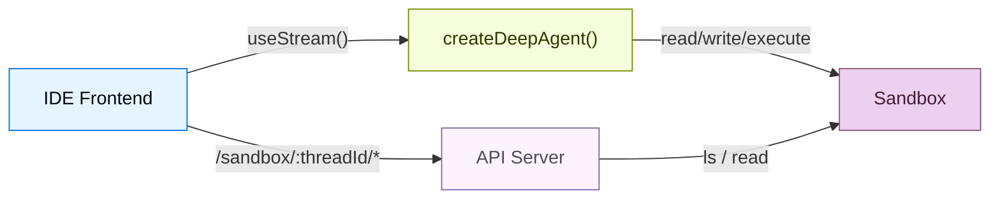
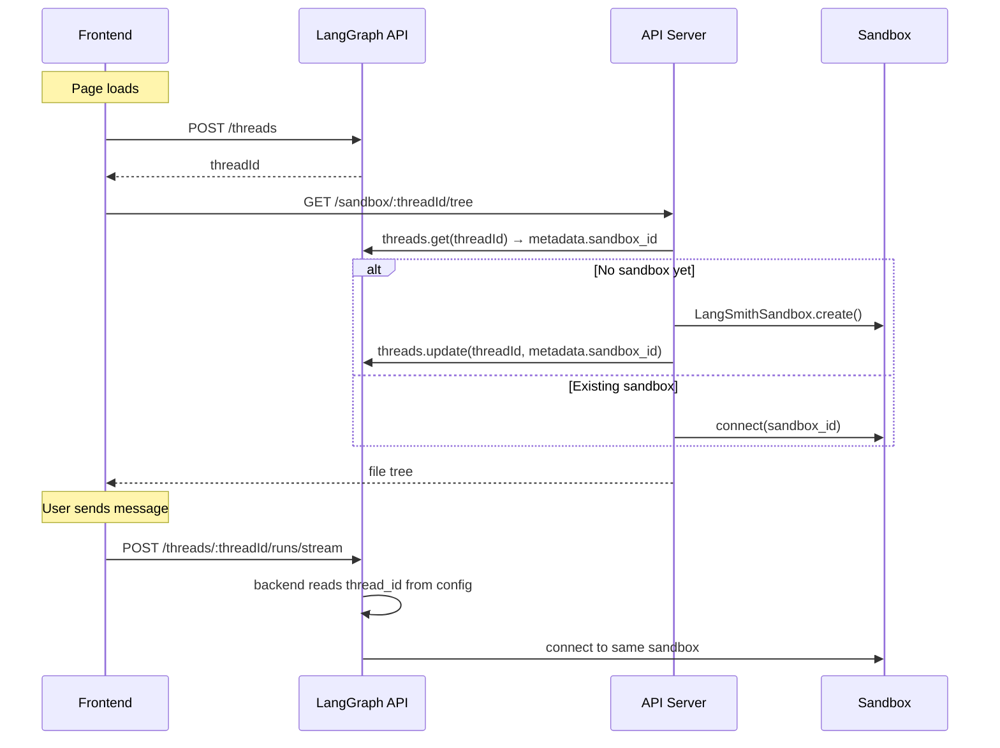

  
开发型智能体需要不止聊天窗口。它们需要文件浏览器、代码查看器、差异面板和一个IDE级体验。此模式将深度智能体连接到[sandbox](/langchain/oss/deepagents/sandboxes)沙盒中，使其能够在隔离环境中读取、写入并执行代码，并通过自定义API服务器将沙盒文件系统暴露出来，使前端能够实时显示文件操作。

此页面涵盖**三面板用户界面**（文件树、代码查看器、聊天面板）和**自定义API路由**，用于向其暴露沙盒文件系统。关于沙盒提供者的生命周期范围、初始化文件、密钥、部署和生产`useStream`配置，请参考[ Going to production ](/langchain/oss/deepagents/going-to-production)。

import { PatternEmbed } from "/langchain/snippets/pattern-embed.jsx";
import FrontendSandboxThreadBackendPy from "/langchain/snippets/code-samples/frontend-sandbox-thread-backend-py.mdx";
import FrontendSandboxUtilsJs from "/langchain/snippets/code-samples/api/frontend-sandbox-utils-js.mdx";
import FrontendSandboxAgentJs from "/langchain/snippets/code-samples/frontend-sandbox-agent-js.mdx";
import FrontendSandboxDetectChangesJs from "/langchain/snippets/code-samples/frontend-sandbox-detect-changes-js.mdx";

<PatternEmbed pattern="deep-agent-ide" minHeight={700} />  

## 架构  

此方案包含三个部分：

:::python  
1. **深度智能体与沙盒后端**：智能体自动从沙盒获取文件系统工具（`read_file`, `write_file`, `edit_file`, `delete`, `execute`）  
:::

:::js  
1. **深度智能体与沙盒后端**：智能体自动从沙盒获取文件系统工具（`read_file`, `write_file`, `edit_file`, `execute`）自动  
:::

:::python  
2. **自定义API服务器**——通过`langgraph.json`的`http.app`字段暴露的FastAPI应用，提供前端可调用的文件浏览端点  
:::

:::js  
2. **自定义API服务器**：通过`langgraph.json`的`http.app`字段暴露的Hono应用，提供前端可调用的文件浏览端点  
:::

3. **三面板前端**：同步显示智能体修改的实时文件系统的文件树、代码/差异查看器和聊天面板  


  
## 沙盒生命周期  

设置沙盒存活时长和共享权限后再连接前端。关于线程作用域沙盒与助手作用域沙盒、异步[图工厂](https://docs.langchain.com/langsmith/graph-rebuild)配置、TTL行为及SDK调用示例，请参考[Sandbox lifecycle](/langchain/oss/deepagents/going-to-production#生命周期)。

本指南默认使用**线程作用域沙盒**。前端和自定义API服务器均通过LangGraph的[thread](https://docs.langchain.com/langsmith/use-threads)ID解析沙盒。这保持了会话隔离性，并在[持久化线程ID](#线程创建)后支持页面刷新重连到相同环境。


  
对于[multi-tenant](/langchain/oss/deepagents/going-to-production#多租户)应用，应在后端工厂中按用户或助手范围作用域沙盒。对于无LangGraph线程的演示，通过API URL传递客户端生成的会话ID。该会话ID不跨浏览器会话持久化。

## 连接智能体与API服务器  

按[执行环境](/langchain/oss/deepagents/going-to-production#执行环境)描述配置深度智能体的[sandbox backend](/langchain/oss/deepagents/sandboxes)。智能体自动获取文件系统工具和[Token]`execute`工具，无需额外工具配置。

构建此界面在生产力环境基础上增加要求：需要**自定义API服务器**，该服务器独立于智能体图运行，确保智能体后端和文件浏览路由为每个线程解析**相同的沙盒**。将沙盒ID存储在线程元数据中，并在两者间共享一个查找函数。

### 从线程元数据解析沙盒  

:::js  
在共享模块定义`getOrCreateSandboxForThread`。智能体图工厂和自定义API路由均导入此模块：  
<FrontendSandboxUtilsJs />  

将智能体配置为异步[图工厂](https://docs.langchain.com/langsmith/graph-rebuild)，读取`thread_id`配置并传递解析后的后端到`createDeepAgent`：  
<FrontendSandboxAgentJs />  

:::

:::python  
<FrontendSandboxThreadBackendPy />  
:::

<Note>  
类似[ Going to production ](/langchain/oss/deepagents/going-to-production#生命周期)的示例，智能体作为每个运行的异步图工厂。将沙盒ID存储在线程元数据中，使自定义 `http.app` 路由可调用相同的 `getOrCreateSandboxForThread` 辅助函数。Going to production在仅通过LangGraph SDK接入时使用提供者标签查找。  
</Note>  

### 初始化项目文件  

运行前通过`uploadFiles`/`upload_files`上传启动文件。关于文件传输模式、提供者示例及同步[记忆](/langchain/oss/deepagents/memory)或[技能](/langchain/oss/deepagents/skills)到沙盒的说明，请参考[File transfers](/langchain/oss/deepagents/going-to-production#文件传输)。对于LangSmith沙盒，创建容器时传递[sandbox snapshot](https://docs.langchain.com/langsmith/sandbox-snapshots)的`templateName`。

<Tip>  
上传`package.json`后运行`sandbox.execute("cd /app && npm install")`确保依赖就绪：  
</Tip>  

## 添加文件浏览API  

:::js  
智能体可读写文件，但前端需要直接访问沙盒文件系统。添加自定义[Hono](https://hono.dev) API服务器并通过`http.app`字段在`langgraph.json`中暴露  
:::

:::python  
智能体可读写文件，但前端需要直接访问沙盒文件系统。添加自定义[FastAPI](https://fastapi.tiangolo.com) API服务器并通过`http.app`字段在`langgraph.json`中暴露  
:::

### 创建API服务器  

沙盒API端点使用线程ID作为URL路径参数，确保前端始终访问当前会话对应的正确沙盒。使用与智能体后端相同的`get_or_create_sandbox_for_thread`（Python）或`getOrCreateSandboxForThread`（JavaScript）函数解析：  

:::js  
```ts
// src/api/app.ts
import { Hono } from "hono";
import { getOrCreateSandboxForThread } from "./utils.js";

export const app = new Hono();

app.get("/sandbox/:threadId/tree", async (c) => {
  const threadId = c.req.param("threadId");
  const rootPath = c.req.query("filePath") || "/app";

  const sandbox = await getOrCreateSandboxForThread(threadId);
  const result = await sandbox.execute(
    `find '${rootPath}' -printf '%y\\t%s\\t%p\\n' 2>/dev/null | sort -t$'\\t' -k3`,
  );

  const entries = result.output
    .trim()
    .split("\n")
    .filter(Boolean)
    .map((line) => {
      const [typeChar, sizeStr, fullPath] = line.split("\t");
      return {
        name: fullPath.split("/").pop(),
        type: typeChar === "d" ? "directory" : "file",
        path: fullPath,
        size: parseInt(sizeStr, 10) || 0,
      };
    });

  return c.json({ path: rootPath, entries, sandboxId: sandbox.id });
});

app.get("/sandbox/:threadId/file", async (c) => {
  const threadId = c.req.param("threadId");
  const filePath = c.req.query("filePath");
  if (!filePath) return c.json({ error: "filePath is required" }, 400);

  const sandbox = await getOrCreateSandboxForThread(threadId);
  const results = await sandbox.downloadFiles([filePath]);
  const file = results[0];
  if (file.error) return c.json({ error: file.error }, 404);

  const content = new TextDecoder().decode(file.content!);
  return c.json({ path: filePath, content });
});
```
  
:::

:::python  
```python
# src/api/server.py
from fastapi import FastAPI, Query, Path
from utils import get_or_create_sandbox_for_thread

app = FastAPI()

@app.get("/sandbox/{thread_id}/tree")
async def list_tree(
    thread_id: str = Path(...),
    filePath: str = Query("/app"),
):
    sandbox = await get_or_create_sandbox_for_thread(thread_id)
    result = await sandbox.aexecute(
        f"find {filePath} -printf '%y\\t%s\\t%p\\n' 2>/dev/null | sort"
    )
    entries = []
    for line in result.output.strip().split("\n"):
        if not line:
            continue
        type_char, size_str, full_path = line.split("\t")
        entries.append({
            "name": full_path.split("/")[-1],
            "type": "directory" if type_char == "d" else "file",
            "path": full_path,
            "size": int(size_str),
        })
    return {"path": filePath, "entries": entries, "sandboxId": sandbox.id}

@app.get("/sandbox/{thread_id}/file")
async def read_file(
    thread_id: str = Path(...),
    filePath: str = Query(...),
):
    sandbox = await get_or_create_sandbox_for_thread(thread_id)
    results = await sandbox.adownload_files([filePath])
    return {"path": filePath, "content": results[0].content.decode()}
```
  
:::

<Note>  
智能体后端和API服务器均调用相同的 `get_or_create_sandbox_for_thread`（Python）或 `getOrCreateSandboxForThread`（JavaScript）函数。这确保两者为同一线程解析相同的沙盒。沙盒ID在元数据中是唯一可信源，无需内存缓存。  
</Note>  

### 配置`langgraph.json`  

注册智能体图和API服务器。`http.app`字段告知LangGraph平台同时服务默认路由和自定义路由。参考[application structure](/langchain/oss/langgraph/application-structure)和[LangSmith Deployments](/langchain/oss/deepagents/going-to-production#langsmith-deployments)获取完整的`langgraph.json`选项说明。

:::js  
```json
{
  "node_version": "22",
  "graphs": {
    "deep_agent_ide": "./src/agents/deep-agent-ide.ts:agent"
  },
  "env": ".env",
  "http": {
    "app": "./src/api/app.ts:app"
  }
}
```
  
:::

:::python  
```json
{
  "graphs": {
    "deep_agent_ide": "./src/agents/my_agent.py:agent"
  },
  "env": ".env",
  "http": {
    "app": "./src/api/server.py:app"
  }
}
```
  
:::

自定义路由与LangGraph API同宿主运行。本地开发使用`langgraph dev`时，地址为`http://localhost:2024`。

<Note>  
  在`http.app`中定义的自定义路由具有优先级，高于默认的LangGraph路由。这意味着您可以通过覆盖内置端点实现特定需求，但需注意不要意外覆盖`/threads`或`/runs`等关键路由。  
</Note>  

## 构建前端界面  

前端包含三个面板：文件树侧边栏、代码/差异查看器，以及  
聊天面板。它使用@`useStream`处理智能体会话，并通过自定义API端点实现文件浏览功能。  

对于生产环境部署，将`apiUrl`指向您的[LangSmith 部署](https://docs.langchain.com/langsmith/deployment)，并在每次运行时传递稳定的`thread_id`。相关配置请参考[Going to production](/langchain/oss/deepagents/going-to-production)中的[Frontend](/langchain/oss/deepagents/going-to-production#前端)部分，其中也包含[通过`thread_id`和运行时`context`调用智能体](/langchain/oss/deepagents/going-to-production#调用智能体)的示例。  

### 线程创建  

页面加载时创建LangGraph线程，并将线程ID持久化存储于`sessionStorage`，以便页面刷新后能重新连接到相同的沙盒环境：  

```tsx
const THREAD_KEY = "sandbox-thread-id";

function IDEPreview() {
  const [threadId, setThreadId] = useState<string | null>(
    () => sessionStorage.getItem(THREAD_KEY),
  );

  const updateThreadId = useCallback((id: string | null) => {
    setThreadId(id);
    if (id) sessionStorage.setItem(THREAD_KEY, id);
    else sessionStorage.removeItem(THREAD_KEY);
  }, []);

  const stream = useStream<typeof myAgent>({
    apiUrl: AGENT_URL,
    assistantId: "deep_agent_ide",
    threadId,
    onThreadId: updateThreadId,
  });

  // Create thread on first mount
  useEffect(() => {
    if (threadId) return;
    stream.client.threads.create().then((t) => updateThreadId(t.thread_id));
  }, [stream.client, threadId, updateThreadId]);

  // Pass threadId to sandbox file hooks
  const { tree, files } = useSandboxFiles(threadId);
  // ...
}
```
  
"新建线程"按钮会清除存储的ID，确保下次挂载时创建全新的线程（及沙盒）：  

```tsx
function handleNewThread() {
  updateThreadId(null);
}
```
  
### 文件状态管理  

跟踪沙盒文件系统的两个快照：初始状态（智能体运行前）和实时更新状态。通过在API URL中包含线程ID，确保所有请求始终指向正确的沙盒环境：  

```ts
const AGENT_URL = "http://localhost:2024";

async function fetchTree(threadId: string): Promise<FileEntry[]> {
  const res = await fetch(
    `${AGENT_URL}/sandbox/${encodeURIComponent(threadId)}/tree?filePath=/app`,
  );
  const data = await res.json();
  return data.entries.filter((e: FileEntry) => !e.path.includes("node_modules"));
}

async function fetchFile(threadId: string, path: string): Promise<string | null> {
  const res = await fetch(
    `${AGENT_URL}/sandbox/${encodeURIComponent(threadId)}/file?filePath=${encodeURIComponent(path)}`,
  );
  const data = await res.json();
  return data.content ?? null;
}
```
  
### 实时文件同步  

IDE的核心体验在于智能体运行时即更新文件，而非在运行结束后。监听文件修改工具的`ToolMessage`消息实例。当`write_file`或`edit_file`工具调用完成时，刷新对应文件；当`execute`调用完成时，刷新所有文件（因 shell 命令可能修改任意文件）：  

<CodeGroup>  
```tsx React
import { useStream } from "@langchain/react";
import { ToolMessage, AIMessage } from "langchain";

const FILE_MUTATING_TOOLS = new Set(["write_file", "edit_file", "execute"]);

export function IDEPreview() {
  const stream = useStream<typeof myAgent>({
    apiUrl: AGENT_URL,
    assistantId: "deep_agent_ide",
  });

  const processedIds = useRef(new Set<string>());

  useEffect(() => {
    // Build a map of file-mutating tool calls from AI messages
    const toolCallMap = new Map();
    for (const msg of stream.messages) {
      if (!AIMessage.isInstance(msg)) continue;
      for (const tc of msg.tool_calls ?? []) {
        if (tc.id && FILE_MUTATING_TOOLS.has(tc.name)) {
          toolCallMap.set(tc.id, { name: tc.name, args: tc.args });
        }
      }
    }

    // When a ToolMessage appears for a file-mutating tool, refresh
    for (const msg of stream.messages) {
      if (!ToolMessage.isInstance(msg)) continue;
      const id = msg.id ?? msg.tool_call_id;
      if (!id || processedIds.current.has(id)) continue;

      const call = toolCallMap.get(msg.tool_call_id);
      if (!call) continue;
      processedIds.current.add(id);

      if (call.name === "write_file" || call.name === "edit_file") {
        refreshSingleFile(call.args.path ?? call.args.file_path);
      } else if (call.name === "execute") {
        refreshTreeAndFiles();
      }
    }
  }, [stream.messages]);
}
```
  
```vue Vue
<script setup lang="ts">
import { useStream } from "@langchain/vue";
import { ToolMessage, AIMessage } from "langchain";
import { watch } from "vue";

const FILE_MUTATING_TOOLS = new Set(["write_file", "edit_file", "execute"]);
const processedIds = new Set<string>();

const stream = useStream<typeof myAgent>({
  apiUrl: AGENT_URL,
  assistantId: "deep_agent_ide",
});

watch(
  () => stream.messages.value,
  (messages) => {
    const toolCallMap = new Map();
    for (const msg of messages) {
      if (AIMessage.isInstance(msg)) {
        for (const tc of msg.tool_calls ?? []) {
          if (tc.id && FILE_MUTATING_TOOLS.has(tc.name)) {
            toolCallMap.set(tc.id, { name: tc.name, args: tc.args });
          }
        }
      }
    }

    for (const msg of messages) {
      if (!ToolMessage.isInstance(msg)) continue;
      const id = msg.id ?? msg.tool_call_id;
      if (!id || processedIds.has(id)) continue;

      const call = toolCallMap.get(msg.tool_call_id);
      if (!call) continue;
      processedIds.add(id);

      if (call.name === "write_file" || call.name === "edit_file") {
        refreshSingleFile(call.args.path ?? call.args.file_path);
      } else if (call.name === "execute") {
        refreshTreeAndFiles();
      }
    }
  },
  { deep: true },
);
</script>
```
  
```svelte Svelte
<script lang="ts">
  import { useStream } from "@langchain/svelte";
  import { ToolMessage, AIMessage } from "langchain";

  const FILE_MUTATING_TOOLS = new Set(["write_file", "edit_file", "execute"]);
  const processedIds = new Set<string>();

  const stream = useStream<typeof myAgent>({
    apiUrl: AGENT_URL,
    assistantId: "deep_agent_ide",
  });

  $effect(() => {
    const msgs = stream.messages;
    const toolCallMap = new Map();
    for (const msg of msgs) {
      if (AIMessage.isInstance(msg)) {
        for (const tc of msg.tool_calls ?? []) {
          if (tc.id && FILE_MUTATING_TOOLS.has(tc.name)) {
            toolCallMap.set(tc.id, { name: tc.name, args: tc.args });
          }
        }
      }
    }

    for (const msg of msgs) {
      if (!ToolMessage.isInstance(msg)) continue;
      const id = msg.id ?? msg.tool_call_id;
      if (!id || processedIds.has(id)) continue;

      const call = toolCallMap.get(msg.tool_call_id);
      if (!call) continue;
      processedIds.add(id);

      if (call.name === "write_file" || call.name === "edit_file") {
        refreshSingleFile(call.args.path ?? call.args.file_path);
      } else if (call.name === "execute") {
        refreshTreeAndFiles();
      }
    }
  });
</script>
```
  
```ts Angular
import { Component, effect } from "@angular/core";
import { injectStream } from "@langchain/angular";
import { ToolMessage, AIMessage } from "langchain";

const FILE_MUTATING_TOOLS = new Set(["write_file", "edit_file", "execute"]);

@Component({
  selector: "app-ide-preview",
  template: `<!-- ... -->`,
})
export class IdePreviewComponent {
  stream = injectStream<typeof myAgent>({
    apiUrl: AGENT_URL,
    assistantId: "deep_agent_ide",
  });

  private processedIds = new Set<string>();

  constructor() {
    effect(() => {
      const messages = this.stream.messages();
      const toolCallMap = new Map();
      for (const msg of messages) {
        if (AIMessage.isInstance(msg)) {
          for (const tc of (msg as AIMessage).tool_calls ?? []) {
            if (tc.id && FILE_MUTATING_TOOLS.has(tc.name)) {
              toolCallMap.set(tc.id, { name: tc.name, args: tc.args });
            }
          }
        }
      }

      for (const msg of messages) {
        if (!ToolMessage.isInstance(msg)) continue;
        const id = (msg as ToolMessage).id ?? (msg as ToolMessage).tool_call_id;
        if (!id || this.processedIds.has(id)) continue;

        const call = toolCallMap.get((msg as ToolMessage).tool_call_id);
        if (!call) continue;
        this.processedIds.add(id);

        if (call.name === "write_file" || call.name === "edit_file") {
          this.refreshSingleFile(call.args.path ?? call.args.file_path);
        } else if (call.name === "execute") {
          this.refreshTreeAndFiles();
        }
      }
    });
  }
}
```
  
</CodeGroup>  

### 检测修改文件  

每次智能体运行前快照当前文件内容。文件更新后，通过对比快照识别修改的文件：  

<FrontendSandboxDetectChangesJs />  

当用户选择修改过的文件时，默认展示差异视图，以便立即查看智能体修改内容。  

### 显示差异  

使用框架适配的差异库渲染统一格式差异：  

| 框架   | 库                                                                 | 组件                     |  
|--------|----------------------------------------------------------------------|--------------------------|  
| React  | [`@pierre/diffs`](https://diffs.com)                                       | `<FileDiff>`配合`parseDiffFromFile`             |  
| Vue    | [`@git-diff-view/vue`](https://github.com/MrWangJustToDo/git-diff-view)    | `<DiffView>`配合`generateDiffFile`来自`@git-diff-view/file` |  
| Svelte | [`@git-diff-view/svelte`](https://github.com/MrWangJustToDo/git-diff-view) | `<DiffView>`配合`generateDiffFile`来自`@git-diff-view/file` |  
| Angular| [`ngx-diff`](https://github.com/rars/ngx-diff)                             | `<ngx-unified-diff>`配合`[before]`和`[after]`      |  

示例（React使用`@pierre/diffs`）：  

```tsx
import { FileDiff } from "@pierre/diffs/react";
import { parseDiffFromFile } from "@pierre/diffs";

function DiffPanel({ original, current, fileName }) {
  const diff = parseDiffFromFile(
    { name: fileName, contents: original },
    { name: fileName, contents: current },
  );

  return (
    <FileDiff
      fileDiff={diff}
      options={{ theme: "github-dark", diffStyle: "unified", diffIndicators: "bars" }}
    />
  );
}
```
  
### 修改文件摘要  

展示所有修改文件的行级增删计数，类似`git status`的概览视图：  

```tsx
function ChangedFilesSummary({ changedFiles, files, originalFiles, onSelect }) {
  const stats = [...changedFiles].map((path) => {
    const oldLines = (originalFiles[path] ?? "").split("\n");
    const newLines = (files[path] ?? "").split("\n");
    // Compute additions/deletions by comparing lines
    return { path, additions, deletions };
  });

  return (
    <div>
      <h3>{stats.length} Files Changed</h3>
      {stats.map((file) => (
        <button key={file.path} onClick={() => onSelect(file.path)}>
          {file.path}
          <span className="text-green-400">+{file.additions}</span>
          <span className="text-red-400">-{file.deletions}</span>
        </button>
      ))}
    </div>
  );
}
```
  
## 用例  

沙盒适用于以下场景：  

- **编程智能体**需要可视化界面（超越纯聊天）  
- **代码审查流程**中智能体提出修改建议，用户需预览差异后再确认  
- **教学/学习应用**中AI助手分步指导项目构建，并实时展示修改上下文  
- **原型工具**中用户通过自然语言描述需求，实时观察智能体实现过程  

## 最佳实践  

前端特定建议：  

- **在`sessionStorage`中持久化`threadId`**，确保页面刷新后能重新连接到相同线程和沙盒环境。  

:::python  
- **在每次相关工具调用时同步文件**，而非仅当运行结束时。监听`write_file`、`edit_file`、`delete`、`execute`工具消息并立即刷新。  
:::js  
- **在每次相关工具调用时同步文件**，而非仅当运行结束时。监听`write_file`、`edit_file`、`execute`工具消息并立即刷新。  
:::  

- **修改文件默认展示差异视图**。用户点击被智能体修改的文件时，优先展示差异视图——这才是他们关心的内容。  
- **对只读操作显示紧凑结果**。例如，替代在聊天中堆砌`read_file`的完整输出，改用单行提示`Read router.js L1-42`。将完整输出保留给修改型工具。  
- **过滤`node_modules`在文件树中**。用户不需要浏览数千个依赖文件，在获取文件树时过滤这些文件。  

后端与沙盒通用建议：  

- **生产环境使用线程级沙盒**。参考[Sandbox lifecycle](/langchain/oss/deepagents/going-to-production#生命周期)。  
- **通过线程元数据共享沙盒解析结果**，确保智能体后端与API服务器解析相同环境，避免内存缓存差异。  
- **为沙盒预置真实项目**。参考[File transfers](/langchain/oss/deepagents/going-to-production#文件传输)。  
- **隔离敏感信息**。使用[sandbox auth proxy](/langchain/oss/deepagents/going-to-production#管理密钥)而非环境变量或文件上传处理API密钥。  
- **添加运行前 guardrails**。配置[RAG](/langchain/oss/deepagents/fault-tolerance#速率限制)、[error handling](/langchain/oss/deepagents/fault-tolerance#错误处理)、[data privacy](/langchain/oss/deepagents/going-to-production#数据隐私)中间件约束自主编程智能体行为。  

## 相关文档  

<CardGroup cols={2}>  
  <Card title="Going to production" icon="rocket" href="/langchain/oss/deepagents/going-to-production">  
    部署带持久化沙盒、认证、安全约束和生产`useStream`设置的智能体  
  </Card>  
  <Card title="Sandboxes" icon="box" href="/langchain/oss/deepagents/sandboxes">  
    沙盒服务提供商、安全模型与文件传输API  
  </Card>  
  <Card title="Frontend overview" icon="layout" href="/langchain/oss/deepagents/frontend/overview">  
    其他深度智能体UI模式：子智能体流式输出、待办清单、自定义状态  
  </Card>  
  <Card title="Application structure" icon="file-code" href="/langchain/oss/langgraph/application-structure">  
    完整`langgraph.json`参考，包括自定义`http.app`路由  
  </Card>  
</CardGroup>  

## 相关LangChain指南  

沙盒IDE基于LangChain前端核心模式。以下指南涵盖本页使用的相同`useStream`基础组件：  

<CardGroup cols={2}>  
  <Card title="Tool calling" icon="hammer" href="/langchain/oss/langchain/frontend/tool-calling">  
    将文件操作和执行工具调用渲染为专用UI卡片，并安全展示结果。  
  </Card>  
  <Card title="Headless tools" icon="cpu" href="/langchain/oss/langchain/frontend/headless-tools">  
    在客户端运行浏览器/设备API，例如在IDE面板嵌入实时预览或终端输出。  
  </Card>  
  <Card title="Open-ended generative UI" icon="layout-grid" href="/langchain/oss/langchain/frontend/open-ended-generative-ui">  
    渲染沙盒内应用预览和MCP生成的界面，扩展生成式UI的边界。  
  </Card>  
  <Card title="Join & rejoin streams" icon="arrows-merge" href="/langchain/oss/langchain/frontend/join-rejoin">  
    页面刷新后自动重新连接运行中的编程会话，不丢失沙盒状态。  
  </Card>  
</CardGroup>

---

> 官方原文：[src/oss/deepagents/frontend/sandbox.mdx](https://github.com/langchain-ai/docs/blob/main/src/oss/deepagents/frontend/sandbox.mdx) · 非官方翻译，译文由 AI 生成，以英文原文为准。
