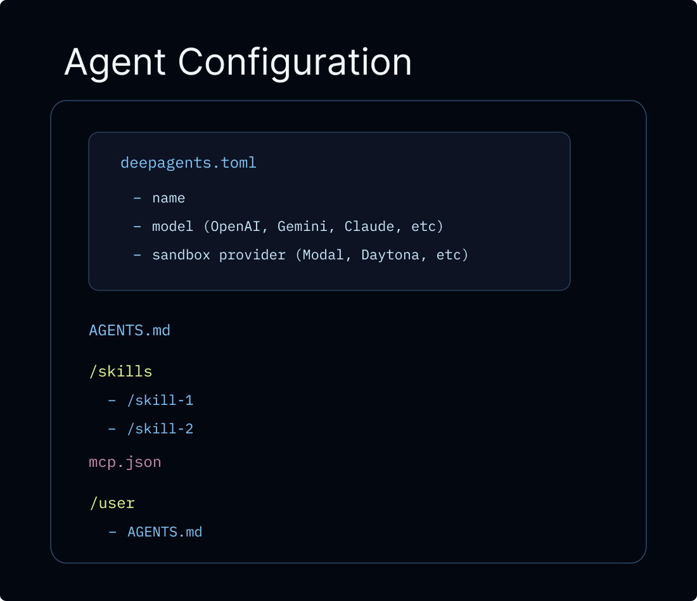
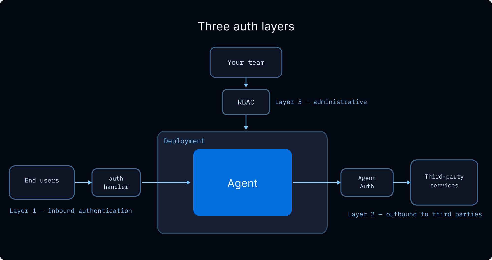
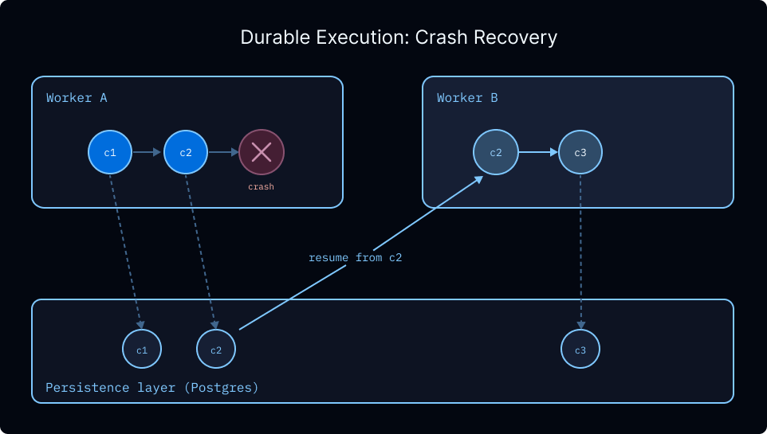
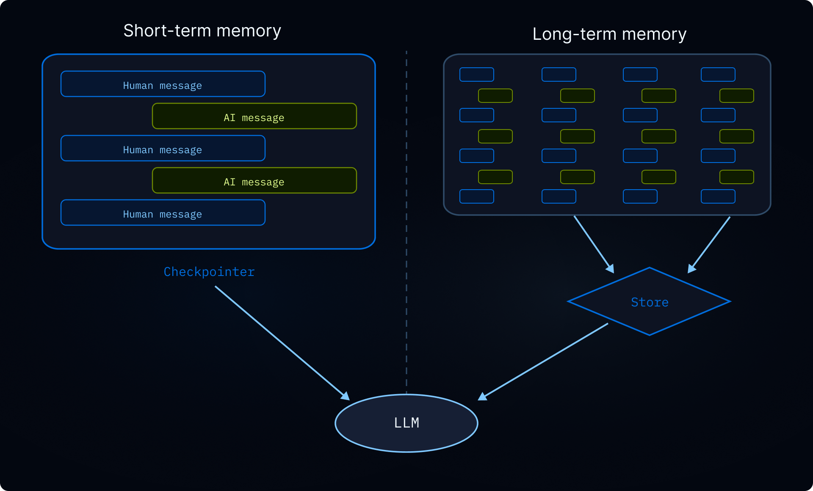
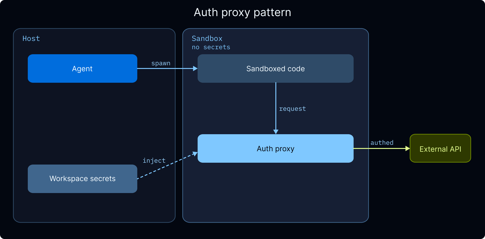

import SandboxLifecycleFactoryAssistantPy from '/langchain/snippets/deepagents-sandbox-lifecycle-factory-assistant-py.mdx';
import SandboxLifecycleFactoryAssistantTs from '/langchain/snippets/deepagents-sandbox-lifecycle-factory-assistant-ts.mdx';
import SandboxLifecycleFactoryThreadPy from '/langchain/snippets/deepagents-sandbox-lifecycle-factory-thread-py.mdx';
import SandboxLifecycleFactoryThreadTs from '/langchain/snippets/deepagents-sandbox-lifecycle-factory-thread-ts.mdx';
import DeepagentsProductionInvokeJs from '/langchain/snippets/code-samples/deepagents-production-invoke-js.mdx';
import DeepagentsProductionInvokePy from '/langchain/snippets/code-samples/deepagents-production-invoke-py.mdx';
import DeployFrameworksPlatformsReference from '/langchain/snippets/langsmith/deploy-frameworks-platforms-reference.mdx';

本指南涵盖了将本地原型深度智能体通过 SDK 部署到生产环境的考虑事项。若要无需管理基础设施即可运行生产智能体，请从 [Managed Deep Agents](https://docs.langchain.com/langsmith/managed-deep-agents-overview) 或 [migrate to Managed Deep Agents](https://docs.langchain.com/langsmith/managed-deep-agents-migrate) 开始。本页剩余部分将介绍在您自行托管智能体或运行自定义 [LangSmith Deployment](https://docs.langchain.com/langsmith/deployment) 时，如何界定记忆、配置执行环境、添加护栏以及连接前端。

## 概述

智能体利用记忆和执行环境中的信息来完成任务。
在生产环境中，有几个基本要素决定了信息的共享和访问方式：

- **线程**：单个对话。消息历史记录和草稿文件默认按线程界定范围，不会跨线程传递。
- **用户**：与您的智能体交互的人。记忆和文件可以是某个用户的私有数据，也可以跨用户共享。身份验证和授权来自您的 [auth layer](https://docs.langchain.com/langsmith/auth)。
- **助手**：配置好的智能体实例。记忆和文件可以与单个助手关联，也可以跨所有助手共享。

本页涵盖：

- **[LangSmith Deployments](#langsmith-deployments)**：Managed Deep Agents（推荐），或带有认证、Webhooks 和 cron 的自定义 LangSmith Deployment
- **[Production considerations](#生产注意事项)**：调用、多租户、认证、凭证、异步和持久性
- **[Memory](#记忆)**：跨对话持久化信息
- **[Execution environment](#执行环境)**：文件存储和代码执行
- **[Guardrails](#安全约束)**：权限和数据隐私
- **[Frontend](#前端)**：将您的 UI 连接到已部署的智能体

## LangSmith Deployments



将深度智能体部署到生产的推荐路径是 [Managed Deep Agents](https://docs.langchain.com/langsmith/managed-deep-agents-overview)，一个以 CLI 优先的托管运行时，用于在 LangSmith 中创建、运行和操作深度智能体。Managed Deep Agents 在 [LangSmith Cloud](https://docs.langchain.com/langsmith/cloud) 上处于公共 [beta](https://docs.langchain.com/langsmith/release-stages) 状态。它运行相同的深度智能体 harness，但您将智能体作为文件项目编写，并声明它供托管运行时使用，而不是自行编译。参见 [Relationship to Deep Agents](https://docs.langchain.com/langsmith/managed-deep-agents-overview#relationship-to-deep-agents)。

对于需要自定义应用代码、自定义路由、高级认证的团队，可以直接配置 [LangSmith Deployment](https://docs.langchain.com/langsmith/deployment)。无论哪种路径，都会为您的智能体提供所需的基础设施：[threads](https://docs.langchain.com/langsmith/use-threads)、[runs](https://docs.langchain.com/langsmith/runs)、一个存储和一个检查点器，因此您无需自行设置这些。传统的 LangSmith Deployment 还可为您提供 [authentication](https://docs.langchain.com/langsmith/auth)、[webhooks](https://docs.langchain.com/langsmith/use-webhooks)、[cron jobs](https://docs.langchain.com/langsmith/cron-jobs) 和 [observability](https://docs.langchain.com/langsmith/observability) 的开箱即用功能，并且可以通过 [MCP](https://docs.langchain.com/langsmith/server-mcp) 或 [A2A](https://docs.langchain.com/langsmith/server-a2a) 暴露您的智能体。

:::js
您也可以在不使用 LangSmith Cloud 的情况下，在 JavaScript 框架和托管平台上部署。

<DeployFrameworksPlatformsReference />
:::

<Tip>
LangSmith 云部署会自动将追踪信息发送到以您的部署命名的项目。打开 [LangSmith](https://smith.langchain.com) 以调试运行并监控使用情况。对于混合或自托管设置，请参阅 [LangSmith 追踪](https://docs.langchain.com/langsmith/data-plane#langsmith-tracing)。我们建议您还设置 [LangSmith 引擎](https://docs.langchain.com/langsmith/engine)，它监控您的追踪信息、检测问题并建议修复方案。
</Tip>

本页上的所有代码片段除非另有说明，否则使用以下 `langgraph.json`：

:::python
```json langgraph.json
{
  "dependencies": ["."],
  "graphs": {
    "agent": "./agent.py:agent"
  },
  "env": ".env"
}
```
:::

:::js
```json langgraph.json
{
  "dependencies": ["."],
  "graphs": {
    "agent": "./src/agent.ts:agent"
  },
  "env": ".env"
}
```
:::

`langgraph.json` 是配置文件，它告诉 LangGraph 平台如何构建和运行您的应用程序。它位于项目的根目录下，对于本地开发（使用 `langgraph dev`）和生产部署都是必需的。关键字段如下：

| 字段 | 描述 |
| --- | --- |
| `dependencies` | 要安装的包。`["."]` 将当前目录作为包进行安装（从 `requirements.txt`、`pyproject.toml` 或 `package.json` 读取）。 |
| `graphs` | 将图 ID 映射到它们的代码位置。每个条目是 `"<id>": "./<file>:<variable>"`，其中 `<id>` 是您通过 API 调用图时使用的名称，`<variable>` 是从 `<file>` 导出的编译图或构造函数。 |
| `env` | 包含环境变量（API 密钥、密钥）的 `.env` 文件路径。这些在构建时设置，并在运行时可用。 |

有关完整的配置选项（自定义 Docker 步骤、存储索引、身份验证处理程序等），请参阅 [应用程序结构](/langchain/oss/langgraph/application-structure)。

## 生产注意事项

### 调用智能体

在生产环境中，每个调用都应该包含两个运行级参数：

- **`thread_id`**（通过 `config={"configurable": {"thread_id": ...}}` 传递）：对话的稳定标识符。[检查点](#可靠性) 使用它来持久化和恢复消息历史记录，因此后续回合可以继续同一对话。生成一个新的 `thread_id` 以开始全新的对话。
- **`context`**：每次运行时您的工具和中间件读取的运行级数据，例如 `user_id`、API 密钥、功能标志或会话元数据。使用 `context_schema` 定义其形状，并通过 `runtime.context` 访问它。请参阅 [运行时上下文](/langchain/oss/deepagents/context-engineering#运行时上下文)。

这两个参数是独立的，并且几乎总是一起传递：

:::python

<DeepagentsProductionInvokePy />

当使用 LangGraph SDK 部署时，SDK 会为您管理线程，并将返回的 `thread_id` 传递给每个运行：

```python
from langgraph_sdk import get_client

client = get_client(url="<DEPLOYMENT_URL>", api_key="<LANGSMITH_API_KEY>")

thread = await client.threads.create()
async for chunk in client.runs.stream(
    thread["thread_id"],  # [!code highlight]
    "agent",
    input={"messages": [{"role": "user", "content": "Plan a 3-day trip to Tokyo"}]},
    context={"user_id": "user-123"},  # [!code highlight]
    stream_mode="updates",
):
    print(chunk.data)
```
:::

:::js

<DeepagentsProductionInvokeJs />

当使用 LangGraph SDK 部署时，SDK 会为您管理线程，并将返回的 `thread_id` 传递给每个运行：

```typescript
import { Client } from "@langchain/langgraph-sdk";

const client = new Client({ apiUrl: "<DEPLOYMENT_URL>", apiKey: "<LANGSMITH_API_KEY>" });

const thread = await client.threads.create();
for await (const chunk of client.runs.stream(
  thread.thread_id,  // [!code highlight]
  "agent",
  {
    input: { messages: [{ role: "user", content: "Plan a 3-day trip to Tokyo" }] },
    context: { userId: "user-123" },  // [!code highlight]
    streamMode: "updates",
  },
)) {
  console.log(chunk.data);
}
```
:::

<Tip>
`thread_id` 范围化了 *对话*（消息历史记录、检查点）。`context` 携带 *每次运行* 的数据，您的工具和中间件会读取这些数据。它们是独立的：更改一个不会影响另一个，并且您可以传递其中一个或两个。
</Tip>

### 多租户

当您的智能体为多个用户服务时，您需要处理三个问题：验证每个用户是谁、控制他们可以访问什么，以及管理智能体代表他们采取行动的凭证。



#### 用户身份和访问控制

[LangSmith 部署](https://docs.langchain.com/langsmith/deployment)支持[自定义认证](https://docs.langchain.com/langsmith/custom-auth)来建立用户身份和[授权处理器](https://docs.langchain.com/langsmith/auth)来控制对线程、智能体和存储命名空间的资源访问。授权处理器在认证成功后运行，可以：

- 使用所有权元数据标记资源（例如，`owner: user_id`）
- 返回过滤器，以便用户只能看到自己的资源
- 对于未授权操作，使用 HTTP 403 拒绝访问

有关分步教程，请参阅[使对话私密](https://docs.langchain.com/langsmith/resource-auth)。有关演示，请观看[自定义认证视频](https://www.youtube.com/watch?v=DkNqgCz8cjE)。

你如何[范围记忆](#范围)和[执行环境](#执行环境)决定了用户之间共享哪些数据。请参阅下文详细说明。

#### 基于角色的访问控制

LangSmith 的[基于角色的访问控制 (RBAC)](https://docs.langchain.com/langsmith/rbac)管理你工作空间中哪些成员可以部署、配置和监控智能体。这与上述最终用户授权是分开的。

| 角色 | 访问权限 |
| --- | --- |
| 工作空间管理员 | 完全权限，包括设置和成员管理 |
| 工作空间编辑器 | 创建和修改资源，但不能删除运行或管理成员 |
| 工作空间查看器 | 只读访问 |

在 Enterprise 计划上，提供具有细粒度权限的自定义角色。有关完整权限模型的详细信息，请参阅[RBAC 参考](https://docs.langchain.com/langsmith/rbac)。

#### 最终用户凭证

当你的智能体需要代表用户调用外部 API（例如，读取他们的 GitHub 仓库、发送 Slack 消息、查询他们的数据仓库）时，你需要一种方法来通过代理传递用户的凭证，而无需硬编码它们。

**通过智能体认证进行 OAuth。** [智能体认证](https://docs.langchain.com/langsmith/agent-auth)提供管理的 OAuth 2.0 流程。配置 OAuth 提供商，智能体可以请求针对每个用户的令牌。在首次使用时，智能体[中断](/langchain/oss/langgraph/interrupts)执行并显示 OAuth 同意 URL。用户认证后，智能体使用有效令牌继续。令牌会自动存储和刷新。

:::python
```python
from langchain_auth import Client
from langchain.tools import tool, ToolRuntime

auth_client = Client()

# Inside your agent's tool:
@tool
async def github_action(runtime: ToolRuntime):
    """Perform an action on behalf of the user via GitHub."""
    auth_result = await auth_client.authenticate(
        provider="github",
        scopes=["repo", "read:org"],
        user_id=runtime.server_info.user.identity,  # [!code highlight]
    )
    # Use auth_result.token for GitHub API calls on the user's behalf
```
:::

:::js
```typescript
import { Client } from "@langchain/auth";

const authClient = new Client();

// Inside your agent's tool:
// Access the authenticated user via runtime.serverInfo
const authResult = await authClient.authenticate({
  provider: "github",
  scopes: ["repo", "read:org"],
  userId: runtime.serverInfo.user.identity,  // [!code highlight]
});
// Use authResult.token for GitHub API calls on the user's behalf
```
:::

**沙盒的凭证注入。** 如果你的智能体在[沙盒](#沙盒)中运行代码并调用外部 API，[沙盒认证代理](https://docs.langchain.com/langsmith/sandbox-auth-proxy)可以自动将凭证注入出站请求，因此沙盒代码永远不会接收原始 API 密钥。有关设置详细信息，请参阅[管理密钥](#管理密钥)。

**工作空间密钥。** 对于跨所有用户共享的 API 密钥（例如你组织的 LLM 提供商密钥、搜索 API 密钥），将它们作为[工作空间密钥](https://docs.langchain.com/langsmith/set-up-hierarchy#configure-workspace-settings)存储在 LangSmith 中。有关详细信息，请参阅[管理密钥](#管理密钥)。

### 异步

基于 LLM 的应用程序高度依赖 I/O：调用语言模型、数据库和外部服务。异步编程允许这些操作并发运行而不是阻塞，从而提高吞吐量和响应能力。

<Note>
LangChain 遵循为异步方法名称添加`a`前缀的约定（例如，`ainvoke`、`abefore_agent`、`astream`）。同步和异步变体位于同一类或命名空间中。
</Note>

在为生产环境构建时：

- **创建异步工具。** LangChain 在单独的线程中运行同步工具以避免阻塞，但原生异步完全避免了线程开销。
- **使用异步中间件方法。** 自定义 [middleware](/langchain/oss/langchain/middleware/custom) 应实现异步钩子（例如，`abefore_agent` 而不是 `before_agent`）。
- **使用异步处理外部资源生命周期。** 创建 [sandboxes](#沙盒) 或连接到 [MCP servers](/langchain/oss/langchain/mcp) 涉及网络调用，应等待。这就是为什么 [graph factories](https://docs.langchain.com/langsmith/graph-rebuild) 预配这些资源是异步的。

### 可靠性

Deep Agents 在 LangGraph 上运行，LangGraph 提供了开箱即用的持久化执行。[persistence](/langchain/oss/langgraph/persistence) 层在每一步检查点状态，因此由失败、超时或 [human-in-the-loop](/langchain/oss/langgraph/interrupts) 暂停中断的运行可以从最后记录的状态恢复，而无需重新处理之前的步骤。对于长时间运行的 deep agents（会生成许多子 agents），这意味着运行中途的失败不会丢失已完成的工作。

 挑起运行

检查点还支持：

- **无限 [interrupts](/langchain/oss/langgraph/interrupts)。** Human-in-the-loop 工作流可以暂停几分钟或几天，并从停止的地方精确恢复。
- **[Time travel](/langchain/oss/langgraph/use-time-travel)。** 每个检查点步骤都是一个快照，你可以倒带，如果出问题，可以从更早的状态重新播放。
- **安全处理敏感操作。** 对于涉及支付或其他不可逆操作的流程，检查点提供审计跟踪和恢复点，以检查导致操作的精确状态。

<Tip>
[LangSmith Deployments](https://docs.langchain.com/langsmith/deployment) 自动配置持久化检查点。如果你是自托管，请参阅 [persistence](/langchain/oss/langgraph/persistence) 获取设置说明。
</Tip>

## 记忆

没有记忆，每次对话都从零开始。记忆使你的智能体能够在对话中保留信息（用户偏好、学习到的指令、过去的经验），以便随着时间的推移个性化其行为。有关记忆类型的概述，请参阅 [memory concepts guide](/langchain/oss/concepts/memory)。



### 范围

记忆始终在对话之间持久化。主要问题是它如何跨用户和助手边界进行范围划分。正确的范围取决于谁应该查看和修改数据：

| 范围 | 命名空间 | 用例 | 示例 |
| --- | --- | --- | --- |
| **用户**（推荐默认） | `(user_id)` | 每个用户的偏好和上下文 | "我倾向于简洁的回复" |
| **助手** | `(assistant_id)` | 一个助手的共享指令 | "帖子最多 280 个字符" |
| **全局** | `(org_id)` | 所有用户和助手的只读策略 | "永远不要泄露内部定价" |

<Warning>
共享内存（助理、用户或组织范围）是提示词注入的向量。如果一名用户可以写入另一名用户对话读取的内存，恶意用户可能会向该共享状态注入指令。在适当的情况下强制执行只读访问。例如，仅通过应用程序代码使组织范围的策略可写，而不是由智能体本身直接写入。使用 [权限](/langchain/oss/deepagents/permissions) 声明性地拒绝向共享路径写入，或使用 [后端策略钩子](/langchain/oss/deepagents/backends#添加策略钩子) 进行自定义验证逻辑。

</Warning>

### 配置

在 Deep Agents 中，内存以文件形式存储在虚拟文件系统中。默认情况下，文件限定于单个线程（对话），并且不会跨线程共享。
否则，要跨线程共享内存，将路径如 `/memories/` 路由到写入 LangGraph [存储](https://docs.langchain.com/langsmith/custom-store) 的 @[StoreBackend]。使用 @[CompositeBackend] 为智能体提供线程限定的临时空间和跨线程 [长期记忆](/langchain/oss/deepagents/memory)。

:::python
<Note>
下面显示的 `rt.server_info` 和 `rt.execution_info` 命名空间模式需要 `deepagents>=0.5.0`。
</Note>
:::

:::js
<Note>
下面显示的 `rt.serverInfo` 和 `rt.executionInfo` 命名空间模式需要 `deepagents>=1.9.0`。
</Note>
:::

<Tabs>
  <Tab title="User (recommended)">
    按 `user_id` 命名空间。每个用户拥有自己的私有内存。这是推荐默认设置，因为大多数应用程序部署单个助理。

:::python
```python agent.py
from deepagents import create_deep_agent
from deepagents.backends import CompositeBackend, StateBackend, StoreBackend

agent = create_deep_agent(
    model="google_genai:gemini-3.6-flash",
    backend=CompositeBackend(
        default=StateBackend(),
        routes={
            "/memories/": StoreBackend(
                namespace=lambda rt: (
                    rt.server_info.assistant_id,  # [!code highlight]
                    rt.server_info.user.identity,  # [!code highlight]
                ),
            ),
        },
    ),
    system_prompt="""You have persistent memory at /memories/.

    Read /memories/instructions.txt at the start of each conversation for
    accumulated knowledge and preferences. When you learn something that
    should persist, update that file.""",
)
```
:::

:::js
```typescript src/agent.ts
import { createDeepAgent, CompositeBackend, StateBackend, StoreBackend } from "deepagents";

export const agent = createDeepAgent({
  backend: new CompositeBackend(
    new StateBackend(),
    {
      "/memories/": new StoreBackend({
        namespace: (rt) => [
          rt.serverInfo.assistantId,  // [!code highlight]
          rt.serverInfo.user.identity,  // [!code highlight]
        ],
      }),
    },
  ),
  systemPrompt: `You have persistent memory at /memories/.

  Read /memories/instructions.txt at the start of each conversation for
  accumulated knowledge and preferences. When you learn something that
  should persist, update that file.`,
});
```
:::

  </Tab>
  <Tab title="Assistant">
    按 `assistant_id` 命名空间。内存在相同助理的所有用户之间共享，因此任何用户都可以读取或更新它。用于共享指令或知识，这些指令或知识适用于使用给定助理的所有人（例如，“始终使用正式语气”）。

:::python
```python agent.py
from deepagents import create_deep_agent
from deepagents.backends import CompositeBackend, StateBackend, StoreBackend

agent = create_deep_agent(
    model="google_genai:gemini-3.6-flash",
    backend=CompositeBackend(
        default=StateBackend(),
        routes={
            "/memories/": StoreBackend(
                namespace=lambda rt: (
                    rt.server_info.assistant_id,  # [!code highlight]
                ),
            ),
        },
    ),
)
```
:::

:::js
```typescript src/agent.ts
import { createDeepAgent, CompositeBackend, StateBackend, StoreBackend } from "deepagents";

export const agent = createDeepAgent({
  backend: new CompositeBackend(
    new StateBackend(),
    {
      "/memories/": new StoreBackend({
        namespace: (rt) => [rt.serverInfo.assistantId],  // [!code highlight]
      }),
    },
  ),
});
```
:::

  </Tab>
  <Tab title="User">
    仅按 `user_id` 命名空间。内存跨所有助理跟随用户。用于应适用于用户与任何助理交谈的全球用户配置文件（姓名、时区、沟通偏好）。

:::python
```python agent.py
from deepagents import create_deep_agent
from deepagents.backends import CompositeBackend, StateBackend, StoreBackend

agent = create_deep_agent(
    model="google_genai:gemini-3.6-flash",
    backend=CompositeBackend(
        default=StateBackend(),
        routes={
            "/memories/": StoreBackend(
                namespace=lambda rt: (rt.server_info.user.identity,),  # [!code highlight]
            ),
        },
    ),
)
```
:::

:::js
```typescript src/agent.ts
import { createDeepAgent, CompositeBackend, StateBackend, StoreBackend } from "deepagents";

export const agent = createDeepAgent({
  backend: new CompositeBackend(
    new StateBackend(),
    {
      "/memories/": new StoreBackend({
        namespace: (rt) => [rt.serverInfo.user.identity],  // [!code highlight]
      }),
    },
  ),
});
```
:::

  </Tab>
  <Tab title="Organization">
    按 `org_id` 命名空间。内存在所有用户和所有助理之间共享。通常用于组织范围的策略（合规规则、品牌指南），这些策略应仅对智能体为只读。写入访问应限制为应用程序代码，以防止提示词注入。

:::python
```python agent.py
from deepagents import create_deep_agent
from deepagents.backends import CompositeBackend, StateBackend, StoreBackend

agent = create_deep_agent(
    model="google_genai:gemini-3.6-flash",
    backend=CompositeBackend(
        default=StateBackend(),
        routes={
            "/memories/": StoreBackend(
                namespace=lambda rt: (rt.context.org_id,),
            ),
        },
    ),
)
```
:::

:::js
```typescript src/agent.ts
import { createDeepAgent, CompositeBackend, StateBackend, StoreBackend } from "deepagents";

export const agent = createDeepAgent({
  backend: new CompositeBackend(
    new StateBackend(),
    {
      "/memories/": new StoreBackend({
        namespace: (rt) => [rt.context.orgId],
      }),
    },
  ),
});
```
:::

  </Tab>
</Tabs>

您还可以使用 [存储 API](https://docs.langchain.com/langsmith/custom-store) 从应用程序代码中读取和写入存储。有关示例，请参阅 [高级用法](/langchain/oss/deepagents/memory#高级用法)。

有关完整的命名空间工厂 API，请参阅 [命名空间工厂](/langchain/oss/deepagents/backends#命名空间工厂)。有关自我改进指令和知识库等长期记忆模式，请参阅 [长期记忆](/langchain/oss/deepagents/memory)。

## 执行环境

本地上，智能体可以直接在磁盘上读写文件并运行 shell 命令。在生产环境中，您需要考虑隔离和持久性。正确的设置取决于您的智能体是否需要执行代码：

- **文件系统后端** 如果你的智能体仅读取和写入文件，则足够。根据你的持久化需求选择后端：线程范围的临时空间、跨线程存储，或两者的组合。
- **沙盒** 添加一个隔离的容器，包含 `execute` 工具用于运行 shell 命令。如果智能体需要运行代码、安装包或执行文件 I/O 之外的操作，使用沙盒。

### 文件系统

根据需要持久化的内容选择后端：

- @[StateBackend]（默认）：线程范围的临时空间。文件在同一个线程内的回合间通过你的检查点持久化，但不会跨线程共享。每一步都会检查点，因此避免写入大文件。
- @[StoreBackend]：跨线程存储，能在对话间持续存在。使用 [命名空间工厂](/langchain/oss/deepagents/backends#命名空间工厂) 进行作用域限定。
- @[CompositeBackend]：组合两者。默认为线程范围的临时空间，特定路径（如 `/memories/`）通过跨线程路由。

:::python
- [`ContextHubBackend`](/langchain/oss/deepagents/backends#contexthubbackend): 在 LangSmith Hub 仓库中的持久文件（`owner/name` 或 `name`）。当你希望使用 LangSmith 原生持久化而不需要单独配置 LangGraph 存储时使用此选项。
:::

有关后端的完整列表以及如何构建自定义后端的详细信息，请参阅 [后端](/langchain/oss/deepagents/backends)。

<Warning>
`FilesystemBackend` 和 `LocalShellBackend` 直接访问主机。不要在已部署的智能体中使用它们。
</Warning>

### 沙盒

如果智能体需要运行代码（而不仅仅是读取和写入文件），使用 [沙盒](/langchain/oss/deepagents/sandboxes)。沙盒提供文件系统和用于运行 shell 命令的 `execute` 工具，所有内容都在隔离的容器内。这种隔离也保护了你的主机：如果智能体的代码耗尽内存或崩溃，仅沙盒受影响。你的服务器保持运行。

#### 生命周期

关键决策是沙盒的存活时间。每个对话是否获得一个全新的沙盒，还是对话共享持久化的环境？

| 范围 | 沙盒 ID 存储在 | 生命周期 | 示例用例 |
|---|---|---|---|
| **线程范围** | [线程](https://docs.langchain.com/langsmith/use-threads) 元数据 | 每个对话一个，TTL 到期时清理 | 数据分析机器人，每个对话开始时环境干净 |
| **助手范围** | [助手](https://docs.langchain.com/langsmith/assistants) 配置 | 跨所有对话共享 | 编程助手，在对话间维护克隆的仓库 |

<Note>
下方的示例使用异步 [图工厂](https://docs.langchain.com/langsmith/graph-rebuild) 而不是静态图，因为沙盒需要 `thread_id` 或 `assistant_id` 来查找或创建正确的沙盒。图工厂不会接收完整的 `Runtime`（没有 `server_info` 或 `execution_info`）；相反，接受一个 `RunnableConfig` 并从 `config["configurable"]` 读取 `thread_id` 和 `assistant_id`。工厂是异步的，因为沙盒创建是 I/O 密集型操作，需要仅在调用时才可用的运行时信息。
</Note>

<Tabs>
  <Tab title="Thread-scoped (most common)">
    每个对话获得自己的沙盒。[图工厂](https://docs.langchain.com/langsmith/graph-rebuild) 从运行配置读取 `thread_id`，因此每个 [线程](https://docs.langchain.com/langsmith/use-threads) 自动获得隔离的环境。命名沙盒查找处理跨运行的去重。沙盒在 [TTL](https://docs.langchain.com/langsmith/configure-ttl) 到期时清理。

:::python
<SandboxLifecycleFactoryThreadPy />
:::

:::js
<SandboxLifecycleFactoryThreadTs />
:::

</Tab>
  <Tab title="Assistant-scoped">
    所有对话共享一个沙盒。 [图工厂](https://docs.langchain.com/langsmith/graph-rebuild) 从 `config["configurable"]` 读取 [助手](https://docs.langchain.com/langsmith/assistants) ID，因此同一助手的所有线程都返回到相同的环境。文件、安装的包和克隆的存储库跨对话持久化。

:::python
<SandboxLifecycleFactoryAssistantPy />
:::

:::js
<SandboxLifecycleFactoryAssistantTs />
:::

    <Warning>
        助手范围的沙盒随时间累积文件、安装的包和其他沙盒内状态。使用沙盒提供者的 TTL 配置，定期使用快照重置，或实现清理逻辑以防止沙盒的磁盘和内存无限制增长。
    </Warning>
  </Tab>
</Tabs>

由于 `agent` 变量是一个异步函数（而不是编译的图），服务器将其视为 [图工厂](https://docs.langchain.com/langsmith/graph-rebuild) 并在每个运行时调用它，注入配置。工厂通过名称查找或创建沙盒，并返回一个连接到该沙盒的新智能体图。

一旦使用 `langgraph deploy` 部署，就在应用程序代码中使用 SDK 调用智能体。无论范围如何，客户端代码都相同。范围完全由上方的智能体工厂处理，但行为不同：

<Tabs>
  <Tab title="Thread-scoped">
    每个线程都有自己的沙盒。同一线程内的后续消息会重用相同的沙盒，但新线程总是以全新的状态开始，没有来自先前对话的遗留文件或安装的包。

:::python
```python client.py
from langgraph_sdk import get_client

client = get_client(url="<DEPLOYMENT_URL>", api_key="<LANGSMITH_API_KEY>")

# Conversation 1: install pandas and analyze data
thread_1 = await client.threads.create()
async for chunk in client.runs.stream(
    thread_1["thread_id"],
    "agent",
    input={"messages": [{"role": "human", "content": "Install pandas and analyze sales_data.csv"}]},
    stream_mode="updates",
):
    print(chunk.data)

# Follow-up in the same conversation — pandas is still installed
async for chunk in client.runs.stream(
    thread_1["thread_id"],
    "agent",
    input={"messages": [{"role": "human", "content": "Now plot the results"}]},
    stream_mode="updates",
):
    print(chunk.data)

# Conversation 2: fresh sandbox — pandas is NOT installed, no files from conversation 1
thread_2 = await client.threads.create()
async for chunk in client.runs.stream(
    thread_2["thread_id"],
    "agent",
    input={"messages": [{"role": "human", "content": "What packages are installed?"}]},
    stream_mode="updates",
):
    print(chunk.data)
```
:::

:::js
```typescript client.ts
import { Client } from "@langchain/langgraph-sdk";

const client = new Client({ apiUrl: "<DEPLOYMENT_URL>", apiKey: "<LANGSMITH_API_KEY>" });

// Conversation 1: install pandas and analyze data
const thread1 = await client.threads.create();
for await (const chunk of client.runs.stream(
  thread1.thread_id,
  "agent",
  { input: { messages: [{ role: "human", content: "Install pandas and analyze sales_data.csv" }] } },
)) {
  console.log(chunk.data);
}

// Follow-up in the same conversation — pandas is still installed
for await (const chunk of client.runs.stream(
  thread1.thread_id,
  "agent",
  { input: { messages: [{ role: "human", content: "Now plot the results" }] } },
)) {
  console.log(chunk.data);
}

// Conversation 2: fresh sandbox — pandas is NOT installed, no files from conversation 1
const thread2 = await client.threads.create();
for await (const chunk of client.runs.stream(
  thread2.thread_id,
  "agent",
  { input: { messages: [{ role: "human", content: "What packages are installed?" }] } },
)) {
  console.log(chunk.data);
}
```
:::

  </Tab>
  <Tab title="Assistant-scoped">
    所有线程共享一个沙盒。当沙盒具有重新创建成本高昂的状态时（例如克隆的存储库、安装的依赖项或构建工件）此方法很有用。同一助手的任何对话都会从上次停止的地方继续，而无需重复设置。

:::python
```python client.py
from langgraph_sdk import get_client

client = get_client(url="<DEPLOYMENT_URL>", api_key="<LANGSMITH_API_KEY>")

# Conversation 1: clone and set up the project
thread_1 = await client.threads.create()
async for chunk in client.runs.stream(
    thread_1["thread_id"],
    "agent",
    input={"messages": [{"role": "human", "content": "Clone https://github.com/org/repo and install dependencies"}]},
    stream_mode="updates",
):
    print(chunk.data)

# Conversation 2: repo and dependencies are still there
thread_2 = await client.threads.create()
async for chunk in client.runs.stream(
    thread_2["thread_id"],
    "agent",
    input={"messages": [{"role": "human", "content": "Run the test suite and fix any failures"}]},
    stream_mode="updates",
):
    print(chunk.data)
```
:::

:::js
```typescript client.ts
import { Client } from "@langchain/langgraph-sdk";

const client = new Client({ apiUrl: "<DEPLOYMENT_URL>", apiKey: "<LANGSMITH_API_KEY>" });

// Conversation 1: clone and set up the project
const thread1 = await client.threads.create();
for await (const chunk of client.runs.stream(
  thread1.thread_id,
  "agent",
  { input: { messages: [{ role: "human", content: "Clone https://github.com/org/repo and install dependencies" }] } },
)) {
  console.log(chunk.data);
}

// Conversation 2: repo and dependencies are still there
const thread2 = await client.threads.create();
for await (const chunk of client.runs.stream(
  thread2.thread_id,
  "agent",
  { input: { messages: [{ role: "human", content: "Run the test suite and fix any failures" }] } },
)) {
  console.log(chunk.data);
}
```
:::

  </Tab>
</Tabs>

#### 文件传输

沙盒是隔离的容器，因此您的应用程序代码不能直接访问沙盒内的文件。使用 `upload_files()` 和 `download_files()` 跨越沙盒边界移动数据：

- **在智能体运行前初始化沙盒**：上传用户文件、[技能](/langchain/oss/deepagents/skills) 脚本、配置或 [持久记忆](/langchain/oss/deepagents/memory)，以便智能体从一开始就有所需内容
- **在智能体运行后检索结果**：下载生成的工件（报告、图表、导出）并将更新的记忆同步回未来对话

有关特定提供者的文件传输示例，请参阅 [使用文件](/langchain/oss/deepagents/sandboxes#处理文件)。有关提供者设置、安全性和生命周期模式，请参阅完整的 [沙盒指南](/langchain/oss/deepagents/sandboxes)。

<Accordion title="Example: syncing skills and memories with custom middleware">
  智能体需要执行的 [技能](/langchain/oss/deepagents/skills) 脚本必须在智能体运行前上传到沙盒。您可能还想同步 [记忆](/langchain/oss/deepagents/memory)，以便智能体可以在容器内读取和更新它们。使用 [自定义中间件](/langchain/oss/langchain/middleware/custom) 与 `before_agent` 和 `after_agent` 钩子移动文件跨越沙盒边界：

:::python
```python agent.py
from deepagents import create_deep_agent
from deepagents.backends import CompositeBackend, StoreBackend
from deepagents.backends.langsmith import LangSmithSandbox
from langchain.agents.middleware import AgentMiddleware, AgentState
from langgraph.runtime import Runtime
from langsmith.sandbox import SandboxClient


def _safe_filename(key: str) -> str:
    """Reject keys that contain path traversal or glob characters."""
    name = key.split("/")[-1]
    if ".." in name or any(c in name for c in ("*", "?")):
        raise ValueError(f"Invalid key: {key}")
    return name


class SandboxSyncMiddleware(AgentMiddleware):
    """Sync skills and memories between the store and the sandbox."""

    def __init__(self, backend: CompositeBackend):
        super().__init__()
        self.backend = backend

    async def abefore_agent(self, state: AgentState, runtime: Runtime) -> None:
        """Upload skill scripts and memories into the sandbox."""
        user_id = runtime.server_info.user.identity  # [!code highlight]
        store = runtime.store
        files = []
        for item in await store.asearch(("skills", user_id)):
            name = _safe_filename(item.key)
            files.append((f"/skills/{name}", item.value["content"].encode()))
        for item in await store.asearch(("memories", user_id)):
            name = _safe_filename(item.key)
            files.append((f"/memories/{name}", item.value["content"].encode()))
        if files:
            await self.backend.upload_files(files)

    async def aafter_agent(self, state: AgentState, runtime: Runtime) -> None:
        """Sync updated memories back to the store."""
        user_id = runtime.server_info.user.identity  # [!code highlight]
        store = runtime.store
        items = await store.asearch(("memories", user_id))
        results = await self.backend.download_files(
            [f"/memories/{item.key}" for item in items]
        )
        for result in results:
            if result.content is not None:
                await store.aput(
                    ("memories", user_id),
                    result.path.split("/")[-1],
                    {"content": result.content.decode()},
                )


client = SandboxClient()
ls_sandbox = client.create_sandbox()


backend = CompositeBackend(
    default=LangSmithSandbox(sandbox=ls_sandbox),
    routes={
        "/skills/": StoreBackend(
            rt,
            namespace=lambda rt: ("skills", rt.server_info.user.identity),  # [!code highlight]
        ),
        "/memories/": StoreBackend(
            rt,
            namespace=lambda rt: ("memories", rt.server_info.user.identity),  # [!code highlight]
        ),
    },
)

agent = create_deep_agent(
    model="google_genai:gemini-3.6-flash",
    backend=backend,
    middleware=[SandboxSyncMiddleware(backend)],
)
```
:::

:::js
```typescript src/agent.ts
import { createMiddleware } from "langchain";
import {
  createDeepAgent,
  CompositeBackend,
  LangSmithSandbox,
  StoreBackend,
} from "deepagents";
import { SandboxClient } from "langsmith/sandbox";

function safeFilename(key: string): string {
  const name = key.split("/").pop()!;
  if (name.includes("..") || /[*?]/.test(name)) {
    throw new Error(`Invalid key: ${key}`);
  }
  return name;
}

const createSandboxSyncMiddleware = (backend: CompositeBackend) => {
  return createMiddleware({
    name: "SandboxSyncMiddleware",
    beforeAgent: async (state, runtime) => {
      // Upload skill scripts and memories into the sandbox
      const userId = runtime.serverInfo.user.identity;  // [!code highlight]
      const store = runtime.store;
      const encoder = new TextEncoder();
      const files: [string, Uint8Array][] = [];
      for (const item of await store.search(["skills", userId])) {
        const name = safeFilename(item.key);
        files.push([`/skills/${name}`, encoder.encode(item.value.content)]);
      }
      for (const item of await store.search(["memories", userId])) {
        const name = safeFilename(item.key);
        files.push([`/memories/${name}`, encoder.encode(item.value.content)]);
      }
      if (files.length > 0) {
        await backend.uploadFiles(files);
      }
    },
    afterAgent: async (state, runtime) => {
      // Sync updated memories back to the store
      const userId = runtime.serverInfo.user.identity;  // [!code highlight]
      const store = runtime.store;
      const items = await store.search(["memories", userId]);
      const results = await backend.downloadFiles(
        items.map((item) => `/memories/${item.key}`),
      );
      const decoder = new TextDecoder();
      for (const result of results) {
        if (result.content) {
          await store.put(
            ["memories", userId],
            result.path.split("/").pop()!,
            { content: decoder.decode(result.content) },
          );
        }
      }
    },
  });
};

const client = new SandboxClient();
const lsSandbox = await client.createSandbox();

const backend = new CompositeBackend(
  new LangSmithSandbox({ sandbox: lsSandbox }),
  {
    "/skills/": new StoreBackend({
      namespace: (rt) => ["skills", rt.serverInfo.user.identity],  // [!code highlight]
    }),
    "/memories/": new StoreBackend({
      namespace: (rt) => ["memories", rt.serverInfo.user.identity],  // [!code highlight]
    }),
  },
);

export const agent = createDeepAgent({
  backend,
  middleware: [createSandboxSyncMiddleware(backend)],
});
```
:::

</Accordion>

#### 管理密钥

沙盒是隔离的容器，因此主机环境变量在沙盒内不可用。向沙盒代码提供 API 密钥和其他密钥有两种方法：

**认证代理（推荐）。** [沙盒认证代理](https://docs.langchain.com/langsmith/sandbox-auth-proxy)拦截沙盒的出站请求并自动注入认证头。沙盒代码正常调用外部API，而代理根据目标主机添加正确的凭证。这意味着API密钥永远不会出现在沙盒代码、环境变量或日志中。



```json
{
  "proxy_config": {
    "rules": [
      {
        "name": "openai-api",
        "match_hosts": ["api.openai.com"],
        "inject_headers": {
          "Authorization": "Bearer ${OPENAI_API_KEY}"
        }
      },
      {
        "name": "anthropic-api",
        "match_hosts": ["api.anthropic.com"],
        "inject_headers": {
          "x-api-key": "${ANTHROPIC_API_KEY}"
        }
      }
    ]
  }
}
```

`${SECRET_KEY}`的引用针对LangSmith [工作区设置](https://docs.langchain.com/langsmith/set-up-hierarchy#configure-workspace-settings)中存储的秘密。在创建引用它们的模板之前，请在那里配置秘密。

**工作区秘密。** 对于不需要基于代理注入的API密钥（例如，由智能体服务器本身使用，而不是沙盒代码），将它们存储为LangSmith的[工作区秘密](https://docs.langchain.com/langsmith/set-up-hierarchy#configure-workspace-settings)。这些在运行时作为工作区中所有智能体的环境变量可用。

<Warning>
避免通过环境变量或文件上传将秘密传递到沙盒中。智能体可以读取沙盒中任何可访问的文件或环境变量，包括凭证。认证代理完全将秘密排除在沙盒之外。
</Warning>

## 安全约束

生产环境中的智能体独立运行，这意味着它们可能会无限循环、触发速率限制或处理包含敏感信息的用户数据。深度智能体提供两层保护：

- **[权限](#权限)**：声明式的允许/拒绝规则，控制智能体可以读取或写入哪些文件和目录。
- **[容错](#容错)**：速率限制、重试、回退和错误处理。
- **[数据隐私](#数据隐私)**：在数据到达模型之前或在日志中存储之前检测和处理PII的中间件。

### 权限

[权限](/langchain/oss/deepagents/permissions)是声明式的允许/拒绝规则，控制智能体可以读取或写入哪些文件和目录。使用权限将智能体隔离到工作目录、保护敏感文件或强制执行只读内存。规则按声明顺序评估，第一个匹配的规则生效。

### 容错

有关速率限制、重试、回退和错误处理，请参阅[Fault tolerance](/langchain/oss/deepagents/fault-tolerance)。

### 数据隐私

如果您的智能体处理可能包含电子邮件、信用卡号码或其他PII的用户输入，您可以在它到达模型之前或在日志中存储之前检测和处理它：

:::python
```python
from deepagents import create_deep_agent
from langchain.agents.middleware import PIIMiddleware

agent = create_deep_agent(
    model="google_genai:gemini-3.6-flash",
    middleware=[
        PIIMiddleware("email", strategy="redact", apply_to_input=True),
        PIIMiddleware("credit_card", strategy="mask", apply_to_input=True),
    ],
)
```
:::

:::js
```typescript
import { createAgent, piiMiddleware } from "langchain";

const agent = createAgent({
  model: "google:gemini-3.6-flash",
  middleware: [
    piiMiddleware("email", { strategy: "redact", applyToInput: true }),
    piiMiddleware("credit_card", { strategy: "mask", applyToInput: true }),
  ],
});
```
:::

策略包括`redact`（替换为`[REDACTED_EMAIL]`）、`mask`（部分掩码，如`****-****-****-1234`）、`hash`（确定性哈希）和`block`（引发错误）。您还可以为特定领域的模式编写自定义检测器。
:::python
参见 @[PIIMiddleware] 了解完整配置。
:::
:::js
参见 @[piiMiddleware] 了解完整配置。
:::

有关默认深度智能体中间件堆栈，请参阅[Customization](/langchain/oss/deepagents/customization#中间件)。有关额外的LangChain预构建中间件（重试、回退、PII检测等），请参阅[Prebuilt middleware](/langchain/oss/langchain/middleware/built-in)。

## 前端

深度智能体使用 [`useStream`](/langchain/oss/langchain/frontend/overview) 连接您的 UI 与智能体后端。@[`useStream`] 是一个前端钩子（适用于 React、Vue、Svelte 和 Angular），它实时流式传输智能体的消息、子智能体进度和自定义状态。

在本地，`useStream` 指向 `http://localhost:2024`。在生产环境中，将其指向您的 [LangSmith 部署](https://docs.langchain.com/langsmith/deployment) 并配置重连，以便在用户连接中断时不会丢失进度。

```tsx
import { useStream } from "@langchain/react";

function App() {
  const stream = useStream<typeof agent>({
    apiUrl: "https://your-deployment.langsmith.dev",
    assistantId: "agent",
  });
}
```

对于会生成许多子智能体的深度智能体工作流，在提交时设置较高的 `recursionLimit` 以避免切断长时间运行的执行：

```tsx
stream.submit(
  { messages: [{ type: "human", content: text }] },
  {
    streamSubgraphs: true,
    config: { recursionLimit: 10000 },
  },
);
```

对于特定于深度智能体的 UI 模式，例如子智能体卡片、待办事项列表和自定义状态渲染，请参阅 [前端指南](/langchain/oss/deepagents/frontend/overview)。

---

> 官方原文：[src/oss/deepagents/going-to-production.mdx](https://github.com/langchain-ai/docs/blob/main/src/oss/deepagents/going-to-production.mdx) · 非官方翻译，译文由 AI 生成，以英文原文为准。
