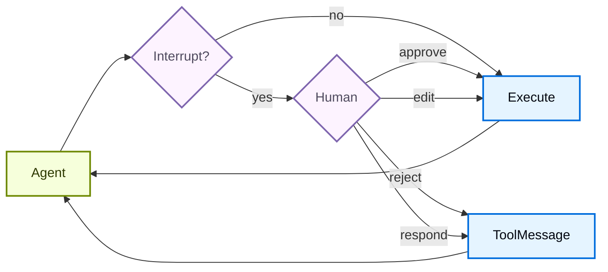
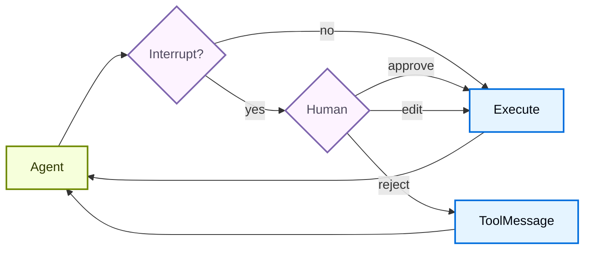

import HitlBasicConfigPy from '/langchain/snippets/code-samples/hitl-basic-config-py.mdx';
import HitlBasicConfigJs from '/langchain/snippets/code-samples/hitl-basic-config-js.mdx';
import HitlConditionalInterruptsPy from '/langchain/snippets/code-samples/hitl-conditional-interrupts-py.mdx';
import HitlDecisionTypesTable from '/langchain/snippets/oss/hitl-decision-types-table.mdx';

一些工具操作可能比较敏感，需要在执行前获得人工批准。深度智能体通过 LangGraph 的中断功能支持人工介入工作流。您可以使用 `interrupt_on` 参数配置哪些工具需要批准。当 `interrupt_on` 被设置时，`HumanInTheLoopMiddleware` 会被添加到 [深度智能体栈](/langchain/oss/deepagents/customization#deep-agents-堆栈) 中。如果一个运行在工具返回结果之前被取消或中断，同一个栈中的 @[`PatchToolCallsMiddleware`] 会自动修复消息历史记录。

:::python

:::

:::js

:::

## 基本配置

`interrupt_on` 参数接受一个将工具名称映射到中断配置的字典。每个工具可以配置为：

- **`True`**：启用具有默认行为的中断
  :::python
  (允许批准、编辑、拒绝和响应)
  :::
  :::js
  (允许批准、编辑和拒绝)
  :::
- **`False`**：禁用此工具的中断
- **`InterruptOnConfig`**：自定义配置。设置 `allowed_decisions` 来控制审核选项。
  :::python
  在 Python 中，添加一个可选的 `when` 谓词来仅中断特定的调用（参见 [条件中断](#条件中断)）。
  :::

:::python
<HitlBasicConfigPy />
:::

:::js
<HitlBasicConfigJs />
:::

## 决策类型

`allowed_decisions` 列表控制当人类在审核工具调用时可以采取的操作：

<HitlDecisionTypesTable />

:::python
当人类拒绝提议的操作时，使用 `reject`。仅当人类作为工具行事时（例如，回答一个 `ask_user` 提示词）才使用 `respond`。不要使用 `respond` 来拒绝具有副作用的工具，因为其消息可能会被模型视为成功的工具结果。
:::

:::js
当人类拒绝提议的操作时，使用 `reject`。
:::

<Tip>
当 **编辑** 工具参数时，保守地做出更改。对原始参数进行重大修改可能会导致模型重新评估其方法，并可能多次执行工具或采取意外操作。
</Tip>

您可以自定义每个工具可用的哪些决策：

:::python
```python
interrupt_on = {
    # Sensitive operations: allow all options
    "delete_file": {"allowed_decisions": ["approve", "edit", "reject"]},

    # Moderate risk: approval or rejection only
    "write_file": {"allowed_decisions": ["approve", "reject"]},

    # Must approve (no rejection allowed)
    "critical_operation": {"allowed_decisions": ["approve"]},
}
```
:::

:::js
```typescript
const interruptOn = {
  // Sensitive operations: allow all options
  delete_file: { allowedDecisions: ["approve", "edit", "reject"] },

  // Moderate risk: approval or rejection only
  write_file: { allowedDecisions: ["approve", "reject"] },

  // Must approve (no rejection allowed)
  critical_operation: { allowedDecisions: ["approve"] },
};
```
:::

:::python
## 条件中断

默认情况下，`interrupt_on` 中列出的每个工具调用都会暂停以供审核。要仅暂停某些调用，请向工具的 `InterruptOnConfig` 添加一个 `when` 谓词。谓词接收一个 @[ToolCallRequest] 并返回 `True` 以中断或 `False` 以自动批准，因此您可以根据工具的参数进行控制。

<Note>
条件中断需要 `langchain>=1.3.3`。
</Note>

<HitlConditionalInterruptsPy />

当 `when` 谓词返回 `False` 时，调用不会中断。当它返回 `True`，或当您省略 `when` 时，调用会像往常一样暂停。计算结果为 `False` 的调用永远不会被添加到中断批次中，因此审核者只看到需要决策的操作。

有关其他配置选项和示例，请参阅 [LangChain 人工介入文档](/langchain/oss/langchain/human-in-the-loop#条件中断)。
:::

## 处理中断

当中断被触发时，智能体会暂停执行并返回控制权。检查结果中的中断，并相应地处理它们。如果用户拒绝操作，请包含一个清晰的 `message`，告诉智能体工具未被执行以及下一步该做什么。

:::python
```python
from langchain_core.utils.uuid import uuid7
from langgraph.types import Command

# Create config with thread_id for state persistence
config = {"configurable": {"thread_id": str(uuid7())}}

# Invoke the agent
result = agent.invoke(
    {"messages": [{"role": "user", "content": "Delete the file temp.txt"}]},
    config=config
)

# Check if execution was interrupted
if result.get("__interrupt__"):  # [!code highlight]
    # Extract interrupt information
    interrupt_value = result["__interrupt__"][0].value  # [!code highlight]
    action_requests = interrupt_value["action_requests"]
    review_configs = interrupt_value["review_configs"]

    # Create a lookup map from tool name to review config
    config_map = {cfg["action_name"]: cfg for cfg in review_configs}

    # Display the pending actions to the user
    for action in action_requests:
        review_config = config_map[action["name"]]
        print(f"Tool: {action['name']}")
        print(f"Arguments: {action['args']}")
        print(f"Allowed decisions: {review_config['allowed_decisions']}")

    # Get user decisions (one per action_request, in order)
    decisions = [
        {
            "type": "reject",
            "message": "User rejected deleting temp.txt. Do not retry deletion.",
        }
    ]

    # Resume execution with decisions
    result = agent.invoke(
        Command(resume={"decisions": decisions}),
        config=config  # Must use the same config!
    )

# Process final result
print(result["messages"][-1].content)  # [!code highlight]
```
:::

:::js
```typescript
import { v7 as uuid7 } from "uuid";
import { Command } from "@langchain/langgraph";

// Create config with thread_id for state persistence
const config = { configurable: { thread_id: uuid7() } };

// Invoke the agent
let result = await agent.invoke({
  messages: [{ role: "user", content: "Delete the file temp.txt" }],
}, config);

// Check if execution was interrupted
if (result.__interrupt__) {
  // Extract interrupt information
  const interrupts = result.__interrupt__[0].value;
  const actionRequests = interrupts.actionRequests;
  const reviewConfigs = interrupts.reviewConfigs;

  // Create a lookup map from tool name to review config
  const configMap = Object.fromEntries(
    reviewConfigs.map((cfg) => [cfg.actionName, cfg])
  );

  // Display the pending actions to the user
  for (const action of actionRequests) {
    const reviewConfig = configMap[action.name];
    console.log(`Tool: ${action.name}`);
    console.log(`Arguments: ${JSON.stringify(action.args)}`);
    console.log(`Allowed decisions: ${reviewConfig.allowedDecisions}`);
  }

  // Get user decisions (one per actionRequest, in order)
  const decisions = [
    {
      type: "reject",
      message: "User rejected deleting temp.txt. Do not retry deletion.",
    }
  ];

  // Resume execution with decisions
  result = await agent.invoke(
    new Command({ resume: { decisions } }),
    config  // Must use the same config!
  );
}

// Process final result
console.log(result.messages[result.messages.length - 1].content);
```
:::

## 使用流式输出处理中断

对于实时 UI，使用 `.stream()` 而不是 `.invoke()` 来在处理 HITL 中断时显示 Token 和工具调用进度。中断会作为 `__interrupt__` 条目出现在 `updates` 流中。流完成后，收集人类决策并通过 `Command(resume=...)` 再次流式传输以恢复。

<Note>
对于典型的 `interrupt_on` HITL 暂停，使用与 `.invoke()` 相同形状的扁平 `{"decisions": [...]}` 负载来恢复。当同时有多个中断待处理时（例如，并行分支），将每个中断 ID 映射到其恢复值。参见 [处理多个中断](/langchain/oss/langgraph/interrupts#处理多个中断)。
</Note>

:::python
```python
from langchain_core.utils.uuid import uuid7
from langgraph.types import Command

config = {"configurable": {"thread_id": str(uuid7())}}
stream_input = {"messages": [{"role": "user", "content": "Delete the file temp.txt"}]}

while True:
    pending_interrupt = None

    for mode, data in agent.stream(  # [!code highlight]
        stream_input,
        stream_mode=["messages", "updates"],  # [!code highlight]
        config=config,
    ):
        if mode == "messages":
            token, metadata = data
            # Display tokens in real time
            if token.content:
                print(token.content, end="", flush=True)

        elif mode == "updates" and isinstance(data, dict):
            if "__interrupt__" in data:  # [!code highlight]
                pending_interrupt = data["__interrupt__"][0]  # [!code highlight]

    # If no interrupt occurred, the agent finished
    if pending_interrupt is None:
        break

    interrupt_value = pending_interrupt.value
    action_requests = interrupt_value["action_requests"]
    review_configs = interrupt_value["review_configs"]
    config_map = {cfg["action_name"]: cfg for cfg in review_configs}

    for action in action_requests:
        review = config_map[action["name"]]
        print(f"\nTool: {action['name']}")
        print(f"Arguments: {action['args']}")
        print(f"Allowed: {review['allowed_decisions']}")

    # Collect one decision per action_request, in order
    decisions = [{"type": "approve"} for _ in action_requests]
    stream_input = Command(resume={"decisions": decisions})  # [!code highlight]

print()
```
:::

:::js
```typescript
import { v7 as uuid7 } from "uuid";
import { Command } from "@langchain/langgraph";

const config = { configurable: { thread_id: uuid7() } };
let streamInput: Record<string, any> | Command = {
  messages: [{ role: "user", content: "Delete the file temp.txt" }],
};

while (true) {
  let pendingInterrupt: { value: any } | undefined;

  for await (const chunk of await agent.stream(  // [!code highlight]
    streamInput,
    {
      streamMode: ["messages", "updates"],  // [!code highlight]
      ...config,
    }
  )) {
    const [mode, data] = chunk;

    if (mode === "messages") {
      const [token] = data;
      // Display tokens in real time
      if (token.text) {
        process.stdout.write(token.text);
      }
    }

    if (mode === "updates" && data?.__interrupt__) {  // [!code highlight]
      pendingInterrupt = data.__interrupt__[0];  // [!code highlight]
    }
  }

  // If no interrupt occurred, the agent finished
  if (!pendingInterrupt) break;

  const interruptValue = pendingInterrupt.value;
  const actionRequests = interruptValue.actionRequests;
  const reviewConfigs = interruptValue.reviewConfigs;
  const configMap = Object.fromEntries(
    reviewConfigs.map((cfg: any) => [cfg.actionName, cfg])
  );

  for (const action of actionRequests) {
    const review = configMap[action.name];
    console.log(`\nTool: ${action.name}`);
    console.log(`Arguments: ${JSON.stringify(action.args)}`);
    console.log(`Allowed: ${review.allowedDecisions}`);
  }

  // Collect one decision per actionRequest, in order
  const decisions = actionRequests.map(() => ({ type: "approve" }));
  streamInput = new Command({ resume: { decisions } });  // [!code highlight]
}

process.stdout.write("\n");
```
:::

<Tip>
结合 `"messages"` 和 `"updates"` 流式模式，在捕获 HITL 中断的同时向用户显示实时 LLM Token。`"messages"` 模式流式传输 Token；`"updates"` 模式发送中断负载。
</Tip>

## 多个工具调用

当智能体调用多个需要批准的工具时，所有中断都会被批量组合在一个中断中。您必须按顺序为每个提供决策。

:::python
```python
config = {"configurable": {"thread_id": str(uuid7())}}

result = agent.invoke(
    {"messages": [{
        "role": "user",
        "content": "Delete temp.txt and send an email to admin@example.com"
    }]},
    config=config
)

if result.get("__interrupt__"):  # [!code highlight]
    interrupt_value = result["__interrupt__"][0].value  # [!code highlight]
    action_requests = interrupt_value["action_requests"]

    # Two tools need approval
    assert len(action_requests) == 2

    # Provide decisions in the same order as action_requests
    decisions = [
        {"type": "approve"},  # First tool: delete_file
        {
            "type": "reject",
            "message": "User rejected this action. Do not retry this tool call.",
        }  # Second tool: send_email
    ]

    result = agent.invoke(
        Command(resume={"decisions": decisions}),
        config=config
    )
```
:::

:::js
```typescript
const config = { configurable: { thread_id: uuid7() } };

let result = await agent.invoke({
  messages: [{
    role: "user",
    content: "Delete temp.txt and send an email to admin@example.com"
  }]
}, config);

if (result.__interrupt__) {
  const interrupts = result.__interrupt__[0].value;
  const actionRequests = interrupts.actionRequests;

  // Two tools need approval
  console.assert(actionRequests.length === 2);

  // Provide decisions in the same order as actionRequests
  const decisions = [
    { type: "approve" },  // First tool: delete_file
    {
      type: "reject",
      message: "User rejected this action. Do not retry this tool call.",
    }  // Second tool: send_email
  ];

  result = await agent.invoke(
    new Command({ resume: { decisions } }),
    config
  );
}
```
:::

## 拒绝消息

当审核者返回一个 `reject` 决策时，深度智能体会跳过工具调用并将拒绝反馈发送回智能体。如果您省略 `message`，默认反馈会告诉模型工具未被执行，除非用户请求，否则不要重试同一个工具调用。

对于敏感或具有副作用的工具，在决策时传递一个与领域相关的 `message`。明确说明智能体是否应该放弃操作、询问后续问题或尝试更安全的替代方案。

:::python
```python
decisions = [
    {
        "type": "reject",
        "message": "User rejected deleting this file. Do not retry deletion. Ask which file to archive instead.",
    }
]
```
:::

:::js
```typescript
const decisions = [
  {
    type: "reject",
    message: "User rejected deleting this file. Do not retry deletion. Ask which file to archive instead.",
  },
];
```
:::

## 编辑工具参数

当 `"edit"` 在允许的决策中时，您可以在执行前修改工具参数：

:::python
```python
if result.get("__interrupt__"):  # [!code highlight]
    interrupt_value = result["__interrupt__"][0].value  # [!code highlight]
    action_request = interrupt_value["action_requests"][0]

    # Original args from the agent
    print(action_request["args"])  # {"to": "everyone@company.com", ...}

    # User decides to edit the recipient
    decisions = [{
        "type": "edit",
        "edited_action": {
            "name": action_request["name"],  # Must include the tool name
            "args": {"to": "team@company.com", "subject": "...", "body": "..."}
        }
    }]

    result = agent.invoke(
        Command(resume={"decisions": decisions}),
        config=config
    )
```
:::

:::js
```typescript
if (result.__interrupt__) {
  const interrupts = result.__interrupt__[0].value;
  const actionRequest = interrupts.actionRequests[0];

  // Original args from the agent
  console.log(actionRequest.args);  // { to: "everyone@company.com", ... }

  // User decides to edit the recipient
  const decisions = [{
    type: "edit",
    editedAction: {
      name: actionRequest.name,  // Must include the tool name
      args: { to: "team@company.com", subject: "...", body: "..." }
    }
  }];

  result = await agent.invoke(
    new Command({ resume: { decisions } }),
    config
  );
}
```
:::

## 子智能体中断

在使用子智能体时，您可以在工具调用 [上](#工具调用上的中断) 和 [内](#工具调用内的中断) 中使用中断。

### 工具调用上的中断

每个子智能体都可以有自己的 `interrupt_on` 配置，该配置会覆盖主智能体的设置：

:::python
```python
agent = create_deep_agent(
    model="google_genai:gemini-3.6-flash",
    tools=[delete_file, read_file],
    interrupt_on={
        "delete_file": True,
        "read_file": False,
    },
    subagents=[{
        "name": "file-manager",
        "description": "Manages file operations",
        "system_prompt": "You are a file management assistant.",
        "tools": [delete_file, read_file],
        "interrupt_on": {
            # Override: require approval for reads in this subagent
            "delete_file": True,
            "read_file": True,  # Different from main agent!
        }
    }],
    checkpointer=checkpointer
)
```
:::

:::js
```typescript
const agent = createDeepAgent({
  tools: [deleteFile, readFile],
  interruptOn: {
    delete_file: true,
    read_file: false,
  },
  subagents: [{
    name: "file-manager",
    description: "Manages file operations",
    systemPrompt: "You are a file management assistant.",
    tools: [deleteFile, readFile],
    interruptOn: {
      // Override: require approval for reads in this subagent
      delete_file: true,
      read_file: true,  // Different from main agent!
    }
  }],
  checkpointer
});
```
:::

当子智能体触发中断时，处理方式相同——检查结果中的 `__interrupt__` 并使用 `Command` 恢复。

当流式传输时，子智能体中断也会作为 `__interrupt__` 条目出现在父 `updates` 流中。您不需要 `subgraphs=True` 来传递中断。如果您还想流式传输子智能体 Token 和进度事件，请启用 `subgraphs=True`。参见 [使用流式输出处理中断](#使用流式输出处理中断) 以获取完整模式。

### 工具调用内的中断

子智能体工具可以直接调用 `interrupt()` 来暂停执行并等待批准：

:::python

```python
from langchain.agents import create_agent
from langchain_anthropic import ChatAnthropic
from langchain.messages import HumanMessage
from langchain.tools import tool
from langgraph.checkpoint.memory import InMemorySaver
from langgraph.types import Command, interrupt

from deepagents.graph import create_deep_agent
from deepagents.middleware.subagents import CompiledSubAgent


@tool(description="Request human approval before proceeding with an action.")
def request_approval(action_description: str) -> str:
    """Request human approval using the interrupt() primitive."""
    # interrupt() pauses execution and returns the value passed to Command(resume=...)
    approval = interrupt({
        "type": "approval_request",
        "action": action_description,
        "message": f"Please approve or reject: {action_description}",
    })

    if approval.get("approved"):
        return f"Action '{action_description}' was APPROVED. Proceeding..."
    else:
        return f"Action '{action_description}' was REJECTED. Reason: {approval.get('reason', 'No reason provided')}"


def main():
    checkpointer = InMemorySaver()
    model = ChatAnthropic(
        model_name="claude-sonnet-4-6",
        max_tokens=4096,
    )

    compiled_subagent = create_agent(
        model=model,
        tools=[request_approval],
        name="approval-agent",
    )

    parent_agent = create_deep_agent(
        model="google_genai:gemini-3.6-flash",
        checkpointer=checkpointer,
        subagents=[
            CompiledSubAgent(
                name="approval-agent",
                description="An agent that can request approvals",
                runnable=compiled_subagent,
            )
        ],
    )

    thread_id = "test_interrupt_directly"
    config = {"configurable": {"thread_id": thread_id}}

    print("Invoking agent - sub-agent will use request_approval tool...")

    result = parent_agent.invoke(
        {
            "messages": [
                HumanMessage(
                    content="Use the task tool to launch the approval-agent sub-agent. "
                    "Tell it to use the request_approval tool to request approval for 'deploying to production'."
                )
            ]
        },
        config=config
    )

    # Check for interrupt
    if result.get("__interrupt__"):  # [!code highlight]
        interrupt_value = result["__interrupt__"][0].value  # [!code highlight]
        print(f"\nInterrupt received!")
        print(f"  Type: {interrupt_value.get('type')}")
        print(f"  Action: {interrupt_value.get('action')}")
        print(f"  Message: {interrupt_value.get('message')}")

        print("\nResuming with Command(resume={'approved': True})...")
        result2 = parent_agent.invoke(
            Command(resume={"approved": True}),
            config=config
        )

        if "__interrupt__" not in result2:  # [!code highlight]
            print("\nExecution completed!")
            # Find the tool response
            tool_msgs = [m for m in result2.get("messages", []) if m.type == "tool"]  # [!code highlight]
            if tool_msgs:
                print(f"  Tool result: {tool_msgs[-1].content}")
        else:
            print("\nAnother interrupt occurred")
    else:
        print("\n  No interrupt - the model may not have called request_approval")


if __name__ == "__main__":
    main()
```

运行时会产生以下输出：

```text
Invoking agent - sub-agent will use request_approval tool...

Interrupt received!
  Type: approval_request
  Action: deploying to production
  Message: Please approve or reject: deploying to production

Resuming with Command(resume={'approved': True})...

Execution completed!
  Tool result: Great! The approval request has been processed. The action **"deploying to production"** was **APPROVED**. You can now proceed with the production deployment.
```

:::

:::js
```typescript
import { createAgent, tool } from "langchain";
import { ChatOpenAI } from "@langchain/openai";
import { HumanMessage } from "@langchain/core/messages";
import { MemorySaver, Command, interrupt } from "@langchain/langgraph";
import { createDeepAgent } from "deepagents";
import { z } from "zod";

const requestApproval = tool(
  async ({ actionDescription }: { actionDescription: string }) => {
    const approval = interrupt({
      type: "approval_request",
      action: actionDescription,
      message: `Please approve or reject: ${actionDescription}`,
    }) as { approved?: boolean; reason?: string };

    if (approval.approved) {
      return `Action '${actionDescription}' was APPROVED. Proceeding...`;
    } else {
      return `Action '${actionDescription}' was REJECTED. Reason: ${
        approval.reason || "No reason provided"
      }`;
    }
  },
  {
    name: "request_approval",
    description: "Request human approval before proceeding with an action.",
    schema: z.object({
      actionDescription: z
        .string()
        .describe("The action that requires approval"),
    }),
  }
);

async function main() {
  const checkpointer = new MemorySaver();
  const model = new ChatOpenAI({
    model: "gpt-5.4-mini",
    maxTokens: 4096,
  });

  const compiledSubagent = createAgent({
    model: model,
    tools: [requestApproval],
    name: "approval-agent",
  });

  const parentAgent = await createDeepAgent({
    checkpointer: checkpointer,
    subagents: [
      {
        name: "approval-agent",
        description: "An agent that can request approvals",
        runnable: compiledSubagent as any,
      },
    ],
  });

  const threadId = "test_interrupt_directly";
  const config = { configurable: { thread_id: threadId } };

  console.log("Invoking agent - sub-agent will use request_approval tool...");

  let result = await parentAgent.invoke(
    {
      messages: [
        new HumanMessage({
          content:
            "Use the task tool to launch the approval-agent sub-agent. " +
            "Tell it to use the request_approval tool to request approval for 'deploying to production'.",
        }),
      ],
    },
    config
  );

  if (result.__interrupt__) {
    const interruptValue = result.__interrupt__[0].value as {
      type?: string;
      action?: string;
      message?: string;
    };
    console.log("\nInterrupt received!");
    console.log(`  Type: ${interruptValue.type}`);
    console.log(`  Action: ${interruptValue.action}`);
    console.log(`  Message: ${interruptValue.message}`);

    console.log("\nResuming with Command(resume={'approved': true})...");
    const result2 = await parentAgent.invoke(
      new Command({ resume: { approved: true } }),
      config
    );

    if (!result2.__interrupt__) {
      console.log("\nExecution completed!");
      // Find the tool response
      const toolMsgs = result2.messages?.filter((m) => m.type === "tool") || [];
      if (toolMsgs.length > 0) {
        const lastToolMsg = toolMsgs[toolMsgs.length - 1];
        console.log(`  Tool result: ${lastToolMsg.content}`);
      }
    } else {
      console.log("\nAnother interrupt occurred");
    }
  } else {
    console.log(
      "\n  No interrupt - the model may not have called request_approval"
    );
  }
}

main().catch(console.error);
```

运行时会产生以下输出：

```text
Invoking agent - sub-agent will use request_approval tool...

Interrupt received!
  Type: approval_request
  Action: deploying to production
  Message: Please approve or reject: deploying to production

Resuming with Command(resume={'approved': true})...

Execution completed!
  Tool result: Approval for "deploying to production" has been granted. You can proceed with the deployment.
```

:::

:::python

## 文件系统权限中断

<Note>
文件系统权限中断需要 `deepagents>=0.6.8`。
</Note>

在 `interrupt_on` 之外，你可以通过将 [权限规则](/langchain/oss/deepagents/permissions) 标记为 `mode="interrupt"` 来暂停内置文件系统工具。当智能体在匹配中断模式规则的路径上调用 `write_file` 或 `edit_file` 时，`create_deep_agent` 会像配置的工具一样引发相同的人工介入中断，并使用文件系统工具的名称作为操作名称。

```python
from deepagents import FilesystemPermission, create_deep_agent
from langgraph.checkpoint.memory import MemorySaver


agent = create_deep_agent(
    model=model,
    permissions=[
        FilesystemPermission(
            operations=["write"],
            paths=["/secrets/**"],
            mode="interrupt",
        ),
    ],
    checkpointer=MemorySaver(),  # Required to pause and resume
)
```

处理和恢复中断的方式与工具调用中断相同：运行直到暂停，检查请求，然后根据决策恢复。

```python
from langgraph.types import Command

config = {"configurable": {"thread_id": "fs-thread-1"}}

result = agent.invoke(
    {"messages": [{"role": "user", "content": "Save the API key to /secrets/key.txt"}]},
    config=config,
)

if result.get("__interrupt__"):
    action = result["__interrupt__"][0].value["action_requests"][0]
    print(f"Approve {action['name']} on {action['args']}?")

    # Resume with the human decision (approve, edit, or reject).
    result = agent.invoke(
        Command(resume={"decisions": [{"type": "approve"}]}),
        config=config,  # Same thread ID
    )
```

文件系统权限中断会与任何 `interrupt_on` 合并，因此单个审查步骤可以覆盖自定义工具和受保护的文件系统路径。

:::

:::python
## 最佳实践

### 始终使用检查点器

人工介入需要检查点器来在中断和恢复之间持久化智能体状态：

```python
from langgraph.checkpoint.memory import MemorySaver

checkpointer = MemorySaver()
agent = create_deep_agent(
    model="google_genai:gemini-3.6-flash",
    tools=[...],
    interrupt_on={...},
    checkpointer=checkpointer  # Required for HITL
)
```

### 使用相同的线程 ID

恢复时，你必须使用相同配置且具有相同 `thread_id`：

```python
# First call
config = {"configurable": {"thread_id": "my-thread"}}
result = agent.invoke(input, config=config)

# Resume (use same config)
result = agent.invoke(Command(resume={...}), config=config)
```

### 决策顺序与操作匹配

决策列表必须与 `action_requests` 的顺序匹配：

```python
if result.get("__interrupt__"):  # [!code highlight]
    interrupt_value = result["__interrupt__"][0].value  # [!code highlight]
    action_requests = interrupt_value["action_requests"]

    # Create one decision per action, in order
    decisions = []
    for action in action_requests:
        decision = get_user_decision(action)  # Your logic
        decisions.append(decision)

    result = agent.invoke(
        Command(resume={"decisions": decisions}),
        config=config
    )
```

### 根据风险调整配置

根据工具的风险级别配置不同的工具：

```python
interrupt_on = {
    # High risk: full control (approve, edit, reject)
    "delete_file": {"allowed_decisions": ["approve", "edit", "reject"]},
    "send_email": {"allowed_decisions": ["approve", "edit", "reject"]},

    # Medium risk: no editing allowed
    "write_file": {"allowed_decisions": ["approve", "reject"]},

    # Low risk: no interrupts
    "read_file": False,
    "ls": False,
}
```
:::

---

> 官方原文：[src/oss/deepagents/human-in-the-loop.mdx](https://github.com/langchain-ai/docs/blob/main/src/oss/deepagents/human-in-the-loop.mdx) · 非官方翻译，译文由 AI 生成，以英文原文为准。
