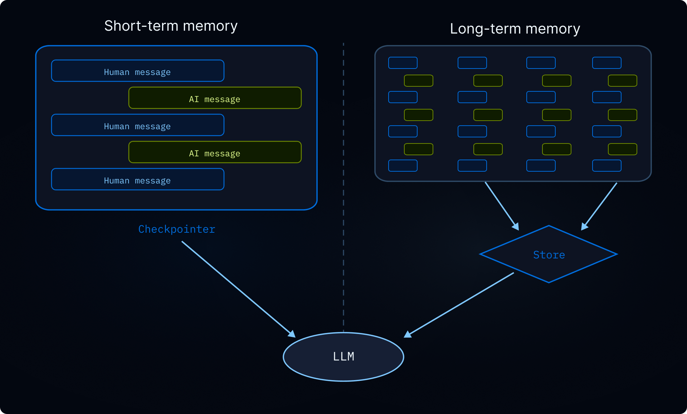
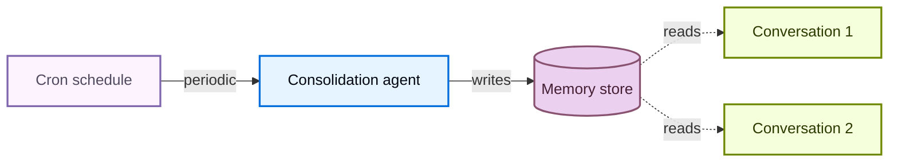

记忆使您的智能体能够在对话中学习和改进。Deep Agents 通过文件系统支持的记忆将记忆作为第一类：智能体将记忆作为文件进行读写，您可以使用 [backends](/langchain/oss/deepagents/backends) 控制这些文件存储的位置。

<Tip>
要生成编码智能体通过 [`AGENTS.md`](https://agents.md/) 发现的仓库维基，请参阅 [OpenWiki](/langchain/oss/openwiki/overview)。
</Tip>

<Note>
本页面涵盖 **长期记忆**：跨对话持久存在的记忆。有关短期记忆（单个会话中的对话历史记录和临时文件），请参阅 [context engineering](/langchain/oss/deepagents/context-engineering) 指南。短期记忆作为智能体 [state](/langchain/oss/langgraph/graph-api#状态) 的一部分自动管理。


</Note>

## 记忆如何工作

1. **将智能体指向记忆文件。** 在创建智能体时将文件路径传递给 `memory=`。您还可以通过 `skills=` 传递 [skills](/langchain/oss/deepagents/skills) 以进行程序性记忆（可重用的指令，告诉智能体 *如何* 执行任务）。[backend](/langchain/oss/deepagents/backends) 控制文件存储位置和访问权限。
2. **智能体读取记忆。** 智能体可以在启动时将记忆文件加载到系统提示中，或在对话期间按需读取。例如，[skills](/langchain/oss/deepagents/skills) 使用按需加载：智能体在启动时仅读取技能描述，然后在匹配任务时才读取完整的技能文件。这使上下文保持精简，直到需要功能时。
3. **智能体更新记忆（可选）。** 当智能体学习到新信息时，它可以使用其内置的 `edit_file` 工具来更新记忆文件。更新可以在对话期间发生（默认情况下）或在对话之间通过 [background consolidation](#背景整合) 在后台发生。更改会被持久化并在下一个对话中可用。并非所有记忆都是可写的：开发者定义的 [skills](/langchain/oss/deepagents/skills) 和 [organization policies](#组织级记忆) 通常为只读。有关 [read-only vs writable memory](#只读与可写记忆) 的详细信息，请参阅。

最常见的两种模式是 [agent-scoped memory](#智能体作用域记忆)（跨所有用户共享）和 [user-scoped memory](#用户作用域记忆)（每个用户隔离）。

对于编码智能体通过 [`AGENTS.md`](https://agents.md/) 发现的生成的仓库维基，请参阅 [OpenWiki](/langchain/oss/openwiki/overview)。

## 作用域记忆

智能体记忆可以作用域化，以便所有使用智能体的用户都可以访问相同的记忆文件，或者每个用户的记忆文件可以独立。

### 智能体作用域记忆

给智能体一个随时间演变的持久身份。智能体作用域记忆跨所有用户共享，因此智能体通过每次对话建立自己的角色、积累的知识和学习到的偏好。随着与用户的互动，它发展专业知识，改进方法，并记住哪些方法有效。它还可以在具有写权限时学习和更新 [skills](/langchain/oss/deepagents/skills)。

关键是后端命名空间：将其设置为 `(assistant_id,)` 意味着该智能体的每个对话都读取和写入相同的记忆文件。

:::python
<Note>
访问 `rt.server_info` 需要 `deepagents>=0.5.0`。在旧版本中，从 `get_config()["metadata"]["assistant_id"]` 读取助手 ID。
</Note>
:::

:::js
<Note>
访问 `rt.serverInfo` 需要 `deepagents>=1.9.0`。在旧版本中，从 `getConfig().metadata.assistantId` 读取助手 ID。
</Note>
:::

:::python
```python
from deepagents import create_deep_agent
from deepagents.backends import CompositeBackend, StateBackend, StoreBackend

agent = create_deep_agent(
    model="google_genai:gemini-3.6-flash",
    memory=["/memories/AGENTS.md"],
    skills=["/skills/"],
    backend=CompositeBackend(
        default=StateBackend(),
        routes={
            "/memories/": StoreBackend(
                namespace=lambda rt: (
                    rt.server_info.assistant_id,  # [!code highlight]
                ),
            ),
            "/skills/": StoreBackend(
                namespace=lambda rt: (
                    rt.server_info.assistant_id,  # [!code highlight]
                ),
            ),
        },
    ),
)
```
:::

:::js
```typescript
import { createDeepAgent, CompositeBackend, StateBackend, StoreBackend } from "deepagents";

const agent = createDeepAgent({
  memory: ["/memories/AGENTS.md"],
  skills: ["/skills/"],
  backend: new CompositeBackend(
    new StateBackend(),
    {
      "/memories/": new StoreBackend({
        namespace: (rt) => [rt.serverInfo.assistantId],  // [!code highlight]
      }),
      "/skills/": new StoreBackend({
        namespace: (rt) => [rt.serverInfo.assistantId],  // [!code highlight]
      }),
    },
  ),
});
```
:::

<Accordion title="Full example: seed memory and invoke">

用初始记忆填充存储，然后在两个线程中调用智能体，以查看它如何记住和更新所学内容。

:::python
```python
from langchain_core.utils.uuid import uuid7

from deepagents import create_deep_agent
from deepagents.backends import CompositeBackend, StateBackend, StoreBackend
from deepagents.backends.utils import create_file_data
from langgraph.store.memory import InMemoryStore

store = InMemoryStore()  # Use platform store when deploying to LangSmith

# Seed the memory file
store.put(
    ("my-agent",),
    "/memories/AGENTS.md",
    create_file_data("""## Response style
- Keep responses concise
- Use code examples where possible
"""),
)

# Seed a skill
store.put(
    ("my-agent",),
    "/skills/langgraph-docs/SKILL.md",
    create_file_data("""---
name: langgraph-docs
description: Fetch relevant LangGraph documentation to provide accurate guidance.
---

# langgraph-docs

Use the fetch_url tool to read https://docs.langchain.com/llms.txt, then fetch relevant pages.
"""),
)

agent = create_deep_agent(
    model="google_genai:gemini-3.6-flash",
    memory=["/memories/AGENTS.md"],
    skills=["/skills/"],
    backend=lambda rt: CompositeBackend(
        default=StateBackend(rt),
        routes={
            "/memories/": StoreBackend(
                rt, namespace=lambda rt: ("my-agent",)
            ),
            "/skills/": StoreBackend(
                rt, namespace=lambda rt: ("my-agent",)
            ),
        },
    ),
    store=store,
)

# Thread 1: the agent learns a new preference and saves it to memory
config1 = {"configurable": {"thread_id": str(uuid7())}}
agent.invoke(
    {"messages": [{"role": "user", "content": "I prefer detailed explanations. Remember that."}]},
    config=config1,
)

# Thread 2: the agent reads memory and applies the preference
config2 = {"configurable": {"thread_id": str(uuid7())}}
agent.invoke(
    {"messages": [{"role": "user", "content": "Explain how transformers work."}]},
    config=config2,
)
```
:::

:::js
```typescript
import { createDeepAgent, CompositeBackend, StateBackend, StoreBackend, createFileData } from "deepagents";
import { InMemoryStore } from "@langchain/langgraph";
import { uuid7 } from "langsmith";

const store = new InMemoryStore();  // Use platform store when deploying to LangSmith

// Seed the memory file
await store.put(
  ["my-agent"],
  "/memories/AGENTS.md",
  createFileData(`## Response style
- Keep responses concise
- Use code examples where possible
`),
);

// Seed a skill
await store.put(
  ["my-agent"],
  "/skills/langgraph-docs/SKILL.md",
  createFileData(`---
name: langgraph-docs
description: Fetch relevant LangGraph documentation to provide accurate guidance.
---

# langgraph-docs

Use the fetch_url tool to read https://docs.langchain.com/llms.txt, then fetch relevant pages.
`),
);

const agent = createDeepAgent({
  memory: ["/memories/AGENTS.md"],
  skills: ["/skills/"],
  backend: (rt) => new CompositeBackend(
    new StateBackend(rt),
    {
      "/memories/": new StoreBackend(rt, {
        namespace: (rt) => ["my-agent"],
      }),
      "/skills/": new StoreBackend(rt, {
        namespace: (rt) => ["my-agent"],
      }),
    },
  ),
  store,
});

// Thread 1: the agent learns a new preference and saves it to memory
const config1 = { configurable: { thread_id: uuid7() } };
await agent.invoke({
  messages: [{ role: "user", content: "I prefer detailed explanations. Remember that." }],
}, config1);

// Thread 2: the agent reads memory and applies the preference
const config2 = { configurable: { thread_id: uuid7() } };
await agent.invoke({
  messages: [{ role: "user", content: "Explain how transformers work." }],
}, config2);
```
:::

</Accordion>

### 用户作用域记忆

给每个用户自己的记忆文件。智能体按用户记住偏好、上下文和历史记录，而核心智能体指令保持固定。如果存储在用户作用域后端，用户还可以有自己的 [skills](/langchain/oss/deepagents/skills)。

命名空间使用 `(user_id,)`，因此每个用户都获得记忆文件的独立副本。用户 A 的偏好永远不会泄露到用户 B 的对话中。

:::python
```python
from deepagents import create_deep_agent
from deepagents.backends import CompositeBackend, StateBackend, StoreBackend

agent = create_deep_agent(
    model="google_genai:gemini-3.6-flash",
    memory=["/memories/preferences.md"],
    skills=["/skills/"],
    backend=CompositeBackend(
        default=StateBackend(),
        routes={
            "/memories/": StoreBackend(
                namespace=lambda rt: (rt.server_info.user.identity,),
            ),
            "/skills/": StoreBackend(
                namespace=lambda rt: (rt.server_info.user.identity,),
            ),
        },
    ),
)
```
:::

:::js
```typescript
import { createDeepAgent, CompositeBackend, StateBackend, StoreBackend } from "deepagents";

const agent = createDeepAgent({
  memory: ["/memories/preferences.md"],
  skills: ["/skills/"],
  backend: new CompositeBackend(
    new StateBackend(),
    {
      "/memories/": new StoreBackend({
        namespace: (rt) => [rt.serverInfo.user.identity],
      }),
      "/skills/": new StoreBackend({
        namespace: (rt) => [rt.serverInfo.user.identity],
      }),
    },
  ),
});
```
:::

<Accordion title="Full example: isolated memory across users">

为每个用户种子记忆，然后以两个不同的用户身份调用智能体。每个用户只能看到自己的偏好。

:::python
```python
from langchain_core.utils.uuid import uuid7

from deepagents import create_deep_agent
from deepagents.backends import CompositeBackend, StateBackend, StoreBackend
from deepagents.backends.utils import create_file_data
from langgraph.store.memory import InMemoryStore


store = InMemoryStore()  # Use platform store when deploying to LangSmith

# Seed preferences for two users
store.put(
    ("user-alice",),
    "/memories/preferences.md",
    create_file_data("""## Preferences
- Likes concise bullet points
- Prefers Python examples
"""),
)
store.put(
    ("user-bob",),
    "/memories/preferences.md",
    create_file_data("""## Preferences
- Likes detailed explanations
- Prefers TypeScript examples
"""),
)

# Seed a skill for Alice
store.put(
    ("user-alice",),
    "/skills/langgraph-docs/SKILL.md",
    create_file_data("""---
name: langgraph-docs
description: Fetch relevant LangGraph documentation to provide accurate guidance.
---

# langgraph-docs

Use the fetch_url tool to read https://docs.langchain.com/llms.txt, then fetch relevant pages.
"""),
)

agent = create_deep_agent(
    model="google_genai:gemini-3.6-flash",
    memory=["/memories/preferences.md"],
    skills=["/skills/"],
    backend=lambda rt: CompositeBackend(
        default=StateBackend(rt),
        routes={
            "/memories/": StoreBackend(
                rt,
                namespace=lambda rt: (rt.server_info.user.identity,),
            ),
            "/skills/": StoreBackend(
                rt,
                namespace=lambda rt: (rt.server_info.user.identity,),
            ),
        },
    ),
    store=store,
)

# When deployed, each authenticated request resolves
# `rt.server_info.user.identity` to the calling user, so Alice and Bob
# automatically see only their own preferences.
agent.invoke(
    {"messages": [{"role": "user", "content": "How do I read a CSV file?"}]},
    config={"configurable": {"thread_id": str(uuid7())}},
)
```
:::

:::js
```typescript
import { createDeepAgent, CompositeBackend, StateBackend, StoreBackend, createFileData } from "deepagents";
import { InMemoryStore } from "@langchain/langgraph";
import { uuid7 } from "langsmith";

const store = new InMemoryStore();  // Use platform store when deploying to LangSmith

// Seed preferences for two users
await store.put(
  ["user-alice"],
  "/memories/preferences.md",
  createFileData(`## Preferences
- Likes concise bullet points
- Prefers Python examples
`),
);
await store.put(
  ["user-bob"],
  "/memories/preferences.md",
  createFileData(`## Preferences
- Likes detailed explanations
- Prefers TypeScript examples
`),
);

// Seed a skill for Alice
await store.put(
  ["user-alice"],
  "/skills/langgraph-docs/SKILL.md",
  createFileData(`---
name: langgraph-docs
description: Fetch relevant LangGraph documentation to provide accurate guidance.
---

# langgraph-docs

Use the fetch_url tool to read https://docs.langchain.com/llms.txt, then fetch relevant pages.
`),
);

const agent = createDeepAgent({
  memory: ["/memories/preferences.md"],
  skills: ["/skills/"],
  backend: (rt) => new CompositeBackend(
    new StateBackend(rt),
    {
      "/memories/": new StoreBackend(rt, {
        namespace: (rt) => [rt.serverInfo.user.identity],
      }),
      "/skills/": new StoreBackend(rt, {
        namespace: (rt) => [rt.serverInfo.user.identity],
      }),
    },
  ),
  store,
});

// When deployed, each authenticated request resolves
// `rt.serverInfo.user.identity` to the calling user, so Alice and Bob
// automatically see only their own preferences.
await agent.invoke(
  { messages: [{ role: "user", content: "How do I read a CSV file?" }] },
  { configurable: { thread_id: uuid7() } },
);
```
:::

</Accordion>

## 高级用法

除了记忆路径和作用域的基本配置选项，您还可以配置记忆的高级参数：

| 维度 | 它回答的问题 | 选项 |
|---|---|---|
| **持续时间** | 它持续多久？ | [短期](/langchain/oss/deepagents/context-engineering)（单个对话）或 [长期](#作用域记忆)（跨对话） |
| **信息类型** | 它是什么类型的信息？ | [Episodic](#情景记忆)（过去的经历），[procedural](/langchain/oss/deepagents/skills)（指令和技能），或 [semantic](/langchain/oss/concepts/memory#语义记忆)（事实） |
| **作用域** | 谁可以查看和修改它？ | [User](#用户作用域记忆)，[agent](#智能体作用域记忆)，或 [organization](#组织级记忆) |
| **更新策略** | 记忆何时写入？ | 在对话期间（默认）或 [在对话之间](#背景整合) |
| **检索** | 记忆如何读取？ | 加载到提示（默认）或按需（例如，[skills](/langchain/oss/deepagents/skills)） |
| **智能体权限** | 智能体能否写入记忆？ | [Read-write](#只读与可写记忆)（默认）或 [read-only](#只读与可写记忆)（用于共享策略） |

### 情景记忆

Episodic memory 存储过去经历的记录：发生了什么、顺序是什么、结果是什么。与存储在文件（如 `AGENTS.md`）中的事实和偏好（semantic memory）不同，episodic memory 保留完整的对话上下文，以便智能体可以回忆 *如何* 解决问题，而不仅仅是 *学到了什么*。要生成和维护用于编码智能体的仓库级维基，请参阅 [OpenWiki](/langchain/oss/openwiki/overview)。

Deep Agents 已经使用 [checkpointers](/langchain/oss/langgraph/checkpointers#检查点)，这是支持 episodic memory 的机制：每个对话都作为检查点线程持久化。

要使过去的对话可搜索，请将线程搜索包装在工具中。`user_id` 从运行时上下文中获取，而不是作为参数传递：

:::python
```python
from langgraph_sdk import get_client
from langchain.tools import tool, ToolRuntime

client = get_client(url="<DEPLOYMENT_URL>")


@tool
async def search_past_conversations(query: str, runtime: ToolRuntime) -> str:
    """Search past conversations for relevant context."""
    user_id = runtime.server_info.user.identity  # [!code highlight]
    threads = await client.threads.search(
        metadata={"user_id": user_id},
        limit=5,
    )
    results = []
    for thread in threads:
        history = await client.threads.get_history(thread_id=thread["thread_id"])
        results.append(history)
    return str(results)
```
:::

:::js
```typescript
import { Client } from "@langchain/langgraph-sdk";
import { tool } from "@langchain/core/tools";

const client = new Client({ apiUrl: "<DEPLOYMENT_URL>" });

const searchPastConversations = tool(
  async ({ query }, runtime) => {
    const userId = runtime.serverInfo.user.identity;  // [!code highlight]
    const threads = await client.threads.search({
      metadata: { userId },
      limit: 5,
    });
    const results = [];
    for (const thread of threads) {
      const history = await client.threads.getHistory(thread.threadId);
      results.push(history);
    }
    return JSON.stringify(results);
  },
  {
    name: "search_past_conversations",
    description: "Search past conversations for relevant context.",
  }
);
```
:::

您可以通过调整元数据过滤器来按用户或组织作用域化线程搜索：

:::python
```python
# Search conversations for a specific user
threads = await client.threads.search(
    metadata={"user_id": user_id},
    limit=5,
)

# Search conversations across an organization
threads = await client.threads.search(
    metadata={"org_id": org_id},
    limit=5,
)
```
:::

:::js
```typescript
// Search conversations for a specific user
const userThreads = await client.threads.search({
  metadata: { userId },
  limit: 5,
});

// Search conversations across an organization
const orgThreads = await client.threads.search({
  metadata: { orgId },
  limit: 5,
});
```
:::

这对于执行复杂、多步骤任务的智能体很有用。例如，编码智能体可以回顾过去的调试会话，直接跳到可能的根本原因。

### 组织级记忆

组织级记忆遵循与用户级记忆相同的模式，但使用的是全局命名空间而非每个用户的命名空间。用于跨所有用户和智能体的策略或知识。

组织记忆通常是 **只读** 的，以防止通过共享状态进行提示词注入。详情请参阅 [只读与可写记忆](#只读与可写记忆)。

:::python
```python
from deepagents import create_deep_agent
from deepagents.backends import CompositeBackend, StateBackend, StoreBackend

agent = create_deep_agent(
    model="google_genai:gemini-3.6-flash",
    memory=[
        "/memories/preferences.md",
        "/policies/compliance.md",
    ],
    backend=CompositeBackend(
        default=StateBackend(),
        routes={
            "/memories/": StoreBackend(
                namespace=lambda rt: (rt.server_info.user.identity,),
            ),
            "/policies/": StoreBackend(
                namespace=lambda rt: (rt.context.org_id,),
            ),
        },
    ),
)
```
:::

:::js
```typescript
import { createDeepAgent, CompositeBackend, StateBackend, StoreBackend } from "deepagents";

const agent = createDeepAgent({
  memory: [
    "/memories/preferences.md",
    "/policies/compliance.md",
  ],
  backend: new CompositeBackend(
    new StateBackend(),
    {
      "/memories/": new StoreBackend({
        namespace: (rt) => [rt.serverInfo.user.identity],
      }),
      "/policies/": new StoreBackend({
        namespace: (rt) => [rt.context.orgId],
      }),
    },
  ),
});
```
:::

从您的应用代码中填充组织记忆：

:::python
```python
from langgraph_sdk import get_client
from deepagents.backends.utils import create_file_data

client = get_client(url="<DEPLOYMENT_URL>")

await client.store.put_item(
    (org_id,),
    "/compliance.md",
    create_file_data("""## Compliance policies
- Never disclose internal pricing
- Always include disclaimers on financial advice
"""),
)
```
:::

:::js
```typescript
import { Client } from "@langchain/langgraph-sdk";
import { createFileData } from "deepagents";

const client = new Client({ apiUrl: "<DEPLOYMENT_URL>" });

await client.store.putItem(
  [orgId],
  "/compliance.md",
  createFileData(`## Compliance policies
- Never disclose internal pricing
- Always include disclaimers on financial advice
`),
);
```
:::

使用 [权限](/langchain/oss/deepagents/permissions) 强制执行组织级记忆的只读属性，或使用 [策略钩子](/langchain/oss/deepagents/backends#添加策略钩子) 进行自定义验证逻辑。

### 背景整合

默认情况下，智能体在对话期间（热点路径）写入记忆。另一种替代方案是在对话之间作为后台任务处理记忆，有时称为 **睡眠时间计算**。一个独立的深度智能体会审查最近的对话，提取关键事实，并将它们与现有记忆合并。

| 方法 | 优点 | 缺点 |
|---|---|---|
| **热点路径**（对话期间） | 记忆立即可用，对用户透明 | 增加延迟，智能体必须多任务处理 |
| **后台**（对话之间） | 无用户可见延迟，可以跨多个对话综合 | 记忆在下一个对话之前不可用，需要第二个智能体 |

对于大多数应用，热点路径就足够了。当您需要减少延迟或在多个对话中提高记忆质量时，添加后台整合。

推荐的模式是在您的智能体旁边部署一个 **整合智能体** — 一个深度智能体，它读取最近的对话历史，提取关键事实，并将它们合并到记忆存储中 — 并在 [cron 定时任务](#cron) 上触发它。选择一个反映您的用户实际与智能体交互频率的时间间隔：一个具有稳定每日流量的聊天产品可能每小时整合几次，而每周只使用几次的工具只需要每天或每周运行一次。比用户交互更频繁地整合只是在无操作运行中消耗 Token。

#### 整合智能体

整合智能体读取最近的对话历史并将关键事实合并到记忆存储中。在 `langgraph.json` 中与您的智能体一起注册：

:::python
```python consolidation_agent.py
from datetime import datetime, timedelta, timezone

from deepagents import create_deep_agent
from langchain.tools import tool, ToolRuntime
from langgraph_sdk import get_client

sdk_client = get_client(url="<DEPLOYMENT_URL>")


@tool
async def search_recent_conversations(query: str, runtime: ToolRuntime) -> str:
    """Search this user's conversations updated in the last 6 hours."""
    user_id = runtime.server_info.user.identity  # [!code highlight]

    since = datetime.now(timezone.utc) - timedelta(hours=6)
    threads = await sdk_client.threads.search(
        metadata={"user_id": user_id},
        updated_after=since.isoformat(),
        limit=20,
    )
    conversations = []
    for thread in threads:
        history = await sdk_client.threads.get_history(
            thread_id=thread["thread_id"]
        )
        conversations.append(history["values"]["messages"])
    return str(conversations)


agent = create_deep_agent(
    model="google_genai:gemini-3.6-flash",
    system_prompt="""Review recent conversations and update the user's memory file.
Merge new facts, remove outdated information, and keep it concise.""",
    tools=[search_recent_conversations],
)
```
:::

:::js
```typescript src/consolidation-agent.ts
import { createDeepAgent } from "deepagents";
import { Client } from "@langchain/langgraph-sdk";
import { tool } from "@langchain/core/tools";

const sdkClient = new Client({ apiUrl: "<DEPLOYMENT_URL>" });

const searchRecentConversations = tool(
  async ({ query }, runtime) => {
    const userId = runtime.serverInfo.user.identity;  // [!code highlight]

    const since = new Date(Date.now() - 6 * 60 * 60 * 1000).toISOString();
    const threads = await sdkClient.threads.search({
      metadata: { userId },
      updatedAfter: since,
      limit: 20,
    });
    const conversations = [];
    for (const thread of threads) {
      const history = await sdkClient.threads.getHistory(thread.threadId);
      conversations.push(history.values.messages);
    }
    return JSON.stringify(conversations);
  },
  {
    name: "search_recent_conversations",
    description: "Search this user's conversations updated in the last 6 hours.",
  }
);

const agent = createDeepAgent({
  model: "google:gemini-3.6-flash",
  systemPrompt: `Review recent conversations and update the user's memory file.
Merge new facts, remove outdated information, and keep it concise.`,
  tools: [searchRecentConversations],
});

export { agent };
```
:::

:::python
```json langgraph.json
{
  "dependencies": ["."],
  "graphs": {
    "agent": "./agent.py:agent",
    "consolidation_agent": "./consolidation_agent.py:agent"
  },
  "env": ".env"
}
```
:::

:::js
```json langgraph.json
{
  "dependencies": ["."],
  "graphs": {
    "agent": "./src/agent.ts:agent",
    "consolidation_agent": "./src/consolidation-agent.ts:agent"
  },
  "env": ".env"
}
```
:::

#### Cron

一个 [cron 任务](https://docs.langchain.com/langsmith/cron-jobs) 按固定时间表运行整合智能体。智能体搜索最近的对话并将它们综合到记忆中。根据您的使用模式匹配时间表，以便整合大致跟踪实际活动。



使用 cron 任务调度整合智能体：

:::python
```python
from langgraph_sdk import get_client

client = get_client(url="<DEPLOYMENT_URL>")

cron_job = await client.crons.create(
    assistant_id="consolidation_agent",
    schedule="0 */6 * * *",
    input={"messages": [{"role": "user", "content": "Consolidate recent memories."}]},
)
```
:::

:::js
```typescript
import { Client } from "@langchain/langgraph-sdk";

const client = new Client({ apiUrl: "<DEPLOYMENT_URL>" });

const cronJob = await client.crons.create(
  "consolidation_agent",
  {
    schedule: "0 */6 * * *",
    input: { messages: [{ role: "user", content: "Consolidate recent memories." }] },
  },
);
```
:::

<Note>
所有 cron 时间表都按 **UTC** 解释。有关管理和删除 cron 任务的详细信息，请参阅 [cron 任务](https://docs.langchain.com/langsmith/cron-jobs)。
</Note>

<Warning>
cron 间隔必须与整合智能体内部的回溯窗口匹配。上面的示例每 6 小时运行一次（`0 */6 * * *`），而智能体的 `search_recent_conversations` 工具回溯 `timedelta(hours=6)` — 保持这些同步。如果 cron 运行比回溯更频繁，您会重新处理相同的对话；如果运行频率较低，您会丢失窗口外的记忆。
</Warning>

有关使用后台进程部署智能体的更多信息，请参阅 [投入生产](/langchain/oss/deepagents/going-to-production)。

### 只读与可写记忆

默认情况下，智能体可以读写记忆文件。对于共享状态（如组织策略或合规规则），您可能希望将记忆设为 **只读**，以便智能体可以引用它但不能修改它。这可以防止通过共享记忆进行提示词注入，并确保只有您的应用代码控制文件中的内容。

| 权限 | 用例 | 工作原理 |
|---|---|---|
| **读写**（默认） | 用户偏好设置、智能体自我改进、学习的 [技能](/langchain/oss/deepagents/skills) | 智能体通过 `edit_file` 工具更新文件 |
| **只读** | 组织策略、合规规则、共享知识库、开发者定义的 [技能](/langchain/oss/deepagents/skills) | 通过应用代码或 [存储 API](https://docs.langchain.com/langsmith/custom-store) 填充。使用 [权限](/langchain/oss/deepagents/permissions) 拒绝向特定路径写入，或使用 [策略钩子](/langchain/oss/deepagents/backends#添加策略钩子) 进行自定义验证逻辑。 |

**安全注意事项**：如果一个用户可以向另一个用户读取的记忆写入，恶意用户可能会向共享状态注入指令。为缓解此问题：

- **默认使用用户范围** `(user_id)`，除非您有特定原因要共享
- 使用 **只读记忆** 用于共享策略（通过应用代码填充，而不是智能体）
- 在智能体向共享记忆写入之前添加 **人工审核** 验证。使用 [中断](/langchain/oss/langgraph/interrupts) 要求对敏感路径的写入进行人工批准。

要强制执行只读记忆，使用 [权限](/langchain/oss/deepagents/permissions) 声明性地拒绝向特定路径写入。对于自定义验证逻辑（速率限制、审计日志、内容检查），使用 [后端策略钩子](/langchain/oss/deepagents/backends#添加策略钩子)。

### 并发写入

多个线程可以并行写入记忆，但向 **同一文件** 的并发写入会导致最后写入者胜出的冲突。对于用户级记忆这种情况很少见，因为用户通常一次只有一个活动对话。对于智能体级或组织级记忆，考虑使用 [后台整合](#背景整合) 来序列化写入，或将记忆结构化为每个主题的单独文件以减少争用。

实际上，如果由于冲突而写入失败，LLM 通常足够智能可以重试或优雅地恢复，因此单个丢失的写入不是灾难性的。

### 同一部署中的多个智能体

要在共享部署中为每个智能体提供自己的记忆，将 `assistant_id` 添加到命名空间中：

:::python
```python
StoreBackend(
    namespace=lambda rt: (
        rt.server_info.assistant_id,  # [!code highlight]
        rt.server_info.user.identity,
    ),
)
```
:::

:::js
```typescript
new StoreBackend({
  namespace: (rt) => [
    rt.serverInfo.assistantId,  // [!code highlight]
    rt.serverInfo.user.identity,
  ],
})
```
:::

如果您只需要每个智能体隔离而不需要每个用户隔离，请单独使用 `assistant_id`。

<Tip>
使用 [LangSmith 跟踪](https://docs.langchain.com/langsmith/trace-with-langgraph) 来审计您的智能体写入记忆的内容。每个文件写入在跟踪中显示为工具调用。
</Tip>

## 参见

- [OpenWiki](/langchain/oss/openwiki/overview): 生成和维护编码智能体通过 `AGENTS.md` 找到的仓库维基
- [Backends](/langchain/oss/deepagents/backends): 选择记忆文件存储位置
- [Context engineering](/langchain/oss/deepagents/context-engineering): 短期记忆、卸载和摘要
- [Skills](/langchain/oss/deepagents/skills): 按需程序性记忆

---

> 官方原文：[src/oss/deepagents/memory.mdx](https://github.com/langchain-ai/docs/blob/main/src/oss/deepagents/memory.mdx) · 非官方翻译，译文由 AI 生成，以英文原文为准。
