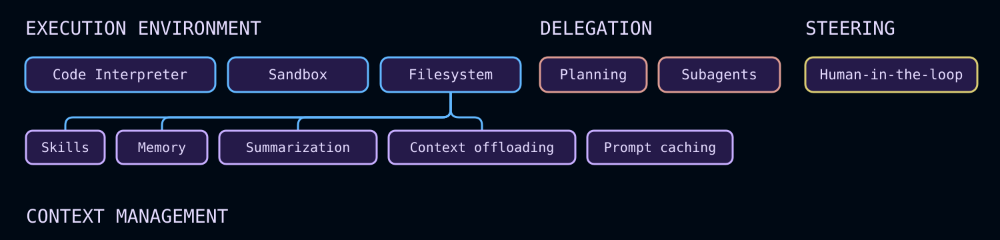

import { PatternEmbed } from "/langchain/snippets/pattern-embed.jsx"
import OverviewQuickstartPy from '/langchain/snippets/code-samples/overview-quickstart-py.mdx';
import OverviewQuickstartJs from '/langchain/snippets/code-samples/overview-quickstart-js.mdx';
import OverviewToolsPy from '/langchain/snippets/code-samples/overview-tools-py.mdx';
import OverviewExcludedToolsPy from '/langchain/snippets/code-samples/overview-excluded-tools-py.mdx';
import FrontendTodoListSetupPy from '/langchain/snippets/code-samples/frontend-todo-list-setup-py.mdx';
import FrontendTodoListSetupJs from '/langchain/snippets/code-samples/frontend-todo-list-setup-js.mdx';

深度智能体是用于复杂、多步骤工作的[智能体框架](/langchain/oss/concepts/products#智能体适配器（如-deep-agents-sdk）)。它基于 LangChain 和 LangGraph，增加了规划、虚拟文件系统用于上下文、子智能体生成和长期记忆。

从[托管深度智能体](https://docs.langchain.com/langsmith/managed-deep-agents-overview)开始，无需管理基础设施即可运行生产智能体。或者，如果您想在使用相同的深度智能体框架的同时获得最大灵活性，可以使用[深度智能体 SDK](#使用-sdk-自托管)自行托管智能体，或运行自定义的[LangSmith 部署](https://docs.langchain.com/langsmith/deployment)。

## 如何运行深度智能体

<CardGroup cols={2}>
  <Card title="Managed Deep Agents" icon="cloud" href="https://docs.langchain.com/langsmith/managed-deep-agents-overview" cta="Start here">
    使用托管部署基础设施构建深度智能体，用于复杂的、长时间运行的任务。LangSmith 运行框架、智能体服务器、沙盒和调度器。
  </Card>
  <Card title="Deep Agents SDK" icon="server" href="#self-host-with-the-sdk" cta="Use the SDK">
    具有最大灵活性的相同深度智能体框架。自行托管智能体，或在需要更多对运行时控制时运行自定义 LangSmith 部署。
  </Card>
</CardGroup>

深度智能体包括以下功能：

- **在环境中执行操作**：通过工具执行操作，读写文件，执行代码
- **连接到您的数据**：在正确的时间加载记忆、技能和领域知识
- **管理不断增长的上下文**：总结历史记录并在长时间运行中卸载大型结果
- **并行化任务**：委托给在隔离上下文中运行的通用或专业子智能体
- **保持同步**：在关键决策点暂停以获取人工批准
- **持续改进**：根据实际使用情况更新记忆、技能和提示词

当您的用例需要时，[任务规划](#任务规划)和[技能](#技能)等可选功能会扩展框架。有关每个组件的详细说明，请参阅[核心功能](#核心功能)。

## 使用 SDK 自托管

当您在您自己的进程或容器中运行智能体、需要自定义[后端](/langchain/oss/deepagents/backends)、存储或检查点器，或想要您自己配置的[LangSmith 部署](https://docs.langchain.com/langsmith/deployment)时，请使用开源 SDK。对于托管部署，请参阅[托管深度智能体](https://docs.langchain.com/langsmith/managed-deep-agents-overview)。

### 尝试使用

<PatternEmbed pattern="deep-agents-comparison" minHeight={700} />

### 快速入门

:::python
<OverviewQuickstartPy />
:::

:::js
<OverviewQuickstartJs />
:::

有关使用 SDK 构建的详细信息，请参阅[快速入门](/langchain/oss/deepagents/quickstart/)和[自定义指南](/langchain/oss/deepagents/customization/)。

<Tip>
使用[LangSmith](https://smith.langchain.com)跟踪请求、调试智能体行为并评估输出。遵循[可观察性快速入门](https://docs.langchain.com/langsmith/observability-quickstart)进行设置。
</Tip>

## 核心功能



深度智能体是一个["智能体框架"](/langchain/oss/concepts/products#智能体适配器（如-deep-agents-sdk）)。它与其他智能体框架相同的核心调用循环，但具有内置功能，使智能体适用于实际任务：

<CardGroup cols={2}>
  <Card title="Execution environment" icon="bolt" href="#execution-environment">
    工具、虚拟文件系统、可选沙盒和 REPL（解释器）
  </Card>
  <Card title="Context management" icon="database" href="#context-management">
    技能、记忆、摘要、上下文卸载和提示词缓存
  </Card>
  <Card title="Delegation" icon="sitemap" href="#delegation">
    子智能体生成和可选任务规划
  </Card>
  <Card title="Steering" icon="user" href="#steering">
    人工批准和中断
  </Card>
</CardGroup>

:::python
[`deepagents`](https://pypi.org/project/deepagents/)是一个基于[LangChain](/langchain/oss/langchain/)的智能体核心构建块的独立库。它使用[LangGraph](/langchain/oss/langgraph/)运行时进行持久执行、流式输出、人工参与和其他功能。
:::

:::js
[`deepagents`](https://www.npmjs.com/package/deepagents)是一个基于[LangChain](/langchain/oss/langchain/)的智能体核心构建块的独立库，并使用[LangGraph](/langchain/oss/langgraph/)的工具来在生产环境中运行智能体。
:::

[LangChain](/langchain/oss/langchain/)是提供智能体核心构建块的框架。有关 LangChain、LangGraph 和深度智能体之间差异的更多信息，请参阅[框架、运行时和框架](/langchain/oss/concepts/products)。有关与 Anthropic 框架的逐项比较，请参阅[深度智能体与 Claude 智能体 SDK](/langchain/oss/deepagents/comparison)。

:::python
对于构建没有这些内置功能的自定义智能体，请考虑使用 LangChain 的[`create_agent`](/langchain/oss/langchain/agents)或构建自定义[LangGraph](/langchain/oss/langgraph/overview)工作流。
:::

:::js
对于构建没有这些内置功能的自定义智能体，请考虑使用 LangChain 的[`createAgent`](/langchain/oss/langchain/agents)或构建自定义[LangGraph](/langchain/oss/langgraph/overview)工作流。
:::

## 执行环境

执行环境是智能体执行操作的地方。它有四个层次：

- **[工具](#工具和-mcp)**：智能体可以调用的自定义函数、API 和数据库
- **[虚拟文件系统](#虚拟文件系统访问)**：由可插拔后端支持的文件工具
- **[文件系统权限](#文件系统权限)**：声明式访问控制，用于管理智能体可以读取或写入的路径
- **[代码执行](#代码执行)**：沙盒化的 Shell 执行和进程内 JavaScript 解释器

**[流式输出](#流式输出)**允许您使用针对消息、工具、值和委托任务的类型化事件流来跟踪所有发生的事情。

### 工具和 MCP

使用 `tools=` 参数传递自定义函数、LangChain 工具或来自任何[MCP 服务器](/langchain/oss/deepagents/tools#mcp工具)的工具。深度智能体完全支持[模型上下文协议 (MCP](/langchain/oss/langchain/mcp))，让您可以通过标准接口连接到数据库、API、文件系统等。

:::python
<OverviewToolsPy />
:::

有关定义自定义工具、使用 MCP 服务器和内置框架工具的完整列表的更多信息，请参阅[工具](/langchain/oss/deepagents/tools)。

### 虚拟文件系统访问

框架提供了一个可配置的虚拟文件系统，该文件系统可以由不同的[可插拔后端](/langchain/oss/deepagents/backends)支持：内存状态、本地磁盘、LangGraph 存储、组合路由或具有[权限规则](/langchain/oss/deepagents/permissions)的自定义后端，用于读写访问。

后端支持以下文件系统操作：

:::python

| 工具 | 描述 |
| ---- | ----------- |
| `ls` | 列出目录中的文件及其元数据（大小、修改时间） |
| `read_file` | 读取文件内容并显示行号，支持对大文件进行偏移量/限制读取。还支持为非文本文件（图像、视频、音频和文档）返回多模态内容块。详见下方支持的扩展格式。 |
| `write_file` | 创建新文件，或覆盖现有文件 |
| `edit_file` | 在文件中执行精确的字符串替换（支持全局替换模式） |
| `delete` | 删除文件，或递归删除目录及其内容 |
| `glob` | 查找匹配模式的文件（例如，`**/*.py`） |
| `grep` | 搜索文件内容，支持多种输出模式（仅文件、带上下文的内容，或计数） |
| `execute` | 在环境中执行 shell 命令（仅在 [沙盒后端](/langchain/oss/deepagents/sandboxes) 中可用） |

<Note>
`delete` 工具需要 `deepagents>=0.7`。不支持删除操作的后端会自动将该工具隐藏，</Note>

:::

:::js

| 工具 | 描述 |
| ---- | ----------- |
| `ls` | 列出目录中的文件及其元数据（大小、修改时间） |
| `read_file` | 读取文件内容并显示行号，支持对大文件进行偏移量/限制读取。还支持为非文本文件（图像、视频、音频和文档）返回多模态内容块。详见下方支持的扩展格式。 |
| `write_file` | 创建新文件 |
| `edit_file` | 在文件中执行精确的字符串替换（支持全局替换模式） |
| `glob` | 查找匹配模式的文件（例如，`**/*.py`） |
| `grep` | 搜索文件内容，支持多种输出模式（仅文件、带上下文的内容，或计数） |
| `execute` | 在环境中执行 shell 命令（仅在 [沙盒后端](/langchain/oss/deepagents/sandboxes) 中可用） |

:::

<Accordion title="Supported multimodal file extensions">

| 类型 | 扩展格式 |
| ---- | ---------- |
| [图像](/langchain/oss/langchain/messages#multimodal) | `.png`, `.jpg`, `.jpeg`, `.gif`, `.webp`, `.heic`, `.heif` |
| [视频](/langchain/oss/langchain/messages#multimodal) | `.mp4`, `.mpeg`, `.mov`, `.avi`, `.flv`, `.mpg`, `.webm`, `.wmv`, `.3gpp` |
| [音频](/langchain/oss/langchain/messages#multimodal) | `.wav`, `.mp3`, `.aiff`, `.aac`, `.ogg`, `.flac` |
| [文件](/langchain/oss/langchain/messages#multimodal) | `.pdf`, `.ppt`, `.pptx` |

</Accordion>

<Accordion title="Running without the default filesystem tools" icon="ban">
    要从模型中隐藏上述文件系统工具，请使用 `excluded_tools` 注册一个 [harness profile](/langchain/oss/deepagents/profiles#链配置)：

    ```python
    from deepagents import HarnessProfile, register_harness_profile

    register_harness_profile(
        "anthropic:claude-sonnet-4-6",
        HarnessProfile(
            excluded_tools=frozenset(
                {"ls", "read_file", "write_file", "edit_file", "delete", "glob", "grep"}
            ),
        ),
    )
    ```

    通过 `excluded_middleware` 删除 @[`FilesystemMiddleware` 本身是故意被拒绝的——它是 [深度智能体堆栈](/langchain/oss/deepagents/customization#deep-agents-堆栈) 中必需的框架。使用 `excluded_tools` 仅隐藏模型可见的工具表面，并保留中间件。要删除 `task` 工具，请参阅 [无子智能体运行](/langchain/oss/deepagents/subagents#不使用子智能体)。
</Accordion>

:::python
<Accordion title="Restricting filesystem tools" icon="filter">
    <Note>
    `tools` 在 `FilesystemMiddleware` 上的允许列表需要 `deepagents>=0.7`。
    </Note>

    若要仅暴露上述文件系统工具的子集（而不是隐藏所有工具），请向 @[`FilesystemMiddleware` 传递一个 `tools` 允许列表，并通过 `middleware=` 提供实例。列表中未包含的任何内置文件系统工具都将从模型的工具列表中移除。

    ```python
    from deepagents import create_deep_agent
    from deepagents.middleware import FilesystemMiddleware

    # Read-only agent: write_file, edit_file, delete, and execute are never shown
    agent = create_deep_agent(
        model="claude-sonnet-4-6",
        middleware=[
            FilesystemMiddleware(backend=backend, tools=["read_file", "ls", "glob", "grep"]),
        ],
    )
    ```

    `read_file` 必须始终包含在列表中——若在创建智能体时遗漏它，将引发 `ValueError`。`execute` 和 `delete` 工具也会在配置的后端不支持它们时从工具表面移除，无论您是否将它们包含在 `tools` 中。通过 `create_deep_agent` 的 `tools=` 参数添加的自定义工具永远不会受此允许列表的影响。

    以这种方式传递自己的 @[`FilesystemMiddleware` 实例将替换主智能体的默认实例，通用子智能体将继承相同的限制。有关更多信息，请参阅 [覆盖默认中间件实例](/langchain/oss/deepagents/customization#覆盖默认中间件实例)。声明式子智能体不会继承它：在子智能体自己的 `middleware` 字段中包含一个 `FilesystemMiddleware(tools=...)` 实例，以独立限制它。
</Accordion>
:::

虚拟文件系统被其他 harness 功能（如技能、记忆、代码执行和上下文管理）使用。
在为 Deep Agents 构建自定义工具和中间件时，您也可以使用文件系统。

有关更多信息，请参阅 [后端](/langchain/oss/deepagents/backends)。要生成可供智能体从文件系统中读取的持久化存储库维基，请参阅 [OpenWiki](/langchain/oss/openwiki/overview)。

### 文件系统权限

Harness 支持声明式权限规则，用于控制智能体可以读取或写入哪些文件和目录。权限适用于上述内置文件系统工具，并按声明顺序评估，采用先匹配者胜出（first-match-wins）语义。

通过在创建智能体时向 `permissions=` 传递规则列表来定义权限。每条规则包含：
- `operations`：`"read"` 和/或 `"write"`
- `paths`：文件或目录的通配符模式
- `mode`：`"allow"` 或 `"deny"`

规则按从上到下的顺序评估，第一个匹配的规则将生效。如果没有规则匹配，则允许操作。

此模型允许您将智能体限制在特定目录（例如，`/workspace/`），保护敏感文件（如 `.env` 或凭证），并为子智能体提供比父智能体更窄的访问权限。

权限不适用于 [沙盒后端](/langchain/oss/deepagents/sandboxes)，后者通过 `execute` 工具支持任意命令执行。对于自定义验证逻辑，请使用 [后端策略钩子](/langchain/oss/deepagents/backends#添加策略钩子)。

有关完整规则结构、示例和子智能体继承，请参阅 [Permissions](/langchain/oss/deepagents/permissions)。

### 代码执行

Deep Agents 支持两种代码执行方式：

- [沙盒后端](/langchain/oss/deepagents/sandboxes) 在隔离环境中暴露 `execute` 工具用于 shell 命令。
- [解释器](/langchain/oss/deepagents/interpreters) 添加 `eval` 工具，在作用域 QuickJS 运行时中执行 JavaScript。

当智能体需要安装依赖项、运行测试、调用 CLI 或与操作系统文件系统交互时，请使用沙盒后端。沙盒后端实现 `SandboxBackendProtocolV2`；当检测到时，Harness 会向智能体的可用工具列表中添加 `execute` 工具。

当智能体需要一个轻量级可编程层用于循环、批处理、确定性数据转换或程序化工具调用时，请使用解释器。解释器不提供 shell 访问、包安装或文件系统和网络访问。

有关沙盒设置、提供者和文件传输 API，请参阅 [Sandboxes](/langchain/oss/deepagents/sandboxes)。有关 QuickJS 运行时和程序化工具调用，请参阅 [Interpreters](/langchain/oss/deepagents/interpreters)。

### 流式输出

[事件流式传输](/langchain/oss/deepagents/event-streaming) 将智能体运行作为消息、工具调用、值和输出的类型化投影。Deep Agents 添加 `stream.subagents`，以便每个委托任务都有自己的独立消息、工具调用和嵌套子智能体流。

## 上下文管理

上下文管理组件控制智能体所知内容、其在 Token 限制内的操作时长，以及跨会话保留的信息。它包含四个层级：

- **[技能](#技能)**：按需加载的领域知识，从技能文件渐进式加载
- **[记忆](#记忆)**：在启动时从 `AGENTS.md` 文件加载的持久指令和偏好设置
- **[摘要和上下文卸载](#摘要和上下文卸载)**：对话历史和大型工具结果的自动压缩
- **[提示词缓存](#提示词缓存)**：系统提示词的静态部分可缓存以加速推理并降低支持模型的成本

### 技能

技能包包含深度智能体的专用工作流、领域知识和自定义指令。

每个技能遵循 [智能体技能标准](https://agentskills.io/)，并存在于包含 `SKILL.md` 文件的目录中。技能还可以包含脚本、模板、参考文档和其他辅助资源。

深度智能体以渐进式披露方式加载技能：智能体在启动时读取 `SKILL.md` 文件头，仅在任务需要时才读取完整技能内容。这使启动上下文保持紧凑，同时仍能按需提供丰富的功能。

更多信息，请参阅 [技能](/langchain/oss/deepagents/skills)。

### 记忆

记忆为深度智能体提供跨对话的持久上下文，例如编码风格、偏好设置、约定和项目指南。

记忆使用 [`AGENTS.md` 文件](https://agents.md/)，您在创建智能体时通过 `memory` 参数传递。与技能不同，记忆文件始终被加载，其内容存储在配置的后端（`StateBackend`、`StoreBackend` 或 `FilesystemBackend`）。

智能体还可以根据交互和反馈更新记忆，因此偏好设置和模式可以延续，无需在每个线程中重新陈述。

有关配置细节和示例，请参阅 [记忆](/langchain/oss/deepagents/customization#记忆)。要生成编码智能体通过 `AGENTS.md` 发现的仓库维基，请参阅 [OpenWiki](/langchain/oss/openwiki/overview)。

### 摘要和上下文卸载

框架管理上下文，使深度智能体能够在 Token 限制内处理长时间运行的工作，同时将最相关的信息保留在范围内。

此上下文流包含四个部分：
- **输入上下文**：系统提示词、记忆、技能和工具提示词定义智能体初始状态。
- **压缩**：内置卸载和摘要功能压缩对话历史和大型中间结果。
- **隔离**：子智能体隔离重型子任务并仅返回最终结果（参见 [委派](#委派)）。
- **长期记忆**：虚拟文件系统中的持久存储跨线程携带信息。

这些机制共同支持超出单个上下文窗口的多步骤任务，同时减少手动上下文修剪和 Token 使用。

有关配置细节，请参阅 [上下文工程](/langchain/oss/deepagents/context-engineering)。对于多模态输入和工具输出，请参阅 [Multimodal](/langchain/oss/deepagents/multimodal)。

### 提示词缓存

对于 Anthropic 和 Amazon Bedrock 模型，`create_deep_agent` 会自动对系统提示词的静态部分应用提示词缓存——在每次交互中重复的基础智能体指令、记忆和技能内容。这避免了跨调用重新处理相同的 Token，从而减少长时间运行智能体的延迟和成本。

使用 Anthropic 模型或 Bedrock 模型（Claude 或 Nova）时，提示词缓存默认启用。无需配置。

对于其他提供者，请参阅 [中间件集成](/langchain/oss/python/integrations/middleware) 以了解可用的提供者特定缓存中间件。

## 委派

委派组件使智能体能够将大型问题分解为更小的可并行化工作单元。它包含两个层级：

- **[任务规划](#任务规划)**：可选的 `write_todos` 工具，用于结构化任务跟踪
- **[子智能体](#子智能体)**：处理隔离子任务的临时子智能体

### 任务规划

任务规划是可选的框架功能，允许智能体在执行期间维护结构化的任务列表。

从 v0.7 版本开始，任务规划仅可选。在早期版本中，任务规划中间件默认包含。

任务规划通常适用于：

- 长或复杂的多步骤任务
- 较低能力的模型，这些模型受益于显式的问责工具
- 从智能体状态流式传输进度（参见 [待办列表](/langchain/oss/deepagents/frontend/todo-list)）

将 @[`TodoListMiddleware`] 传递给 middleware 参数，以向智能体提供 `write_todos` 工具，用于在执行期间维护结构化的任务列表。

:::python
<FrontendTodoListSetupPy />
:::

:::js
<FrontendTodoListSetupJs />
:::

任务支持状态跟踪（`'pending'`、`'in_progress'`、`'completed'`），并保存在智能体状态中。这为智能体提供了一个轻量级规划层，用于组织长时间运行和多步骤工作。

有关配置选项和行为细节，请参阅 [待办列表](/langchain/oss/langchain/middleware/built-in#待办事项列表)。

### 子智能体

框架包含一个内置的 `task` 工具，允许主智能体为隔离的、长时间运行的、多步骤或并行任务创建临时子智能体。
提供两种子智能体类型：同步子智能体（默认）在返回单个报告之前阻塞主管，而 [异步子智能体](/langchain/oss/deepagents/async-subagents) 并行运行，并通过启动、检查、更新和取消工具支持飞行中导航。

子智能体执行提供：
- **隔离或继承上下文**：默认情况下，每次调用都会创建一个新的智能体实例并拥有其自己的上下文（`mode: "isolated"`）。使用 `mode: "fork"` 可继承父智能体的完整对话历史。参见 [Forked subagents](/langchain/oss/deepagents/subagents#分叉子智能体)。
- **自主执行**：子智能体独立运行直至完成。
- **单一交接**：它向主智能体返回一个最终报告。
- **可配置策略**：使用 [默认 `general-purpose` 子智能体](/langchain/oss/deepagents/subagents#默认子智能体)（默认启用）或定义 [自定义子智能体](/langchain/oss/deepagents/subagents#自定义子智能体)。
- **无状态消息**：子智能体无状态，不能发送多条消息。
- **上下文和 Token 效率**：重型子任务工作保持隔离，并压缩为紧凑的结果。

更多信息，请参阅 [Subagents](/langchain/oss/deepagents/subagents)。要移除 `task` 工具，请参阅 [Running without subagents](/langchain/oss/deepagents/subagents#不使用子智能体)。

## 引导

引导组件允许人类在运行时控制智能体行为，并设置智能体工作的文件系统权限。

### 人机协同

深度智能体与 LangGraph 中断集成，以便在敏感工具调用时暂停以获取批准。通过 `create_deep_agent` 中的 `interrupt_on` 参数启用此行为。

`interrupt_on` 接受工具名称到中断配置的映射。例如，`interrupt_on={"edit_file": True}` 在每次编辑前暂停，让你批准调用、添加指导或修改工具输入后再执行。

这为你提供了针对破坏性操作、昂贵 API 调用和交互式调试的运行时安全性和控制层。

更多信息，请参阅 [人在回路](/langchain/oss/deepagents/human-in-the-loop)。

## 入门

:::python
<CardGroup cols={2}>
    <Card title="Managed Deep Agents" icon="cloud" href="https://docs.langchain.com/langsmith/managed-deep-agents-overview">
        使用托管部署基础设施构建深度智能体
    </Card>
    <Card title="SDK quickstart" icon="rocket" href="/langchain/oss/deepagents/quickstart">
        同样的深度智能体 harness，自托管
    </Card>
    <Card title="Customization" icon="adjustments" href="/langchain/oss/deepagents/customization">
        了解 SDK 自定义选项
    </Card>
    <Card title="Code" icon="terminal" href="/langchain/oss/deepagents/code/overview">
        使用 Deep Agents Code
    </Card>
    <Card title="ACP" icon="plug-connected" href="/langchain/oss/deepagents/acp">
        在代码编辑器中使用 ACP 中的深度智能体
    </Card>
    <Card title="Reference" icon="external-link" href="https://reference.langchain.com/python/deepagents/">
        查看 `deepagents` API 参考
    </Card>
</CardGroup>
:::

:::js
<CardGroup cols={2}>
    <Card title="Managed Deep Agents" icon="cloud" href="https://docs.langchain.com/langsmith/managed-deep-agents-overview">
        使用托管部署基础设施构建深度智能体
    </Card>
    <Card title="SDK quickstart" icon="rocket" href="/langchain/oss/deepagents/quickstart">
        同样的深度智能体 harness，自托管
    </Card>
    <Card title="Customization" icon="adjustments" href="/langchain/oss/deepagents/customization">
        了解 SDK 自定义选项
    </Card>
    <Card title="Code" icon="terminal" href="/langchain/oss/deepagents/code/overview">
        使用 Deep Agents Code
    </Card>
    <Card title="ACP" icon="plug-connected" href="/langchain/oss/deepagents/acp">
        在代码编辑器中使用 ACP 中的深度智能体
    </Card>
    <Card title="Reference" icon="external-link" href="https://reference.langchain.com/javascript/modules/deepagents.html">
        查看 `deepagents` API 参考
    </Card>
</CardGroup>
:::

---

> 官方原文：[src/oss/deepagents/overview.mdx](https://github.com/langchain-ai/docs/blob/main/src/oss/deepagents/overview.mdx) · 非官方翻译，译文由 AI 生成，以英文原文为准。
