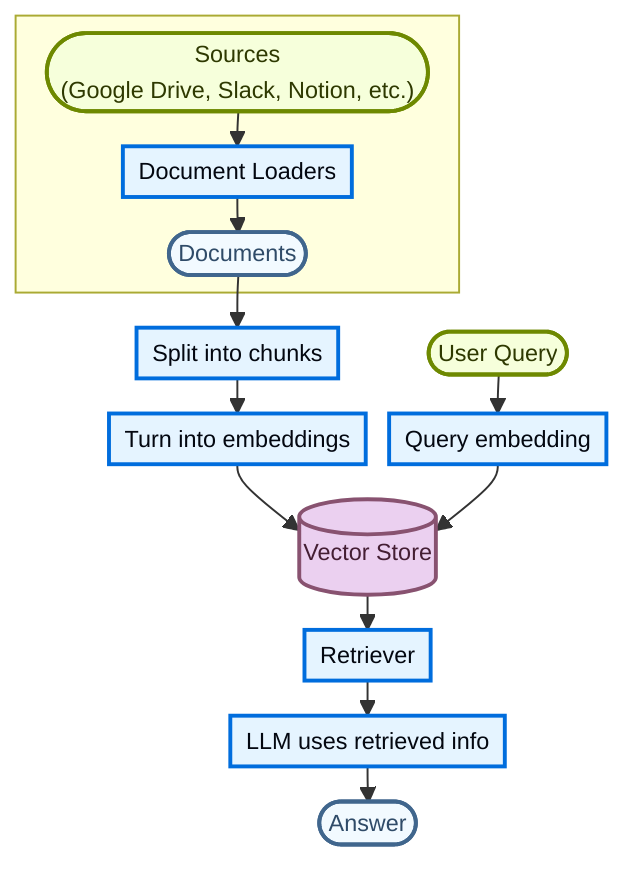
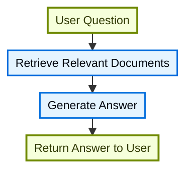
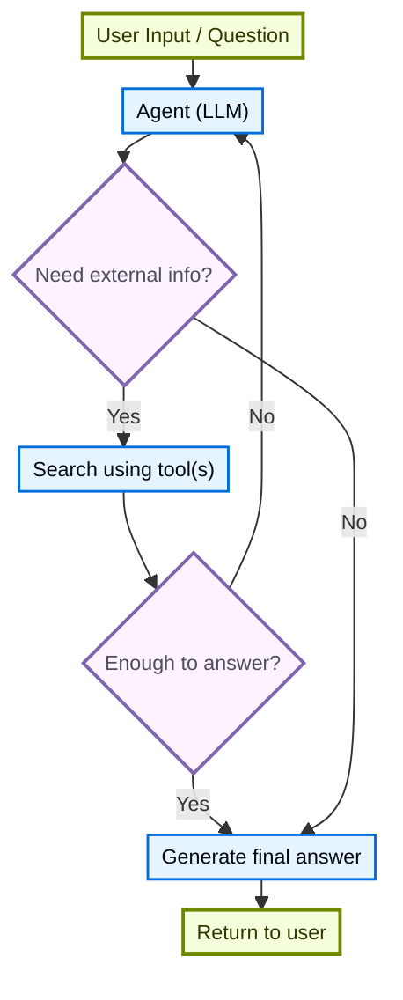
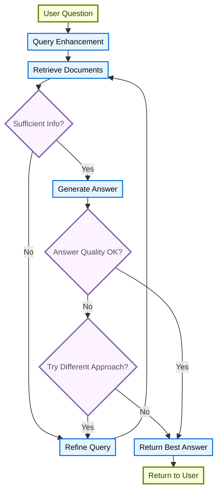

大型语言模型（LLM）功能强大，但存在两个关键局限性：

* **有限的上下文**：它们无法一次性处理整个语料库。
* **静态知识**：它们的训练数据在某个时间点被固定。

检索通过在查询时获取相关的外部知识来解决这些问题。这是**检索增强生成（RAG）**的基础，通过上下文特定的信息增强 LLM 的答案。

## 构建知识库

**知识库**是一个在检索过程中使用的文档或结构化数据的存储库。

如果您需要自定义知识库，您可以使用 LangChain 的文档加载器和向量存储，从您自己的数据构建一个。

<Note>
    如果您已经有一个知识库（例如 SQL 数据库、文档数据库、CRM 或内部文档系统），您**不需要**重新构建它。您可以：
    - 将其作为 Agentic RAG 中智能体的**工具**连接。
    - 查询它并将检索到的内容作为上下文提供给 LLM [(2-Step RAG)](#两步-rag)。
</Note>

有关更多信息，请参阅以下教程以构建可搜索的知识库和最小 RAG 工作流：

<Card
    title="教程：语义搜索"
    icon="database"
    href="/langchain/oss/langchain/knowledge-base"
    arrow cta="了解更多"
>
    了解如何使用 LangChain 的文档加载器、嵌入和向量存储，从您自己的数据创建可搜索的知识库。
    在此教程中，您将构建一个 PDF 搜索引擎，使检索与查询相关的段落成为可能。您还将在这个引擎之上实现一个最小 RAG 工作流，以了解外部知识如何集成到 LLM 推理中。
</Card>

### 从检索到 RAG

检索允许 LLM 在运行时访问相关的上下文。但大多数实际应用更进一步：它们**将检索与生成集成**以产生有根据、上下文感知的答案。

这是**检索增强生成（RAG）**的核心思想。检索管道成为结合搜索与生成的更广泛系统的基础。

### 检索管道

典型的检索工作流程如下所示：



每个组件都是模块化的：您可以更换加载器、分割器、嵌入或向量存储，而无需重写应用程序的逻辑。

### 构建模块

<Columns cols={2}>
    <Card
        title="文档加载器"
        icon="file-import"
        href="/langchain/oss/python/integrations/document_loaders"
        arrow cta="了解更多"
    >
        从外部来源（Google Drive、Slack、Notion 等）导入数据，返回标准化的 @[`Document`] 对象。
    </Card>

    :::python
    <Card
        title="文本分割器"
        icon="scissors"
        href="/langchain/oss/integrations/splitters"
        arrow
        cta="了解更多"
    >
        将大型文档分割成较小的块，这些块可以单独检索，并且适合模型的上下文窗口。
    </Card>
    :::
    <Card
        title="嵌入模型"
        icon="sitemap"
        href="/langchain/oss/python/integrations/embeddings"
        arrow
        cta="了解更多"
    >
        嵌入模型将文本转换为数字向量，使具有相似含义的文本在该向量空间中彼此靠近。
    </Card>

    <Card
        title="向量存储"
        icon="database"
        href="/langchain/oss/python/integrations/vectorstores/"
        arrow
        cta="了解更多"
    >
        用于存储和搜索嵌入的专用数据库。
    </Card>

    <Card
        title="检索器"
        icon="binoculars"
        href="/langchain/oss/python/integrations/retrievers/"
        arrow
        cta="了解更多"
    >
        检索器是一个接口，给定非结构化查询即可返回文档。
    </Card>
</Columns>

## RAG 架构

RAG 可以根据您系统的需求以多种方式实现。我们在下文中的各节中概述每种类型。

| 架构            | 描述                                                                | 控制   | 灵活性 | 延迟        | 示例用例                                   |
|-------------------------|----------------------------------------------------------------------------|-----------|-------------|----------------|----------------------------------------------------|
| **2-Step RAG**          | 检索总是在生成之前发生。简单且可预测         | ✅ 高    | ❌ 低       | ⚡ 快         | 常见问题解答、文档机器人                           |
| **Agentic RAG**         | 由 LLM 驱动的智能体决定*何时*和*如何*在推理过程中检索 | ❌ 低     | ✅ 高      | ⏳ 可变     | 具备访问多个工具的研究助理  |
| **混合**              | 结合两种方法的特性，并带有验证步骤          | ⚖️ 中等 | ⚖️ 中等   | ⏳ 可变     | 域特定 Q&A 带有质量验证        |

<Info>
**延迟**：在**2-Step RAG**中，延迟通常更**可预测**，因为 LLM 调用的最大数量是已知且受限制的。这种可预测性假设 LLM 推理时间是主要因素。然而，现实世界的延迟也可能受检索步骤的性能影响，例如 API 响应时间、网络延迟或数据库查询，这些可能会根据所使用的工具和基础设施而变化。
</Info>

### 两步 RAG

在**2-Step RAG**中，检索步骤总是在生成步骤之前执行。这种架构简单且可预测，适用于许多应用程序，其中检索相关文档是生成答案的明确先决条件。


<br/>
<CardGroup cols={2}>
    <Card
        title="教程：语义搜索"
        icon="database"
        href="/langchain/oss/langchain/knowledge-base"
        arrow
        cta="了解更多"
    >
        使用文档加载器、嵌入和向量存储构建可搜索的知识库，然后在它上面运行一个最小的检索后生成 RAG 工作流。
    </Card>
    <Card
        title="教程：评估 RAG 应用"
        icon="clipboard-check"
        href="https://docs.langchain.com/langsmith/evaluate-rag-tutorial"
        arrow
        cta="了解更多"
    >
        构建一个简单的检索后生成 RAG 应用，并使用 LangSmith 测量答案的正确性、相关性、可靠性和检索质量。
    </Card>
</CardGroup>

### 智能体 RAG

**智能体检索增强生成（RAG）** 结合了检索增强生成和基于智能体的推理的优势。在回答问题之前检索文档，智能体（由 LLM 驱动）逐步推理并决定在交互过程中**何时**和**如何**检索信息。

<Tip>
智能体实现 RAG 行为所需的唯一条件是访问一个或多个可以获取外部知识的**工具**，例如文档加载器、Web API 或数据库查询。
</Tip>



:::python
```python
import requests
from langchain.tools import tool
from langchain.chat_models import init_chat_model
from langchain.agents import create_agent


@tool
def fetch_url(url: str) -> str:
    """Fetch text content from a URL"""
    response = requests.get(url, timeout=10.0)
    response.raise_for_status()
    return response.text

system_prompt = """\
Use fetch_url when you need to fetch information from a web-page; quote relevant snippets.
"""

agent = create_agent(
    model="claude-sonnet-4-6",
    tools=[fetch_url], # A tool for retrieval [!code highlight]
    system_prompt=system_prompt,
)
```
:::

:::js
```typescript
import { tool, createAgent } from "langchain";

const fetchUrl = tool(
    (url: string) => {
        return `Fetched content from ${url}`;
    },
    { name: "fetch_url", description: "Fetch text content from a URL" }
);

const agent = createAgent({
    model: "claude-sonnet-4-6",
    tools: [fetchUrl],
    systemPrompt,
});
```
:::

<Expandable title="Extended example: Agentic RAG for LangGraph's llms.txt">

此示例实现了一个**智能体 RAG 系统**来帮助用户查询 LangGraph 文档。智能体首先加载 [llms.txt](https://llmstxt.org/)，其中列出了可用的文档 URL，然后可以根据用户的问题动态使用一个 `fetch_documentation` 工具来检索和处理相关内容。

:::python
```python
import requests
from langchain.agents import create_agent
from langchain.messages import HumanMessage
from langchain.tools import tool
from markdownify import markdownify


ALLOWED_DOMAINS = ["https://docs.langchain.com/"]
LLMS_TXT = 'https://docs.langchain.com/llms.txt'


@tool
def fetch_documentation(url: str) -> str:  # [!code highlight]
    """Fetch and convert documentation from a URL"""
    if not any(url.startswith(domain) for domain in ALLOWED_DOMAINS):
        return (
            "Error: URL not allowed. "
            f"Must start with one of: {', '.join(ALLOWED_DOMAINS)}"
        )
    response = requests.get(url, timeout=10.0)
    response.raise_for_status()
    return markdownify(response.text)


# We will fetch the content of llms.txt, so this can
# be done ahead of time without requiring an LLM request.
llms_txt_content = requests.get(LLMS_TXT).text

# System prompt for the agent
system_prompt = f"""
You are an expert Python developer and technical assistant.
Your primary role is to help users with questions about LangGraph and related tools.

Instructions:

1. If a user asks a question you're unsure about—or one that likely involves API usage,
   behavior, or configuration—you MUST use the `fetch_documentation` tool to consult the relevant docs.
2. When citing documentation, summarize clearly and include relevant context from the content.
3. Do not use any URLs outside of the allowed domain.
4. If a documentation fetch fails, tell the user and proceed with your best expert understanding.

You can access official documentation from the following approved sources:

{llms_txt_content}

You MUST consult the documentation to get up to date documentation
before answering a user's question about LangGraph.

Your answers should be clear, concise, and technically accurate.
"""

tools = [fetch_documentation]

model = init_chat_model("claude-sonnet-4-6", max_tokens=32_000)

agent = create_agent(
    model=model,
    tools=tools,  # [!code highlight]
    system_prompt=system_prompt,  # [!code highlight]
    name="Agentic RAG",
)

response = agent.invoke({
    'messages': [
        HumanMessage(content=(
            "Write a short example of a langgraph agent using the "
            "prebuilt create react agent. the agent should be able "
            "to look up stock pricing information."
        ))
    ]
})

print(response['messages'][-1].content)
```
:::
:::js
```typescript
import { tool, createAgent, HumanMessage } from "langchain";
import * as z from "zod";

const ALLOWED_DOMAINS = ["https://docs.langchain.com/"];
const LLMS_TXT = "https://docs.langchain.com/llms.txt";

const fetchDocumentation = tool(
  async (input) => {  // [!code highlight]
    if (!ALLOWED_DOMAINS.some((domain) => input.url.startsWith(domain))) {
      return `Error: URL not allowed. Must start with one of: ${ALLOWED_DOMAINS.join(", ")}`;
    }
    const response = await fetch(input.url);
    if (!response.ok) {
      throw new Error(`HTTP error! status: ${response.status}`);
    }
    return response.text();
  },
  {
    name: "fetch_documentation",
    description: "Fetch and convert documentation from a URL",
    schema: z.object({
      url: z.string().describe("The URL of the documentation to fetch"),
    }),
  }
);

const llmsTxtResponse = await fetch(LLMS_TXT);
const llmsTxtContent = await llmsTxtResponse.text();

const systemPrompt = `
You are an expert TypeScript developer and technical assistant.
Your primary role is to help users with questions about LangGraph and related tools.

Instructions:

1. If a user asks a question you're unsure about—or one that likely involves API usage,
   behavior, or configuration—you MUST use the \`fetch_documentation\` tool to consult the relevant docs.
2. When citing documentation, summarize clearly and include relevant context from the content.
3. Do not use any URLs outside of the allowed domain.
4. If a documentation fetch fails, tell the user and proceed with your best expert understanding.

You can access official documentation from the following approved sources:

${llmsTxtContent}

You MUST consult the documentation to get up to date documentation
before answering a user's question about LangGraph.

Your answers should be clear, concise, and technically accurate.
`;

const tools = [fetchDocumentation];

const agent = createAgent({
  model: "claude-sonnet-4-6"
  tools,  // [!code highlight]
  systemPrompt,  // [!code highlight]
  name: "Agentic RAG",
});

const response = await agent.invoke({
  messages: [
    new HumanMessage(
      "Write a short example of a langgraph agent using the " +
      "prebuilt create react agent. the agent should be able " +
      "to look up stock pricing information."
    ),
  ],
});

console.log(response.messages.at(-1)?.content);
```
:::
</Expandable>

<Card
    title="教程：深度智能体 RAG"
    icon="robot"
    href="/langchain/oss/deepagents/rag"
    arrow cta="了解更多"
>
    构建一个文档问答智能体，它在查询时检索相关片段，将它们卸载到文件系统，并将分析委托给子智能体。
</Card>

### 混合 RAG

混合 RAG 结合了 2-步 RAG 和智能体 RAG 的特点。它引入了查询预处理、检索验证和生成后检查等中间步骤。这些系统比固定管道更具灵活性，同时保持对执行的某些控制。

典型组件包括：

* **查询增强**：修改输入问题以提高检索质量。这可能涉及重写不明确的查询、生成多个变体或使用附加上下文扩展查询。
* **检索验证**：评估检索到的文档是否相关和充分。如果不是，系统可能会重新调整查询并再次检索。
* **答案验证**：检查生成的答案的准确性、完整性和与源内容的对齐。如有必要，系统可以重新生成或修订答案。

该架构通常支持在这些步骤之间进行多次迭代：



该架构适用于：

* 查询具有模糊或未明确说明的应用
* 需要验证或质量控制步骤的系统
* 涉及多个来源或迭代细化的工作流

<Card
    title="教程：带自我纠正的智能体 RAG"
    icon="robot"
    href="/langchain/oss/langgraph/agentic-rag"
    arrow cta="了解更多"
>
    一个**混合 RAG** 的示例，它结合了智能体推理、检索和自我纠正。
</Card>

---

> 官方原文：[src/oss/deepagents/retrieval.mdx](https://github.com/langchain-ai/docs/blob/main/src/oss/deepagents/retrieval.mdx) · 译文由 AI 生成，以英文原文为准。
