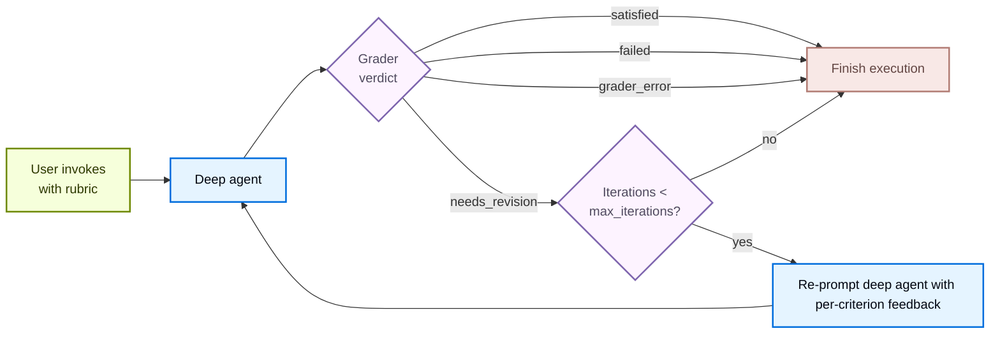

import RubricConfigurePy from '/langchain/snippets/code-samples/rubric-configure-py.mdx';
import RubricInvokePy from '/langchain/snippets/code-samples/rubric-invoke-py.mdx';
import RubricOnEvaluationPy from '/langchain/snippets/code-samples/rubric-on-evaluation-py.mdx';
import RubricStreamPy from '/langchain/snippets/code-samples/rubric-stream-py.mdx';
import RubricCodeGenerationMiddlewarePy from '/langchain/snippets/code-samples/rubric-code-generation-middleware-py.mdx';
import RubricCodeGenerationAgentPy from '/langchain/snippets/code-samples/rubric-code-generation-agent-py.mdx';
import RubricCodeGenerationInvokePy from '/langchain/snippets/code-samples/rubric-code-generation-invoke-py.mdx';

<Note>
`RubricMiddleware` 需要 `deepagents>=0.6.5`。它处于 [**测试版**](/langchain/oss/versioning) 状态；未来 API 可能会发生变化。
</Note>

某些智能体任务有明确的 "完成" 定义，而工作模型单独无法在第一次尝试中可靠地达成：符合正确音节模式的俳句、所有测试通过的代码重构，或涵盖所有必要部分的报告。`RubricMiddleware` 允许您将 *完成的样貌* 声明为标准，并让智能体 **自我评估和迭代**，直到标准得到满足，或达到配置的最大迭代次数限制。

**将语言模型作为裁判** 是一种模式，其中一个语言模型根据定义的标准评估另一个模型的输出。在 [LangSmith 评估](https://docs.langchain.com/langsmith/evaluation-concepts#llm-as-judge) 中，LLM-as-a-judge 评估器离线批量评分应用程序输出。`RubricMiddleware` 在运行时应用相同模式：深度智能体生成输出后，一个专用的评分模型根据您的标准审查会话记录，并驱动修订，直到所有标准通过（或达到配置的迭代次数限制）。

当深度智能体完成推理时，LLM-as-a-judge 评分子智能体审查输出并返回裁决。如果它返回 `needs_revision`，则针对每个标准的反馈会注入对话中，智能体再次运行。循环在 `satisfied`、`max_iterations_reached`、`failed` 或 `grader_error` 时终止。

## 配置中间件

在调用 `create_deep_agent` 时，将 `RubricMiddleware` 添加到 `middleware` 列表中：

<RubricConfigurePy />

| 参数 | 是否必需 | 默认值 | 描述 |
| --- | --- | --- | --- |
| `model` | 是 | `None` | LLM-as-a-judge 评分子智能体使用的对话模型。接受一个 `"provider:model-id"` 字符串或一个 `BaseChatModel` 实例。通常是深度智能体工作模型更小或更便宜的模型。 |
| `system_prompt` | 否 | 内置评分提示词 | 自定义评分说明。回退到默认系统提示词，该提示词教评分器裁决格式以及它可使用的工具。 |
| `tools` | 否 | `None` | 评分器在生成裁决之前可能调用的工具（运行测试、计算 Token、读取文件）。如果没有工具，评分器仅根据会话记录进行推理。 |
| `max_iterations` | 否 | `3` | 每次标准尝试中评分器的最大迭代次数；必须为正整数。当达到上限且未返回 `satisfied` 裁决时，智能体以状态 `max_iterations_reached` 终止。 |
| `on_evaluation` | 否 | `None` | 可选回调，在每次评分迭代后（无论您使用 `invoke()`、`stream()` 还是 `stream_events()`）调用，传递每个 `RubricEvaluation`。用于日志记录、自定义指标、评估数据集或 UI 更新。 |

## 调用时传递标准

在调用状态中传递 `rubric` 字符串以启动自我评估循环。使用 `invoke()` 进行单个阻塞调用，或使用 [`stream_events(..., version="v3")`](/langchain/oss/langchain/event-streaming) 与 [`CustomTransformer`](/langchain/oss/langchain/event-streaming#自定义更新) 接收在 `stream.custom` 中发生的评分事件：

<Tabs>
    <Tab title="invoke()">
        <RubricInvokePy />
    </Tab>
    <Tab title="stream_events()">
        <RubricStreamPy />

        标准评分在 `stream.custom` 上发出以下自定义事件：

        | 事件 | 触发时机 | 载荷字段 |
        | --- | --- | --- |
        | `rubric_evaluation_start` | 评分器运行之前。 | <ul><li>`type`: 事件名称</li><li>`grading_run_id`: 在一次标准尝试中所有事件共享的值</li><li>`iteration`: 当前评分运行的零基索引</li></ul> |
        | `rubric_evaluation_end` | 评分器返回后或评分器异常后。 | <ul><li>`type`: 事件名称</li><li>`grading_run_id`: 在一次标准尝试中所有事件共享的值</li><li>`iteration`: 当前评分器遍历的零基索引</li><li>`result`: 此遍历的最终裁决</li><li>`explanation`: 评分器的摘要</li><li>`criteria`: 每个标准的裁决</li></ul> |
    </Tab>
</Tabs>

### 标准裁决

当深度智能体完成推理并具有输出时，LLM-as-a-judge 评分子智能体根据标准审查输出，并生成以下裁决之一：

| 状态 | 含义 | 是否回环 |
| --- | --- | --- |
| `satisfied` | 标准中的每个标准都通过。 | 否 |
| `needs_revision` | 至少一个标准未通过；评分器反馈被注入，智能体再次运行。 | 是 |
| `max_iterations_reached` | 评分器仍希望修订，但 `max_iterations` 已被命中。 | 否 |
| `failed` | 评分器判断标准格式错误或无法根据会话记录进行评估。 | 否 |
| `grader_error` | LLM-as-a-judge 评分子智能体本身引发异常（提供者超时、缺少凭证、格式错误的结构化响应等）。 | 否 |

## 观察迭代进度

`on_evaluation` 是一个回调，在每次评分迭代后（无论您调用 `invoke()` 还是 `stream_events()`）触发，并传递评分器的裁决。如果您未从 `stream.custom`（使用 `CustomTransformer`）读取标准事件或使用 [LangSmith 追踪运行](https://docs.langchain.com/langsmith/trace-with-langgraph)，这是检查评分过程中发生情况的主要方式。

<RubricOnEvaluationPy />

中间件在每次 [评分器遍历](#评分器遍历事件) 后调用您的函数，传递一个 `RubricEvaluation` 字典。该 `RubricEvaluation` 字典包含：

| 字段 | 类型 | 描述 |
| --- | --- | --- |
| `grading_run_id` | `str` | 在一次标准尝试中所有评估共享的标识符。当调用者提供不同的 `rubric`，或相同 `rubric` 在最终裁决后再次被调用时，将开始新的运行。 |
| `iteration` | `int` | 当前评分器遍历在运行中的零基索引。 |
| `result` | `str` | 此遍历的评分器裁决：`satisfied`、`needs_revision`、`failed` 或 `grader_error`。 |
| `explanation` | `str` | 评分器的自由格式摘要。在基础设施故障时，这包括异常类型和消息。 |
| `criteria` | `list` | 每个标准的裁决。每个条目要么是 `{name, passed: true}`，要么是 `{name, passed: false, gap}`，其中 `gap` 是针对失败标准的可操作反馈。 |

### 评分器遍历事件

| Event | Description |
| ----- | ------------- |
| **Successful grading** | Fires once per pass, including intermediate `needs_revision` verdicts and the final `satisfied` or `failed` verdict.    When the grader returns `needs_revision` but `max_iterations` has been reached, the callback still receives `result: "needs_revision"` (the grader's verdict). The run's terminal status is `max_iterations_reached` on private state `_rubric_status`, not on the evaluation record. Inspect `_rubric_status` after `invoke` completes, or read the last entry in `_rubric_evaluations` together with `_rubric_iterations`, to branch on cap exhaustion. |
| **Grader exceptions** | Fires with `result: "grader_error"`, an explanation derived from the exception, and an empty `criteria` list. |
| **Errors in your callback** | Exceptions are logged and suppressed. The grading loop continues. Do not use `on_evaluation` to enforce control flow (for example, raising to stop the agent). |

## 跨调用持久化评估标准

一个 `agent.invoke()` 或 `agent.stream_events()` 调用会运行评分循环直至完成，并以终端判定结果 `satisfied`、`failed` 或 `max_iterations_reached` 结束。

若需将评分标准延续至后续调用，请附加 [checkpointer](/langchain/oss/langgraph/checkpointers#检查点) 并在调用时传递相同的 `thread_id`。在这种情况下，相同的 `rubric` 将在未来的 `invoke()` 或 `stream_events()` 调用中持续存在，直到您传递新的 `rubric` 为止。

中断（`KeyboardInterrupt`，`asyncio.CancelledError`）从`agent.invoke()`和`agent.stream_events()`传播出去且未被捕获。在一个检查点线程上，具有相同规则的下一个调用会继续进行中的评分运行。

## 示例：生成经过审核的 Python 代码

以下示例构建了一个深度智能体，该智能体编写一个`find_duplicates`函数。它定义`RubricMiddleware`一次，将其附加到智能体上，然后在调用时传递一个`rubric`字符串。

与其让评分器抽象地推理正确性，该示例给它提供了一个`run_test_suite`工具来直接验证行为。评分器在生成裁决之前会调用此工具以获取额外信息，并且在未提供工具时会回退到从转录文本中推理。

<Steps>
<Step title="Define RubricMiddleware">

这个中间件在基础智能体之上添加了一个 LLM 作为裁判的评分循环。配置裁判模型、可选的自定义提示词、证据收集工具以及最大迭代次数。

<RubricCodeGenerationMiddlewarePy />

</Step>
<Step title="Pass it to a deep agent">

智能体的 `system_prompt` 告诉它如何执行工作，而评分标准则告诉裁判如何评判工作。

<RubricCodeGenerationAgentPy />

</Step>
<Step title="Invoke with a human message and rubric">

在调用时，在 `messages` 中提供用户请求，并在 `rubric` 中提供一个换行符分隔的检查清单，裁判必须标记为满足。当输入状态中未提供 `rubric` 时，中间件不会运行。

<RubricCodeGenerationInvokePy />

</Step>
</Steps>

在智能体生成输出后，裁判接管并检查输出中的每个标准：例如，当输入包含不可哈希类型时 `test_unhashable` 会以 `TypeError` 失败。如果裁判发现任何问题，会提供反馈，然后智能体会修改其实现并返回给裁判。

---

> 官方原文：[src/oss/deepagents/rubric.mdx](https://github.com/langchain-ai/docs/blob/main/src/oss/deepagents/rubric.mdx) · 译文由 AI 生成，以英文原文为准。
