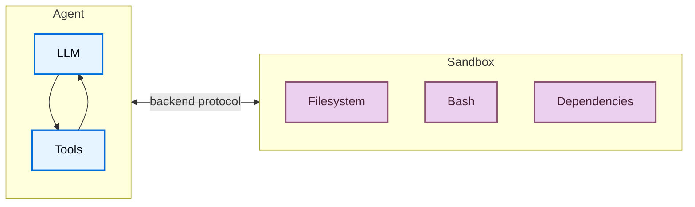
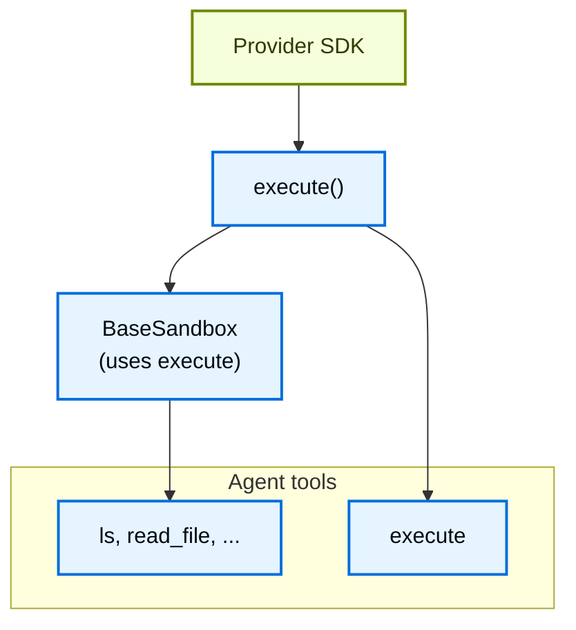
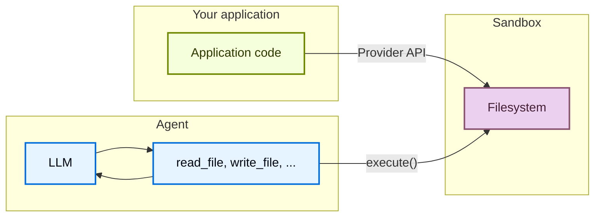

import SandboxesBasicTabsPy from '/langchain/snippets/sandboxes-basic-tabs-py.mdx';
import DeepagentsSandboxBasicJs from '/langchain/snippets/code-samples/deepagents-sandbox-basic-js.mdx';
import DeepagentsSandboxLifecycleFactoryThreadTs from '/langchain/snippets/code-samples/deepagents-sandbox-lifecycle-factory-thread-js.mdx';
import DeepagentsSandboxLifecycleFactoryAssistantTs from '/langchain/snippets/code-samples/deepagents-sandbox-lifecycle-factory-assistant-js.mdx';
import DeepagentsSandboxLifecycleFactoryThreadPy from '/langchain/snippets/code-samples/deepagents-sandbox-lifecycle-factory-thread-py.mdx';
import DeepagentsSandboxLifecycleFactoryAssistantPy from '/langchain/snippets/code-samples/deepagents-sandbox-lifecycle-factory-assistant-py.mdx';
import DeepagentsSandboxAsToolPy from '/langchain/snippets/code-samples/deepagents-sandbox-as-tool-py.mdx';
import DeepagentsSandboxAsToolJs from '/langchain/snippets/code-samples/deepagents-sandbox-as-tool-js.mdx';
import DeepagentsSandboxExecuteLangsmithPy from '/langchain/snippets/code-samples/deepagents-sandbox-execute-langsmith-py.mdx';
import DeepagentsSandboxUploadJs from '/langchain/snippets/code-samples/deepagents-sandbox-upload-js.mdx';
import DeepagentsSandboxDownloadJs from '/langchain/snippets/code-samples/deepagents-sandbox-download-js.mdx';
import DeepagentsSandboxUploadLangsmithPy from '/langchain/snippets/code-samples/deepagents-sandbox-upload-langsmith-py.mdx';
import DeepagentsSandboxDownloadLangsmithPy from '/langchain/snippets/code-samples/deepagents-sandbox-download-langsmith-py.mdx';

智能体生成代码、与文件系统交互以及运行 Shell 命令。由于无法预测智能体可能执行的操作，因此确保其环境隔离非常重要，以防止其访问凭证、文件或网络。沙盒通过在智能体的执行环境与您的宿主机系统之间创建边界来提供这种隔离。

在 Deep Agents 中，**沙盒是 [backends](/langchain/oss/deepagents/backends)**，它们定义了智能体操作的上下文。与其他后端（状态、文件系统、存储）不同，这些后端仅暴露文件操作，沙盒后端还向智能体提供了一个 `execute` 工具用于运行 Shell 命令。当您配置沙盒后端时，智能体会获得：

:::python
- 所有标准文件系统工具（`ls`, `read_file`, `write_file`, `edit_file`, `delete`, `glob`, `grep`）
:::
:::js
- 所有标准文件系统工具（`ls`, `read_file`, `write_file`, `edit_file`, `glob`, `grep`）
:::
- 用于在沙盒中运行任意 Shell 命令的 `execute` 工具
- 保护您的宿主机系统的安全边界



## 为什么使用沙盒？

沙盒用于安全目的。
它们允许智能体执行任意代码、访问文件和使用网络，而不会泄露您的凭证、本地文件或宿主机系统。
这种隔离在智能体自主运行时至关重要。

沙盒特别适用于：

- 编程智能体：自主运行的智能体可以使用 Shell、git、克隆存储库（许多提供者提供原生 git API，例如 [Daytona 的 git 操作](https://www.daytona.io/docs/en/git-operations/)），并运行 Docker-in-Docker 用于构建和测试管道
- 数据分析智能体：在安全的隔离环境中加载文件、安装数据分析库（pandas、numpy 等）、运行统计计算并创建 PowerPoint 演示文稿等输出

<Tip>
    **使用 Deep Agents 代码？** Deep Agents 代码通过 `--sandbox` 标志提供内置沙盒支持。有关 Deep Agents 代码特定的设置、标志（`--sandbox-id`、`--sandbox-setup`）和示例，请参阅 [为 Deep Agents 代码使用远程沙盒](/langchain/oss/deepagents/code/remote-sandboxes)。
</Tip>

<Note>
**如果您正在寻找 LangSmith 沙盒：** LangSmith 提供第一方管理的沙盒，您可以直接从 LangSmith UI 或 SDK 使用它们，而无需第三方帐户。有关管理的沙盒资源、快照、服务 URL 和认证代理，请参阅 [LangSmith 沙盒](https://docs.langchain.com/langsmith/sandboxes)。
</Note>

## 基本用法

这些示例假设您已经使用提供者的 SDK 创建了沙盒/devbox，并设置了凭证。有关注册、认证和提供者特定的生命周期详细信息，请参阅 [可用提供者](#可用提供者)。

:::js
<DeepagentsSandboxBasicJs />
:::

:::python
<SandboxesBasicTabsPy />
:::

<Tip>
[LangSmith](https://smith.langchain.com) 跟踪显示了沙盒中运行的哪些 Shell 命令以及智能体如何使用文件系统工具。请遵循 [可观察性快速入门](https://docs.langchain.com/langsmith/observability-quickstart) 进行设置。有关管理的沙盒托管，请参阅 [LangSmith 沙盒](https://docs.langchain.com/langsmith/sandboxes)。

我们建议您还设置 [LangSmith 引擎](https://docs.langchain.com/langsmith/engine)，它监控您的跟踪、检测问题并建议修复。
</Tip>

## 可用提供者

针对特定提供者的设置、认证和生命周期细节，请参阅 [沙盒集成](/langchain/oss/python/integrations/sandboxes)。

## 生命周期和作用域

大多数应用程序选择每个 [线程](https://docs.langchain.com/langsmith/use-threads)（线程作用域）一个沙盒，或为同一 [助手](https://docs.langchain.com/langsmith/assistants)（助手作用域）上的所有线程共享一个沙盒。

沙盒会消耗资源并产生费用，直到它们被关闭。确保在沙盒不再使用时将其关闭。

有关完整生命周期表格、异步 [图工厂](https://docs.langchain.com/langsmith/graph-rebuild) 注释、TTL 行为、LangGraph 部署连接和客户端示例，请参阅 [沙盒生命周期](/langchain/oss/deepagents/going-to-production#生命周期) 在《迈向生产环境》中。

### 线程作用域（默认）

每个对话都有自己的沙盒。首次运行时创建它；同一线程上的后续回合会重用它。当线程结束或沙盒 TTL 过期时，环境会消失。以下示例展示了如何存储沙盒名称或元数据的映射，以便每次运行都能解析到相同的沙盒。

<Tip>
当用户可以在空闲时间后返回时，为沙盒配置 TTL，以便提供者自动删除或存档空闲环境。
</Tip>

:::js
<DeepagentsSandboxLifecycleFactoryThreadTs />
:::

:::python
<DeepagentsSandboxLifecycleFactoryThreadPy />
:::

### 助手作用域

同一助手上的所有线程会重用同一个沙盒。文件、安装的包和克隆的仓库会跨对话持久化。

<Warning>
助手作用域沙盒会随时间累积沙盒内状态。配置沙盒提供者的 TTL，定期使用快照重置，或实现清理逻辑，以防止磁盘和内存无限制增长。
</Warning>

:::js
<DeepagentsSandboxLifecycleFactoryAssistantTs />
:::

:::python
<DeepagentsSandboxLifecycleFactoryAssistantPy />
:::

有关在图工厂外部执行、运行和拆除的手动操作，请参阅 [基础用法](#基本用法) 和 [沙盒集成](/langchain/oss/python/integrations/sandboxes) 以获取特定提供者的 API。

## 集成模式

集成智能体与沙盒的架构模式有两种，取决于智能体运行的位置。

### 智能体在沙盒模式

智能体在沙盒内运行，您通过网络与其通信。您构建一个预安装了智能体框架的 Docker 或 VM 镜像，在沙盒内运行它，并从外部连接以发送消息。

优点：

- ✅ 与本地开发非常相似。
- ✅ 智能体与环境之间存在紧密耦合。

权衡：

- 🔴 API 密钥必须存在于沙盒内（安全风险）。
- 🔴 更新需要重建镜像。
- 🔴 需要通信基础设施（WebSocket 或 HTTP 层）。

要在沙盒内运行智能体，请构建镜像并在其上安装 deepagents。

```dockerfile
FROM python:3.11
RUN pip install deepagents-code
```

然后在沙盒内运行智能体。
要在沙盒内使用智能体，您必须添加额外的基础设施来处理应用程序与沙盒内智能体之间的通信。

### 沙盒作为工具模式

智能体在您的机器或服务器上运行。当它需要执行代码时，会调用沙盒工具（例如 `execute`、`read_file` 或 `write_file`），这些工具会调用提供者的 API 以在远程沙盒中运行操作。

优点：

- ✅ 可即时更新智能体代码，无需重建镜像。
- ✅ 智能体状态与执行之间实现更清晰的分离。
    - API 密钥保留在沙盒外部。
    - 沙盒失败不会丢失智能体状态。
    - 可选择并行在多个沙盒中运行任务。
- ✅ 仅按执行时间付费。

权衡：

- 🔴 每次执行调用时的网络延迟。

:::python

<DeepagentsSandboxAsToolPy />

:::

:::js

<DeepagentsSandboxAsToolJs />

:::

本文档中的示例将沙盒用作工具模式。
当您的提供者 SDK 处理通信层，并且您希望生产环境与本地开发环境一致时，选择智能体在沙盒模式。
当您需要快速迭代智能体逻辑、将 API 密钥保留在沙盒外部，或倾向于更清晰的关注点分离时，选择沙盒作为工具模式。

## 沙盒的工作原理

### 隔离边界

所有沙盒提供者都保护您的宿主机系统免受智能体文件系统和 shell 操作的影响。智能体无法读取您的本地文件、访问机器上的环境变量或干扰其他进程。然而，沙盒本身**不**能防护：

- **上下文注入**：如果攻击者控制了智能体输入的一部分，它可以指示智能体在沙盒内运行任意命令。沙盒是隔离的，但智能体在其内部拥有完全控制权。
- **网络外泄**：除非阻止网络访问，否则上下文注入的智能体可以通过 HTTP 或 DNS 将数据发送出沙盒。某些提供者支持阻止网络访问（例如 `blockNetwork: true` on Modal）。

参见 [安全注意事项](#安全注意事项)，了解如何处理密钥并缓解这些风险。

### `execute` 方法

沙盒后端具有简单的架构：提供者必须实现的唯一方法是 `execute()`，该方法运行 shell 命令并返回其输出。

:::python
其他所有文件系统操作（`read`、`write`、`edit`、`delete`、`ls`、`glob`、`grep`）都由 @[`BaseSandbox`] 基类基于 `execute()` 构建，该基类构造脚本并通过 `execute()` 在沙盒内运行它们。
:::
:::js
其他所有文件系统操作（`read`、`write`、`edit`、`ls`、`glob`、`grep`）都由 @[`BaseSandbox`] 基类基于 `execute()` 构建，该基类构造脚本并通过 `execute()` 在沙盒内运行它们。
:::



这种设计意味着：
- **添加新的提供者非常简单。** 实现 `execute()`——基类会处理其他所有内容。
- **`execute` 工具是条件性可用的。** 在每次模型调用时，执行器检查后端是否实现了 @[`SandboxBackendProtocol`]。如果没有，该工具会被过滤掉，智能体永远不会看到它。

当智能体调用 `execute` 工具时，它会提供一个 `command` 字符串，并返回组合的 stdout/stderr、退出码，如果输出过大还会附带截断通知。

您也可以在应用程序代码中直接调用后端 `execute()` 方法。

:::python
<Tabs>
    <Tab title="LangSmith">
        <DeepagentsSandboxExecuteLangsmithPy />
    </Tab>
    <Tab title="AgentCore">
        <CodeGroup>
            ```bash pip
            pip install langchain-agentcore-codeinterpreter
            ```

            ```bash uv
            uv add langchain-agentcore-codeinterpreter
            ```
        </CodeGroup>

        ```python
        from bedrock_agentcore.tools.code_interpreter_client import CodeInterpreter

        from langchain_agentcore_codeinterpreter import AgentCoreSandbox

        interpreter = CodeInterpreter(region="us-west-2")
        interpreter.start()

        backend = AgentCoreSandbox(interpreter=interpreter)

        try:
            result = backend.execute("python3 --version")
            print(result.output)
        finally:
            interpreter.stop()
        ```
    </Tab>
    <Tab title="Databricks">
        <CodeGroup>
            ```bash pip
            pip install 'databricks-langchain[deepagents]>=0.22.0'
            ```

            ```bash uv
            uv add 'databricks-langchain[deepagents]>=0.22.0'
            ```
        </CodeGroup>

        ```python
        from databricks.sdk import WorkspaceClient

        from databricks_langchain import DatabricksSandbox

        client = WorkspaceClient()
        backend = DatabricksSandbox(client, "sandboxes/my-sandbox")

        result = backend.execute("python --version")
        print(result.output)
        ```
    </Tab>
    <Tab title="Daytona">
        <CodeGroup>
            ```bash pip
            pip install langchain-daytona
            ```

            ```bash uv
            uv add langchain-daytona
            ```
        </CodeGroup>

        ```python
        from daytona import Daytona

        from langchain_daytona import DaytonaSandbox

        sandbox = Daytona().create()
        backend = DaytonaSandbox(sandbox=sandbox)

        result = backend.execute("python --version")
        print(result.output)
        ```
    </Tab>
    <Tab title="E2B">
        <CodeGroup>
            ```bash pip
            pip install langchain-e2b
            ```

            ```bash uv
            uv add langchain-e2b
            ```
        </CodeGroup>

        ```python
        from e2b import Sandbox
        from langchain_e2b import E2BSandbox

        e2b_sandbox = Sandbox.create()
        sandbox = E2BSandbox(sandbox=e2b_sandbox)

        try:
            result = sandbox.execute("python --version")
            print(result.output)
        finally:
            e2b_sandbox.kill()
        ```
    </Tab>
    <Tab title="Modal">
        ```python
        import modal

        from langchain_modal import ModalSandbox

        app = modal.App.lookup("your-app")
        modal_sandbox = modal.Sandbox.create(app=app)
        backend = ModalSandbox(sandbox=modal_sandbox)

        result = backend.execute("python --version")
        print(result.output)
        ```
    </Tab>
    <Tab title="NVIDIA OpenShell">
        <CodeGroup>
            ```bash pip
            pip install langchain-nvidia-openshell
            ```

            ```bash uv
            uv add langchain-nvidia-openshell
            ```
        </CodeGroup>

        ```python
        import openshell

        from langchain_nvidia_openshell import OpenShellSandbox

        with openshell.Sandbox(delete_on_exit=True) as sandbox:
            backend = OpenShellSandbox(sandbox=sandbox)

            result = backend.execute("python3 --version")
            print(result.output)
        ```
    </Tab>
    <Tab title="Runloop">
        <CodeGroup>
            ```bash pip
            pip install langchain-runloop
            ```

            ```bash uv
            uv add langchain-runloop
            ```
        </CodeGroup>

        ```python
        from runloop_api_client import RunloopSDK

        from langchain_runloop import RunloopSandbox

        api_key = "..."
        client = RunloopSDK(bearer_token=api_key)

        devbox = client.devbox.create()
        backend = RunloopSandbox(devbox=devbox)

        try:
            result = backend.execute("python --version")
            print(result.output)
        finally:
            devbox.shutdown()
        ```
    </Tab>
    <Tab title="Vercel">
        <CodeGroup>
            ```bash pip
            pip install langchain-vercel-sandbox
            ```

            ```bash uv
            uv add langchain-vercel-sandbox
            ```
        </CodeGroup>

        ```python
        from vercel.sandbox import Sandbox

        from langchain_vercel_sandbox import VercelSandbox

        sandbox = Sandbox.create(runtime="python3.13")
        backend = VercelSandbox(sandbox=sandbox)

        try:
            result = backend.execute("python --version")
            print(result.output)
        finally:
            sandbox.stop()
        ```
    </Tab>
</Tabs>
:::

例如：

```
4
[Command succeeded with exit code 0]
```

```
bash: foobar: command not found
[Command failed with exit code 127]
```

如果一个命令产生非常大的输出，结果会自动保存到文件中，并指示智能体使用 `read_file` 来逐步访问它。这可以防止上下文窗口溢出。

### 两个文件访问层面

文件进出沙盒有两种截然不同的方式，了解何时使用每种方式非常重要：

:::python
**智能体文件系统工具**：`read_file`、`write_file`、`edit_file`、`delete`、`ls`、`glob`、`grep`、`execute`是大型语言模型在执行期间调用的工具。这些工具通过沙盒内的 `execute()` 进行操作。智能体使用它们来读取代码、写入文件以及作为任务的一部分运行命令。
:::
:::js
**智能体文件系统工具**：`read_file`、`write_file`、`edit_file`、`ls`、`glob`、`grep`、`execute`是大型语言模型在执行期间调用的工具。这些工具通过沙盒内的 `execute()` 进行操作。智能体使用它们来读取代码、写入文件以及作为任务的一部分运行命令。
:::

**文件传输API**：您的应用程序代码调用的 `uploadFiles()` 和 `downloadFiles()` 方法。这些方法使用提供者的原生文件传输API（不是shell命令），并设计用于在您的宿主环境和沙盒之间移动文件。使用这些方法来：
- 在智能体运行前用源代码、配置或数据**初始化沙盒**
- 在智能体运行后**检索工件**（生成的代码、构建输出、报告）
- **预填充**智能体将需要的依赖项



:::js
## 处理文件

### 初始化沙盒

使用 `uploadFiles()` 在智能体运行前填充沙盒。文件内容作为 `Uint8Array` 提供：

<DeepagentsSandboxUploadJs />

### 检索工件

使用 `downloadFiles()` 在智能体运行后从沙盒检索文件：

<DeepagentsSandboxDownloadJs />

<Note>
在沙盒内，智能体使用其自身的文件系统工具（`read_file`、`write_file`）：不是 `uploadFiles` 或 `downloadFiles`。这些方法是您的应用程序代码用来在您的宿主和沙盒之间移动文件的方式。
</Note>
:::

:::python
## 处理文件

深度智能体沙盒后端支持文件传输API，用于在您的应用程序和沙盒之间移动文件。

### 初始化沙盒

使用 `upload_files()` 在智能体运行前填充沙盒。路径必须是绝对路径，内容是 `bytes`：

<Tabs>
    <Tab title="LangSmith">

        <DeepagentsSandboxUploadLangsmithPy />
    </Tab>
    <Tab title="AgentCore">
        <CodeGroup>
            ```bash pip
            pip install langchain-agentcore-codeinterpreter
            ```

            ```bash uv
            uv add langchain-agentcore-codeinterpreter
            ```
        </CodeGroup>

        ```python
        from bedrock_agentcore.tools.code_interpreter_client import CodeInterpreter

        from langchain_agentcore_codeinterpreter import AgentCoreSandbox

        interpreter = CodeInterpreter(region="us-west-2")
        interpreter.start()

        backend = AgentCoreSandbox(interpreter=interpreter)

        backend.upload_files(
            [
                ("hello.py", b"print('Hello')\n"),
                ("data.csv", b"name,value\na,1\nb,2\n"),
            ]
        )
        ```
    </Tab>
    <Tab title="Databricks">
        <CodeGroup>
            ```bash pip
            pip install 'databricks-langchain[deepagents]>=0.22.0'
            ```

            ```bash uv
            uv add 'databricks-langchain[deepagents]>=0.22.0'
            ```
        </CodeGroup>

        ```python
        from databricks.sdk import WorkspaceClient

        from databricks_langchain import DatabricksSandbox

        client = WorkspaceClient()
        backend = DatabricksSandbox(client, "sandboxes/my-sandbox")

        backend.upload_files(
            [
                ("/src/index.py", b"print('Hello')\n"),
                ("/pyproject.toml", b"[project]\nname = 'my-app'\n"),
            ]
        )
        ```
    </Tab>
    <Tab title="Daytona">
        <CodeGroup>
            ```bash pip
            pip install langchain-daytona
            ```

            ```bash uv
            uv add langchain-daytona
            ```
        </CodeGroup>

        ```python
        from daytona import Daytona

        from langchain_daytona import DaytonaSandbox

        sandbox = Daytona().create()
        backend = DaytonaSandbox(sandbox=sandbox)

        backend.upload_files(
            [
                ("/src/index.py", b"print('Hello')\n"),
                ("/pyproject.toml", b"[project]\nname = 'my-app'\n"),
            ]
        )
        ```
    </Tab>
    <Tab title="E2B">
        <CodeGroup>
            ```bash pip
            pip install langchain-e2b
            ```

            ```bash uv
            uv add langchain-e2b
            ```
        </CodeGroup>

        ```python
        from e2b import Sandbox
        from langchain_e2b import E2BSandbox

        e2b_sandbox = Sandbox.create()
        sandbox = E2BSandbox(sandbox=e2b_sandbox)

        try:
            sandbox.upload_files(
                [
                    ("/src/index.py", b"print('Hello')\n"),
                    ("/pyproject.toml", b"[project]\nname = 'my-app'\n"),
                ]
            )
        finally:
            e2b_sandbox.kill()
        ```
    </Tab>
    <Tab title="Modal">
        ```python
        import modal

        from langchain_modal import ModalSandbox

        app = modal.App.lookup("your-app")
        modal_sandbox = modal.Sandbox.create(app=app)
        backend = ModalSandbox(sandbox=modal_sandbox)

        backend.upload_files(
            [
                ("/src/index.py", b"print('Hello')\n"),
                ("/pyproject.toml", b"[project]\nname = 'my-app'\n"),
            ]
        )
        ```
    </Tab>
    <Tab title="Runloop">
        <CodeGroup>
            ```bash pip
            pip install langchain-runloop
            ```

            ```bash uv
            uv add langchain-runloop
            ```
        </CodeGroup>

        ```python
        from runloop_api_client import RunloopSDK

        from langchain_runloop import RunloopSandbox

        api_key = "..."
        client = RunloopSDK(bearer_token=api_key)

        devbox = client.devbox.create()
        backend = RunloopSandbox(devbox=devbox)

        backend.upload_files(
            [
                ("/src/index.py", b"print('Hello')\n"),
                ("/pyproject.toml", b"[project]\nname = 'my-app'\n"),
            ]
        )
        ```
    </Tab>
    <Tab title="Vercel">
        <CodeGroup>
            ```bash pip
            pip install langchain-vercel-sandbox
            ```

            ```bash uv
            uv add langchain-vercel-sandbox
            ```
        </CodeGroup>

        ```python
        from vercel.sandbox import Sandbox

        from langchain_vercel_sandbox import VercelSandbox

        sandbox = Sandbox.create(runtime="python3.13")
        backend = VercelSandbox(sandbox=sandbox)

        backend.upload_files(
            [
                ("/src/index.py", b"print('Hello')\n"),
                ("/pyproject.toml", b"[project]\nname = 'my-app'\n"),
            ]
        )
        ```
    </Tab>
</Tabs>

### 检索工件

使用 `download_files()` 在智能体运行后从沙盒检索文件：

<Tabs>
    <Tab title="LangSmith">
        <DeepagentsSandboxDownloadLangsmithPy />
    </Tab>
    <Tab title="AgentCore">
        <CodeGroup>
            ```bash pip
            pip install langchain-agentcore-codeinterpreter
            ```

            ```bash uv
            uv add langchain-agentcore-codeinterpreter
            ```
        </CodeGroup>

        ```python
        from bedrock_agentcore.tools.code_interpreter_client import CodeInterpreter

        from langchain_agentcore_codeinterpreter import AgentCoreSandbox

        interpreter = CodeInterpreter(region="us-west-2")
        interpreter.start()

        backend = AgentCoreSandbox(interpreter=interpreter)

        results = backend.download_files(["hello.py"])
        for result in results:
            if result.content is not None:
                print(f"{result.path}: {result.content.decode()}")
            else:
                print(f"Failed to download {result.path}: {result.error}")

        interpreter.stop()
        ```
    </Tab>
    <Tab title="Databricks">
        <CodeGroup>
            ```bash pip
            pip install 'databricks-langchain[deepagents]>=0.22.0'
            ```

            ```bash uv
            uv add 'databricks-langchain[deepagents]>=0.22.0'
            ```
        </CodeGroup>

        ```python
        from databricks.sdk import WorkspaceClient

        from databricks_langchain import DatabricksSandbox

        client = WorkspaceClient()
        backend = DatabricksSandbox(client, "sandboxes/my-sandbox")

        results = backend.download_files(["/src/index.py", "/output.txt"])
        for result in results:
            if result.content is not None:
                print(f"{result.path}: {result.content.decode()}")
            else:
                print(f"Failed to download {result.path}: {result.error}")
        ```
    </Tab>
    <Tab title="Daytona">
        <CodeGroup>
            ```bash pip
            pip install langchain-daytona
            ```

            ```bash uv
            uv add langchain-daytona
            ```
        </CodeGroup>

        ```python
        from daytona import Daytona

        from langchain_daytona import DaytonaSandbox

        sandbox = Daytona().create()
        backend = DaytonaSandbox(sandbox=sandbox)

        results = backend.download_files(["/src/index.py", "/output.txt"])
        for result in results:
            if result.content is not None:
                print(f"{result.path}: {result.content.decode()}")
            else:
                print(f"Failed to download {result.path}: {result.error}")
        ```
    </Tab>
    <Tab title="E2B">
        <CodeGroup>
            ```bash pip
            pip install langchain-e2b
            ```

            ```bash uv
            uv add langchain-e2b
            ```
        </CodeGroup>

        ```python
        from e2b import Sandbox
        from langchain_e2b import E2BSandbox

        e2b_sandbox = Sandbox.create()
        sandbox = E2BSandbox(sandbox=e2b_sandbox)

        try:
            results = sandbox.download_files(["/src/index.py", "/output.txt"])
            for result in results:
                if result.content is not None:
                    print(f"{result.path}: {result.content.decode()}")
                else:
                    print(f"Failed to download {result.path}: {result.error}")
        finally:
            e2b_sandbox.kill()
        ```
    </Tab>
    <Tab title="Modal">
        ```python
        import modal

        from langchain_modal import ModalSandbox

        app = modal.App.lookup("your-app")
        modal_sandbox = modal.Sandbox.create(app=app)
        backend = ModalSandbox(sandbox=modal_sandbox)

        results = backend.download_files(["/src/index.py", "/output.txt"])
        for result in results:
            if result.content is not None:
                print(f"{result.path}: {result.content.decode()}")
            else:
                print(f"Failed to download {result.path}: {result.error}")
        ```
    </Tab>
    <Tab title="Runloop">
        <CodeGroup>
            ```bash pip
            pip install langchain-runloop
            ```

            ```bash uv
            uv add langchain-runloop
            ```
        </CodeGroup>

        ```python
        from runloop_api_client import RunloopSDK

        from langchain_runloop import RunloopSandbox

        api_key = "..."
        client = RunloopSDK(bearer_token=api_key)

        devbox = client.devbox.create()
        backend = RunloopSandbox(devbox=devbox)

        results = backend.download_files(["/src/index.py", "/output.txt"])
        for result in results:
            if result.content is not None:
                print(f"{result.path}: {result.content.decode()}")
            else:
                print(f"Failed to download {result.path}: {result.error}")
        ```
    </Tab>
    <Tab title="Vercel">
        <CodeGroup>
            ```bash pip
            pip install langchain-vercel-sandbox
            ```

            ```bash uv
            uv add langchain-vercel-sandbox
            ```
        </CodeGroup>

        ```python
        from vercel.sandbox import Sandbox

        from langchain_vercel_sandbox import VercelSandbox

        sandbox = Sandbox.create(runtime="python3.13")
        backend = VercelSandbox(sandbox=sandbox)

        results = backend.download_files(["/src/index.py", "/output.txt"])
        for result in results:
            if result.content is not None:
                print(f"{result.path}: {result.content.decode()}")
            else:
                print(f"Failed to download {result.path}: {result.error}")
        ```
    </Tab>
</Tabs>

<Note>
在沙盒内，智能体使用文件系统工具（`read_file`、`write_file`）。`upload_files` 和 `download_files` 方法是您的应用程序代码用来在您的宿主和沙盒之间移动文件的方式。
</Note>
:::

## 安全注意事项

沙盒隔离代码执行与您的宿主机系统，但它们无法防护**上下文注入**。如果攻击者控制了智能体部分输入，它可以指示智能体读取文件、运行命令或从沙盒中窃取数据。这使得沙盒内的凭证尤其危险。

<Warning>
**切勿将密钥放在沙盒内。** API 密钥、Token、数据库凭证和其他注入沙盒（通过环境变量、挂载文件或 `secrets` 选项）的密钥可以被上下文注入的智能体读取和窃取。即使是对短时效或作用域受限的凭证也是如此——如果智能体可以访问它们，攻击者也可以。

</Warning>

### 安全处理密钥

如果您的智能体需要调用认证 API 或访问受保护资源，您有两个选项：

1. **在沙盒外部的工具中保留密钥。** 定义在您的宿主机环境中运行（而不是在沙盒内）的工具，并在那里处理认证。智能体通过名称调用这些工具，但永远不会看到凭证。这是推荐的方法。

2. **使用注入凭证的网络代理。** 一些沙盒提供者支持拦截沙盒发出的 HTTP 请求并附加凭证（例如 `Authorization` 标头）再转发它们的代理。智能体永远不会看到密钥——它只是向 URL 发送普通请求。这种方法目前尚未在所有提供者中普及。

<Warning>
如果您必须将密钥注入沙盒（不推荐），请采取以下预防措施：

- 为**所有**工具调用启用 [人工审核](/langchain/oss/deepagents/human-in-the-loop)批准，而不仅仅是敏感调用
- 阻止或限制沙盒的网络访问以限制窃取路径
- 使用最窄可能的凭证作用域和最短的时效
- 监控沙盒网络流量以检测意外的出站请求

即使有这些安全措施，这仍然是一个不安全的变通方法。足够巧妙的上下文注入攻击可以绕过输出过滤和人工审核。

</Warning>

### 一般最佳实践

- 在应用程序中处理沙盒输出之前进行审查
- 在不需要时阻止沙盒网络访问
- 使用 [中间件](/langchain/oss/langchain/middleware)来过滤或删除工具输出中的敏感模式
- 将沙盒内生成的一切视为不可信输入

---

> 官方原文：[src/oss/deepagents/sandboxes.mdx](https://github.com/langchain-ai/docs/blob/main/src/oss/deepagents/sandboxes.mdx) · 译文由 AI 生成，以英文原文为准。
