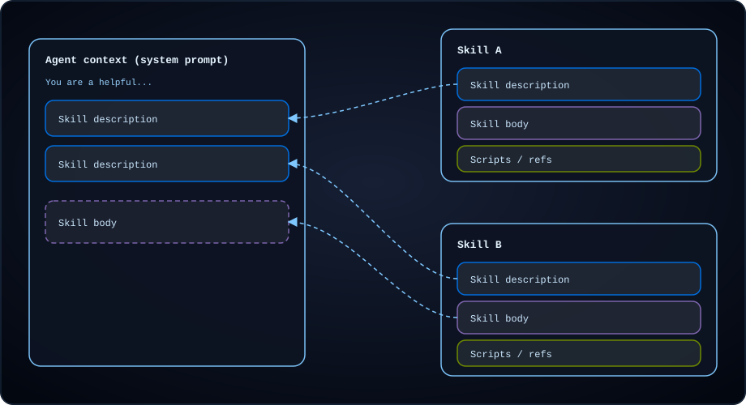
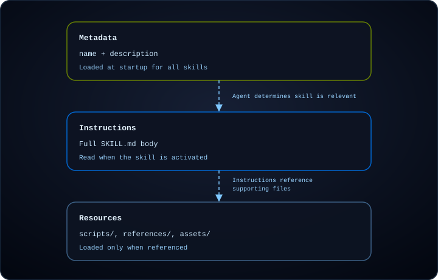

import SkillsUsageTabsPy from '/langchain/snippets/skills-usage-tabs-py.mdx';
import SkillsUsageTabsJs from '/langchain/snippets/skills-usage-tabs-js.mdx';
import SkillsSandboxPy from '/langchain/snippets/code-samples/skills-sandbox-py.mdx';
import SkillsSandboxJs from '/langchain/snippets/code-samples/skills-sandbox-js.mdx';
import BackendReadonlySkillsPy from '/langchain/snippets/code-samples/backend-readonly-skills-py.mdx';
import BackendReadonlySkillsJs from '/langchain/snippets/code-samples/backend-readonly-skills-js.mdx';
import SkillsCreateAgentPy from '/langchain/snippets/code-samples/skills-create-agent-py.mdx';
import SkillsCreateAgentJs from '/langchain/snippets/code-samples/skills-create-agent-js.mdx';
import SkillsInvokePy from '/langchain/snippets/code-samples/skills-invoke-py.mdx';
import SkillsInvokeJs from '/langchain/snippets/code-samples/skills-invoke-js.mdx';
import SkillsDynamicListsPy from '/langchain/snippets/code-samples/skills-dynamic-lists-py.mdx';
import SkillsDynamicListsJs from '/langchain/snippets/code-samples/skills-dynamic-lists-js.mdx';
import SkillsNamespacedPy from '/langchain/snippets/code-samples/skills-namespaced-py.mdx';
import SkillsNamespacedJs from '/langchain/snippets/code-samples/skills-namespaced-js.mdx';
import SkillsSubagentsPy from '/langchain/snippets/code-samples/skills-subagents-py.mdx';
import SkillsSubagentsJs from '/langchain/snippets/code-samples/skills-subagents-js.mdx';
import SkillsComposeSourcesPy from '/langchain/snippets/code-samples/skills-compose-sources-py.mdx';
import SkillsComposeSourcesJs from '/langchain/snippets/code-samples/skills-compose-sources-js.mdx';
import SkillsApprovalPy from '/langchain/snippets/code-samples/skills-approval-py.mdx';
import SkillsApprovalJs from '/langchain/snippets/code-samples/skills-approval-js.mdx';
import SkillsWritablePy from '/langchain/snippets/code-samples/skills-writable-py.mdx';
import SkillsWritableJs from '/langchain/snippets/code-samples/skills-writable-js.mdx';
import SkillsReloadInvokePy from '/langchain/snippets/code-samples/skills-reload-invoke-py.mdx';
import SkillsReloadInvokeJs from '/langchain/snippets/code-samples/skills-reload-invoke-js.mdx';
import SkillsReloadUpdateStatePy from '/langchain/snippets/code-samples/skills-reload-update-state-py.mdx';
import SkillsReloadUpdateStateJs from '/langchain/snippets/code-samples/skills-reload-update-state-js.mdx';
import SkillsReloadMiddlewarePy from '/langchain/snippets/code-samples/skills-reload-middleware-py.mdx';
import SkillsReloadMiddlewareJs from '/langchain/snippets/code-samples/skills-reload-middleware-js.mdx';
import SkillsToolsListPy from '/langchain/snippets/code-samples/skills-tools-list-py.mdx';
import SkillsToolsResolverPy from '/langchain/snippets/code-samples/skills-tools-resolver-py.mdx';
import SkillsToolsIntegrationPy from '/langchain/snippets/code-samples/skills-tools-integration-py.mdx';
import SkillsToolsPerUserPy from '/langchain/snippets/code-samples/skills-tools-per-user-py.mdx';
import SkillsToolsSearchPy from '/langchain/snippets/code-samples/skills-tools-search-py.mdx';
import SkillsToolsListJs from '/langchain/snippets/code-samples/skills-tools-list-js.mdx';
import SkillsToolsResolverJs from '/langchain/snippets/code-samples/skills-tools-resolver-js.mdx';
import SkillsToolsIntegrationJs from '/langchain/snippets/code-samples/skills-tools-integration-js.mdx';
import SkillsToolsPerUserJs from '/langchain/snippets/code-samples/skills-tools-per-user-js.mdx';
import SkillsToolsSearchJs from '/langchain/snippets/code-samples/skills-tools-search-js.mdx';
import SkillsPinInvokePy from '/langchain/snippets/code-samples/skills-pin-invoke-py.mdx';
import SkillsPinParsePy from '/langchain/snippets/code-samples/skills-pin-parse-py.mdx';
import SkillsPinInvokeJs from '/langchain/snippets/code-samples/skills-pin-invoke-js.mdx';
import SkillsPinParseJs from '/langchain/snippets/code-samples/skills-pin-parse-js.mdx';

Skills 包含领域专业知识，例如工作流、最佳实践、脚本、参考文档和模板，并将其封装到可重用的目录中。智能体在启动时会获取内容的摘要，并且仅在需要时才会发现和读取包含的文件。

Skills 通过在启动时仅加载摘要并仅在任务需要时读取完整指令来帮助您避免上下文膨胀。您可以在智能体和项目中共享 Skills，并在单个智能体中组合多个 Skills，以便每个 Skills 覆盖不同的功能。

:::js
<Note>
Skills 需要 `deepagents>=1.7.0`。
</Note>
:::

<Tip>
要查看可用于提升您的智能体在 LangChain 生态系统任务中性能的现成 Skills，请参阅 [LangChain Skills](https://github.com/langchain-ai/langchain-skills) 存储库。
</Tip>

## 使用

<Steps>
<Step title="Create a top-level skills directory">

为您的项目创建一个目录来存放所有 Skills，例如 `skills/`，位于您的后端根目录下。

</Step>
<Step title="Create a subdirectory inside your skills directory for your skill">

每个 Skills 是一个目录，其中包含一个 `SKILL.md` 文件：一个带有 YAML [frontmatter](#前置字段)（`name` 和 `description`）的 Markdown 文件，后面是智能体在 Skills 激活时遵循的指令。一个 Skills 目录还可以可选地包含脚本、参考文档和模板等支持文件。

<Tree>
  <Tree.Folder name="skills" defaultOpen>
    <Tree.Folder name="langgraph-docs" defaultOpen>
      <Tree.File name="SKILL.md" />
      <Tree.Folder name="scripts">
        <Tree.File name="fetch_docs.py" />
      </Tree.Folder>
      <Tree.Folder name="references">
        <Tree.File name="api-patterns.md" />
        <Tree.File name="style-guide.md" />
      </Tree.Folder>
      <Tree.Folder name="assets">
        <Tree.File name="report-template.md" />
        <Tree.File name="schema.json" />
      </Tree.Folder>
    </Tree.Folder>
  </Tree.Folder>
</Tree>

深度智能体 Skills 遵循 [Agent Skills 规范](https://agentskills.io/specification)。

</Step>
<Step title="Add a `SKILL.md` file with YAML frontmatter and instructions.">

`SKILL.md` 以 YAML [frontmatter](#前置字段) 开头，后面是 Markdown 指令：

````md
---
name: langgraph-docs
description: Use this skill for requests related to LangGraph in order to fetch relevant documentation to provide accurate, up-to-date guidance.
---

# langgraph-docs

## Overview

This skill explains how to access LangGraph documentation to help answer questions and guide implementation.

## Instructions

### 1. Fetch the documentation index

Use the fetch_url tool to read the following URL:
https://docs.langchain.com/llms.txt

This provides a structured list of all available documentation with descriptions.

### 2. Select relevant documentation

Based on the question, identify 2-4 most relevant documentation URLs from the index. Prioritize:

- Specific how-to guides for implementation questions
- Core concept pages for understanding questions
- Tutorials for end-to-end examples
- Reference docs for API details

### 3. Fetch and synthesize

Use the fetch_url tool to read the selected documentation URLs, then answer the user's question. Give a direct answer first, include the minimum necessary context, and link to the source pages rather than quoting long passages.
````

<Note>
    在您的 `SKILL.md` 中引用任何 [支持资源](#添加支持资源)，并描述每个文件的内容以及何时使用它。智能体通过 Skills 指令中的引用发现这些文件。
</Note>

</Step>
<Step title="Pass the skills path when creating your agent">

在创建智能体时，在 `skills` 参数中传递您的顶级 Skills 目录的路径：

:::python
<SkillsCreateAgentPy />
:::

:::js
<SkillsCreateAgentJs />
:::

此示例使用 `FilesystemBackend` 从磁盘加载 Skills。有关其他存储选项，包括从远程源加载 Skills，请参阅 [后端和远程 Skills 加载](#后端和远程技能加载)。

:::python
将每个源路径指向包含技能目录的目录。指向包含 `SKILL.md` 的技能目录的路径不会被加载。
:::

:::js
每个源路径可以指向包含技能目录的目录，或者直接指向包含 `SKILL.md` 的技能目录。
:::

<ParamField body="skills" type="list[str]" optional>
    技能源路径列表。

    路径必须使用正斜杠指定，并且相对于后端根目录。

    - 如果省略，则不会加载任何技能。
    - 当使用 `StateBackend`（默认值）时，提供 `invoke(files={...})` 格式的技能文件。使用 `create_file_data()` 从 `deepagents.backends.utils` 格式化文件内容；不支持原始字符串。
    :::python
    - 使用 `FilesystemBackend` 和 `StoreBackend` 创建后端，调用 `backend.upload_files()` 添加技能文件，然后将后端传递给 `create_deep_agent`。对于 `FilesystemBackend`，使用 `virtual_mode=True` 对 `root_dir` 下的路径进行沙盒处理。`root_dir` 下已存在的技能无需上传即可加载。
    :::
    :::js
    - 使用 `FilesystemBackend` 和 `StoreBackend` 创建后端，调用 `backend.uploadFiles()` 添加技能文件，然后将后端传递给 `createDeepAgent`。对于 `FilesystemBackend`，使用 `virtualMode: true` 对 `rootDir` 下的路径进行沙盒处理。`rootDir` 下已存在的技能无需上传即可加载。
    :::

    后续源会覆盖先前的源，对于具有相同名称的技能（后一个优先）。

    <Note>
    当多个技能源包含具有相同名称的技能时，`skills` 数组中列出的较后源的技能优先（后一个优先）。这允许你叠加来自不同来源的技能，例如基础技能被特定项目版本覆盖。
    </Note>

</ParamField>

</Step>
<Step title="Invoke the agent">

使用 `invoke()` 将任务发送给智能体。启动时，智能体加载每个技能的 [`name`](#前置字段) 和 [`description`](#前置字段)（来自 [frontmatter](#前置字段)）到系统提示词中。当你的任务与技能的描述匹配时，智能体读取该技能的 `SKILL.md` 并遵循其指令。

:::python
<SkillsInvokePy />
:::

:::js
<SkillsInvokeJs />
:::

</Step>
</Steps>

## 技能的工作原理

随着智能体承担更复杂的任务，它们需要的上下文也随之增长。将所有指令加载到系统提示词中会浪费与当前任务无关的 Token，而手动跨会话提供相同指导无法扩展。

<Info>
技能使用 **渐进式披露**：智能体按层加载技能信息，而不是一次性全部加载。启动时，它只看到每个技能的名称和描述。当技能被调用时，它读取完整的 `SKILL.md` 指令。支持文件在需要时才会加载。
</Info>

技能按三个级别加载。每个级别仅在任务需要时添加更多细节：

| 级别 | 加载内容 | 时间 |
| ----- | ---------- | ---- |
| **1. 元数据** | [`name`](#前置字段) 和 [`description`](#前置字段)（来自 `SKILL.md` [frontmatter](#前置字段)） | 智能体启动，针对每个配置的技能 |
| **2. 指令** | 完整的 `SKILL.md` 正文 | 当技能被调用时 |
| **3. 资源** | `scripts/`、`references/` 和 `assets/` 下 [支持文件](#添加支持资源) | 调用后按需加载，当指令引用它们时 |

下图显示了在特定时刻智能体上下文中出现的内容。启动时，每个技能的级别 1 元数据都在系统提示词中。当技能被调用时，级别 2 指令加入上下文。级别 3 文件保留在后端，直到智能体在调用后读取它们。

<div className="skills-composition-diagram">



</div>

随着智能体处理任务，它按层加载技能信息：

<div className="skills-composition-diagram">



</div>

在 Deep Agents 中，@[`SkillsMiddleware`（当你传递 `skills` 时是 [Deep Agents 堆栈](/langchain/oss/deepagents/customization#deep-agents-堆栈) 的一部分）处理前两个级别，第三个级别由 LLM 处理：

1. **发现**（级别 1）：在智能体启动时，中间件扫描配置的技能路径，解析每个 `SKILL.md` [frontmatter](#前置字段)，并将 [`name`](#前置字段) 和 [`description`](#前置字段) 字段注入系统提示词。
2. **读取**（级别 2）：当智能体调用技能时，它通过 `read_file` 读取完整的 `SKILL.md` 内容。
3. **执行**（级别 3）：调用后，智能体遵循技能的指令，并仅在指令需要时读取支持文件（脚本、参考、资源）。

要在智能体选择技能之前给其技能指令，[固定技能](#固定技能)。

## 何时使用技能

如果你发现自己向智能体提供相似的指令，特别是如果它们详细且包含多个步骤，请考虑将指令编码给智能体。这样，在将来当你想要完成类似任务时，智能体将已经知道该做什么。

<Tip>
    你还可以要求你的智能体为你之前与智能体合作的任务编写技能。
</Tip>

技能特别适用于编码：

- **分步工作流**：跨越多个步骤的工作流，类似于食谱。
- **特定领域知识**：指导智能体如何使用工具进行工作流。例如，提供有关从哪里获取信息的信息，包括技能可能访问的其他参考信息或脚本。
- **带可执行代码的指令**：将程序与智能体可以运行的脚本或模块捆绑在一起，以便它遵循经过测试的逻辑，而不是每次都从指令中重新生成它。参见 [使用技能执行代码](#使用技能执行代码)。
- **指南**：向智能体提供有关必须遵守的护栏的辅助指令。例如，遵循特定的格式或风格指南，或指定始终将测试作为工作流的一部分运行。

## 编写有效的技能

[智能体技能规范](https://agentskills.io/specification) 包括关于如何构建技能以实现可靠发现和激活的指导。以下建议在此基础上构建了适用于 Deep Agents 的实用模式。

**保持 [frontmatter](#前置字段) 简洁**，并将 `SKILL.md` 正文保持在 5,000 个 Token 以下。每个技能的 frontmatter 在 [发现](#技能的工作原理) 时会添加到系统提示词中，而完整正文仅在激活时才读取。保持这两层较小意味着你可以加载许多技能，而不会挤占上下文窗口。

**编写具体描述。** 在 [发现](#技能的工作原理) 阶段，[`description`](#前置字段) 字段是智能体每个技能唯一能获取的信息。一个好的描述告诉智能体技能的作用以及何时激活它，并包含智能体可以匹配的具体关键词：

```yaml
# Good: specific about what and when
description: >-
  Extract text and tables from PDF files, fill PDF forms, and merge
  multiple PDFs. Use when working with PDF documents or when the user
  mentions PDFs, forms, or document extraction.

# Poor: too vague for reliable matching
description: Helps with PDFs.
```

当你在相关领域有多个技能时，要清晰地区分它们的描述。重叠的描述会导致智能体激活错误的技能或在不同选项间犹豫。如果两个技能用途相似，将它们合并为一个。

**保持指令聚焦。** Agent Skills 规范建议将你的 `SKILL.md` 控制在 500 行以内。当指令变得过长时，将详细参考材料移动到 [支持资源文件](#添加支持资源)，并在主 `SKILL.md` 中引用它们：

<Tree>
  <Tree.Folder name="skills" defaultOpen>
    <Tree.Folder name="data-pipeline" defaultOpen>
      <Tree.File name="SKILL.md" />
      <Tree.Folder name="references" defaultOpen>
        <Tree.File name="schema-reference.md" />
        <Tree.File name="error-codes.md" />
      </Tree.Folder>
    </Tree.Folder>
  </Tree.Folder>
</Tree>

智能体仅在指令调用时加载参考文件，保持每层渐进披露的适当大小。将文件引用保持在 `SKILL.md` 的一级深度，避免深层嵌套的引用链，这会迫使智能体多次读取才能获取所需信息。

**为智能体结构化指令。** 将你的 `SKILL.md` 正文编写为智能体可以遵循的清晰指令：

- **分步流程** 用于多步骤工作流
- **选择方法的标准** 用于在不同方案间选择
- **预期输入和输出的示例** 让智能体知道成功的样子
- **智能体应处理或向用户标记的边界情况**

**管理技能数量。** 数量少但范围明确的技能优于大量重叠的技能。随着具有相似描述的技能数量增加，智能体选择正确技能的能力会下降。如果你发现自己有许多相关技能，可以考虑：

- 将相关功能合并为一个技能，并为每个子任务设置部分
- 使用参考文件保持主 `SKILL.md` 简洁，同时涵盖多个子任务

<Tip>
    使用 [`skills-ref` 验证工具](https://github.com/agentskills/agentskills/tree/main/skills-ref) 检查你的 `SKILL.md` [frontmatter](#前置字段) 是否遵循 Agent Skills 规范的命名和格式约定。
</Tip>

## 添加支持资源

除了 `SKILL.md`，技能目录可以包含任何其他文件或目录。[Agent Skills 规范](https://agentskills.io/specification) 定义了三个可选目录用于常见资源类型。Deep Agents 在发现或激活时不加载这些文件。智能体仅在 `SKILL.md` 指令指示时读取或执行它们。

### `scripts/`

`scripts/` 目录包含智能体可以运行的执行代码，例如 API 客户端、数据转换或验证检查。脚本应：

- 自包含或明确文档化依赖关系
- 包含有用的错误消息
- 优雅地处理边界情况

支持的语言取决于你的智能体设置。常见选项包括 Python、Bash 和 JavaScript 或 TypeScript。要执行脚本而不仅仅是读取它们，请参阅 [使用技能执行代码](#使用技能执行代码)。当智能体需要 shell 时使用 [沙盒脚本](#沙盒脚本)。

### `references/`

`references/` 目录包含智能体按需读取的补充文档。用于材料过于详细不适合 `SKILL.md` 但仍与任务相关的场景，例如：

- `REFERENCE.md` 用于详细技术参考
- `FORMS.md` 用于表单模板或结构化数据格式
- 领域特定指南（`finance.md`、`legal.md` 及类似内容）

保持单个参考文件聚焦。智能体仅在需要时加载它们，因此较小的文件使用更少的上下文。

### `assets/`

`assets/` 目录包含智能体使用但不需作为指令读取的静态资源，例如：

- 文档或配置模板
- 图片（图表、示例）
- 数据文件（查找表、模式）

在 `SKILL.md` 中描述智能体何时应打开或复制每个资源。

### 从 `SKILL.md` 引用的文件

引用支持文件时，使用相对于技能根的相对路径：

````md
For API details, see the [reference guide](references/api-patterns.md).

To extract tables from a PDF, run:
scripts/extract.py
````

对于每个引用的文件，说明其包含的内容以及智能体何时使用它。将引用保持在 `SKILL.md` 的一级深度。避免深层嵌套的引用链，这会迫使智能体多次读取才能获取所需信息。

## 向技能添加工具

技能可以自带工具。智能体仅在读取技能后才能看到它们，因此它们的模式直到任务需要时才出现在提示词中。

技能工具是 Deep Agents 的功能，而不是 [Agent Skills 规范](https://agentskills.io/specification) 的一部分。Deep Agents 从规范的 `metadata` 字段读取工具名称。它们与规范的 `allowed-tools` 字段无关，后者预先批准工具而不是添加它们。

:::python
<Note>技能工具需要 `deepagents>=0.7.22`。</Note>
:::

:::js
<Note>技能工具需要 `deepagents>=1.15.0`。</Note>
:::

在技能的 frontmatter 中，将工具列在 `metadata.include_tools` 下，用空格分隔。YAML 列表不会匹配任何工具。

```yaml
name: linear
description: Triage and file Linear issues. Use when the user reports a bug or asks about the Linear backlog.
metadata:
  include_tools: list_issues create_issue
```

:::python
将 `skills` 传递给 `create_deep_agent` 为你创建一个 `SkillsMiddleware`。要添加工具，请自行创建中间件并传递给 `middleware`。给它你的技能路径作为 `sources`，并在中间件上而不是在智能体上提供你的工具作为 `tools`：

<SkillsToolsListPy />
:::

:::js
将 `skills` 传递给 `createDeepAgent` 为你创建技能中间件。要添加工具，请使用 `createSkillsMiddleware` 自行创建它，并传递给 `middleware`。给它你的技能路径作为 `sources`，并在中间件上而不是在智能体上提供你的工具作为 `tools`：

<SkillsToolsListJs />
:::

技能工具遵循以下规则：

- 技能工具是受限制的。直到智能体读取技能的 `SKILL.md`，对其中一个的调用会作为未知工具失败，即使模型猜测了它的名称和参数。
- 当 [摘要](/langchain/oss/deepagents/context-engineering#摘要) 从对话中删除该读取时，工具在智能体再次读取技能之前不可用。
- [固定技能](#固定技能) 会以读取技能的 `SKILL.md` 相同的方式使其工具可用。它们在摘要删除固定技能的消息之前保持可用。

<Note>
在允许对话中途接受新工具的模型中，Deep Agents 在读取后添加一个技能工具，以保持提示词缓存有效。在其他模型中，它将工具添加到请求的 `tools` 中，这将使缓存失效。请参阅 [Anthropic](/langchain/oss/python/integrations/chat/anthropic#对话中更改工具) 和 [OpenAI](/langchain/oss/python/integrations/chat/openai#在对话中途添加工具) 集成页面。
</Note>

### 在运行时解析工具

`include_tools` 中的名称不必与工具的名称完全匹配。像 `mcp_linear_list_issues_ab12` 这样的生成工具名称很难手动编写，并且可能会发生变化。

为了将技能列表中的名称映射到工具，将解析器函数作为中间件的 `tools` 传递。解析器接收每个 `include_tools` 名称和图的 `Runtime`，并返回该名称对应的工具。

:::js
将解析器标注为 `SkillToolResolver`，当它读取带类型的 `runtime.context` 时，标注为 `SkillToolResolver<TContext>`。
:::

技能列表的可读名称：

```yaml
metadata:
  include_tools: list_issues create_issue
```

解析器将每个名称映射到其真实工具：

:::python
<SkillsToolsResolverPy />
:::

:::js
<SkillsToolsResolverJs />
:::

一个名称也可以代表多个工具，例如来自 Linear MCP 服务器的所有工具。在技能中列出一个名称：

```yaml
metadata:
  include_tools: linear
```

然后在解析器中返回服务器的所有工具：

:::python
<SkillsToolsIntegrationPy />
:::

:::js
<SkillsToolsIntegrationJs />
:::

解析器还会接收图的 `Runtime`，因此它可以根据 [运行时上下文](/langchain/oss/deepagents/context-engineering#运行时上下文) 为每次运行返回不同的工具。例如，按用户查找工具：

:::python
<SkillsToolsPerUserPy />
:::

:::js
<SkillsToolsPerUserJs />
:::

编写解析器时：

- 保持其快速。它在智能体读取技能后为每个模型调用运行，并在每次技能工具调用之前再次运行。
:::python
- 解析器可以是异步的。如果是，通过其异步方法运行智能体，例如 `ainvoke`。
:::
:::js
- 解析器可以是异步的。它可以返回工具的 Promise。
:::

### 保持工具可搜索

:::python
技能工具，即您传递给 `SkillsMiddleware` 的工具，只能通过其技能访问。使用 @[`ProviderToolSearchMiddleware`，模型通过搜索查找标记为 `extras={"defer_loading": True}` 的 [延迟工具](/langchain/oss/langchain/middleware/built-in#提供者工具搜索)。为了通过搜索或读取技能使其可访问，将工具传递给智能体的 `tools` 并延迟它。读取技能后即可显示它，而无需搜索：

<SkillsToolsSearchPy />
:::

:::js
技能工具，即您传递给 `createSkillsMiddleware` 的工具，只能通过其技能访问。使用 @[`providerToolSearchMiddleware`，模型通过搜索查找标记为 `extras: { defer_loading: true }` 的 [延迟工具](/langchain/oss/langchain/middleware/built-in#提供者工具搜索)。为了通过搜索或读取技能使其可访问，将工具传递给智能体的 `tools` 并延迟它。读取技能后即可显示它，而无需搜索：

<SkillsToolsSearchJs />
:::

与技能工具不同，延迟工具没有限制。模型可以在智能体读取技能之前通过搜索找到并调用它。

智能体如何访问工具取决于您将其传递的位置：

:::python
| 传递工具到 | 智能体读取技能之前 | 智能体读取技能之后 |
| --- | --- | --- |
| `SkillsMiddleware(tools=...)` | 隐藏，调用失败 | 可见 |
| 智能体的 `tools`，延迟 | 可通过提供者工具搜索访问 | 无需搜索即可可见 |
| 智能体的 `tools` | 可见，因此 `include_tools` 没有影响 | 可见 |

当技能列出一个智能体已经拥有的工具时，包括内置工具如 `edit_file`，Deep Agents 使用智能体的工具，而不是 `SkillsMiddleware` 中具有相同名称的工具。
:::

:::js
| 传递工具到 | 智能体读取技能之前 | 智能体读取技能之后 |
| --- | --- | --- |
| `createSkillsMiddleware({ tools })` | 隐藏，调用失败 | 可见 |
| 智能体的 `tools`，延迟 | 可通过提供者工具搜索访问 | 无需搜索即可可见 |
| 智能体的 `tools` | 可见，因此 `include_tools` 没有影响 | 可见 |

当技能列出一个智能体已经拥有的工具时，包括内置工具如 `edit_file`，Deep Agents 使用智能体的工具，而不是传递给 `createSkillsMiddleware` 的具有相同名称的工具。
:::

## 后端和远程技能加载

Deep Agents 支持不同的后端，具体取决于您希望如何存储和管理技能文件：

- `StateBackend`：将文件存储在当前线程的 LangGraph 智能体状态中。
- `StoreBackend`：将文件存储在 LangGraph 存储中进行持久化、跨线程存储。
- `FilesystemBackend`：从磁盘读取和写入技能文件，路径为可配置的 `root_dir`。

:::python
<SkillsUsageTabsPy />
:::

:::js
<SkillsUsageTabsJs />
:::

## 技能可用性

并非每次运行都需要每个技能。通过选择传递给 `skills` 的路径、将那些路径解析到特定上下文的存储，或组合多个技能源来控制智能体可以看到哪些技能。上下文可以来自请求处理器、身份验证声明、图工厂、部署配置或任何其他应用程序逻辑。

### 根据上下文选择技能

在创建智能体之前选择 `skills` 数组。当技能位于公共位置，并且您的应用程序决定哪些路径适用于当前角色、租户、用户或请求类型时，使用此模式：

:::python
<SkillsDynamicListsPy />
:::

:::js
<SkillsDynamicListsJs />
:::

这种模式保持每个技能的单一维护副本，并且仅更改传递给每个智能体的路径。在部署中，图工厂是解析用户信息并使用正确的技能路径构建智能体的自然位置。

<Note>
    SDK 仅加载您传递给 `skills` 的源。它不会自动扫描目录，如 `~/.deepagents/...` 或 `~/.agents/...`。

    对于 Deep Agents 代码存储约定，请参阅 [应用数据](/langchain/oss/deepagents/code/configuration#数据位置)。

    <Accordion
        title="在 SDK 中模拟 Deep Agents 代码源顺序"
    >
        要在 SDK 代码中匹配 Deep Agents 代码分层，请按最低到最高优先级顺序显式传递所有所需源：

        ```text
        [
        "<user-home>/.deepagents/{agent}/skills/",
        "<user-home>/.agents/skills/",
        "<project-root>/.deepagents/skills/",
        "<project-root>/.agents/skills/",
        ]
        ```

        然后在创建智能体时将此有序列表作为 `skills` 传递。
    </Accordion>
</Note>

### 隔离技能库

当相同的技能路径对于不同的用户、角色、租户、工作区或环境应解析到不同的文件时，请使用隔离库。例如，每个智能体都可以接收 `skills=["/skills/"]`，而后端将 `/skills/` 解析到针对当前身份或部署上下文进行范围限制的存储。

以下示例使用 @[StoreBackend]，但相同的模式适用于任何可以根据运行时上下文解析文件的后端：

:::python
<SkillsNamespacedPy />
:::

:::js
<SkillsNamespacedJs />
:::

这确保了智能体配置的稳定性，同时后端强制执行智能体可以访问的库。作用域不需要是用户特定的。它可以是应用程序使用的任何边界，包括角色、租户、工作区、组织、环境或请求类型。

要填充共享库，可以从应用程序代码或管理员工作流程中为存储进行初始化：

- 使用 org ID 命名空间来为工作区范围的技能。将此与 [只读技能](#只读技能)配合使用，当智能体应使用库但不应修改它时。
- 使用用户 ID 命名空间，当每个用户需要一个独立的库，如上面的示例所示。

使用像 `/company-policies/SKILL.md` 这样的键和包含 `content` 和 `encoding` 字段的值初始化存储。在从存储读取记录之前，会移除 `/skills/` 路径前缀。

您也可以组合共享和个人库：将 `/skills/approved/` 路由到组织范围的 `StoreBackend`，将 `/skills/editable/` 路由到用户范围的后端，并将两个路径都传递给 `skills`。参见 [可写技能](#可写技能)。

### 组合多个来源

当智能体应该看到多个库时，传递多个技能路径。例如，您可以组合批准的组织技能、团队特定的工作流程和请求特定说明：

:::python
<SkillsComposeSourcesPy />
:::

:::js
<SkillsComposeSourcesJs />
:::

每个路径可以指向相同后端、不同后端路由或由运行时上下文限定后端。对于处理技能访问、共享和工作区级可见性的托管解决方案，请参阅 [舰队技能](https://docs.langchain.com/langsmith/fleet/skills)。

## 重新加载技能

技能每个线程加载一次并保持在智能体状态中，因此该线程上的每个后续模型调用都会重用相同的列表。在此之后添加、编辑或删除的技能永远不会到达模型。当配置了检查点器时适用。没有检查点器，状态不会在运行之间存活，因此每个运行都会重新加载技能。

:::python
在下一个运行开始时重置存储的元数据，以便重新加载每个来源。
:::

:::js
在下一个模型调用之前重置存储的元数据，以便重新加载每个来源。
:::

<Note>
本地运行通常没有检查点器，因此技能编辑会立即生效，并且技能似乎会自行重新加载。[LangSmith 部署](https://docs.langchain.com/langsmith/deployment)会自动配置持久检查点器，因此部署后相同的智能体会保持其技能直到线程结束。参见 [进入生产](/langchain/oss/deepagents/going-to-production)。
</Note>

:::python
<Note>重新加载技能需要 `deepagents>=0.7.16`。</Note>
:::

:::js
<Note>重新加载技能需要 `deepagents>=1.14.0`。</Note>
:::

将重置作为运行输入传递，以便在单个调用中重新加载并运行：

:::python
<SkillsReloadInvokePy />
:::

:::js
<SkillsReloadInvokeJs />
:::

在运行之间重置状态：

:::python
<SkillsReloadUpdateStatePy />
:::

:::js
<SkillsReloadUpdateStateJs />
:::

:::python
使用 `None`，而不是空列表。空列表意味着加载的来源没有包含技能，因此智能体在其余线程中看不到技能。
:::

:::js
使用 `null`，而不是空列表。空列表意味着加载的来源没有包含技能，因此智能体在其余线程中看不到技能。
:::

<Note>
找到不同技能集的重新加载会更改系统提示词并使该线程的提示词缓存失效。找到相同技能集的重新加载会产生相同的提示词且不产生任何成本。
</Note>

中间件也可以重置该值，这允许您的应用程序决定何时线程已过时。

:::python
加载在每个运行开始时发生，因此来自挂钩的重置由下一个运行提供服务，而不是当前运行的中间部分。从 `after_agent` 而不是 `after_model` 重置：在运行中途存储的值会使提示词在当前运行中剩余的模型调用中没有列出技能。
:::

:::js
加载在每个模型调用之前发生，因此来自挂钩的重置在下一个模型调用（包括当前运行的中间部分）生效。
:::

:::python
<SkillsReloadMiddlewarePy />
:::

:::js
<SkillsReloadMiddlewareJs />
:::

## 固定技能

智能体只在决定技能与任务匹配时才读取技能。例如，当用户在应用程序中命名技能时，通过键入 `/langgraph-docs` 或从菜单中选择它，固定技能。深度智能体随后将技能的说明添加到对话中，因此智能体不必选择它。

:::python
<Note>固定技能需要 `deepagents>=0.7.23`。</Note>

将技能名称作为运行输入传递到 `pinned_skills`：

<SkillsPinInvokePy />
:::

:::js
<Note>固定技能需要 `deepagents>=1.15.0`。</Note>

将技能名称作为运行输入传递到 `pinnedSkills`：

<SkillsPinInvokeJs />

自定义中间件可以从 hooks 设置 `pinnedSkills`。在中间件的状态 schema 上声明 `pinnedSkillsValue`，方式与 [重新加载中间件](#重新加载技能) 声明 `skillsMetadataValue` 相同。
:::

在下一个模型调用之前，`SkillsMiddleware` 读取每个命名技能的 `SKILL.md` 并将其作为 `HumanMessage` 添加到对话中。它按您命名的顺序为每个技能添加一条消息。每条消息包含不带 frontmatter 的文件：

```text
<skill name="langgraph-docs" path="/skills/langgraph-docs/SKILL.md">
# langgraph-docs

## Overview
...
</skill>
```

:::python
每条消息还将 `additional_kwargs["lc_source"]` 设置为 `"pinned_skill"`，并将技能的 `name`、`path` 和 `description` 放入 `additional_kwargs["skill"]`。聊天界面可以使用这些字段将固定技能显示为标签，而不是其完整文本。
:::

:::js
每条消息还将 `additional_kwargs.lc_source` 设置为 `"pinned_skill"`，并将技能的 `name`、`path` 和 `description` 放入 `additional_kwargs.skill`。聊天界面可以使用这些字段将固定技能显示为标签，而不是其完整文本。
:::

固定技能遵循以下规则：

:::python
- 消息按原样保留在对话中。稍后编辑 `SKILL.md` 不会改变它，并且再次固定技能会追加当前文本。较早的消息永远不会改变，因此提示词缓存保持有效。
- 中间件会跳过与未加载技能匹配的名称，以及 `SKILL.md` 它无法读取的技能。它以调试级别记录每个跳过。
- 当您固定技能时，其 [技能工具](#向技能添加工具) 对智能体可用，与智能体读取其 `SKILL.md` 时相同。
:::

:::js
- 消息按原样保留在对话中。稍后编辑 `SKILL.md` 不会改变它，并且再次固定技能会追加当前文本。较早的消息永远不会改变，因此提示词缓存保持有效。
- 中间件会跳过与未加载技能匹配的名称，以及 `SKILL.md` 它无法读取的技能。
- 当您固定技能时，其 [技能工具](#向技能添加工具) 对智能体可用，与智能体读取其 `SKILL.md` 时相同。
:::

### 在消息中命名的技能固定

:::python
Deep Agents 不在消息中查找技能名称。您的应用程序选择语法，找到名称，并将它们传递到 `pinned_skills`。以下示例将消息中名为 `/skill-name` 的每个技能固定，并保持文本不变：

<SkillsPinParsePy />
:::]

:::js
Deep Agents 不在消息中查找技能名称。您的应用程序选择语法，找到名称，并将它们传递到 `pinnedSkills`。以下示例将消息中名为 `/skill-name` 的每个技能固定，并保持文本不变：

<SkillsPinParseJs />
:::]

该模式匹配一个 `/` 后跟一个技能名称，位于消息开头或空格之后。它不会检查名称是否与您的技能匹配，因为中间件会跳过未知名称。要支持其他语法，例如 `$skill-name`，请更改模式。

## 子智能体的技能

当您使用 [子智能体](/langchain/oss/deepagents/subagents) 时，可以配置每种类型可以访问哪些技能：

- **通用子智能体**：当您将 `skills` 传递到 `create_deep_agent` 时，会自动继承主智能体的技能。无需额外配置。
- **自定义子智能体**：不会继承主智能体的技能。为每个子智能体定义添加 `skills` 参数，并指定该子智能体的技能源路径。

技能状态完全隔离：主智能体的技能对子智能体不可见，子智能体的技能对主智能体也不可见。

:::python
<SkillsSubagentsPy />
:::]

:::js
<SkillsSubagentsJs />
:::]

有关子智能体配置和技能继承的更多信息，请参阅 [子智能体](/langchain/oss/deepagents/subagents)。

## 技能权限

技能可用性控制智能体可以看到哪些技能文件。技能权限控制智能体是否可以读取这些文件、写入它们或在写入前请求人工批准。使用 [文件系统权限](/langchain/oss/deepagents/permissions) 进行基于路径的读写规则，并在写入需要批准时使用 [`interrupt_on`](/langchain/oss/deepagents/human-in-the-loop) 或带有 `mode="interrupt"` 的权限规则。

### 只读技能

要让智能体使用经过审核的技能库而不修改它，将技能路径路由到包含已批准库的后端，并拒绝在该路径下执行写入操作。智能体可以发现和读取技能；只有您的应用程序代码或管理员工作流会更新后端。

:::python

<BackendReadonlySkillsPy />

:::]

:::js

<BackendReadonlySkillsJs />

:::]

用于企业知识库、已批准的工具指令或集中管理的技能包，智能体应使用内容但不应重写事实来源。

### 可写技能

默认情况下，如果后端允许且没有权限规则阻止路径，智能体可以写入技能文件。要让智能体创建或改进某些技能，同时保护其他技能：

1. 将可写路径路由到可以持久化智能体编辑的后端。
2. 将这些路径传递到 `skills`。
3. 为任何应保持只读的路径添加 `deny` 规则。如果路径重叠，请将更具体的规则放在更广泛的拒绝规则之前（[规则排序](/langchain/oss/deepagents/permissions#规则顺序)）。

:::python
<SkillsWritablePy />
:::]

:::js
<SkillsWritableJs />
:::]

智能体使用 `write_file` 和 `edit_file` 在可写路径下创建或更新 `SKILL.md` 和支持文件。要捕获技能格式之外的通用学习成果，将单独的路径（如 `/memories/`）路由到另一个可写后端。有关路由和存储设置，请参阅 [后端](/langchain/oss/deepagents/backends)。

### 写入批准

如果智能体可以写入技能文件，但您希望首先有人参与，请使用 [`interrupt_on`](/langchain/oss/deepagents/human-in-the-loop) 或带有 `mode="interrupt"` 的权限规则。两者都会在 `write_file` 或 `edit_file` 运行之前暂停，并使用相同的恢复流程。

:::python
<SkillsApprovalPy />
:::]

:::js
<SkillsApprovalJs />
:::]

或者，配置 `interrupt_on={"write_file": True, "edit_file": True}` 以要求对所有文件系统写入（而不仅仅是技能路径）进行批准。有关处理和恢复中断的信息，请参阅 [人工参与](/langchain/oss/deepagents/human-in-the-loop)。

:::python
<Note>
    文件系统权限中断需要 `deepagents>=0.6.8`。
</Note>
:::]

## 使用技能执行代码

没有代码执行，技能是被动：智能体读取指令并使用其可用工具遵循它们。代码执行将技能转换为主动功能。一个技能可以包含经过测试的脚本，该脚本调用 API、转换数据、验证输出或运行管道——智能体按确定性执行它，而不是每次都从指令中重新生成逻辑。这对于需要精确行为的工作流（数据转换、API 集成、合规检查）或依赖于智能体无法通过工具调用单独使用的库的工作流尤其有价值。

技能通过 [沙盒脚本](#沙盒脚本) 执行代码：当智能体需要安装依赖项、运行测试、调用 CLI 或与操作系统文件系统工作时，它会运行捆绑的脚本。

### 沙盒脚本

技能可以与 `SKILL.md` 文件一起包含脚本。在您的 `SKILL.md` 中引用脚本，以便智能体知道它们的存在以及何时运行它们：

:::python
<Tree>
  <Tree.Folder name="skills" defaultOpen>
    <Tree.Folder name="arxiv-search" defaultOpen>
      <Tree.File name="SKILL.md" />
      <Tree.Folder name="scripts" defaultOpen>
        <Tree.File name="search.py" />
      </Tree.Folder>
    </Tree.Folder>
  </Tree.Folder>
</Tree>
:::]

:::js
<Tree>
  <Tree.Folder name="skills" defaultOpen>
    <Tree.Folder name="arxiv-search" defaultOpen>
      <Tree.File name="SKILL.md" />
      <Tree.Folder name="scripts" defaultOpen>
        <Tree.File name="search.ts" />
      </Tree.Folder>
    </Tree.Folder>
  </Tree.Folder>
</Tree>
:::]

:::python
````md
---
name: arxiv-search
description: Search the arXiv preprint repository for research papers. Use when the user asks about academic papers, recent research, or scientific literature.
---

# arxiv-search

Search arXiv for papers matching the user's query.

## Instructions

1. Run `scripts/search.py` with the user's query as an argument.
2. Parse the results and present them with title, authors, abstract summary, and link.
3. If the user asks for more detail on a specific paper, fetch the full abstract.
````
:::]

:::js
````md
---
name: arxiv-search
description: Search the arXiv preprint repository for research papers. Use when the user asks about academic papers, recent research, or scientific literature.
---

# arxiv-search

Search arXiv for papers matching the user's query.

## Instructions

1. Run `scripts/search.ts` with the user's query as an argument.
2. Parse the results and present them with title, authors, abstract summary, and link.
3. If the user asks for more detail on a specific paper, fetch the full abstract.
````
:::]

智能体可以 _读取_ 来自任何后端的脚本，但要 _执行_ 它们，智能体需要访问 shell，而只有 [沙盒后端](/langchain/oss/deepagents/sandboxes) 提供这种访问权限。

[Sandbox backends](/langchain/oss/deepagents/sandboxes) 在隔离的容器中运行。存储在沙盒外的技能文件在沙盒内不可用，这意味着除非首先将它们传输进去，否则智能体无法执行技能脚本或访问技能资源。使用 [自定义中间件](/langchain/oss/langchain/middleware/custom) 来处理此传输：

- **`before_agent`**：从后端读取技能文件并将它们上传到沙盒，以便智能体从一开始就能执行脚本。
- **`after_agent`**：从沙盒下载任何更新的或新创建的技能文件，并将它们写回后端，以便更改跨运行持久保存。

:::python

<SkillsSandboxPy />

:::]

:::js
<SkillsSandboxJs />
:::]

对于在执行前预置技能和记忆，并在执行后同步两者的完整示例，请参阅[syncing skills and memories with custom middleware](/langchain/oss/deepagents/going-to-production#example-syncing-skills-and-memories-with-custom-middleware)。

## 故障排除

使用[LangSmith](https://smith.langchain.com)跟踪来调试技能发现、`read_file`在`SKILL.md`上的调用以及支持资源访问。请遵循[tracing quickstart](https://docs.langchain.com/langsmith/observability-quickstart)来设置。我们建议您还设置[LangSmith Engine](https://docs.langchain.com/langsmith/engine)，它监控您的跟踪、检测问题并建议解决方案。

### 技能未激活

**问题**：智能体在处理任务时未读取技能的`SKILL.md`。

**解决方案**：

1. **使描述更具体**。智能体仅根据[`description`](#前置字段)字段在[discovery](#技能的工作原理)阶段选择技能。包含技能的作用、何时使用以及智能体可以匹配的关键词：

   ```yaml
   # Good
   description: >-
     Search the arXiv preprint repository for research papers. Use when the
     user asks about academic papers, recent research, or scientific literature.

   # Poor
   description: Helps with research.
   ```

2. **减少技能之间的重叠**。如果多个技能具有相似的描述，智能体可能会跳过正确的技能或选择错误的技能。区分描述或[合并相关技能](#编写有效的技能)。

3. **确认技能在`skills`数组中**。技能仅从在智能体创建时传递的路径或子智能体特定的`skills`参数中加载。

4. **固定技能**。当用户或您的应用程序已经知道适用的技能时，[固定它](#固定技能)。然后智能体将获取技能的指令，而无需选择技能。

### 启动时技能缺失

**问题**：智能体在其系统提示中未列出技能，或`read_file`在`SKILL.md`上失败。

**解决方案**：

1. **检查技能路径**。路径必须使用正斜杠，并相对于后端根目录。使用`FilesystemBackend`时，路径相对于`root_dir`。使用`StateBackend`时，通过`create_file_data()`将技能文件传递到`invoke(files={...})`。

:::python
2. **检查路径层级**。`skills`中的每个条目都是一个包含技能目录的源目录。传递技能目录本身不会发现任何内容并引发错误，因为源目录存在，并且仅搜索其子目录以查找`SKILL.md`。

3. **验证`SKILL.md` [frontmatter](#前置字段)**。[`name`](#前置字段)必须与父目录名称匹配，并遵循[Agent Skills specification](https://agentskills.io/specification)。使用[`skills-ref`验证工具](https://github.com/agentskills/agentskills/tree/main/skills-ref)检查格式。

4. **检查文件大小**。Deep Agents在发现过程中跳过超过10 MB的`SKILL.md`文件。

5. **检查分层源**。当相同的技能名称出现在多个源中时，[最后一个源获胜](#使用)。来自较晚路径的较旧或空的技能可以覆盖您期望的技能。
:::

:::js
2. **验证`SKILL.md` [frontmatter](#前置字段)**。[`name`](#前置字段)必须与父目录名称匹配，并遵循[Agent Skills specification](https://agentskills.io/specification)。使用[`skills-ref`验证工具](https://github.com/agentskills/agentskills/tree/main/skills-ref)检查格式。

3. **检查文件大小**。Deep Agents在发现过程中跳过超过10 MB的`SKILL.md`文件。

4. **检查分层源**。当相同的技能名称出现在多个源中时，[最后一个源获胜](#使用)。来自较晚路径的较旧或空的技能可以覆盖您期望的技能。
:::

### 技能更改未被检测到

**问题**：在您添加、编辑或删除技能后，智能体仍然使用该技能的早期版本。

**解决方案**：技能每个线程加载一次，因此已经运行过的线程看不到更改。重置存储的元数据。请参阅[Reload skills](#重新加载技能)。

### 支持文件未找到

**问题**：智能体读取`SKILL.md`，但无法访问脚本、引用或资源。

**解决方案**：

1. **从`SKILL.md`引用文件**。智能体不会自动发现支持文件。说明每个文件的内容和何时使用它。使用[相对路径](#从-skill-md-引用的文件)从技能根目录开始。

2. **保持路径在技能目录内**。文件路径相对于后端解析。确认支持文件存在于您的指令引用的路径上。

3. **将技能同步到沙盒**。如果您使用[sandbox backends](/langchain/oss/deepagents/sandboxes)，则容器外部的技能文件在您将它们复制到容器中之前不可用。请参阅[Sandbox scripts](#沙盒脚本)和[syncing skills and memories with custom middleware](/langchain/oss/deepagents/going-to-production#example-syncing-skills-and-memories-with-custom-middleware)。

### 技能工具不可用

**问题**：智能体无法调用技能在`include_tools`中列出的工具。

**解决方案**：

1. **确认智能体读取了技能**。技能工具仅在智能体读取`SKILL.md`后出现，并且在摘要丢弃该读取时消失。请参阅[Add tools to skills](#向技能添加工具)。

2. **将`include_tools`作为字符串编写**。使用空格分隔名称。YAML列表永远不会匹配工具。

:::python
3. **检查名称**。每个名称必须与传递给智能体或`SkillsMiddleware`的工具名称匹配，或与您的解析器处理的名称匹配。Deep Agents仅在`DEBUG`级别记录未匹配的名称，因此启用`deepagents`记录器的调试日志以查看它们。
:::

:::js
3. **检查名称**。每个名称必须与传递给智能体或`createSkillsMiddleware`的工具名称匹配，或与您的解析器处理的名称匹配。
:::

### 脚本无法运行

**问题**：智能体读取脚本但无法运行它。

**解决方案**：智能体可以从任何后端读取脚本，但运行它们需要[sandbox backend](/langchain/oss/deepagents/sandboxes)。请参阅[Execute code with skills](#使用技能执行代码)。

### 子智能体无法访问技能

**问题**：自定义子智能体看不到主智能体使用的技能。

**解决方案**：自定义子智能体不会继承主智能体的技能。为每个[subagent definition](#子智能体的技能)参数添加`skills`，包含该子智能体的技能源路径。通用子智能体会自动继承`create_deep_agent`的技能。

## 参考

### 技能、记忆和工具

技能、[记忆](/langchain/oss/deepagents/memory)（`AGENTS.md`文件）和工具都为智能体提供上下文或功能。下表总结了何时使用每个：

| | 技能 | 记忆 | 工具 |
|---|--------|--------|-------|
| **目的** | 通过渐进式披露发现的按需能力 | 启动时加载的持久化上下文 | 智能体可以调用的程序化操作 |
| **加载** | 仅当智能体确定相关性时读取 | 智能体启动时加载 | 每次回合可用 |
| **格式** | `SKILL.md` 存储在命名目录中 | `AGENTS.md` 文件 | 绑定到智能体的函数 |
| **分层** | 用户，然后项目（后者的优先级更高） | 用户，然后项目（合并） | 在智能体创建时定义 |
| **使用场景** | 指令是任务特定的且可能较大 | 上下文始终相关（项目约定、偏好） | 智能体需要程序化操作，或无法访问文件系统 |

这些是指导原则，而非硬性边界。在实践中，技能和记忆存在于一个谱系上。智能体可以在工作时更新自己的技能，捕获新流程并随着时间的推移完善指令。通过这种方式，技能可以作为一种渐进式披露记忆的形式：智能体按需构建和检索的上下文，而不是每次提示时都加载。

### 前置字段

[智能体技能规范](https://agentskills.io/specification)定义了以下前置字段：

| 字段 | 必填 | 描述 |
|-------|----------|-------------|
| `name` | 是 | 小写字母数字，可包含连字符，1-64个字符。必须与父目录名称匹配。 |
| `description` | 是 | 技能的作用和使用时机。最多1,024个字符。 |
| `license` | 否 | 许可证名称或捆绑许可证文件的引用。 |
| `compatibility` | 否 | 环境要求（系统包、网络访问）。最多500个字符。 |
| `metadata` | 否 | 用于附加属性的任意键值对。 |
| `allowed-tools` | 否 | 智能体可以使用的前批准工具的空格分隔列表。实验性功能。 |

````md expandable
---
name: langgraph-docs
description: Use this skill for requests related to LangGraph in order to fetch relevant documentation to provide accurate, up-to-date guidance.
license: MIT
compatibility: Requires internet access for fetching documentation URLs
metadata:
  author: langchain
  version: "1.0"
allowed-tools: fetch_url
---

# langgraph-docs

Instructions for the agent go here. See [Usage](#usage) for a complete example of skill instructions.
````

<Warning>
    参考完整的[智能体技能规范](https://agentskills.io/specification)以获取详细的约束和验证规则。在Deep Agents中，`SKILL.md`文件必须小于10 MB。超过此限制的文件在技能加载时会被跳过。
</Warning>

:::python
更多示例技能，请参阅[Deep Agents示例技能](https://github.com/langchain-ai/deepagents/tree/main/libs/code/examples/skills)。
:::

:::js
更多示例技能，请参阅[Deep Agents示例技能](https://github.com/langchain-ai/deepagentsjs/tree/main/examples/skills)。
:::

---

> 官方原文：[src/oss/deepagents/skills.mdx](https://github.com/langchain-ai/docs/blob/main/src/oss/deepagents/skills.mdx) · 译文由 AI 生成，以英文原文为准。
