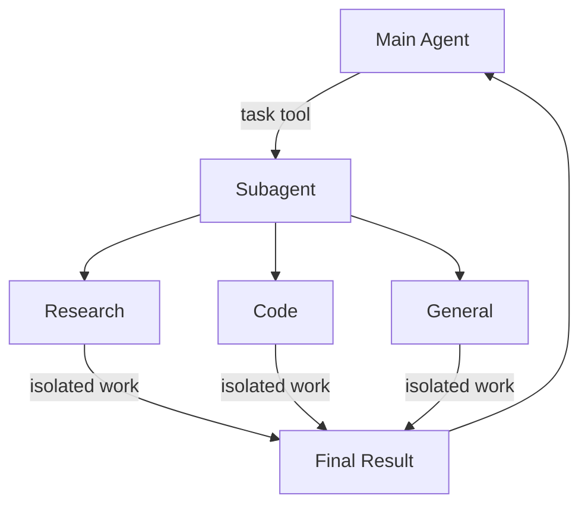
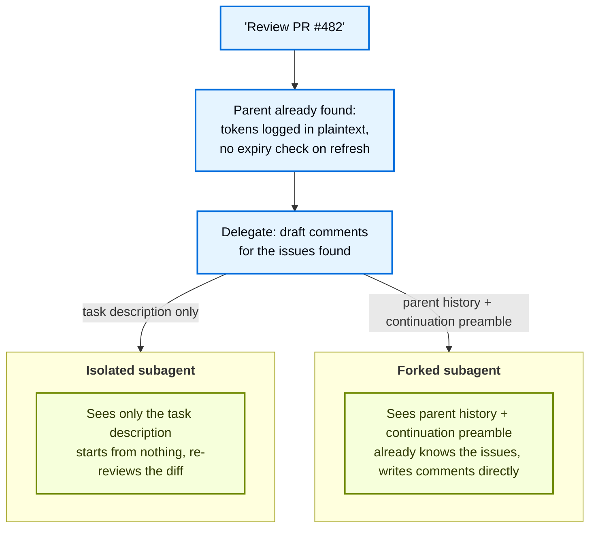
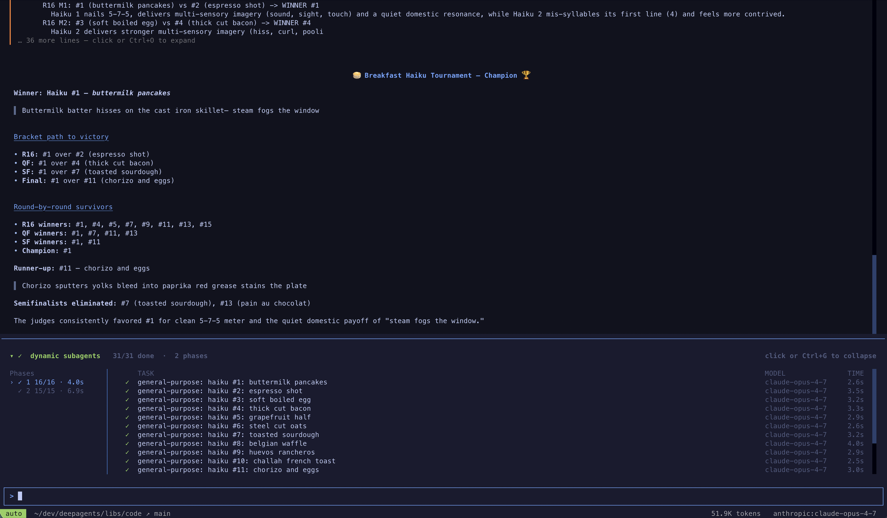
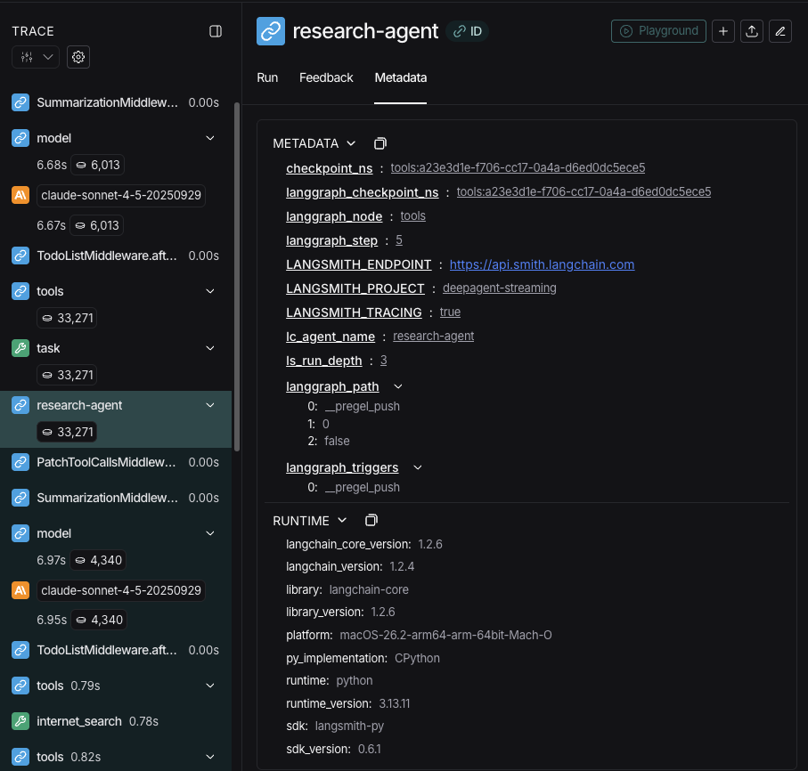

import SubagentBasicPy from '/langchain/snippets/code-samples/subagent-basic-py.mdx';
import SubagentBasicJs from '/langchain/snippets/code-samples/subagent-basic-js.mdx';
import SubagentStreamProgressPy from '/langchain/snippets/code-samples/subagent-stream-progress-py.mdx';
import SubagentStreamProgressJs from '/langchain/snippets/code-samples/subagent-stream-progress-js.mdx';
import SubagentsCompiledSubagentPy from '/langchain/snippets/code-samples/subagents-compiled-subagent-py.mdx';
import SubagentsCompiledSubagentJs from '/langchain/snippets/code-samples/subagents-compiled-subagent-js.mdx';
import ForkedSubagentsBasicPy from '/langchain/snippets/code-samples/forked-subagents-basic-py.mdx';
import ForkedSubagentsBasicJs from '/langchain/snippets/code-samples/forked-subagents-basic-js.mdx';
import DynamicSubagentsQuickstartPy from '/langchain/snippets/code-samples/dynamic-subagents-quickstart-py.mdx';
import DynamicSubagentsQuickstartJs from '/langchain/snippets/code-samples/dynamic-subagents-quickstart-js.mdx';
import DynamicSubagentsInvokePy from '/langchain/snippets/code-samples/dynamic-subagents-invoke-py.mdx';
import DynamicSubagentsInvokeJs from '/langchain/snippets/code-samples/dynamic-subagents-invoke-js.mdx';
import SubagentsStructuredOutputPy from '/langchain/snippets/code-samples/subagents-structured-output-py.mdx';
import SubagentsStructuredOutputJs from '/langchain/snippets/code-samples/subagents-structured-output-js.mdx';
import SubagentsGeneralPurposeOverridePy from '/langchain/snippets/code-samples/subagents-general-purpose-override-py.mdx';
import SubagentsGeneralPurposeOverrideJs from '/langchain/snippets/code-samples/subagents-general-purpose-override-js.mdx';
import SkillsSubagentsPy from '/langchain/snippets/code-samples/skills-subagents-py.mdx';
import SkillsSubagentsJs from '/langchain/snippets/code-samples/skills-subagents-js.mdx';
import SubagentsResearchPromptPy from '/langchain/snippets/code-samples/subagents-research-prompt-py.mdx';
import SubagentsResearchPromptJs from '/langchain/snippets/code-samples/subagents-research-prompt-js.mdx';
import SubagentsEmailToolsGoodPy from '/langchain/snippets/code-samples/subagents-email-tools-good-py.mdx';
import SubagentsEmailToolsGoodJs from '/langchain/snippets/code-samples/subagents-email-tools-good-js.mdx';
import SubagentsEmailToolsBadPy from '/langchain/snippets/code-samples/subagents-email-tools-bad-py.mdx';
import SubagentsEmailToolsBadJs from '/langchain/snippets/code-samples/subagents-email-tools-bad-js.mdx';
import SubagentsChooseModelsPy from '/langchain/snippets/code-samples/subagents-choose-models-py.mdx';
import SubagentsChooseModelsJs from '/langchain/snippets/code-samples/subagents-choose-models-js.mdx';
import SubagentsConciseResultsPy from '/langchain/snippets/code-samples/subagents-concise-results-py.mdx';
import SubagentsConciseResultsJs from '/langchain/snippets/code-samples/subagents-concise-results-js.mdx';
import SubagentsMultipleSpecializedPy from '/langchain/snippets/code-samples/subagents-multiple-specialized-py.mdx';
import SubagentsMultipleSpecializedJs from '/langchain/snippets/code-samples/subagents-multiple-specialized-js.mdx';
import SubagentsContextPropagationPy from '/langchain/snippets/code-samples/subagents-context-propagation-py.mdx';
import SubagentsContextPropagationJs from '/langchain/snippets/code-samples/subagents-context-propagation-js.mdx';
import SubagentsPerSubagentContextPy from '/langchain/snippets/code-samples/subagents-per-subagent-context-py.mdx';
import SubagentsPerSubagentContextJs from '/langchain/snippets/code-samples/subagents-per-subagent-context-js.mdx';
import SubagentsSharedLookupPy from '/langchain/snippets/code-samples/subagents-shared-lookup-py.mdx';
import SubagentsSharedLookupJs from '/langchain/snippets/code-samples/subagents-shared-lookup-js.mdx';
import SubagentsFlexibleSearchPy from '/langchain/snippets/code-samples/subagents-flexible-search-py.mdx';
import SubagentsFlexibleSearchJs from '/langchain/snippets/code-samples/subagents-flexible-search-js.mdx';
import SubagentsTroubleshootingDescriptionGoodPy from '/langchain/snippets/code-samples/subagents-troubleshooting-description-good-py.mdx';
import SubagentsTroubleshootingDescriptionGoodJs from '/langchain/snippets/code-samples/subagents-troubleshooting-description-good-js.mdx';
import SubagentsTroubleshootingDescriptionBadPy from '/langchain/snippets/code-samples/subagents-troubleshooting-description-bad-py.mdx';
import SubagentsTroubleshootingDescriptionBadJs from '/langchain/snippets/code-samples/subagents-troubleshooting-description-bad-js.mdx';
import SubagentsTroubleshootingDelegatePy from '/langchain/snippets/code-samples/subagents-troubleshooting-delegate-py.mdx';
import SubagentsTroubleshootingDelegateJs from '/langchain/snippets/code-samples/subagents-troubleshooting-delegate-js.mdx';
import SubagentsTroubleshootingConcisePromptPy from '/langchain/snippets/code-samples/subagents-troubleshooting-concise-prompt-py.mdx';
import SubagentsTroubleshootingConcisePromptJs from '/langchain/snippets/code-samples/subagents-troubleshooting-concise-prompt-js.mdx';
import SubagentsTroubleshootingFilesystemPromptPy from '/langchain/snippets/code-samples/subagents-troubleshooting-filesystem-prompt-py.mdx';
import SubagentsTroubleshootingFilesystemPromptJs from '/langchain/snippets/code-samples/subagents-troubleshooting-filesystem-prompt-js.mdx';
import SubagentsTroubleshootingDifferentiatePy from '/langchain/snippets/code-samples/subagents-troubleshooting-differentiate-py.mdx';
import SubagentsTroubleshootingDifferentiateJs from '/langchain/snippets/code-samples/subagents-troubleshooting-differentiate-js.mdx';

深度智能体可以创建子智能体来分派任务。您可以在 `subagents` 参数中指定自定义子智能体。子智能体适用于 [上下文隔离](https://www.dbreunig.com/2025/06/26/how-to-fix-your-context.html#context-quarantine)（保持主智能体的上下文纯净）以及提供专门指令的场景。

本页面介绍 **同步** 子智能体，即监督者会等待子智能体完成操作才会继续。对于长时间运行的任务、并行工作流或需要中途调整和取消的情况，请参考 [异步子智能体](/langchain/oss/deepagents/async-subagents)。



## 为什么使用子智能体？

子智能体解决**上下文膨胀问题**。当智能体使用具有大输出的工具（网络搜索、文件读取、数据库查询）时，上下文窗口会迅速被中间结果填满。子智能体隔离了这项详细工作——主智能体只接收最终结果，而不是产生它的几十个工具调用。

**何时使用子智能体：**
- ✅ 多步骤任务，会弄乱主智能体的上下文
- ✅ 需要自定义指令或工具的专业领域
- ✅ 需要不同模型能力的任务
- ✅ 当你想让主智能体专注于高级协调时

**何时**不**使用子智能体：**
- ❌ 简单的单步骤任务
- ❌ 当你需要维护中间上下文
- ❌ 当开销大于收益

## 配置

`subagents` 应该是一个字典列表或 @[`CompiledSubAgent`] 对象。有两种类型：

### 默认子智能体

Deep Agents 自动添加一个同步 `general-purpose` 子智能体，除非你已经提供了一个同名的同步子智能体。

`general-purpose` 子智能体默认具有文件系统工具，可以通过额外的工具/中间件进行自定义。

- 要替换它，请传递你自己的名为 `general-purpose` 的子智能体。
- 要重命名或重新提示自动添加的版本，请在活动的 [harness profile](/langchain/oss/deepagents/profiles#链配置) 上设置 `general_purpose_subagent=GeneralPurposeSubagentProfile(...)`。
- 要禁用它，请参阅下文的 [不使用子智能体](#不使用子智能体)。

### 不使用子智能体

要运行一个不使用 `task` 工具的智能体，请做两件事：

1. 在活动的 [harness profile](/langchain/oss/deepagents/profiles#链配置) 上设置 `general_purpose_subagent=GeneralPurposeSubagentProfile(enabled=False)`。
2. 通过 `subagents=` 在 `create_deep_agent` 上传递无同步子智能体。

Deep Agents 仅在至少存在一个同步子智能体时才附加 @[`SubAgentMiddleware`]（以及 `task` 工具）。如果没有默认的或调用者提供的，智能体将无代理运行。

异步子智能体不受影响——它们通过自己的中间件和工具运行，如 [异步子智能体](/langchain/oss/deepagents/async-subagents) 中所述。

<Tip>
    不要在这里使用 `excluded_middleware`——`SubAgentMiddleware` 是必需的框架结构，列出它会导致 `ValueError`。`general_purpose_subagent.enabled = False` 旋钮是支持路径。
</Tip>

## 自定义子智能体

你可以使用 `subagents` 参数定义具有特定工具的专用子智能体，例如作为代码审查员、网络研究员或测试运行器。

对于大多数用例，将子智能体定义为 [子智能体字典](#子智能体（基于字典）) 中的字典。对于复杂的工作流程，使用一个 [`CompiledSubAgent`](#编译子智能体)：

### 子智能体（基于字典）

将子智能体定义为与 @[`SubAgent`] 规范匹配的字典，包含以下字段：

:::python

| 字段 | 类型 | 描述 |
|------|------|------|
| `name` | `str` | 必填。子智能体的唯一标识符。主智能体在调用 `task()` 工具时使用此名称。子智能体名称成为 `AIMessage` 的元数据，并在流式输出中，有助于区分不同智能体。 |
| `description` | `str` | 必填。描述此子智能体做什么。具体且以行动为导向。主智能体使用此内容来决定何时委托。 |
| `system_prompt` | `str` | 必填，用于 `mode: "isolated"`（默认）。子智能体的指令。自定义隔离子智能体必须定义自己的。包含工具使用指南和输出格式要求。<br></br>不继承自主智能体。对于 `mode: "fork"`，除非你需要一个仅分叉的附加说明，否则省略此字段。参见 [分叉子智能体](#分叉子智能体)。 |
| `mode` | `"isolated"` \| `"fork"` | 可选。上下文模式。默认为 `"isolated"`，子智能体只看到委托的任务。设置为 `"fork"` 以继承父级对话和系统提示。参见 [分叉子智能体](#分叉子智能体)。 |
| `tools` | `list[Callable]` | 可选。子智能体可使用的工具。保持最小化，只包含所需的工具。<br></br>默认继承自主智能体。指定时，完全覆盖继承的工具。 |
| `model` | `str` \| `BaseChatModel` | 可选。覆盖主智能体的模型。省略则使用主智能体的模型。<br></br>默认继承自主智能体。你可以传递一个模型标识符字符串，如 `'openai:gpt-5.5'`（使用 `'provider:model'` 格式），或一个 LangChain 对话模型对象（`init_chat_model("gpt-5.5")` 或 `ChatOpenAI(model="gpt-5.5")`）。 |
| `middleware` | `list[Middleware]` | 可选。用于自定义行为、日志记录或速率限制的额外中间件。<br></br>隔离子智能体不继承主智能体的自定义中间件。对于分叉模式下的继承和覆盖，参见 [配置分叉子智能体](#配置分叉子智能体)。合并到 [同步子智能体堆栈](/langchain/oss/deepagents/customization#同步子智能体栈)：一个 `.name` 与默认匹配的实例会替换它，任何其他内容都会位于最后一个核心中间件条目之后，以及配置、提示缓存和记忆之前。参见 [覆盖默认中间件实例](/langchain/oss/deepagents/customization#覆盖默认中间件实例)。例如，在此处包含一个 @[`FilesystemMiddleware`] 实例，具有 `tools` 允许列表，以独立于主智能体限制子智能体的文件系统工具。更多信息，请参阅 [虚拟文件系统访问](/langchain/oss/deepagents/overview#虚拟文件系统访问) 下的“限制文件系统工具”部分。 |
| `interrupt_on` | `dict[str, bool \| InterruptOnConfig]` | 可选。为特定工具配置 [人机交互](/langchain/oss/deepagents/human-in-the-loop)。选项：`True`、`False` 或一个 `InterruptOnConfig`，其中包含 `allowed_decisions`。需要检查点。<br></br>默认继承自主智能体。子智能体值覆盖默认值。 |
| `skills` | `list[str]` | 可选。[技能](/langchain/oss/deepagents/skills) 源路径。指定时，子智能体从这些目录（例如，`["/skills/researcher/"]`，其子目录是技能的容器）加载技能。这允许子智能体具有与主智能体不同的技能集。<br></br>不继承自主智能体。仅通用子智能体继承主智能体的技能。当子智能体具有技能时，它运行自己的独立 @[`SkillsMiddleware`] 实例。技能状态完全隔离——子智能体加载的技能对父智能体不可见，反之亦然。 |
| `response_format` | `ResponseFormat` | 可选。[结构化输出](/langchain/oss/langchain/structured-output) 模式。设置时，父智能体将接收子智能体的结果作为 JSON 而不是自由文本。接受 Pydantic 模型、`ToolStrategy(...)`、`ProviderStrategy(...)` 或原始模式类型。参见 [结构化输出](#结构化输出)。 |
| `permissions` | `list[FilesystemPermission]` | 可选。[文件系统权限规则](/langchain/oss/deepagents/permissions)。设置时，**完全替换**父智能体的权限。<br></br>默认继承自主智能体。 |

:::

:::js


| 字段 | 类型 | 描述 |
|-------|------|-------------|
| `name` | `string` | 必填项。子智能体的唯一标识符。主智能体通过此名称调用 `task()` 工具。子智能体名称会成为 `AIMessage` 的元数据，并在流式输出中帮助区分智能体。 |
| `description` | `string` | 必填项。子智能体的功能描述。需具体且行动导向。主智能体据此决定何时委派任务。 |
| `systemPrompt` | `string` | 必填项（默认值 `mode: "isolated"`）。子智能体的指令。自定义隔离子智能体需自行定义。包含工具使用指导和输出格式要求。<br></br>不继承主智能体。对于 `mode: "fork"`，除非需要分支专用补充说明，否则无需此字段。参见 [分支子智能体](#分叉子智能体)。 |
| `mode` | `"isolated"` \| `"fork"` | 可选。上下文模式。默认为 `"isolated"`（子智能体仅可见委派任务）。设为 `"fork"` 以继承父智能体的对话和系统提示。参见 [分支子智能体](#分叉子智能体)。 |
| `tools` | `StructuredTool[]` | 可选。子智能体可调用的工具。需保持精简，仅包含必要工具。<br></br>默认继承主智能体工具。明确指定时将完全覆盖继承工具。 |
| `model` | `LanguageModelLike \| string` | 可选。覆盖主智能体的模型。省略则使用主智能体模型。<br></br>默认继承主智能体模型。可传入类似 `'openai:gpt-5.5'`（使用 `'provider:model'` 格式）的模型标识字符串，或 LangChain 对话模型对象（`await initChatModel("gpt-5.5")` 或 `new ChatOpenAI({ model: "gpt-5.5" })`）。 |
| `middleware` | `AgentMiddleware[]` | 可选。自定义中间件（如日志、限流）。<br></br>不继承主智能体。附加到 [同步子智能体栈](/langchain/oss/deepagents/customization#同步子智能体栈)。 |
| `interruptOn` | `Record<string, boolean \| InterruptOnConfig>` | 可选。针对特定工具配置 [人工介入](/langchain/oss/deepagents/human-in-the-loop)。选项： `True`、`False`。或包含 `InterruptOnConfig` 的 `allowed_decisions`。需检查点器。<br></br>默认继承主智能体。子智能体值将覆盖默认设置。 |
| `skills` | `string[]` | 可选。[技能](/langchain/oss/deepagents/skills) 源路径。指定后子智能体将从这些目录加载技能（如 `["/skills/research/", "/skills/web-search/"]`）。此功能使子智能体能拥有与主智能体不同的技能集。<br></br>不继承主智能体。通用型子智能体继承主智能体技能。当子智能体包含技能时，独立运行自己的 @[`SkillsMiddleware`] 实例。技能状态完全隔离——子智能体的加载技能对父智能体不可见，反之亦然。 |
| `responseFormat` | `ResponseFormat` | 可选。[结构化输出](/langchain/oss/langchain/structured-output) 模式。启用后父智能体以 JSON 格式接收子智能体结果而非自由文本。支持 Zod схемы、JSON schema 对象、 `toolStrategy(...)` 或 `providerStrategy(...)`。参见 [结构化输出](#结构化输出)。 |
| `permissions` | `FilesystemPermission[]` | 可选。[文件系统权限规则](/langchain/oss/deepagents/permissions)。启用后 **完全替换** 父智能体的权限。<br></br>默认继承主智能体权限。 |

:::

### 编译子智能体

对于复杂工作流，使用预构建的 LangGraph 图作为 @[`CompiledSubAgent`]：

| 字段 | 类型 | 描述 |
|-------|------|-------------|
| `name` | `str` | 必填项。子智能体的唯一标识符。子智能体名称会成为 `AIMessage` 的元数据，并在流式输出中帮助区分智能体。 |
| `description` | `str` | 必填项。子智能体的功能描述。 |
| `runnable` | `Runnable` | 必填项。需先调用 `.compile()` 的编译 LangGraph 图。 |
| `mode` | `"isolated"` \| `"fork"` | 可选。默认为 `"isolated"`。设为 `"fork"` 以继承父智能体的消息历史。编译图无论何种模式均保持自身系统提示。参见 [分支子智能体](#分叉子智能体)。 |

## 使用子智能体

:::python
<SubagentBasicPy />
:::

:::js
<SubagentBasicJs />
:::

## 使用编译子智能体

对于更复杂场景，可通过 @[`CompiledSubAgent`] 提供自定义子智能体。
可通过 LangChain 的 @[`create_agent`] 或通过 [图 API](/langchain/oss/langgraph/graph-api) 构建自定义 LangGraph 图创建自定义子智能体。

若通过 LangGraph 图构建，确保图包含名为 `"messages"` 的 [状态键](/langchain/oss/langgraph/quickstart#2-定义状态)：

:::python
<SubagentsCompiledSubagentPy />
:::

:::js
<SubagentsCompiledSubagentJs />
:::

## 分叉子智能体

默认情况下，子智能体以 `mode: "isolated"` 运行：它只能看到你给它的任务描述，并且没有关于导致委派之前的对话的记忆。一个 **分叉子智能体**（`mode: "fork"`）会继承父智能体的对话历史和状态。

当子智能体的任务是继续父智能体已经开始的工作时，请使用分叉子智能体，例如一个接手父智能体已经诊断出的修复工作的工人智能体，或者一个为事件调查起草事后总结的子智能体。由于分叉是设置在子智能体本身的模式，所以这是你在定义它时做出的决定。



:::python
<Note>
    子智能体分叉需要 `deepagents>=0.7.13`。它处于 [**beta**](/langchain/oss/versioning) 状态；API 和行为可能在版本之间发生变化。
</Note>
:::

:::js
<Note>
    子智能体分叉需要 `deepagents>=1.13.3`。它处于 [**beta**](/langchain/oss/versioning) 状态；API 和行为可能在版本之间发生变化。
</Note>
:::

### 配置分叉子智能体

:::python
在 @[`SubAgent`] 上设置 `mode: "fork"`（默认值为 `mode: "isolated"`）。你可以配置这些 @[`SubAgent`] 字段：
`name`、`description`、`tools`、`model`、`middleware`、`interrupt_on`、`permissions` 和 `response_format`。

分叉会继承传递给父智能体的 `create_deep_agent` 中的自定义中间件。子智能体的 `middleware` 列表中的中间件会替换继承的相同 `.name` 的实例。其他实例会被添加到子智能体的默认中间件堆栈中。

默认情况下，分叉会继承传递给父智能体的所有工具。设置 `tools` 以替换这些工具，而不是添加它们。例如，一个包含一个工具的列表会替换继承的列表为那个工具。文件系统和其他由中间件提供的工具会单独添加。

如果提供 `skills`，则会被拒绝。`system_prompt` 会被追加到父智能体继承的提示词中作为补充。除非你需要仅适用于分叉的指令，否则请保持它未设置。

一个 `wrap_model_call` 钩子通过 `request.system_message` 接收分叉继承的提示词。它可以使用 `request.override(system_message=...)` 重新编写分叉的传出请求，而不会改变父智能体的提示词。这与 `system_prompt` 不同，后者会追加指令。

避免重写共享继承前缀或修改工具定义，除非你接受缓存复用率降低和潜在模型成本上升。例如，此钩子片段会在继承前缀前添加文本，从而防止该前缀被复用：

```python
from langchain.messages import SystemMessage

rewritten = SystemMessage(content=[
    {"type": "text", "text": "You are a security auditor.\n"},
    *request.system_message.content_blocks,
])
return handler(request.override(system_message=rewritten))
```

附加中间件或追加指令并不必然阻止对未修改前缀的复用。

<ForkedSubagentsBasicPy />
:::

:::js
设置 `mode: "fork"` 为 @[`SubAgent`]（默认是 `mode: "isolated"`）。您可配置这些 @[`SubAgent`] 字段：
`name`, `description`, `tools`, `model`, `middleware`, `interruptOn`, `permissions`, 和 `responseFormat`。

分支继承父节点的技能；设置 `skills` 不受支持。

留空 `systemPrompt` 以使用父节点的提示词。若设置，其指令将追加到父节点提示词后，缩短跨服务提供商提示缓存中共享前缀的长度。因此，除非分支需要额外指令，否则不建议设置分支特定的系统提示。

默认情况下，分支继承父节点传递的所有工具。设置 `tools` 以替换而非追加这些工具。例如，包含单个工具的列表将替换继承的列表为该工具。文件系统和其他中间件提供的工具将单独追加。

<ForkedSubagentsBasicJs />
:::

### 工作原理

分支接收父节点的有效对话历史和委托任务描述。Deep Agents 会移除末尾的委托调用，并将任务描述与延续前导语附加。若父节点已压缩历史，分支将接收该压缩上下文，而非所有原始消息。

此处分支（forking）指继承委托工作的上下文，而非复制持久化线程的检查点历史。子智能体将接收为其调用的准备好的状态，且排除父节点独有字段。完成工作时，其回答作为普通工具结果返回，父节点继续处理。

:::python
```python
# What the parent has, right before delegating
[
    HumanMessage("Review the changes in PR #482"),
    AIMessage("", tool_calls=[{"name": "read_diff", "args": {"path": "src/auth/session.py"}}]),
    ToolMessage("- session tokens are logged in plaintext\n- no expiry check on refresh", tool_call_id="1"),
    AIMessage("Found two issues: session tokens are logged in plaintext, and there's no expiry check on refresh."),
    HumanMessage("Good catch. Draft review comments for those."),
    AIMessage("", tool_calls=[{"name": "task", "args": {"subagent_type": "comment-writer", "description": "Draft review comments for the two issues found above."}}]),
]

# What the fork actually sees
[
    HumanMessage("Review the changes in PR #482"),
    AIMessage("", tool_calls=[{"name": "read_diff", "args": {"path": "src/auth/session.py"}}]),
    ToolMessage("- session tokens are logged in plaintext\n- no expiry check on refresh", tool_call_id="1"),
    AIMessage("Found two issues: session tokens are logged in plaintext, and there's no expiry check on refresh."),
    HumanMessage("Good catch. Draft review comments for those."),
    HumanMessage("Continuing as the subagent that was just invoked. Draft review comments for the two issues found above."),
]
```
:::

:::js
```javascript
// What the parent has, right before delegating
[
  new HumanMessage("Review the changes in PR #482"),
  new AIMessage({ content: "", tool_calls: [{ name: "read_diff", args: { path: "src/auth/session.py" } }] }),
  new ToolMessage({ content: "- session tokens are logged in plaintext\n- no expiry check on refresh", tool_call_id: "1" }),
  new AIMessage("Found two issues: session tokens are logged in plaintext, and there's no expiry check on refresh."),
  new HumanMessage("Good catch. Draft review comments for those."),
  new AIMessage({ content: "", tool_calls: [{ name: "task", args: { subagentType: "comment-writer", description: "Draft review comments for the two issues found above." } }] }),
]

// What the fork actually sees
[
  new HumanMessage("Review the changes in PR #482"),
  new AIMessage({ content: "", tool_calls: [{ name: "read_diff", args: { path: "src/auth/session.py" } }] }),
  new ToolMessage({ content: "- session tokens are logged in plaintext\n- no expiry check on refresh", tool_call_id: "1" }),
  new AIMessage("Found two issues: session tokens are logged in plaintext, and there's no expiry check on refresh."),
  new HumanMessage("Good catch. Draft review comments for those."),
  new HumanMessage("Continuing as the subagent that was just invoked. Draft review comments for the two issues found above."),
]
```
:::

分支可复用父节点的提示缓存以匹配请求的前缀。修改系统提示、工具或早期消息会缩短跨服务提供商共享前缀的长度。保持分支配置不变以最大化复用，但缓存命中无法保证。

@[`CompiledSubAgent`] 支持 `mode: "fork"`，尽管它保留自己的系统提示，因为图已构建。

### 何时使用分支
从以下维度对比独立模式（默认）和分支模式：

| 维度 | 独立模式（默认） | 分支模式 |
|------|------------------|----------|
| **上下文** | 仅您传入的任务描述 | 父节点的有效对话历史、继承状态和任务描述 |
| **系统提示和技能** | 您在子智能体上设置 | 继承技能和父节点基础提示。可选系统提示可追加指令并减少缓存复用 |
| **调用其他子智能体** | 可使用 `task` 工具 | 不能使用 `task`；必须自行完成任务 |
| **适用场景** | 需要少量先验上下文的工作 | 继续父节点已启动的调查 |

## 动态子智能体

默认情况下，主智能体通过 `task` 工具调用委托子智能体（可单次调用并行执行多个）。附加 [解释器](/langchain/oss/deepagents/interpreters) 后，智能体可通过代码分发子智能体——使用循环、分支和并行批次将工作分散到多个项并程序化合成结果。这称为 [动态子智能体](/langchain/oss/deepagents/dynamic-subagents)。

当工作跨越多个独立单元（如审查目录下所有文件、分批处理工单）、需要多视角或受益于递归分析时，应使用动态子智能体。

<Warning>
    动态子智能体使用解释器运行时，该运行时处于 [**β版**](/langchain/oss/versioning)。API 和生命周期行为可能在版本间变更。
</Warning>

### 启用动态子智能体

当智能体同时具备子智能体和解释器中间件时，动态子智能体即可用。安装 QuickJS 解释器包，并在智能体中添加 `CodeInterpreterMiddleware`。

:::python
<CodeGroup>
```bash pip
pip install -U "deepagents[quickjs]"
```

```bash uv
uv add "deepagents[quickjs]"
```
</CodeGroup>

<DynamicSubagentsQuickstartPy />

<Note>
    动态子智能体分发默认开启，当智能体具备子智能体和解释器中间件时。传递 `CodeInterpreterMiddleware(subagents=False)` 以强制通过常规 `task` 工具路径分发。解释器需要 `langchain-quickjs>=0.2.0` 和 Python 3.11 或更高版本。
</Note>
:::

:::js
<CodeGroup>
```bash npm
npm install deepagents @langchain/quickjs
```

```bash pnpm
pnpm add deepagents @langchain/quickjs
```

```bash yarn
yarn add deepagents @langchain/quickjs
```
</CodeGroup>

<DynamicSubagentsQuickstartJs />

<Note>
    动态子智能体分发默认开启，当智能体具备子智能体和解释器中间件时。传递 `createCodeInterpreterMiddleware({ subagents: false })` 以强制通过常规 `task` 工具路径分发。
</Note>
:::

### 触发动态编排

动态分发是隐式的：智能体根据任务结构决定是否通过代码分散工作，而非依赖每调用标志。

<Tip>
    **"工作流" 是有效触发词。** 内置解释器系统提示将 "工作流" 视为组织工作的信号——通过 `task()` 从代码分发子智能体。将请求表述为 "工作流" 是主动启用动态编排的杠杆：在需要智能体通过代码分散工作时使用该表述。对于单次直接委托，应平铺表述请求。
</Tip>

例如，将请求表述为 "工作流" 即可启用代码级分散：

:::python
<DynamicSubagentsInvokePy />
:::

:::js
<DynamicSubagentsInvokeJs />
:::

配置高级编排模式和安全注意事项，请参阅 [动态子智能体](/langchain/oss/deepagents/dynamic-subagents)。

### 与编程智能体配合使用

使用 `dcode`（基于 Deep Agent 构建的 LangChain 终端编程智能体）是尝试动态子智能体的最快方式。其内置代码解释器已启用，无需额外配置即可使用。

安装 `dcode`：

```bash
curl -LsSf https://langch.in/dcode | bash
```

运行：

```bash
dcode
```

通过请求 "工作流" 触发动态子智能体。而非自行执行工作或通过原生 `task` 工具管理分散，智能体会编写调用内置 `task()` 全局的编排脚本来执行。例如："运行一个工作流来审查 src/ 中的所有文件是否存在 SQL 注入。"

作为子代理的创建，`dcode`会在动态子代理面板中实时显示它们，并按调度阶段分组。

<Frame>
  
</Frame>

`dcode` 是快速体验此功能的最佳方式，但您也可以在您选择的编程代理（例如通过 [ACP](/langchain/oss/deepagents/acp)（如 Zed））中启用动态子代理。

## 流式输出

深度代理支持从协调者和所有受托子代理处接收流式更新。

:::python
使用 [`stream_events`](/langchain/oss/deepagents/event-streaming) 获取类型化投影——分别为子代理、消息、工具调用和值提供独立迭代器，以便独立消费每个部分。
:::

:::js
使用 [`streamEvents`](/langchain/oss/deepagents/event-streaming) 获取类型化投影——分别为子代理、消息、工具调用和值提供独立迭代器，以便独立消费每个部分。
:::

### 跟踪子代理进度

最简单的模式是通过迭代 `stream.subagents` 跟踪每个受托任务从启动、运行到完成的整个过程。每个子代理句柄会暴露 `.name`、`.messages`、`.tool_calls` 和 `.output`。

:::python

<SubagentStreamProgressPy />

:::

:::js

<SubagentStreamProgressJs />

:::

### LangSmith 追踪

当深度代理运行时，所有由子代理或协调者执行的操作都会在元数据中添加代理名称（键为 `lc_agent_name`）。例如 `{'lc_agent_name': 'research-agent'}`。这允许您在 LangSmith 中通过子代理标识和过滤运行。



<Tip>
在 [LangSmith](https://smith.langchain.com) 中打开运行以比较协调者追踪与各子代理运行。按照 [可观测性快速入门](https://docs.langchain.com/langsmith/observability-quickstart) 配置环境。我们建议同时启用 [LangSmith Engine](https://docs.langchain.com/langsmith/engine) 以监控追踪、检测问题并推荐修复方案。
</Tip>

## 在 LangSmith 中按子代理过滤

由于每个子代理的 `name` 会将其元数据写入 `lc_agent_name` 键的每个运行结果中，您可以使用 LangSmith 的元数据过滤功能隔离特定子代理的所有运行——适用于调试、监控或对比子代理行为变化。

### 在 LangSmith UI 中过滤

1. 在 [LangSmith](https://smith.langchain.com) 中打开您的追踪项目。
2. 在追踪项目页切换视图为 **运行** 以查看独立跨度。
3. 点击 **添加过滤器** 并选择 **元数据**。
4. 设置 **键** 为 `lc_agent_name`，**值** 为子代理名称（例如 `coordinator`）。


这仅显示该子代理生成的运行。可将过滤器保存为命名视图以复用。如需完整过滤选项参考，请查阅 [过滤追踪](https://docs.langchain.com/langsmith/filter-traces)。

### 通过 SDK 程序性过滤

使用 LangSmith 过滤查询语言中的 `has` 比较器匹配元数据键值对：

```python
from langsmith import Client

client = Client()

runs = client.list_runs(
    project_name="<your-project>",
    filter='has(metadata, \'{"lc_agent_name": "research-agent"}\')',
)

for run in runs:
    print(run.name, run.start_time, run.status)
```

要获取所有非主代理的命名子代理运行，过滤具有 `lc_agent_name` 键的运行：

```python
runs = client.list_runs(
    project_name="<your-project>",
    filter="has(metadata, 'lc_agent_name')",
)
```
  
对于完整的筛选查询语言参考，请查看 [查询语句语法](https://docs.langchain.com/langsmith/trace-query-syntax)。  

## 结构化输出  

子智能体支持 [结构化输出](/langchain/oss/langchain/structured-output)，因此父智能体可以接收到可预测且可解析的JSON格式数据，而非自由格式的文本。  

:::python  
<Note>  
    子智能体的结构化输出需要 `deepagents>=0.5.3`。  
</Note>  

在子智能体配置中传递 `response_format`。当子智能体执行完毕，其结构化响应会被序列化为JSON并作为 `ToolMessage` 内容返回给父智能体。该方案支持任何由 @[`create_agent`] 支持的类型：Pydantic模型、`ToolStrategy(...)`、`ProviderStrategy(...)`，或原始 schema 类型。  

<SubagentsStructuredOutputPy />  

:::  

:::js  
<Note>  
    子智能体的结构化输出需要 `deepagents>=1.8.4`。  
</Note>  

在子智能体配置中传递 `responseFormat`。当子智能体执行完毕，其结构化响应会被序列化为JSON并作为 `ToolMessage` 内容返回给父智能体。该方案支持任何由 `createAgent` 支持的类型：Zod模式、JSON schema对象、`toolStrategy(...)`，或 `providerStrategy(...)`。  

<SubagentsStructuredOutputJs />  
:::  

未启用 `response_format` 时，父智能体会直接接收子智能体的最后消息文本。启用后，父智能体将始终获得与 schema 匹配的有效JSON，这在需要程序化处理结果或传递给下游工具时非常有用。  

对于 schema 类型及策略（工具调用 vs. 原生实现）的完整细节，请参考 [结构化输出](/langchain/oss/langchain/structured-output)。  

## 通用子智能体  

除用户自定义的子智能体外，每个深度智能体始终拥有一个 `general-purpose` 子智能体。该子智能体具备以下特性：  
- 使用经过 [用户资料叠加后的默认系统提示](/langchain/oss/deepagents/customization#系统提示词)  
- 访问与主智能体相同的工具集  
- 除非显式覆盖，否则使用相同模型  
- 继承主智能体的技能（当技能已配置时）  

### 覆盖通用子智能体  

:::python  
在 `subagents` 列表中包含一个具有 `name="general-purpose"` 属性的子智能体，以替换默认配置。此方式可用于为通用子智能体配置不同的模型、工具或系统提示：  

<SubagentsGeneralPurposeOverridePy />  
:::  

:::js  
在 `subagents` 列表中包含一个具有 `name: "general-purpose"` 属性的子智能体，以替换默认配置。此方式可用于为通用子智能体配置不同的模型、工具或系统提示：  

<SubagentsGeneralPurposeOverrideJs />  
:::  

当使用通用名称指定子智能体时，默认通用子智能体不会被添加。您的配置将完全覆盖默认实现。  

若需完全移除内置的通用子智能体（而非替换），请将活动 harness 账号的 `enabled` 标志设置为 `False`。  

### 使用场景  

通用子智能体适用于无需特殊行为的上下文隔离场景。主智能体可将复杂多步骤任务委托给该子智能体，并获取精炼的结果，而无需中间工具调用带来的冗余信息。  

<Card title="Example">  
    相较于主智能体执行10次网络搜索并填充上下文，采用通用子智能体可优化流程：`task(name="general-purpose", task="Research quantum computing trends")`。子智能体内部完成所有搜索操作，仅返回摘要。  
</Card>  

### 技能继承  

在配置 [技能](/langchain/oss/deepagents/skills) 时若启用 `create_deep_agent`：  
- **通用子智能体**：自动继承主智能体的技能  
- **自定义子智能体**：默认不继承技能——需通过 `skills` 参数为其配置独立技能

<Note>  
    带有技能配置的子智能体才能获得 `SkillsMiddleware` 实例——未配置 `skills` 参数的自定义子智能体不会。当存在时，技能状态在双向间完全隔离：父智能体的技能对子智能体不可见，子智能体的技能也不会回传至父智能体。  
</Note>  

:::python  
<SkillsSubagentsPy />  
:::  

:::js  
<SkillsSubagentsJs />  
:::  

## 最佳实践  

### 写清晰描述  

主智能体通过描述决定调用哪个子智能体。需具体说明：  

✅ **好的:** `"Analyzes financial data and generates investment insights with confidence scores"`  

❌ **坏的:** `"Does finance stuff"`  

### 保持系统提示详细  

包含使用工具的具体指导及输出格式规范：  

:::python  
<SubagentsResearchPromptPy />  
:::  

:::js  
<SubagentsResearchPromptJs />  
:::  

### 最小化工具集  

仅向子智能体提供其所需工具。这能提升专注度和安全性：  

:::python  
<SubagentsEmailToolsGoodPy />  
:::  

:::js  
<SubagentsEmailToolsGoodJs />  
:::  

:::python  
<SubagentsEmailToolsBadPy />  
:::  

:::js  
<SubagentsEmailToolsBadJs />  
:::  

### 根据任务选择模型  

不同模型擅长不同任务：  

:::python  
<SubagentsChooseModelsPy />  
:::  

:::js  
<SubagentsChooseModelsJs />  
:::  

### 返回简洁结果  

要求子智能体返回摘要而非原始数据：  

:::python  
<SubagentsConciseResultsPy />  
:::  

:::js  
<SubagentsConciseResultsJs />  
:::  

## 常见模式  

### 多个专业化子智能体  

为不同领域创建专业化子智能体：  

:::python  
<SubagentsMultipleSpecializedPy />  
:::  

:::js  
<SubagentsMultipleSpecializedJs />  
:::  

**工作流:**  
1. 主智能体创建高层计划  
2. 将数据采集委托给 data-collector  
3. 将结果传递给 data-analyzer  
4. 将洞察发送给 report-writer  
5. 整合最终输出  

每个子智能体仅处理与其任务相关的纯净上下文。  

## 上下文管理  

当通过 [运行时上下文](/langchain/oss/langchain/runtime) 调用父智能体时，该上下文会自动传播至所有子智能体。每个子智能体运行都将接收与父 `invoke` / `ainvoke` 调用相同的运行时上下文。  

这意味着任意子智能体内的工具均可访问父智能体提供的相同上下文值：  

:::python  
<SubagentsContextPropagationPy />  
:::  

:::js  
<SubagentsContextPropagationJs />  
:::  

### 子智能体专属上下文  

所有子智能体均接收相同父上下文。若需为特定子智能体传递配置，可通过以下方式之一：  
1. 使用命名空间键（例如 `researcher:max_depth`）在扁平 `context` 映射前缀键  
2. 将设置建模为上下文类型中的独立字段  

:::python  
<SubagentsPerSubagentContextPy />  
:::  

:::js  
<SubagentsPerSubagentContextJs />  
:::  

### 识别调用工具的子智能体  

当父智能体与多个子智能体共享相同工具时，可通过 `lc_agent_name` 元数据（与 [流式输出](#流式输出) 使用相同值）确定调用发起方：  

:::python  
<SubagentsSharedLookupPy />  
:::  

:::js  
<SubagentsSharedLookupJs />  
:::  

可结合两种模式：从 `runtime.context` 读取子智能体特定设置，并从 `runtime.config` 元数据读取 `lc_agent_name` 以分支工具行为。  

:::python  
<SubagentsFlexibleSearchPy />  
:::  

:::js  
<SubagentsFlexibleSearchJs />  
:::  

## 故障排查  

### 子智能体未被调用  

**问题**：主智能体自行处理任务而非委托。  

**解决方案**：  

1. **使描述更具体**：  

   :::python  
   <SubagentsTroubleshootingDescriptionGoodPy />  
   :::  

   :::js  
   <SubagentsTroubleshootingDescriptionGoodJs />  
   :::  

   :::python  
   <SubagentsTroubleshootingDescriptionBadPy />  
   :::  

   :::js  
   <SubagentsTroubleshootingDescriptionBadJs />  
   :::  

2. **明确指示主智能体委托**：  

   :::python  
   <SubagentsTroubleshootingDelegatePy />  
   :::  

   :::js  
   <SubagentsTroubleshootingDelegateJs />  
   :::  

### 上下文仍持续膨胀  

**问题**：使用子智能体后上下文仍膨胀。  

**解决方案**：  

1. **要求子智能体返回简洁结果**：  

   :::python  
   <SubagentsTroubleshootingConcisePromptPy />  
   :::  

   :::js  
   <SubagentsTroubleshootingConcisePromptJs />  
   :::  

2. **使用文件系统存储大数据**：  

   :::python  
   <SubagentsTroubleshootingFilesystemPromptPy />  
   :::  

   :::js  
   <SubagentsTroubleshootingFilesystemPromptJs />  
   :::  

### 错误子智能体被选中  

**问题**：主智能体调用与任务不匹配的子智能体。  

**解决方案**：在描述中清晰区分子智能体：  

:::python  
<SubagentsTroubleshootingDifferentiatePy />  
:::  

:::js  
<SubagentsTroubleshootingDifferentiateJs />  
:::

---

> 官方原文：[src/oss/deepagents/subagents.mdx](https://github.com/langchain-ai/docs/blob/main/src/oss/deepagents/subagents.mdx) · 译文由 AI 生成，以英文原文为准。
