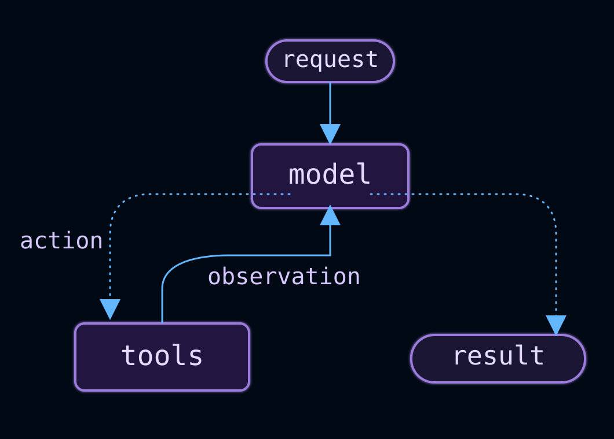
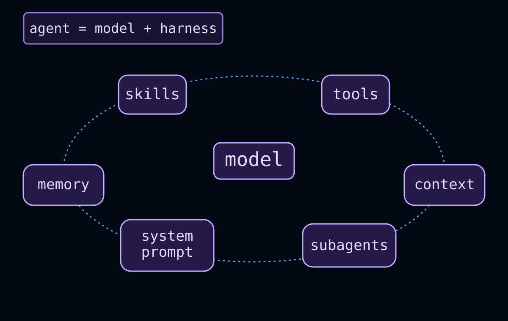
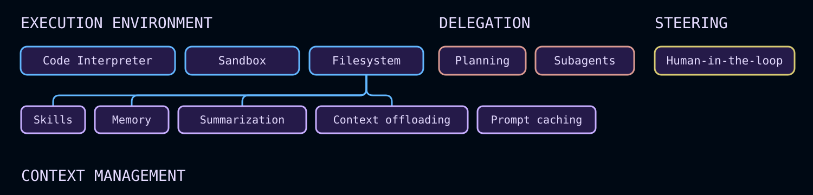

import AgentInvocationThreadAndContextJs from '/langchain/snippets/code-samples/agent-invocation-thread-and-context-js.mdx';
import AgentInvocationThreadAndContextPy from '/langchain/snippets/code-samples/agent-invocation-thread-and-context-py.mdx';
import AgentInvocationThreadIdJs from '/langchain/snippets/code-samples/agent-invocation-thread-id-js.mdx';
import AgentInvocationThreadIdPy from '/langchain/snippets/code-samples/agent-invocation-thread-id-py.mdx';
import AgentsAgentStateJs from '/langchain/snippets/code-samples/agents-agent-state-js.mdx';
import AgentsAgentStatePy from '/langchain/snippets/code-samples/agents-agent-state-py.mdx';
import AgentsContextManagementJs from '/langchain/snippets/code-samples/agents-context-management-js.mdx';
import AgentsContextManagementPy from '/langchain/snippets/code-samples/agents-context-management-py.mdx';
import AgentsExecutionEnvironmentJs from '/langchain/snippets/code-samples/agents-execution-environment-js.mdx';
import AgentsExecutionEnvironmentPy from '/langchain/snippets/code-samples/agents-execution-environment-py.mdx';
import AgentsFaultToleranceJs from '/langchain/snippets/code-samples/agents-fault-tolerance-js.mdx';
import AgentsFaultTolerancePy from '/langchain/snippets/code-samples/agents-fault-tolerance-py.mdx';
import AgentsGuardrailsJs from '/langchain/snippets/code-samples/agents-guardrails-js.mdx';
import AgentsGuardrailsPy from '/langchain/snippets/code-samples/agents-guardrails-py.mdx';
import AgentsIntroJs from '/langchain/snippets/code-samples/agents-intro-js.mdx';
import AgentsIntroPy from '/langchain/snippets/code-samples/agents-intro-py.mdx';
import AgentsModelJs from '/langchain/snippets/code-samples/agents-model-js.mdx';
import AgentsModelPy from '/langchain/snippets/code-samples/agents-model-py.mdx';
import AgentsNameJs from '/langchain/snippets/code-samples/agents-name-js.mdx';
import AgentsNamePy from '/langchain/snippets/code-samples/agents-name-py.mdx';
import AgentsPlanningDelegationJs from '/langchain/snippets/code-samples/agents-planning-delegation-js.mdx';
import AgentsPlanningDelegationPy from '/langchain/snippets/code-samples/agents-planning-delegation-py.mdx';
import AgentsSteeringJs from '/langchain/snippets/code-samples/agents-steering-js.mdx';
import AgentsSteeringPy from '/langchain/snippets/code-samples/agents-steering-py.mdx';
import AgentsStreamingProgressJs from '/langchain/snippets/code-samples/agents-streaming-progress-js.mdx';
import AgentsStreamingProgressPy from '/langchain/snippets/code-samples/agents-streaming-progress-py.mdx';
import AgentsStructuredOutputJs from '/langchain/snippets/code-samples/agents-structured-output-js.mdx';
import AgentsStructuredOutputPy from '/langchain/snippets/code-samples/agents-structured-output-py.mdx';
import AgentsSystemPromptJs from '/langchain/snippets/code-samples/agents-system-prompt-js.mdx';
import AgentsSystemPromptPy from '/langchain/snippets/code-samples/agents-system-prompt-py.mdx';
import AgentsToolsJs from '/langchain/snippets/code-samples/agents-tools-js.mdx';
import AgentsToolsPy from '/langchain/snippets/code-samples/agents-tools-py.mdx';

智能体是一个在循环中调用工具，直到给定任务完成的模型。



智能体框架是围绕这个循环的所有内容：提示词、工具以及任何塑造模型行为的中间件。

<Note>
**智能体 = 模型 + 框架**

框架的工作：在正确的时间为给定任务获取模型正确的上下文。
</Note>

@[`create_agent`] 是一个高度可配置的框架。最简单的情况下，你可以使用以下方式创建一个：

:::python

<AgentsIntroPy />

:::
:::js

<AgentsIntroJs />

:::

在此基础上，你可以直接使用 `model=`、`tools=` 和 `system_prompt=` 参数配置基本设置。对于更高级的功能，通过 [中间件](#配置执行框架)扩展框架。

<Tip>
[管理式深度智能体](https://docs.langchain.com/langsmith/managed-deep-agents-overview)基于 `create_agent`构建，并已预装常用功能，如规划、文件系统工具、子智能体和记忆。在最大程度灵活性的同时使用相同的深度智能体框架，可以使用 [深度智能体](/langchain/oss/deepagents/overview)自行托管智能体，或运行自定义的 [LangSmith 部署](https://docs.langchain.com/langsmith/deployment)。当你需要自行配置较小的框架时，使用 `create_agent`。
</Tip>

## 核心组件



### 模型

传递模型标识符字符串（`"provider:model"`）或已初始化的模型实例来选择智能体的模型。参见 [模型](/langchain/oss/langchain/models)了解参数、提供者设置和动态模型选择。

:::python

<AgentsModelPy />

:::
:::js

<AgentsIntroJs />

:::

### 工具

为了向智能体提供工具，传递任何 Python 可调用对象、LangChain 工具或工具字典。参见 [工具](/langchain/oss/langchain/tools)了解工具定义、上下文访问和动态工具选择。

:::python

<AgentsToolsPy />

:::
:::js

<AgentsToolsJs />

:::

### 系统提示词

塑造智能体处理任务的方式。系统提示词参数接受字符串或 `SystemMessage`。对于运行时的动态提示词，使用 [中间件](/langchain/oss/langchain/middleware)。

:::python

<AgentsSystemPromptPy />

:::
:::js

<AgentsSystemPromptJs />

:::

### 结构化输出

使用 `response_format=` 从智能体返回验证的架构。参见 [结构化输出](/langchain/oss/langchain/structured-output)了解策略和示例。

:::python

<AgentsStructuredOutputPy />

:::
:::js

<AgentsStructuredOutputJs />

:::

### 智能体状态

:::python
每个智能体通过 @[`AgentState`管理其执行上下文，这是一个类型化的字典，包含当前对话历史和你的工具及中间件需要的任何自定义字段。

内置字段是：

| 字段 | 类型 | 描述 |
|-------|------|-------------|
| `messages` | `list[BaseMessage]` | 当前线程的完整对话历史。仅追加：新消息被添加，从不替换。 |

`AgentState`也是每个节点式中间件钩子（`before_model`、`after_model`及类似的）的类型签名。钩子接收当前状态，并可以返回一个要合并回其中的更新字典。

要添加自定义字段（例如，一个 `user_id` 或计数器），子类化 `AgentState` 并通过 `state_schema=`将子类传递给 `create_agent`：

<AgentsAgentStatePy />

有关完整详细信息、示例和中间件级别的状态架构，参见 [短期记忆](/langchain/oss/langchain/short-term-memory#定制化智能体记忆)和 [自定义中间件](/langchain/oss/langchain/middleware/custom#状态更新)。
:::

:::js
每个智能体通过一个 `AgentState` 对象管理其执行上下文，该对象包含当前对话历史和你的工具及中间件需要的任何自定义字段。

内置字段是：

| 字段 | 类型 | 描述 |
|-------|------|-------------|
| `messages` | `BaseMessage[]` | 当前线程的完整对话历史。仅追加：新消息被添加，从不替换。 |

`AgentState`也是传递给每个节点式中间件钩子（`beforeModel`、`afterModel`及类似的）的类型。钩子接收当前状态，并可以返回一个要合并回其中的更新对象。

要添加自定义字段，在中间件上使用 `stateSchema`定义状态架构，使用 `StateSchema`或 Zod 对象：

<AgentsAgentStateJs />

有关完整详细信息、示例和中间件级别的状态架构，参见 [短期记忆](/langchain/oss/langchain/short-term-memory#定制化智能体记忆)和 [自定义中间件](/langchain/oss/langchain/middleware/custom#状态更新)。
:::

## 调用

<Tip>
使用 [LangSmith](https://smith.langchain.com)跟踪此循环的每个步骤、调试工具调用并评估智能体输出。遵循 [跟踪快速入门](https://docs.langchain.com/langsmith/trace-with-langchain)进行设置。我们建议你同时设置 [LangSmith 引擎](https://docs.langchain.com/langsmith/engine)，它监控你的跟踪、检测问题并提出修复建议。
</Tip>

:::python
你可以使用消息调用智能体。在后台，这会将更新传递给智能体的 [`State`](/langchain/oss/langgraph/graph-api#状态)。所有智能体在其状态中都包含一个 [消息序列](/langchain/oss/langgraph/use-graph-api#消息状态)；要调用智能体，传递一条新消息以及一个 `thread_id`，以便智能体可以持久化并恢复对话历史：
:::
:::js
你可以使用消息调用智能体。在后台，这会将更新传递给智能体的 [`State`](/langchain/oss/langgraph/graph-api#状态)。所有智能体在其状态中都包含一个 [消息序列](/langchain/oss/langgraph/use-graph-api#消息值)；要调用智能体，传递一条新消息以及一个 `thread_id`，以便智能体可以持久化并恢复对话历史：
:::

:::python

<AgentInvocationThreadIdPy />

:::
:::js

<AgentInvocationThreadIdJs />

:::

<Note>
使用 `thread_id`持久化对话历史需要将智能体配置为具有一个 [检查点](/langchain/oss/langchain/long-term-memory)。在 [LangSmith](https://docs.langchain.com/langsmith/deployment)上部署时，检查点会自动配置。本地，显式传递一个，例如 `create_agent(..., checkpointer=InMemorySaver())`。
</Note>

:::python
如果你还需要将每次运行的配置（例如用户 ID、API 密钥或功能标志）传递给工具和中间件，将 `context` 与 `config` 一起传递。使用 `context_schema`定义该数据的形状，并通过 `runtime.context`访问它：

<AgentInvocationThreadAndContextPy />

`thread_id`作用域化*对话*（消息历史、检查点），而 `context`携带*每次运行*的数据，你的工具和中间件在调用时读取。两者通常一起传递。参见 [工具上下文](/langchain/oss/langchain/tools#上下文)和 [运行时](/langchain/oss/langchain/runtime)了解更多。
:::
:::js
如果你还需要将每次运行的配置（例如用户 ID、API 密钥或功能标志）传递给工具和中间件，将 `context`与配置一起传递。使用 `contextSchema`定义该数据的形状，并通过 `runtime.context`访问它：

<AgentInvocationThreadAndContextJs />

`thread_id` 限定 *对话*（消息历史、检查点），而 `context` 携带 *每运行* 数据，在调用时供工具和中间件读取。两者通常一起传递。更多内容请参考 [工具上下文](/langchain/oss/langchain/tools#上下文) 和 [运行时](/langchain/oss/langchain/runtime)。
:::

## 流式输出

`invoke` 在运行结束时返回最终响应。如果智能体执行多个工具调用，用户通常需要在完成前获得进度更新。使用流式输出以实时显示中间消息和工具活动。

:::python

<AgentsStreamingProgressPy />

:::
:::js

<AgentsStreamingProgressJs />

:::

<Tip>
关于流式模式、事件类型和 UI 模式，请参考 [流式输出](/langchain/oss/langchain/streaming)。
</Tip>

## 配置执行框架

`create_agent` 具有高度可扩展性。中间件是定制的原语：每个组件处理一个关注点，在智能体循环的正确时刻挂钩，并可以自由地与其他组件组合。根据您的用例需求选择所需部分，忽略其余部分。

常见的模式已作为一等中间件预构建。您可以构建任何其他 [自定义中间件](/langchain/oss/langchain/middleware/custom)。



随着智能体承担复杂工作，它们需要在几个关键领域获得支持。中间件生态系统提供：

<CardGroup cols={2}>
  <Card title="Execution environment" icon="bolt" href="#execution-environment">
    工具、文件系统、沙盒和代码执行
  </Card>
  <Card title="Context management" icon="database" href="#context-management">
    摘要、记忆、技能和提示词缓存
  </Card>
  <Card title="Planning and delegation" icon="sitemap" href="#planning-and-delegation">
    待办事项列表和子智能体，用于并行、隔离的工作
  </Card>
  <Card title="Fault tolerance" icon="shield" href="#fault-tolerance">
    重试、回退和调用限制
  </Card>
  <Card title="Guardrails" icon="lock" href="#guardrails">
    PII 检测和内容控制
  </Card>
  <Card title="Steering" icon="user" href="#steering">
    在高影响操作前进行人工审核
  </Card>
</CardGroup>

<Tip>
`create_deep_agent` 预组装此堆栈，用于长时间运行的编码和研究任务（默认包含文件系统、摘要、子智能体和提示词缓存）。请参考 [深度智能体](/langchain/oss/deepagents/harness) 了解完整的预构建执行框架。
</Tip>

### 执行环境

当智能体不仅能生成文本还能采取行动时，它们特别有用。执行环境为智能体提供工作空间：可调用的工具、跨回合的读写文件系统，以及用于运行脚本或 Shell 命令的代码执行。

:::python

<AgentsExecutionEnvironmentPy />

:::
:::js

<AgentsExecutionEnvironmentJs />

:::

请参考 @[`FilesystemMiddleware`]、[沙盒](/langchain/oss/deepagents/sandboxes)、[解释器](/langchain/oss/deepagents/interpreters)。

<Note>
此示例从 `deepagents` 包中导入。使用以下命令安装它：

:::python
<CodeGroup>
  ```bash pip
  pip install deepagents
  ```

  ```bash uv
  uv add deepagents
  ```
</CodeGroup>
:::
:::js
<CodeGroup>
  ```bash npm
  npm install deepagents
  ```

  ```bash yarn
  yarn add deepagents
  ```

  ```bash pnpm
  pnpm add deepagents
  ```
</CodeGroup>
:::
</Note>

### 上下文管理

每个模型调用都有一个固定的上下文窗口。随着智能体运行，该窗口会因累积的历史记录、工具结果和中间步骤而填满。摘要会在溢出发生前压缩历史记录；记忆在启动时加载持久指令，以便知识跨会话传递；技能按需提取领域知识，而不是预先加载所有内容。

:::python

<AgentsContextManagementPy />

:::
:::js

<AgentsContextManagementJs />

:::

请参考 @[`SummarizationMiddleware`]、@[`MemoryMiddleware`]、[技能](/langchain/oss/langchain/multi-agent/skills)、[上下文工程](/langchain/oss/deepagents/context-engineering)。

<Note>
此示例从 `deepagents` 包中导入。使用以下命令安装它：

:::python
<CodeGroup>
  ```bash pip
  pip install deepagents
  ```

  ```bash uv
  uv add deepagents
  ```
</CodeGroup>
:::
:::js
<CodeGroup>
  ```bash npm
  npm install deepagents
  ```

  ```bash yarn
  yarn add deepagents
  ```

  ```bash pnpm
  pnpm add deepagents
  ```
</CodeGroup>
:::
</Note>

### 规划和委托

复杂任务通常超出单个上下文窗口的处理能力。委托允许主智能体将工作分解为多个部分，将它们交给各自在隔离上下文中运行的子智能体，并专注于协调而非执行。工作可以并行运行；主智能体的上下文保持干净。

:::python
<AgentsPlanningDelegationPy />
:::
:::js
<AgentsPlanningDelegationJs />
:::

请参考 [子智能体](/langchain/oss/langchain/multi-agent/subagents)。

<Note>
此示例从 `deepagents` 包中导入。使用以下命令安装它：

:::python
<CodeGroup>
  ```bash pip
  pip install deepagents
  ```

  ```bash uv
  uv add deepagents
  ```
</CodeGroup>
:::
:::js
<CodeGroup>
  ```bash npm
  npm install deepagents
  ```

  ```bash yarn
  yarn add deepagents
  ```

  ```bash pnpm
  pnpm add deepagents
  ```
</CodeGroup>
:::
</Note>

### 为智能体命名

可选地使用标识符为智能体命名。这在将智能体嵌入 [多智能体](/langchain/oss/langchain/multi-agent) 系统作为子图时特别有用。

:::python

<AgentsNamePy />

:::
:::js

<AgentsNameJs />

:::

### 容错

生产环境中的智能体会遇到开发中很少出现的故障：速率限制、模型超时、瞬态 API 错误。容错中间件在基础设施级别处理这些问题，因此您的工具和业务逻辑无需在每次调用时都使用 try/catch。

:::python
<AgentsFaultTolerancePy />
:::
:::js
<AgentsFaultToleranceJs />
:::

:::python
请参考 @[`ModelRetryMiddleware`]、@[`ToolRetryMiddleware`]、[预构建中间件](/langchain/oss/langchain/middleware/built-in)。
:::

:::js
请参考 @[`modelRetryMiddleware`]、@[`toolRetryMiddleware`]、[预构建中间件](/langchain/oss/langchain/middleware/built-in)。
:::

### 安全约束

某些策略无法存在于提示词中——它们需要无论模型做什么都强制执行确定性。安全约束在数据通过智能体循环时拦截，在工具结果到达模型的上下文之前应用合规规则或内容策略。

:::python
<AgentsGuardrailsPy />
:::
:::js
<AgentsGuardrailsJs />
:::

:::python
请参考 @[`PIIMiddleware`]、[预构建中间件](/langchain/oss/langchain/middleware/built-in)。
:::

:::js
请参考 @[`piiMiddleware`]、[预构建中间件](/langchain/oss/langchain/middleware/built-in)。
:::

### 引导

完全自主并不总是合适的。引导允许您在特定决策点放置人类——在破坏性写入、昂贵 API 调用或任何需要判断的操作之前——而无需重构您的智能体。智能体暂停并等待；人类批准、编辑或拒绝；然后继续执行。

:::python
<AgentsSteeringPy />
:::
:::js
<AgentsSteeringJs />
:::

:::python
请参考 @[`HumanInTheLoopMiddleware`]、[人工审核](/langchain/oss/langchain/human-in-the-loop)。
:::

:::js
请参考 @[`humanInTheLoopMiddleware`]、[人工审核](/langchain/oss/langchain/human-in-the-loop)。
:::

### 中间件资源

<CardGroup cols={3}>
  <Card title="Middleware overview" icon="route" href="/langchain/oss/langchain/middleware/overview" arrow>
    中间件堆栈的工作原理和挂钩触发时机
  </Card>
  <Card title="Prebuilt middleware" icon="package" href="/langchain/oss/langchain/middleware/built-in" arrow>
    带配置示例的完整参考
  </Card>
  <Card title="Custom middleware" icon="code" href="/langchain/oss/langchain/middleware/custom" arrow>
    为业务逻辑、PII 清洗等编写自己的挂钩
  </Card>
</CardGroup>

---

> 官方原文：[src/oss/langchain/agents.mdx](https://github.com/langchain-ai/docs/blob/main/src/oss/langchain/agents.mdx) · 译文由 AI 生成，以英文原文为准。
