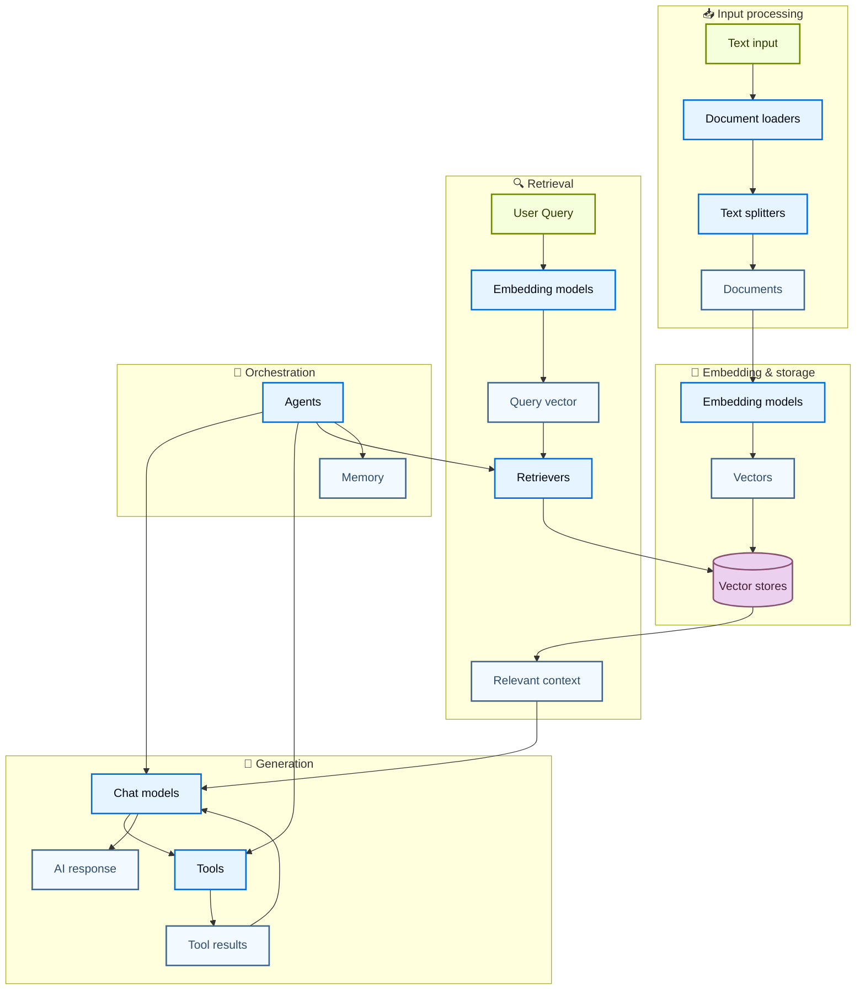
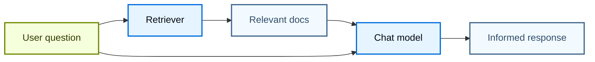
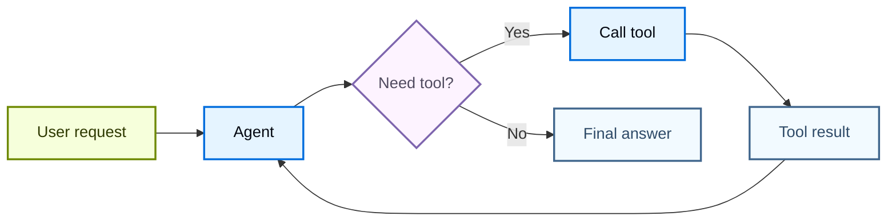
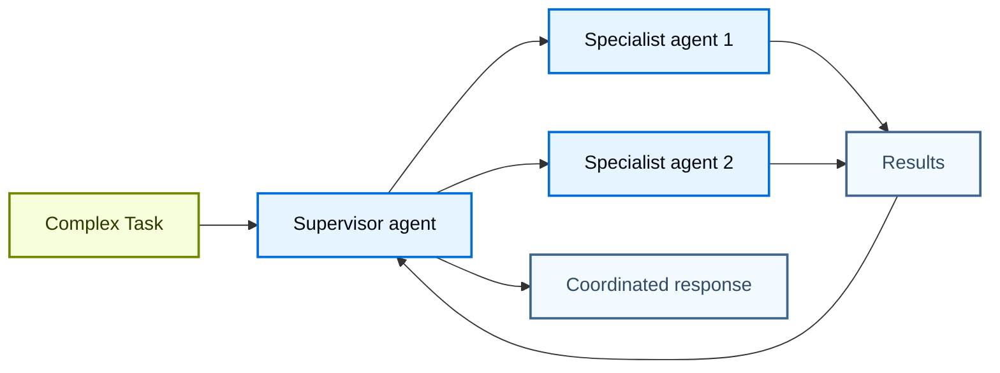

LangChain 的强大之处在于其组件如何协同工作以构建复杂的 AI 应用程序。本页面通过组件关系图展示不同组件之间的交互。

## 核心组件生态

以下架构图展示了 LangChain 主要组件如何连接以构建完整 AI 应用：

### 组件连接方式

每个组件层级都建立在先前组件之上：

1. **输入处理** – 将原始数据转换为结构化文档
2. **嵌入与存储** – 将文本转换为可检索的向量表示
3. **检索** – 根据用户查询查找相关信息
4. **生成** – 使用 AI 模型生成响应（可选集成工具）
5. **编排** – 通过智能体和记忆系统协调所有环节

## 组件分类

LangChain 将组件划分为以下主要类别：

| 类别 | 目的 | 关键组件 | 应用场景 |
|------|------|----------|----------|
| **[Models](/langchain/oss/langchain/models)** | AI 推理与生成 | 对话模型、大语言模型、嵌入模型 | 文本生成、推理、语义理解 |
| **[Tools](/langchain/oss/langchain/tools)** | 外部能力 | API、数据库等 | 网页搜索、数据访问、计算任务 |
| **[Agents](/langchain/oss/langchain/agents)** | 编排与推理 | ReAct 智能体、工具调用智能体 | 非确定性工作流、决策制定 |
| **[Memory](/langchain/oss/langchain/short-term-memory)** | 上下文保留 | 消息历史、自定义状态 | 对话、状态化交互 |
| **[Retrievers](/langchain/oss/python/integrations/retrievers)** | 信息访问 | 向量检索器、网页检索器 | RAG、知识库搜索 |
| **[Document processing](/langchain/oss/python/integrations/document_loaders)** | 数据摄入 | 加载器、分割器、转换器 | PDF 处理、网页抓取 |
| **[Vector Stores](/langchain/oss/python/integrations/vectorstores)** | 语义搜索 | Chroma、Pinecone、FAISS | 相似度搜索、嵌入存储 |

## 常见模式

### RAG（检索增强生成）

### 工具集成智能体

### 多智能体系统

## 深入学习

- [创建智能体](/langchain/oss/langchain/agents)
- [使用工具](/langchain/oss/langchain/tools)
- [浏览集成](/langchain/oss/python/integrations/providers/overview)

---

> 官方原文：[src/oss/langchain/component-architecture.mdx](https://github.com/langchain-ai/docs/blob/main/src/oss/langchain/component-architecture.mdx) · 非官方翻译，译文由 AI 生成，以英文原文为准。
