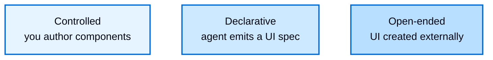

生成式 UI 是指智能体的输出呈现超出文本的用户界面。与其将段落流式传输到聊天气泡中，智能体驱动表单、卡片、仪表板和交互控件。这使得您的 UI 能够像应用程序一样传达结果，而智能体决定展示什么以及何时展示。

生成式 UI 不是一个单一的技术。它由一个问题定义的范围：**谁编写界面？** 一端是你编写每个组件，智能体仅从中选择。另一端，界面完全在您的应用程序外部创建。沿着范围推进以表达范围为代价换取可预测性。

## 生成式 UI 范围

该范围从对每个像素的完全控制到智能体的完全自主性，使用三种主要方法：

  更多控制
  

  更多自主性

从左到右移动，可预测性和按能力工程成本都会下降，而智能体的表达范围会增长。可访问性和视觉一致性在左侧最容易保证，在右侧最难保证。

### 受控

你编写组件，智能体选择渲染哪个组件以及传递什么数据。这提供了最高的可预测性和对品牌和可访问性的最严格控制，代价是为你想要展示的每个能力编写组件。它是生成式 UI 的工作horse，并且是高流量、品牌关键表面的合适选择，例如机票和预订确认，其中布局必须精确。您的组件库是边界：智能体只能渲染您交付的内容。受控生成式 UI 涵盖组件作为工具、工具调用渲染、状态渲染和推理。

详细内容请参阅 [受控生成式 UI](/langchain/oss/langchain/frontend/controlled-generative-ui)。

### 声明式

智能体发出结构化规范，前端从您提前注册的组件目录中组合界面。目录充当护栏和边界：智能体可以自由地排列和组合您的组件，但不能超出您批准的集合。这就是长尾的所在。它以像素级完美为代价换取广度，适用于次要交互、内部工具和仪表板，在这些场景中，展示有用内容比精确控制更重要。[声明式生成式 UI](/langchain/oss/langchain/frontend/declarative-generative-ui) 使用 [json-render](https://json-render.dev) 涵盖这一点；通过 CopilotKit 集成的 Google 的 A2UI 提供相同的形状，具有动态和固定模式变体。

### 开放式

智能体拥有画布。界面在您的应用程序外部创建，例如由 MCP 服务器创建，并在沙盒中渲染。这提供了最宽的表达范围，并且可以在您不编写前端代码的情况下添加新的界面功能，适用于一次性可视化和定制答案，其中令人惊讶且足够好的结果比可预测的结果更有优势。它也是最实验性的方法：最不确定，并且最难保证可访问性、一致性和安全性，因此 UI 必须隔离。沙盒和您的提示词是边界。

详细内容请参阅 [开放式生成式 UI](/langchain/oss/langchain/frontend/open-ended-generative-ui)。

## 选择方法

从您需要如何限制界面开始：

| 如果您需要... | 选择 |
| --- | --- |
| 为已知输出保证品牌、布局和可访问性 | [受控](/langchain/oss/langchain/frontend/controlled-generative-ui) |
| 让智能体使用仅批准的组件组合新布局 | [声明式](/langchain/oss/langchain/frontend/declarative-generative-ui) |
| 展示由第三方编写的界面，而无需自己构建 | [开放式](/langchain/oss/langchain/frontend/open-ended-generative-ui) |

为整个产品选择单一方法是常见的错误。实际应用程序混合方法，并根据每个表面的目的匹配每个表面：受控组件用于高流量、品牌关键的核心，声明式组合用于次要交互的长尾，开放式嵌入用于第三方功能。单个会话可以跨越所有三种方法。

该范围也适用于聊天之外。这三种方法同样描述了移动设备和 Slack 或电子邮件等界面，而不仅限于聊天记录。

## 探索范围

<CardGroup cols={3}>
  <Card title="Controlled" icon="components" href="/langchain/oss/langchain/frontend/controlled-generative-ui">
    编写组件；智能体选择渲染哪个组件以及传递什么数据。
  </Card>
  <Card title="Declarative" icon="schema" href="/langchain/oss/langchain/frontend/declarative-generative-ui">
    智能体发出规范；前端从注册的目录中组合。
  </Card>
  <Card title="Open-ended" icon="world" href="/langchain/oss/langchain/frontend/open-ended-generative-ui">
    渲染在别处创建的 UI，例如沙盒中的 MCP 应用。
  </Card>
</CardGroup>

---

> 官方原文：[src/oss/langchain/frontend/generative-ui-overview.mdx](https://github.com/langchain-ai/docs/blob/main/src/oss/langchain/frontend/generative-ui-overview.mdx) · 译文由 AI 生成，以英文原文为准。
