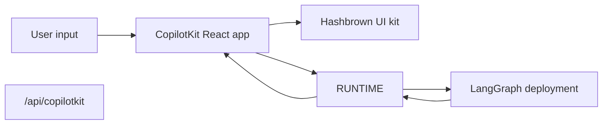

[CopilotKit](https://www.copilotkit.ai/) 提供了一个完整的 React 对话运行时，并且与 LangGraph 配合得非常好，当你希望智能体返回 **结构化的 UI 负载** 而不仅仅是纯文本时。前端与 CopilotKit 运行时 URL 通信，并将助手消息解析为动态的 React 组件。

:::js
在这种模式中，你的 LangGraph 部署在同一进程中提供图 API 和自定义的 CopilotKit 端点。
:::

:::python
在这种模式中，你的 LangGraph 部署提供图 API 和一个 AG-UI FastAPI 桥接器。一个小型的 Node CopilotKit 运行时位于该桥接器前面，React 客户端调用的是这个运行时。
:::

在服务器端，[copilotkit](https://pypi.org/project/copilotkit/) 包提供了 [`CopilotKitMiddleware`](https://docs.copilotkit.ai)，使得 LangGraph 图、LangChain 智能体或 [Deep Agent](/langchain/oss/deepagents/overview) 可以使用 [Agent UI (AG-UI)](https://docs.ag-ui.com/) 线协议，向对话 UI 流式传输工具和消息事件，并读取或写入共享的 **CopilotKit** 状态切片。TypeScript 设置通常将 CopilotKit 运行时挂载在图 API 旁边。Python 设置在部署上挂载 AG-UI FastAPI 桥接器，并在其前面以 Node 运行 CopilotKit 运行时。

当你需要以下功能时，这种方法是很有用的：

- 一个现成的对话运行时，而不是自己接线 `stream.messages`
- 一个自定义服务器端点，可以在你部署的图旁边添加特定提供者的行为
- 从受限的组件注册表中渲染的结构化生成式 UI

[CopilotKit for LangGraph](https://docs.copilotkit.ai/langgraph) 还记录了 [generative UI](https://docs.copilotkit.ai/langgraph/generative-ui)、[human in the loop](https://docs.copilotkit.ai/langgraph/human-in-the-loop)（HITL）和 [shared state](https://docs.copilotkit.ai/langgraph/shared-state)，它们基于相同的中间件和客户端。

<Info>
  对于 CopilotKit 特定的 API、UI 模式和运行时配置，请参阅
  [CopilotKit 文档](https://docs.copilotkit.ai/langgraph)。有关 Deep Agent 演示，请参阅
  [Deep Agents and CopilotKit](https://docs.copilotkit.ai/langgraph/deep-agents)（位于 CopilotKit 文档中）。
</Info>

import { ExampleEmbed } from "/langchain/snippets/example-embed.jsx"
import ChannelsTsconfig from "/langchain/snippets/code-samples/copilotkit-channels-tsconfig.mdx"
import ChannelsAgent from "/langchain/snippets/code-samples/copilotkit-channels-agent-js.mdx"
import ChannelsChannel from "/langchain/snippets/code-samples/copilotkit-channels-channel-js.mdx"

<ExampleEmbed example="copilotkit" minHeight={700} />

## 工作原理

从高层次来看，CopilotKit 位于你的 React 应用和 LangGraph 部署之间。

:::js
前端将对话状态发送到与图 API 挂载在同一处的自定义 `/api/copilotkit` 路由。该路由将请求转发给 LangGraph，响应返回助手消息以及任何你的组件注册表可以渲染的结构化 UI 负载。

1. **像平常一样部署图**，使用 LangSmith 或使用 LangGraph 开发服务器。
2. **扩展部署**，挂载一个与图 API 并排的 CopilotKit 路由的 HTTP 应用。
3. **将前端包装在 `CopilotKit`** 中，并将其指向该自定义运行时 URL。
4. **注册动态 UI 组件**，在渲染时将助手响应解析为这些组件。
:::

:::python
前端将对话状态发送到 Node CopilotKit 运行时。该运行时调用你的 LangGraph 部署上的 AG-UI FastAPI 桥接器，响应返回助手消息以及任何你的组件注册表可以渲染的结构化 UI 负载。

1. **像平常一样部署图**，使用 LangSmith 或使用 LangGraph 开发服务器。
2. **扩展部署**，挂载一个与图 API 并排的 AG-UI FastAPI 桥接器的 HTTP 应用。
3. **运行一个 Node CopilotKit 运行时**，它指向一个 `HttpAgent`，然后对前端使用 `CopilotKit` 来对抗运行时 URL。
4. **注册动态 UI 组件**，在渲染时将助手响应解析为这些组件。
:::



:::python
在 Python 中，CopilotKit 运行时是一个单独的 Node 进程。LangGraph 部署仅托管图 API 和 AG-UI FastAPI 桥接器。参见 [Add the CopilotKit runtime](#添加-copilotkit-运行时)。
:::

:::python
## Python 服务器上你获得的内容

[copilotkit](https://pypi.org/project/copilotkit/) 和相关包桥接了 LangGraph 部署和 CopilotKit 客户端。

| 组件 | 角色 |
| --------- | ---- |
| `CopilotKitMiddleware` | 合并 CopilotKit 和 AG-UI 状态和请求到你的智能体，包括前端 [tool calls](/langchain/oss/langchain/agents#工具) 和上下文。将其添加到 `middleware` 列表中用于 @[create_agent] 或 @[create_deep_agent] |
| `CopilotKitState` (子类) | [自定义状态](/langchain/oss/langchain/short-term-memory)：扩展 `CopilotKitState`，使 CopilotKit 键成为图状态的一部分。 |
| `LangGraphAGUIAgent` | 将编译后的图与名称和描述捆绑在一起，供运行时使用。 |
| `add_langgraph_fastapi_endpoint` (来自 [ag-ui-langgraph](https://pypi.org/project/ag-ui-langgraph/)) | 在你的图相同的 [LangGraph](/langchain/oss/langgraph/overview) 进程上连接一个 **FastAPI** AG-UI 桥接器。使用 [在 `langgraph.json` 中的自定义 `http` 应用](#使用自定义端点扩展-langgraph-部署) 挂载它。React 客户端仍然需要一个单独的 Node [CopilotKit runtime](#添加-copilotkit-运行时)，它通过 AG-UI 调用此桥接器。 |

`CopilotKitMiddleware` 是 @[create_deep_agent] 和添加到 `middleware` 列表中的 @[create_agent] 图的相同中间件。对于具有 `CopilotKitState` 和 FastAPI 桥接器的 `create_agent` 图，请遵循下面 [Python `main.py` 示例](#使用自定义端点扩展-langgraph-部署)。结构化生成式 UI（例如 `useAgentContext` 和来自客户端的 `output_schema`）需要额外的中间件，该中间件将 Copilot 状态映射到 [结构化输出](/langchain/oss/langchain/agents#结构化输出) 策略，如同一节中可展开的 `src/middleware.py` 示例所示。

在 `langgraph.json` 中的 `http` 键上挂载 `app` 遵循通常的 [LangGraph 或 LangSmith 部署](/langchain/oss/langgraph/deploy)：一个进程托管图 API 和 AG-UI FastAPI 桥接器。CopilotKit React 客户端与 Node 运行时通信，该运行时调用该桥接器。
:::

## 安装

对于后端端点：

:::js
```bash
bun add @copilotkit/runtime hono
```
:::

:::python
```bash
uv add copilotkit ag-ui-langgraph fastapi uvicorn
```

中间件包与 Deep Agents 堆栈并排。使用你的 [chat model](/langchain/oss/python/integrations/chat) 包安装它（此示例使用 OpenAI）：

<CodeGroup>
```python pip
pip install -U deepagents copilotkit langchain-openai
```

```python uv
uv add deepagents copilotkit langchain-openai
```
</CodeGroup>

前端调用的 CopilotKit 运行时是一个 Node 包，因此 Python 设置还需要一个小型 Node 服务器。下面的 pin 是一个已知的良好组合。如果你升级 `@copilotkit/runtime`，安装发布列表中作为依赖项的 `@ag-ui/client` 版本，以便 `HttpAgent` 类型匹配：

```bash
bun add @copilotkit/runtime@1.73.3 @ag-ui/client@0.0.59
```
:::

对于前端应用：

```bash
bun add @copilotkit/react-core @copilotkit/react-ui @hashbrownai/core @hashbrownai/react
```

:::python
## 使用 Deep Agent 与 CopilotKit

将 `CopilotKitMiddleware` 添加到您传递给 @[create_deep_agent] 的 `middleware` 列表中。该中间件允许 CopilotKit 路由前端工具调用，并将聊天状态与您的图对齐。保留您配置的其他 [中间件](/langchain/oss/deepagents/customization#中间件) 在同一列表中。

然后，编译好的图即可连接到 CopilotKit 或 AG-UI 兼容的流程（例如，下方的 [FastAPI 模式](#使用自定义端点扩展-langgraph-部署)）或 CopilotKit 文档中的 [深度智能体和 CopilotKit](https://docs.copilotkit.ai/langgraph/deep-agents) 这样的指南。如果您在 `graphs` 中将导出的智能体列在 `langgraph.json` 下，则不要传递检查点器。下方的 [FastAPI 示例](#使用自定义端点扩展-langgraph-部署) 仅在 AG-UI 路由副本上附加检查点器。

```python
from deepagents import create_deep_agent
from copilotkit import CopilotKitMiddleware


def get_weather(location: str) -> str:
    """Return a simple weather string for a location."""
    return f"The weather in {location} is sunny."


agent = create_deep_agent(
    model="openai:gpt-5.5",
    tools=[get_weather],
    middleware=[CopilotKitMiddleware()],  # AG-UI, frontend tools, and context
    system_prompt="You are a helpful research assistant.",
)
```
:::

## 使用自定义端点扩展 LangGraph 部署

关键思想是 LangGraph 部署不仅提供图，还可以加载 HTTP 应用，这允许您在部署本身旁边挂载额外的路由。

在 `langgraph.json` 中，将 `http.app` 指向您的自定义应用入口点：

:::js
```json
{
  "graphs": {
    "copilotkit_shadify": "./src/agents/copilotkit-shadify.ts:agent"
  },
  "http": {
    "app": "./src/api/app.ts:app"
  }
}
```
:::

:::python
```json
{
  "dependencies": ["."],
  "graphs": {
    "copilotkit_shadify": "./main.py:agent"
  },
  "http": {
    "app": "./main.py:app"
  }
}
```
:::

:::js
然后创建 Hono 应用并注册 CopilotKit 路由：

```ts app.ts
import { Hono } from "hono";
import { registerCopilotKit } from "./copilotkit.js";

export const app = new Hono();

registerCopilotKit(app);
```
:::

:::python
在 Python 中，创建一个 `FastAPI` 应用并通过 CopilotKit 的 AG-UI 桥接器暴露 LangGraph 智能体：

```python main.py
from typing import Any, TypedDict

from ag_ui_langgraph import add_langgraph_fastapi_endpoint
from copilotkit import CopilotKitMiddleware, CopilotKitState, LangGraphAGUIAgent
from fastapi import FastAPI
from langchain.agents import create_agent
from langgraph.checkpoint.memory import MemorySaver

from src.middleware import apply_structured_output_schema, normalize_context


class AgentState(CopilotKitState):
    pass


class AgentContext(TypedDict, total=False):
    output_schema: dict[str, Any]


agent = create_agent(
    model="openai:gpt-5.5",
    middleware=[
        normalize_context,
        CopilotKitMiddleware(),
        apply_structured_output_schema,
    ],
    context_schema=AgentContext,
    state_schema=AgentState,
    system_prompt=(
        "You are a helpful UI assistant. Build visual responses using the "
        "available components."
    ),
)

app = FastAPI()

add_langgraph_fastapi_endpoint(
    app=app,
    agent=LangGraphAGUIAgent(
        name="copilotkit_shadify",
        description="A UI assistant that returns structured component payloads.",
        # The AG-UI bridge reads graph state, so this route needs a checkpointer.
        graph=agent.copy(update={"checkpointer": MemorySaver()}),
    ),
    path="/",
)
```

AG-UI 桥接器在每个运行时读取图的状态，因此 FastAPI 路由后面的图需要一个检查点器。保留检查点器不在 `agent` 上：`agent` 也列在 `graphs` 下，`langgraph dev` 拒绝加载带有自己检查点器的列出的图，因为 LangGraph API 为列出的图处理持久化。带有 `MemorySaver` 的副本仅服务 FastAPI 路由。其线程驻留在进程内存中，因此在重启时不会存活，不会跨副本共享，也不会出现在部署的线程 API 中。对于此路由的生产流量，请传递一个持久的 [检查点器](/langchain/oss/langgraph/persistence)。
:::

:::js
这个自定义应用是重要的扩展点：它挂载了一个 CopilotKit 兼容的运行时，而没有替换底层的 LangGraph 部署。
:::

:::python
这个自定义应用是重要的扩展点：它挂载了 AG-UI FastAPI 桥接器，而没有替换底层的 LangGraph 部署。Node CopilotKit 运行时保持独立；参见 [添加 CopilotKit 运行时](#添加-copilotkit-运行时)。
:::

:::js
在该路由内部，创建一个 `CopilotRuntime` 并使用 `LangGraphAgent` 将其指向部署的图：

```ts expandable copilotkit.ts
import { type Hono } from "hono";

import { createCopilotEndpointSingleRoute, CopilotRuntime } from "@copilotkit/runtime/v2";
import { LangGraphAgent } from "@copilotkit/runtime/langgraph";

const defaultAgentHost = process.env.LANGGRAPH_DEPLOYMENT_URL || "http://127.0.0.1:2024";
const agentUrl = defaultAgentHost.startsWith("http")
  ? defaultAgentHost
  : `http://${defaultAgentHost}`;

class BridgedLangGraphAgent extends LangGraphAgent {
  override prepareRunAgentInput(
    input: Parameters<LangGraphAgent["prepareRunAgentInput"]>[0],
  ): ReturnType<LangGraphAgent["prepareRunAgentInput"]> {
    const prepared = super.prepareRunAgentInput(input);

    return {
      ...prepared,
      context: normalizeCopilotContext(prepared.context) as ReturnType<
        LangGraphAgent["prepareRunAgentInput"]
      >["context"],
    };
  }

  override async getAssistant(): Promise<Awaited<ReturnType<LangGraphAgent["getAssistant"]>>> {
    const assistants = await this.client.assistants.search({
      graphId: this.graphId,
      limit: 100,
    });

    const assistant = assistants.find((candidate) => candidate.graph_id === this.graphId);
    if (assistant) {
      return assistant;
    }

    return super.getAssistant();
  }
}

export function registerCopilotKit(app: Hono) {
  const runtime = new CopilotRuntime({
    agents: {
      default: new BridgedLangGraphAgent({
        deploymentUrl: agentUrl,
        graphId: "copilotkit_shadify",
      }),
    },
  });

  const copilotApp = createCopilotEndpointSingleRoute({
    runtime,
    basePath: "/api/copilotkit",
  });

  app.route("/", copilotApp);
}

function normalizeCopilotContext(context: unknown): unknown {
  if (!Array.isArray(context)) {
    return context;
  }

  const normalizedEntries = context.flatMap((item) => {
    if (!item || typeof item !== "object") {
      return [];
    }

    const entry = item as { description?: unknown; value?: unknown };
    return typeof entry.description === "string" ? [[entry.description, entry.value] as const] : [];
  });

  return Object.fromEntries(normalizedEntries);
}
```

路由适配器只是 TypeScript 设置的一半。您的 LangChain 智能体还需要中间件来读取转发的 `output_schema`，并将其转换为模型所需的结构化 `responseFormat`：

```ts expandable agent.ts
import { createAgent, createMiddleware, toolStrategy } from "langchain";
import { z } from "zod";

import { deepSearchTool, searchWebTool } from "../tools/index.js";

const contextSchema = z.object({
  output_schema: z.unknown().optional(),
});

const structuredOutputMiddleware = createMiddleware({
  name: "CopilotKitStructuredOutput",
  contextSchema,
  wrapModelCall: async (request, handler) => {
    const rawOutputSchema = getRuntimeOutputSchema(request.runtime);
    const schema = normalizeOutputSchema(rawOutputSchema);
    if (!schema) {
      return handler(request);
    }

    const responseFormat = toolStrategy(
      schema as unknown as Parameters<typeof toolStrategy>[0],
      {
        toolMessageContent: "Structured UI response generated.",
      },
    );

    return handler({
      ...request,
      responseFormat,
    });
  },
});

export const agent = createAgent({
  model: process.env.COPILOTKIT_MODEL ?? "google:gemini-3.6-flash",
  contextSchema,
  middleware: [structuredOutputMiddleware],
  tools: [searchWebTool, deepSearchTool],
  systemPrompt: `You are a helpful UI assistant inspired by the CopilotKit Shadify example.

Build rich visual responses with the available UI components when they add value.
Only wrap actual UI layouts inside cards. Plain Markdown answers should stay as Markdown.
Use rows for side-by-side layouts with at most two columns.
Prefer simple, polished outputs over dense dashboards.
When using charts, make labels and values concise and easy to read.
When showing code, prefer the code_block component.
When researching topics, use the available search tools first and then present the result cleanly.`,
});

function normalizeOutputSchema(value: unknown): Record<string, unknown> | null {
  let schema = value;

  if (typeof schema === "string") {
    try {
      schema = JSON.parse(schema);
    } catch {
      return null;
    }
  }

  if (!schema || typeof schema !== "object" || Array.isArray(schema)) {
    return null;
  }

  const normalized = { ...(schema as Record<string, unknown>) };

  if (!normalized.title) {
    normalized.title = "CopilotKitStructuredOutput";
  }

  if (!normalized.description) {
    normalized.description = "Structured response schema for the CopilotKit preview.";
  }

  return normalized;
}

function getRuntimeOutputSchema(runtime: {
  context?: { output_schema?: unknown };
  configurable?: Record<string, unknown>;
}): unknown {
  if (runtime.context?.output_schema !== undefined) {
    return runtime.context.output_schema;
  }

  const configurable = runtime.configurable;
  if (!configurable || typeof configurable !== "object" || Array.isArray(configurable)) {
    return undefined;
  }

  return configurable.output_schema;
}
```

这就是 `useAgentContext({ description: "output_schema", ... })` 在前端有用的原因。CopilotKit 运行时转发模式，而智能体将其转换为模型必须遵循的结构化输出契约。
:::

:::python
在 Python 中，等效的工作在中间件中完成：规范化 CopilotKit 上下文并将 `output_schema` 从 `useAgentContext(...)` 转发到模型的结构化输出配置。Hashbrown 生成的模式没有顶层 `title`，而 OpenAI 集成需要一个来命名结构化输出模式，因此中间件在缺少 `title` 和 `description` 时会填充它们。

```python expandable src/middleware.py
import json
from collections.abc import Mapping

from langchain.agents.middleware import before_agent, wrap_model_call
from langchain.agents.structured_output import ProviderStrategy


@wrap_model_call
async def apply_structured_output_schema(request, handler):
    schema = None
    runtime = getattr(request, "runtime", None)
    runtime_context = getattr(runtime, "context", None)

    if isinstance(runtime_context, Mapping):
        schema = runtime_context.get("output_schema")

    if schema is None and isinstance(getattr(request, "state", None), dict):
        copilot_context = request.state.get("copilotkit", {}).get("context")
        if isinstance(copilot_context, list):
            for item in copilot_context:
                if isinstance(item, dict) and item.get("description") == "output_schema":
                    schema = item.get("value")
                    break

    if isinstance(schema, str):
        try:
            schema = json.loads(schema)
        except json.JSONDecodeError:
            schema = None

    if isinstance(schema, dict):
        # OpenAI uses the top-level title as the structured output name.
        schema = {
            **schema,
            "title": schema.get("title") or "CopilotKitStructuredOutput",
            "description": schema.get("description")
            or "Structured response schema for the CopilotKit preview.",
        }
        request = request.override(
            response_format=ProviderStrategy(schema=schema, strict=True),
        )

    return await handler(request)


@before_agent
def normalize_context(state, runtime):
    copilotkit_state = state.get("copilotkit", {})
    context = copilotkit_state.get("context")

    if isinstance(context, list):
        normalized = [
            item.model_dump() if hasattr(item, "model_dump") else item
            for item in context
        ]
        return {"copilotkit": {**copilotkit_state, "context": normalized}}

    return None
```
:::

结果是清晰的职责分离：

- LangGraph 仍然拥有图执行和持久化
- CopilotKit 拥有面向聊天的运行时契约
- 您的自定义端点在一个部署内部将它们粘合在一起

:::python
### 添加 CopilotKit 运行时

FastAPI 路由使用的是 AG-UI 协议，而不是 CopilotKit 运行时协议，因此前端不能直接调用它：将 `runtimeUrl` 指向 FastAPI 路由会失败并显示 `runtime_info_fetch_failed`。在小型 Node 服务器中运行 [CopilotKit 运行时](https://docs.copilotkit.ai/langgraph)，并将一个 `HttpAgent` 指向 FastAPI 路由。Python 图和中间件仍然定义工具行为和智能体逻辑。

```ts server.ts
import { createServer } from "node:http";

import { HttpAgent } from "@ag-ui/client";
import { CopilotRuntime } from "@copilotkit/runtime/v2";
import { createCopilotNodeListener } from "@copilotkit/runtime/v2/node";

// The FastAPI route is mounted at the root of the LangGraph deployment.
const agentUrl = process.env.LANGGRAPH_DEPLOYMENT_URL || "http://127.0.0.1:2024";

const runtime = new CopilotRuntime({
  agents: {
    default: new HttpAgent({ url: agentUrl }),
  },
});

createServer(
  createCopilotNodeListener({
    runtime,
    basePath: "/api/copilotkit",
    cors: true,
  }),
).listen(4000);
```

在 LangGraph 部署旁边启动运行时：

```bash
bun server.ts
```

运行时在端口 4000 上提供 `/api/copilotkit`。将前端指向它，可以通过设置 `VITE_RUNTIME_URL=http://localhost:4000/api/copilotkit` 或从您的开发服务器将 `/api/copilotkit` 代理到端口 4000。

这个运行时是基本的内应用集成。[通道](#通道) 不使用 FastAPI 路由：它通过部署的图 API 使用 `LangGraphAgent` 连接到图。
:::

## 结构化前端应用

在前端，将您的应用包装在 `CopilotKit` 中，并将其指向自定义运行时 URL：

```tsx
import { CopilotKit } from "@copilotkit/react-core";
import { CopilotChat, useAgentContext } from "@copilotkit/react-core/v2";
import { s } from "@hashbrownai/core";

import { useChatKit } from "@/components/chat/chat-kit";
import { chatTheme } from "@/lib/chat-theme";

export function App() {
  return (
    <CopilotKit runtimeUrl={import.meta.env.VITE_RUNTIME_URL ?? "/api/copilotkit"}>
      <Page />
    </CopilotKit>
  );
}

function Page() {
  const chatKit = useChatKit();

  useAgentContext({
    description: "output_schema",
    value: s.toJsonSchema(chatKit.schema),
  });

  return <CopilotChat {...chatTheme} />;
}
```

这里有两个重要的部分：

- `runtimeUrl="/api/copilotkit"` 将聊天发送到您的自定义后端路由，而不是直接发送到原始 LangGraph API
- `useAgentContext(...)` 将 UI 模式发送给智能体，以便模型知道它应该生成什么结构化输出格式

## 注册动态组件

组件注册表位于 `useChatKit()`。这是您定义智能体允许发出的组件集的地方，例如卡片、行、列、图表、代码块和按钮。

```tsx
import { s } from "@hashbrownai/core";
import { exposeComponent, exposeMarkdown, useUiKit } from "@hashbrownai/react";

import { Button } from "@/components/ui/button";
import { Card } from "@/components/ui/card";
import { CodeBlock } from "@/components/ui/code-block";
import { Row, Column } from "@/components/ui/layout";
import { SimpleChart } from "@/components/ui/simple-chart";

export function useChatKit() {
  return useUiKit({
    components: [
      exposeMarkdown(),
      exposeComponent(Card, {
        name: "card",
        description: "Card to wrap generative UI content.",
        children: "any",
      }),
      exposeComponent(Row, {
        name: "row",
        props: {
          gap: s.string("Tailwind gap size") as never,
        },
        children: "any",
      }),
      exposeComponent(Column, {
        name: "column",
        children: "any",
      }),
      exposeComponent(SimpleChart, {
        name: "chart",
        props: {
          labels: s.array("Category labels", s.string("A label")),
          values: s.array("Numeric values", s.number("A value")),
        },
        children: false,
      }),
      exposeComponent(CodeBlock, {
        name: "code_block",
        props: {
          code: s.streaming.string("The code to display"),
          language: s.string("Programming language") as never,
        },
        children: false,
      }),
      exposeComponent(Button, {
        name: "button",
        children: "text",
      }),
    ],
  });
}
```

这个注册表成为智能体和 UI 之间的契约。模型不是生成任意的 JSX。它生成必须针对您暴露的组件和属性进行验证的结构化数据。

## 将助手消息渲染为动态 UI

一旦助手响应到达，自定义消息渲染器决定如何显示它。在这个示例中：

- 助手消息被解析为针对 UI 套件模式的结构化 JSON
- 有效的结构化输出被渲染为真实的 React 组件
- 用户消息被渲染为普通的聊天气泡

```tsx
import type { AssistantMessage } from "@ag-ui/core";
import type { RenderMessageProps } from "@copilotkit/react-ui";
import { useJsonParser } from "@hashbrownai/react";
import { memo } from "react";

import { useChatKit } from "@/components/chat/chat-kit";
import { Squircle } from "@/components/squircle";

const AssistantMessageRenderer = memo(function AssistantMessageRenderer({
  message,
}: {
  message: AssistantMessage;
}) {
  const kit = useChatKit();
  const { value } = useJsonParser(message.content ?? "", kit.schema);

  if (!value) return null;

  return (
    <div className="group/msg mt-2 flex w-full justify-start">
      <div className="magic-text-output w-full px-1 py-1">{kit.render(value)}</div>
    </div>
  );
});

export function CustomMessageRenderer({ message }: RenderMessageProps) {
  if (message.role === "assistant") {
    return <AssistantMessageRenderer message={message} />;
  }

  return (
    <div className="flex w-full justify-end">
      <Squircle className="w-full max-w-[64ch] px-4 py-3">
        <pre>{typeof message.content === "string" ? message.content : JSON.stringify(message.content, null, 2)}</pre>
      </Squircle>
    </div>
  );
}
```

这种渲染模式使集成感觉原生：

- CopilotKit 处理聊天状态和传输
- 自定义渲染器决定助手有效载荷如何成为 UI
- [Hashbrown](https://hashbrown.dev/) 将验证的结构化数据转换为具体的 React 元素

## 通道

同一个驱动您内应用 Copilot 的智能体也可以作为 Slack 和其他消息平台的机器人运行。[CopilotKit 通道](https://docs.copilotkit.ai/channels) 通过管理的 CopilotKit 智能连接将您的 LangChain 智能体连接到消息平台：智能连接持有平台凭证和消息传递，而您的进程运行智能体。

<Note>
  通道需要 `@copilotkit/channels` 0.6.1 和 `@copilotkit/runtime` 1.65.0，作为经过测试的对一起安装，并在长期运行的宿主机上使用 Node.js 22 或更高版本。通道连接的 LangChain 部署可以是 Python 或 TypeScript。
</Note>

<Info>
  本页面展示了通道如何与 LangChain 智能体协同工作。有关使用 LangGraph 后端的完整 Slack 演示，请参阅 [在 Slack 中连接和运行您的智能体](https://docs.copilotkit.ai/slack/langgraph-typescript/connect)。有关其他智能体后端和平台支持情况，请参阅 [通道概述](https://docs.copilotkit.ai/channels)。
</Info>

### 如何协同工作

CopilotKit Intelligence 负责平台连接（Slack、Microsoft Teams 等）及其凭证。您的长期运行的通道监听器负责智能体、工具和应用程序逻辑。每次交互都遵循相同的路径：

1. 一个人在 Slack 中向您应用发送消息。
2. Intelligence 使用为通道配置的凭证接收平台事件。
3. 持久的 Intelligence 网关连接将交互传递给您的通道监听器。
4. 监听器在 [AG-UI](https://docs.ag-ui.com/) 上运行您的 LangChain 智能体，并渲染回复。
5. Intelligence 将结果作为原生 Slack Block Kit 发送回。

平台凭证永远不会进入智能体进程。在 [CopilotKit Intelligence](https://docs.copilotkit.ai/slack/intelligence) 中创建一个托管通道，并连接 Slack：Intelligence 存储Slack 凭证，并为您提供 **通道代码**（`CHANNEL_CODE`）和项目范围的 **Intelligence API 密钥**（`INTELLIGENCE_API_KEY`）供监听器使用。

### 安装

安装经过测试的 SDK 对，然后安装 TypeScript 工具：

<CodeGroup>
```bash npm
npm install --save-exact @copilotkit/channels@0.6.1 @copilotkit/runtime@1.65.0
npm install -D tsx typescript @types/node
```

```bash pnpm
pnpm add --save-exact @copilotkit/channels@0.6.1 @copilotkit/runtime@1.65.0
pnpm add -D tsx typescript @types/node
```

```bash yarn
yarn add --exact @copilotkit/channels@0.6.1 @copilotkit/runtime@1.65.0
yarn add -D tsx typescript @types/node
```
</CodeGroup>

使用 NodeNext TypeScript 配置：

<ChannelsTsconfig />

### 连接您的 LangChain 智能体

为每次对话返回一个新的智能体，按线程键值，以便 Slack 线程之间不会泄露状态。LangGraph Server 说话 LangGraph API，因此请使用 `LangGraphAgent` 从 `@copilotkit/runtime/langgraph`，而不是 `HttpAgent`。将其指向您已经运行的 [部署](#使用自定义端点扩展-langgraph-部署)：

<ChannelsAgent />

### 运行通道监听器

使用 Intelligence 提供的 `Code` 声明通道，并将每条消息转发给智能体。创建 Node 监听器是连接通道的操作。在创建监听器之前注册进程拆除，以便在连接窗口期间按下 Ctrl-C 仍能干净地停止通道。

<ChannelsChannel />

设置运行时密钥，然后启动进程：

```bash .env
INTELLIGENCE_API_KEY=<project-api-key>
CHANNEL_CODE=support-slack
LANGGRAPH_DEPLOYMENT_URL=http://127.0.0.1:2024
PORT=3000
```

```bash Terminal
node --env-file=.env --import tsx channel.ts
```

通道一旦进程连接，就会在 Intelligence 中从 **等待运行时** 转变为 **在线** 状态。

### 其他平台

托管 Slack 通常可用。托管 Teams 是一个受控的集成目标。通道 SDK 还直接提供了 Teams、Discord、Telegram 和 WhatsApp 的适配器。有关当前平台列表和每个平台的设置，请参阅 [通道概述](https://docs.copilotkit.ai/slack)。

## 资源

- CopilotKit 文档中的 [深度智能体和 CopilotKit](https://docs.copilotkit.ai/langgraph/deep-agents) — 端到端的 Next.js、开发服务器和 **深度智能体** 路径
- [CopilotKit: LangGraph 功能](https://docs.copilotkit.ai/langgraph) — 生成式 UI、HITL、共享状态
- [LangGraph 部署](/langchain/oss/langgraph/deploy) — 生产环境和发展服务器

## 最佳实践

- **保持自定义端点精简：** 使用它来使 CopilotKit 适应您的图部署，而不是重复图中已有的业务逻辑
- **显式发送模式：** `useAgentContext` 应该在每次页面挂载时描述 UI 合约
- **注册受约束的组件集：** 仅暴露您希望模型使用的组件和属性
- **将渲染视为解析步骤：** 在渲染之前，根据您的模式解析助手内容
- **保持用户消息简洁：** 只有助手消息需要结构化渲染器；用户消息可以保持普通聊天气泡

---

> 官方原文：[src/oss/langchain/frontend/integrations/copilotkit.mdx](https://github.com/langchain-ai/docs/blob/main/src/oss/langchain/frontend/integrations/copilotkit.mdx) · 译文由 AI 生成，以英文原文为准。
