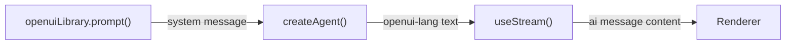
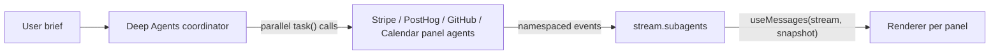

[OpenUI](https://github.com/thesysdev/openui) 是一个生成式 UI 库，允许语言模型以 **openui-lang** 这种声明式格式生成完整的、可交互的 UI。智能体不是返回聊天消息，而是返回包含卡片、图表、表格、选项卡和表单的组件树，`Renderer` 将其转换为真实的 React UI。

这种集成非常适合数据丰富的输出，如报告、仪表板和数据探索器，其中模型既是数据分析师也是 UI 设计师。

import { ExampleEmbed } from "/langchain/snippets/example-embed.jsx"

<ExampleEmbed example="openui" minHeight={700} />

## 工作原理

1. **生成系统提示词：** 启动时调用 `openuiLibrary.prompt()` 一次；它生成完整的 openui-lang 参考文档，模型使用该文档编写有效的组件树
2. **首次消息时注入：** 在新对话开始时将系统提示词作为开头的系统消息发送
3. **模型编写 openui-lang：** 模型以 `root = Stack([header, kpis, chart])` 这样的程序形式响应，而不是文本
4. **使用 `Renderer` 渲染：** 将文本传递给 OpenUI 的 `Renderer` 和组件库；它解析并渲染该树



## 安装

```bash
npm install @langchain/react @openuidev/react-ui @openuidev/react-headless @openuidev/react-lang
```

<Tip>
OpenUI 需要 React 19+ 和 [`zustand`](https://www.npmjs.com/package/zustand)。前端代码仅支持 React；LangGraph 智能体后端可以写成 TypeScript 或 Python。
</Tip>

## 导入组件样式

在您的 CSS 入口文件或根组件中直接导入 OpenUI 的捆绑样式：

```css
@import "@openuidev/react-ui/components.css";
@import "@openuidev/react-ui/styles/index.css";
```

## 生成系统提示词

OpenUI 提供了一个 `openuiLibrary.prompt()` 函数，它生成完整的 openui-lang 参考文档，包含所有组件签名、语法规则、流式输出提示和示例。在模块加载时调用它一次：

```ts
import { openuiLibrary, openuiPromptOptions } from "@openuidev/react-ui/genui-lib";

// Generate the full openui-lang system prompt. Call this once at startup,
// not inside a component, to avoid recomputing it on every render.
const SYSTEM_PROMPT = openuiLibrary.prompt({
  ...openuiPromptOptions,
  preamble:
    "You are a report generator. When asked for a report, produce a detailed, " +
    "data-rich report using openui-lang: executive summary, KPI cards, charts, " +
    "tables, and multiple sections. Your ENTIRE response must be raw openui-lang " +
    "— no code fences, no markdown, no prose.",
});
```

The `preamble` 覆盖了默认的角色。添加 `additionalRules` 以注入特定任务的约束：

```ts
const SYSTEM_PROMPT = openuiLibrary.prompt({
  ...openuiPromptOptions,
  preamble: "You are a report generator...",
  additionalRules: [
    ...(openuiPromptOptions.additionalRules ?? []),
    "Always end the report with 3–4 follow-up query buttons using " +
    "Button({ type: 'continue_conversation' }, 'secondary') inside a " +
    "Card([CardHeader('Explore Further'), Buttons([...])], 'sunk').",
  ],
});
```

## 通过 useStream 注入系统提示词

将系统提示词作为每个新线程的第一条消息发送。检查 `stream.messages.length === 0` 以检测新线程并添加 `system` 消息：

```tsx
import { useCallback } from "react";
import { useStream } from "@langchain/react";

const SYSTEM_PROMPT = openuiLibrary.prompt({ ... });

export function App() {
  const stream = useStream({
    apiUrl: import.meta.env.VITE_LANGGRAPH_API_URL ?? "http://localhost:2024",
    assistantId: "openui",
  });

  const handleSubmit = useCallback(
    (text: string) => {
      // Inject the system prompt only on the first message of a new thread.
      // Subsequent messages already have it in their persisted history.
      const isNewThread = stream.messages.length === 0;
      stream.submit({
        messages: [
          ...(isNewThread
            ? [{ type: "system", content: SYSTEM_PROMPT }]
            : []),
          { type: "human", content: text },
        ],
      });
    },
    [stream],
  );

  // ...
}
```

## 使用 Renderer 渲染

将 AI 消息的文本内容直接传递给 `Renderer` 以及 `openuiLibrary`：

```tsx
import { Renderer } from "@openuidev/react-lang";
import { openuiLibrary } from "@openuidev/react-ui/genui-lib";
import { AIMessage } from "langchain";

function MessageList({ messages, isLoading }) {
  const lastAiIdx = messages.reduce(
    (acc, msg, i) => (AIMessage.isInstance(msg) ? i : acc),
    -1,
  );

  return messages.map((msg, i) => {
    if (AIMessage.isInstance(msg)) {
      const text = msg.text;
      return (
        <Renderer
          key={msg.id ?? i}
          response={text}
          library={openuiLibrary}
          isStreaming={isLoading && i === lastAiIdx}
        />
      );
    }
    // ... human message bubble
  });
}
```

在活动流期间传递 `isStreaming={true}`，以便 Renderer 能够在定义到达时优雅地处理未解决的引用。

## openui-lang 格式

模型编写程序而不是 JSON 规范。每条语句都是赋值语句；`root` 是入口点。官方提示词教导模型这种格式，包括提升——首先编写 `root`，以便 UI 容器立即显示：

```
root = Stack([header, execSummary, kpis, marketSection])

header    = CardHeader("State of AI in 2025", "Comprehensive Analysis")
execSummary = MarkDownRenderer("## Executive Summary\n\nThe AI market reached...")

kpi1 = Card([CardHeader("$826B", "Global Market"), TextContent("42% YoY", "small")], "sunk")
kpi2 = Card([CardHeader("78%",   "Adoption"),       TextContent("Fortune 500",  "small")], "sunk")
kpis = Stack([kpi1, kpi2], "row", "m", "stretch", "start", true)

col1 = Col("Segment", "string")
col2 = Col("Revenue ($B)", "number")
tbl  = Table([col1, col2], [["Generative AI", 286], ["ML Infra", 198]])
s1   = Series("Revenue", [286, 198, 147])
ch1  = BarChart(["Gen AI", "ML Infra", "Vision"], [s1])
marketSection = Card([CardHeader("Market Breakdown"), tbl, ch1])
```

启用提升（推荐），`root` 行首先编写，以便页面结构立即显示，并且每个部分随着模型的定义而填充。

## 渐进式渲染工具

将 @[`useStream`] 直接连接到 `Renderer` 会导致在每次流式 Token 时重新渲染结果，并产生每条响应数百次无操作重新解析。这会导致图表组件在数据尚未到达时崩溃。以下工具解决了这些问题：

| 问题 | 解决方案 |
| --- | --- |
| **部分字符串字面量** | `truncateAtOpenString` / `closeOrTruncateOpenString` — 在解析前丢弃或关闭不完整的字符串 |
| **Token 间波动** | `useStableText` — 在完整的语句边界（`name = Expr(…)`）而不是每个 Token 上门控 Renderer 更新 |
| **图表空数据崩溃** | `chartDataRefsResolved` — 在将图表包含在快照中之前，验证其 `Series` 和标签数组是否已定义 |
| **尚未写入 `root` / 回退** | `buildProgressiveRoot` — 从顶层变量合成一个 `root = Stack([…])`，当模型尚未编写时 |
| **蛇形命名标识符** | `sanitizeIdentifiers` — 解析器仅接受 camelCase；将模型发出的任何 `snake_case` 名称转换为 |
| **将完整块复制到您的项目并传递 `stable` 给 `<Renderer>`：**

```tsx expandable
import {
  useCallback,
  useEffect,
  useMemo,
  useRef,
  useState,
} from "react";
import {
  type ActionEvent,
  BuiltinActionType,
  Renderer,
} from "@openuidev/react-lang";
import { openuiLibrary } from "@openuidev/react-ui/genui-lib";

/** Strip any markdown code fence the model may have emitted. */
function stripCodeFence(text: string): string {
  return text
    .replace(/^```[a-z]*\r?\n?/i, "")
    .replace(/\n?```\s*$/i, "")
    .trim();
}

/**
 * The openui-lang parser only accepts camelCase identifiers.
 * Convert any snake_case variable names the model emits; string content is untouched.
 */
function sanitizeIdentifiers(text: string): string {
  const toCamel = (s: string) =>
    s.replace(/_([a-zA-Z0-9])/g, (_, c: string) => c.toUpperCase());

  const snakeVars: string[] = [];
  for (const m of text.matchAll(/^([a-zA-Z][a-zA-Z0-9]*(?:_[a-zA-Z0-9]+)+)\s*=/gm)) {
    if (!snakeVars.includes(m[1])) snakeVars.push(m[1]);
  }
  if (snakeVars.length === 0) return text;

  let result = "";
  let inStr = false;
  let i = 0;
  while (i < text.length) {
    if (text[i] === "\\" && inStr) { result += text[i] + (text[i + 1] ?? ""); i += 2; continue; }
    if (text[i] === '"') { inStr = !inStr; result += text[i++]; continue; }
    if (!inStr) {
      let replaced = false;
      for (const v of snakeVars) {
        if (text.startsWith(v, i) && !/[a-zA-Z0-9_]/.test(text[i + v.length] ?? "")) {
          result += toCamel(v); i += v.length; replaced = true; break;
        }
      }
      if (!replaced) result += text[i++];
    } else {
      result += text[i++];
    }
  }
  return result;
}

/**
 * Walk the text tracking open strings. If the text ends mid-string, truncate to
 * the last safe newline — this prevents a partial string literal from consuming
 * any `root = Stack(…)` line we synthesise later.
 */
function truncateAtOpenString(text: string): string {
  let inStr = false;
  let lastSafeNewline = 0;
  for (let i = 0; i < text.length; i++) {
    const ch = text[i];
    if (ch === "\\" && inStr) { i++; continue; }
    if (ch === '"') { inStr = !inStr; continue; }
    if (ch === "\n" && !inStr) lastSafeNewline = i;
  }
  return inStr ? text.slice(0, lastSafeNewline) : text;
}

/**
 * Like truncateAtOpenString, but synthesises a closing `")` when the partial
 * line is a TextContent statement. This lets text render token-by-token while
 * all other partial-string lines are still truncated.
 */
function closeOrTruncateOpenString(text: string): string {
  let inStr = false;
  let lastSafeNewline = 0;
  for (let i = 0; i < text.length; i++) {
    const ch = text[i];
    if (ch === "\\" && inStr) { i++; continue; }
    if (ch === '"') { inStr = !inStr; continue; }
    if (ch === "\n" && !inStr) lastSafeNewline = i;
  }
  if (!inStr) return text;

  const safeText = lastSafeNewline > 0 ? text.slice(0, lastSafeNewline) : "";
  const partialLine = text.slice(lastSafeNewline > 0 ? lastSafeNewline + 1 : 0);

  if (/^[a-zA-Z][a-zA-Z0-9]*\s*=\s*TextContent\(/.test(partialLine)) {
    return (lastSafeNewline > 0 ? safeText + "\n" : "") + partialLine + '")';
  }
  return safeText;
}

/** Count lines that form a complete assignment ending with `)` or `]`. */
function countCompleteStatements(text: string): number {
  let count = 0;
  for (const line of text.split("\n")) {
    const t = line.trimEnd();
    if ((t.endsWith(")") || t.endsWith("]")) && /^[a-zA-Z]/.test(t)) count++;
  }
  return count;
}

const CHART_TYPES = new Set([
  "BarChart", "LineChart", "AreaChart", "RadarChart",
  "HorizontalBarChart", "PieChart", "RadialChart",
  "SingleStackedBarChart", "ScatterChart",
]);

const OPENUI_KEYWORDS = new Set([
  "true", "false", "null", "grouped", "stacked", "linear", "natural", "step",
  "pie", "donut", "string", "number", "action", "row", "column", "card", "sunk",
  "clear", "info", "warning", "error", "success", "neutral", "danger", "start",
  "end", "center", "between", "around", "evenly", "stretch", "baseline",
  "small", "default", "large", "none", "xs", "s", "m", "l", "xl",
  "horizontal", "vertical",
]);

/**
 * Chart components (recharts) crash with `.map() on null` when their labels or
 * series props are unresolved. Before committing a stable snapshot, verify that
 * every chart in the text has all its data variables already defined.
 */
function chartDataRefsResolved(text: string): boolean {
  const lines = text.split("\n");
  const complete = new Set<string>();
  for (const line of lines) {
    const t = line.trimEnd();
    const m = t.match(/^([a-zA-Z][a-zA-Z0-9]*)\s*=/);
    if (m && (t.endsWith(")") || t.endsWith("]"))) complete.add(m[1]);
  }
  for (const line of lines) {
    const t = line.trimEnd();
    const m = t.match(/^([a-zA-Z][a-zA-Z0-9]*)\s*=\s*([A-Z][a-zA-Z0-9]*)\(/);
    if (!m || !CHART_TYPES.has(m[2]) || !t.endsWith(")")) continue;
    const rhs = t.slice(t.indexOf("=") + 1).replace(/"(?:[^"\\]|\\.)*"/g, '""');
    for (const [, name] of rhs.matchAll(/\b([a-zA-Z][a-zA-Z0-9]*)\b/g)) {
      if (/^[a-z]/.test(name) && !OPENUI_KEYWORDS.has(name) && !complete.has(name))
        return false;
    }
  }
  return true;
}

/**
 * If the model hasn't written a `root = Stack(…)` yet, synthesise one from the
 * top-level variables (those defined but not referenced inside any other expression).
 * This enables progressive rendering even when the model writes root last.
 */
function buildProgressiveRoot(text: string): string {
  if (!text) return text;
  const safe = truncateAtOpenString(text);
  if (/^root\s*=/m.test(safe)) return safe;

  const defs: string[] = [];
  const seen = new Set<string>();
  for (const m of safe.matchAll(/^([a-zA-Z_][a-zA-Z0-9_]*)\s*=/gm)) {
    if (!seen.has(m[1])) { defs.push(m[1]); seen.add(m[1]); }
  }
  if (defs.length === 0) return safe;

  const referenced = new Set<string>();
  for (const line of safe.split("\n")) {
    const thisVar = line.match(/^([a-zA-Z_][a-zA-Z0-9_]*)\s*=/)?.[1];
    const stripped = line.replace(/"(?:[^"\\]|\\.)*"/g, '""');
    for (const v of defs) {
      if (v !== thisVar && new RegExp(`\\b${v}\\b`).test(stripped)) referenced.add(v);
    }
  }

  const topLevel = defs.filter((v) => !referenced.has(v));
  const rootVars = topLevel.length > 0 ? topLevel : defs;
  return `${safe.trimEnd()}\nroot = Stack([${rootVars.join(", ")}], "column", "l")`;
}

/**
 * Gate Renderer updates to moments when at least one new *complete* statement
 * has arrived. This eliminates hundreds of no-op re-parses during streaming.
 *
 * Special case: TextContent lines update token-by-token (via closeOrTruncate)
 * so text renders progressively without waiting for the full line to complete.
 */
function useStableText(raw: string, isStreaming: boolean): string {
  const [stable, setStable] = useState<string>("");
  const lastCount = useRef(0);

  useEffect(() => {
    const safe = truncateAtOpenString(raw);         // strict — for counting only
    const enhanced = closeOrTruncateOpenString(raw); // display — closes partial TextContent

    if (!isStreaming) { setStable(enhanced); return; }

    const count = countCompleteStatements(safe);
    const newComplete = count > lastCount.current && chartDataRefsResolved(safe);
    const partialTextContent = enhanced !== safe;

    if (newComplete || partialTextContent) {
      if (newComplete) lastCount.current = count;
      setStable(enhanced);
    }
  }, [raw, isStreaming]);

  return stable;
}

function AIMessageView({
  raw,
  isStreaming,
  onSubmit,
}: {
  raw: string;
  isStreaming: boolean;
  onSubmit: (text: string) => void;
}) {
  const stable = useStableText(raw, isStreaming);
  const processed = useMemo(() => buildProgressiveRoot(stable), [stable]);

  const handleAction = useCallback(
    (event: ActionEvent) => {
      if (event.type === BuiltinActionType.ContinueConversation) {
        onSubmit(event.humanFriendlyMessage);
      }
    },
    [onSubmit],
  );

  if (!processed) return null;

  return (
    <Renderer
      response={processed}
      library={openuiLibrary}
      isStreaming={isStreaming}
      onAction={handleAction}
    />
  );
}

export function MessageList({ messages, isLoading, onSubmit }) {
  const lastAiIdx = messages.reduce(
    (acc, msg, i) => (msg.getType() === "ai" ? i : acc),
    -1,
  );

  return messages.map((msg, i) => {
    if (msg.getType() === "human") {
      return (
        <div key={msg.id ?? i} className="flex justify-end">
          <div className="user-bubble">
            {msg.text}
          </div>
        </div>
      );
    }

    if (msg.getType() === "ai") {
      const raw = sanitizeIdentifiers(
        stripCodeFence(msg.text),
      );
      if (!raw) return null;
      return (
        <div key={msg.id ?? i}>
          <AIMessageView
            raw={raw}
            isStreaming={isLoading && i === lastAiIdx}
            onSubmit={onSubmit}
          />
        </div>
      );
    }

    return null;
  });
}
```

## 后续查询

OpenUI 的 `Button` 组件支持 `continue_conversation` 操作类型。当用户点击后续按钮时，`Renderer` 触发 `onAction`，`AIMessageView` 上的代码将按钮的标签作为下一个用户消息提交，与在输入中输入的代码路径完全相同。

通过 `additionalRules` 在系统提示词中添加“进一步探索”部分，为每个报告添加：

```
followUp1 = Button("Compare AI leaders 2024 vs 2025", { type: "continue_conversation" }, "secondary")
followUp2 = Button("Global AI investment breakdown",  { type: "continue_conversation" }, "secondary")
followUpBtns = Buttons([followUp1, followUp2], "row")
followUpCard  = Card([CardHeader("Explore Further"), followUpBtns], "sunk")
root = Stack([..., followUpCard])
```

## 使用 Deep Agents 构建并行仪表板

上述流程将一个 OpenUI 程序渲染到一个表面上。对于更丰富的应用，[Deep Agents](/langchain/oss/deepagents/overview) 协调器可以委托给多个专业智能体，每个智能体都并发地流式传输自己的 OpenUI 面板，所有这些都通过一个 @[`useStream`] 连接。[OpenUI 并行仪表板示例](https://github.com/langchain-ai/streaming-cookbook/tree/main/typescript/openui) 将一个仪表板简报转换为独立流式传输的 Stripe、PostHog、GitHub 和日历面板，无需自定义图或流复用代码。



### 共享一个 OpenUI 库

在服务器上（用于生成面板提示词）和客户端（作为 `Renderer` 属性）使用相同的库对象，以便模型被告知的组件始终与渲染器可以绘制的组件匹配：

```ts library.ts
import { openuiChatLibrary, openuiChatPromptOptions } from "@openuidev/react-ui";

export const library = openuiChatLibrary;
export const promptOptions = openuiChatPromptOptions;
```

### 定义协调器和面板智能体

@[`createDeepAgent`] 构建一个仅负责路由的协调器：它选择简报需要的专家，并在一条消息中发出所有他们的 `task()` 调用，以便面板并发运行。每个面板子智能体共享一个预生成的 OpenUI 系统提示词，并且只接收其数据域的工具。

```ts expandable agent.ts
import { createDeepAgent, type SubAgent } from "deepagents";

import { library, promptOptions } from "./library.js";
import { calendarTools, githubTools, posthogTools, stripeTools } from "./tools.js";

// The coordinator only routes, so a fast model handles it; panels generate
// strict openui-lang and stay on the frontier model.
const COORDINATOR_MODEL = "openai:gpt-5.4-mini";
const PANEL_MODEL = "openai:gpt-5.5";

// Generate the shared panel prompt once at module load so the model prefix
// stays stable for provider prompt caching.
const PANEL_SYSTEM_PROMPT = library.prompt({
  ...promptOptions,
  preamble:
    "Build one panel of a live executive dashboard. Follow the coordinator's " +
    "task exactly and stay within the data available from your tools.",
  additionalRules: [
    ...(promptOptions.additionalRules ?? []),
    "Use your available data tools before writing the panel.",
    "Return the complete openui-lang program and nothing else.",
    "Emit the `root` statement on the first line so rendering can start immediately.",
  ],
});

const subagents: SubAgent[] = [
  {
    name: "stripe-panel",
    model: PANEL_MODEL,
    description: "Builds the revenue and payments panel from Stripe data.",
    systemPrompt: PANEL_SYSTEM_PROMPT,
    tools: stripeTools,
  },
  // posthog-panel, github-panel, and calendar-panel follow the same shape.
];

const COORDINATOR_PROMPT = `You orchestrate a live executive dashboard.

1. Delegate immediately. Never write openui-lang yourself.
2. Launch all selected specialists in a SINGLE message, one task call per
   panel, so they run concurrently.
3. Give each task a distinct, self-contained description.
4. After the tasks complete, reply with one short plain-text summary.`;

export const dashboard = createDeepAgent({
  model: COORDINATOR_MODEL,
  systemPrompt: COORDINATOR_PROMPT,
  subagents,
});
```

协调器从不编写 openui-lang。每个面板智能体调用其工具，然后返回一个以 `root` 开头的完整程序，以便其渲染器可以在模型完成其余语句之前绘制。

### 注册图

将 `langgraph.json` 指向导出的协调器：

```json langgraph.json
{
  "node_version": "22",
  "graphs": {
    "dashboard": "./src/agent.ts:dashboard"
  },
  "env": "../../.env"
}
```

### 在前端发现和渲染面板

一个 `useStream` 连接承载协调器以及每个面板。面板不是硬编码的：每个并行 `task()` 调用都显示为一个 `stream.subagents` 快照。对于每个快照，范围一个 `useMessages(stream, snapshot)` 投影，以便面板只接收其自己的子智能体的消息，然后将其 OpenUI 程序输入到隔离的 `Renderer`：

```tsx expandable App.tsx
import { memo } from "react";

import type { SubagentDiscoverySnapshot } from "@langchain/langgraph-sdk/stream";
import { useMessages, useStream } from "@langchain/react";
import { Renderer, type ActionEvent } from "@openuidev/react-lang";

import { library } from "./library";

// One panel, scoped to one subagent. Memoized so the app shell's re-renders
// never reach this Renderer; the panel's own tokens arrive through useMessages.
const Panel = memo(function Panel({
  stream,
  snapshot,
  isStreaming,
  onAction,
}: {
  stream: ReturnType<typeof useStream>;
  snapshot: SubagentDiscoverySnapshot;
  isStreaming: boolean;
  onAction: (event: ActionEvent) => void;
}) {
  const messages = useMessages(stream, snapshot);
  // The program is the last AI message whose text starts with `root =`.
  const program = programFromMessages(messages);

  if (program === "") return <PanelSkeleton name={snapshot.name} />;

  return (
    <Renderer
      response={program}
      library={library}
      isStreaming={isStreaming}
      onAction={onAction}
    />
  );
});

export function Dashboard() {
  const stream = useStream({
    assistantId: "dashboard",
    apiUrl: import.meta.env.VITE_LANGGRAPH_API_URL ?? "http://localhost:2024",
  });

  // Discover top-level panels from the stream; the layout adapts to whichever
  // specialists the coordinator delegated.
  const panels = [...stream.subagents.values()].filter(
    (snapshot) => snapshot.parentId === null,
  );

  return (
    <main>
      {panels.map((snapshot) => (
        <Panel
          key={snapshot.id}
          stream={stream}
          snapshot={snapshot}
          isStreaming={snapshot.status === "running" && stream.isLoading}
          onAction={(event) => {
            // Handle continue_conversation and open_url actions.
          }}
        />
      ))}
    </main>
  );
}
```

由于 SDK 将子智能体 Token 事件从根存储中隔离，并且每个 `Panel` 都在其快照身份上被记忆化，因此一个面板的 Token 永远不会重新渲染另一个面板。

## 最佳实践

- **在模块加载时生成系统提示词：** 不要在 React 组件内部；提示词有数 KB 大小，应一次性计算
- **仅在新鲜线程中注入系统提示词：** 检查 `stream.messages.length === 0` 并在后续回合跳过注入，以避免在线程历史中重复提示词
- **使用提升顺序：** 先写 `root = Stack([...])`；UI 容器立即显示，各部分随模型定义逐步填充
- **对完整语句进行门控：** 避免每个 Token 都重新渲染 Renderer；仅当完整语句（`name = ComponentCall(...)`）到达时才更新
- **渲染前验证图表数据：** 图表组件需要 `Series` 和标签数组在包含在稳定快照前定义
- **保持 camelCase 变量名：** openui-lang 解析器仅接受 camelCase 标识符；在系统提示词的 `additionalRules` 中强化此规则
- **在一个消息中委托面板：** 当扩展到 Deep Agents 专家时，在单一协调消息中发出所有 `task()` 调用，使面板并发流式输出而非逐个
- **将每个面板限定于其子智能体：** 从 `stream.subagents` 发现面板，并将每个快照传递给 `useMessages(stream, snapshot)`，使面板仅渲染其子智能体的输出

---

> 官方原文：[src/oss/langchain/frontend/integrations/openui.mdx](https://github.com/langchain-ai/docs/blob/main/src/oss/langchain/frontend/integrations/openui.mdx) · 译文由 AI 生成，以英文原文为准。
