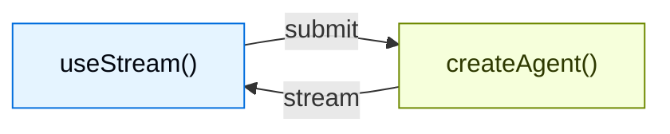

为使用 `createAgent` 创建的智能体构建丰富的交互式前端。这些模式涵盖了从基本消息渲染到高级工作流，如人工介入审批、排队提交、持久流重连和时间旅行调试。

LangChain 前端 SDK 是为 **智能体应用** 构建的，而不仅仅是 token 流式输出聊天机器人。相同的钩子渲染消息，同时也暴露了智能体的持久线程状态、工具调用生命周期、中断、检查点历史记录和自定义状态值，因此您的 UI 可以成为长期运行智能体工作的控制平面。

<Note>
这些模式使用 v1 前端 SDK 包。如果您使用的是早期版本，请参阅 [React](https://github.com/langchain-ai/langgraphjs/blob/main/libs/sdk-react/docs/v1-migration.md)、[Vue](https://github.com/langchain-ai/langgraphjs/blob/main/libs/sdk-vue/docs/v1-migration.md)、[Svelte](https://github.com/langchain-ai/langgraphjs/blob/main/libs/sdk-svelte/docs/v1-migration.md) 和 [Angular](https://github.com/langchain-ai/langgraphjs/blob/main/libs/sdk-angular/docs/v1-migration.md) 的迁移指南。
</Note>

## 架构

每个模式都遵循相同的架构：一个 `createAgent` 后端通过 SDK 流 API 将状态流式传输到前端。



在后端，`createAgent` 生成一个编译后的 LangGraph 图，该图暴露了一个流 API。在前端，流句柄连接到该 API，并提供反应式状态——消息、工具调用、中断、值和线程元数据——您可以使用任何框架进行渲染。

## 为什么使用 LangChain 前端 SDK？

大多数 AI UI 库帮助您将流式文本追加到聊天记录中。LangChain 的 SDK 暴露了生产智能体需要的更丰富的运行时语义：

| 功能 | 它在您的 UI 中实现什么 |
| --- | --- |
| **持久线程** | 刷新页面、切换设备或重新加入运行，而不会丢失对话状态。 |
| **类型化的智能体状态** | 渲染任何状态键，而不仅仅是消息：待办事项、管道输出、引用、沙盒文件、指标或自定义业务对象。 |
| **工具调用生命周期** | 将待处理、完成和失败的工具调用显示为专用的 UI 卡片，而不是原始 JSON。 |
| **中断** | 暂停执行以供人工审批、编辑或缺少信息，然后从智能体停止的确切点恢复。 |
| **检查点** | 从持久化的状态快照构建编辑、重试、分支、审计和时间旅行流程。 |
| **嵌套执行** | 可视化深度智能体、子智能体和图节点，而不会将所有内容扁平化为一个难以阅读的流。 |
| **框架原生的反应性** | 使用 React、Vue、Svelte 或 Angular 的相同协议，同时保持惯用的钩子、可组合项、存储或信号。 |

这些原语使您能够设计 UI，用户可以在智能体运行时检查、引导、暂停、恢复和分支智能体工作。

<CodeGroup>

:::python
```python agent.py
from langchain import create_agent
from langgraph.checkpoint.memory import MemorySaver

agent = create_agent(
    model="openai:gpt-5.5",
    tools=[get_weather, search_web],
    checkpointer=MemorySaver(),
)
```

```ts types.ts
export interface GraphState {
  messages: BaseMessage[];
}
```

```tsx Chat.tsx
import { useStream } from "@langchain/react";
import type { GraphState } from "./types";

function Chat() {
  const stream = useStream<GraphState>({
    apiUrl: "http://localhost:2024",
    assistantId: "agent",
  });

  return (
    <div>
      {stream.messages.map((msg) => (
        <Message key={msg.id} message={msg} />
      ))}
    </div>
  );
}
```

:::

:::js
```ts agent.ts
import { createAgent } from "langchain";
import { MemorySaver } from "@langchain/langgraph";

const agent = createAgent({
  model: "openai:gpt-5.5",
  tools: [getWeather, searchWeb],
  checkpointer: new MemorySaver(),
});
```

```tsx Chat.tsx
import { useStream } from "@langchain/react";
import type { agent } from "./agent";

function Chat() {
  const stream = useStream<typeof agent>({
    apiUrl: "http://localhost:2024",
    assistantId: "agent",
  });

  return (
    <div>
      {stream.messages.map((msg) => (
        <Message key={msg.id} message={msg} />
      ))}
    </div>
  );
}
```
:::

</CodeGroup>

React、Vue 和 Svelte 使用 `useStream`。Angular 使用 `injectStream`：

```ts
import { useStream } from "@langchain/react";      // React
import { useStream } from "@langchain/vue";        // Vue
import { useStream } from "@langchain/svelte";     // Svelte
import { injectStream } from "@langchain/angular"; // Angular
```

## 类型推断

向 @[`useStream`]（或在 Angular 中向 @[`injectStream`]）传递一个类型参数，以安全地访问 `stream.messages`、`stream.toolCalls`、`stream.interrupt`、`stream.values` 和其他反应式状态。

:::python

定义一个与您的智能体状态模式匹配的 TypeScript 接口，并将其作为类型参数传递：

```ts
import type { BaseMessage } from "langchain";

interface AgentState {
  messages: BaseMessage[];
}

const stream = useStream<AgentState>({
  apiUrl: "http://localhost:2024",
  assistantId: "agent",
});
```

使用 `langgraph.json` 中的图名作为 `assistantId`。在本指南中的模式示例中，将 `typeof myAgent` 替换为您的接口名称（例如，`AgentState`）。

如果您的智能体暴露了自定义状态键，请扩展接口：

```ts
import type { BaseMessage, Todo } from "langchain";

interface AgentState {
  messages: BaseMessage[];
  todos: Todo[];
}
```

:::

:::js

导入您的智能体并将 `typeof myAgent` 作为类型参数传递。TypeScript 从编译后的图中推断状态模式：

```ts
import type { myAgent } from "./agent";

const stream = useStream<typeof myAgent>({
  apiUrl: "http://localhost:2024",
  assistantId: "agent",
});
```

自定义状态键会自动推断，无需手动接口。

:::

## 模式

### 渲染消息和输出

<CardGroup cols={3}>
  <Card title="Markdown messages" icon="markdown" href="/langchain/oss/langchain/frontend/markdown-messages">
    解析并渲染流式 Markdown，具有正确的格式和代码高亮。
  </Card>
  <Card title="Structured output" icon="layout-grid" href="/langchain/oss/langchain/frontend/structured-output">
    将类型化的智能体响应作为自定义 UI 组件而不是纯文本进行渲染。
  </Card>
  <Card title="Reasoning tokens" icon="brain" href="/langchain/oss/langchain/frontend/reasoning-tokens">
    在可折叠块中显示模型思考过程。
  </Card>
  <Card title="Generative UI" icon="wand" href="/langchain/oss/langchain/frontend/generative-ui-overview">
    渲染智能体生成的界面，范围从受控到声明式再到开放式的。
  </Card>
</CardGroup>

### 显示智能体操作

<CardGroup cols={3}>
  <Card title="Tool calling" icon="tool" href="/langchain/oss/langchain/frontend/tool-calling">
    将工具调用显示为丰富的、类型安全的 UI 卡片，具有加载和错误状态。
  </Card>
  <Card title="Headless tools" icon="device-desktop" href="/langchain/oss/langchain/frontend/headless-tools">
    在客户端运行浏览器和设备 API，同时在智能体上保持类型化的工具模式。
  </Card>
  <Card title="Human-in-the-loop" icon="user-check" href="/langchain/oss/langchain/frontend/human-in-the-loop">
    通过批准、拒绝和编辑工作流暂停智能体以供人工审查。
  </Card>
</CardGroup>

### 管理对话

<CardGroup cols={3}>
  <Card title="Branching chat" icon="git-branch" href="/langchain/oss/langchain/frontend/branching-chat">
    编辑消息、重新生成响应并导航对话分支。
  </Card>
  <Card title="Message queues" icon="list-check" href="/langchain/oss/langchain/frontend/message-queues">
    在智能体按顺序处理它们时排队多个消息。
  </Card>
</CardGroup>

### 高级流式传输

<CardGroup cols={3}>
  <Card title="Join & rejoin streams" icon="plug-connected" href="/langchain/oss/langchain/frontend/join-rejoin">
    断开连接并重新连接到正在运行的智能体流，而不会丢失进度。
  </Card>
  <Card title="Time travel" icon="clock" href="/langchain/oss/langchain/frontend/time-travel">
    检查、导航并从对话历史记录中的任何检查点恢复。
  </Card>
</CardGroup>

## 选择前端模式

从您的应用程序需要回答的 UX 问题开始：

| 如果用户需要... | 从...开始 |
| --- | --- |
| 了解智能体正在做什么 | [工具调用](/langchain/oss/langchain/frontend/tool-calling) 和 [推理 Token](/langchain/oss/langchain/frontend/reasoning-tokens) |
| 安全地批准敏感操作 | [人工介入](/langchain/oss/langchain/frontend/human-in-the-loop) |
| 在运行活动时发送工作 | [消息队列](/langchain/oss/langchain/frontend/message-queues) |
| 离开并返回到长期运行的工作 | [加入和重连流](/langchain/oss/langchain/frontend/join-rejoin) |
| 从更早的回合编辑或重试 | [分支聊天](/langchain/oss/langchain/frontend/branching-chat) 和 [时间旅行](/langchain/oss/langchain/frontend/time-travel) |
| 将状态作为应用程序而不是聊天进行渲染 | [结构化输出](/langchain/oss/langchain/frontend/structured-output)、[生成式 UI](/langchain/oss/langchain/frontend/generative-ui-overview) 和 [深度智能体前端模式](/langchain/oss/deepagents/frontend/overview) |

## 集成

流 API 是 UI 无关的。使用任何组件库或生成式 UI 框架。组件库可以拥有呈现层，而 LangChain 的 SDK 可以拥有智能体运行时状态、可恢复性、中断和检查点语义。

<CardGroup cols={3}>
  <Card title="AI Elements" icon="package" href="/langchain/oss/langchain/frontend/integrations/ai-elements">
    用于 AI 聊天的可组合 shadcn/ui 组件：`Conversation`、`Message`、`Tool`、`Reasoning`。
  </Card>
  <Card title="assistant-ui" icon="package" href="/langchain/oss/langchain/frontend/integrations/assistant-ui">
    具有内置线程管理、分支和附件支持的 Headless React 框架。
  </Card>
  <Card title="OpenUI" icon="package" href="/langchain/oss/langchain/frontend/integrations/openui">
    用于数据丰富报告和仪表板的生成式 UI 库，使用 openui-lang 组件 DSL。
  </Card>
</CardGroup>

---

> 官方原文：[src/oss/langchain/frontend/overview.mdx](https://github.com/langchain-ai/docs/blob/main/src/oss/langchain/frontend/overview.mdx) · 非官方翻译，译文由 AI 生成，以英文原文为准。
