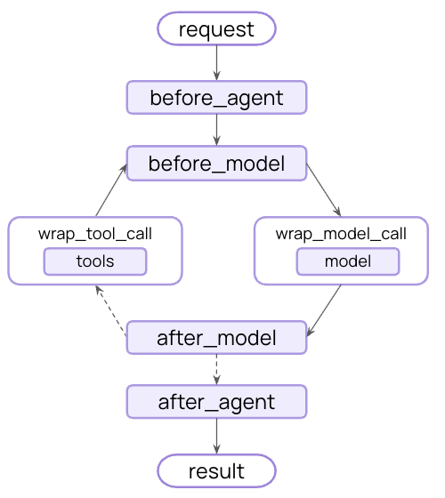

约束条件帮助您构建安全合规的 AI 应用，通过在智能体的执行关键节点验证和过滤内容。它们可以检测敏感信息、执行内容策略、验证输出，并在问题造成影响之前阻止不安全行为。

常见用例包括：
- 防止个人身份信息泄露
- 检测并阻止提示词注入攻击
- 阻止不当或有害内容
- 执行业务规则和合规要求
- 验证输出质量和准确性

您可以使用 [中间件](/langchain/oss/langchain/middleware/overview) 在战略节点拦截执行——在智能体开始之前、完成之后，或在模型和工具调用周围。

<div style={{ display: "flex", justifyContent: "center" }}>
    
</div>

约束条件可以通过两种互补的方法实现：

<CardGroup cols={2}>
    <Card title="Deterministic guardrails" icon="list-check">
        使用基于规则的逻辑，如正则表达式模式、关键字匹配或显式检查。快速、可预测且成本效益高，但可能遗漏细微的违规行为。
    </Card>
    <Card title="Model-based guardrails" icon="brain">
        使用大型语言模型或分类器来评估具有语义理解的内容。捕获规则遗漏的细微问题，但速度较慢且成本更高。
    </Card>
</CardGroup>

LangChain 提供内置约束条件（例如，[个人身份信息检测](#个人身份信息检测)、[人工审核](#人工审核)）和灵活的中间件系统，用于使用任何方法构建自定义约束条件。

## 内置约束条件

### 个人身份信息检测

LangChain 提供内置中间件，用于检测和处理对话中的个人身份信息（PII）。此中间件可以检测常见的 PII 类型，如电子邮件、信用卡、IP 地址等。

个人身份信息检测中间件适用于需要合规要求（如医疗保健和金融应用）、需要清理日志的客户服务代理，以及通常处理敏感用户数据的任何应用。

PII 中间件支持多种处理检测到的 PII 的策略：

| 策略 | 描述 | 示例 |
|----------|-------------|---------|
| `redact` | 替换为 `[REDACTED_{PII_TYPE}]` | `[REDACTED_EMAIL]` |
| `mask` | 部分模糊（例如，最后 4 位） | `****-****-****-1234` |
| `hash` | 替换为确定性哈希 | `a8f5f167...` |
| `block` | 检测到时抛出异常 | 抛出错误 |

:::python
<Note>
使用 `apply_to_output=True`，`PIIMiddleware` 还会清理流式传输的线输出——文本增量、工具调用参数、工具输出和状态快照——通过注册的流转换器。需要 `langchain>=1.3.2`。参见 [在中间件上注册转换器](/langchain/oss/langchain/event-streaming#在中间件上注册转换器)。
</Note>

```python
from langchain.agents import create_agent
from langchain.agents.middleware import PIIMiddleware


agent = create_agent(
    model="gpt-5.5",
    tools=[customer_service_tool, email_tool],
    middleware=[
        # Redact emails in user input before sending to model
        PIIMiddleware(
            "email",
            strategy="redact",
            apply_to_input=True,
        ),
        # Mask credit cards in user input
        PIIMiddleware(
            "credit_card",
            strategy="mask",
            apply_to_input=True,
        ),
        # Block API keys - raise error if detected
        PIIMiddleware(
            "api_key",
            detector=r"sk-[a-zA-Z0-9]{32}",
            strategy="block",
            apply_to_input=True,
        ),
    ],
)

# When user provides PII, it will be handled according to the strategy
result = agent.invoke({
    "messages": [{"role": "user", "content": "My email is john.doe@example.com and card is 5105-1051-0510-5100"}]
})
```
:::

:::js
```typescript
import { createAgent, piiMiddleware } from "langchain";

const agent = createAgent({
  model: "gpt-5.5",
  tools: [customerServiceTool, emailTool],
  middleware: [
    // Redact emails in user input before sending to model
    piiMiddleware("email", {
      strategy: "redact",
      applyToInput: true,
    }),
    // Mask credit cards in user input
    piiMiddleware("credit_card", {
      strategy: "mask",
      applyToInput: true,
    }),
    // Block API keys - raise error if detected
    piiMiddleware("api_key", {
      detector: /sk-[a-zA-Z0-9]{32}/,
      strategy: "block",
      applyToInput: true,
    }),
  ],
});

// When user provides PII, it will be handled according to the strategy
const result = await agent.invoke({
  messages: [{
    role: "user",
    content: "My email is john.doe@example.com and card is 5105-1051-0510-5100"
  }]
});
```
:::

<Accordion title="Built-in PII types and configuration">

**内置个人身份信息类型：**
- `email` - 电子邮件地址
- `credit_card` - 信用卡号码（通过 Luhn 验证）
- `ip` - IP 地址
- `mac_address` - MAC 地址
- `url` - URL

**配置选项：**

:::python
参数 | 描述 | 默认
-----------|-------------|---------
`pii_type` | 要检测的个人身份信息类型（内置或自定义） | 必须提供
`strategy` | 如何处理检测到的个人身份信息（`"block"`、`"redact"`、`"mask"`、`"hash"`） | `"redact"`
`detector` | 自定义检测函数或正则表达式模式 | `None`（使用内置）
`apply_to_input` | 在模型调用前检查用户消息 | `True`
`apply_to_output` | 在模型调用后检查 AI 消息 | `False`
`apply_to_tool_results` | 在执行后检查工具结果消息 | `False`
:::

:::js
参数 | 描述 | 默认
-----------|-------------|---------
`piiType` | 要检测的个人身份信息类型（内置或自定义） | 必须提供
`strategy` | 如何处理检测到的个人身份信息（`"block"`、`"redact"`、`"mask"`、`"hash"`） | `"redact"`
`detector` | 自定义检测正则表达式模式 | `undefined`（使用内置）
`applyToInput` | 在模型调用前检查用户消息 | `true`
`applyToOutput` | 在模型调用后检查 AI 消息 | `false`
`applyToToolResults` | 在执行后检查工具结果消息 | `false`
:::

</Accordion>

有关个人身份信息检测功能的完整详细信息，请参阅 [中间件文档](/langchain/oss/langchain/middleware/built-in#pii-检测)。

### 人工审核

LangChain 提供内置中间件，用于在执行敏感操作之前需要人工批准。这是针对高风险决策的最有效的约束条件之一。

人工审核中间件适用于需要合规要求（如金融交易和转账）、删除或修改生产数据、向外部方发送通信，以及任何具有重大业务影响的操作。

:::python
```python
from langchain.agents import create_agent
from langchain.agents.middleware import HumanInTheLoopMiddleware
from langgraph.checkpoint.memory import InMemorySaver
from langgraph.types import Command


agent = create_agent(
    model="gpt-5.5",
    tools=[search_tool, send_email_tool, delete_database_tool],
    middleware=[
        HumanInTheLoopMiddleware(
            interrupt_on={
                # Require approval for sensitive operations
                "send_email": True,
                "delete_database": True,
                # Auto-approve safe operations
                "search": False,
            }
        ),
    ],
    # Persist the state across interrupts
    checkpointer=InMemorySaver(),
)

# Human-in-the-loop requires a thread ID for persistence
config = {"configurable": {"thread_id": "some_id"}}

# Agent will pause and wait for approval before executing sensitive tools
result = agent.invoke(
    {"messages": [{"role": "user", "content": "Send an email to the team"}]},
    config=config
)

result = agent.invoke(
    Command(resume={"decisions": [{"type": "approve"}]}),
    config=config  # Same thread ID to resume the paused conversation
)
```
:::

:::js
```typescript
import { createAgent, humanInTheLoopMiddleware } from "langchain";
import { MemorySaver, Command } from "@langchain/langgraph";

const agent = createAgent({
  model: "gpt-5.5",
  tools: [searchTool, sendEmailTool, deleteDatabaseTool],
  middleware: [
    humanInTheLoopMiddleware({
      interruptOn: {
        // Require approval for sensitive operations
        send_email: { allowAccept: true, allowEdit: true, allowRespond: true },
        delete_database: { allowAccept: true, allowEdit: true, allowRespond: true },
        // Auto-approve safe operations
        search: false,
      }
    }),
  ],
  checkpointer: new MemorySaver(),
});

// Human-in-the-loop requires a thread ID for persistence
const config = { configurable: { thread_id: "some_id" } };

// Agent will pause and wait for approval before executing sensitive tools
let result = await agent.invoke(
  { messages: [{ role: "user", content: "Send an email to the team" }] },
  config
);

result = await agent.invoke(
  new Command({ resume: { decisions: [{ type: "approve" }] } }),
  config  // Same thread ID to resume the paused conversation
);
```
:::

<Tip>
    有关如何实现批准工作流的完整详细信息，请参阅 [人工审核文档](/langchain/oss/langchain/human-in-the-loop)。
</Tip>

## 自定义约束条件

对于更复杂的约束条件，您可以创建自定义中间件，在智能体执行之前或之后运行。这使您能够完全控制验证逻辑、内容过滤和安全性检查。

### 智能体执行前约束条件

使用“智能体执行前”钩子，在每次调用的开始时验证请求一次。这对于会话级检查（如身份验证、速率限制或阻止不适当的请求）在处理开始之前非常有用。

:::python

<CodeGroup>

```python title="Class syntax"
from typing import Any

from langchain.agents.middleware import AgentMiddleware, AgentState, hook_config
from langgraph.runtime import Runtime

class ContentFilterMiddleware(AgentMiddleware):
    """Deterministic guardrail: Block requests containing banned keywords."""

    def __init__(self, banned_keywords: list[str]):
        super().__init__()
        self.banned_keywords = [kw.lower() for kw in banned_keywords]

    @hook_config(can_jump_to=["end"])
    def before_agent(self, state: AgentState, runtime: Runtime) -> dict[str, Any] | None:
        # Get the first user message
        if not state["messages"]:
            return None

        first_message = state["messages"][0]
        if first_message.type != "human":
            return None

        content = first_message.content.lower()

        # Check for banned keywords
        for keyword in self.banned_keywords:
            if keyword in content:
                # Block execution before any processing
                return {
                    "messages": [{
                        "role": "assistant",
                        "content": "I cannot process requests containing inappropriate content. Please rephrase your request."
                    }],
                    "jump_to": "end"
                }

        return None

# Use the custom guardrail
from langchain.agents import create_agent

agent = create_agent(
    model="gpt-5.5",
    tools=[search_tool, calculator_tool],
    middleware=[
        ContentFilterMiddleware(
            banned_keywords=["hack", "exploit", "malware"]
        ),
    ],
)

# This request will be blocked before any processing
result = agent.invoke({
    "messages": [{"role": "user", "content": "How do I hack into a database?"}]
})
```

```python title="Decorator syntax"
from typing import Any

from langchain.agents.middleware import before_agent, AgentState, hook_config
from langgraph.runtime import Runtime

banned_keywords = ["hack", "exploit", "malware"]

@before_agent(can_jump_to=["end"])
def content_filter(state: AgentState, runtime: Runtime) -> dict[str, Any] | None:
    """Deterministic guardrail: Block requests containing banned keywords."""
    # Get the first user message
    if not state["messages"]:
        return None

    first_message = state["messages"][0]
    if first_message.type != "human":
        return None

    content = first_message.content.lower()

    # Check for banned keywords
    for keyword in banned_keywords:
        if keyword in content:
            # Block execution before any processing
            return {
                "messages": [{
                    "role": "assistant",
                    "content": "I cannot process requests containing inappropriate content. Please rephrase your request."
                }],
                "jump_to": "end"
            }

    return None

# Use the custom guardrail
from langchain.agents import create_agent

agent = create_agent(
    model="gpt-5.5",
    tools=[search_tool, calculator_tool],
    middleware=[content_filter],
)

# This request will be blocked before any processing
result = agent.invoke({
    "messages": [{"role": "user", "content": "How do I hack into a database?"}]
})
```
</CodeGroup>

:::

:::js
```typescript
import { createMiddleware, AIMessage } from "langchain";

const contentFilterMiddleware = (bannedKeywords: string[]) => {
  const keywords = bannedKeywords.map(kw => kw.toLowerCase());

  return createMiddleware({
    name: "ContentFilterMiddleware",
    beforeAgent: {
      hook: (state) => {
        // Get the first user message
        if (!state.messages || state.messages.length === 0) {
          return;
        }

        const firstMessage = state.messages[0];
        if (firstMessage._getType() !== "human") {
          return;
        }

        const content = firstMessage.content.toString().toLowerCase();

        // Check for banned keywords
        for (const keyword of keywords) {
          if (content.includes(keyword)) {
            // Block execution before any processing
            return {
              messages: [
                new AIMessage(
                  "I cannot process requests containing inappropriate content. Please rephrase your request."
                )
              ],
              jumpTo: "end",
            };
          }
        }

        return;
      },
      canJumpTo: ['end']
    }
  });
};

// Use the custom guardrail
import { createAgent } from "langchain";

const agent = createAgent({
  model: "gpt-5.5",
  tools: [searchTool, calculatorTool],
  middleware: [
    contentFilterMiddleware(["hack", "exploit", "malware"]),
  ],
});

// This request will be blocked before any processing
const result = await agent.invoke({
  messages: [{ role: "user", content: "How do I hack into a database?" }]
});
```
:::

### 智能体执行后约束条件

使用“智能体执行后”钩子，在返回用户之前验证最终输出一次。这对于基于模型的检查、质量验证或对智能体完整响应进行最终合规扫描非常有用。

:::python

<CodeGroup>

```python title="Class syntax"
from langchain.agents.middleware import AgentMiddleware, AgentState, hook_config
from langgraph.runtime import Runtime
from langchain.messages import AIMessage
from langchain.chat_models import init_chat_model
from typing import Any

class SafetyGuardrailMiddleware(AgentMiddleware):
    """Model-based guardrail: Use an LLM to evaluate response safety."""

    def __init__(self):
        super().__init__()
        self.safety_model = init_chat_model("gpt-5.4-mini")

    @hook_config(can_jump_to=["end"])
    def after_agent(self, state: AgentState, runtime: Runtime) -> dict[str, Any] | None:
        # Get the final AI response
        if not state["messages"]:
            return None

        last_message = state["messages"][-1]
        if not isinstance(last_message, AIMessage):
            return None

        # Use a model to evaluate safety
        safety_prompt = f"""Evaluate if this response is safe and appropriate.
        Respond with only 'SAFE' or 'UNSAFE'.

        Response: {last_message.content}"""

        result = self.safety_model.invoke([{"role": "user", "content": safety_prompt}])

        if "UNSAFE" in result.content:
            last_message.content = "I cannot provide that response. Please rephrase your request."

        return None

# Use the safety guardrail
from langchain.agents import create_agent

agent = create_agent(
    model="gpt-5.5",
    tools=[search_tool, calculator_tool],
    middleware=[SafetyGuardrailMiddleware()],
)

result = agent.invoke({
    "messages": [{"role": "user", "content": "How do I make explosives?"}]
})
```

```python title="Decorator syntax"
from langchain.agents.middleware import after_agent, AgentState, hook_config
from langgraph.runtime import Runtime
from langchain.messages import AIMessage
from langchain.chat_models import init_chat_model
from typing import Any

safety_model = init_chat_model("gpt-5.4-mini")

@after_agent(can_jump_to=["end"])
def safety_guardrail(state: AgentState, runtime: Runtime) -> dict[str, Any] | None:
    """Model-based guardrail: Use an LLM to evaluate response safety."""
    # Get the final AI response
    if not state["messages"]:
        return None

    last_message = state["messages"][-1]
    if not isinstance(last_message, AIMessage):
        return None

    # Use a model to evaluate safety
    safety_prompt = f"""Evaluate if this response is safe and appropriate.
    Respond with only 'SAFE' or 'UNSAFE'.

    Response: {last_message.content}"""

    result = safety_model.invoke([{"role": "user", "content": safety_prompt}])

    if "UNSAFE" in result.content:
        last_message.content = "I cannot provide that response. Please rephrase your request."

    return None

# Use the safety guardrail
from langchain.agents import create_agent

agent = create_agent(
    model="gpt-5.5",
    tools=[search_tool, calculator_tool],
    middleware=[safety_guardrail],
)

result = agent.invoke({
    "messages": [{"role": "user", "content": "How do I make explosives?"}]
})
```

</CodeGroup>

:::

:::js
```typescript
import { createMiddleware, AIMessage, initChatModel } from "langchain";

const safetyGuardrailMiddleware = () => {
  const safetyModel = initChatModel("gpt-5.4-mini");

  return createMiddleware({
    name: "SafetyGuardrailMiddleware",
    afterAgent: {
      hook: async (state) => {
        // Get the final AI response
        if (!state.messages || state.messages.length === 0) {
          return;
        }

        const lastMessage = state.messages[state.messages.length - 1];
        if (lastMessage._getType() !== "ai") {
          return;
        }

        // Use a model to evaluate safety
        const safetyPrompt = `Evaluate if this response is safe and appropriate.
        Respond with only 'SAFE' or 'UNSAFE'.

        Response: ${lastMessage.content.toString()}`;

        const result = await safetyModel.invoke([
          { role: "user", content: safetyPrompt }
        ]);

        if (result.content.toString().includes("UNSAFE")) {
          return {
            messages: [
              new AIMessage(
                "I cannot provide that response. Please rephrase your request."
              )
            ],
            jumpTo: "end",
          };
        }

        return;
      },
      canJumpTo: ['end']
    }
  });
};

// Use the safety guardrail
import { createAgent } from "langchain";

const agent = createAgent({
  model: "gpt-5.5",
  tools: [searchTool, calculatorTool],
  middleware: [safetyGuardrailMiddleware()],
});

const result = await agent.invoke({
  messages: [{ role: "user", content: "How do I make explosives?" }]
});
```
:::

### 组合多个约束条件

您可以通过将它们添加到中间件数组中来堆叠多个约束条件。它们按顺序执行，允许您构建分层保护：

:::python
```python
from langchain.agents import create_agent
from langchain.agents.middleware import PIIMiddleware, HumanInTheLoopMiddleware

agent = create_agent(
    model="gpt-5.5",
    tools=[search_tool, send_email_tool],
    middleware=[
        # Layer 1: Deterministic input filter (before agent)
        ContentFilterMiddleware(banned_keywords=["hack", "exploit"]),

        # Layer 2: PII protection (before and after model)
        PIIMiddleware("email", strategy="redact", apply_to_input=True),
        PIIMiddleware("email", strategy="redact", apply_to_output=True),

        # Layer 3: Human approval for sensitive tools
        HumanInTheLoopMiddleware(interrupt_on={"send_email": True}),

        # Layer 4: Model-based safety check (after agent)
        SafetyGuardrailMiddleware(),
    ],
)
```
:::

:::js
```typescript
import { createAgent, piiMiddleware, humanInTheLoopMiddleware } from "langchain";

const agent = createAgent({
  model: "gpt-5.5",
  tools: [searchTool, sendEmailTool],
  middleware: [
    // Layer 1: Deterministic input filter (before agent)
    contentFilterMiddleware(["hack", "exploit"]),

    // Layer 2: PII protection (before and after model)
    piiMiddleware("email", {
      strategy: "redact",
      applyToInput: true,
    }),
    piiMiddleware("email", {
      strategy: "redact",
      applyToOutput: true,
    }),

    // Layer 3: Human approval for sensitive tools
    humanInTheLoopMiddleware({
      interruptOn: {
        send_email: { allowAccept: true, allowEdit: true, allowRespond: true },
      }
    }),

    // Layer 4: Model-based safety check (after agent)
    safetyGuardrailMiddleware(),
  ],
});
```
:::

## 其他资源

- [中间件文档](/langchain/oss/langchain/middleware/overview) - 自定义中间件的完整指南
- [中间件 API 参考](https://reference.langchain.com/python/langchain/middleware/) - 自定义中间件的完整指南
- [人工审核](/langchain/oss/langchain/human-in-the-loop) - 为敏感操作添加人工审核
- [测试智能体](/langchain/oss/langchain/test/) - 测试安全机制的策略

---

> 官方原文：[src/oss/langchain/guardrails.mdx](https://github.com/langchain-ai/docs/blob/main/src/oss/langchain/guardrails.mdx) · 非官方翻译，译文由 AI 生成，以英文原文为准。
