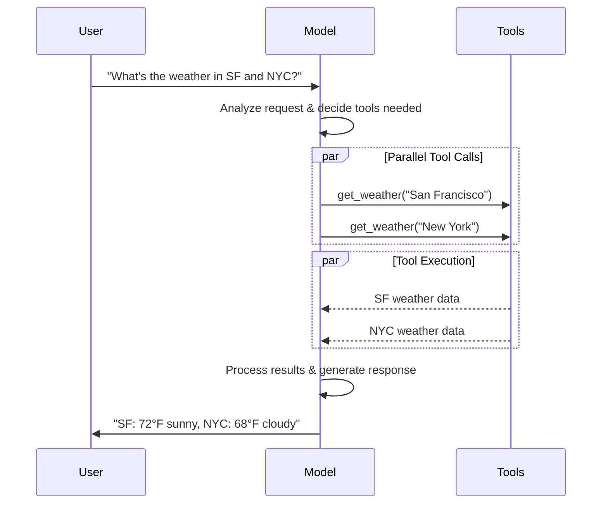
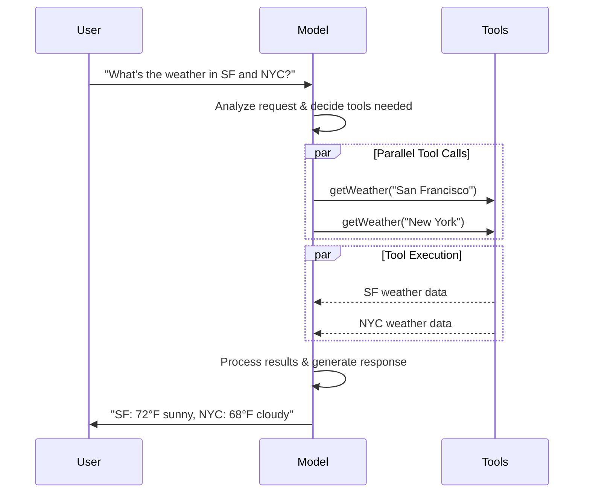

import ChatModelTabsPy from '/langchain/snippets/chat-model-tabs.mdx';
import ChatModelTabsJS from '/langchain/snippets/chat-model-tabs-js.mdx';

[大型语言模型](https://en.wikipedia.org/wiki/Large_language_model)是强大的AI工具，能够像人类一样理解和生成文本。它们功能多样，可以撰写内容、翻译语言、摘要以及回答问题，而无需针对每个任务进行专门训练。

除了文本生成，许多模型还支持：

* <Icon icon="hammer" size={16} /> [工具调用](#工具调用) - 调用外部工具（如数据库查询或API调用）并使用结果在其响应中体现。
* <Icon icon="layout-grid" size={16} /> [结构化输出](#结构化输出) - 模型的响应被约束为遵循定义好的格式。
* <Icon icon="photo" size={16} /> [多模态](#多模态) - 处理并返回非文本数据，例如图像、音频和视频。
* <Icon icon="brain" size={16} /> [推理](#推理) - 模型通过多步推理得出结论。

模型是[智能体](/langchain/oss/langchain/agents)的推理引擎。它们驱动智能体的决策过程，决定调用哪些工具、如何解释结果以及何时提供最终答案。

您选择的模型的质量和能力直接影响智能体的基准可靠性和性能。不同的模型在不同任务上表现优异——有些擅长遵循复杂指令，有些擅长结构化推理，还有些支持更大的上下文窗口以处理更多信息。

LangChain的标准模型接口让您可以访问许多不同的提供商集成，这使得尝试和切换模型以找到最适合您用例的方案变得容易。

有关特定提供商的集成信息和能力，请参阅提供商的[对话模型页面](/langchain/oss/python/integrations/chat)。

<Tip>
[LangSmith](https://docs.langchain.com/langsmith/observability)跟踪每个模型调用，以便您比较提供商、检查工具路由并调试失败。请遵循[跟踪快速入门](https://docs.langchain.com/langsmith/trace-with-langchain)进行设置。

我们还建议您设置[LangSmith引擎](https://docs.langchain.com/langsmith/engine)，它监控您的跟踪记录、检测问题并提出修复建议。
</Tip>

## 基本用法

模型有两种使用方式：

1. **与智能体结合** - 在创建 [智能体](/langchain/oss/langchain/agents#模型) 时可以动态指定模型。
2. **独立使用** - 模型可以直接调用（在智能体循环之外），用于文本生成、分类或提取等任务，无需智能体框架。

两种上下文都使用相同的模型接口，这为您提供了灵活性，可以根据需要从简单的设置扩展到更复杂的基于智能体的工作流。

### 初始化模型

:::python
在 LangChain 中使用独立模型最简单的方法是使用 @[`init_chat_model`] 从您选择的聊天模型提供者初始化一个（示例如下）：

<ChatModelTabsPy />
```python
response = model.invoke("Why do parrots talk?")
```

有关更多详细信息，包括如何传递模型 [参数](#参数)，请参见 @[`init_chat_model`][init_chat_model]。
:::
:::js
在 LangChain 中使用独立模型最简单的方法是使用 `initChatModel` 从您选择的 [聊天模型提供者](/langchain/oss/python/integrations/chat) 初始化一个（示例如下）：

<ChatModelTabsJS />
```typescript
const response = await model.invoke("Why do parrots talk?");
```
See @[`initChatModel`][initChatModel] for more detail, including information on how to pass model [parameters](#参数).
:::

### 支持的提供者和模型

LangChain 通过专门的集成包支持所有主要模型提供者。每个提供者包实现相同的标准接口，因此您可以更换提供者而无需重写应用程序逻辑。新的模型名称立即生效——无需 LangChain 更新——因为提供者包将模型名称直接传递给提供者的 API。

浏览 [支持的全部提供者列表](/langchain/oss/python/integrations/providers/overview)，或参见 [提供者和模型](/langchain/oss/concepts/providers-and-models) 了解提供者、包和模型名称在 LangChain 中如何协同工作的概念性概述。

### 关键方法

<Card title="Invoke" href="#invoke" icon="send" arrow="true" horizontal>
    模型接收消息作为输入，并在生成完整响应后输出消息。
</Card>
<Card title="Stream" href="#stream" icon="broadcast" arrow="true" horizontal>
    调用模型，但实时流式输出生成的结果。
</Card>
<Card title="Batch" href="#batch" icon="grip-vertical" arrow="true" horizontal>
    将多个请求批量发送给模型以实现更高效的处理。
</Card>

<Info>
    除了聊天模型，LangChain 还提供对其他相关技术的支持，例如嵌入模型和向量存储。有关详细信息，请参见 [集成页面](/langchain/oss/python/integrations/providers/overview)。
</Info>

## 参数

对话模型会使用参数来配置其行为。支持的全参数集因模型和提供者而异，但标准参数包括：

<ParamField body="model" type="string" required>
   您想要与提供者使用的特定模型的名称或标识符。您也可以使用 '{model_provider}:{model}' 格式在单个参数中指定模型及其提供者，例如 'openai:o1'。
</ParamField>

:::python
<ParamField body="api_key" type="string">
    用于认证模型提供者的密钥。这通常在您注册访问模型时发放。通常通过设置一个 <Tooltip tip="A variable whose value is set outside the program, typically through functionality built into the operating system or microservice.">环境变量</Tooltip>来访问。
</ParamField>
:::
:::js
<ParamField body="apiKey" type="string">
    用于认证模型提供者的密钥。这通常在您注册访问模型时发放。通常通过设置一个 <Tooltip tip="A variable whose value is set outside the program, typically through functionality built into the operating system or microservice.">环境变量</Tooltip>来访问。
</ParamField>
:::

<ParamField body="temperature" type="number">
    控制模型输出的随机性。较高的数值使响应更具创造性；较低的数值使它们更确定。
</ParamField>

:::python
<ParamField body="max_tokens" type="number">
    限制响应中 <Tooltip tip="The basic unit that a model reads and generates. Providers may define them differently, but in general, they can represent a whole or part of word.">tokens</Tooltip> 的总数，从而控制输出的长度。
</ParamField>
:::
:::js
<ParamField body="maxTokens" type="number">
    限制响应中 <Tooltip tip="The basic unit that a model reads and generates. Providers may define them differently, but in general, they can represent a whole or part of word.">tokens</Tooltip> 的总数，从而控制输出的长度。
</ParamField>
:::

<ParamField body="timeout" type="number">
    在取消请求之前，等待模型响应的最大时间（以秒为单位）。
</ParamField>

:::python
<ParamField body="max_retries" type="number" default="6">
    如果由于网络超时或速率限制等问题导致请求失败，系统将尝试重新发送请求的最大次数。重试使用带抖动的指数退避。网络错误、速率限制（429）和服务器错误（5xx）会自动重试。客户端错误（如 401（未授权）或 404）不会重试。对于在不可靠网络上运行的长任务 [智能体](/langchain/oss/deepagents/overview)，请考虑将其增加到 10–15。
</ParamField>
:::
:::js
<ParamField body="maxRetries" type="number" default="6">
    如果由于网络超时或速率限制等问题导致请求失败，系统将尝试重新发送请求的最大次数。重试使用带抖动的指数退避。网络错误、速率限制（429）和服务器错误（5xx）会自动重试。客户端错误（如 401（未授权）或 404）不会重试。对于在不可靠网络上运行的长任务 [智能体](/langchain/oss/deepagents/overview)，请考虑将其增加到 10–15。

    在支持它的提供者上，[模型重试中间件](/langchain/oss/langchain/middleware/built-in#模型重试)接管它包装的调用的重试，此值不适用于它们。
</ParamField>
:::

:::python
使用 @[`init_chat_model`]，将这些参数作为内联 <Tooltip tip="Arbitrary keyword arguments" cta="Learn more" href="https://www.w3schools.com/python/python_args_kwargs.asp">`**kwargs`</Tooltip>:

```python Initialize using model parameters
model = init_chat_model(
    "claude-sonnet-4-6",
    # Kwargs passed to the model:
    temperature=0.7,
    timeout=30,
    max_tokens=1000,
    max_retries=6,  # Default; increase for unreliable networks
)
```
:::
:::js
使用 `initChatModel`，将以下参数作为内联参数传递：

```typescript Initialize using model parameters
const model = await initChatModel(
    "claude-sonnet-4-6",
    { temperature: 0.7, timeout: 30, maxTokens: 1000, maxRetries: 6 }
)
```
:::

### 连接弹性

LangChain 对话模型会自动使用指数退避策略重试失败的 API 请求。默认情况下，模型会针对网络错误、速率限制（429）和服务器错误（5xx）重试最多 **6 次**。客户端错误（如 401（未授权）或 404）不会重试。

:::python
创建模型时，您可以调整 `max_retries` 和 `timeout`，然后将该实例传递给 `create_agent`、`create_deep_agent` 或独立调用：

```python
from langchain.chat_models import init_chat_model

model = init_chat_model(
    "google_genai:gemini-3.6-flash",
    max_retries=10,  # Increase for unreliable networks (default: 6)
    timeout=120,  # Seconds; increase for slow connections
)
```
:::

:::js
创建模型时，您可以调整 `maxRetries` 和 `timeout`，然后将该实例传递给 `createAgent`、`createDeepAgent` 或独立调用：

```typescript
import { initChatModel } from "langchain";

const model = await initChatModel("google:gemini-3.6-flash", {
  maxRetries: 10, // Increase for unreliable networks (default: 6)
  timeout: 120_000, // Milliseconds; increase for slow connections
});
```
:::

<Tip>
    对于在不可靠网络上运行的长时智能体图，建议设置更高的 `max_retries`（例如 10–15），并使用 [checkpointer](/langchain/oss/langgraph/persistence) 以确保在失败时保留进度。
</Tip>

<Info>
    每个对话模型集成可能具有额外的参数，用于控制特定提供者的功能。

    例如，@[`ChatOpenAI`] 有 `use_responses_api` 来指定是使用 OpenAI 响应 API 还是完成 API。

    要查找特定对话模型支持的参数，请访问 [对话模型集成](/langchain/oss/python/integrations/chat) 页面。
</Info>

---

## 调用

对话模型必须被调用以生成输出。存在三种主要的调用方法，每种方法适用于不同的使用场景。

### 调用

调用模型的直接方式是使用 @[`invoke()`][BaseChatModel.invoke]，传入单个消息或消息列表。

:::python
```python Single message
response = model.invoke("Why do parrots have colorful feathers?")
print(response)
```
:::

:::js
```typescript Single message
const response = await model.invoke("Why do parrots have colorful feathers?");
console.log(response);
```
:::

消息列表可以提供给对话模型以表示对话历史。每条消息都有一个角色，模型使用该角色来指示对话中消息的发送者。

有关角色、类型和内容的更多详细信息，请参阅[消息](/langchain/oss/langchain/messages)指南。

:::python
```python Dictionary format
conversation = [
    {"role": "system", "content": "You are a helpful assistant that translates English to French."},
    {"role": "user", "content": "Translate: I love programming."},
    {"role": "assistant", "content": "J'adore la programmation."},
    {"role": "user", "content": "Translate: I love building applications."}
]

response = model.invoke(conversation)
print(response)  # AIMessage("J'adore créer des applications.")
```
```python Message objects
from langchain.messages import HumanMessage, AIMessage, SystemMessage

conversation = [
    SystemMessage("You are a helpful assistant that translates English to French."),
    HumanMessage("Translate: I love programming."),
    AIMessage("J'adore la programmation."),
    HumanMessage("Translate: I love building applications.")
]

response = model.invoke(conversation)
print(response)  # AIMessage("J'adore créer des applications.")
```
:::

:::js
```typescript Object format
const conversation = [
  { role: "system", content: "You are a helpful assistant that translates English to French." },
  { role: "user", content: "Translate: I love programming." },
  { role: "assistant", content: "J'adore la programmation." },
  { role: "user", content: "Translate: I love building applications." },
];

const response = await model.invoke(conversation);
console.log(response);  // AIMessage("J'adore créer des applications.")
```
```typescript Message objects
import { HumanMessage, AIMessage, SystemMessage } from "langchain";

const conversation = [
  new SystemMessage("You are a helpful assistant that translates English to French."),
  new HumanMessage("Translate: I love programming."),
  new AIMessage("J'adore la programmation."),
  new HumanMessage("Translate: I love building applications."),
];

const response = await model.invoke(conversation);
console.log(response);  // AIMessage("J'adore créer des applications.")
```
:::

<Info>
    如果你的调用返回类型是字符串，请确保你正在使用对话模型而不是大型语言模型。传统的文本补全大型语言模型直接返回字符串。LangChain对话模型以"Chat"为前缀，例如 @[`ChatOpenAI`](/langchain/oss/python/integrations/chat/openai)。
</Info>

### 流式输出

大多数模型可以在生成输出内容时进行流式输出。通过逐步显示输出，流式输出显著改善了用户体验，特别是对于较长的响应。

调用 @[`stream()`][BaseChatModel.stream] 返回一个 <Tooltip tip="An object that progressively provides access to each item of a collection, in order.">迭代器</Tooltip>，它会随着生成过程产出输出片段。你可以使用循环实时处理每个片段：

:::python
<CodeGroup>
    ```python Basic text streaming
    for chunk in model.stream("Why do parrots have colorful feathers?"):
        print(chunk.text, end="|", flush=True)
    ```

    ```python Stream tool calls, reasoning, and other content
    for chunk in model.stream("What color is the sky?"):
        for block in chunk.content_blocks:
            if block["type"] == "reasoning" and (reasoning := block.get("reasoning")):
                print(f"Reasoning: {reasoning}")
            elif block["type"] == "tool_call_chunk":
                print(f"Tool call chunk: {block}")
            elif block["type"] == "text":
                print(block["text"])
            else:
                ...
    ```
</CodeGroup>
:::
:::js
<CodeGroup>
    ```typescript Basic text streaming
    const stream = await model.stream("Why do parrots have colorful feathers?");
    for await (const chunk of stream) {
      console.log(chunk.text)
    }
    ```

    ```typescript Stream tool calls, reasoning, and other content
    const stream = await model.stream("What color is the sky?");
    for await (const chunk of stream) {
      for (const block of chunk.contentBlocks) {
        if (block.type === "reasoning") {
          console.log(`Reasoning: ${block.reasoning}`);
        } else if (block.type === "tool_call_chunk") {
          console.log(`Tool call chunk: ${block}`);
        } else if (block.type === "text") {
          console.log(block.text);
        } else {
          ...
        }
      }
    }
    ```
</CodeGroup>
:::

与 [`invoke()`](#调用-2) 相比，后者在模型完成生成完整响应后返回一个 @[`AIMessage`][AIMessage]，`stream()` 返回多个 @[`AIMessageChunk`][AIMessageChunk] 对象，每个对象包含输出文本的一部分。重要的是，流中的每个片段都设计为通过求和方式聚合成一个完整消息：

:::python
```python Construct an AIMessage
full = None  # None | AIMessageChunk
for chunk in model.stream("What color is the sky?"):
    full = chunk if full is None else full + chunk
    print(full.text)

# The
# The sky
# The sky is
# The sky is typically
# The sky is typically blue
# ...

print(full.content_blocks)
# [{"type": "text", "text": "The sky is typically blue..."}]
```
:::

:::js
```typescript Construct AIMessage
let full: AIMessageChunk | null = null;
for await (const chunk of stream) {
  full = full ? full.concat(chunk) : chunk;
  console.log(full.text);
}

// The
// The sky
// The sky is
// The sky is typically
// The sky is typically blue
// ...

console.log(full.contentBlocks);
// [{"type": "text", "text": "The sky is typically blue..."}]
```
:::

生成的消息可以与使用 [`invoke()`](#调用-2) 生成的消息一样处理——例如，它可以被聚合到消息历史中，并作为对话上下文传递回模型。

<Warning>
    只有当程序中的所有步骤都了解如何处理片段流时，流式输出才会生效。例如，一个不具备流式输出能力的应用程序需要在处理之前将整个输出存储在内存中。
</Warning>

<Accordion title="Advanced streaming topics">
    <Accordion title="Streaming events">
        :::python
        LangChain 对话模型也可以使用 `astream_events()` 流式输出语义事件。

        这简化了基于事件类型和其他元数据的过滤，并在后台聚合完整消息。下方是一个示例。

        ```python
        async for event in model.astream_events("Hello"):

            if event["event"] == "on_chat_model_start":
                print(f"Input: {event['data']['input']}")

            elif event["event"] == "on_chat_model_stream":
                print(f"Token: {event['data']['chunk'].text}")

            elif event["event"] == "on_chat_model_end":
                print(f"Full message: {event['data']['output'].text}")

            else:
                pass
        ```
        ```txt
        Input: Hello
        Token: Hi
        Token:  there
        Token: !
        Token:  How
        Token:  can
        Token:  I
        ...
        Full message: Hi there! How can I help today?
        ```

        <Tip>
            查看 @[`astream_events()`][BaseChatModel.astream_events] 参考文档了解事件类型和其他详细信息。
        </Tip>
        :::

        :::js
        LangChain 对话模型也可以使用
        [`streamEvents()`][BaseChatModel.streamEvents] 流式输出语义事件。

        这简化了基于事件类型和其他元数据的过滤，并在后台聚合完整消息。下方是一个示例。

        ```typescript
        const stream = await model.streamEvents("Hello");
        for await (const event of stream) {
            if (event.event === "on_chat_model_start") {
                console.log(`Input: ${event.data.input}`);
            }
            if (event.event === "on_chat_model_stream") {
                console.log(`Token: ${event.data.chunk.text}`);
            }
            if (event.event === "on_chat_model_end") {
                console.log(`Full message: ${event.data.output.text}`);
            }
        }
        ```
        ```txt
        Input: Hello
        Token: Hi
        Token:  there
        Token: !
        Token:  How
        Token:  can
        Token:  I
        ...
        Full message: Hi there! How can I help today?
        ```

        查看 @[`streamEvents()`][BaseChatModel.streamEvents] 参考文档了解事件类型和其他详细信息。
        :::
    </Accordion>
    <Accordion title='"Auto-streaming" chat models'>
        LangChain 通过在某些情况下自动启用流式模式简化了从对话模型的流式输出，即使你没有显式调用流式方法也是如此。这在使用非流式调用方法但仍然希望流式输出整个应用程序（包括来自对话模型的中间结果）时特别有用。

在 [LangGraph 智能体](/langchain/oss/langchain/agents) 中，例如，您可以在节点内调用 `model.invoke()`，但如果在流式模式下运行，LangChain 将自动委托给流式输出。

        #### 工作原理

        当您 `invoke()` 对话模型时，如果 LangChain 检测到您正在尝试流式输出整个应用程序，它将自动切换到内部流式模式。就使用 invoke 的代码而言，调用的结果将是相同的；然而，在对话模型被流式输出期间，LangChain 将负责在 LangChain 的回调系统中调用 @[`on_llm_new_token`] 事件。

        :::python
        回调事件允许 LangGraph `stream()` 和 `astream_events()` 实时显示对话模型的输出。
        :::
        :::js
        回调事件允许 LangGraph `stream()` 和 `streamEvents()` 实时显示对话模型的输出。
        :::
    </Accordion>
</Accordion>

### 批量处理

将多个独立的请求批量发送给模型可以显著提高性能并降低成本，因为处理可以并行进行：

:::python
```python Batch
responses = model.batch([
    "Why do parrots have colorful feathers?",
    "How do airplanes fly?",
    "What is quantum computing?"
])
for response in responses:
    print(response)
```

<Note>
    本节描述了一个对话模型方法 @[`batch()`][BaseChatModel.batch]，该方法在客户端并行化模型调用。

    它与推理提供方支持的批量 API **不同**，例如 [OpenAI](https://platform.openai.com/docs/guides/batch) 或 [Anthropic](https://platform.claude.com/docs/en/build-with-claude/batch-processing#message-batches-api)。
</Note>

默认情况下，@[`batch()`][BaseChatModel.batch] 仅返回整个批量的最终输出。如果您希望接收每个单独输入的输出，可以在生成完成后使用 @[`batch_as_completed()`][BaseChatModel.batch_as_completed] 进行流式输出：

```python Yield batch responses upon completion
for response in model.batch_as_completed([
    "Why do parrots have colorful feathers?",
    "How do airplanes fly?",
    "What is quantum computing?"
]):
    print(response)
```
<Note>
    使用 @[`batch_as_completed()`][BaseChatModel.batch_as_completed] 时，结果可能会乱序到达。每个结果都包含输入索引，用于匹配以重建原始顺序（如果需要）。
</Note>

<Tip>
    使用 @[`batch()`][BaseChatModel.batch] 或 @[`batch_as_completed()`][BaseChatModel.batch_as_completed] 处理大量输入时，您可能希望控制最大并行调用数量。这可以通过在 @[`RunnableConfig`] 字典中设置 @[`max_concurrency`][RunnableConfig(max_concurrency)] 属性来完成。

    ```python Batch with max concurrency
    model.batch(
        list_of_inputs,
        config={
            'max_concurrency': 5,  # Limit to 5 parallel calls
        }
    )
    ```

    请参阅 @[`RunnableConfig`] 参考文档以获取所有支持的属性列表。
</Tip>

有关批量处理的更多详细信息，请参阅 @[reference][BaseChatModel.batch]。
:::

:::js
```typescript Batch
const responses = await model.batch([
  "Why do parrots have colorful feathers?",
  "How do airplanes fly?",
  "What is quantum computing?",
  "Why do parrots have colorful feathers?",
  "How do airplanes fly?",
  "What is quantum computing?",
]);
for (const response of responses) {
  console.log(response);
}
```

<Tip>
    使用 `batch()` 处理大量输入时，您可能希望控制最大并行调用数量。这可以通过在 @[`RunnableConfig`] 字典中设置 `maxConcurrency` 属性来完成。

    ```typescript Batch with max concurrency
    model.batch(
      listOfInputs,
      {
        maxConcurrency: 5,  // Limit to 5 parallel calls
      }
    )
    ```

    请参阅 @[`RunnableConfig`] 参考文档以获取所有支持的属性列表。
</Tip>

有关批量处理的更多详细信息，请参阅 @[reference][BaseChatModel.batch]。
:::

---

## 工具调用
模型可以请求调用执行任务（如从数据库获取数据、搜索网络或运行代码）的工具。工具是一对：
1. 一个模式，包括工具的名称、描述和/或参数定义（通常是 JSON 模式）
2. 一个函数或 <Tooltip tip="A method that can suspend execution and resume at a later time"> 协程 </Tooltip> 来执行。
<Note>
    你可能会听到“函数调用”这个术语。我们将其与“工具调用”互换使用。
</Note>
以下是用户与模型之间基本的工具调用流程：
:::python

:::
:::js

:::
:::python
要使你定义的工具可供模型使用，你必须使用 @[`bind_tools`][BaseChatModel.bind_tools] 将其绑定。在后续调用中，模型可以根据需要选择调用任何已绑定的工具。
:::
:::js
要使你定义的工具可供模型使用，你必须使用 @[`bindTools`][BaseChatModel.bindTools] 将其绑定。在后续调用中，模型可以根据需要选择调用任何已绑定的工具。
:::
一些模型提供者提供 <Tooltip tip="Tools that are executed server-side, such as web search and code interpreters"> 内置工具 </Tooltip>，可以通过模型或调用参数启用（例如 [`ChatOpenAI`](/langchain/oss/python/integrations/chat/openai), [`ChatAnthropic`](/langchain/oss/python/integrations/chat/anthropic)）。有关详细信息，请参阅相应的 [提供者参考](/langchain/oss/python/integrations/providers/overview)。
<Tip>
    有关详细信息和创建工具的其他选项，请参阅 [工具指南](/langchain/oss/langchain/tools)。
</Tip>
:::python
```python Binding user tools
from langchain.tools import tool

@tool
def get_weather(location: str) -> str:
    """Get the weather at a location."""
    return f"It's sunny in {location}."


model_with_tools = model.bind_tools([get_weather])  # [!code highlight]

response = model_with_tools.invoke("What's the weather like in Boston?")
for tool_call in response.tool_calls:
    # View tool calls made by the model
    print(f"Tool: {tool_call['name']}")
    print(f"Args: {tool_call['args']}")
```
:::
:::js
```typescript Binding user tools
import { tool } from "langchain";
import * as z from "zod";
import { ChatOpenAI } from "@langchain/openai";

const getWeather = tool(
  (input) => `It's sunny in ${input.location}.`,
  {
    name: "get_weather",
    description: "Get the weather at a location.",
    schema: z.object({
      location: z.string().describe("The location to get the weather for"),
    }),
  },
);

const model = new ChatOpenAI({ model: "gpt-5.5" });
const modelWithTools = model.bindTools([getWeather]);  // [!code highlight]

const response = await modelWithTools.invoke("What's the weather like in Boston?");
const toolCalls = response.tool_calls || [];
for (const tool_call of toolCalls) {
  // View tool calls made by the model
  console.log(`Tool: ${tool_call.name}`);
  console.log(`Args: ${tool_call.args}`);
}
```
:::
在绑定用户定义的工具时，模型的响应包含一个 **请求** 来执行工具。当单独使用模型时 [智能体](/langchain/oss/langchain/agents)，你需要执行请求的工具并将结果返回给模型，以便在后续推理中使用。当使用 [智能体](/langchain/oss/langchain/agents)时，智能体循环将处理工具执行循环。
下面，我们展示一些常见的工具调用使用方法。
<AccordionGroup>
    <Accordion title="Tool execution loop" icon="refresh">
        当模型返回工具调用时，你需要执行工具并将结果返回给模型。这会创建一个对话循环，模型可以使用工具结果来生成最终响应。LangChain 包括 [智能体](/langchain/oss/langchain/agents) 抽象，可以为你处理这种编排。
        下面是一个如何执行此操作的简单示例：
        :::python
        ```python Tool execution loop
        # Bind (potentially multiple) tools to the model
        tools = [get_weather]
        tools_by_name = {tool.name: tool for tool in tools}
        model_with_tools = model.bind_tools(tools)

        # Step 1: Model generates tool calls
        messages = [{"role": "user", "content": "What's the weather in Boston?"}]
        ai_msg = model_with_tools.invoke(messages)
        messages.append(ai_msg)

        # Step 2: Execute tools and collect results
        for tool_call in ai_msg.tool_calls:
            # Execute the tool with the generated arguments
            tool = tools_by_name[tool_call["name"]]
            tool_result = tool.invoke(tool_call)
            messages.append(tool_result)

        # Step 3: Pass results back to model for final response
        final_response = model_with_tools.invoke(messages)
        print(final_response.text)
        # "The current weather in Boston is 72°F and sunny."
        ```
        :::
        :::js
        ```typescript Tool execution loop
        // Bind (potentially multiple) tools to the model
        const tools = [getWeather]
        const toolsByName = Object.fromEntries(tools.map((tool) => [tool.name, tool]))
        const modelWithTools = model.bindTools(tools)

        // Step 1: Model generates tool calls
        const messages = [{"role": "user", "content": "What's the weather in Boston?"}]
        const ai_msg = await modelWithTools.invoke(messages)
        messages.push(ai_msg)

        // Step 2: Execute tools and collect results
        for (const tool_call of ai_msg.tool_calls) {
            // Execute the tool with the generated arguments
            const tool = toolsByName[tool_call.name]
            const tool_result = await tool.invoke(tool_call)
            messages.push(tool_result)
        }

        // Step 3: Pass results back to model for final response
        const final_response = await modelWithTools.invoke(messages)
        console.log(final_response.text)
        // "The current weather in Boston is 72°F and sunny."
        ```
        :::
工具返回的每个 @[`ToolMessage`] 都包含一个 `tool_call_id`，与原始工具调用匹配，帮助模型将结果与请求关联起来。
    </Accordion>
    <Accordion title="Forcing tool calls" icon="asterisk">
        默认情况下，模型可以根据用户输入自由选择要使用的已绑定工具。但是，你可能希望强制选择一个工具，确保模型使用特定工具或给定列表中的 **任何** 工具：
        :::python
        <CodeGroup>
            ```python Force use of any tool
            model_with_tools = model.bind_tools([tool_1], tool_choice="any")
            ```
            ```python Force use of specific tools
            model_with_tools = model.bind_tools([tool_1], tool_choice="tool_1")
            ```
        </CodeGroup>
        :::
        :::js
        <CodeGroup>
            ```typescript Force use of any tool
            const modelWithTools = model.bindTools([tool_1], { toolChoice: "any" })
            ```
            ```typescript Force use of specific tools
            const modelWithTools = model.bindTools([tool_1], { toolChoice: "tool_1" })
            ```
        </CodeGroup>
        :::
    </Accordion>
    <Accordion title="Parallel tool calls" icon="stack-2">
        许多模型在适当的情况下支持并行调用多个工具。这允许模型同时从不同来源收集信息。
        :::python
        ```python Parallel tool calls
        tools = [get_weather]
        tools_by_name = {tool.name: tool for tool in tools}
        model_with_tools = model.bind_tools(tools)

        response = model_with_tools.invoke(
            "What's the weather in Boston and Tokyo?"
        )


        # The model may generate multiple tool calls
        print(response.tool_calls)
        # [
        #   {'name': 'get_weather', 'args': {'location': 'Boston'}, 'id': 'call_1'},
        #   {'name': 'get_weather', 'args': {'location': 'Tokyo'}, 'id': 'call_2'},
        # ]


        # Execute all tools (can be done in parallel with async)
        results = []
        for tool_call in response.tool_calls:
            tool = tools_by_name[tool_call["name"]]
            result = tool.invoke(tool_call)
            results.append(result)
        ```
        :::
        :::js
        ```typescript Parallel tool calls
        const tools = [getWeather]
        const toolsByName = Object.fromEntries(tools.map((tool) => [tool.name, tool]))
        const modelWithTools = model.bindTools(tools)

        const response = await modelWithTools.invoke(
            "What's the weather in Boston and Tokyo?"
        )


        // The model may generate multiple tool calls
        console.log(response.tool_calls)
        // [
        //   { name: 'get_weather', args: { location: 'Boston' }, id: 'call_1' },
        //   { name: 'get_weather', args: { location: 'Tokyo' }, id: 'call_2' }
        // ]


        // Execute all tools (can be done in parallel with async)
        const results = []
        for (const tool_call of response.tool_calls || []) {
            const tool = toolsByName[tool_call.name]
            const result = await tool.invoke(tool_call)
            results.push(result)
        }
        ```
        :::
模型智能地确定何时并行执行是适当的，这取决于请求操作的独立性。
        <Tip>
        支持工具调用的大多数模型默认启用并行工具调用。一些（包括 [OpenAI](/langchain/oss/python/integrations/chat/openai) 和 [Anthropic](/langchain/oss/python/integrations/chat/anthropic)）允许你禁用此功能。要执行此操作，设置 `parallel_tool_calls=False`：
        ```python
        model.bind_tools([get_weather], parallel_tool_calls=False)
        ```
        </Tip>
    </Accordion>
    <Accordion title="Streaming tool calls" icon="rss">
        在流式输出时，工具调用通过 @[`ToolCallChunk` 逐步构建。这允许你在生成工具调用时看到它们，而不是等待完整响应。
        :::python

        ```python Streaming tool calls
        for chunk in model_with_tools.stream(
            "What's the weather in Boston and Tokyo?"
        ):
            # Tool call chunks arrive progressively
            for tool_chunk in chunk.tool_call_chunks:
                if name := tool_chunk.get("name"):
                    print(f"Tool: {name}")
                if id_ := tool_chunk.get("id"):
                    print(f"ID: {id_}")
                if args := tool_chunk.get("args"):
                    print(f"Args: {args}")

        # Output:
        # Tool: get_weather
        # ID: call_SvMlU1TVIZugrFLckFE2ceRE
        # Args: {"lo
        # Args: catio
        # Args: n": "B
        # Args: osto
        # Args: n"}
        # Tool: get_weather
        # ID: call_QMZdy6qInx13oWKE7KhuhOLR
        # Args: {"lo
        # Args: catio
        # Args: n": "T
        # Args: okyo
        # Args: "}
        ```
        你可以累积片段来构建完整的工具调用：
        ```python Accumulate tool calls
        gathered = None
        for chunk in model_with_tools.stream("What's the weather in Boston?"):
            gathered = chunk if gathered is None else gathered + chunk
            print(gathered.tool_calls)
        ```
        :::
        :::js
        ```typescript Streaming tool calls
        const stream = await modelWithTools.stream(
            "What's the weather in Boston and Tokyo?"
        )
        for await (const chunk of stream) {
            // Tool call chunks arrive progressively
            if (chunk.tool_call_chunks) {
                for (const tool_chunk of chunk.tool_call_chunks) {
                console.log(`Tool: ${tool_chunk.get('name', '')}`)
                console.log(`Args: ${tool_chunk.get('args', '')}`)
                }
            }
        }

        // Output:
        // Tool: get_weather
        // Args:
        // Tool:
        // Args: {"loc
        // Tool:
        // Args: ation": "BOS"}
        // Tool: get_time
        // Args:
        // Tool:
        // Args: {"timezone": "Tokyo"}
        ```
        你可以累积片段来构建完整的工具调用：
        ```typescript Accumulate tool calls
        let full: AIMessageChunk | null = null
        const stream = await modelWithTools.stream("What's the weather in Boston?")
        for await (const chunk of stream) {
            full = full ? full.concat(chunk) : chunk
            console.log(full.contentBlocks)
        }
        ```
        :::
    </Accordion>
</AccordionGroup>
---

## 结构化输出
可以要求模型按照给定的模式格式提供其响应。这有助于确保输出可以被轻松解析并在后续处理中使用。LangChain 支持多种模式类型和强制结构化输出的方法。
<Tip>
    要了解结构化输出，请参阅 [结构化输出](/langchain/oss/langchain/structured-output)。
</Tip>
:::python
<Tabs>
    <Tab title="Pydantic">
        [Pydantic 模型](https://docs.pydantic.dev/latest/concepts/models/#basic-model-usage) 提供最丰富的功能集，包括字段验证、描述和嵌套结构。
        ```python
        from pydantic import BaseModel, Field

        class Movie(BaseModel):
            """A movie with details."""
            title: str = Field(description="The title of the movie")
            year: int = Field(description="The year the movie was released")
            director: str = Field(description="The director of the movie")
            rating: float = Field(description="The movie's rating out of 10")

        model_with_structure = model.with_structured_output(Movie)
        response = model_with_structure.invoke("Provide details about the movie Inception")
        print(response)  # Movie(title="Inception", year=2010, director="Christopher Nolan", rating=8.8)
        ```
    </Tab>
    <Tab title="TypedDict">
        Python 的 `TypedDict` 提供了一种比 Pydantic 模型更简单的替代方案，适用于不需要运行时验证的情况。
        ```python
        from typing_extensions import TypedDict, Annotated

        class MovieDict(TypedDict):
            """A movie with details."""
            title: Annotated[str, ..., "The title of the movie"]
            year: Annotated[int, ..., "The year the movie was released"]
            director: Annotated[str, ..., "The director of the movie"]
            rating: Annotated[float, ..., "The movie's rating out of 10"]

        model_with_structure = model.with_structured_output(MovieDict)
        response = model_with_structure.invoke("Provide details about the movie Inception")
        print(response)  # {'title': 'Inception', 'year': 2010, 'director': 'Christopher Nolan', 'rating': 8.8}
        ```
    </Tab>
    <Tab title="JSON Schema">
        提供一个 [JSON 模式](https://json-schema.org/understanding-json-schema/about) 以实现最大控制和互操作性。
        ```python
        import json

        json_schema = {
            "title": "Movie",
            "description": "A movie with details",
            "type": "object",
            "properties": {
                "title": {
                    "type": "string",
                    "description": "The title of the movie"
                },
                "year": {
                    "type": "integer",
                    "description": "The year the movie was released"
                },
                "director": {
                    "type": "string",
                    "description": "The director of the movie"
                },
                "rating": {
                    "type": "number",
                    "description": "The movie's rating out of 10"
                }
            },
            "required": ["title", "year", "director", "rating"]
        }

        model_with_structure = model.with_structured_output(
            json_schema,
            method="json_schema",
        )
        response = model_with_structure.invoke("Provide details about the movie Inception")
        print(response)  # {'title': 'Inception', 'year': 2010, ...}
        ```
    </Tab>
</Tabs>
:::
:::js
<Tabs>
    <Tab title="Zod">
        一个 [zod 模式](https://zod.dev/) 是定义输出模式的首选方法。请注意，当提供 zod 模式时，模型输出也将使用 zod 的解析方法根据该模式进行验证。
        ```typescript
        import * as z from "zod";

        const Movie = z.object({
          title: z.string().describe("The title of the movie"),
          year: z.number().describe("The year the movie was released"),
          director: z.string().describe("The director of the movie"),
          rating: z.number().describe("The movie's rating out of 10"),
        });

        const modelWithStructure = model.withStructuredOutput(Movie);

        const response = await modelWithStructure.invoke("Provide details about the movie Inception");
        console.log(response);
        // {
        //   title: "Inception",
        //   year: 2010,
        //   director: "Christopher Nolan",
        //   rating: 8.8,
        // }
        ```
    </Tab>
    <Tab title="JSON Schema">
        为了实现最大控制或互操作性，您可以提供一个原始的 JSON 模式。
        ```typescript
        const jsonSchema = {
          "title": "Movie",
          "description": "A movie with details",
          "type": "object",
          "properties": {
            "title": {
              "type": "string",
              "description": "The title of the movie",
            },
            "year": {
              "type": "integer",
              "description": "The year the movie was released",
            },
            "director": {
              "type": "string",
              "description": "The director of the movie",
            },
            "rating": {
              "type": "number",
              "description": "The movie's rating out of 10",
            },
          },
          "required": ["title", "year", "director", "rating"],
        }

        const modelWithStructure = model.withStructuredOutput(
          jsonSchema,
          { method: "jsonSchema" },
        )

        const response = await modelWithStructure.invoke("Provide details about the movie Inception")
        console.log(response)  // {'title': 'Inception', 'year': 2010, ...}
        ```
    </Tab>
    <Tab title="Standard Schema">
        任何实现 [标准模式](https://standardschema.dev/) 规范的库中的模式也受支持。标准模式对象通过模式的 `~standard.validate()` 方法在运行时进行验证。
        ```typescript
        import * as v from "valibot";
        import { toStandardJsonSchema } from "@valibot/to-json-schema";

        const Movie = toStandardJsonSchema(
          v.object({
            title: v.pipe(v.string(), v.description("The title of the movie")),
            year: v.pipe(v.number(), v.description("The year the movie was released")),
            director: v.pipe(v.string(), v.description("The director of the movie")),
            rating: v.pipe(v.number(), v.description("The movie's rating out of 10")),
          })
        );

        const modelWithStructure = model.withStructuredOutput(Movie);

        const response = await modelWithStructure.invoke("Provide details about the movie Inception");
        console.log(response);
        // {
        //   title: "Inception",
        //   year: 2010,
        //   director: "Christopher Nolan",
        //   rating: 8.8,
        // }
        ```
    </Tab>
</Tabs>
:::
:::python
<Note>
    **结构化输出的关键注意事项**
    - **方法参数**：某些提供者支持不同的结构化输出方法：
        - `'json_schema'`：使用提供者提供的专用结构化输出功能。
        - `'function_calling'`：通过强制执行遵循给定模式的 [工具调用](#工具调用) 来派生结构化输出。
        - `'json_mode'`：某些提供者提供的 `'json_schema'` 的前身。生成有效的 JSON，但模式必须在提示词中描述。
    - **包含原始**：将 `include_raw=True` 设置为 true 以获取解析后的输出和原始 AI 消息。
    - **验证**：Pydantic 模型提供自动验证。`TypedDict` 和 JSON 模式需要手动验证。
    请参阅您的 [提供者的集成页面](/langchain/oss/python/integrations/providers/overview) 以获取支持的方法和配置选项。
</Note>
:::
:::js
<Note>
    **结构化输出的关键注意事项：**
    - **方法参数**：某些提供者支持不同的方法 (`'jsonSchema'`, `'functionCalling'`, `'jsonMode'`)
    - **包含原始**：使用 @[`includeRaw: true`][BaseChatModel.with_structured_output(include_raw)] 以获取解析后的输出和原始 @[`AIMessage`]
    - **验证**：Zod 和 Standard Schema 对象提供自动验证，而 JSON 模式需要手动验证
    - **标准模式**：任何实现 [标准模式](https://standardschema.dev/) 规范的库中的模式都受支持，并在运行时进行验证
    请参阅您的 [提供者的集成页面](/langchain/oss/python/integrations/providers/overview) 以获取支持的方法和配置选项。
</Note>
:::
<Accordion title="Example: Message output alongside parsed structure">
将原始 @[`AIMessage`] 对象与解析后的表示一起返回以访问响应元数据（例如 [Token 计数](#token-使用)）可能很有用。为此，在调用 @[`with_structured_output`][BaseChatModel.with_structured_output] 时设置 @[`include_raw=True`][BaseChatModel.with_structured_output(include_raw)]：
    :::python
    ```python
    from pydantic import BaseModel, Field

    class Movie(BaseModel):
        """A movie with details."""
        title: str = Field(description="The title of the movie")
        year: int = Field(description="The year the movie was released")
        director: str = Field(description="The director of the movie")
        rating: float = Field(description="The movie's rating out of 10")

    model_with_structure = model.with_structured_output(Movie, include_raw=True)  # [!code highlight]
    response = model_with_structure.invoke("Provide details about the movie Inception")
    response
    # {
    #     "raw": AIMessage(...),
    #     "parsed": Movie(title=..., year=..., ...),
    #     "parsing_error": None,
    # }
    ```
    :::
    :::js
    ```typescript
    import * as z from "zod";

    const Movie = z.object({
      title: z.string().describe("The title of the movie"),
      year: z.number().describe("The year the movie was released"),
      director: z.string().describe("The director of the movie"),
      rating: z.number().describe("The movie's rating out of 10"),
      title: z.string().describe("The title of the movie"),
      year: z.number().describe("The year the movie was released"),
      director: z.string().describe("The director of the movie"),  // [!code highlight]
      rating: z.number().describe("The movie's rating out of 10"),
    });

    const modelWithStructure = model.withStructuredOutput(Movie, { includeRaw: true });

    const response = await modelWithStructure.invoke("Provide details about the movie Inception");
    console.log(response);
    // {
    //   raw: AIMessage { ... },
    //   parsed: { title: "Inception", ... }
    // }
    ```
    :::
</Accordion>
<Accordion title="Example: Nested structures">
    模式可以嵌套：
    :::python
    <CodeGroup>
        ```python Pydantic BaseModel
        from pydantic import BaseModel, Field

        class Actor(BaseModel):
            name: str
            role: str

        class MovieDetails(BaseModel):
            title: str
            year: int
            cast: list[Actor]
            genres: list[str]
            budget: float | None = Field(None, description="Budget in millions USD")

        model_with_structure = model.with_structured_output(MovieDetails)
        ```
        ```python TypedDict
        from typing_extensions import Annotated, TypedDict

        class Actor(TypedDict):
            name: str
            role: str

        class MovieDetails(TypedDict):
            title: str
            year: int
            cast: list[Actor]
            genres: list[str]
            budget: Annotated[float | None, ..., "Budget in millions USD"]

        model_with_structure = model.with_structured_output(MovieDetails)
        ```
    </CodeGroup>
    ::::::js
    ```typescript
    import * as z from "zod";

    const Actor = z.object({
      name: z.string(),
      role: z.string(),
    });

    const MovieDetails = z.object({
      title: z.string(),
      year: z.number(),
      cast: z.array(Actor),
      genres: z.array(z.string()),
      budget: z.number().nullable().describe("Budget in millions USD"),
    });

    const modelWithStructure = model.withStructuredOutput(MovieDetails);
    ```
    :::
</Accordion>
---

## 高级主题

### 模型配置文件

<Info>
    模型配置文件需要 `langchain>=1.1`。
</Info>

:::python
LangChain 对话模型可以通过一个 `profile` 属性暴露支持的特性和功能：

```python
model.profile
# {
#   "max_input_tokens": 400000,
#   "image_inputs": True,
#   "reasoning_output": True,
#   "tool_calling": True,
#   ...
# }
```

    请参考 [API 参考](https://reference.langchain.com/python/langchain-core/language_models/model_profile/ModelProfile) 中的完整字段集。

大部分模型配置文件数据由 [models.dev](https://github.com/sst/models.dev) 项目提供支持，这是一个开源项目，提供模型能力数据。这些数据会根据 LangChain 的使用需求增加额外字段。这些增强功能会随着上游项目的演进保持同步。

模型配置文件数据允许应用程序动态地适配模型能力。例如：

1. [摘要中间件](/langchain/oss/langchain/middleware/built-in#摘要) 可以根据模型的上下文窗口大小触发摘要生成。
2. `create_agent` 中的 [结构化输出](/langchain/oss/langchain/structured-output) 策略可以自动推断（例如，通过检查对原生结构化输出功能的支持）。
3. 模型输入可以根据支持的 [模态](#多模态) 和最大输入 Token 进行限制。
4. [深度智能体代码](/langchain/oss/deepagents/code/overview) 会过滤 [交互式模型切换器](/langchain/oss/deepagents/code/providers#切换器中显示哪些模型)，仅选择那些配置文件报告 `tool_calling` 支持和文本 I/O 的模型，并在选择器详情视图中显示上下文窗口大小和能力标志。

<Accordion title="Updating or overwriting profile data">
    如果模型配置文件数据缺失、过时或错误，可以修改。

    **选项 1（快速修复）**

    您可以使用任何有效的配置文件实例化对话模型：

    ```python
    custom_profile = {
        "max_input_tokens": 100_000,
        "tool_calling": True,
        "structured_output": True,
        # ...
    }
    model = init_chat_model("...", profile=custom_profile)
    ```

    该 `profile` 也是一个常规的 `dict`，可以就地更新。如果模型实例是共享的，请考虑使用 `model_copy` 以避免修改共享状态。

    ```python
    new_profile = model.profile | {"key": "value"}
    model.model_copy(update={"profile": new_profile})
    ```

    **选项 2（上游修复数据）**

    数据的主要来源是 [models.dev](https://models.dev/) 项目。这些数据会与额外字段和覆盖在 LangChain [集成包](/langchain/oss/python/integrations/providers/overview) 中合并，并随这些包一起分发。

    模型配置文件数据可以通过以下流程更新：

    1. （如果需要）通过 pull request 更新 [models.dev](https://models.dev/) 中的源数据到其 [GitHub 上的仓库](https://github.com/sst/models.dev)。
    2. （如果需要）通过 pull request 更新 `langchain_<package>/data/profile_augmentations.toml` 中的额外字段和覆盖到 LangChain [集成包](/langchain/oss/python/integrations/providers/overview)。
    3. 使用 [`langchain-model-profiles`](https://pypi.org/project/langchain-model-profiles/) 命令行工具从 [models.dev](https://models.dev/) 拉取最新数据，合并增强功能并更新配置文件数据：
    <CodeGroup>
        ```bash pip
        pip install -U langchain-model-profiles
        ```

        ```bash uv
        uv add langchain-model-profiles
        ```
    </CodeGroup>

    ```bash
    langchain-profiles refresh --provider <provider> --data-dir <data_dir>
    ```

    该命令：
    - 从 models.dev 下载 `<provider>` 的最新数据
    - 合并来自 `profile_augmentations.toml` 的增强功能到 `<data_dir>`
    - 将合并后的配置文件写入 `profiles.py` 中的 `<data_dir>`

    例如：从 [`libs/partners/anthropic`](https://github.com/langchain-ai/langchain/tree/master/libs/partners/anthropic) 在 [LangChain 单体仓库](https://github.com/langchain-ai/langchain) 中：

    ```bash
    uv run --with langchain-model-profiles langchain-profiles refresh --provider anthropic --data-dir langchain_anthropic/data
    ```
</Accordion>

:::

:::js
LangChain 对话模型可以通过 `profile` 属性暴露一个支持的功能和能力的字典：

```typescript
model.profile;
// {
//   maxInputTokens: 400000,
//   imageInputs: true,
//   reasoningOutput: true,
//   toolCalling: true,
//   ...
// }
```

请参考 [API 参考](https://reference.langchain.com/javascript/langchain-core/language_models/profile/ModelProfile) 中的完整字段集。

大部分模型配置数据由 [models.dev](https://github.com/sst/models.dev) 项目提供支持，这是一个开源倡议项目，提供模型能力数据。这些数据会根据 LangChain 的使用需求增加额外的字段。这些增强功能会随着上游项目的演进保持一致。

模型配置数据允许应用程序动态地适应模型的能力。例如：

1. [摘要中间件](/langchain/oss/langchain/middleware/built-in#摘要) 可以根据模型的上下文窗口大小触发摘要。
2. `createAgent` 中的 [结构化输出](/langchain/oss/langchain/structured-output) 策略可以自动推断（例如，通过检查对原生结构化输出功能的支持）。
3. 模型输入可以根据支持的 [模态](#多模态) 和最大输入 Token 进行限制。
4. [深度智能体代码](/langchain/oss/deepagents/code/overview) 会过滤 [交互式模型切换器](/langchain/oss/deepagents/code/providers#切换器中显示哪些模型)，仅选择那些配置报告 `tool_calling` 支持和文本 I/O 的模型，并在选择器详情视图中显示上下文窗口大小和能力标志。

<Accordion title="Modify profile data">
    如果模型配置数据缺失、过时或错误，可以更改。

    **选项 1（快速修复）**

    您可以使用任何有效的配置实例化对话模型：

    ```typescript
    const customProfile = {
    maxInputTokens: 100_000,
    toolCalling: true,
    structuredOutput: true,
    // ...
    };
    const model = initChatModel("...", { profile: customProfile });
    ```

    **选项 2（上游修复数据）**

    数据的主要来源是 [models.dev](https://models.dev/) 项目。这些数据会与额外的字段和覆盖在 LangChain [集成包](/langchain/oss/python/integrations/providers/overview) 中合并，并随这些包一起交付。

    模型配置数据可以通过以下流程更新：

    1. （如果需要）通过 pull request 更新 [models.dev](https://models.dev/) 上的源数据到其 [GitHub 上的仓库](https://github.com/sst/models.dev)。
    2. （如果需要）通过 pull request 更新 `langchain-<package>/profiles.toml` 中的额外字段和覆盖到 LangChain [集成包](/langchain/oss/python/integrations/providers/overview)。

</Accordion>

:::

<Warning>
    模型配置是 Beta 功能。配置的格式可能会发生变化。
</Warning>

### 多模态

某些模型能够处理并返回非文本数据，如图像、音频和视频。您可以通过提供 [内容块](/langchain/oss/langchain/messages#消息内容) 将非文本数据传递给模型。

<Tip>
    所有具有底层多模态能力的 LangChain 对话模型支持：

    1. 跨提供商的标准格式数据（参见 [我们的消息指南](/langchain/oss/langchain/messages)）
    2. OpenAI [对话补全](https://platform.openai.com/docs/api-reference/chat) 格式
    3. 该特定提供商的原生格式（例如，Anthropic 模型接受 Anthropic 原生格式）
</Tip>

有关详细信息，请参阅消息指南的 [多模态部分](/langchain/oss/langchain/messages#多模态)。

<Tooltip tip="Not all LLMs are made equally!" cta="See reference" href="https://models.dev/">某些模型</Tooltip>可以将多模态数据作为其响应的一部分返回。如果被调用执行此操作，生成的 @[`AIMessage`] 将包含多模态类型的 内容块。

:::python
```python Multimodal output
response = model.invoke("Create a picture of a cat")
print(response.content_blocks)
# [
#     {"type": "text", "text": "Here's a picture of a cat"},
#     {"type": "image", "base64": "...", "mime_type": "image/jpeg"},
# ]
```
:::

:::js
```typescript Multimodal output
const response = await model.invoke("Create a picture of a cat");
console.log(response.contentBlocks);
// [
//   { type: "text", text: "Here's a picture of a cat" },
//   { type: "image", data: "...", mimeType: "image/jpeg" },
// ]
```
:::

有关特定提供商的详细信息，请参阅 [集成页面](/langchain/oss/python/integrations/providers/overview)。

### 推理

许多模型能够执行多步推理以得出结论。这涉及将复杂问题分解为更小、更易于管理的步骤。

**如果底层模型支持，**您可以展示推理过程，以更好地理解模型是如何得出最终答案的。

:::python
<CodeGroup>
    ```python Stream reasoning output
    for chunk in model.stream("Why do parrots have colorful feathers?"):
        reasoning_steps = [r for r in chunk.content_blocks if r["type"] == "reasoning"]
        print(reasoning_steps if reasoning_steps else chunk.text)
    ```

    ```python Complete reasoning output
    response = model.invoke("Why do parrots have colorful feathers?")
    reasoning_steps = [b for b in response.content_blocks if b["type"] == "reasoning"]
    print(" ".join(step["reasoning"] for step in reasoning_steps))
    ```
</CodeGroup>
:::

:::js
<CodeGroup>
    ```typescript Stream reasoning output
    const stream = model.stream("Why do parrots have colorful feathers?");
    for await (const chunk of stream) {
        const reasoningSteps = chunk.contentBlocks.filter(b => b.type === "reasoning");
        console.log(reasoningSteps.length > 0 ? reasoningSteps : chunk.text);
    }
    ```

    ```typescript Complete reasoning output
    const response = await model.invoke("Why do parrots have colorful feathers?");
    const reasoningSteps = response.contentBlocks.filter(b => b.type === "reasoning");
    console.log(reasoningSteps.map(step => step.reasoning).join(" "));
    ```
</CodeGroup>
:::

根据模型的不同，有时您可以指定它应投入的推理程度。同样，您可以要求模型完全关闭推理。这可能以分类的“层级”推理（例如，`'low'`或`'high'`）或整数 Token 预算的形式出现。

:::python
<Note>
    `reasoning_effort`作为标准参数需要`langchain-core>=1.5.2`，以及相应的配套包版本：`langchain-anthropic>=1.5.3`、`langchain-openai>=1.4.1`、`langchain-fireworks>=1.5.2`、`langchain-xai>=1.3.0`、`langchain-google-genai>=4.3.1`或`langchain-aws>=1.7.0`.
</Note>

@[`ChatOpenAI`]、@[`ChatAnthropic`]、@[`ChatFireworks`]、@[`ChatXAI`]、@[`ChatGoogleGenerativeAI`]和[`ChatBedrockConverse`](https://reference.langchain.com/python/langchain-aws/chat_models/bedrock_converse/ChatBedrockConverse)支持标准的`reasoning_effort`参数。与`temperature`类似，它可以在模型构建时或每次调用时设置，每个提供商会将其转换为自己的 API 格式：

```python
from langchain_anthropic import ChatAnthropic

model = ChatAnthropic(model="claude-sonnet-4-6")
response = model.invoke(
    "Why do parrots have colorful feathers?",
    reasoning_effort="high",
)
```

支持的推理程度和提供方的文档默认值因模型而异。查看模型的[配置](#模型配置文件)以了解它支持的级别及其默认值：

```python
model.profile["reasoning_effort_levels"]  # e.g. ['low', 'medium', 'high']
model.profile["reasoning_effort_default"]  # e.g. 'high'
```

一些提供方还接受`reasoning_effort`的本地别名（例如，`ChatAnthropic`接受`effort`，`ChatGoogleGenerativeAI`接受`thinking_level`）。请参阅[聊天模型集成](/langchain/oss/python/integrations/chat)页面以获取提供方特定的详细信息。
:::

详细信息，请参阅您的相应聊天模型的[集成页面](/langchain/oss/python/integrations/providers/overview)或[参考](https://reference.langchain.com/python/integrations/)。

### 本地模型

LangChain 支持在您自己的硬件上本地运行模型。这对于数据隐私至关重要、您想要调用自定义模型，或您想要避免使用基于云的模型时产生的成本等场景非常有用。

[Ollama](/langchain/oss/python/integrations/chat/ollama) 是本地运行对话和嵌入模型最简单的方法之一。

### 提示词缓存

许多提供商提供提示词缓存功能，以减少对相同 Token 的重复处理的延迟和成本。您可以在三个层级上启用缓存：

- **隐式提供商缓存**：如果请求命中缓存，提供商会自动传递成本节省，无需配置。例如：[OpenAI](/langchain/oss/python/integrations/chat/openai) 和 [Gemini](/langchain/oss/python/integrations/chat/google_generative_ai)。
- **提供商级别的显式控制**：提供商允许您手动指示缓存点，以实现更精细的控制或保证成本节省。这些功能与底层提供商/API 行为一致。例如：
    - @[`ChatOpenAI`]（通过 `prompt_cache_key`）
    - Anthropic 内容块 [`cache_control`](/langchain/oss/python/integrations/chat/anthropic#提示词缓存)
    - [Gemini](https://reference.langchain.com/python/langchain-google-genai)。
:::python
    - AWS Bedrock [`cachePoint`](/langchain/oss/python/integrations/chat/bedrock#提示词缓存) 块
:::
- **LangChain 中间件**：对于智能体，中间件允许 LangChain 优化稳定系统提示词和工具内容的缓存。例如：
    - Anthropic 的 [`AnthropicPromptCachingMiddleware`](/langchain/oss/python/integrations/middleware/anthropic#提示词缓存)
    - AWS Bedrock 的 [`BedrockPromptCachingMiddleware`](/langchain/oss/python/integrations/middleware/aws#提示词缓存)
:::

<Warning>
    提示词缓存通常只在达到最低输入 Token 阈值以上时才会启用。请参阅 [提供商页面](/langchain/oss/python/integrations/chat) 了解详情。
</Warning>

缓存使用情况将反映在模型响应的 [使用元数据](/langchain/oss/langchain/messages#token-使用情况) 中。

### 服务器端工具使用

一些提供商支持服务器端 [工具调用](#工具调用) 循环：模型可以在单个对话回合中与网络搜索、代码解释器和其他工具交互并分析结果。

如果模型在服务器端调用工具，响应消息的内容将包含代表工具调用和结果的文本。访问响应的 [内容块](/langchain/oss/langchain/messages#标准内容块) 将以提供商无关的格式返回服务器端工具调用和结果：

:::python
```python Invoke with server-side tool use
from langchain.chat_models import init_chat_model

model = init_chat_model("gpt-5.4-mini")

tool = {"type": "web_search"}
model_with_tools = model.bind_tools([tool])

response = model_with_tools.invoke("What was a positive news story from today?")
print(response.content_blocks)
```
```python Result expandable
[
    {
        "type": "server_tool_call",
        "name": "web_search",
        "args": {
            "query": "positive news stories today",
            "type": "search"
        },
        "id": "ws_abc123"
    },
    {
        "type": "server_tool_result",
        "tool_call_id": "ws_abc123",
        "status": "success"
    },
    {
        "type": "text",
        "text": "Here are some positive news stories from today...",
        "annotations": [
            {
                "end_index": 410,
                "start_index": 337,
                "title": "article title",
                "type": "citation",
                "url": "..."
            }
        ]
    }
]
```
:::
:::js
```typescript
import { initChatModel } from "langchain";

const model = await initChatModel("gpt-5.4-mini");
const modelWithTools = model.bindTools([{ type: "web_search" }])

const message = await modelWithTools.invoke("What was a positive news story from today?");
console.log(message.contentBlocks);
```
:::
这代表了一个对话回合；没有相关的 [ToolMessage](/langchain/oss/langchain/messages#工具消息) 对象需要像在客户端 [工具调用](#工具调用) 中那样传递。

请参考您的提供商的 [集成页面](/langchain/oss/python/integrations/chat) 获取可用工具和使用详情。

:::python

### 模型异常

主要的集成包会从 `langchain_core.exceptions` 抛出标准的异常类型，用于处理常见的模型失败情况，如认证错误、速率限制和超时。这些异常既继承自 LangChain 的基础类型，也继承自提供者 SDK 自身的异常类型，因此你可以捕获其中任意一种：

```python
from langchain.chat_models import init_chat_model
from langchain_core.exceptions import ModelTimeoutError

model = init_chat_model("openai:gpt-5.6-luna", timeout=0.0001)

try:
    response = model.invoke("Hello")
except ModelTimeoutError:
    print("caught")
```

每种类型都携带一个 `is_retryable` 属性，[重试中间件](/langchain/oss/langchain/middleware/built-in#模型重试) 默认会尊重该属性。

<Accordion title="Exception types">
- @[`ModelAuthenticationError`] — API 密钥缺失、无效或过期（不可重试）
- @[`ModelPermissionDeniedError`] — 凭证权限不足（不可重试）
- @[`ModelInvalidRequestError`] — 提供者拒绝请求（不可重试）
- @[`ModelNotFoundError`] — 请求的模型不存在（不可重试）
- @[`ModelRateLimitError`] — 提供者速率限制超出（可重试）
- @[`ModelAPIError`] — 提供者服务器故障（可重试）
- @[`ModelConnectionError`] — 无法连接到提供者（可重试）
- @[`ModelTimeoutError`] — 请求超时（可重试）
- @[`ContextOverflowError`] — 输入超出模型上下文限制（不可重试）
</Accordion>
:::

:::python

### 速率限制

许多对话模型提供商会对特定时间段内的调用次数施加限制。如果你触发了速率限制，通常你会从提供商那里收到一个速率限制错误响应，并且需要等待才能发起更多请求。

为了帮助管理速率限制，对话模型集成接受一个 `rate_limiter` 参数，该参数可以在初始化时提供，以控制请求的发送速率。

<Accordion title="Initialize and use a rate limiter" icon="gauge">
    LangChain 提供了（可选的）内置 @[`InMemoryRateLimiter`]。这个限制器是线程安全的，可以在同一进程中的多个线程之间共享。

    ```python Define a rate limiter
    from langchain.rate_limiters import InMemoryRateLimiter

    rate_limiter = InMemoryRateLimiter(
        requests_per_second=0.1,  # 1 request every 10s
        check_every_n_seconds=0.1,  # Check every 100ms whether allowed to make a request
        max_bucket_size=10,  # Controls the maximum burst size.
    )

    model = init_chat_model(
        model="gpt-5.5",
        model_provider="openai",
        rate_limiter=rate_limiter  # [!code highlight]
    )
    ```

    <Warning>
        提供的速率限制器只能限制单位时间内的请求次数。如果你还需要根据请求的大小进行限制，它将无法提供帮助。
    </Warning>
</Accordion>
:::

### 基础 URL 和代理设置

您可以为实现 OpenAI Chat Completions API 的提供者配置自定义基础 URL。

<Warning>
    `model_provider="openai"`（或直接使用 `ChatOpenAI`）针对官方 OpenAI API 规范。来自路由器和代理的特定提供者字段可能不会被提取或保留。

    对于 OpenRouter 和 LiteLLM，请优先使用专用集成：
    - [OpenRouter via `ChatOpenRouter`](/langchain/oss/python/integrations/chat/openrouter) (`langchain-openrouter`)
    - [LiteLLM via `ChatLiteLLM` / `ChatLiteLLMRouter`](/langchain/oss/python/integrations/chat) (`langchain-litellm`)
</Warning>

<Accordion title="Custom base URL" icon="link">
    :::python
    许多模型提供者提供与 OpenAI 兼容的 API（例如，[Together AI](https://www.together.ai/), [vLLM](https://github.com/vllm-project/vllm)）。您可以通过指定适当的 `base_url` 参数使用 @[`init_chat_model`] 与这些提供者：

    ```python
    model = init_chat_model(
        model="MODEL_NAME",
        model_provider="openai",
        base_url="BASE_URL",
        api_key="YOUR_API_KEY",
    )
    ```
    :::

    :::js
    许多模型提供者提供与 OpenAI 兼容的 API（例如，[Together AI](https://www.together.ai/), [vLLM](https://github.com/vllm-project/vllm)）。您可以通过指定适当的 `base_url` 参数使用 `initChatModel` 与这些提供者：

    ```python
    model = initChatModel(
        "MODEL_NAME",
        {
            modelProvider: "openai",
            baseUrl: "BASE_URL",
            apiKey: "YOUR_API_KEY",
        }
    )
    ```
    :::

    <Note>
        在使用直接对话模型类实例化时，参数名称可能因提供者而异。请查阅相应的 [参考](/langchain/oss/python/integrations/providers/overview) 了解详情。
    </Note>
</Accordion>

:::python
<Accordion title="HTTP proxy configuration" icon="shield">
    对于需要 HTTP 代理的部署，某些模型集成支持代理配置：

    ```python
    from langchain_openai import ChatOpenAI

    model = ChatOpenAI(
        model="gpt-5.5",
        openai_proxy="http://proxy.example.com:8080"
    )
    ```

<Note>
    代理支持因集成而异。请查阅特定模型提供者的 [参考](/langchain/oss/python/integrations/providers/overview) 了解代理配置选项。
</Note>

</Accordion>
:::

### 对数概率

某些模型可以通过在初始化模型时设置 `logprobs` 参数来配置，使其返回表示给定 Token 出现可能性的 Token 级别对数概率：

:::python
```python
model = init_chat_model(
    model="gpt-5.5",
    model_provider="openai"
).bind(logprobs=True)

response = model.invoke("Why do parrots talk?")
print(response.response_metadata["logprobs"])
```
:::

:::js
```typescript
const model = new ChatOpenAI({
    model: "gpt-5.5",
    logprobs: true,
});

const responseMessage = await model.invoke("Why do parrots talk?");

responseMessage.response_metadata.logprobs.content.slice(0, 5);
```
:::

### Token 使用

一些模型提供商会将 Token 使用信息作为调用响应的一部分返回。当可用时，这些信息将被包含在相应模型生成的 @[`AIMessage`] 对象中。更多详情，请参阅 [消息](/langchain/oss/langchain/messages) 指南。

:::python
<Note>
    一些提供者 API，特别是 OpenAI 和 Azure OpenAI 聊天补全，要求用户在流式环境中选择接收 Token 使用数据。有关详细信息，请参阅集成指南的 [流式使用元数据](/langchain/oss/python/integrations/chat/openai#流式输出元数据) 部分。
</Note>
:::

:::python
您可以使用回调或上下文管理器来跟踪应用程序中跨模型的聚合 Token 计数，如下所示：

<Tabs>
    <Tab title="Callback handler">
        ```python
        from langchain.chat_models import init_chat_model
        from langchain_core.callbacks import UsageMetadataCallbackHandler

        model_1 = init_chat_model(model="gpt-5.4-mini")
        model_2 = init_chat_model(model="claude-haiku-4-5-20251001")

        callback = UsageMetadataCallbackHandler()
        result_1 = model_1.invoke("Hello", config={"callbacks": [callback]})
        result_2 = model_2.invoke("Hello", config={"callbacks": [callback]})
        print(callback.usage_metadata)
        ```
        ```python
        {
            'gpt-5.4-mini': {
                'input_tokens': 8,
                'output_tokens': 10,
                'total_tokens': 18,
                'input_token_details': {'audio': 0, 'cache_read': 0},
                'output_token_details': {'audio': 0, 'reasoning': 0}
            },
            'claude-haiku-4-5-20251001': {
                'input_tokens': 8,
                'output_tokens': 21,
                'total_tokens': 29,
                'input_token_details': {'cache_read': 0, 'cache_creation': 0}
            }
        }
        ```
    </Tab>
    <Tab title="Context manager">
        ```python
        from langchain.chat_models import init_chat_model
        from langchain_core.callbacks import get_usage_metadata_callback

        model_1 = init_chat_model(model="gpt-5.4-mini")
        model_2 = init_chat_model(model="claude-haiku-4-5-20251001")

        with get_usage_metadata_callback() as cb:
            model_1.invoke("Hello")
            model_2.invoke("Hello")
            print(cb.usage_metadata)
        ```
        ```python
        {
            'gpt-5.4-mini': {
                'input_tokens': 8,
                'output_tokens': 10,
                'total_tokens': 18,
                'input_token_details': {'audio': 0, 'cache_read': 0},
                'output_token_details': {'audio': 0, 'reasoning': 0}
            },
            'claude-haiku-4-5-20251001': {
                'input_tokens': 8,
                'output_tokens': 21,
                'total_tokens': 29,
                'input_token_details': {'cache_read': 0, 'cache_creation': 0}
            }
        }
        ```
    </Tab>
</Tabs>
:::

### 调用配置

:::python
当调用模型时，可以通过 `config` 参数使用 @[`RunnableConfig`] 字典传递附加配置。这提供了对执行行为、回调和元数据跟踪的运行时控制。
:::

:::js
当调用模型时，可以通过 `config` 参数使用 @[`RunnableConfig`] 对象传递附加配置。这提供了对执行行为、回调和元数据跟踪的运行时控制。
:::

常见的配置选项包括：

:::python
```python Invocation with config
response = model.invoke(
    "Tell me a joke",
    config={
        "run_name": "joke_generation",      # Custom name for this run
        "tags": ["humor", "demo"],          # Tags for categorization
        "metadata": {"user_id": "123"},     # Custom metadata
        "callbacks": [my_callback_handler], # Callback handlers
    }
)
```
:::

:::js
```typescript Invocation with config
const response = await model.invoke(
    "Tell me a joke",
    {
        runName: "joke_generation",      // Custom name for this run
        tags: ["humor", "demo"],          // Tags for categorization
        metadata: {"user_id": "123"},     // Custom metadata
        callbacks: [my_callback_handler], // Callback handlers
    }
)
```
:::

这些配置值在以下情况下特别有用：
- 使用 [LangSmith](https://docs.langchain.com/langsmith/observability) 追踪进行调试
- 实现自定义日志记录或监控
- 控制生产环境中的资源使用
- 跨复杂管道跟踪调用

:::python
<Accordion title="Key configuration attributes">
    <ParamField body="run_name" type="string">
        在日志和追踪中标识此特定调用。不会被子调用继承。
    </ParamField>

    <ParamField body="tags" type="string[]">
        所有子调用继承的标签，用于调试工具中的过滤和组织。
    </ParamField>

    <ParamField body="metadata" type="object">
        用于跟踪附加上下文的自定义键值对，会被所有子调用继承。
    </ParamField>

    <ParamField body="max_concurrency" type="number">
        控制在使用 @[`batch()`][BaseChatModel.batch] 或 @[`batch_as_completed()`][BaseChatModel.batch_as_completed] 时的最大并行调用数量。
    </ParamField>

    <ParamField body="callbacks" type="array">
        用于监控和响应执行期间事件的处理器。
    </ParamField>

    <ParamField body="recursion_limit" type="number">
        链的最大递归深度，以防止复杂管道中的无限循环。
    </ParamField>
</Accordion>
:::

:::js
<Accordion title="Key configuration attributes">
    <ParamField body="runName" type="string">
        在日志和追踪中标识此特定调用。不会被子调用继承。
    </ParamField>

    <ParamField body="tags" type="string[]">
        所有子调用继承的标签，用于调试工具中的过滤和组织。
    </ParamField>

    <ParamField body="metadata" type="object">
        用于跟踪附加上下文的自定义键值对，会被所有子调用继承。
    </ParamField>

    <ParamField body="maxConcurrency" type="number">
        控制在使用 `batch()` 时的最大并行调用数量。
    </ParamField>

    <ParamField body="callbacks" type="CallbackHandler[]">
        用于监控和响应执行期间事件的处理器。
    </ParamField>

    <ParamField body="recursion_limit" type="number">
        链的最大递归深度，以防止复杂管道中的无限循环。
    </ParamField>
</Accordion>
:::

<Tip>
    查看所有支持的属性的全局 @[`RunnableConfig`] 参考。
</Tip>

:::python

### 可配置模型

您可以通过指定 @[`configurable_fields`][BaseChatModel.configurable_fields] 来创建一个运行时可配置的模型。如果您未指定模型值，`'model'` 和 `'model_provider'` 将默认可配置。

```python
from langchain.chat_models import init_chat_model

configurable_model = init_chat_model(temperature=0)

configurable_model.invoke(
    "what's your name",
    config={"configurable": {"model": "gpt-5-nano"}},  # Run with GPT-5-Nano
)
configurable_model.invoke(
    "what's your name",
    config={"configurable": {"model": "claude-sonnet-4-6"}},  # Run with Claude
)
```

<Accordion title="Configurable model with default values">
    我们可以创建一个具有默认模型值的可配置模型，指定哪些参数是可配置的，并为可配置参数添加前缀：

    ```python
    first_model = init_chat_model(
            model="gpt-5.4-mini",
            temperature=0,
            configurable_fields=("model", "model_provider", "temperature", "max_tokens"),
            config_prefix="first",  # Useful when you have a chain with multiple models
    )

    first_model.invoke("what's your name")
    ```

    ```python
    first_model.invoke(
        "what's your name",
        config={
            "configurable": {
                "first_model": "claude-sonnet-4-6",
                "first_temperature": 0.5,
                "first_max_tokens": 100,
            }
        },
    )
    ```

    更多关于 `configurable_fields` 和 `config_prefix` 的详情，请参见 @[`init_chat_model`] 参考。
</Accordion>

<Accordion title="Using a configurable model declaratively">
    我们可以对可配置模型调用 `bind_tools`、`with_structured_output`、`with_configurable` 等声明式操作，并以与常规实例化的聊天模型对象相同的方式链式调用可配置模型。

    ```python
    from pydantic import BaseModel, Field


    class GetWeather(BaseModel):
        """Get the current weather in a given location"""

            location: str = Field(description="The city and state, e.g. San Francisco, CA")


    class GetPopulation(BaseModel):
        """Get the current population in a given location"""

            location: str = Field(description="The city and state, e.g. San Francisco, CA")


    model = init_chat_model(temperature=0)
    model_with_tools = model.bind_tools([GetWeather, GetPopulation])

    model_with_tools.invoke(
        "what's bigger in 2024 LA or NYC", config={"configurable": {"model": "gpt-5.4-mini"}}
    ).tool_calls
    ```
    ```
    [
        {
            'name': 'GetPopulation',
            'args': {'location': 'Los Angeles, CA'},
            'id': 'call_Ga9m8FAArIyEjItHmztPYA22',
            'type': 'tool_call'
        },
        {
            'name': 'GetPopulation',
            'args': {'location': 'New York, NY'},
            'id': 'call_jh2dEvBaAHRaw5JUDthOs7rt',
            'type': 'tool_call'
        }
    ]
    ```
    ```python
    model_with_tools.invoke(
        "what's bigger in 2024 LA or NYC",
        config={"configurable": {"model": "claude-sonnet-4-6"}},
    ).tool_calls
    ```
    ```
    [
        {
            'name': 'GetPopulation',
            'args': {'location': 'Los Angeles, CA'},
            'id': 'toolu_01JMufPf4F4t2zLj7miFeqXp',
            'type': 'tool_call'
        },
        {
            'name': 'GetPopulation',
            'args': {'location': 'New York City, NY'},
            'id': 'toolu_01RQBHcE8kEEbYTuuS8WqY1u',
            'type': 'tool_call'
        }
    ]
    ```
</Accordion>
:::

### 动态模型选择

动态模型根据当前的 <Tooltip tip="The data that flows through your agent's execution, including messages, custom fields, and any information that needs to be tracked and potentially modified during processing (e.g., user preferences or tool usage stats).">状态</Tooltip>和上下文在 <Tooltip tip="The execution environment of your agent, containing immutable configuration and contextual data that persists throughout the agent's execution (e.g., user IDs, session details, or application-specific configuration).">运行时</Tooltip>进行选择。这可以实现复杂的路由逻辑和成本优化。

:::python

要使用动态模型，请使用 @[`@wrap_model_call`] 装饰器创建中间件，该中间件修改请求中的模型：

```python
from langchain_openai import ChatOpenAI
from langchain.agents import create_agent
from langchain.agents.middleware import wrap_model_call, ModelRequest, ModelResponse


basic_model = ChatOpenAI(model="gpt-5.4-mini")
advanced_model = ChatOpenAI(model="gpt-5.5")

@wrap_model_call
def dynamic_model_selection(request: ModelRequest, handler) -> ModelResponse:
    """Choose model based on conversation complexity."""
    message_count = len(request.state["messages"])

    if message_count > 10:
        # Use an advanced model for longer conversations
        model = advanced_model
    else:
        model = basic_model

    return handler(request.override(model=model))

agent = create_agent(
    model=basic_model,  # Default model
    tools=[],
    middleware=[dynamic_model_selection]
)
```

<Warning>
在使用结构化输出时，不支持预绑定的模型（已调用 @[`bind_tools`][BaseChatModel.bind_tools] 的模型）。如果您需要使用结构化输出的动态模型选择，请确保传递给中间件的模型未预绑定。
</Warning>

:::
:::js

要使用动态模型，请使用 `wrapModelCall` 创建中间件，该中间件修改请求中的模型：

```ts
import { ChatOpenAI } from "@langchain/openai";
import { createAgent, createMiddleware } from "langchain";

const basicModel = new ChatOpenAI({ model: "gpt-5.4-mini" });
const advancedModel = new ChatOpenAI({ model: "gpt-5.5" });

const dynamicModelSelection = createMiddleware({
  name: "DynamicModelSelection",
  wrapModelCall: (request, handler) => {
    // Choose model based on conversation complexity
    const messageCount = request.messages.length;

    return handler({
        ...request,
        model: messageCount > 10 ? advancedModel : basicModel,
    });
  },
});

const agent = createAgent({
  model: "gpt-5.4-mini", // Base model (used when messageCount ≤ 10)
  tools: [],
  middleware: [dynamicModelSelection],
});
```

有关中间件和高级模式的更多详细信息，请参阅 [中间件文档](/langchain/oss/langchain/middleware/overview)。
:::

<Tip>
有关模型配置的详细信息，请参阅 [模型](/langchain/oss/langchain/models)。有关动态模型选择模式，请参阅 [中间件中的动态模型](/langchain/oss/langchain/middleware/custom#动态模型选择)。
</Tip>

---

> 官方原文：[src/oss/langchain/models.mdx](https://github.com/langchain-ai/docs/blob/main/src/oss/langchain/models.mdx) · 非官方翻译，译文由 AI 生成，以英文原文为准。
