多智能体系统协调专业组件来处理复杂的工作流程。然而，并非每个复杂任务都需要这种方法——一个拥有正确（有时是动态的）工具和提示词的单个智能体通常也能实现类似的结果。

<Tip>
要使用内置的多智能体支持，请使用 [Managed Deep Agents](https://docs.langchain.com/langsmith/managed-deep-agents-overview)：一个基于 LangChain 构建的托管式高级框架，包含 [子智能体](/langchain/oss/deepagents/subagents)、[技能](/langchain/oss/deepagents/skills)、规划、虚拟文件系统和上下文管理。或者，为了在使用相同的 Deep Agents 框架时获得最大灵活性，可以使用 [Deep Agents](/langchain/oss/deepagents/overview) 自行托管智能体，或运行自定义的 [LangSmith 部署](https://docs.langchain.com/langsmith/deployment)。
</Tip>

## 为什么使用多智能体？

当开发者说他们需要“多智能体”时，他们通常是在寻找以下一种或多种能力：

- <Icon icon="brain" /> **上下文管理**：在不使模型上下文窗口过载的情况下提供专业知识。如果上下文无限且延迟为零，你可以将所有知识都放入单个提示词中——但由于并非如此，你需要模式来选择性地展示相关信息。
- <Icon icon="users" /> **分布式开发**：允许不同团队独立开发和维护功能，并将它们组合成一个具有明确边界的大系统。
- <Icon icon="git-branch" /> **并行化**：为子任务创建专门的工人并发执行，以获得更快的速度。

多智能体模式在单个智能体拥有过多的 [工具](/langchain/oss/langchain/tools) 并在何时使用它们做出糟糕决策时特别有价值，当任务需要具有广泛上下文的专业知识（长提示词和特定领域的工具），或者当你需要强制执行顺序约束，只有满足特定条件才能解锁功能时。

<Tip>
多智能体设计的核心是 **[上下文工程](/langchain/oss/langchain/context-engineering)**——决定每个智能体可以看到哪些信息。你的系统的质量取决于确保每个智能体都能访问执行其任务所需的正确数据。
</Tip>

## 模式

以下是构建多智能体系统的主要模式，每个模式适用于不同的用例：

| 模式 | 工作原理 |
|--------------|--------------|
| [**子智能体**](/langchain/oss/langchain/multi-agent/subagents) | 主智能体将子智能体作为工具进行协调。所有路由都通过主智能体，主智能体决定何时以及如何调用每个子智能体。 |
| [**交接**](/langchain/oss/langchain/multi-agent/handoffs) | 行为根据状态动态变化。工具调用更新状态变量，触发路由或配置更改，切换智能体或调整当前智能体的工具和提示词。 |
| [**技能**](/langchain/oss/langchain/multi-agent/skills) | 按需加载的专用提示词和知识。单个智能体保持控制权，根据需要从技能中加载上下文。 |
| [**路由器**](/langchain/oss/langchain/multi-agent/router) | 一个路由步骤类对输入进行分类并将其引导到一个或多个专用智能体。结果被综合成一个组合响应。 |
| [**自定义工作流**](/langchain/oss/langchain/multi-agent/custom-workflow) | 使用 [LangGraph](/langchain/oss/langgraph/overview) 构建定制的执行流程，混合确定性逻辑和智能体行为。将其他模式作为工作流中的节点嵌入。 |

### 选择模式

使用此表格将你的需求与正确的模式匹配：

| 模式 | 分布式开发 | 并行化 | 多跳 | 直接用户交互 |
|---------|:-----------------------:|:---------------:|:----------:|:-----------------------:|
| [**子智能体**](/langchain/oss/langchain/multi-agent/subagents) | ⭐⭐⭐⭐⭐ | ⭐⭐⭐⭐⭐ | ⭐⭐⭐⭐⭐ | ⭐ |
| [**交接**](/langchain/oss/langchain/multi-agent/handoffs) | - | - | ⭐⭐⭐⭐⭐ | ⭐⭐⭐⭐⭐ |
| [**技能**](/langchain/oss/langchain/multi-agent/skills) | ⭐⭐⭐⭐⭐ | ⭐⭐⭐ | ⭐⭐⭐⭐⭐ | ⭐⭐⭐⭐⭐ |
| [**路由器**](/langchain/oss/langchain/multi-agent/router) | ⭐⭐⭐ | ⭐⭐⭐⭐⭐ | - | ⭐⭐⭐ |

- **分布式开发**：不同团队能否独立维护组件？
- **并行化**：多个智能体能否并发执行？
- **多跳**：该模式是否支持按顺序调用多个子智能体？
- **直接用户交互**：子智能体能否直接与用户对话？

<Tip>
    你可以混合模式！例如，一个 **子智能体** 架构可以调用工具来调用自定义工作流或路由器智能体。子智能体甚至可以使用 **技能** 模式按需加载上下文。可能性是无限的！
</Tip>

### 可视化概述

<Tabs>
  <Tab title="Subagents">
    主智能体将子智能体作为工具进行协调。所有路由都通过主智能体。

    <Frame>
      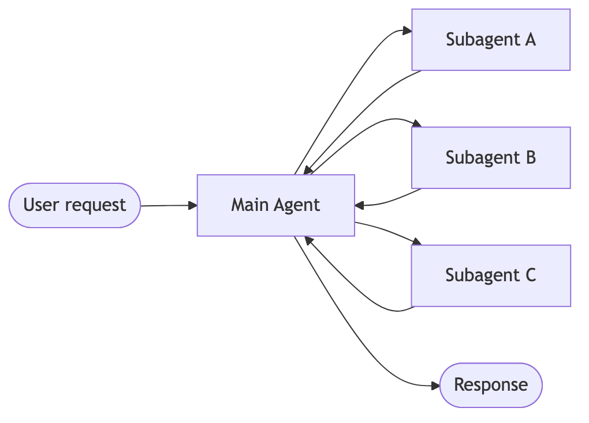
    </Frame>
  </Tab>

  <Tab title="Handoffs">
    智能体通过工具调用相互转移控制权。每个智能体都可以将控制权交给其他智能体，或直接响应用户。

<Frame>
      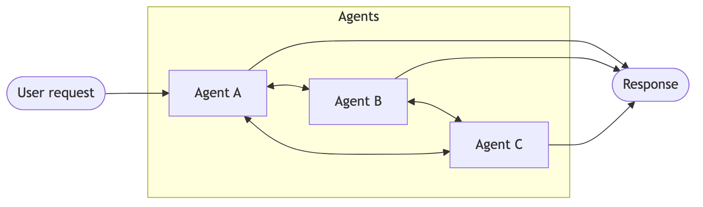
    </Frame>
  </Tab>

  <Tab title="Skills">
    单个智能体按需加载专用提示词和知识，同时保持控制权。

    <Frame>
      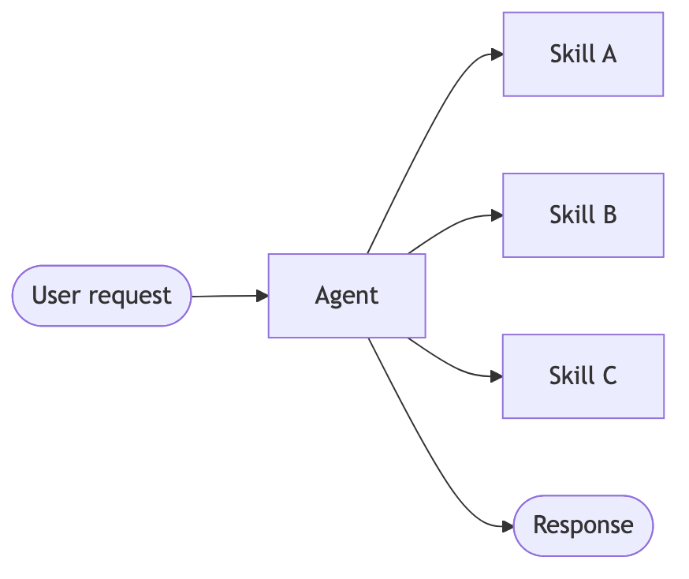
    </Frame>
  </Tab>

  <Tab title="Router">
    路由步骤对输入进行分类，并将其导向专用智能体。结果会被综合。

    <Frame>
      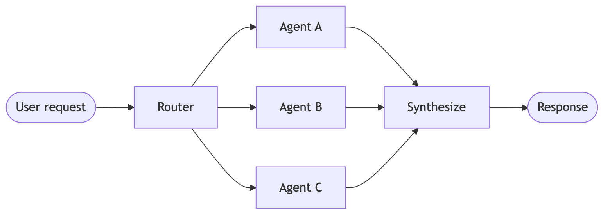
    </Frame>
  </Tab>
</Tabs>

<Tip>
使用 [LangSmith](https://smith.langchain.com) 追踪智能体间的完整协调流程。遵循 [tracing quickstart](https://docs.langchain.com/langsmith/trace-with-langchain) 来完成设置。

我们建议您也设置 [LangSmith Engine](https://docs.langchain.com/langsmith/engine)，它监控您的追踪记录、检测问题并建议解决方案。
</Tip>

## 性能比较

不同的模式具有不同的性能特征。理解这些权衡有助于您根据延迟和成本需求选择合适的模式。

**关键指标：**
- **模型调用次数**：LLM 调用的次数。调用次数越多 = 延迟越高（尤其是顺序调用）和每请求 API 成本越高。
- **处理的 Token 数量**：所有调用中 [context window](/langchain/oss/langchain/context-engineering) 的总使用量。Token 数量越多 = 处理成本越高和潜在的上下文限制。

### 单次请求

> **用户：** "买咖啡"

一个专用的咖啡智能体/技能可以调用一个 `buy_coffee` 工具。

| 模式 | 模型调用次数 | 最佳匹配 |
|------|--------------|----------|
| [**Subagents**](/langchain/oss/langchain/multi-agent/subagents) | 4 | |
| [**Handoffs**](/langchain/oss/langchain/multi-agent/handoffs) | 3 | ✅ |
| [**Skills**](/langchain/oss/langchain/multi-agent/skills) | 3 | ✅ |
| [**Router**](/langchain/oss/langchain/multi-agent/router) | 3 | ✅ |

<Tabs>
  <Tab title="Subagents">
    **4 次模型调用：**

    <Frame>
      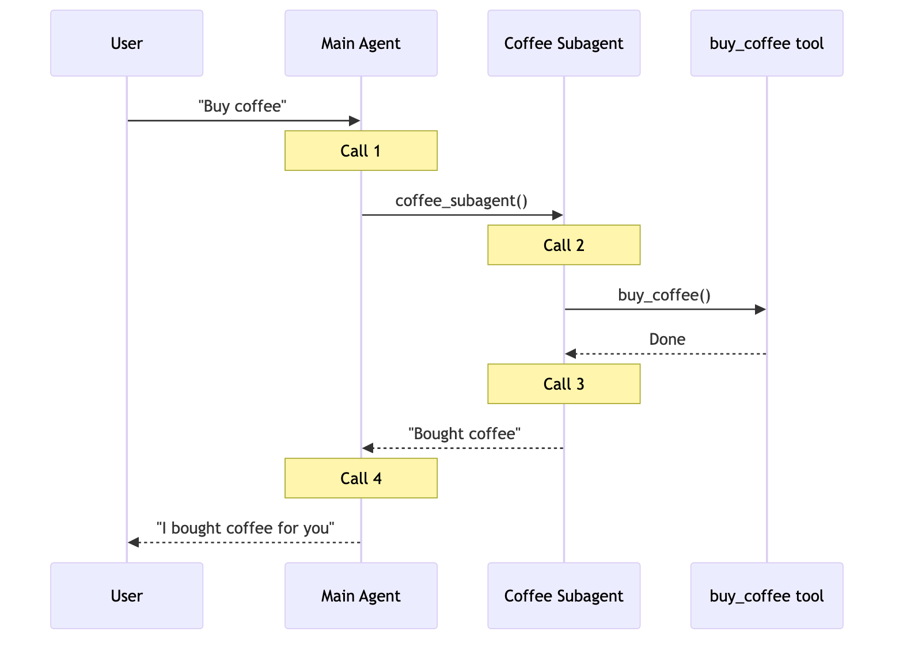
    </Frame>
  </Tab>

  <Tab title="Handoffs">
    **3 次模型调用：**

    <Frame>
      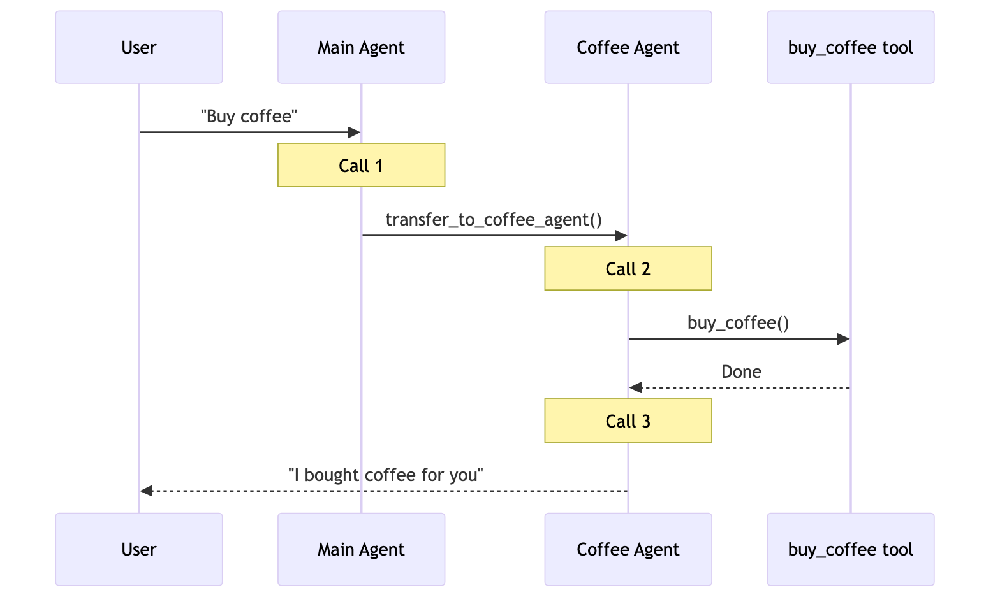
    </Frame>
  </Tab>

  <Tab title="Skills">
    **3 次模型调用：**

    <Frame>
      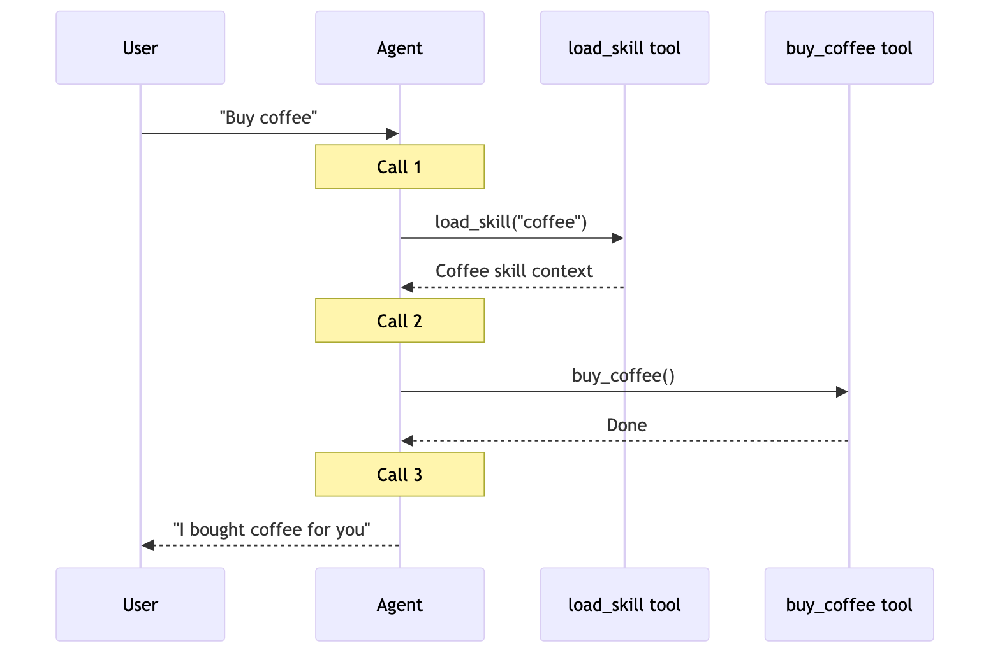
    </Frame>
  </Tab>

  <Tab title="Router">
    **3 次模型调用：**

    <Frame>
      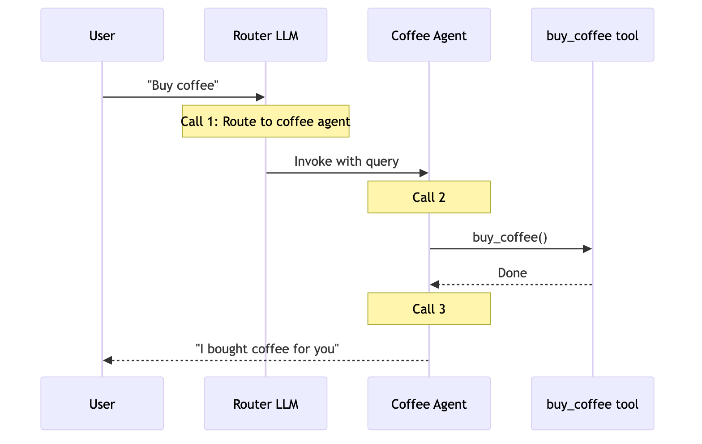
    </Frame>
  </Tab>
</Tabs>

**核心洞察：** 交接、技能和路由器对于单个任务（每次3次调用）效率最高。子智能体增加了一次额外调用，因为结果需要通过主智能体返回——这种开销提供了集中控制。

### 重复请求

> **回合1：** "买咖啡"
> **回合2：** "再买咖啡"

用户在同一个对话中重复相同请求。

| 模式 | 回合2调用次数 | 总次数（两个回合） | 最佳匹配 |
|------|:------------:|:------------------:|:--------:|
| [**子智能体**](/langchain/oss/langchain/multi-agent/subagents) | 4 | 8 | |
| [**交接**](/langchain/oss/langchain/multi-agent/handoffs) | 2 | 5 | ✅ |
| [**技能**](/langchain/oss/langchain/multi-agent/skills) | 2 | 5 | ✅ |
| [**路由器**](/langchain/oss/langchain/multi-agent/router) | 3 | 6 | |

<Tabs>
  <Tab title="Subagents">
    **再次4次调用 → 总计8次**

    - 子智能体按设计**无状态**——每次调用遵循相同流程
    - 主智能体维护对话上下文，但子智能体每次都重新开始
    - 这提供了强上下文隔离，但重复完整流程
  </Tab>

  <Tab title="Handoffs">
    **2次调用 → 总计5次**

    - 咖啡智能体从回合1**仍然活跃**（状态持续）
    - 无需交接——智能体直接调用 `buy_coffee` 工具（调用1）
    - 智能体回复用户（调用2）
    - **通过跳过交接节省1次调用**
  </Tab>

  <Tab title="Skills">
    **2次调用 → 总计5次**

    - 技能上下文在对话历史中**已加载**
    - 无需重新加载——智能体直接调用 `buy_coffee` 工具（调用1）
    - 智能体回复用户（调用2）
    - **通过复用已加载技能节省1次调用**
  </Tab>

  <Tab title="Router">
    **再次3次调用 → 总计6次**

    - 路由器**无状态**——每次请求都需要LLM路由调用
    - 回合2：路由器LLM调用（1）→ 牛奶智能体调用buy_coffee（2）→ 牛奶智能体回复（3）
    - 可以通过在状态智能体中封装为工具来优化
  </Tab>
</Tabs>

**核心洞察：** 有状态模式（交接、技能）在重复请求上节省40-50%的调用。子智能体保持每次请求的一致成本——这种无状态设计提供强上下文隔离，但代价是重复的模型调用。

### 多领域

> **用户：** "比较Python、JavaScript和Rust用于Web开发"

每个语言智能体/技能包含约2000个Token的文档。所有模式都可以进行并行工具调用。

| 模式 | 模型调用次数 | 总Token数 | 最佳匹配 |
|------|:-----------:|:------------:|:--------:|
| [**子智能体**](/langchain/oss/langchain/multi-agent/subagents) | 5 | ~9K | ✅ |
| [**交接**](/langchain/oss/langchain/multi-agent/handoffs) | 7+ | ~14K+ | |
| [**技能**](/langchain/oss/langchain/multi-agent/skills) | 3 | ~15K | |
| [**路由器**](/langchain/oss/langchain/multi-agent/router) | 5 | ~9K | ✅ |

<Tabs>
  <Tab title="Subagents">
    **5次调用，~9K Token**

    <Frame>
      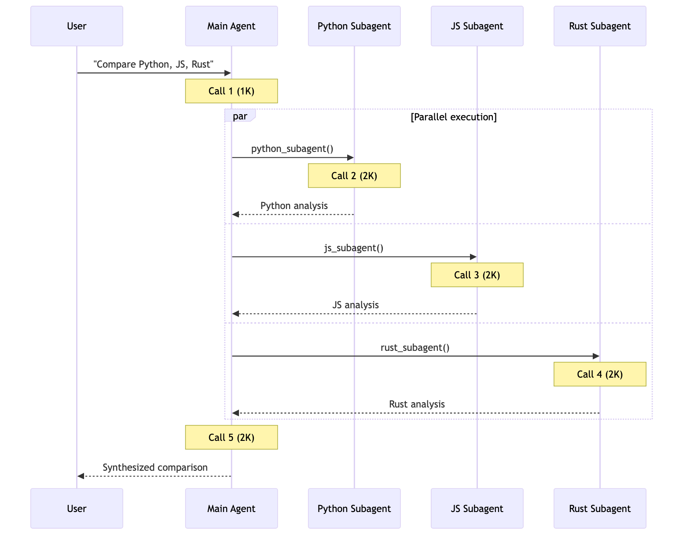
    </Frame>

    每个子智能体在**隔离**状态下仅处理其相关上下文。总计：**9K Token**。
  </Tab>

  <Tab title="Handoffs">
    **7+次调用，~14K+ Token**

    <Frame>
      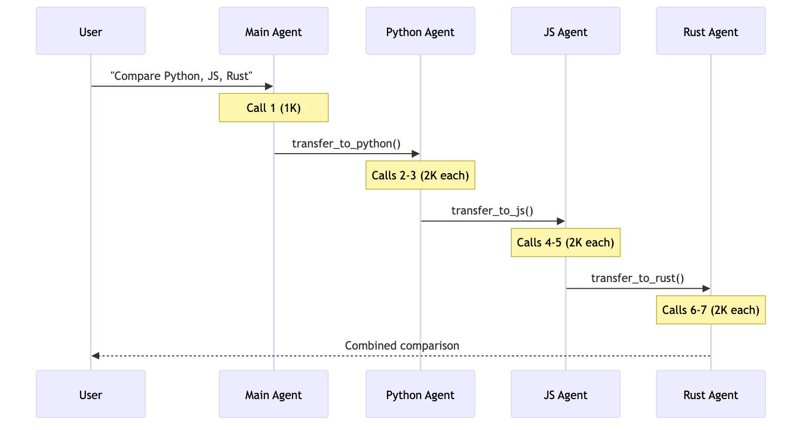
    </Frame>

    交接**按顺序执行**——无法并行研究三种语言。增长对话历史增加开销。总计：**~14K+ Token**。
  </Tab>

  <Tab title="Skills">
    **3次调用，~15K Token**

    <Frame>
      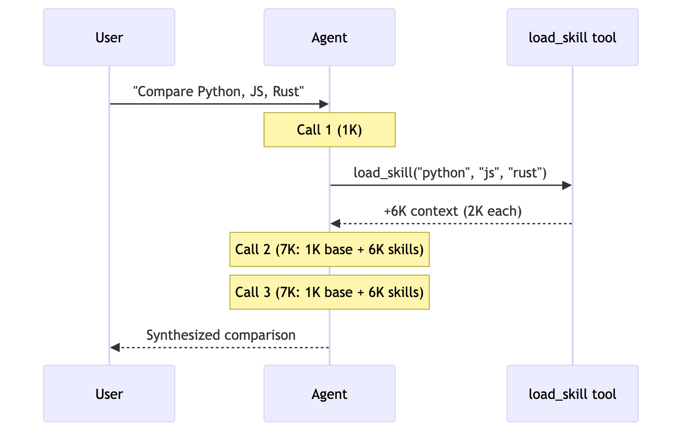
    </Frame>

    加载后，**每次后续调用处理全部6K Token的技能文档**。子智能体整体Token消耗减少67%，得益于上下文隔离。总计：**15K Token**。
  </Tab>

  <Tab title="Router">
    **5次调用，~9K Token**

    <Frame>
      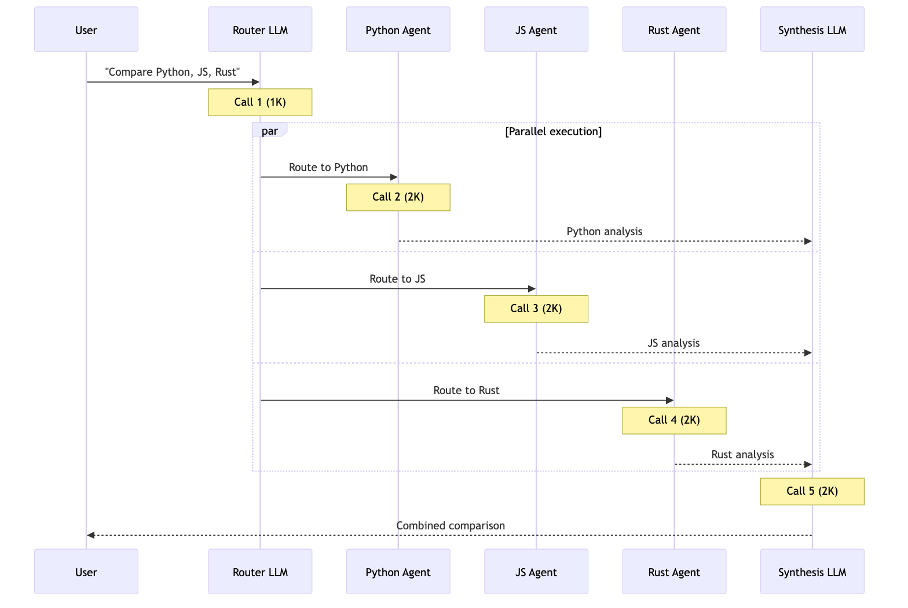
    </Frame>

    路由器使用**LLM进行路由**，然后并行调用智能体。与子智能体类似，但带有显式路由步骤。总计：**9K Token**。
  </Tab>
</Tabs>

**核心洞察：** 对于多领域任务，具有并行执行的模式（子智能体、路由器）效率最高。技能虽然调用次数少，但由于上下文累积导致Token使用率高。交接在此场景下效率低下——必须按顺序执行，且无法并行调用工具同时咨询多个领域。

### 总结

以下是三种场景中模式的对比：

| 模式 | 单次请求 | 重复请求 | 多领域 |
|------|:-----------:|:---------:|:----------------:|
| [**子智能体**](/langchain/oss/langchain/multi-agent/subagents) | 4次调用 | 8次调用（4+4） | 5次调用，9K Token |
| [**交接**](/langchain/oss/langchain/multi-agent/handoffs) | 3次调用 | 5次调用（3+2） | 7+次调用，14K+ Token |
| [**技能**](/langchain/oss/langchain/multi-agent/skills) | 3次调用 | 5次调用（3+2） | 3次调用，15K Token |
| [**路由器**](/langchain/oss/langchain/multi-agent/router) | 3次调用 | 6次调用（3+3） | 5次调用，9K Token |

**选择模式：**

| 优化目标 | [子智能体](/langchain/oss/langchain/multi-agent/subagents) | [交接](/langchain/oss/langchain/multi-agent/handoffs) | [技能](/langchain/oss/langchain/multi-agent/skills) | [路由器](/langchain/oss/langchain/multi-agent/router) |
|----------|:---------:|:--------:|:------:|:------:|
| 单次请求 | | ✅ | ✅ | ✅ |
| 重复请求 | | ✅ | ✅ | |
| 并行执行 | ✅ | | | ✅ |
| 大上下文领域 | ✅ | | | ✅ |
| 简单、专注任务 | | | ✅ | |

---

> 官方原文：[src/oss/langchain/multi-agent/index.mdx](https://github.com/langchain-ai/docs/blob/main/src/oss/langchain/multi-agent/index.mdx) · 译文由 AI 生成，以英文原文为准。
