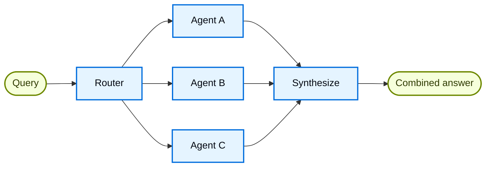

在 **路由** 架构中，路由步骤对输入进行分类并将其导向专门的 [智能体](/langchain/oss/langchain/agents)。当您有明确的 **垂直领域**（需要各自智能体的独立知识领域）时，这很有用。



## 主要特点

* 路由器分解查询
* 零个或多个专用智能体并行调用
* 结果合成为一个连贯的响应

## 使用场景

当您有明确的垂直领域（需要各自智能体的独立知识领域）、需要并行查询多个源，并希望将结果合成为一个组合响应时，使用路由模式。

## 基本实现

路由器对查询进行分类并将其导向适当的智能体。使用 [`Command`](/langchain/oss/langgraph/graph-api#command) 进行单智能体路由，或使用 [`Send`](/langchain/oss/langgraph/graph-api#send) 进行并行分发给多个智能体。

<Tabs>
<Tab title="Single agent">

使用 `Command` 路由到单个专用智能体：

:::python
```python
from langgraph.types import Command

def classify_query(query: str) -> str:
    """Use LLM to classify query and determine the appropriate agent."""
    # Classification logic here
    ...

def route_query(state: State) -> Command:
    """Route to the appropriate agent based on query classification."""
    active_agent = classify_query(state["query"])

    # Route to the selected agent
    return Command(goto=active_agent)
```
:::
:::js
```typescript
import { z } from "zod";
import { Command } from "@langchain/langgraph";

const ClassificationResult = z.object({
  query: z.string(),
  agent: z.string(),
});

function classifyQuery(query: string): z.infer<typeof ClassificationResult> {
  // Use LLM to classify query and determine the appropriate agent
  // Classification logic here
  ...
}

function routeQuery(state: z.infer<typeof ClassificationResult>) {
  const classification = classifyQuery(state.query);

  // Route to the selected agent
  return new Command({ goto: classification.agent });
}
```
:::

</Tab>
<Tab title="Multiple agents (parallel)">

使用 `Send` 并行分发给多个专用智能体：

:::python
```python
from typing import TypedDict
from langgraph.types import Send

class ClassificationResult(TypedDict):
    query: str
    agent: str

def classify_query(query: str) -> list[ClassificationResult]:
    """Use LLM to classify query and determine which agents to invoke."""
    # Classification logic here
    ...

def route_query(state: State):
    """Route to relevant agents based on query classification."""
    classifications = classify_query(state["query"])

    # Fan out to selected agents in parallel
    return [
        Send(c["agent"], {"query": c["query"]})
        for c in classifications
    ]
```
:::
:::js
```typescript
import { z } from "zod";
import { Command } from "@langchain/langgraph";

const ClassificationResult = z.object({
  query: z.string(),
  agent: z.string(),
});

function classifyQuery(query: string): z.infer<typeof ClassificationResult>[] {
  // Use LLM to classify query and determine the appropriate agent
  // Classification logic here
  ...
}

function routeQuery(state: typeof State.State) {
  const classifications = classifyQuery(state.query);

  // Fan out to selected agents in parallel
  return classifications.map(
    (c) => new Send(c.agent, { query: c.query })
  );
}
```
:::

</Tab>
</Tabs>

完整的实现请参考下方的教程。

<Card title="Tutorial: Build a multi-source knowledge base with routing" icon="book" href="/langchain/oss/langchain/multi-agent/router-knowledge-base">
构建一个路由器，并行查询 GitHub、Notion 和 Slack，然后将结果合成为一个连贯的答案。涵盖状态定义、专用智能体、使用 `Send` 的并行执行和结果合成。

</Card>

## 无状态与有状态

两种方法：
* [**无状态路由器](#无状态)** 独立处理每个请求
* [**有状态路由器](#有状态)** 跨请求维护对话历史

## 无状态

每个请求独立路由——调用之间无记忆。对于多轮对话，请参阅 [有状态路由器](#有状态)。

<Tip>
**路由器与子智能体**：这两种模式都可以将工作分派给多个智能体，但它们在路由决策方式上有所不同：

- **路由器**：一个专用的路由步骤（通常是单个 LLM 调用或基于规则的逻辑），对输入进行分类并分派给智能体。路由器本身通常不维护对话历史或执行多轮编排——它是一个预处理步骤。
- **子智能体**：一个主监督智能体在持续对话中动态决定调用哪些 [子智能体](/langchain/oss/langchain/multi-agent/subagents)。主智能体维护上下文，可以在多轮中调用多个子智能体，并编排复杂的多步骤工作流。

当您有明确的输入类别并希望进行确定性或轻量级的分类时，使用 **路由器**。当您需要灵活的、感知对话的编排，并且 LLM 根据不断发展的上下文决定下一步要做什么时，使用 **监督者**。

</Tip>

## 有状态

对于多轮对话，您需要在调用之间维护上下文。

### 工具封装

最简单的方法：将无状态路由器封装为一个对话智能体可以调用的工具。对话智能体处理记忆和上下文；路由器保持无状态。这避免了在多个并行智能体之间管理对话历史的复杂性。

:::python
```python
@tool
def search_docs(query: str) -> str:
    """Search across multiple documentation sources."""
    result = workflow.invoke({"query": query})  # [!code highlight]
    return result["final_answer"]

# Conversational agent uses the router as a tool
conversational_agent = create_agent(
    model,
    tools=[search_docs],
    prompt="You are a helpful assistant. Use search_docs to answer questions."
)
```
:::
:::js
```typescript
const searchDocs = tool(
  async ({ query }) => {
    const result = await workflow.invoke({ query }); // [!code highlight]
    return result.finalAnswer;
  },
  {
    name: "search_docs",
    description: "Search across multiple documentation sources",
    schema: z.object({
      query: z.string().describe("The search query"),
    }),
  }
);

// Conversational agent uses the router as a tool
const conversationalAgent = createAgent({
  model,
  tools: [searchDocs],
  systemPrompt: "You are a helpful assistant. Use search_docs to answer questions.",
});
```
:::

### 完全持久化

如果您需要路由器本身维护状态，请使用 [持久化](/langchain/oss/langchain/short-term-memory) 存储消息历史。在路由到智能体时，从状态中获取先前的消息，并选择性地将其包含在智能体的上下文中——这是 [上下文工程](/langchain/oss/langchain/context-engineering) 的一个杠杆。

<Warning>
**有状态路由器需要自定义历史管理。** 如果路由器在多轮中切换智能体，当智能体具有不同的语气或提示词时，对话可能不会让最终用户感觉流畅。在并行调用中，您需要在路由器级别（输入和合成输出）维护历史，并在路由逻辑中利用这段历史。考虑使用 [交接模式](/langchain/oss/langchain/multi-agent/handoffs) 或 [子智能体模式](/langchain/oss/langchain/multi-agent/subagents)——两者都为多轮对话提供了更清晰的语义。

</Warning>

---

> 官方原文：[src/oss/langchain/multi-agent/router.mdx](https://github.com/langchain-ai/docs/blob/main/src/oss/langchain/multi-agent/router.mdx) · 非官方翻译，译文由 AI 生成，以英文原文为准。
