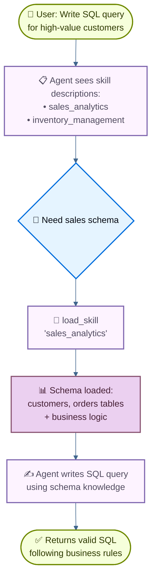

import ChatModelTabsPy from '/langchain/snippets/chat-model-tabs.mdx';
import ChatModelTabsJs from '/langchain/snippets/chat-model-tabs-js.mdx';

本教程展示了如何使用**渐进式披露**——一种上下文管理技术，智能体按需加载信息而非一次性加载——来实现**技能**（基于提示词的专用指令）。智能体通过工具调用加载技能，而不是动态更改系统提示词，只为每个任务发现并加载所需的技能。

**应用场景**：假设您正在构建一个帮助跨不同业务领域编写 SQL 查询的智能体。您的组织可能为每个领域有独立的数据存储，或是一个包含数千个表的单一单体数据库。无论哪种方式，一次性加载所有模式都会使上下文窗口过载。渐进式披露通过按需加载相关模式来解决这个问题。这种架构还允许不同的产品负责人和利益相关者独立地为他们的特定业务领域贡献和维护技能。

**您将构建的内容**：一个具有两个技能（销售分析和库存管理）的 SQL 查询助手。智能体在其系统提示词中看到轻量级的技能描述，然后仅在用户查询相关时通过工具调用加载完整的数据库模式和业务逻辑。

<Note>
有关具有查询执行、错误纠正和验证的 SQL 智能体的完整示例，请参阅我们的 [SQL 智能体教程](/langchain/oss/langchain/sql-agent)。本教程专注于渐进式披露模式，该模式可应用于任何领域。
</Note>

<Tip>
渐进式披露由 Anthropic 推广为构建可扩展智能体技能系统的技术。这种方法使用三级架构（元数据→核心内容→详细资源），智能体按需加载信息。有关此技术的更多信息，请参阅 [为智能体配备现实世界的技能](https://www.anthropic.com/engineering/equipping-agents-for-the-real-world-with-agent-skills)。
</Tip>

## 工作原理

当用户请求 SQL 查询时的流程如下：



**为何使用渐进式披露：**
- **减少上下文使用**——仅加载任务所需的 2-3 个技能，而不是所有可用技能
- **实现团队自主性**——不同团队可以独立开发专用技能（类似于其他多智能体架构）
- **高效扩展**——添加几十或几百个技能而不会使上下文过载
- **简化对话历史**——单个智能体，一个对话线程

**技能是什么**：技能，如 Claude Code 所推广的，主要是基于提示词的：为特定业务任务设计的自包含的专用指令单元。在 Claude Code 中，技能作为文件系统上的目录和文件暴露，通过文件操作发现。技能通过提示词指导行为，可以提供有关工具使用的信息，或包含编码智能体可执行的示例代码。

<Tip>
具有渐进式披露的技能可以视为一种 [RAG（检索增强生成）](/langchain/oss/deepagents/rag) 的形式，其中每个技能是一个检索单元——尽管不一定由嵌入或关键字搜索支持，而是由用于浏览内容（如文件操作，或在本次教程中直接查找）的工具支持。
</Tip>

**权衡：**
- **延迟**：按需加载技能需要额外的工具调用，这会增加需要每个技能的第一个请求的延迟
- **工作流控制**：基本实现依赖于提示词来指导技能使用——如果没有自定义逻辑，您无法强制执行硬约束，例如“始终在技能 A 之前尝试技能 B”

<Tip>
**实现自己的技能系统**

在构建自己的技能实现（我们在本教程中就是这样做的）时，核心概念是渐进式披露——按需加载信息。除此之外，您在实现方面拥有完全的灵活性：

- **存储**：数据库、S3、内存数据结构或任何后端
- **发现**：直接查找（本教程）、用于大型技能集合的 RAG、文件系统扫描或 API 调用
- **加载逻辑**：自定义延迟特性并添加逻辑来搜索技能内容或排序相关性
- **副作用**：定义技能加载时发生的情况，例如暴露与该技能相关的工具（在第 8 节中涵盖）

这种灵活性使您能够针对性能、存储和工作流控制的具体要求进行优化。
</Tip>

## 设置

### 安装

本教程需要 `langchain` 包：

:::python
<CodeGroup>
```bash pip
pip install langchain
```
```bash uv
uv add langchain
```
```bash conda
conda install langchain -c conda-forge
```
</CodeGroup>
:::

:::js
<CodeGroup>
```bash npm
npm install langchain
```
```bash yarn
yarn add langchain
```
```bash pnpm
pnpm add langchain
```
</CodeGroup>
:::

有关更多详细信息，请参阅我们的 [安装指南](/langchain/oss/langchain/install)。

### LangSmith

设置 [LangSmith](https://smith.langchain.com) 以检查智能体内部的运行情况。然后设置以下环境变量：

:::python
<CodeGroup>
```bash Shell
export LANGSMITH_TRACING="true"
export LANGSMITH_API_KEY="..."
```
```python Python
import getpass
import os

os.environ["LANGSMITH_TRACING"] = "true"
os.environ["LANGSMITH_API_KEY"] = getpass.getpass()
```
</CodeGroup>
:::

:::js
<CodeGroup>
```bash Shell
export LANGSMITH_TRACING="true"
export LANGSMITH_API_KEY="..."
```
```typescript TypeScript
process.env.LANGSMITH_TRACING = "true";
process.env.LANGSMITH_API_KEY = "...";
```
</CodeGroup>
:::

### 选择 LLM

从 LangChain 的集成套件中选择一个对话模型：

:::python
<ChatModelTabsPy />
:::

:::js
<ChatModelTabsJs />
:::

## 1. 定义技能

首先，定义技能的结构。每个技能都有一个名称、简要描述（在系统提示词中显示）和完整内容（按需加载）：

:::python
```python
from typing import TypedDict

class Skill(TypedDict):  # [!code highlight]
    """A skill that can be progressively disclosed to the agent."""
    name: str  # Unique identifier for the skill
    description: str  # 1-2 sentence description to show in system prompt
    content: str  # Full skill content with detailed instructions
```
:::

:::js
```typescript
import { z } from "zod";

// A skill that can be progressively disclosed to the agent
const SkillSchema = z.object({  // [!code highlight]
  name: z.string(),  // Unique identifier for the skill
  description: z.string(),  // 1-2 sentence description to show in system prompt
  content: z.string(),  // Full skill content with detailed instructions
});

type Skill = z.infer<typeof SkillSchema>;
```
:::

现在定义 SQL 查询助手的示例技能。这些技能设计为**描述轻量级**（在智能体 upfront 显示）但**内容详细**（按需加载）：

<Accordion title="View complete skill definitions">

:::python
```python
SKILLS: list[Skill] = [
    {
        "name": "sales_analytics",
        "description": "Database schema and business logic for sales data analysis including customers, orders, and revenue.",
        "content": """# Sales Analytics Schema

## Tables

### customers
- customer_id (PRIMARY KEY)
- name
- email
- signup_date
- status (active/inactive)
- customer_tier (bronze/silver/gold/platinum)

### orders
- order_id (PRIMARY KEY)
- customer_id (FOREIGN KEY -> customers)
- order_date
- status (pending/completed/cancelled/refunded)
- total_amount
- sales_region (north/south/east/west)

### order_items
- item_id (PRIMARY KEY)
- order_id (FOREIGN KEY -> orders)
- product_id
- quantity
- unit_price
- discount_percent

## Business Logic

**Active customers**: status = 'active' AND signup_date <= CURRENT_DATE - INTERVAL '90 days'

**Revenue calculation**: Only count orders with status = 'completed'. Use total_amount from orders table, which already accounts for discounts.

**Customer lifetime value (CLV)**: Sum of all completed order amounts for a customer.

**High-value orders**: Orders with total_amount > 1000

## Example Query

-- Get top 10 customers by revenue in the last quarter
SELECT
    c.customer_id,
    c.name,
    c.customer_tier,
    SUM(o.total_amount) as total_revenue
FROM customers c
JOIN orders o ON c.customer_id = o.customer_id
WHERE o.status = 'completed'
  AND o.order_date >= CURRENT_DATE - INTERVAL '3 months'
GROUP BY c.customer_id, c.name, c.customer_tier
ORDER BY total_revenue DESC
LIMIT 10;
""",
    },
    {
        "name": "inventory_management",
        "description": "Database schema and business logic for inventory tracking including products, warehouses, and stock levels.",
        "content": """# Inventory Management Schema

## Tables

### products
- product_id (PRIMARY KEY)
- product_name
- sku
- category
- unit_cost
- reorder_point (minimum stock level before reordering)
- discontinued (boolean)

### warehouses
- warehouse_id (PRIMARY KEY)
- warehouse_name
- location
- capacity

### inventory
- inventory_id (PRIMARY KEY)
- product_id (FOREIGN KEY -> products)
- warehouse_id (FOREIGN KEY -> warehouses)
- quantity_on_hand
- last_updated

### stock_movements
- movement_id (PRIMARY KEY)
- product_id (FOREIGN KEY -> products)
- warehouse_id (FOREIGN KEY -> warehouses)
- movement_type (inbound/outbound/transfer/adjustment)
- quantity (positive for inbound, negative for outbound)
- movement_date
- reference_number

## Business Logic

**Available stock**: quantity_on_hand from inventory table where quantity_on_hand > 0

**Products needing reorder**: Products where total quantity_on_hand across all warehouses is less than or equal to the product's reorder_point

**Active products only**: Exclude products where discontinued = true unless specifically analyzing discontinued items

**Stock valuation**: quantity_on_hand * unit_cost for each product

## Example Query

-- Find products below reorder point across all warehouses
SELECT
    p.product_id,
    p.product_name,
    p.reorder_point,
    SUM(i.quantity_on_hand) as total_stock,
    p.unit_cost,
    (p.reorder_point - SUM(i.quantity_on_hand)) as units_to_reorder
FROM products p
JOIN inventory i ON p.product_id = i.product_id
WHERE p.discontinued = false
GROUP BY p.product_id, p.product_name, p.reorder_point, p.unit_cost
HAVING SUM(i.quantity_on_hand) <= p.reorder_point
ORDER BY units_to_reorder DESC;
""",
    },
]
```
:::

:::js
```typescript
import { context } from "langchain";

const SKILLS: Skill[] = [
  {
    name: "sales_analytics",
    description:
      "Database schema and business logic for sales data analysis including customers, orders, and revenue.",
    content: context`
    # Sales Analytics Schema

    ## Tables

    ### customers
    - customer_id (PRIMARY KEY)
    - name
    - email
    - signup_date
    - status (active/inactive)
    - customer_tier (bronze/silver/gold/platinum)

    ### orders
    - order_id (PRIMARY KEY)
    - customer_id (FOREIGN KEY -> customers)
    - order_date
    - status (pending/completed/cancelled/refunded)
    - total_amount
    - sales_region (north/south/east/west)

    ### order_items
    - item_id (PRIMARY KEY)
    - order_id (FOREIGN KEY -> orders)
    - product_id
    - quantity
    - unit_price
    - discount_percent

    ## Business Logic

    **Active customers**:
    status = 'active' AND signup_date <= CURRENT_DATE - INTERVAL '90 days'

    **Revenue calculation**:
    Only count orders with status = 'completed'.
    Use total_amount from orders table, which already accounts for discounts.

    **Customer lifetime value (CLV)**:
    Sum of all completed order amounts for a customer.

    **High-value orders**:
    Orders with total_amount > 1000

    ## Example Query

    -- Get top 10 customers by revenue in the last quarter
    SELECT
        c.customer_id,
        c.name,
        c.customer_tier,
        SUM(o.total_amount) as total_revenue
    FROM customers c
    JOIN orders o ON c.customer_id = o.customer_id
    WHERE o.status = 'completed'
    AND o.order_date >= CURRENT_DATE - INTERVAL '3 months'
    GROUP BY c.customer_id, c.name, c.customer_tier
    ORDER BY total_revenue DESC
    LIMIT 10;`,
  },
  {
    name: "inventory_management",
    description:
      "Database schema and business logic for inventory tracking including products, warehouses, and stock levels.",
    content: context`
    # Inventory Management Schema

    ## Tables

    ### products
    - product_id (PRIMARY KEY)
    - product_name
    - sku
    - category
    - unit_cost
    - reorder_point (minimum stock level before reordering)
    - discontinued (boolean)

    ### warehouses
    - warehouse_id (PRIMARY KEY)
    - warehouse_name
    - location
    - capacity

    ### inventory
    - inventory_id (PRIMARY KEY)
    - product_id (FOREIGN KEY -> products)
    - warehouse_id (FOREIGN KEY -> warehouses)
    - quantity_on_hand
    - last_updated

    ### stock_movements
    - movement_id (PRIMARY KEY)
    - product_id (FOREIGN KEY -> products)
    - warehouse_id (FOREIGN KEY -> warehouses)
    - movement_type (inbound/outbound/transfer/adjustment)
    - quantity (positive for inbound, negative for outbound)
    - movement_date
    - reference_number

    ## Business Logic

    **Available stock**:
    quantity_on_hand from inventory table where quantity_on_hand > 0

    **Products needing reorder**:
    Products where total quantity_on_hand across all warehouses is less
    than or equal to the product's reorder_point

    **Active products only**:
    Exclude products where discontinued = true unless specifically analyzing discontinued items

    **Stock valuation**:
    quantity_on_hand * unit_cost for each product

    ## Example Query

    -- Find products below reorder point across all warehouses
    SELECT
        p.product_id,
        p.product_name,
        p.reorder_point,
        SUM(i.quantity_on_hand) as total_stock,
        p.unit_cost,
        (p.reorder_point - SUM(i.quantity_on_hand)) as units_to_reorder
    FROM products p
    JOIN inventory i ON p.product_id = i.product_id
    WHERE p.discontinued = false
    GROUP BY p.product_id, p.product_name, p.reorder_point, p.unit_cost
    HAVING SUM(i.quantity_on_hand) <= p.reorder_point
    ORDER BY units_to_reorder DESC;`,
  },
];
```
:::

</Accordion>

## 2. 创建技能加载工具

创建一个按需加载完整技能内容的工具：

:::python
```python
from langchain.tools import tool

@tool  # [!code highlight]
def load_skill(skill_name: str) -> str:
    """Load the full content of a skill into the agent's context.

    Use this when you need detailed information about how to handle a specific
    type of request. This will provide you with comprehensive instructions,
    policies, and guidelines for the skill area.

    Args:
        skill_name: The name of the skill to load (e.g., "expense_reporting", "travel_booking")
    """
    # Find and return the requested skill
    for skill in SKILLS:
        if skill["name"] == skill_name:
            return f"Loaded skill: {skill_name}\n\n{skill['content']}"  # [!code highlight]

    # Skill not found
    available = ", ".join(s["name"] for s in SKILLS)
    return f"Skill '{skill_name}' not found. Available skills: {available}"
```
:::

:::js
```typescript
import { tool } from "langchain";
import { z } from "zod";

const loadSkill = tool(  // [!code highlight]
  async ({ skillName }) => {
    // Find and return the requested skill
    const skill = SKILLS.find((s) => s.name === skillName);
    if (skill) {
      return `Loaded skill: ${skillName}\n\n${skill.content}`;  // [!code highlight]
    }

    // Skill not found
    const available = SKILLS.map((s) => s.name).join(", ");
    return `Skill '${skillName}' not found. Available skills: ${available}`;
  },
  {
    name: "load_skill",
    description: `Load the full content of a skill into the agent's context.

Use this when you need detailed information about how to handle a specific
type of request. This will provide you with comprehensive instructions,
policies, and guidelines for the skill area.`,
    schema: z.object({
      skillName: z.string().describe("The name of the skill to load"),
    }),
  }
);
```
:::

`load_skill` 工具将完整技能内容作为字符串返回，该内容成为对话的一部分作为 ToolMessage。有关创建和使用工具的更多详细信息，请参阅 [工具指南](/langchain/oss/langchain/tools)。

## 3. 构建技能中间件

创建自定义中间件，将技能描述注入系统提示词。此中间件使技能可发现，而无需 upfront 加载其完整内容。

<Note>
本指南演示了创建自定义中间件。有关中间件概念和模式的全面指南，请参阅 [自定义中间件文档](/langchain/oss/langchain/middleware/custom)。
</Note>

:::python
```python
from langchain.agents.middleware import ModelRequest, ModelResponse, AgentMiddleware
from langchain.messages import SystemMessage
from typing import Callable

class SkillMiddleware(AgentMiddleware):  # [!code highlight]
    """Middleware that injects skill descriptions into the system prompt."""

    # Register the load_skill tool as a class variable
    tools = [load_skill]  # [!code highlight]

    def __init__(self):
        """Initialize and generate the skills prompt from SKILLS."""
        # Build skills prompt from the SKILLS list
        skills_list = []
        for skill in SKILLS:
            skills_list.append(
                f"- **{skill['name']}**: {skill['description']}"
            )
        self.skills_prompt = "\n".join(skills_list)

    def wrap_model_call(
        self,
        request: ModelRequest,
        handler: Callable[[ModelRequest], ModelResponse],
    ) -> ModelResponse:
        """Sync: Inject skill descriptions into system prompt."""
        # Build the skills addendum
        skills_addendum = ( # [!code highlight]
            f"\n\n## Available Skills\n\n{self.skills_prompt}\n\n" # [!code highlight]
            "Use the load_skill tool when you need detailed information " # [!code highlight]
            "about handling a specific type of request." # [!code highlight]
        )

        # Append to system message content blocks
        new_content = list(request.system_message.content_blocks) + [
            {"type": "text", "text": skills_addendum}
        ]
        new_system_message = SystemMessage(content=new_content)
        modified_request = request.override(system_message=new_system_message)
        return handler(modified_request)
```
:::

:::js
```typescript
import { createMiddleware } from "langchain";

// Build skills prompt from the SKILLS list
const skillsPrompt = SKILLS.map(
  (skill) => `- **${skill.name}**: ${skill.description}`
).join("\n");

const skillMiddleware = createMiddleware({  // [!code highlight]
  name: "skillMiddleware",
  tools: [loadSkill],  // [!code highlight]
  wrapModelCall: async (request, handler) => {
    // Build the skills addendum
    const skillsAddendum =  // [!code highlight]
      `\n\n## Available Skills\n\n${skillsPrompt}\n\n` +  // [!code highlight]
      "Use the load_skill tool when you need detailed information " +  // [!code highlight]
      "about handling a specific type of request.";  // [!code highlight]

    // Append to system prompt
    const newSystemPrompt = request.systemPrompt + skillsAddendum;

    return handler({
      ...request,
      systemPrompt: newSystemPrompt,
    });
  },
});
```
:::

中间件将技能描述追加到系统提示词中，使智能体在不加载其完整内容的情况下知晓可用技能。`load_skill`工具被注册为类变量，使其对智能体可用。

<Note>
**生产环境考虑**：本教程为简化起见在`__init__`中加载技能列表。在生产系统中，您可能希望在`before_agent`钩子中加载技能，以便它们可以定期刷新以反映最新更改（例如，当添加新技能或修改现有技能时）。有关详细信息，请参阅[before_agent钩子文档](/langchain/oss/langchain/middleware/custom#节点式钩子)。

</Note>

## 4. 创建带技能支持的智能体

现在使用带技能中间件和用于状态持久化的检查点器创建智能体：

:::python
```python
from langchain.agents import create_agent
from langgraph.checkpoint.memory import InMemorySaver

# Create the agent with skill support
agent = create_agent(
    model,
    system_prompt=(
        "You are a SQL query assistant that helps users "
        "write queries against business databases."
    ),
    middleware=[SkillMiddleware()],  # [!code highlight]
    checkpointer=InMemorySaver(),
)
```
:::

:::js
```typescript
import { createAgent } from "langchain";
import { MemorySaver } from "@langchain/langgraph";

// Create the agent with skill support
const agent = createAgent({
  model,
  systemPrompt:
    "You are a SQL query assistant that helps users " +
    "write queries against business databases.",
  middleware: [skillMiddleware],  // [!code highlight]
  checkpointer: new MemorySaver(),
});
```
:::

智能体现在可以访问系统提示词中的技能描述，并在需要时调用`load_skill`检索完整技能内容。检查点器维护跨回合的对话历史。

## 5. 测试渐进式披露

使用需要特定技能知识的提问测试智能体：

:::python
```python
from langchain_core.utils.uuid import uuid7

# Configuration for this conversation thread
thread_id = str(uuid7())
config = {"configurable": {"thread_id": thread_id}}

# Ask for a SQL query
result = agent.invoke(  # [!code highlight]
    {
        "messages": [
            {
                "role": "user",
                "content": (
                    "Write a SQL query to find all customers "
                    "who made orders over $1000 in the last month"
                ),
            }
        ]
    },
    config
)

# Print the conversation
for message in result["messages"]:
    if hasattr(message, 'pretty_print'):
        message.pretty_print()
    else:
        print(f"{message.type}: {message.content}")
```
:::

:::js
```typescript
import { uuid7 } from "langsmith";
// Configuration for this conversation thread
const threadId = uuid7();
const config = { configurable: { thread_id: threadId } };

// Ask for a SQL query
const result = await agent.invoke(  // [!code highlight]
  {
    messages: [
      {
        role: "user",
        content:
          "Write a SQL query to find all customers " +
          "who made orders over $1000 in the last month",
      },
    ],
  },
  config
);

// Print the conversation
for (const message of result.messages) {
  console.log(`${message._getType()}: ${message.content}`);
}
```
:::

预期输出：

```
================================ Human Message =================================

Write a SQL query to find all customers who made orders over $1000 in the last month
================================== Ai Message ==================================
Tool Calls:
  load_skill (call_abc123)
 Call ID: call_abc123
  Args:
    skill_name: sales_analytics
================================= Tool Message =================================
Name: load_skill

Loaded skill: sales_analytics

# Sales Analytics Schema

## Tables

### customers
- customer_id (PRIMARY KEY)
- name
- email
- signup_date
- status (active/inactive)
- customer_tier (bronze/silver/gold/platinum)

### orders
- order_id (PRIMARY KEY)
- customer_id (FOREIGN KEY -> customers)
- order_date
- status (pending/completed/cancelled/refunded)
- total_amount
- sales_region (north/south/east/west)

[... rest of schema ...]

## Business Logic

**High-value orders**: Orders with `total_amount > 1000`
**Revenue calculation**: Only count orders with `status = 'completed'`

================================== Ai Message ==================================

Here's a SQL query to find all customers who made orders over $1000 in the last month:

\`\`\`sql
SELECT DISTINCT
    c.customer_id,
    c.name,
    c.email,
    c.customer_tier
FROM customers c
JOIN orders o ON c.customer_id = o.customer_id
WHERE o.total_amount > 1000
  AND o.status = 'completed'
  AND o.order_date >= CURRENT_DATE - INTERVAL '1 month'
ORDER BY c.customer_id;
\`\`\`

This query:
- Joins customers with their orders
- Filters for high-value orders (>$1000) using the total_amount field
- Only includes completed orders (as per the business logic)
- Restricts to orders from the last month
- Returns distinct customers to avoid duplicates if they made multiple qualifying orders
```

智能体在其系统提示词中看到了轻量级技能描述，识别出问题需要销售数据库知识，调用`load_skill("sales_analytics")`获取完整架构和业务逻辑，然后使用这些信息遵循数据库规范编写了正确的查询。

## 6. 高级：使用自定义状态添加约束

<Accordion title="Optional: Track loaded skills and enforce tool constraints">

您可以添加约束以强制确保某些工具仅在特定技能加载后可用。这需要跟踪已加载哪些技能的自定义智能体状态。

### 定义自定义状态

首先，扩展智能体状态以跟踪已加载的技能：

:::python
```python
from langchain.agents.middleware import AgentState

class CustomState(AgentState):  # [!code highlight]
    skills_loaded: NotRequired[list[str]]  # Track which skills have been loaded  # [!code highlight]
```
:::

:::js
```typescript
import { StateSchema } from "@langchain/langgraph";
import { z } from "zod";

const CustomState = new StateSchema({
  skillsLoaded: z.array(z.string()).optional(),  // Track which skills have been loaded  // [!code highlight]
});
```
:::

### 更新load_skill以修改状态

修改`load_skill`工具，在加载技能时更新状态：

:::python
```python
from langgraph.types import Command  # [!code highlight]
from langchain.tools import tool, ToolRuntime
from langchain.messages import ToolMessage  # [!code highlight]

@tool
def load_skill(skill_name: str, runtime: ToolRuntime) -> Command:  # [!code highlight]
    """Load the full content of a skill into the agent's context.

    Use this when you need detailed information about how to handle a specific
    type of request. This will provide you with comprehensive instructions,
    policies, and guidelines for the skill area.

    Args:
        skill_name: The name of the skill to load
    """
    # Find and return the requested skill
    for skill in SKILLS:
        if skill["name"] == skill_name:
            skill_content = f"Loaded skill: {skill_name}\n\n{skill['content']}"

            # Update state to track loaded skill
            return Command(  # [!code highlight]
                update={  # [!code highlight]
                    "messages": [  # [!code highlight]
                        ToolMessage(  # [!code highlight]
                            content=skill_content,  # [!code highlight]
                            tool_call_id=runtime.tool_call_id,  # [!code highlight]
                        )  # [!code highlight]
                    ],  # [!code highlight]
                    "skills_loaded": [skill_name],  # [!code highlight]
                }  # [!code highlight]
            )  # [!code highlight]

    # Skill not found
    available = ", ".join(s["name"] for s in SKILLS)
    return Command(
        update={
            "messages": [
                ToolMessage(
                    content=f"Skill '{skill_name}' not found. Available skills: {available}",
                    tool_call_id=runtime.tool_call_id,
                )
            ]
        }
    )
```
:::

:::js
```typescript
import { tool, ToolMessage, type ToolRuntime } from "langchain";
import { Command } from "@langchain/langgraph";  // [!code highlight]
import { z } from "zod";

const loadSkill = tool(  // [!code highlight]
  async ({ skillName }, runtime: ToolRuntime<typeof CustomState.State>) => {
    // Find and return the requested skill
    const skill = SKILLS.find((s) => s.name === skillName);

    if (skill) {
      const skillContent = `Loaded skill: ${skillName}\n\n${skill.content}`;

      // Update state to track loaded skill
      return new Command({  // [!code highlight]
        update: {  // [!code highlight]
          messages: [  // [!code highlight]
            new ToolMessage({  // [!code highlight]
              content: skillContent,  // [!code highlight]
              tool_call_id: runtime.toolCallId,  // [!code highlight]
            }),  // [!code highlight]
          ],  // [!code highlight]
          skillsLoaded: [skillName],  // [!code highlight]
        },  // [!code highlight]
      });  // [!code highlight]
    }

    // Skill not found
    const available = SKILLS.map((s) => s.name).join(", ");
    return new Command({
      update: {
        messages: [
          new ToolMessage({
            content: `Skill '${skillName}' not found. Available skills: ${available}`,
            tool_call_id: runtime.toolCallId,
          }),
        ],
      },
    });
  },
  {
    name: "load_skill",
    description: `Load the full content of a skill into the agent's context.`,
    schema: z.object({
      skillName: z.string().describe("The name of the skill to load"),
    }),
  }
);
```
:::

### 创建受约束的工具

创建一个仅在加载特定技能后才可用的工具：

:::python
```python
@tool
def write_sql_query(  # [!code highlight]
    query: str,
    vertical: str,
    runtime: ToolRuntime,
) -> str:
    """Write and validate a SQL query for a specific business vertical.

    This tool helps format and validate SQL queries. You must load the
    appropriate skill first to understand the database schema.

    Args:
        query: The SQL query to write
        vertical: The business vertical (sales_analytics or inventory_management)
    """
    # Check if the required skill has been loaded
    skills_loaded = runtime.state.get("skills_loaded", [])  # [!code highlight]

    if vertical not in skills_loaded:  # [!code highlight]
        return (  # [!code highlight]
            f"Error: You must load the '{vertical}' skill first "  # [!code highlight]
            f"to understand the database schema before writing queries. "  # [!code highlight]
            f"Use load_skill('{vertical}') to load the schema."  # [!code highlight]
        )  # [!code highlight]

    # Validate and format the query
    return (
        f"SQL Query for {vertical}:\n\n"
        f"```sql\n{query}\n```\n\n"
        f"✓ Query validated against {vertical} schema\n"
        f"Ready to execute against the database."
    )
```
:::

:::js
```typescript
const writeSqlQuery = tool(  // [!code highlight]
  async ({ query, vertical }, runtime: ToolRuntime<typeof CustomState.State>) => {
    // Check if the required skill has been loaded
    const skillsLoaded = runtime.state.skillsLoaded ?? [];  // [!code highlight]

    if (!skillsLoaded.includes(vertical)) {  // [!code highlight]
      return (  // [!code highlight]
        `Error: You must load the '${vertical}' skill first ` +  // [!code highlight]
        `to understand the database schema before writing queries. ` +  // [!code highlight]
        `Use load_skill('${vertical}') to load the schema.`  // [!code highlight]
      );  // [!code highlight]
    }

    // Validate and format the query
    return (
      `SQL Query for ${vertical}:\n\n` +
      `\`\`\`sql\n${query}\n\`\`\`\n\n` +
      `✓ Query validated against ${vertical} schema\n` +
      `Ready to execute against the database.`
    );
  },
  {
    name: "write_sql_query",
    description: `Write and validate a SQL query for a specific business vertical.

This tool helps format and validate SQL queries. You must load the
appropriate skill first to understand the database schema.`,
    schema: z.object({
      query: z.string().describe("The SQL query to write"),
      vertical: z.string().describe("The business vertical (sales_analytics or inventory_management)"),
    }),
  }
);
```
:::

### 更新中间件和智能体

更新中间件以使用自定义状态模式：

:::python
```python
class SkillMiddleware(AgentMiddleware[CustomState]):  # [!code highlight]
    """Middleware that injects skill descriptions into the system prompt."""

    state_schema = CustomState  # [!code highlight]
    tools = [load_skill, write_sql_query]  # [!code highlight]

    # ... rest of the middleware implementation stays the same
```
:::

:::js
```typescript
const skillMiddleware = createMiddleware({  // [!code highlight]
  name: "skillMiddleware",
  stateSchema: CustomState,  // [!code highlight]
  tools: [loadSkill, writeSqlQuery],  // [!code highlight]
  // ... rest of the middleware implementation stays the same
});
```
:::

使用注册了受约束工具的中间件创建智能体：

:::python
```python
agent = create_agent(
    model,
    system_prompt=(
        "You are a SQL query assistant that helps users "
        "write queries against business databases."
    ),
    middleware=[SkillMiddleware()],  # [!code highlight]
    checkpointer=InMemorySaver(),
)
```
:::

:::js
```typescript
const agent = createAgent({
  model,
  systemPrompt:
    "You are a SQL query assistant that helps users " +
    "write queries against business databases.",
  middleware: [skillMiddleware],  // [!code highlight]
  checkpointer: new MemorySaver(),
});
```
:::

现在如果智能体在加载所需技能之前尝试使用`write_sql_query`，它将收到错误消息，提示它首先加载适当的技能（例如，`sales_analytics`或`inventory_management`）。这确保智能体在尝试验证查询之前具有必要的架构知识。

</Accordion>

## 完整示例

<Accordion title="View complete runnable script">

这是一个结合了本教程中所有部分的完整、可运行的实现：

:::python
```python
from langchain_core.utils.uuid import uuid7
from typing import TypedDict, NotRequired
from langchain.tools import tool
from langchain.agents import create_agent
from langchain.agents.middleware import ModelRequest, ModelResponse, AgentMiddleware
from langchain.messages import SystemMessage
from langgraph.checkpoint.memory import InMemorySaver
from typing import Callable

# Define skill structure
class Skill(TypedDict):
    """A skill that can be progressively disclosed to the agent."""
    name: str
    description: str
    content: str

# Define skills with schemas and business logic
SKILLS: list[Skill] = [
    {
        "name": "sales_analytics",
        "description": "Database schema and business logic for sales data analysis including customers, orders, and revenue.",
        "content": """# Sales Analytics Schema

## Tables

### customers
- customer_id (PRIMARY KEY)
- name
- email
- signup_date
- status (active/inactive)
- customer_tier (bronze/silver/gold/platinum)

### orders
- order_id (PRIMARY KEY)
- customer_id (FOREIGN KEY -> customers)
- order_date
- status (pending/completed/cancelled/refunded)
- total_amount
- sales_region (north/south/east/west)

### order_items
- item_id (PRIMARY KEY)
- order_id (FOREIGN KEY -> orders)
- product_id
- quantity
- unit_price
- discount_percent

## Business Logic

**Active customers**: status = 'active' AND signup_date <= CURRENT_DATE - INTERVAL '90 days'

**Revenue calculation**: Only count orders with status = 'completed'. Use total_amount from orders table, which already accounts for discounts.

**Customer lifetime value (CLV)**: Sum of all completed order amounts for a customer.

**High-value orders**: Orders with total_amount > 1000

## Example Query

-- Get top 10 customers by revenue in the last quarter
SELECT
    c.customer_id,
    c.name,
    c.customer_tier,
    SUM(o.total_amount) as total_revenue
FROM customers c
JOIN orders o ON c.customer_id = o.customer_id
WHERE o.status = 'completed'
  AND o.order_date >= CURRENT_DATE - INTERVAL '3 months'
GROUP BY c.customer_id, c.name, c.customer_tier
ORDER BY total_revenue DESC
LIMIT 10;
""",
    },
    {
        "name": "inventory_management",
        "description": "Database schema and business logic for inventory tracking including products, warehouses, and stock levels.",
        "content": """# Inventory Management Schema

## Tables

### products
- product_id (PRIMARY KEY)
- product_name
- sku
- category
- unit_cost
- reorder_point (minimum stock level before reordering)
- discontinued (boolean)

### warehouses
- warehouse_id (PRIMARY KEY)
- warehouse_name
- location
- capacity

### inventory
- inventory_id (PRIMARY KEY)
- product_id (FOREIGN KEY -> products)
- warehouse_id (FOREIGN KEY -> warehouses)
- quantity_on_hand
- last_updated

### stock_movements
- movement_id (PRIMARY KEY)
- product_id (FOREIGN KEY -> products)
- warehouse_id (FOREIGN KEY -> warehouses)
- movement_type (inbound/outbound/transfer/adjustment)
- quantity (positive for inbound, negative for outbound)
- movement_date
- reference_number

## Business Logic

**Available stock**: quantity_on_hand from inventory table where quantity_on_hand > 0

**Products needing reorder**: Products where total quantity_on_hand across all warehouses is less than or equal to the product's reorder_point

**Active products only**: Exclude products where discontinued = true unless specifically analyzing discontinued items

**Stock valuation**: quantity_on_hand * unit_cost for each product

## Example Query

-- Find products below reorder point across all warehouses
SELECT
    p.product_id,
    p.product_name,
    p.reorder_point,
    SUM(i.quantity_on_hand) as total_stock,
    p.unit_cost,
    (p.reorder_point - SUM(i.quantity_on_hand)) as units_to_reorder
FROM products p
JOIN inventory i ON p.product_id = i.product_id
WHERE p.discontinued = false
GROUP BY p.product_id, p.product_name, p.reorder_point, p.unit_cost
HAVING SUM(i.quantity_on_hand) <= p.reorder_point
ORDER BY units_to_reorder DESC;
""",
    },
]

# Create skill loading tool
@tool
def load_skill(skill_name: str) -> str:
    """Load the full content of a skill into the agent's context.

    Use this when you need detailed information about how to handle a specific
    type of request. This will provide you with comprehensive instructions,
    policies, and guidelines for the skill area.

    Args:
        skill_name: The name of the skill to load (e.g., "sales_analytics", "inventory_management")
    """
    # Find and return the requested skill
    for skill in SKILLS:
        if skill["name"] == skill_name:
            return f"Loaded skill: {skill_name}\n\n{skill['content']}"

    # Skill not found
    available = ", ".join(s["name"] for s in SKILLS)
    return f"Skill '{skill_name}' not found. Available skills: {available}"

# Create skill middleware
class SkillMiddleware(AgentMiddleware):
    """Middleware that injects skill descriptions into the system prompt."""

    # Register the load_skill tool as a class variable
    tools = [load_skill]

    def __init__(self):
        """Initialize and generate the skills prompt from SKILLS."""
        # Build skills prompt from the SKILLS list
        skills_list = []
        for skill in SKILLS:
            skills_list.append(
                f"- **{skill['name']}**: {skill['description']}"
            )
        self.skills_prompt = "\n".join(skills_list)

    def wrap_model_call(
        self,
        request: ModelRequest,
        handler: Callable[[ModelRequest], ModelResponse],
    ) -> ModelResponse:
        """Sync: Inject skill descriptions into system prompt."""
        # Build the skills addendum
        skills_addendum = (
            f"\n\n## Available Skills\n\n{self.skills_prompt}\n\n"
            "Use the load_skill tool when you need detailed information "
            "about handling a specific type of request."
        )

        # Append to system message content blocks
        new_content = list(request.system_message.content_blocks) + [
            {"type": "text", "text": skills_addendum}
        ]
        new_system_message = SystemMessage(content=new_content)
        modified_request = request.override(system_message=new_system_message)
        return handler(modified_request)

# Initialize your chat model (replace with your model)
# Example: from langchain_anthropic import ChatAnthropic
# model = ChatAnthropic(model="claude-sonnet-4-6")
from langchain_openai import ChatOpenAI
model = ChatOpenAI(model="gpt-5.5")

# Create the agent with skill support
agent = create_agent(
    model,
    system_prompt=(
        "You are a SQL query assistant that helps users "
        "write queries against business databases."
    ),
    middleware=[SkillMiddleware()],
    checkpointer=InMemorySaver(),
)

# Example usage
if __name__ == "__main__":
    # Configuration for this conversation thread
    thread_id = str(uuid7())
    config = {"configurable": {"thread_id": thread_id}}

    # Ask for a SQL query
    result = agent.invoke(
        {
            "messages": [
                {
                    "role": "user",
                    "content": (
                        "Write a SQL query to find all customers "
                        "who made orders over $1000 in the last month"
                    ),
                }
            ]
        },
        config
    )

    # Print the conversation
    for message in result["messages"]:
        if hasattr(message, 'pretty_print'):
            message.pretty_print()
        else:
            print(f"{message.type}: {message.content}")
```
:::

:::js
```typescript
import {
  tool,
  createAgent,
  createMiddleware,
  ToolMessage,
  context,
  type ToolRuntime,
} from "langchain";
import { MemorySaver, Command } from "@langchain/langgraph";
import { ChatOpenAI } from "@langchain/openai";
import { z } from "zod";
import { uuid7 } from "langsmith";

// A skill that can be progressively disclosed to the agent
const SkillSchema = z.object({
  name: z.string(), // Unique identifier for the skill
  description: z.string(), // 1-2 sentence description to show in system prompt
  content: z.string(), // Full skill content with detailed instructions
});

type Skill = z.infer<typeof SkillSchema>;

const SKILLS: Skill[] = [
  {
    name: "sales_analytics",
    description:
      "Database schema and business logic for sales data analysis including customers, orders, and revenue.",
    content: context`
    # Sales Analytics Schema

    ## Tables

    ### customers
    - customer_id (PRIMARY KEY)
    - name
    - email
    - signup_date
    - status (active/inactive)
    - customer_tier (bronze/silver/gold/platinum)

    ### orders
    - order_id (PRIMARY KEY)
    - customer_id (FOREIGN KEY -> customers)
    - order_date
    - status (pending/completed/cancelled/refunded)
    - total_amount
    - sales_region (north/south/east/west)

    ### order_items
    - item_id (PRIMARY KEY)
    - order_id (FOREIGN KEY -> orders)
    - product_id
    - quantity
    - unit_price
    - discount_percent

    ## Business Logic

    **Active customers**: status = 'active' AND signup_date <= CURRENT_DATE - INTERVAL '90 days'

    **Revenue calculation**:
    Only count orders with status = 'completed'. Use total_amount from orders table,
    which already accounts for discounts.

    **Customer lifetime value (CLV)**:
    Sum of all completed order amounts for a customer.

    **High-value orders**:
    Orders with total_amount > 1000

    ## Example Query
    -- Get top 10 customers by revenue in the last quarter
    SELECT
        c.customer_id,
        c.name,
        c.customer_tier,
        SUM(o.total_amount) as total_revenue
    FROM customers c
    JOIN orders o ON c.customer_id = o.customer_id
    WHERE o.status = 'completed'
    AND o.order_date >= CURRENT_DATE - INTERVAL '3 months'
    GROUP BY c.customer_id, c.name, c.customer_tier
    ORDER BY total_revenue DESC
    LIMIT 10;`,
  },
  {
    name: "inventory_management",
    description:
      "Database schema and business logic for inventory tracking including products, warehouses, and stock levels.",
    content: context`
    # Inventory Management Schema

    ## Tables

    ### products
    - product_id (PRIMARY KEY)
    - product_name
    - sku
    - category
    - unit_cost
    - reorder_point (minimum stock level before reordering)
    - discontinued (boolean)

    ### warehouses
    - warehouse_id (PRIMARY KEY)
    - warehouse_name
    - location
    - capacity

    ### inventory
    - inventory_id (PRIMARY KEY)
    - product_id (FOREIGN KEY -> products)
    - warehouse_id (FOREIGN KEY -> warehouses)
    - quantity_on_hand
    - last_updated

    ### stock_movements
    - movement_id (PRIMARY KEY)
    - product_id (FOREIGN KEY -> products)
    - warehouse_id (FOREIGN KEY -> warehouses)
    - movement_type (inbound/outbound/transfer/adjustment)
    - quantity (positive for inbound, negative for outbound)
    - movement_date
    - reference_number

    ## Business Logic

    **Available stock**:
    quantity_on_hand from inventory table where quantity_on_hand > 0

    **Products needing reorder**:
    Products where total quantity_on_hand across all warehouses is
    less than or equal to the product's reorder_point

    **Active products only**:
    Exclude products where discontinued = true unless specifically
    analyzing discontinued items

    **Stock valuation**:
    quantity_on_hand * unit_cost for each product

    ## Example Query

    -- Find products below reorder point across all warehouses
    SELECT
        p.product_id,
        p.product_name,
        p.reorder_point,
        SUM(i.quantity_on_hand) as total_stock,
        p.unit_cost,
        (p.reorder_point - SUM(i.quantity_on_hand)) as units_to_reorder
    FROM products p
    JOIN inventory i ON p.product_id = i.product_id
    WHERE p.discontinued = false
    GROUP BY p.product_id, p.product_name, p.reorder_point, p.unit_cost
    HAVING SUM(i.quantity_on_hand) <= p.reorder_point
    ORDER BY units_to_reorder DESC;`,
  },
];

// const loadSkill = tool(
//   async ({ skillName }) => {
//     // Find and return the requested skill
//     const skill = SKILLS.find((s) => s.name === skillName);
//     if (skill) {
//       return `Loaded skill: ${skillName}\n\n${skill.content}`;
//     }

//     // Skill not found
//     const available = SKILLS.map((s) => s.name).join(", ");
//     return `Skill '${skillName}' not found. Available skills: ${available}`;
//   },
//   {
//     name: "load_skill",
//     description: `Load the full content of a skill into the agent's context.

// Use this when you need detailed information about how to handle a specific
// type of request. This will provide you with comprehensive instructions,
// policies, and guidelines for the skill area.`,
//     schema: z.object({
//       skillName: z.string().describe("The name of the skill to load"),
//     }),
//   }
// );

// Build skills prompt from the SKILLS list
const skillsPrompt = SKILLS.map(
  (skill) => `- **${skill.name}**: ${skill.description}`
).join("\n");

const skillMiddleware = createMiddleware({
  name: "skillMiddleware",
  tools: [loadSkill],
  wrapModelCall: async (request, handler) => {
    // Build the skills addendum
    const skillsAddendum =
      `\n\n## Available Skills\n\n${skillsPrompt}\n\n` +
      "Use the load_skill tool when you need detailed information " +
      "about handling a specific type of request.";

    // Append to system prompt
    const newSystemPrompt = request.systemPrompt + skillsAddendum;

    return handler({
      ...request,
      systemPrompt: newSystemPrompt,
    });
  },
});

const model = new ChatOpenAI({
  model: "gpt-5.4-mini",
  temperature: 0,
});

// Create the agent with skill support
const agent = createAgent({
  model,
  systemPrompt:
    "You are a SQL query assistant that helps users " +
    "write queries against business databases.",
  middleware: [skillMiddleware],
  checkpointer: new MemorySaver(),
});

// Configuration for this conversation thread
const threadId = uuid7();
const config = { configurable: { thread_id: threadId } };

// Ask for a SQL query
const result = await agent.invoke(
  {
    messages: [
      {
        role: "user",
        content:
          "Write a SQL query to find all customers " +
          "who made orders over $1000 in the last month",
      },
    ],
  },
  config
);

// Print the conversation
for (const message of result.messages) {
  console.log(`${message.type}: ${message.content}`);
}
```
:::

此完整示例包括：
- 带完整数据库架构的技能定义
- 用于按需加载的`load_skill`工具
- 将技能描述注入系统提示词的`SkillMiddleware`
- 使用中间件和检查点器创建的智能体
- 示例用法，展示智能体如何加载技能并编写SQL查询

要运行此示例，您需要：
1. 安装所需包：`pip install langchain langchain-openai langgraph`
2. 设置您的API密钥（例如，`export OPENAI_API_KEY=...`）
3. 用您喜欢的LLM提供程序替换模型初始化

</Accordion>

## 实现变体

<Accordion title="View implementation options and trade-offs">

本教程将技能实现为通过工具调用加载的内存中Python字典。然而，有几种方法可以实现带技能的渐进式披露：

**存储后端：**
- **内存中**（本教程）：技能定义为Python数据结构，访问速度快，无I/O开销
- **文件系统**（Claude Code方法）：技能作为目录和文件，通过文件操作（如`read_file`）发现
- **远程存储**：技能在S3、数据库、Notion或API中，按需获取

**技能发现**（智能体如何学习哪些技能存在）：
- **系统提示词列出**：系统提示词中的技能描述（本教程中使用）
- **基于文件**：通过扫描目录发现技能（Claude Code方法）
- **基于注册表**：查询技能注册服务或API以获取可用技能
- **动态查找**：通过工具调用列出可用技能

**渐进式披露策略**（技能内容如何加载）：
- **单次加载**：通过一次工具调用加载整个技能内容（本教程中使用）
- **分页**：分多个页面/块加载大技能的内容
- **基于搜索**：在特定技能内容中搜索相关部分（例如，使用grep/读操作技能文件）
- **分层**：首先加载技能概述，然后深入特定子部分

**大小考虑**（未校准的心理模型 - 为您的系统优化）：
- **小技能**（< 1K Token / ~750字）：
  - 可以直接包含在系统提示词中，并使用提示词缓存以节省成本和加快响应速度
- **中等技能**（1-10K Token / ~750-7.5K字）：
  - 从按需加载中受益，以避免上下文开销（本教程）
- **大技能**（> 10K Token / ~7.5K字，或> 5-10%的上下文窗口）：
  - 应使用渐进式披露技术（如分页、基于搜索的加载或分层探索）以避免消耗过多的上下文

选择取决于您的需求：内存最快但需要重新部署以更新技能，而基于文件或远程存储则无需代码更改即可实现动态技能管理。

</Accordion>

## 渐进式披露与上下文工程

<Accordion title="Combining with few-shot prompting and other techniques">

渐进式披露本质上是一种**[上下文工程技术](/langchain/oss/langchain/context-engineering)** - 您在管理智能体何时可以访问哪些信息。本教程关注加载数据库架构，但相同的原理适用于其他类型的上下文。

### 与少样本提示结合

对于SQL查询用例，您可以扩展渐进式披露以动态加载与用户查询匹配的**少样本示例**：

**示例方法：**
1. 用户询问："查找6个月内未下单的客户"
2. 智能体加载 `sales_analytics` 模式（如本教程所示）
3. 智能体还加载2-3个相关示例查询（通过语义搜索或基于标签的查找）：
   - 查找非活跃客户的查询
   - 基于日期的过滤查询
   - 连接客户和订单表的查询
4. 智能体使用模式知识 *和* 示例模式编写查询

这种渐进式披露（按需加载模式）和动态少样本提示（加载相关示例）的组合，创建了一种强大的上下文工程模式，能够扩展到大型知识库，同时提供高质量、有根据的输出。

</Accordion>

## 下一步

- 学习关于 [中间件](/langchain/oss/langchain/middleware/overview) 以实现更动态的智能体行为
- 探索 [上下文工程](/langchain/oss/langchain/context-engineering) 技术以管理智能体上下文
- 探索 [交接模式](/langchain/oss/langchain/multi-agent/handoffs-customer-support) 以实现顺序工作流
- 阅读关于 [子智能体模式](/langchain/oss/langchain/multi-agent/subagents-personal-assistant) 以实现并行任务路由
- 查看 [多智能体模式](/langchain/oss/langchain/multi-agent) 以了解其他专业智能体方法
- 使用 [LangSmith](https://smith.langchain.com) 进行技能加载的调试和监控

---

> 官方原文：[src/oss/langchain/multi-agent/skills-sql-assistant.mdx](https://github.com/langchain-ai/docs/blob/main/src/oss/langchain/multi-agent/skills-sql-assistant.mdx) · 非官方翻译，译文由 AI 生成，以英文原文为准。
