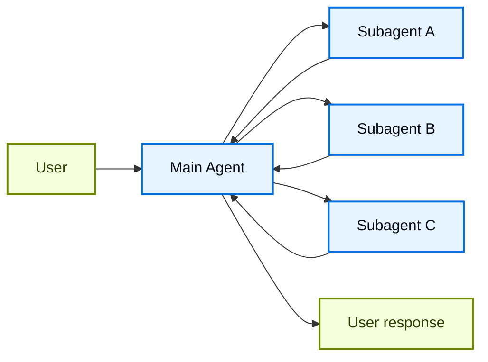
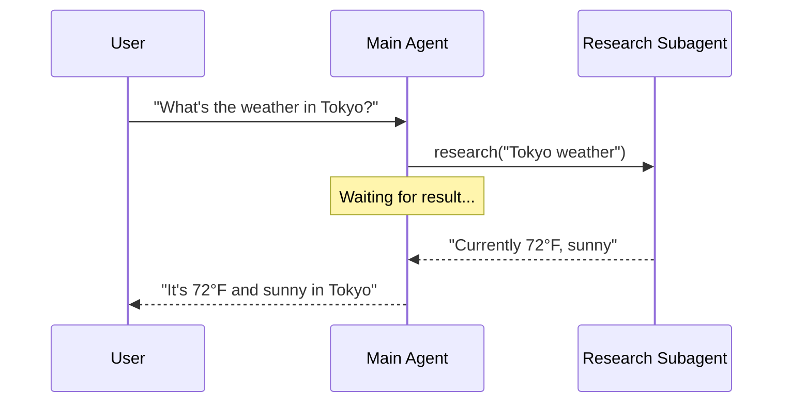
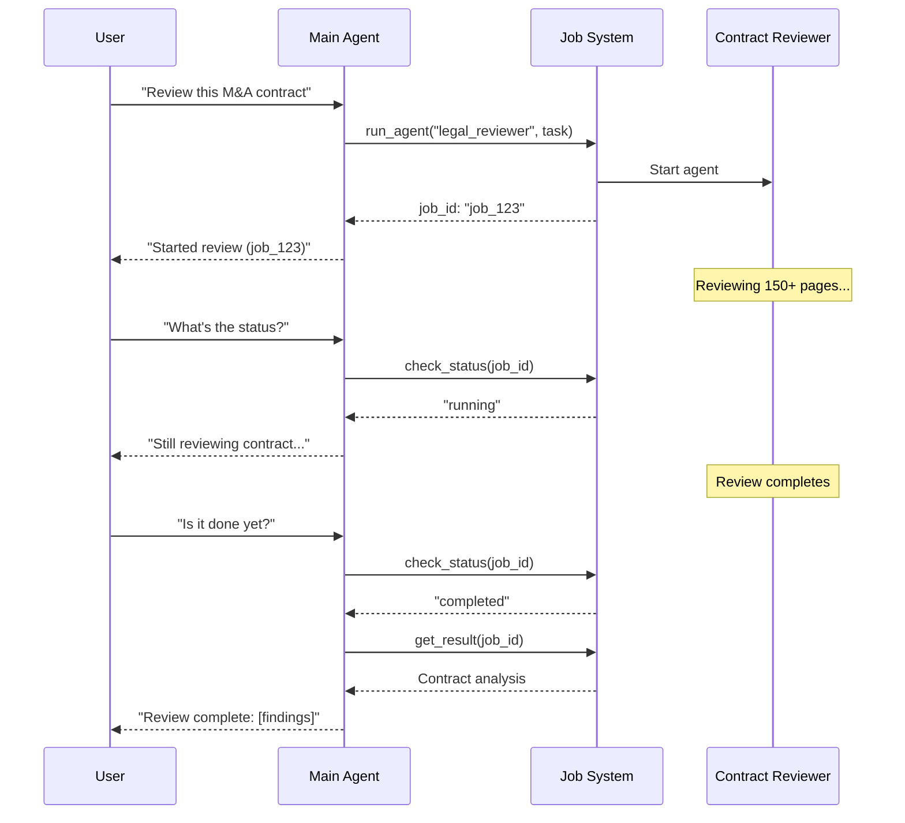
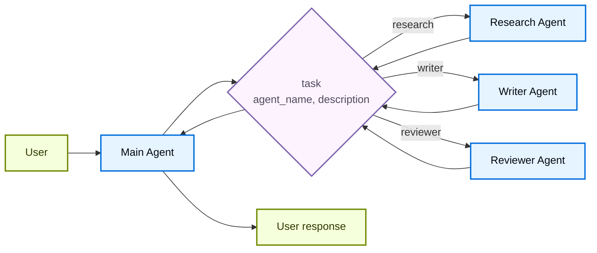

在**子智能体**架构中，一个中央主[智能体](/langchain/oss/langchain/agents)（通常被称为**监督者**）通过调用它们作为[工具](/langchain/oss/langchain/tools)来协调子智能体。主智能体决定调用哪个子智能体、提供什么输入以及如何组合结果。默认情况下，子智能体是无状态的——它们不记住过去的交互，所有的对话记忆都由主智能体维护。这提供了[上下文](/langchain/oss/langchain/context-engineering)隔离：每个子智能体调用都在一个干净的上下文窗口中工作，防止主对话中的上下文膨胀。

当子智能体需要该上下文时，您也可以将主智能体的对话历史传递给子智能体。参见[子智能体输入](#子智能体输入)。

有关内置子智能体支持，请参阅[深度智能体](/langchain/oss/deepagents/subagents)。



## 关键特性

* 集中控制：所有路由都通过主智能体
* 无直接用户交互：子智能体将结果返回给主智能体，而不是用户（尽管您可以在子智能体中使用[中断](/langchain/oss/langgraph/interrupts#使用-interrupt-暂停)来允许用户交互）
* 通过工具的子智能体：子智能体通过工具被调用
* 并行执行：主智能体可以在单次回合中调用多个子智能体

<Note>
**监督者与路由器**：监督者智能体（此模式）与[路由器](/langchain/oss/langchain/multi-agent/router)不同。监督者是一个维护对话上下文并在多轮中动态决定调用哪些子智能体的完整智能体。路由器通常是一个单一的分类步骤，它将任务派发给智能体而不维护持续的对话状态。
</Note>

## 何时使用

当您有多个不同的领域（例如，日历、电子邮件、CRM、数据库）、子智能体不需要直接与用户交谈，或您想要集中工作流控制时，请使用子智能体模式。对于只有几个[工具](/langchain/oss/langchain/tools)的简单情况，请使用[单个智能体](/langchain/oss/langchain/agents)。

<Tip>
**子智能体内需要用户交互？** 虽然子智能体通常将结果返回给主智能体而不是直接与用户交谈，但您可以在子智能体中使用[中断](/langchain/oss/langgraph/interrupts#使用-interrupt-暂停)来暂停执行并收集用户输入。当子智能体在继续之前需要澄清或批准时，这很有用。主智能体仍然是协调者，但子智能体可以在执行中途从用户那里收集信息。
</Tip>

## 基本实现

核心机制是将子智能体包装为一个主智能体可以调用的工具：

:::python
```python
from langchain.tools import tool
from langchain.agents import create_agent

# Create a subagent
subagent = create_agent(model="google_genai:gemini-3.6-flash", tools=[...])

# Wrap it as a tool
@tool("research", description="Research a topic and return findings")
def call_research_agent(query: str):
    result = subagent.invoke({"messages": [{"role": "user", "content": query}]})
    return result["messages"][-1].content

# Main agent with subagent as a tool
main_agent = create_agent(model="google_genai:gemini-3.6-flash", tools=[call_research_agent])
```
:::
:::js
```typescript
import { createAgent, tool } from "langchain";
import { z } from "zod";

// Create a subagent
const subagent = createAgent({ model: "google:gemini-3.6-flash", tools: [...] });

// Wrap it as a tool
const callResearchAgent = tool(
  async ({ query }) => {
    const result = await subagent.invoke({
      messages: [{ role: "user", content: query }]
    });
    return result.messages.at(-1)?.content;
  },
  {
    name: "research",
    description: "Research a topic and return findings",
    schema: z.object({ query: z.string() })
  }
);

// Main agent with subagent as a tool
const mainAgent = createAgent({ model: "google:gemini-3.6-flash", tools: [callResearchAgent] });
```
:::

<Card
    title="教程：使用子智能体构建个人助理"
    icon="sitemap"
    href="/langchain/oss/langchain/multi-agent/subagents-personal-assistant"
    arrow cta="了解更多"
>
    了解如何使用子智能体模式构建个人助理，其中中央主智能体（监督者）协调专门的工人智能体。
</Card>

## 设计决策

在实现子智能体模式时，您将做出几个关键设计选择。此表总结了选项——每个选项都在下文详细说明。

| 决策 | 选项 |
|------|---------|
| [**同步与异步**](#同步与异步) | 同步（阻塞）与异步（后台） |
| [**工具模式**](#工具模式) | 每个智能体一个工具与单一调度工具 |
| [**子智能体规范**](#子智能体规范) | 系统提示词与枚举约束与基于工具的发现（仅限单一调度工具） |
| [**子智能体输入**](#子智能体输入) | 仅查询与完整上下文 |
| [**子智能体输出**](#子智能体输出) | 子智能体结果与完整对话历史 |

## 同步与异步

子智能体执行可以是**同步**（阻塞）或**异步**（后台）。您的选择取决于主智能体是否需要结果才能继续。

| 模式 | 主智能体行为 | 最佳适用 | 交易权衡 |
|------|---------------------|----------|----------|
| **同步** | 等待子智能体完成 | 主智能体需要结果才能继续 | 简单，但阻塞对话 |
| **异步** | 在子智能体在后台运行时继续 | 独立任务，用户不应等待 | 响应式，但更复杂 |

<Tip>
不要与 Python 的 `async`/`await` 混淆。在此，“异步”意味着主智能体启动一个后台作业（通常在单独的进程或服务中）并继续而不阻塞。
</Tip>

### 同步（默认）

默认情况下，子智能体调用是**同步**的：主智能体在继续之前等待每个子智能体完成。当主智能体的下一步操作依赖于子智能体的结果时，请使用同步。



**何时使用同步：**
- 主智能体需要子智能体的结果来制定其响应
- 任务具有顺序依赖关系（例如，获取数据→分析→响应）
- 子智能体故障应阻止主智能体的响应

**权衡：**
- 简单实现——只需调用并等待
- 用户直到所有子智能体完成才看到响应
- 长任务冻结对话

### 异步

当子智能体的工作是独立的时候使用**异步执行**——主智能体不需要结果就能继续与用户交谈。主智能体启动一个后台作业并保持响应。



**何时使用异步：**
- 子智能体的工作与主对话流程独立
- 用户应该能够在工作发生时继续聊天
- 您想并行运行多个独立任务

**三工具模式：**
1. **启动作业**：启动后台任务，返回作业 ID
2. **检查状态**：返回当前状态（待处理、运行中、已完成、失败）
3. **获取结果**：检索已完成的结果

**处理作业完成：** 当作业完成时，您的应用程序需要通知用户。一种方法：显示一个通知，当点击时，发送一个 `HumanMessage`，例如“检查 job_123 并总结结果。”

## 工具模式

有两种主要方法可以公开子智能体作为工具：

| 模式 | 最佳适用 | 权衡 |
|---------|----------|-----------|
| [**每个智能体一个工具**](#每个智能体一个工具) | 对每个子智能体的输入/输出进行细粒度控制 | 设置更多，但更多自定义 |
| [**单一调度工具**](#单次分发工具) | 许多智能体、分布式团队、约定优于配置 | 更简单的组合，较少的每智能体自定义 |

### 每个智能体一个工具


核心思想是将子智能体包装为主智能体可以调用的工具：

:::python
```python
from langchain.tools import tool
from langchain.agents import create_agent

# Create a sub-agent
subagent = create_agent(model="...", tools=[...])  # [!code highlight]

# Wrap it as a tool  # [!code highlight]
@tool("subagent_name", description="subagent_description")  # [!code highlight]
def call_subagent(query: str):  # [!code highlight]
    result = subagent.invoke({"messages": [{"role": "user", "content": query}]})
    return result["messages"][-1].content

# Main agent with subagent as a tool  # [!code highlight]
main_agent = create_agent(model="...", tools=[call_subagent])  # [!code highlight]
```
:::
:::js
```typescript
import { createAgent, tool } from "langchain";
import * as z from "zod";

// Create a sub-agent
const subagent = createAgent({...});  // [!code highlight]

// Wrap it as a tool  // [!code highlight]
const callSubagent = tool(  // [!code highlight]
  async ({ query }) => {  // [!code highlight]
    const result = await subagent.invoke({
      messages: [{ role: "user", content: query }]
    });
    return result.messages.at(-1)?.text;
  },
  {
    name: "subagent_name",
    description: "subagent_description",
    schema: z.object({
      query: z.string().describe("The query to send to subagent")
    })
  }
);

// Main agent with subagent as a tool  // [!code highlight]
const mainAgent = createAgent({ model, tools: [callSubagent] });  // [!code highlight]
```
:::

主智能体在决定任务匹配子智能体的描述时调用子智能体工具，接收结果并继续编排。参见[上下文工程](#上下文工程)以实现细粒度控制。

### 单次分发工具

另一种方法使用单个参数化工具来调用用于独立任务的临时子智能体。与[每个智能体一个工具](#每个智能体一个工具)方法不同（该方法将每个子智能体包装为单独的工具），此方法采用基于约定的方法，使用单个 `task` 工具：任务描述作为人类消息传递给子智能体，子智能体的最终消息作为工具结果返回。

当你希望跨多个团队分发智能体开发、需要将复杂任务隔离到单独的上下文窗口、需要一个无需修改协调器的可扩展方法来添加新智能体，或倾向于约定优于定制时，请使用此方法。这种方法以上下文工程的灵活性换取智能体组合的简单性和强上下文隔离。



**主要特征：**

* 单任务工具：一个可以按名称调用任何已注册子智能体的参数化工具
* 基于约定的调用：通过名称选择智能体，任务作为人类消息传递，最终消息作为工具结果返回
* 团队分发：不同团队可以独立开发和部署智能体
* 智能体发现：可以通过系统提示（列出可用智能体）或通过[渐进式披露](/langchain/oss/langchain/multi-agent/skills-sql-assistant)（通过工具按需加载智能体信息）发现子智能体

<Tip>
这种方法的一个有趣之处在于，子智能体可能与主智能体具有完全相同的功能。在这种情况下，调用子智能体主要关于**上下文隔离**——允许复杂的多步骤任务在隔离的上下文窗口中运行，而不会使主智能体的对话历史膨胀。子智能体自主完成工作并仅返回简洁的摘要，使主线程保持专注和高效。
</Tip>

<Accordion title="Agent registry with task dispatcher">

:::python
```python
from langchain.tools import tool
from langchain.agents import create_agent

# Sub-agents developed by different teams
research_agent = create_agent(
    model="gpt-5.5",
    prompt="You are a research specialist..."
)

writer_agent = create_agent(
    model="gpt-5.5",
    prompt="You are a writing specialist..."
)

# Registry of available sub-agents
SUBAGENTS = {
    "research": research_agent,
    "writer": writer_agent,
}

@tool
def task(
    agent_name: str,
    description: str
) -> str:
    """Launch an ephemeral subagent for a task.

    Available agents:
    - research: Research and fact-finding
    - writer: Content creation and editing
    """
    agent = SUBAGENTS[agent_name]
    result = agent.invoke({
        "messages": [
            {"role": "user", "content": description}
        ]
    })
    return result["messages"][-1].content

# Main coordinator agent
main_agent = create_agent(
    model="gpt-5.5",
    tools=[task],
    system_prompt=(
        "You coordinate specialized sub-agents. "
        "Available: research (fact-finding), "
        "writer (content creation). "
        "Use the task tool to delegate work."
    ),
)
```
:::
:::js
```typescript
import { tool, createAgent } from "langchain";
import * as z from "zod";

// Sub-agents developed by different teams
const researchAgent = createAgent({
  model: "gpt-5.5",
  prompt: "You are a research specialist...",
});

const writerAgent = createAgent({
  model: "gpt-5.5",
  prompt: "You are a writing specialist...",
});

// Registry of available sub-agents
const SUBAGENTS = {
  research: researchAgent,
  writer: writerAgent,
};

const task = tool(
  async ({ agentName, description }) => {
    const agent = SUBAGENTS[agentName];
    const result = await agent.invoke({
      messages: [
        { role: "user", content: description }
      ],
    });
    return result.messages.at(-1)?.content;
  },
  {
    name: "task",
    description: `Launch an ephemeral subagent.

Available agents:
- research: Research and fact-finding
- writer: Content creation and editing`,
    schema: z.object({
      agentName: z
        .string()
        .describe("Name of agent to invoke"),
      description: z
        .string()
        .describe("Task description"),
    }),
  }
);

// Main coordinator agent
const mainAgent = createAgent({
  model: "gpt-5.5",
  tools: [task],
  prompt: (
    "You coordinate specialized sub-agents. " +
    "Available: research (fact-finding), " +
    "writer (content creation). " +
    "Use the task tool to delegate work."
  ),
});
```
:::

</Accordion>

## 上下文工程

控制主智能体与其子智能体之间的上下文流：

| 类别 | 目的 | 影响 |
|------|------|------|
| [**子智能体规范**](#子智能体规范) | 确保在适当时候调用子智能体 | 主智能体路由决策 |
| [**子智能体输入**](#子智能体输入) | 确保子智能体能够使用优化的上下文执行任务 | 子智能体性能 |
| [**子智能体输出**](#子智能体输出) | 确保监督者可以对子智能体结果采取行动 | 主智能体性能 |

另请参阅我们关于智能体的[上下文工程](/langchain/oss/langchain/context-engineering)的全面指南。

### 子智能体规范

子智能体关联的**名称**和**描述**是主智能体知道要调用哪些子智能体的主要方式。这些是提示杠杆——请谨慎选择。

* **名称**：主智能体引用子智能体的方式。保持清晰和动作导向（例如，`research_agent`，`code_reviewer`）。
* **描述**：主智能体了解子智能体的功能。具体说明它处理哪些任务以及何时使用它。

对于[单次分发工具](#单次分发工具)设计，您必须额外向主智能体提供有关其可以调用的子智能体的信息。
您可以根据智能体数量以及您的注册表是静态的还是动态的，以不同的方式提供此信息：

| 方法 | 最佳用途 | 权衡 |
|------|----------|------|
| **系统提示枚举** | 小型、静态的智能体列表（< 10 个智能体） | 简单，但在智能体变更时需要更新提示 |
| **枚举约束** | 小型、静态的智能体列表（< 10 个智能体） | 类型安全且明确，但在智能体变更时需要代码更改 |
| **基于工具的发现** | 大型或动态的智能体注册表 | 灵活且可扩展，但增加了复杂性 |

#### 系统提示枚举

直接在主智能体的系统提示中列出可用智能体。主智能体将其视为指令的一部分，看到智能体列表及其描述。

**使用场景：**
- 您有一组小型、固定的智能体（< 10）
- 智能体注册表很少变更
- 您希望实现最简单的实现

**示例：**
```python
main_agent = create_agent(
    model="...",
    tools=[task],
    system_prompt=(
        "You coordinate specialized sub-agents. "
        "Available agents:\n"
        "- research: Research and fact-finding\n"
        "- writer: Content creation and editing\n"
        "- reviewer: Code and document review\n"
        "Use the task tool to delegate work."
    ),
)
```

#### 分发工具上的枚举约束

在您的分发工具的 `agent_name` 参数中添加枚举约束。这提供了类型安全性，并在工具模式中明确列出可用智能体。

**使用场景：**
- 您有一组小型、固定的智能体（< 10）
- 您希望实现类型安全性和明确的智能体名称
- 您倾向于基于模式的验证而不是基于提示的指导

**示例：**
```python
from enum import Enum

class AgentName(str, Enum):
    RESEARCH = "research"
    WRITER = "writer"
    REVIEWER = "reviewer"

@tool
def task(
    agent_name: AgentName,  # Enum constraint
    description: str
) -> str:
    """Launch an ephemeral subagent for a task."""
    # ...
```

#### 基于工具的发现

提供一个单独的工具（例如，`list_agents` 或 `search_agents`），主智能体可以调用它按需发现可用智能体。这支持渐进式披露并适用于动态注册表。

**使用场景：**
- 您有许多智能体（> 10）或正在增长的注册表
- 智能体注册表经常变更或动态
- 您希望减少提示大小和 Token 使用
- 不同团队独立管理不同的智能体

**示例：**
```python
@tool
def list_agents(query: str = "") -> str:
    """List available subagents, optionally filtered by query."""
    agents = search_agent_registry(query)
    return format_agent_list(agents)

@tool
def task(agent_name: str, description: str) -> str:
    """Launch an ephemeral subagent for a task."""
    # ...

main_agent = create_agent(
    model="...",
    tools=[task, list_agents],
    system_prompt="Use list_agents to discover available subagents, then use task to invoke them."
)
```

### 子智能体输入

自定义子智能体接收的上下文以执行其任务。通过从智能体状态中提取，添加无法在静态提示中捕获的输入——完整消息历史、先前结果或任务元数据。

:::python
```python Subagent inputs example expandable
from langchain.agents import AgentState
from langchain.tools import tool, ToolRuntime

class CustomState(AgentState):
    example_state_key: str

@tool(
    "subagent1_name",
    description="subagent1_description"
)
def call_subagent1(query: str, runtime: ToolRuntime[None, CustomState]):
    # Apply any logic needed to transform the messages into a suitable input
    subagent_input = some_logic(query, runtime.state["messages"])
    result = subagent1.invoke({
        "messages": subagent_input,
        # You could also pass other state keys here as needed.
        # Make sure to define these in both the main and subagent's
        # state schemas.
        "example_state_key": runtime.state["example_state_key"]
    })
    return result["messages"][-1].content
```
:::
:::js
```typescript Subagent inputs example expandable
import { createAgent, tool, AgentState, ToolMessage } from "langchain";
import { Command } from "@langchain/langgraph";
import * as z from "zod";

// Example of passing the full conversation history to the sub agent via the state.
const callSubagent1 = tool(
  async ({query}) => {
    const state = getCurrentTaskInput<AgentState>();
    // Apply any logic needed to transform the messages into a suitable input
    const subAgentInput = someLogic(query, state.messages);
    const result = await subagent1.invoke({
      messages: subAgentInput,
      // You could also pass other state keys here as needed.
      // Make sure to define these in both the main and subagent's
      // state schemas.
      exampleStateKey: state.exampleStateKey
    });
    return result.messages.at(-1)?.content;
  },
  {
    name: "subagent1_name",
    description: "subagent1_description",
  }
);
```
:::

`some_logic` 控制子智能体接收的上下文量。仅传递任务描述（`query`）使子智能体保持隔离。传递父消息历史（`runtime.state["messages"]`）则向子智能体注入先前工作，这在它需要继续父智能体已开始的工作时很有帮助，例如继续 PR 审查或接手错误修复。

[深度智能体](/langchain/oss/deepagents/subagents#分叉子智能体)将这些模式命名为 `mode: "isolated"`（默认）和 `mode: "fork"`，并为您实现了分支：分支的子智能体接收父智能体的完整消息历史（包括工具调用）和系统提示。

| 模式 | 子智能体接收 | 最适合 | 权衡 |
|------|-------------------|----------|----------|
| **隔离**（默认） | 仅任务描述 | 需要少量先前上下文的专注工作 | 上下文隔离，但重新推导父智能体已经做的一切 |
| **分叉** | 父智能体的对话历史（以及在深度智能体中，系统提示词） | 继续父智能体已经开始的任务 | 以更大的提示词为代价，用先前的上下文初始化，但隔离性较低 |

### 子智能体输出

自定义主智能体接收的内容，以便其做出良好决策。有两种策略：

1. **提示子智能体**：指定应返回的内容。常见的失败模式是子智能体执行工具调用或推理，但在最终消息中不包含结果——提醒它，监督者只看到最终输出。
2. **代码格式化**：在返回之前调整或丰富响应。例如，使用 [`Command`](/langchain/oss/langgraph/graph-api#command) 在返回最终文本的同时传递特定的状态键。

:::python
```python Subagent outputs example expandable
from typing import Annotated
from langchain.agents import AgentState
from langchain.tools import InjectedToolCallId
from langgraph.types import Command


@tool(
    "subagent1_name",
    description="subagent1_description"
)
def call_subagent1(
    query: str,
    tool_call_id: Annotated[str, InjectedToolCallId],
) -> Command:
    result = subagent1.invoke({
        "messages": [{"role": "user", "content": query}]
    })
    return Command(update={
        # Pass back additional state from the subagent
        "example_state_key": result["example_state_key"],
        "messages": [
            ToolMessage(
                content=result["messages"][-1].content,
                tool_call_id=tool_call_id
            )
        ]
    })
```
:::
:::js
```typescript Subagent outputs example expandable
import { tool, ToolMessage } from "langchain";
import { Command } from "@langchain/langgraph";
import * as z from "zod";

const callSubagent1 = tool(
  async ({ query }, config) => {
    const result = await subagent1.invoke({
      messages: [{ role: "user", content: query }]
    });

    // Return a Command to update multiple state keys
    return new Command({
      update: {
        // Pass back additional state from the subagent
        exampleStateKey: result.exampleStateKey,
        messages: [
          new ToolMessage({
            content: result.messages.at(-1)?.text,
            tool_call_id: config.toolCall?.id!
          })
        ]
      }
    });
  },
  {
    name: "subagent1_name",
    description: "subagent1_description",
    schema: z.object({
      query: z.string().describe("The query to send to subagent1")
    })
  }
);
```
:::

## 检查点和状态检查

默认情况下，子智能体使用 **继承检查点** 模式——每次调用都以全新状态开始，支持 [中断](/langchain/oss/langgraph/interrupts#使用-interrupt-暂停)，并安全地并行运行。如果您需要子智能体在调用之间维护自己的持久对话历史，请使用 `checkpointer=True`（连续模式）编译它。有关模式的完整比较，请参阅 [子图持久化](/langchain/oss/langgraph/use-subgraphs#子图持久化)。

由于子智能体是在工具函数内部调用的，LangGraph 无法 [静态发现](/langchain/oss/langgraph/use-subgraphs#查看子图状态) 它们。这意味着 [`get_state` with `subgraphs`](/langchain/oss/langgraph/use-subgraphs#查看子图状态) 将不会返回子智能体状态。如果您需要读取嵌套图状态（例如，在 [中断](/langchain/oss/langgraph/interrupts#使用-interrupt-暂停) 期间），请在自定义图中从 [节点函数](/langchain/oss/langgraph/use-subgraphs#在节点中调用子图) 调用子智能体。有关每种模式如何影响状态可见性的详细信息，请参阅 [子图持久化](/langchain/oss/langgraph/use-subgraphs#子图持久化)。

:::python
<Card
    title="从 langgraph-supervisor 迁移"
    icon="arrow-right"
    href="/langchain/oss/python/migrate/langgraph-supervisor"
    arrow cta="查看指南"
>
    langgraph-supervisor 包已不再积极维护。了解如何从 create_supervisor 迁移到子智能体模式，包括使用外部 API 回调的中断和恢复流程。
</Card>
:::

---

> 官方原文：[src/oss/langchain/multi-agent/subagents.mdx](https://github.com/langchain-ai/docs/blob/main/src/oss/langchain/multi-agent/subagents.mdx) · 非官方翻译，译文由 AI 生成，以英文原文为准。
