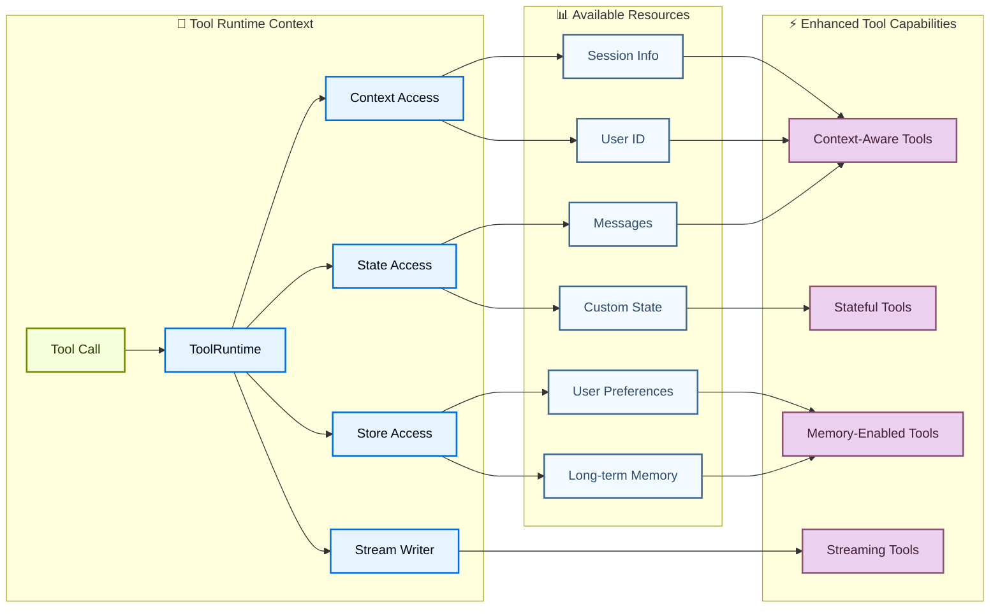

import ToolReturnValuesPy from '/langchain/snippets/code-samples/tool-return-values-py.mdx';
import ToolReturnValuesJs from '/langchain/snippets/code-samples/tool-return-values-js.mdx';
import ToolReturnObjectPy from '/langchain/snippets/code-samples/tool-return-object-py.mdx';
import ToolReturnObjectJs from '/langchain/snippets/code-samples/tool-return-object-js.mdx';
import ToolReturnCommandPy from '/langchain/snippets/code-samples/tool-return-command-py.mdx';
import ToolReturnCommandJs from '/langchain/snippets/code-samples/tool-return-command-js.mdx';
import ToolReturnDirectPy from '/langchain/snippets/code-samples/tool-return-direct-py.mdx';
import ToolReturnDirectJs from '/langchain/snippets/code-samples/tool-return-direct-js.mdx';
import ToolReturnDirectCommandPy from '/langchain/snippets/code-samples/tool-return-direct-command-py.mdx';
import ToolUpdateStatePy from '/langchain/snippets/code-samples/tool-update-state-py.mdx';
import ToolErrorHandlingPy from '/langchain/snippets/code-samples/tool-error-handling-py.mdx';
import ToolErrorHandlingJs from '/langchain/snippets/code-samples/tool-error-handling-js.mdx';
import ToolRuntimeContextThreadJs from '/langchain/snippets/code-samples/tool-runtime-context-thread-js.mdx';
import ToolRuntimeContextThreadPy from '/langchain/snippets/code-samples/tool-runtime-context-thread-py.mdx';

[工具扩展了智能体](/langchain/oss/langchain/agents)的能力——让它们能够获取实时数据、执行代码、查询外部数据库以及与世界互动。

在底层，工具是具有明确定义输入和输出的可调用函数，[这些函数会被传递给对话模型](/langchain/oss/langchain/models)。模型根据对话上下文决定何时调用工具，以及提供什么输入参数。

<Tip>
有关模型如何处理工具调用的详细信息，请参阅[工具调用](/langchain/oss/langchain/models#工具调用)。使用[LangSmith](https://smith.langchain.com)跟踪工具调用并调试错误。遵循[跟踪快速入门](https://docs.langchain.com/langsmith/trace-with-langchain)来设置。

我们建议您还设置[LangSmith Engine](https://docs.langchain.com/langsmith/engine)，它监控您的跟踪记录、检测问题并建议修复方案。
</Tip>

## 创建工具

### 基本工具定义

使用 @[`@tool`] 装饰器是创建工具最简单的方式。默认情况下，函数的文档字符串将成为工具的描述，帮助模型理解何时使用它：

```python
from langchain.tools import tool

@tool
def search_database(query: str, limit: int = 10) -> str:
    """Search the customer database for records matching the query.

    Args:
        query: Search terms to look for
        limit: Maximum number of results to return
    """
    return f"Found {limit} results for '{query}'"
```

类型提示是**必需**的，因为它们定义了工具的输入模式。文档字符串应该信息丰富且简洁，以帮助模型理解工具的用途。
:::

:::js
创建工具最简单的方式是导入 `tool` 包中的 `langchain` 函数。您可以使用 [zod](https://zod.dev/) 来定义工具的输入模式：

```ts
import * as z from "zod"
import { tool } from "langchain"

const searchDatabase = tool(
  ({ query, limit }) => `Found ${limit} results for '${query}'`,
  {
    name: "search_database",
    description: "Search the customer database for records matching the query.",
    schema: z.object({
      query: z.string().describe("Search terms to look for"),
      limit: z.number().describe("Maximum number of results to return"),
    }),
  }
);
```

:::

<Note>
    **服务器端工具使用：** 某些对话模型具有内置工具（网络搜索、代码解释器），这些工具在服务器端执行。有关详细信息，请参阅 [服务器端工具使用](#服务器端工具使用)。
</Note>

<Warning>
    建议使用 `snake_case` 作为工具名称（例如，`web_search` 而不是 `Web Search`）。一些模型提供者对包含空格或特殊字符的名称存在问题或错误地拒绝它们。坚持使用字母数字字符、下划线和连字符有助于提高跨提供者的兼容性。
</Warning>

:::python

### 自定义工具属性

#### 自定义工具名称

默认情况下，工具名称来自函数名称。当您需要更描述性的名称时，可以覆盖它：

```python
@tool("web_search")  # Custom name
def search(query: str) -> str:
    """Search the web for information."""
    return f"Results for: {query}"

print(search.name)  # web_search
```

#### 自定义工具描述

覆盖自动生成的工具描述，以便为模型提供更清晰的指导：

```python
@tool("calculator", description="Performs arithmetic calculations. Use this for any math problems.")
def calc(expression: str) -> str:
    """Evaluate mathematical expressions."""
    return str(eval(expression))
```

### 高级模式定义

使用 Pydantic 模型或 JSON 模式定义复杂输入：

<CodeGroup>
    ```python Pydantic model
    from pydantic import BaseModel, Field
    from typing import Literal

    class WeatherInput(BaseModel):
        """Input for weather queries."""
        location: str = Field(description="City name or coordinates")
        units: Literal["celsius", "fahrenheit"] = Field(
            default="celsius",
            description="Temperature unit preference"
        )
        include_forecast: bool = Field(
            default=False,
            description="Include 5-day forecast"
        )

    @tool(args_schema=WeatherInput)
    def get_weather(location: str, units: str = "celsius", include_forecast: bool = False) -> str:
        """Get current weather and optional forecast."""
        temp = 22 if units == "celsius" else 72
        result = f"Current weather in {location}: {temp} degrees {units[0].upper()}"
        if include_forecast:
            result += "\nNext 5 days: Sunny"
        return result
    ```

    ```python JSON Schema
    weather_schema = {
        "type": "object",
        "properties": {
            "location": {"type": "string"},
            "units": {"type": "string"},
            "include_forecast": {"type": "boolean"}
        },
        "required": ["location", "units", "include_forecast"]
    }

    @tool(args_schema=weather_schema)
    def get_weather(location: str, units: str = "celsius", include_forecast: bool = False) -> str:
        """Get current weather and optional forecast."""
        temp = 22 if units == "celsius" else 72
        result = f"Current weather in {location}: {temp} degrees {units[0].upper()}"
        if include_forecast:
            result += "\nNext 5 days: Sunny"
        return result
    ```
</CodeGroup>

### 保留的参数名称

以下参数名称是保留的，不能用作工具参数。使用这些名称会导致运行时错误。

| 参数名称 | 用途 |
|----------------|---------|
| `config` | 用于在工具内部传递 `RunnableConfig` |
| `runtime` | 用于 `ToolRuntime` 参数（访问状态、上下文、存储） |

要访问运行时信息，请使用 @[`ToolRuntime`] 参数，而不是将您自己的参数命名为 `config` 或 `runtime`。

如果您使用 `InjectedState`、`InjectedStore`、`get_runtime()` 或 `InjectedToolCallId`，请参阅 [从旧注入模式迁移](#migrate-from-older-injection-patterns)。

## 访问上下文

工具在能够访问运行时信息时最为强大，例如对话历史记录、用户数据和持久化记忆。本节将介绍如何从工具内部访问和更新这些信息。

:::python
工具可以通过 @[`ToolRuntime`] 参数访问运行时信息，该参数提供：

| 组件 | 描述 | 用例 |
|-------|-------|------|
| **State** | 短期记忆 - 可变数据，存在于当前对话中（消息、计数器、自定义字段） | 访问对话历史记录、跟踪工具调用次数 |
| **Context** | 在调用时传递的不可变配置（用户 ID、会话信息） | 基于用户身份个性化响应 |
| **Store** | 长期记忆 - 跨对话持续存在的持久化数据 | 保存用户偏好设置、维护知识库 |
| **Stream Writer** | 在工具执行期间发出实时更新 | 显示长时间运行操作的进度 |
| **Execution Info** | 当前执行的标识和重试信息（线程 ID、运行 ID、尝试次数） | 访问线程/运行 ID、根据重试状态调整行为 |
| **Server Info** | 在运行 LangGraph Server 时提供的特定服务器元数据（助手 ID、图 ID、已认证用户） | 访问助手 ID、图 ID 或已认证用户信息 |
| **Config** | @[`RunnableConfig`] 的执行配置 | 访问回调、标签和元数据 |
| **Tool Call ID** | 当前工具调用的唯一标识符 | 用于日志和模型调用的工具调用关联 |



### 短期记忆（状态）

状态表示存在于对话期间短期记忆。它包括消息历史记录以及您在您的 [graph state](/langchain/oss/langgraph/graph-api#状态) 中定义的任何自定义字段。

#### 访问状态

在您的工具签名中添加 `runtime: ToolRuntime` 以访问状态。调用时，@[`ToolNode`] 会自动注入值；该参数不会包含在发送给模型的工具模式中。使用 `runtime.state` 来读取当前对话状态：

```python
from langchain.tools import tool, ToolRuntime
from langchain.messages import HumanMessage

@tool
def get_last_user_message(runtime: ToolRuntime) -> str:
    """Get the most recent message from the user."""
    messages = runtime.state["messages"]

    # Find the last human message
    for message in reversed(messages):
        if isinstance(message, HumanMessage):
            return message.content

    return "No user messages found"

# Access custom state fields
@tool
def get_user_preference(
    pref_name: str,
    runtime: ToolRuntime
) -> str:
    """Get a user preference value."""
    preferences = runtime.state.get("user_preferences", {})
    return preferences.get(pref_name, "Not set")
```

<Warning>
    The `runtime` 参数对模型是隐藏的。对于上述示例，模型在工具模式中只看到 `pref_name`。
</Warning>

#### 更新状态

使用 @[`Command`] 来更新智能体的状态。这对于需要更新自定义状态字段的工具很有用。
在更新中包含一个 `ToolMessage`，以便模型可以看到工具调用的结果：

<ToolUpdateStatePy />

<Tip>
    当工具更新状态变量时，考虑为这些字段定义一个 [reducer](/langchain/oss/langgraph/graph-api#归约器)。由于大型语言模型可以并行调用多个工具，reducer 决定如何解决并发工具调用更新相同状态字段时的冲突。
</Tip>
:::

### 上下文

上下文提供不可变的配置数据，在调用时传递。用于用户 ID、会话详情或不应在对话过程中更改的特定于应用程序的设置。

<Note>
虽然 `thread_id`（通过 `config={"configurable": {"thread_id": ...}}` 传递）范围化了*对话*：消息历史记录和检查点，但 `context` 包含*每次运行*的数据，您的工具和中间件在调用时读取。持久化需要一个 [检查点器](/langchain/oss/langchain/short-term-memory)。在生产环境中，您通常为每个对话传递一个稳定的 `thread_id`，并在每次调用时传递一个 `context` 对象。
</Note>

:::python
通过 `runtime.context` 访问上下文。配置一个 [检查点器](/langchain/oss/langchain/short-term-memory)，并传递 `context`，其中包含一个稳定的 `thread_id`，以便对话跨调用持久化：

<ToolRuntimeContextThreadPy />

:::

:::js
工具可以通过 `config` 参数访问智能体的运行时上下文。配置一个 [检查点器](/langchain/oss/langchain/short-term-memory)，并传递 `context`，其中包含一个稳定的 `thread_id`，以便对话跨调用持久化：

<ToolRuntimeContextThreadJs />

:::

### 长期记忆（存储）

@[`BaseStore`] 提供持久化存储，能够在对话之间持续存在。与状态（短期记忆）不同，存储中的数据在未来的会话中仍然可用。

:::python
通过 `runtime.store` 访问存储。存储使用命名空间/键模式来组织数据：

<Tip>
    对于生产部署，使用持久化存储实现，如 @[`PostgresStore`]、`MongoDBStore` 或 `RedisStore`，而不是 `InMemoryStore`。有关配置详情，请参阅 [记忆文档](/langchain/oss/langgraph/add-memory)。
</Tip>

```python expandable
from langgraph.store.memory import InMemoryStore
from langchain.agents import create_agent
from langchain.tools import tool, ToolRuntime
from langchain_openai import ChatOpenAI

# Access memory
@tool
def get_user_info(user_id: str, runtime: ToolRuntime) -> str:
    """Look up user info."""
    store = runtime.store
    user_info = store.get(("users",), user_id)
    return str(user_info.value) if user_info else "Unknown user"

# Update memory
@tool
def save_user_info(user_id: str, name: str, age: int, email: str, runtime: ToolRuntime) -> str:
    """Save user info."""
    store = runtime.store
    store.put(("users",), user_id, {"name": name, "age": age, "email": email})
    return "Successfully saved user info."

model = ChatOpenAI(model="gpt-5.5")

store = InMemoryStore()
agent = create_agent(
    model,
    tools=[get_user_info, save_user_info],
    store=store
)

# First session: save user info
agent.invoke({
    "messages": [{"role": "user", "content": "Save the following user: userid: abc123, name: Foo, age: 25, email: foo@langchain.dev"}]
})

# Second session: get user info
agent.invoke({
    "messages": [{"role": "user", "content": "Get user info for user with id 'abc123'"}]
})
# Here is the user info for user with ID "abc123":
# - Name: Foo
# - Age: 25
# - Email: foo@langchain.dev
```

:::

:::js
通过 `config.store` 访问存储。存储使用命名空间/键模式来组织数据：

<Tip>
    对于生产部署，使用持久化存储实现，如 @[`PostgresStore`]、`MongoDBStore` 或 `RedisStore`，而不是 `InMemoryStore`。有关配置详情，请参阅 [记忆文档](/langchain/oss/langgraph/add-memory)。
</Tip>

```ts expandable
import * as z from "zod";
import { createAgent, tool } from "langchain";
import { InMemoryStore } from "@langchain/langgraph";
import { ChatOpenAI } from "@langchain/openai";

const store = new InMemoryStore();

// Access memory
const getUserInfo = tool(
  async ({ user_id }) => {
    const value = await store.get(["users"], user_id);
    console.log("get_user_info", user_id, value);
    return value;
  },
  {
    name: "get_user_info",
    description: "Look up user info.",
    schema: z.object({
      user_id: z.string(),
    }),
  }
);

// Update memory
const saveUserInfo = tool(
  async ({ user_id, name, age, email }) => {
    console.log("save_user_info", user_id, name, age, email);
    await store.put(["users"], user_id, { name, age, email });
    return "Successfully saved user info.";
  },
  {
    name: "save_user_info",
    description: "Save user info.",
    schema: z.object({
      user_id: z.string(),
      name: z.string(),
      age: z.number(),
      email: z.string(),
    }),
  }
);

const agent = createAgent({
  model: new ChatOpenAI({ model: "gpt-5.5" }),
  tools: [getUserInfo, saveUserInfo],
  store,
});

// First session: save user info
await agent.invoke({
  messages: [
    {
      role: "user",
      content: "Save the following user: userid: abc123, name: Foo, age: 25, email: foo@langchain.dev",
    },
  ],
});

// Second session: get user info
const result = await agent.invoke({
  messages: [
    { role: "user", content: "Get user info for user with id 'abc123'" },
  ],
});

console.log(result);
// Here is the user info for user with ID "abc123":
// - Name: Foo
// - Age: 25
// - Email: foo@langchain.dev
```

:::

### 流式写入器

在执行过程中从工具中流式传输实时更新。这对于在长时间运行的操作期间向用户提供进度反馈很有用。

:::python
使用 `runtime.stream_writer` 发送自定义更新：

```python
from langchain.tools import tool, ToolRuntime

@tool
def get_weather(city: str, runtime: ToolRuntime) -> str:
    """Get weather for a given city."""
    writer = runtime.stream_writer

    # Stream custom updates as the tool executes
    writer(f"Looking up data for city: {city}")
    writer(f"Acquired data for city: {city}")

    return f"It's always sunny in {city}!"
```

<Note>
如果你在工具内部使用 `runtime.stream_writer`，则该工具必须在 LangGraph 执行上下文中被调用。有关更多详细信息，请参阅 [流式传输](/langchain/oss/langchain/streaming)。
</Note>
:::

:::js
使用 `config.writer` 发送自定义更新：

```ts
import * as z from "zod";
import { tool, ToolRuntime } from "langchain";

const getWeather = tool(
  ({ city }, config: ToolRuntime) => {
    const writer = config.writer;

    // Stream custom updates as the tool executes
    if (writer) {
      writer(`Looking up data for city: ${city}`);
      writer(`Acquired data for city: ${city}`);
    }

    return `It's always sunny in ${city}!`;
  },
  {
    name: "get_weather",
    description: "Get weather for a given city.",
    schema: z.object({
      city: z.string(),
    }),
  }
);
```

:::

### 执行信息

通过 `runtime.execution_info` 在工具内部访问线程 ID、运行 ID 和重试状态：

:::python
```python
from langchain.tools import tool, ToolRuntime

@tool
def log_execution_context(runtime: ToolRuntime) -> str:
    """Log execution identity information."""
    info = runtime.execution_info
    print(f"Thread: {info.thread_id}, Run: {info.run_id}")  # [!code highlight]
    print(f"Attempt: {info.node_attempt}")
    return "done"
```
:::

:::js
```ts
import { tool } from "langchain";
import * as z from "zod";

const logExecutionContext = tool(
  async (_input, runtime) => {
    const info = runtime.executionInfo;
    console.log(`Thread: ${info.threadId}, Run: ${info.runId}`);  // [!code highlight]
    console.log(`Attempt: ${info.nodeAttempt}`);
    return "done";
  },
  {
    name: "log_execution_context",
    description: "Log execution identity information.",
    schema: z.object({}),
  }
);
```
:::

:::python
<Note>
需要 `deepagents>=0.5.0`（或 `langgraph>=1.1.5`）。
</Note>
:::

:::js
<Note>
需要 `deepagents>=1.9.0`（或 `@langchain/langgraph>=1.2.8`）。
</Note>
:::

### 服务器信息

当您的工具在 LangGraph 服务器上运行时，通过 `runtime.server_info` 访问助手 ID、图 ID 和认证用户：

:::python
```python
from langchain.tools import tool, ToolRuntime

@tool
def get_assistant_scoped_data(runtime: ToolRuntime) -> str:
    """Fetch data scoped to the current assistant."""
    server = runtime.server_info
    if server is not None:
        print(f"Assistant: {server.assistant_id}, Graph: {server.graph_id}")  # [!code highlight]
        if server.user is not None:
            print(f"User: {server.user.identity}")  # [!code highlight]
    return "done"
```

`server_info` 是 `None`，当工具不在 LangGraph 服务器上运行时（例如，在本地开发或测试期间）。
:::

:::js
```ts
import { tool } from "langchain";
import * as z from "zod";

const getAssistantScopedData = tool(
  async (_input, runtime) => {
    const server = runtime.serverInfo;
    if (server != null) {
      console.log(`Assistant: ${server.assistantId}, Graph: ${server.graphId}`);  // [!code highlight]
      if (server.user != null) {
        console.log(`User: ${server.user.identity}`);  // [!code highlight]
      }
    }
    return "done";
  },
  {
    name: "get_assistant_scoped_data",
    description: "Fetch data scoped to the current assistant.",
    schema: z.object({}),
  }
);
```

`serverInfo` 是 `null`，当工具不在 LangGraph 服务器上运行时。
:::

:::python
<Note>
需要 `deepagents>=0.5.0`（或 `langgraph>=1.1.5`）。
</Note>
:::

:::js
<Note>
需要 `deepagents>=1.9.0`（或 `@langchain/langgraph>=1.2.8`）。
</Note>
:::

:::python
<Accordion title="Migrate from older injection patterns" id="migrate-from-older-injection-patterns">

较旧的示例使用了 `InjectedState`、`InjectedStore`、`get_runtime()` 或 `InjectedToolCallId`。请使用 @[`ToolRuntime`] 代替，以提供一个明确的接口来声明状态、上下文、存储和执行元数据。

#### 之前的模式

```python
from langchain.tools import tool, InjectedState

@tool
def summarize(state: InjectedState) -> str:
    """Summarize the conversation."""
    messages = state["messages"]
    return f"Conversation length: {len(messages)} messages."
```

#### 推荐模式

```python
from langchain.tools import tool, ToolRuntime

@tool
def summarize(runtime: ToolRuntime) -> str:
    """Summarize the conversation."""
    messages = runtime.state["messages"]
    return f"Conversation length: {len(messages)} messages."
```

对于智能体级别的迁移（例如 `create_react_agent` 和自定义状态），请参阅 [LangChain v1 迁移指南](/langchain/oss/python/migrate/langchain-v1)。

</Accordion>
:::

## 工具执行

在 LangChain 中，智能体（例如通过 @[`create_agent`）使用工具，工具错误处理通过 [middleware](/langchain/oss/langchain/middleware/overview) 进行配置。

对于 LangGraph 工作流，工具执行由 @[`ToolNode` 处理。有关 Graph API 的使用方法，包括工具如何访问当前图状态和运行范围上下文，请参阅 [ToolNode](/langchain/oss/langgraph/workflows-agents#工具节点)。

### 工具返回值

您可以选择不同的工具返回值：

- 返回一个 `string` 以提供人类可读的结果。
- 返回一个 `object` 以供模型解析的结构化结果。
- 返回一个 `Command` 并包含可选消息，当您需要写入状态时。

#### 返回字符串

当工具应向模型提供纯文本以供其读取并在下一次响应中使用时，返回字符串。

:::python

<ToolReturnValuesPy />

:::

:::js

<ToolReturnValuesJs />

:::

行为：

- 返回值被转换为 `ToolMessage`。
- 模型看到该文本并决定下一步做什么。
- 除非模型或另一个工具稍后更改，否则不会更改智能体状态字段。

当结果自然是人类可读文本时使用此方法。

#### 返回对象

当您的工具生成模型应检查的结构化数据时（例如，一个 `dict`），返回对象。

:::python

<ToolReturnObjectPy />

:::

:::js

<ToolReturnObjectJs />

:::

行为：

- 对象被序列化并作为工具输出返回。
- 模型可以读取特定字段并进行推理。
- 与字符串返回一样，这不会直接更新图状态。

当下游推理受益于显式字段而不是自由文本时使用此方法。

#### 返回多模态内容

工具不仅限于纯文本。当模型支持多模态工具结果时，工具可以返回 [标准内容块](/langchain/oss/langchain/messages#标准内容块)，以便模型在一个工具结果中接收文本、图像和其他媒体。

:::python
```python
from langchain.tools import tool


@tool
def capture_screenshot() -> list[dict]:
    """Capture a screenshot of the current page."""
    return [
        {"type": "text", "text": "Screenshot of the current page:"},
        {"type": "image", "url": "https://example.com/page.png"},
    ]
```
:::

:::js
```typescript
import { tool } from "langchain";
import { z } from "zod";

const captureScreenshot = tool(
  async () => [
    { type: "text", text: "Screenshot of the current page:" },
    { type: "image", url: "https://example.com/page.png" },
  ],
  {
    name: "capture_screenshot",
    description: "Capture a screenshot of the current page.",
    schema: z.object({}),
  }
);
```
:::

行为：

- 返回值被转换为具有多模态 `content` 的 `ToolMessage`。
- 使用 `message.content_blocks` 在工具运行后读取归一化的块列表。
- 模型必须支持您返回的模态。在返回图像、音频或视频之前，请检查您的 [模型的能力](/langchain/oss/python/integrations/chat)。

有关块类型和特定提供者的要求，请参阅 [多模态消息](/langchain/oss/langchain/messages#多模态)。

:::python
返回图像或混合内容的 MCP 工具以相同方式转换。参见 [多模态内容](/langchain/oss/langchain/mcp/tools#多模态内容)。
:::

#### 返回命令

当工具需要更新图状态时（例如，设置用户偏好或应用状态），返回一个 @[`Command`]。
当`Command`目标为当前图时，在更新中包含一个`ToolMessage`，其工具调用 ID 与当前工具调用匹配。
消息历史中的每个工具调用都必须有一个对应的`ToolMessage`。

:::python
使用`runtime.tool_call_id`作为`tool_call_id`参数。`ToolNode`强制执行此要求：如果更新没有与工具调用匹配的`ToolMessage`，它将引发一个`ValueError`。
:::

:::js
使用`runtime.toolCallId`作为`tool_call_id`参数。
:::

:::python

<ToolReturnCommandPy />

:::

:::js

<ToolReturnCommandJs />

:::

行为：

- 命令使用`update`更新状态。
- 更新后的状态对同一运行中的后续步骤可用。
- 使用reducer处理可能被并行工具调用更新的字段。

当工具不仅返回数据，还修改智能体状态时使用此方法。

#### 直接从工具返回

将返回直接设置为工具以绕过智能体循环：智能体立即将工具的输出返回给调用者，而不会将其发送回模型进行进一步处理。

:::python

<ToolReturnDirectPy />

:::

:::js

<ToolReturnDirectJs />

:::

行为：

- 工具正常执行，其输出被包裹在`ToolMessage`中。
- 智能体停止循环，并将工具的输出作为最终响应返回，绕过任何额外的模型调用。
- **多个并行工具调用**：当模型在一个步骤中调用多个工具时，所有工具首先执行。所有工具完成后，智能体仅在**所有**该批次中的工具都有`return_direct=True`时才路由到`END`。最终响应包括该步骤中每个被调用工具的`ToolMessage`输出。

使用此方法时：

- 工具的输出是完整的、用户可用的答案（例如，返回可直接显示结果的查找）。
- 您希望在不需要额外推理时避免额外的模型调用。
- 您需要确定性、未修改的输出：模型不能改述、总结或对工具结果采取行动。

<Warning>
    由于模型不处理工具的输出，`return_direct=True`不适合结果需要进一步推理、总结或与其他工具调用链的工具。
</Warning>

<Warning>
    **混合并行调用**：如果模型在执行不具有`return_direct=True`的工具的同时调用一个`return_direct=True`工具，智能体在该步骤后**不会**退出。它会将批次的每个`ToolMessage`路由回模型，以便模型可以推理所有结果。`return_direct`仅在步骤中的所有工具调用都有`return_direct=True`时才绕过循环。
</Warning>

:::python

#### 返回一个带有 return_direct 的命令

一个带有 `return_direct=True` 的工具也可以在智能体退出前返回一个 @[`Command`] 来更新图状态。与普通返回值不同，一个 `Command` 不会被自动转换为 `ToolMessage`。当 `Command` 指向当前图（`graph` 未设置或为 `None`）时，在 `Command.update` 中包含与工具调用 `tool_call_id` 匹配的 `ToolMessage`。省略它会导致 `ToolNode` 触发一个 `ValueError`，因为每个 `AIMessage` 工具调用都必须在消息历史中有对应的 `ToolMessage`。

<ToolReturnDirectCommandPy />

若要写入父图，请设置 `graph=Command.PARENT`。在这种情况下 `ToolMessage` 的要求会被解除，因为执行会完全离开当前图。

:::

### 错误处理

使用 LangChain 智能体 [中间件](/langchain/oss/langchain/middleware/overview) 处理工具错误，以重试失败的工具调用或返回自定义错误消息：

:::python

<ToolErrorHandlingPy />

:::

:::js

<ToolErrorHandlingJs />

:::

### 状态注入

工具通过 @[`ToolRuntime`] 访问图状态。有关状态、上下文、存储和流式输出 API 的更多信息，请参阅 [访问上下文](#访问上下文)。

:::python
```python
from langchain.tools import tool, ToolRuntime

@tool
def get_message_count(runtime: ToolRuntime) -> str:
    """Get the number of messages in the conversation."""
    messages = runtime.state["messages"]
    return f"There are {len(messages)} messages."
```
:::

有关从工具访问状态、上下文和长期记忆的更多详情，请参阅 [访问上下文](#访问上下文)。

## 动态工具选择
通过动态工具，智能体可用的工具集在运行时修改，而非预先全部定义。并非每种工具都适用于每种情况。工具过多可能使模型（上下文过载）产生错误；工具过少则限制能力。动态工具选择能够根据认证状态、用户权限、功能开关或对话阶段调整可用工具集。
根据工具是否预先已知，有两种方法：
<Tabs>
  <Tab title="Filtering pre-registered tools">
    当智能体创建时已知所有可能工具，可以预先注册它们，并根据状态、权限或上下文动态过滤哪些工具对模型可见。
    <Tabs>
      <Tab title="State">
        仅在达到特定对话里程碑后启用高级工具：
        :::python
        ```python
        from langchain.agents import create_agent
        from langchain.agents.middleware import wrap_model_call, ModelRequest, ModelResponse
        from typing import Callable

        @wrap_model_call
        def state_based_tools(
            request: ModelRequest,
            handler: Callable[[ModelRequest], ModelResponse]
        ) -> ModelResponse:
            """Filter tools based on conversation State."""
            # Read from State: check if user has authenticated
            state = request.state
            is_authenticated = state.get("authenticated", False)
            message_count = len(state["messages"])

            # Only enable sensitive tools after authentication
            if not is_authenticated:
                tools = [t for t in request.tools if t.name.startswith("public_")]
                request = request.override(tools=tools)
            elif message_count < 5:
                # Limit tools early in conversation
                tools = [t for t in request.tools if t.name != "advanced_search"]
                request = request.override(tools=tools)

            return handler(request)

        agent = create_agent(
            model="gpt-5.5",
            tools=[public_search, private_search, advanced_search],
            middleware=[state_based_tools]
        )
        ```
        :::
        :::js
        ```typescript
        import { createMiddleware, tool } from "langchain";
        import { createDeepAgent } from "deepagents";

        const stateBasedTools = createMiddleware({
            name: "StateBasedTools",
            wrapModelCall: (request, handler) => {
                // Read from State: check authentication and conversation length
                const state = request.state as typeof request.state & {
                    authenticated?: boolean;
                };
                const isAuthenticated = state.authenticated ?? false;
                const messageCount = state.messages.length;

                let filteredTools = request.tools;

                // Only enable sensitive tools after authentication
                if (!isAuthenticated) {
                    filteredTools = request.tools.filter(
                        (t: any) => typeof t.name === "string" && t.name.startsWith("public_"),
                    );
                } else if (messageCount < 5) {
                    filteredTools = request.tools.filter(
                        (t: any) => typeof t.name === "string" && t.name !== "advanced_search",
                    );
                }

                return handler({ ...request, tools: filteredTools });
            },
        });

        const agent = await createDeepAgent({
            model: "claude-sonnet-4-6",
            tools: tools,
            middleware: [stateBasedTools] as any,
        });
        ```
        :::
      </Tab>
      <Tab title="Store">
        在 Store 中根据用户偏好或功能开关过滤工具：
        :::python
        ```python
        from dataclasses import dataclass
        from langchain.agents import create_agent
        from langchain.agents.middleware import wrap_model_call, ModelRequest, ModelResponse
        from typing import Callable
        from langgraph.store.memory import InMemoryStore

        @dataclass
        class Context:
            user_id: str

        @wrap_model_call
        def store_based_tools(
            request: ModelRequest,
            handler: Callable[[ModelRequest], ModelResponse]
        ) -> ModelResponse:
            """Filter tools based on Store preferences."""
            user_id = request.runtime.context.user_id

            # Read from Store: get user's enabled features
            store = request.runtime.store
            feature_flags = store.get(("features",), user_id)

            if feature_flags:
                enabled_features = feature_flags.value.get("enabled_tools", [])
                # Only include tools that are enabled for this user
                tools = [t for t in request.tools if t.name in enabled_features]
                request = request.override(tools=tools)

            return handler(request)

        agent = create_agent(
            model="gpt-5.5",
            tools=[search_tool, analysis_tool, export_tool],
            middleware=[store_based_tools],
            context_schema=Context,
            store=InMemoryStore()
        )
        ```
        :::
        :::js
        ```typescript
        import { createMiddleware } from "langchain";
        import { createDeepAgent, StoreBackend } from "deepagents";
        import * as z from "zod";
        import { InMemoryStore } from "@langchain/langgraph";

        const contextSchema = z.object({
          userId: z.string(),
        });

        const storeBasedTools = createMiddleware({
          name: "StoreBasedTools",
          contextSchema,
          wrapModelCall: async (request, handler) => {
            const userId =
              (request.runtime?.context as { userId?: string } | undefined)?.userId ??
                "user-123";

            // Read from Store: get user's enabled features
            const runtimeStore = request.runtime?.store as InMemoryStore | undefined;
            const rawFlags = (await runtimeStore?.get(
              ["features"],
              userId as string,
            )) as unknown;
            const featureFlags = rawFlags as FeatureFlags | undefined;

            let filteredTools = request.tools;

            if (featureFlags) {
              const enabledFeatures = featureFlags.enabledTools || [];
              filteredTools = request.tools.filter((t) =>
                enabledFeatures.includes(t.name as string)
              );
            }

            return handler({ ...request, tools: filteredTools });
          },
        });

        const agent = await createDeepAgent({
          model: "claude-sonnet-4-6",
          backend: new StoreBackend(),
          store,
          checkpointer,
          tools,
          middleware: [storeBasedTools] as any,
        });
        ```
        :::
      </Tab>
      <Tab title="Runtime Context">
        根据运行时上下文中的用户权限过滤工具：
        :::python
        ```python
        from dataclasses import dataclass
        from langchain.agents import create_agent
        from langchain.agents.middleware import wrap_model_call, ModelRequest, ModelResponse
        from typing import Callable

        @dataclass
        class Context:
            user_role: str

        @wrap_model_call
        def context_based_tools(
            request: ModelRequest,
            handler: Callable[[ModelRequest], ModelResponse]
        ) -> ModelResponse:
            """Filter tools based on Runtime Context permissions."""
            # Read from Runtime Context: get user role
            if request.runtime is None or request.runtime.context is None:
                # If no context provided, default to viewer (most restrictive)
                user_role = "viewer"
            else:
                user_role = request.runtime.context.user_role

            if user_role == "admin":
                # Admins get all tools
                pass
            elif user_role == "editor":
                # Editors can't delete
                tools = [t for t in request.tools if t.name != "delete_data"]
                request = request.override(tools=tools)
            else:
                # Viewers get read-only tools
                tools = [t for t in request.tools if t.name.startswith("read_")]
                request = request.override(tools=tools)

            return handler(request)

        agent = create_agent(
            model="gpt-5.5",
            tools=[read_data, write_data, delete_data],
            middleware=[context_based_tools],
            context_schema=Context
        )
        ```
        :::
        :::js
        ```typescript
        import * as z from "zod";
        import { createMiddleware } from "langchain";
        import { createDeepAgent } from "deepagents";

        const contextSchema = z.object({
          userRole: z.string(),
        });

        const contextBasedTools = createMiddleware({
          name: "ContextBasedTools",
          contextSchema,
          wrapModelCall: (request, handler) => {
            // Read from Runtime Context: get user role
            const userRole = request.runtime.context.userRole;

            let filteredTools = request.tools;

            if (userRole === "admin") {
              // Admins get all tools
            } else if (userRole === "editor") {
              filteredTools = request.tools.filter((t) => t.name !== "delete_data");
            } else {
              filteredTools = request.tools.filter(
                (t) => (t.name as string).startsWith("read_"),
              );
            }

            return handler({ ...request, tools: filteredTools });
          },
        });

        const agent = await createDeepAgent({
          model: "claude-sonnet-4-6",
          store,
          checkpointer,
          tools,
          middleware: [contextBasedTools] as any,
        });
        ```
        :::
      </Tab>
    </Tabs>
    当满足以下条件时，此方法最佳：
    - 在编译/启动时已知所有可能工具
    - 需要根据权限、功能开关或对话状态进行过滤
    - 工具是静态的，但可用性是动态的
    查看 [动态选择工具](/langchain/oss/langchain/middleware/custom#动态选择工具) 获取更多示例。
  </Tab>
  <Tab title="Runtime tool registration">
    当工具在运行时发现或创建（例如从 MCP 服务器加载、基于用户数据生成或从远程注册表获取），需要同时注册工具并动态处理其执行。
    这需要两个中间件钩子：
    1. `wrap_model_call` - 将动态工具添加到请求
    2. `wrap_tool_call` - 处理动态添加的工具的执行
    :::python

    ```python
    from langchain.tools import tool
    from langchain.agents import create_agent
    from langchain.agents.middleware import AgentMiddleware, ModelRequest, ToolCallRequest

    # A tool that will be added dynamically at runtime
    @tool
    def calculate_tip(bill_amount: float, tip_percentage: float = 20.0) -> str:
        """Calculate the tip amount for a bill."""
        tip = bill_amount * (tip_percentage / 100)
        return f"Tip: ${tip:.2f}, Total: ${bill_amount + tip:.2f}"

    class DynamicToolMiddleware(AgentMiddleware):
        """Middleware that registers and handles dynamic tools."""

        def wrap_model_call(self, request: ModelRequest, handler):
            # Add dynamic tool to the request
            # This could be loaded from an MCP server, database, etc.
            updated = request.override(tools=[*request.tools, calculate_tip])
            return handler(updated)

        def wrap_tool_call(self, request: ToolCallRequest, handler):
            # Handle execution of the dynamic tool
            if request.tool_call["name"] == "calculate_tip":
                return handler(request.override(tool=calculate_tip))
            return handler(request)

    agent = create_agent(
        model="gpt-5.5",
        tools=[get_weather],  # Only static tools registered here
        middleware=[DynamicToolMiddleware()],
    )

    # The agent can now use both get_weather AND calculate_tip
    result = agent.invoke({
        "messages": [{"role": "user", "content": "Calculate a 20% tip on $85"}]
    })
    ```
    :::
    :::js
    ```typescript
    import { createAgent, createMiddleware, tool } from "langchain";
    import * as z from "zod";

    // A tool that will be added dynamically at runtime
    const calculateTip = tool(
      ({ billAmount, tipPercentage = 20 }) => {
        const tip = billAmount * (tipPercentage / 100);
        return `Tip: $${tip.toFixed(2)}, Total: $${(billAmount + tip).toFixed(2)}`;
      },
      {
        name: "calculate_tip",
        description: "Calculate the tip amount for a bill",
        schema: z.object({
          billAmount: z.number().describe("The bill amount"),
          tipPercentage: z.number().default(20).describe("Tip percentage"),
        }),
      }
    );

    const dynamicToolMiddleware = createMiddleware({
      name: "DynamicToolMiddleware",
      wrapModelCall: (request, handler) => {
        // Add dynamic tool to the request
        // This could be loaded from an MCP server, database, etc.
        return handler({
          ...request,
          tools: [...request.tools, calculateTip],
        });
      },
      wrapToolCall: (request, handler) => {
        // Handle execution of the dynamic tool
        if (request.toolCall.name === "calculate_tip") {
          return handler({ ...request, tool: calculateTip });
        }
        return handler(request);
      },
    });

    const agent = createAgent({
      model: "gpt-5.5",
      tools: [getWeather], // Only static tools registered here
      middleware: [dynamicToolMiddleware],
    });

    // The agent can now use both getWeather AND calculateTip
    const result = await agent.invoke({
      messages: [{ role: "user", content: "Calculate a 20% tip on $85" }],
    });
    ```
:::
    这种方法最适合以下情况：
    - 工具在运行时发现（例如，从 MCP 服务器）
    - 工具根据用户数据或配置动态生成
    - 您正在与外部工具注册表集成
    <Note>
    对于运行时注册的工具，需要 `wrap_tool_call` 钩子，因为智能体需要知道如何执行原始工具列表中不存在的工具。没有它，智能体将不知道如何调用动态添加的工具。
    </Note>
  </Tab>
</Tabs>

## 无头工具

有些工具应该运行在**用户的应用程序运行的地方**（通常是浏览器），而不是在服务器内部。**无头工具**是工具定义，包括名称、描述和参数模式，你需要在**服务器**上为你的智能体注册这些定义。**实现**只在**客户端**注册，并在短暂的断续/恢复握手后执行。

这与普通工具不同，普通工具的功能体在服务器上运行，也不同于[服务器端工具使用](#服务器端工具使用)，其中模型提供者远程执行内置工具。

### 何时使用无头工具

当工作依赖于**环境、设备或 UI**，而只有客户端存在这些条件时，使用它们。例如：

- **浏览器 API**：地理位置、IndexedDB、剪贴板、Canvas 2D、文件选择器、电池 API 等。
- **隐私和本地性**：数据保留在设备上（例如，IndexedDB 中的本地“记忆”）。
- **延迟**：纯本地操作无需额外的服务器往返。
- **结构化、安全的副作用**：优先选择许多小型、类型化的工具（例如，每个画布原语一个工具），而不是向 `eval`发送任意代码。

### 该模式的工作原理

在两种运行时中，模型看到一个它可以调用的普通工具，但实际执行发生在服务器进程外部。

:::python
1. **定义**一个无头工具使用 `tool(name=..., description=..., args_schema=...)` 从 `langchain.tools`。无头工具仅是模式定义，没有进程内实现。
2. **注册**该工具使用 `create_agent` 或你的 LangGraph 图，以便模型可以正常调用它。
3. **处理**工具被调用时的中断负载。而不是本地运行，图会暂停，负载形状像 `{"type": "tool", "tool_call": {"id", "name", "args"}}`。
4. **恢复**图，在应用程序、另一个服务或人工步骤执行操作后。对于基于浏览器的流程，你可以在前端镜像模式，并将 `.implement(...)` 附加在那里。

<Info>
    如果你用 Python 仅使用 `name`、`description` 和 `args_schema` 调用 `tool(...)`，LangChain 会返回一个 `HeadlessTool`。Python 端没有 `.implement()` API。
</Info>
:::

:::js
1. **定义**工具使用 `tool({ name, description, schema })` 从 `langchain`，仅包含元数据和验证，没有服务器端运行器。
2. **附加**真实行为使用 `.implement(async (args) => { ... })`，它返回一个**无头工具实现**（定义 + `execute` 函数）。
3. **注册**步骤 1 的定义使用 `createAgent` 或你的图，以便模型在其常规工具调用循环中看到该工具。
4. **将**步骤 2 的实现传递给你的流式输出钩的 `tools` 选项。

<Info>
    将 **工具定义**（`tool({ name, description, schema })`）和 **实现**（`.implement(...)`）放在 **独立的模块** 中。从服务器智能体和前端导入共享的定义文件，以保持名称和模式的一致性；将仅客户端执行的逻辑保留在实现模块中，服务器不会加载这些逻辑。
</Info>
:::

当模型为这些工具之一发出工具调用时，运行 **中断** 而不是在本地执行工具。您的应用可以检查有效负载，在正确的环境中执行操作（例如浏览器、另一个服务或人工审核步骤），然后使用工具结果 **恢复** 图。当您使用支持的 JS SDK 钩子时，它们可以检测无头工具中断，运行匹配的客户端实现，并为您提交恢复命令。

使用可选的 **`onTool`** 回调来观察生命周期事件（`start`、`success`、`error`）以提供 UI 反馈，例如旋转器或吐司。

<Card
    title="无头工具前端模式"
    href="/langchain/oss/langchain/frontend/headless-tools"
    icon="device-desktop"
    arrow="true"
    horizontal
>
    查看使用 `useStream` 在客户端执行仅模式工具的端到端示例。
</Card>

## 预构建工具

LangChain 提供了大量用于常见任务的预构建工具和工具包，例如网络搜索、代码解释、数据库访问等。这些即用型工具可以直接集成到您的智能体中，无需编写自定义代码。

请参阅 [工具和工具包](/langchain/oss/python/integrations/tools) 集成页面，以获取按类别组织的可用工具的完整列表。

## MCP 服务器工具

[模型上下文协议 (MCP)](https://modelcontextprotocol.io) 是一个开放协议，它标准化了应用程序向语言模型暴露工具的方式。与其手动编写工具，您只需连接到 MCP 服务器，将其宣传的工具适配为 LangChain 工具，即可像传递任何其他工具一样将其传递给智能体。

:::python
@[`MCPAdapter`] 发现服务器的工具并将它们转换为 LangChain 工具。打开适配器，调用 `list_tools()`，并将结果交给 @[`create_agent`]：

```python
from langchain.agents import create_agent
from langchain.mcp import MCPAdapter

async with MCPAdapter("https://example.com/mcp") as adapter:
    tools = await adapter.list_tools()
    agent = create_agent("claude-sonnet-4-6", tools)
```

<Note>
`langchain.mcp` 命名空间需要 `langchain[mcp]>=1.4.0`，目前处于 Beta 版本。API 可能会变更。
</Note>

关于传输、认证、多个服务器以及处理工具结果，请参阅 [模型上下文协议 (MCP)](/langchain/oss/langchain/mcp)。
:::

:::js
LangChain 智能体通过 [`@langchain/mcp-adapters`](https://github.com/langchain-ai/langchainjs/tree/main/libs/langchain-mcp-adapters) 库调用 MCP 服务器上定义的工具，该库发现服务器的工具并将它们适配为 LangChain 工具。

关于设置、传输和认证，请参阅 [模型上下文协议 (MCP)](/langchain/oss/langchain/mcp)。
:::

## 服务器端工具使用

某些对话模型具备内置工具，由模型提供方在服务器端执行。这些工具包括无需您定义或托管工具逻辑的功能，例如网络搜索和代码解释器。

有关启用和使用这些内置工具的详细信息，请参阅各个 [对话模型集成页面](https://docs.langchain.com/oss/integrations/providers) 和 [工具调用文档](/langchain/oss/langchain/models#服务器端工具使用)。

---

> 官方原文：[src/oss/langchain/tools.mdx](https://github.com/langchain-ai/docs/blob/main/src/oss/langchain/tools.mdx) · 非官方翻译，译文由 AI 生成，以英文原文为准。
