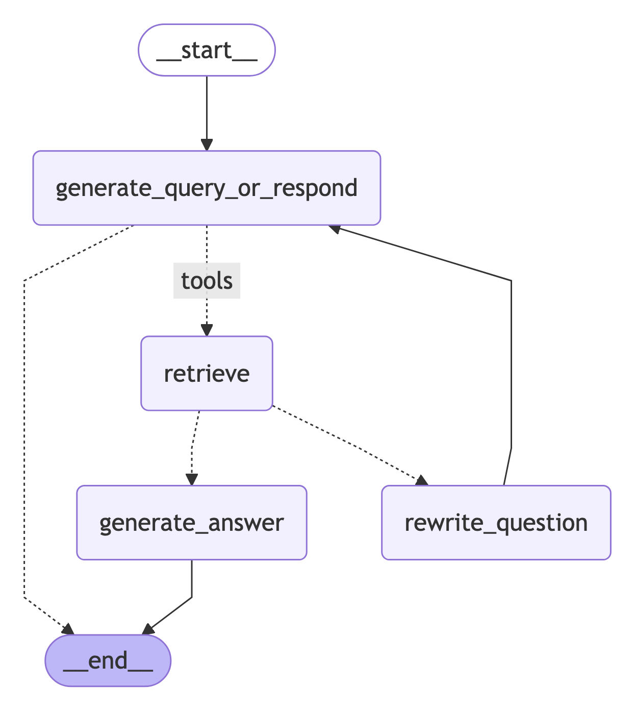

import AgenticRagAssembleGraphJs from '/langchain/snippets/code-samples/agentic-rag-assemble-graph-js.mdx';
import AgenticRagAssembleGraphPy from '/langchain/snippets/code-samples/agentic-rag-assemble-graph-py.mdx';
import AgenticRagCreateRetrieverPy from '/langchain/snippets/code-samples/agentic-rag-create-retriever-py.mdx';
import AgenticRagCreateRetrieverToolJs from '/langchain/snippets/code-samples/agentic-rag-create-retriever-tool-js.mdx';
import AgenticRagCreateRetrieverToolPy from '/langchain/snippets/code-samples/agentic-rag-create-retriever-tool-py.mdx';
import AgenticRagGenerateAnswerJs from '/langchain/snippets/code-samples/agentic-rag-generate-answer-js.mdx';
import AgenticRagGenerateAnswerPy from '/langchain/snippets/code-samples/agentic-rag-generate-answer-py.mdx';
import AgenticRagGenerateQueryOrRespondJs from '/langchain/snippets/code-samples/agentic-rag-generate-query-or-respond-js.mdx';
import AgenticRagGenerateQueryOrRespondPy from '/langchain/snippets/code-samples/agentic-rag-generate-query-or-respond-py.mdx';
import AgenticRagGradeDocumentsJs from '/langchain/snippets/code-samples/agentic-rag-grade-documents-js.mdx';
import AgenticRagGradeDocumentsPy from '/langchain/snippets/code-samples/agentic-rag-grade-documents-py.mdx';
import AgenticRagGradeIrrelevantPy from '/langchain/snippets/code-samples/agentic-rag-grade-irrelevant-py.mdx';
import AgenticRagGradeRelevantPy from '/langchain/snippets/code-samples/agentic-rag-grade-relevant-py.mdx';
import AgenticRagPreprocessJs from '/langchain/snippets/code-samples/agentic-rag-preprocess-js.mdx';
import AgenticRagPreprocessPy from '/langchain/snippets/code-samples/agentic-rag-preprocess-py.mdx';
import AgenticRagRewriteQuestionJs from '/langchain/snippets/code-samples/agentic-rag-rewrite-question-js.mdx';
import AgenticRagRewriteQuestionPy from '/langchain/snippets/code-samples/agentic-rag-rewrite-question-py.mdx';
import AgenticRagRunAgentJs from '/langchain/snippets/code-samples/agentic-rag-run-agent-js.mdx';
import AgenticRagRunAgentPy from '/langchain/snippets/code-samples/agentic-rag-run-agent-py.mdx';
import AgenticRagSetupEnvPy from '/langchain/snippets/code-samples/agentic-rag-setup-env-py.mdx';
import AgenticRagSplitDocumentsJs from '/langchain/snippets/code-samples/agentic-rag-split-documents-js.mdx';
import AgenticRagSplitDocumentsPy from '/langchain/snippets/code-samples/agentic-rag-split-documents-py.mdx';
import AgenticRagTestRetrieverToolJs from '/langchain/snippets/code-samples/agentic-rag-test-retriever-tool-js.mdx';
import AgenticRagTestRetrieverToolPy from '/langchain/snippets/code-samples/agentic-rag-test-retriever-tool-py.mdx';
import AgenticRagTryGenerateAnswerPy from '/langchain/snippets/code-samples/agentic-rag-try-generate-answer-py.mdx';
import AgenticRagTryGreetingPy from '/langchain/snippets/code-samples/agentic-rag-try-greeting-py.mdx';
import AgenticRagTryRetrievalQuestionPy from '/langchain/snippets/code-samples/agentic-rag-try-retrieval-question-py.mdx';
import AgenticRagTryRewritePy from '/langchain/snippets/code-samples/agentic-rag-try-rewrite-py.mdx';
import AgenticRagVisualizeGraphPy from '/langchain/snippets/code-samples/agentic-rag-visualize-graph-py.mdx';

构建一个[retrieval](/langchain/oss/deepagents/retrieval) agent with LangGraph，该智能体决定何时搜索向量存储或直接回答用户。

LangChain 提供基于[LangGraph](/langchain/oss/langgraph/overview)原生的[agent](/langchain/oss/langchain/agents)内置实现。当需要深度定制时，直接在 LangGraph 中实现智能体。本教程通过检索智能体模式进行演示。

本教程将指导您完成以下步骤：

1. 拉取并预处理用于检索的文档
2. 对分割后的文档进行语义搜索索引，并为智能体创建检索工具
3. 构建具备决策能力的 RAG 系统以决定何时使用检索工具


### 概念

本教程涵盖以下核心概念：

- [retrieval](/langchain/oss/deepagents/retrieval) 使用
  - [document loaders](/langchain/oss/python/integrations/document_loaders)，
  - [text splitters](/langchain/oss/integrations/splitters)、[embeddings](/langchain/oss/python/integrations/embeddings)，和
  - [vector stores](/langchain/oss/python/integrations/vectorstores)
- LangGraph [Graph API](/langchain/oss/langgraph/graph-api)，包括状态、节点、边和条件边

## 配置

安装所需包并设置 API 密钥：

:::python
```python
pip install -U langgraph langchain langchain-openai langchain-text-splitters beautifulsoup4 requests
```

<AgenticRagSetupEnvPy />
:::

:::js
<CodeGroup>
```bash npm
npm install @langchain/langgraph @langchain/openai @langchain/textsplitters cheerio
```

```bash pnpm
pnpm install @langchain/langgraph @langchain/openai @langchain/textsplitters cheerio
```

```bash yarn
yarn add @langchain/langgraph @langchain/openai @langchain/textsplitters cheerio
```

```bash bun
bun add @langchain/langgraph @langchain/openai @langchain/textsplitters cheerio
```
</CodeGroup>

:::

### 配置 LangSmith

RAG 应用程序按顺序执行检索和生成操作。本教程中的示例运行时，[LangSmith](https://docs.langchain.com/langsmith/observability) 会为每个查询记录追踪信息，便于检查检索、工具调用和模型响应。

完成[LangSmith](https://smith.langchain.com)注册后，设置环境变量以启用追踪记录：

```shell
export LANGSMITH_TRACING="true"
export LANGSMITH_API_KEY="..."
```

:::python
或通过 Python 设置：

```python
import getpass
import os

os.environ["LANGSMITH_TRACING"] = "true"
os.environ["LANGSMITH_API_KEY"] = getpass.getpass()
```
:::

<Tip>
若构建生产级智能体，我们建议同时配置[LangSmith Engine](https://docs.langchain.com/langsmith/engine)，该组件可监控追踪记录、检测问题并推荐修复方案。
</Tip>

## 预处理文档

:::python
<Steps>
<Step title="Fetch documents">

使用[Lilian Weng's blog](https://lilianweng.github.io/)的三篇博客文章。通过基于`requests`和`BeautifulSoup`构建的简易助手获取页面内容。

<AgenticRagPreprocessPy />

</Step>
<Step title="Split documents">

将获取的文档分割为小块以便向向量存储索引：

<AgenticRagSplitDocumentsPy />

</Step>
</Steps>
:::

:::js
<Steps>
<Step title="Fetch documents">

使用[Lilian Weng's blog](https://lilianweng.github.io/)的三篇近期文章。通过基于`fetch`和`cheerio`构建的简易助手获取页面内容：

<AgenticRagPreprocessJs />

</Step>
<Step title="Split documents">

将获取的文档分割为小块以便向向量存储索引：

<AgenticRagSplitDocumentsJs />

</Step>
</Steps>
:::

## 创建检索工具

将分割后的文档向向量存储进行语义索引。

:::python
<Steps>
<Step title="Index documents">

使用内存向量存储和 OpenAI 嵌入：

<AgenticRagCreateRetrieverPy />

</Step>
<Step title="Create the retriever tool">

通过`@tool`装饰器创建检索工具：

<AgenticRagCreateRetrieverToolPy />

</Step>
<Step title="Test the tool">

<AgenticRagTestRetrieverToolPy />

</Step>
</Steps>
:::

:::js
<Steps>
<Step title="Index documents and create the tool">

使用内存向量存储和 OpenAI 嵌入，然后用 LangChain 预构建的 `createRetrieverTool` 创建检索器工具：

<AgenticRagCreateRetrieverToolJs />

</Step>
<Step title="Test the tool">

<AgenticRagTestRetrieverToolJs />

</Step>
</Steps>
:::

## 生成查询或响应

当检索器工具就绪后，开始构建LangGraph图中的智能体。在 [Graph API](/langchain/oss/langgraph/graph-api), 一个图由以下组件构成：

:::python
- **[状态](/langchain/oss/langgraph/graph-api#状态)**: 节点读取并更新共享数据。本教程使用 [`MessagesState`](/langchain/oss/langgraph/graph-api#消息状态), 该组件存储一个 `messages` 列表，其中包含 [对话消息](/langchain/oss/langchain/messages)。
:::

:::js
- **[状态](/langchain/oss/langgraph/graph-api#状态)**: 节点读取并更新共享数据。本教程使用 [`MessagesAnnotation`](/langchain/oss/langgraph/graph-api#在你的图中使用消息), 该组件存储一个 `messages` 列表，其中包含 [对话消息](/langchain/oss/langchain/messages)。
:::

- **[节点](/langchain/oss/langgraph/graph-api#节点)**: 函数接受当前状态，执行一个步骤（例如调用模型或工具），并返回状态更新。
- **[边](/langchain/oss/langgraph/graph-api#边缘)**: 定义下一个运行的节点，包括 [条件边](/langchain/oss/langgraph/graph-api#条件边缘)] 根据状态分支的连接。

第一个节点是智能体决策点。根据当前对话，模型要么直接回答用户，要么在需要博客上下文时调用检索器工具。这种动态选择使系统具备代理能力，而非固定"检索-生成"流水线：检索仅在模型请求时运行。

:::python
<Steps>
<Step title="Build the node">

构建 `generate_query_or_respond` 节点，调用模型处理当前消息，并将 `retriever_tool` 绑定到 `.bind_tools`：

<AgenticRagGenerateQueryOrRespondPy />

</Step>
<Step title="Try a simple greeting">

<AgenticRagTryGreetingPy />

**输出：**

```text wrap
================================== Ai Message ==================================

Hello! How can I help you today?
```

</Step>
<Step title="Ask a retrieval question">

提出需要语义搜索的问题：

<AgenticRagTryRetrievalQuestionPy />

**输出：**

```text wrap
================================== Ai Message ==================================
Tool Calls:
retrieve_blog_posts (call_tYQxgfIlnQUDMdtAhdbXNwIM)
Call ID: call_tYQxgfIlnQUDMdtAhdbXNwIM
Args:
    query: types of reward hacking
```

</Step>
</Steps>
:::

:::js
<Steps>
<Step title="Build the node">

构建 `generateQueryOrRespond` 节点，调用模型处理当前消息，并将 `tools` 绑定到 `.bindTools`：

<AgenticRagGenerateQueryOrRespondJs />

</Step>
<Step title="Try a simple greeting">

```typescript
import { HumanMessage } from "@langchain/core/messages";

const input = { messages: [new HumanMessage("hello!")] };
const result = await generateQueryOrRespond(input);
console.log(result.messages[0]);
```

**输出：**

```text wrap
AIMessage {
  content: "Hello! How can I help you today?",
  tool_calls: []
}
```

</Step>
<Step title="Ask a retrieval question">

提出需要语义搜索的问题：

```typescript
const input = {
  messages: [
    new HumanMessage("What does Lilian Weng say about types of reward hacking?")
  ]
};
const result = await generateQueryOrRespond(input);
console.log(result.messages[0]);
```

**输出：**

```text wrap
AIMessage {
  content: "",
  tool_calls: [
    {
      name: "retrieve_blog_posts",
      args: { query: "types of reward hacking" },
      id: "call_...",
      type: "tool_call"
    }
  ]
}
```

</Step>
</Steps>
:::

## 评估文档

普通边始终将图发送到同一下一个节点。一个 [条件边](/langchain/oss/langgraph/graph-api#条件边缘)] 在运行时通过计算当前状态决定下一个节点。在检索后，使用该模式评估文档相关性：若相关则继续生成回答，否则重写问题并重新尝试。

:::python
<Steps>
<Step title="Add document grading">

添加 `grade_documents` 路由函数，使用具有结构化输出 schema `GradeDocuments` 的模型。根据评分决策（`generate_answer` 或 `rewrite_question`）返回下一个节点名称：

<AgenticRagGradeDocumentsPy />

</Step>
<Step title="Test with irrelevant documents">

使用包含不相关文档的工具响应运行此流程：

<AgenticRagGradeIrrelevantPy />

</Step>
<Step title="Test with relevant documents">

验证相关文档的归类：

<AgenticRagGradeRelevantPy />

</Step>
</Steps>
:::

:::js
<Steps>
<Step title="Add document grading">

添加一个使用具有结构化输出（Zod）模型的`gradeDocuments`路由函数，若结构化解析失败则退化为简单的"是"或"否"响应。该函数根据评分决策（`generate`或`rewrite`）返回下一个节点的名称，因此应通过条件边调用而非直接添加节点：

<AgenticRagGradeDocumentsJs />

</Step>
<Step title="Test with irrelevant documents">

在工具响应中包含无关文档进行测试：

```typescript
import { ToolMessage } from "@langchain/core/messages";

const input = {
  messages: [
    new HumanMessage("What does Lilian Weng say about types of reward hacking?"),
    new AIMessage({
      tool_calls: [
        {
          type: "tool_call",
          name: "retrieve_blog_posts",
          args: { query: "types of reward hacking" },
          id: "1",
        }
      ]
    }),
    new ToolMessage({
      content: "meow",
      tool_call_id: "1",
    })
  ]
}
const result = await gradeDocuments(input);
```

</Step>
<Step title="Test with relevant documents">

验证相关文档的归类：

```typescript
const input = {
  messages: [
    new HumanMessage("What does Lilian Weng say about types of reward hacking?"),
    new AIMessage({
      tool_calls: [
        {
          type: "tool_call",
          name: "retrieve_blog_posts",
          args: { query: "types of reward hacking" },
          id: "1",
        }
      ]
    }),
    new ToolMessage({
      content: "reward hacking can be categorized into two types: environment or goal misspecification, and reward tampering",
      tool_call_id: "1",
    })
  ]
}
const result = await gradeDocuments(input);
```

</Step>
</Steps>
:::

## 重写问题

当评分者标记检索到的文档为无关时，图不应基于该上下文回答。相反，需将原始用户问题重写为更清晰的搜索查询，然后通过控制流返回到生成查询或响应节点，使智能体重新检索。这种重试循环帮助智能体从首次检索不足中恢复，而非停止或编造答案。

:::python
<Steps>
<Step title="Build the rewrite node">

构建用于改进原始用户问题的`rewrite_question`节点（当检索缺失时）：

<AgenticRagRewriteQuestionPy />

</Step>
<Step title="Try it out">

<AgenticRagTryRewritePy />

**Output:**

```text wrap
What are the different types of reward hacking described by Lilian Weng, and how does she explain them?
```

</Step>
</Steps>
:::

:::js
<Steps>
<Step title="Build the rewrite node">

构建用于改进原始用户问题的`rewrite`节点（当检索缺失时）：

<AgenticRagRewriteQuestionJs />

</Step>
<Step title="Try it out">

```typescript
import { HumanMessage, AIMessage, ToolMessage } from "@langchain/core/messages";

const input = {
  messages: [
    new HumanMessage("What does Lilian Weng say about types of reward hacking?"),
    new AIMessage({
      content: "",
      tool_calls: [
        {
          id: "1",
          name: "retrieve_blog_posts",
          args: { query: "types of reward hacking" },
          type: "tool_call"
        }
      ]
    }),
    new ToolMessage({ content: "meow", tool_call_id: "1" })
  ]
};

const response = await rewrite(input);
console.log(response.messages[0].content);
```

**Output:**

```text wrap
What are the different types of reward hacking described by Lilian Weng, and how does she explain them?
```

</Step>
</Steps>
:::

## 生成答案

当评分者接受检索到的文档时，图进入答案生成阶段。此为经典的RAG步骤：将原始用户问题与包含检索上下文的工具消息结合，要求模型生成基于提供的上下文而非编造细节的答案。需保持提示词简洁，确保模型从给定上下文而非自行编造信息。

:::python
<Steps>
<Step title="Build the answer node">

构建用于从问题和检索上下文生成最终回复的`generate_answer`节点：

<AgenticRagGenerateAnswerPy />

</Step>
<Step title="Try it">

<AgenticRagTryGenerateAnswerPy />

**Output:**

```text wrap
================================== Ai Message ==================================

Lilian Weng categorizes reward hacking into two types: environment or goal misspecification, and reward tampering. She considers reward hacking as a broad concept that includes both of these categories. Reward hacking occurs when an agent exploits flaws or ambiguities in the reward function to achieve high rewards without performing the intended behaviors.
```

</Step>
</Steps>
:::

:::js
<Steps>
<Step title="Build the answer node">

构建用于从问题和检索上下文生成最终回复的`generate`节点：

<AgenticRagGenerateAnswerJs />

</Step>
<Step title="Try it">

```typescript
import { HumanMessage, AIMessage, ToolMessage } from "@langchain/core/messages";

const input = {
  messages: [
    new HumanMessage("What does Lilian Weng say about types of reward hacking?"),
    new AIMessage({
      content: "",
      tool_calls: [
        {
          id: "1",
          name: "retrieve_blog_posts",
          args: { query: "types of reward hacking" },
          type: "tool_call"
        }
      ]
    }),
    new ToolMessage({
      content: "reward hacking can be categorized into two types: environment or goal misspecification, and reward tampering",
      tool_call_id: "1"
    })
  ]
};

const response = await generate(input);
console.log(response.messages[0].content);
```

**Output:**

```text wrap
Lilian Weng categorizes reward hacking into two types: environment or goal misspecification, and reward tampering. She considers reward hacking as a broad concept that includes both of these categories. Reward hacking occurs when an agent exploits flaws or ambiguities in the reward function to achieve high rewards without performing the intended behaviors.
```

</Step>
</Steps>
:::

## 组装图

将节点和边组装为完整图：

:::python
- 从`generate_query_or_respond`开始，判断是否需要调用`retriever_tool`。
- 根据模型是否进行工具调用决定下一步路由：
  - 如果`generate_query_or_respond`返回`tool_calls`，调用`retriever_tool`检索上下文。
  - 否则直接向用户回复。
- 对检索到的文档内容与问题的相关性（`grade_documents`）进行评分，并决定下一步：
  - 如果不相关，使用`rewrite_question`重写问题后再次调用`generate_query_or_respond`。
  - 如果相关，进入`generate_answer`，使用带有检索文档上下文的@[ToolMessage]生成最终响应。

<AgenticRagAssembleGraphPy />

可视化流程图：

<AgenticRagVisualizeGraphPy />


:::

:::js
- 从`generateQueryOrRespond`开始，判断是否调用检索器工具。
- 通过条件分支路由到下一步：
  - 如果`generateQueryOrRespond`返回`tool_calls`，调用检索器工具检索上下文。
  - 否则直接向用户回复。
- 对检索到的文档内容与问题的相关性（`gradeDocuments`）进行评分，并决定下一步：
  - 如果不相关，使用`rewrite`重写问题后再次调用`generateQueryOrRespond`。
  - 如果相关，进入`generate`，使用带有检索文档上下文的@[ToolMessage]生成最终响应。

<AgenticRagAssembleGraphJs />
:::

## 运行 agentic RAG

通过以下问题测试完整流程：

:::python
<AgenticRagRunAgentPy />
:::

:::js
<AgenticRagRunAgentJs />
:::

## 参考文档

- [检索](/langchain/oss/langchain/retrieval)
- [图 API](/langchain/oss/langgraph/graph-api)
- [智能体](/langchain/oss/langchain/agents)
- [构建 RAG 智能体](/langchain/oss/deepagents/rag)
- [构建语义搜索引擎](/langchain/oss/langchain/knowledge-base)

---

> 官方原文：[src/oss/langgraph/agentic-rag.mdx](https://github.com/langchain-ai/docs/blob/main/src/oss/langgraph/agentic-rag.mdx) · 非官方翻译，译文由 AI 生成，以英文原文为准。
