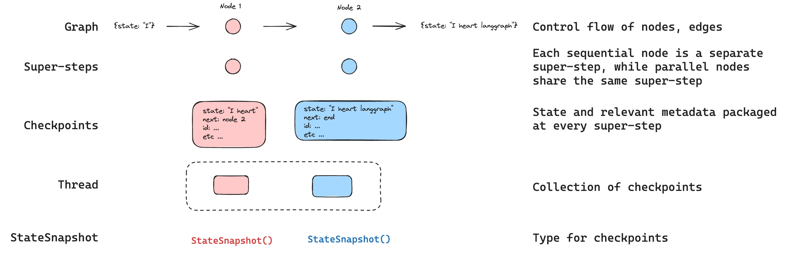
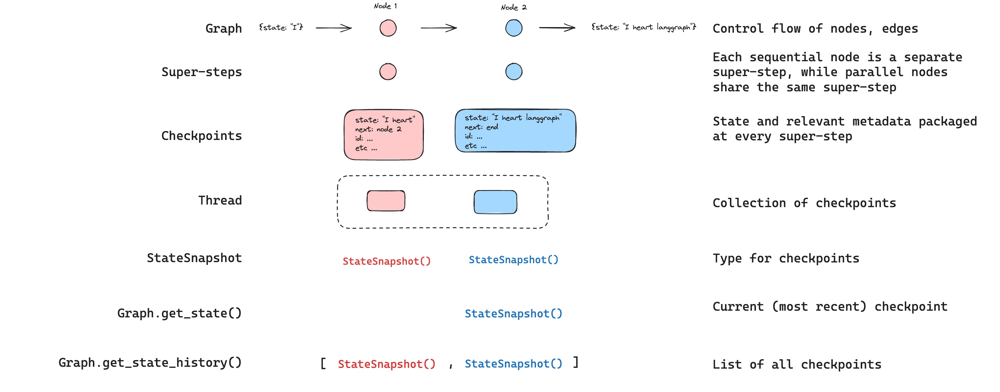
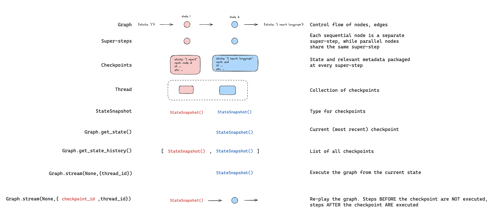
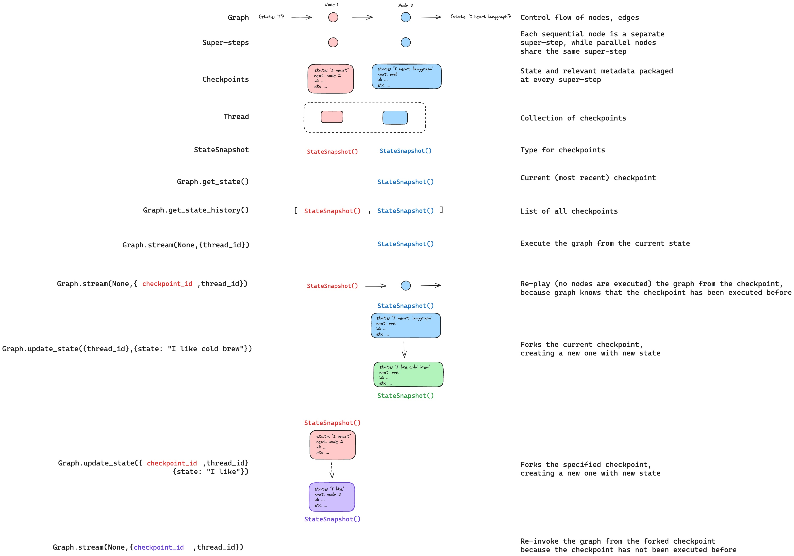

检查点器在每个超步骤中保存图状态的快照，并组织成 **线程**。使用带检查点器的图来启用人机交互工作流、时间旅行调试、容错执行和对话记忆。



<Info>
**智能体服务器自动处理检查点**
在使用 [智能体服务器](https://docs.langchain.com/langsmith/agent-server) 时，您无需手动实现或配置检查点器。服务器在后台为您处理所有持久化基础设施。
</Info>

<Tip>
使用 [LangSmith](https://smith.langchain.com) 追踪检查点状态并调试智能体跨会话恢复的方式。遵循 [跟踪快速入门](https://docs.langchain.com/langsmith/trace-with-langgraph) 来设置。
</Tip>

## 为什么使用检查点器

以下功能需要检查点器：

- **人机交互**：检查点器通过允许人类检查、中断和批准图步骤来促进 [人机交互工作流](/langchain/oss/langgraph/interrupts)。由于人需要能够随时查看图的状态，并且图能够在人类对状态做出任何更新后恢复执行，因此这些工作流需要检查点器。参见 [中断](/langchain/oss/langgraph/interrupts) 获取示例。
- **记忆**：检查点器允许交互之间的 ["记忆"](/langchain/oss/concepts/memory)。在重复人机交互（如对话）的情况下，任何后续消息都可以发送到该线程，该线程将保留对之前的记忆。参见 [添加记忆](/langchain/oss/langgraph/add-memory) 了解如何使用检查点器添加和管理对话记忆。
- **时间旅行**：检查点器允许 ["时间旅行"](/langchain/oss/langgraph/use-time-travel)，允许用户重放先前的图执行以审查和 / 或调试特定图步骤。此外，检查点器使在任意检查点分叉图状态成为可能，以探索替代轨迹。
- **容错**：检查点提供容错和错误恢复：如果在一个超步骤中一个或多个节点失败，您可以从最后一个成功步骤重新启动您的图。
<a id="pending-writes"></a>
- **待处理写入**：当一个图节点在一个 [超步骤](#超步骤) 执行中途失败时，LangGraph 会存储来自任何在该超步骤中成功完成的节点的待处理检查点写入。当您从该超步骤重新启动图执行时，您不需要重新运行成功的节点。

## 核心概念

### 线程

线程是检查点器为每个保存的检查点分配的唯一 ID 或线程标识符。它包含一系列 [运行](https://docs.langchain.com/langsmith/runs) 的累积状态。当执行运行时，[状态](/langchain/oss/langgraph/graph-api#状态) 的底层图将持久化到线程。

在带检查点器调用图时，您必须将 `thread_id` 作为配置的 `configurable` 部分指定：

:::python
```python
{"configurable": {"thread_id": "1"}}
```
:::

:::js
```typescript
{
  configurable: {
    thread_id: "1";
  }
}
```
:::

线程的当前和历史状态可以被检索。为了持久化状态，必须在执行运行之前创建线程。LangSmith API 提供了几个端点用于创建和管理线程和线程状态。参见 [API 参考](https://reference.langchain.com/python/langsmith/) 获取更多详细信息。

检查点器使用 `thread_id` 作为存储和检索检查点的主键。没有它，检查点器无法保存状态或在 [中断](/langchain/oss/langgraph/interrupts) 后恢复执行，因为检查点器使用 `thread_id` 来加载保存的状态。

### 检查点

线程在特定时间点的状态称为检查点。检查点是每个 [超步骤](#超步骤) 保存的图状态的快照，并由一个 `StateSnapshot` 对象表示（参见 [状态快照字段](#statesnapshot-字段) 获取完整字段参考）。

#### 超步骤

LangGraph 在每个 **超步骤** 边界创建检查点。超步骤是图的单个“滴答”，其中所有为该步骤安排的节点执行（可能并行）。对于像 `START -> A -> B -> END` 这样的顺序图，输入、节点 A 和节点 B 有单独的超步骤——每个步骤后都会生成一个检查点。理解超步骤边界对于 [时间旅行](/langchain/oss/langgraph/use-time-travel) 很重要，因为您只能从检查点（即超步骤边界）恢复执行。

除了超步骤检查点，LangGraph 还在 **节点（任务）级别** 持久化写入。在超步骤内的每个节点完成时，其输出会写入检查点器的 `checkpoint_writes` 表作为链接到进行中的检查点的任务条目。这些按任务写入使 [待处理写入](#pending-writes) 恢复成为可能：如果同一超步骤中的另一个节点失败，成功节点的写入已经是持久的，在恢复时不需要重新运行。然后，在超步骤完成后提交完整的状态快照。

LangGraph 还持久化超步骤内单个节点执行时的写入。这些写入作为任务存储，并用于容错：如果同一超步骤中的另一个节点失败，在恢复时不需要重新计算成功节点的写入。这些任务写入不是完整的 `StateSnapshot` 检查点，因此时间旅行从超步骤边界处的完整检查点恢复。

检查点被持久化，并可用于在稍后时间恢复线程的状态。

让我们看看当以下方式调用简单图时保存了哪些检查点：

:::python
```python
from langgraph.graph import StateGraph, START, END
from langgraph.checkpoint.memory import InMemorySaver
from langchain_core.runnables import RunnableConfig
from typing import Annotated
from typing_extensions import TypedDict
from operator import add

class State(TypedDict):
    foo: str
    bar: Annotated[list[str], add]

def node_a(state: State):
    return {"foo": "a", "bar": ["a"]}

def node_b(state: State):
    return {"foo": "b", "bar": ["b"]}


workflow = StateGraph(State)
workflow.add_node(node_a)
workflow.add_node(node_b)
workflow.add_edge(START, "node_a")
workflow.add_edge("node_a", "node_b")
workflow.add_edge("node_b", END)

checkpointer = InMemorySaver()
graph = workflow.compile(checkpointer=checkpointer)

config: RunnableConfig = {"configurable": {"thread_id": "1"}}
graph.invoke({"foo": "", "bar":[]}, config)
```
:::

:::js
```typescript
import { StateGraph, StateSchema, ReducedValue, START, END, MemorySaver } from "@langchain/langgraph";
import { z } from "zod/v4";

const State = new StateSchema({
  foo: z.string(),
  bar: new ReducedValue(
    z.array(z.string()).default(() => []),
    {
      inputSchema: z.array(z.string()),
      reducer: (x, y) => x.concat(y),
    }
  ),
});

const workflow = new StateGraph(State)
  .addNode("nodeA", (state) => {
    return { foo: "a", bar: ["a"] };
  })
  .addNode("nodeB", (state) => {
    return { foo: "b", bar: ["b"] };
  })
  .addEdge(START, "nodeA")
  .addEdge("nodeA", "nodeB")
  .addEdge("nodeB", END);

const checkpointer = new MemorySaver();
const graph = workflow.compile({ checkpointer });

const config = { configurable: { thread_id: "1" } };
await graph.invoke({ foo: "", bar: [] }, config);
```
:::

:::python
运行图后，将恰好有 4 个检查点：

* 空检查点，将 @[`START`] 作为下一个要执行的节点
* 检查点，包含用户输入 `{'foo': '', 'bar': []}` 和 `node_a` 作为下一个要执行的节点
* 检查点，包含 `node_a` `{'foo': 'a', 'bar': ['a']}` 和 `node_b` 的输出作为下一个要执行的节点
* 检查点，包含 `node_b` `{'foo': 'b', 'bar': ['a', 'b']}` 的输出，并且没有下一个节点要执行

请注意，`bar` 通道值包含来自两个节点的输出，因为此示例为 `bar` 通道配置了 reducer。
:::

:::js
运行图后，将恰好有 4 个检查点：

* 空的检查点，以 @[`START`] 作为下一个要执行的节点
* 包含用户输入 `{'foo': '', 'bar': []}` 和 `nodeA` 的检查点，作为下一个要执行的节点
* 包含 `nodeA` `{'foo': 'a', 'bar': ['a']}` 和 `nodeB` 输出的检查点，作为下一个要执行的节点
* 包含 `nodeB` `{'foo': 'b', 'bar': ['a', 'b']}` 输出且没有下一个节点要执行的检查点

请注意 `bar` 通道值包含来自两个节点的输出，因为此示例为 `bar` 通道配置了 reducer。

:::

#### 检查点命名空间

每个检查点都有一个 `checkpoint_ns`（检查点命名空间）字段，用于标识它所属的图或子图：

- **`""`**（空字符串）：检查点属于父图（根图）。
- **`"node_name:uuid"`**：检查点属于作为给定节点调用的子图。对于嵌套子图，命名空间使用 `|` 分隔符连接（例如，`"outer_node:uuid|inner_node:uuid"`）。

您可以通过配置在节点内部访问检查点命名空间：

:::python
```python
from langchain_core.runnables import RunnableConfig

def my_node(state: State, config: RunnableConfig):
    checkpoint_ns = config["configurable"]["checkpoint_ns"]
    # "" for the parent graph, "node_name:uuid" for a subgraph
```
:::

:::js
```typescript
import { RunnableConfig } from "@langchain/core/runnables";

function myNode(state: typeof State.Type, config: RunnableConfig) {
  const checkpointNs = config.configurable?.checkpoint_ns;
  // "" for the parent graph, "node_name:uuid" for a subgraph
}
```
:::

参见 [子图](/langchain/oss/langgraph/use-subgraphs) 了解更多关于处理子图状态和检查点的详细信息。

## 获取和更新状态

### 获取状态

:::python
在与保存的图状态交互时，您 **必须** 指定 [线程标识符](#线程)。您可以通过调用 `graph.get_state(config)` 查看图的 _最新_ 状态。这将返回一个 `StateSnapshot` 对象，该对象对应于配置中提供的线程 ID 关联的最新检查点，或者如果提供了检查点 ID，则对应于线程的检查点关联的检查点。

```python
# get the latest state snapshot
config = {"configurable": {"thread_id": "1"}}
graph.get_state(config)

# get a state snapshot for a specific checkpoint_id
config = {"configurable": {"thread_id": "1", "checkpoint_id": "1ef663ba-28fe-6528-8002-5a559208592c"}}
graph.get_state(config)
```
:::

:::js
在与保存的图状态交互时，您 **必须** 指定 [线程标识符](#线程)。您可以通过调用 `graph.getState(config)` 查看图的 _最新_ 状态。这将返回一个 `StateSnapshot` 对象，该对象对应于配置中提供的线程 ID 关联的最新检查点，或者如果提供了检查点 ID，则对应于线程的检查点关联的检查点。

```typescript
// get the latest state snapshot
const config = { configurable: { thread_id: "1" } };
await graph.getState(config);

// get a state snapshot for a specific checkpoint_id
const config = {
  configurable: {
    thread_id: "1",
    checkpoint_id: "1ef663ba-28fe-6528-8002-5a559208592c",
  },
};
await graph.getState(config);
```
:::

:::python
在此示例中，`get_state` 的输出如下所示：

```
StateSnapshot(
    values={'foo': 'b', 'bar': ['a', 'b']},
    next=(),
    config={'configurable': {'thread_id': '1', 'checkpoint_ns': '', 'checkpoint_id': '1ef663ba-28fe-6528-8002-5a559208592c'}},
    metadata={'source': 'loop', 'writes': {'node_b': {'foo': 'b', 'bar': ['b']}}, 'step': 2},
    created_at='2024-08-29T19:19:38.821749+00:00',
    parent_config={'configurable': {'thread_id': '1', 'checkpoint_ns': '', 'checkpoint_id': '1ef663ba-28f9-6ec4-8001-31981c2c39f8'}},
    tasks=()
)
```
:::

:::js
在此示例中，`getState` 的输出如下所示：

```
StateSnapshot {
  values: { foo: 'b', bar: ['a', 'b'] },
  next: [],
  config: {
    configurable: {
      thread_id: '1',
      checkpoint_ns: '',
      checkpoint_id: '1ef663ba-28fe-6528-8002-5a559208592c'
    }
  },
  metadata: {
    source: 'loop',
    writes: { nodeB: { foo: 'b', bar: ['b'] } },
    step: 2
  },
  createdAt: '2024-08-29T19:19:38.821749+00:00',
  parentConfig: {
    configurable: {
      thread_id: '1',
      checkpoint_ns: '',
      checkpoint_id: '1ef663ba-28f9-6ec4-8001-31981c2c39f8'
    }
  },
  tasks: []
}
```
:::

#### StateSnapshot 字段

:::python

| 字段 | 类型 | 描述 |
|-------|------|-------------|
| `values` | `dict` | 此检查点的状态通道值。 |
| `next` | `tuple[str, ...]` | 下一个要执行的节点名称。空的 `()` 表示图已完成。 |
| `config` | `dict` | 包含 `thread_id`, `checkpoint_ns`, 和 `checkpoint_id`。 |
| `metadata` | `dict` | 执行元数据。包含 `source` (`"input"`, `"loop"`, 或 `"update"`), `writes` (节点输出), 和 `step` (超步计数器)。 |
| `created_at` | `str` | 此检查点创建的 ISO 8601 时间戳。 |
| `parent_config` | `dict \| None` | 前一个检查点的配置。`None` 对于第一个检查点。 |
| `tasks` | `tuple[PregelTask, ...]` | 此步骤要执行的任务。每个任务有 `id`, `name`, `error`, `interrupts`，以及可选的 `state` (子图快照，当使用 `subgraphs=True` 时)。 |

:::

:::js

| 字段 | 类型 | 描述 |
|-------|------|-------------|
| `values` | `object` | 此检查点的状态通道值。 |
| `next` | `string[]` | 下一个要执行的节点名称。空的 `[]` 表示图已完成。 |
| `config` | `object` | 包含 `thread_id`, `checkpoint_ns`, 和 `checkpoint_id`。 |
| `metadata` | `object` | 执行元数据。包含 `source` (`"input"`, `"loop"`, 或 `"update"`), `writes` (节点输出), 和 `step` (超步计数器)。 |
| `createdAt` | `string` | 此检查点创建的 ISO 8601 时间戳。 |
| `parentConfig` | `object \| null` | 前一个检查点的配置。`null` 对于第一个检查点。 |
| `tasks` | `PregelTask[]` | 此步骤要执行的任务。每个任务有 `id`, `name`, `error`, `interrupts`，以及可选的 `state` (子图快照，当使用 `subgraphs: true` 时)。 |

:::

### 获取状态历史

:::python
您可以通过调用 @[`graph.get_state_history(config)`][get_state_history] 获取给定线程的图执行完整历史。这将返回与配置中提供的线程 ID 关联的一系列 `StateSnapshot` 对象。重要的是，检查点将按时间顺序排列，最新的检查点 / `StateSnapshot` 将是列表中的第一个。

```python
config = {"configurable": {"thread_id": "1"}}
list(graph.get_state_history(config))
```
:::

:::js
您可以通过调用 `graph.getStateHistory(config)` 获取给定线程的图执行完整历史。这将返回与配置中提供的线程 ID 关联的一系列 `StateSnapshot` 对象。重要的是，检查点将按时间顺序排列，最新的检查点 / `StateSnapshot` 将是列表中的第一个。

```typescript
const config = { configurable: { thread_id: "1" } };
for await (const state of graph.getStateHistory(config)) {
  console.log(state);
}
```
:::

:::python
在此示例中，`get_state_history` 的输出如下所示：

```
[
    StateSnapshot(
        values={'foo': 'b', 'bar': ['a', 'b']},
        next=(),
        config={'configurable': {'thread_id': '1', 'checkpoint_ns': '', 'checkpoint_id': '1ef663ba-28fe-6528-8002-5a559208592c'}},
        metadata={'source': 'loop', 'writes': {'node_b': {'foo': 'b', 'bar': ['b']}}, 'step': 2},
        created_at='2024-08-29T19:19:38.821749+00:00',
        parent_config={'configurable': {'thread_id': '1', 'checkpoint_ns': '', 'checkpoint_id': '1ef663ba-28f9-6ec4-8001-31981c2c39f8'}},
        tasks=(),
    ),
    StateSnapshot(
        values={'foo': 'a', 'bar': ['a']},
        next=('node_b',),
        config={'configurable': {'thread_id': '1', 'checkpoint_ns': '', 'checkpoint_id': '1ef663ba-28f9-6ec4-8001-31981c2c39f8'}},
        metadata={'source': 'loop', 'writes': {'node_a': {'foo': 'a', 'bar': ['a']}}, 'step': 1},
        created_at='2024-08-29T19:19:38.819946+00:00',
        parent_config={'configurable': {'thread_id': '1', 'checkpoint_ns': '', 'checkpoint_id': '1ef663ba-28f4-6b4a-8000-ca575a13d36a'}},
        tasks=(PregelTask(id='6fb7314f-f114-5413-a1f3-d37dfe98ff44', name='node_b', error=None, interrupts=()),),
    ),
    StateSnapshot(
        values={'foo': '', 'bar': []},
        next=('node_a',),
        config={'configurable': {'thread_id': '1', 'checkpoint_ns': '', 'checkpoint_id': '1ef663ba-28f4-6b4a-8000-ca575a13d36a'}},
        metadata={'source': 'loop', 'writes': None, 'step': 0},
        created_at='2024-08-29T19:19:38.817813+00:00',
        parent_config={'configurable': {'thread_id': '1', 'checkpoint_ns': '', 'checkpoint_id': '1ef663ba-28f0-6c66-bfff-6723431e8481'}},
        tasks=(PregelTask(id='f1b14528-5ee5-579c-949b-23ef9bfbed58', name='node_a', error=None, interrupts=()),),
    ),
    StateSnapshot(
        values={'bar': []},
        next=('__start__',),
        config={'configurable': {'thread_id': '1', 'checkpoint_ns': '', 'checkpoint_id': '1ef663ba-28f0-6c66-bfff-6723431e8481'}},
        metadata={'source': 'input', 'writes': {'foo': ''}, 'step': -1},
        created_at='2024-08-29T19:19:38.816205+00:00',
        parent_config=None,
        tasks=(PregelTask(id='6d27aa2e-d72b-5504-a36f-8620e54a76dd', name='__start__', error=None, interrupts=()),),
    )
]
```
:::

:::js
在此示例中，`getStateHistory` 的输出如下所示：

```
[
  StateSnapshot {
    values: { foo: 'b', bar: ['a', 'b'] },
    next: [],
    config: {
      configurable: {
        thread_id: '1',
        checkpoint_ns: '',
        checkpoint_id: '1ef663ba-28fe-6528-8002-5a559208592c'
      }
    },
    metadata: {
      source: 'loop',
      writes: { nodeB: { foo: 'b', bar: ['b'] } },
      step: 2
    },
    createdAt: '2024-08-29T19:19:38.821749+00:00',
    parentConfig: {
      configurable: {
        thread_id: '1',
        checkpoint_ns: '',
        checkpoint_id: '1ef663ba-28f9-6ec4-8001-31981c2c39f8'
      }
    },
    tasks: []
  },
  StateSnapshot {
    values: { foo: 'a', bar: ['a'] },
    next: ['nodeB'],
    config: {
      configurable: {
        thread_id: '1',
        checkpoint_ns: '',
        checkpoint_id: '1ef663ba-28f9-6ec4-8001-31981c2c39f8'
      }
    },
    metadata: {
      source: 'loop',
      writes: { nodeA: { foo: 'a', bar: ['a'] } },
      step: 1
    },
    createdAt: '2024-08-29T19:19:38.819946+00:00',
    parentConfig: {
      configurable: {
        thread_id: '1',
        checkpoint_ns: '',
        checkpoint_id: '1ef663ba-28f4-6b4a-8000-ca575a13d36a'
      }
    },
    tasks: [
      PregelTask {
        id: '6fb7314f-f114-5413-a1f3-d37dfe98ff44',
        name: 'nodeB',
        error: null,
        interrupts: []
      }
    ]
  },
  StateSnapshot {
    values: { foo: '', bar: [] },
    next: ['node_a'],
    config: {
      configurable: {
        thread_id: '1',
        checkpoint_ns: '',
        checkpoint_id: '1ef663ba-28f4-6b4a-8000-ca575a13d36a'
      }
    },
    metadata: {
      source: 'loop',
      writes: null,
      step: 0
    },
    createdAt: '2024-08-29T19:19:38.817813+00:00',
    parentConfig: {
      configurable: {
        thread_id: '1',
        checkpoint_ns: '',
        checkpoint_id: '1ef663ba-28f0-6c66-bfff-6723431e8481'
      }
    },
    tasks: [
      PregelTask {
        id: 'f1b14528-5ee5-579c-949b-23ef9bfbed58',
        name: 'node_a',
        error: null,
        interrupts: []
      }
    ]
  },
  StateSnapshot {
    values: { bar: [] },
    next: ['__start__'],
    config: {
      configurable: {
        thread_id: '1',
        checkpoint_ns: '',
        checkpoint_id: '1ef663ba-28f0-6c66-bfff-6723431e8481'
      }
    },
    metadata: {
      source: 'input',
      writes: { foo: '' },
      step: -1
    },
    createdAt: '2024-08-29T19:19:38.816205+00:00',
    parentConfig: null,
    tasks: [
      PregelTask {
        id: '6d27aa2e-d72b-5504-a36f-8620e54a76dd',
        name: '__start__',
        error: null,
        interrupts: []
      }
    ]
  }
]
```
:::



#### 查找特定检查点

您可以通过过滤状态历史来查找符合特定条件的检查点：

:::python
```python
history = list(graph.get_state_history(config))

# Find the checkpoint before a specific node executed
before_node_b = next(s for s in history if s.next == ("node_b",))

# Find a checkpoint by step number
step_2 = next(s for s in history if s.metadata["step"] == 2)

# Find checkpoints created by update_state
forks = [s for s in history if s.metadata["source"] == "update"]

# Find the checkpoint where an interrupt occurred
interrupted = next(
    s for s in history
    if s.tasks and any(t.interrupts for t in s.tasks)
)
```
:::

:::js
```typescript
const history: StateSnapshot[] = [];
for await (const state of graph.getStateHistory(config)) {
  history.push(state);
}

// Find the checkpoint before a specific node executed
const beforeNodeB = history.find((s) => s.next.includes("nodeB"));

// Find a checkpoint by step number
const step2 = history.find((s) => s.metadata.step === 2);

// Find checkpoints created by updateState
const forks = history.filter((s) => s.metadata.source === "update");

// Find the checkpoint where an interrupt occurred
const interrupted = history.find(
  (s) => s.tasks.length > 0 && s.tasks.some((t) => t.interrupts.length > 0)
);
```
:::

### 重放

重放重新执行先前检查点之前的步骤。使用先前的 `checkpoint_id` 调用图以重新运行检查点之后的节点。检查点之前的节点将被跳过（其结果已经保存）。检查点之后的节点将重新执行，包括任何 LLM 调用、API 请求或 [中断](/langchain/oss/langgraph/interrupts) — 在重放期间始终会重新触发。

参见 [时间旅行](/langchain/oss/langgraph/use-time-travel) 了解重放过去执行的完整详细信息和代码示例。



### 更新状态

:::python
您可以使用 @[`update_state` 编辑图状态。这将创建一个新的检查点，其中包含更新后的值 — 它不会修改原始检查点。更新被视为节点更新相同：当定义时，值会通过 [reducer](/langchain/oss/langgraph/graph-api#归约器) 函数传递，因此带有 reducer 的通道会 _累积_ 值而不是覆盖它们。

您可以选择指定 `as_node` 来控制更新被视为来自哪个节点，这会影响下一个执行的节点。参见 [时间旅行: `as_node`](/langchain/oss/langgraph/use-time-travel#从特定节点开始) 了解详细信息。
:::

:::js
您可以使用 `graph.updateState()` 编辑图状态。这将创建一个新的检查点，其中包含更新后的值 — 它不会修改原始检查点。更新被视为节点更新相同：当定义时，值会通过 [reducer](/langchain/oss/langgraph/graph-api#归约器) 函数传递，因此带有 reducer 的通道会 _累积_ 值而不是覆盖它们。

您可以选择指定 `asNode` 来控制更新被视为来自哪个节点，这会影响下一个执行的节点。参见 [时间旅行: `asNode`](/langchain/oss/langgraph/use-time-travel#从特定节点开始) 了解详细信息。
:::



## 持久化模式

LangGraph 支持三种持久化模式，让您在性能和数据一致性之间进行权衡。您可以在调用任何图执行方法时指定持久化模式：

:::python
```python
graph.stream(
    {"input": "test"},
    durability="sync"
)
```
:::

:::js
```typescript
await graph.stream(
  { input: "test" },
  { durability: "sync" }
)
```
:::

持久化模式从最不持久到最持久如下：

* `"exit"`：LangGraph 仅在图执行退出时持久化变更——成功退出、发生错误或由于人工中断。这为长时间运行的图提供了最佳性能，但意味着中间状态不会保存，因此您无法从系统故障（如进程崩溃）中恢复执行。
* `"async"`：LangGraph 在执行下一步时异步持久化变更。这提供了良好的性能和持久性，但存在一个小风险，即如果进程在执行过程中崩溃，LangGraph 可能不会写入检查点。

:::python
* `"sync"`：LangGraph 在下一步开始前同步持久化变更。这确保 LangGraph 在继续执行前会写入每个检查点，以牺牲一些性能开销为代价提供高持久性。
:::

:::js
* `"sync"`：LangGraph 在运行期间持续持久化检查点写入，并在运行结束时等待尚未完成的检查点 promise。中间步骤可以在这些写入完成前继续，因此运行中进程崩溃仍可能丢失最近的检查点；它比 `"async"` 更持久，仅体现在运行不会在待处理写入落定前返回。
:::

### 新线程上的首个持久检查点

对于新线程，持久化模式还会决定在第一个用户节点执行前提交哪些检查点。内部的 `__start__` 超步先运行；步骤 `0` 是在该超步之后写入的循环检查点。

* `"exit"`：运行结束前不存在任何检查点。运行期间崩溃不会留下该线程的任何记录。
* `"async"`：LangGraph 在第一个用户节点执行前开始写入输入检查点，但不会等待写入完成。第一个用户节点可能在提交任何检查点之前就开始运行。

:::python
* `"sync"`：LangGraph 在第一个用户节点执行前提交输入检查点（步骤 `-1`）和步骤 `0` 检查点。
:::

:::js
* `"sync"`：LangGraph 在早期 tick 中调度输入和步骤 `0` 的写入，但只在运行结束后等待尚未完成的检查点 promise。对于缓慢或延迟的保存器，第一个用户节点可能在提交任何检查点之前就开始运行，因此该边界上的准入可见性与 `"async"` 一致。
:::

:::python
<Warning>
无论采用哪种模式，如果崩溃发生在第一个检查点变为持久之前，该线程看起来与从未被调用过的线程没有区别：`get_tuple()` 在两种情况下都返回 `None`，而 `invoke(None, config)` 会抛出 `EmptyInputError`。如果你需要区分“从未接受”和“已接受但丢失”，请在检查点之外记录准入信息，例如在调用 `invoke` 之前将一条 outbox 记录提交到你自己的存储中。
</Warning>
:::

:::js
<Warning>
无论采用哪种模式，如果崩溃发生在第一个检查点变为持久之前，该线程看起来与从未被调用过的线程没有区别：`getTuple()` 在两种情况下都返回 `undefined`，而 `invoke(null, config)` 会抛出 `EmptyInputError`。如果你需要区分“从未接受”和“已接受但丢失”，请在检查点之外记录准入信息，例如在调用 `invoke` 之前将一条 outbox 记录提交到你自己的存储中。
</Warning>
:::

## 优化检查点存储

:::python
默认情况下，LangGraph 检查点会写入每个状态通道在每个超步的完整值。对于具有大量累积的长时间运行线程（如多轮对话），这会导致存储随时间显著增长。

@[`DeltaChannel`] 仅存储增量差异而不是完整累积值，大幅减少追加型通道的检查点大小。参见 [DeltaChannel](/langchain/oss/langgraph/pregel#deltachannel) 了解用法和存储与延迟的权衡。

<Warning>
`DeltaChannel` 需要 `langgraph>=1.2`，目前处于 Beta 版本。API 在未来版本中可能会发生变化。
</Warning>
:::

## 检查点库

底层，检查点功能由符合 @[`BaseCheckpointSaver`] 接口的对象提供。LangGraph 提供了多个检查点实现，均通过独立的可安装库实现。

:::python
<Note>
参见 [checkpointer integrations](/langchain/oss/python/integrations/checkpointers/index) 了解可用提供者。
</Note>

* `langgraph-checkpoint`：检查点保存器的基础接口 (@[`BaseCheckpointSaver`]) 和序列化/反序列化接口 (@[`SerializerProtocol`)。包含用于实验的内存检查点实现 (@[`InMemorySaver`)。LangGraph 随附 `langgraph-checkpoint`。
* `langgraph-checkpoint-sqlite`：使用 SQLite 数据库实现的 LangGraph 检查点 (@[`SqliteSaver`] / @[`AsyncSqliteSaver`)。适用于实验和本地工作流。需要单独安装。
* `langgraph-checkpoint-postgres`：使用 Postgres 数据库的高级检查点 (@[`PostgresSaver`] / @[`AsyncPostgresSaver`)，用于 LangSmith。适用于生产环境。需要单独安装。
* `langgraph-checkpoint-mongodb`：使用 MongoDB (`MongoDBSaver` / `AsyncMongoDBSaver`) 的高级检查点。适用于生产环境。需要单独安装。
* `langchain-azure-cosmosdb`：使用 Azure Cosmos DB 实现的 LangGraph 检查点，用于 NoSQL (@[`CosmosDBSaverSync`] / @[`CosmosDBSaver`)。适用于 Azure 生产环境。支持同步和异步操作，并使用 Microsoft Entra ID 身份验证。需要单独安装。
:::

:::js
* `@langchain/langgraph-checkpoint`：检查点保存器的基础接口 (@[`BaseCheckpointSaver`) 和序列化/反序列化接口 (@[`SerializerProtocol`)。包含用于实验的内存检查点实现 (@[`MemorySaver`)。LangGraph 随附 `@langchain/langgraph-checkpoint`。
* `@langchain/langgraph-checkpoint-sqlite`：使用 SQLite 数据库实现的 LangGraph 检查点 (@[`SqliteSaver`)。适用于实验和本地工作流。需要单独安装。
* `@langchain/langgraph-checkpoint-postgres`：使用 Postgres 数据库的高级检查点 (@[`PostgresSaver`)，用于 LangSmith。适用于生产环境。需要单独安装。
* `@langchain/langgraph-checkpoint-mongodb`：基于 MongoDB 的高级检查点 (`MongoDBSaver`) 和长期记忆存储 (`MongoDBStore`)。存储支持跨线程持久化，并可选集成向量搜索。适用于生产环境。需要单独安装。
* `@langchain/langgraph-checkpoint-redis`：使用 Redis 数据库 (`RedisSaver`) 的高级检查点。适用于生产环境。需要单独安装。
:::

### 检查点接口

:::python
每个检查点都符合 @[`BaseCheckpointSaver`] 接口，并实现以下方法：

* `.put` - 存储带有其配置和元数据的检查点。
* `.put_writes` - 存储与检查点链接的中间写入（即 [pending writes](#pending-writes)）。
* `.get_tuple` - 使用给定配置（`thread_id` 和 `checkpoint_id`）获取检查点元组。这用于在 `graph.get_state()` 中填充 `StateSnapshot`。
* `.list` - 列出符合给定配置和过滤标准的检查点。这用于在 `graph.get_state_history()` 中填充状态历史

如果检查点与异步图执行一起使用（即通过 `.ainvoke`、`.astream`、`.abatch` 执行图），将使用上述方法的异步版本 (`.aput`、`.aput_writes`、`.aget_tuple`、`.alist`)。

<Note>
要异步运行您的图，您可以使用 @[`InMemorySaver`，或 Sqlite/Postgres 检查点的异步版本——@[`AsyncSqliteSaver` / @[`AsyncPostgresSaver`] 检查点。
</Note>
:::

:::js
每个检查点都符合 @[`BaseCheckpointSaver`] 接口，并实现以下方法：

* `.put` - 存储带有其配置和元数据的检查点。
* `.putWrites` - 存储与检查点链接的中间写入（即 [pending writes](#pending-writes)）。
* `.getTuple` - 使用给定配置（`thread_id` 和 `checkpoint_id`）获取检查点元组。这用于在 `StateSnapshot` 中填充 `graph.getState()`。
* `.list` - 列出符合给定配置和过滤标准的检查点。这用于在 `graph.getStateHistory()` 中填充状态历史
:::

:::python

### 序列化器

当检查点保存图状态时，它们需要序列化状态中的通道值。这是通过序列化器对象完成的。

`langgraph_checkpoint` 定义了 @[protocol][SerializerProtocol]，用于实现序列化器，并提供了一个默认实现 (@[`JsonPlusSerializer`)，可处理多种类型，包括 LangChain 和 LangGraph 基本类型、日期时间、枚举等。

#### 使用 `pickle` 进行序列化

默认序列化器 @[`JsonPlusSerializer`] 在底层使用 ormsgpack 和 JSON，这不适合所有类型的对象。

如果您希望对于当前 msgpack 编码器不支持的对象（例如 Pandas 数据框）回退到使用 pickle，您可以使用 @[`JsonPlusSerializer`] 的 `pickle_fallback` 参数：

```python
from langgraph.checkpoint.memory import InMemorySaver
from langgraph.checkpoint.serde.jsonplus import JsonPlusSerializer

# ... Define the graph ...
graph.compile(
    checkpointer=InMemorySaver(serde=JsonPlusSerializer(pickle_fallback=True))
)
```

#### 加密

Checkpointers 可以选择加密所有持久化状态。要启用此功能，请将 @[`EncryptedSerializer`] 的实例传递给任何 @[`BaseCheckpointSaver`] 实现的 `serde` 参数。创建加密序列化器的最简单方法是通过 @[`from_pycryptodome_aes`]，它从 `LANGGRAPH_AES_KEY` 环境变量中读取 AES 密钥（或接受一个 `key` 参数）：

```python
import sqlite3

from langgraph.checkpoint.serde.encrypted import EncryptedSerializer
from langgraph.checkpoint.sqlite import SqliteSaver

serde = EncryptedSerializer.from_pycryptodome_aes()  # reads LANGGRAPH_AES_KEY
checkpointer = SqliteSaver(sqlite3.connect("checkpoint.db"), serde=serde)
```

```python
from langgraph.checkpoint.serde.encrypted import EncryptedSerializer
from langgraph.checkpoint.postgres import PostgresSaver

serde = EncryptedSerializer.from_pycryptodome_aes()
checkpointer = PostgresSaver.from_conn_string("postgresql://...", serde=serde)
checkpointer.setup()
```

在 LangSmith 上运行时，只要 `LANGGRAPH_AES_KEY` 存在，加密就会自动启用，因此您只需要提供环境变量。其他加密方案可以通过实现 @[`CipherProtocol`] 并将其提供给 @[`EncryptedSerializer`] 来使用。

:::

## 构建 custom checkpointer

:::python

<Tip>
在构建过程中使用 [conformance test suite](#使用一致性套件进行测试) 进行验证。它涵盖了所有五个基本方法以及扩展功能，包括 delta channels。在发布前在 CI 中运行它。
</Tip>

本节涵盖了为自定义存储后端从头开始实现 `BaseCheckpointSaver`。如果您已经有一个工作的 checkpointer，并且只需要添加 delta channel 支持，请跳转到 [Delta channel support](#delta-通道支持)。

### 概述

LangGraph 的持久化层基于两个存储抽象：

- **Checkpoint 表** — 每个超级步骤一行；存储序列化的图状态（`channel_values`, `channel_versions`, `versions_seen`）以及指向其父 checkpoint 的链接。
- **写入表** — 每个超级步骤中的节点输出一行；存储 `(task_id, channel, value)` 元组并链接到 checkpoint。

您的 checkpointer 管理这两个表。`put` 写入 checkpoint 行；`put_writes` 写入节点输出行；`get_tuple` 将两者都读取回 `CheckpointTuple`。

### 基本合同

继承 `BaseCheckpointSaver` 并实现以下五个方法。所有方法都是必需的 — 缺少基本方法会在运行时引发 `NotImplementedError`。

```python
from collections.abc import AsyncIterator, Iterator, Sequence
from typing import Any
from langchain_core.runnables import RunnableConfig
from langgraph.checkpoint.base import (
    BaseCheckpointSaver,
    ChannelVersions,
    Checkpoint,
    CheckpointMetadata,
    CheckpointTuple,
)

class MyCheckpointer(BaseCheckpointSaver):
    async def aput(
        self,
        config: RunnableConfig,
        checkpoint: Checkpoint,
        metadata: CheckpointMetadata,
        new_versions: ChannelVersions,
    ) -> RunnableConfig:
        ...

    async def aput_writes(
        self,
        config: RunnableConfig,
        writes: Sequence[tuple[str, Any]],
        task_id: str,
        task_path: str = "",
    ) -> None:
        ...

    async def aget_tuple(self, config: RunnableConfig) -> CheckpointTuple | None:
        ...

    async def alist(
        self,
        config: RunnableConfig | None,
        *,
        filter: dict[str, Any] | None = None,
        before: RunnableConfig | None = None,
        limit: int | None = None,
    ) -> AsyncIterator[CheckpointTuple]:
        ...
        yield  # make this an async generator

    async def adelete_thread(self, thread_id: str) -> None:
        ...
```

#### put / aput

存储一个 checkpoint 行。返回包含存储的 `checkpoint_id` 的更新配置。

关键要求：

- 使用 `self.serde.dumps_typed(checkpoint)` 序列化 checkpoint — 这会处理所有 LangGraph 原生类型，包括 delta channels 使用的 `_DeltaSnapshot` 块。
- 完整存储 `metadata` — 不要剥离未知键。LangGraph 在次要版本中会添加新的元数据字段（例如 delta channels 的 `counters_since_delta_snapshot`）；无声丢弃它们会破坏功能。
- 将 `config["configurable"].get("checkpoint_id")` 存储为父 checkpoint ID，以便 `get_tuple` 可以填充 `parent_config`。

```python
async def aput(self, config, checkpoint, metadata, new_versions):
    thread_id = config["configurable"]["thread_id"]
    checkpoint_ns = config["configurable"]["checkpoint_ns"]
    checkpoint_id = checkpoint["id"]
    parent_id = config["configurable"].get("checkpoint_id")

    type_, blob = self.serde.dumps_typed(checkpoint)
    serialized_metadata = self.serde.dumps_typed(metadata)

    await self.db.execute(
        "INSERT INTO checkpoints (...) VALUES (...)",
        thread_id, checkpoint_ns, checkpoint_id, parent_id,
        type_, blob, *serialized_metadata,
    )
    return {
        "configurable": {
            "thread_id": thread_id,
            "checkpoint_ns": checkpoint_ns,
            "checkpoint_id": checkpoint_id,
        }
    }
```

#### put_writes / aput_writes

存储当前超级步骤中单个任务的所有节点输出行。这些行通过 `(thread_id, checkpoint_ns, checkpoint_id)` 链接到 checkpoint。

```python
async def aput_writes(self, config, writes, task_id, task_path=""):
    thread_id = config["configurable"]["thread_id"]
    checkpoint_ns = config["configurable"]["checkpoint_ns"]
    checkpoint_id = config["configurable"]["checkpoint_id"]

    rows = []
    for idx, (channel, value) in enumerate(writes):
        type_, blob = self.serde.dumps_typed(value)
        final_idx = WRITES_IDX_MAP.get(channel, idx)
        rows.append((thread_id, checkpoint_ns, checkpoint_id,
                      task_id, task_path, final_idx, channel, type_, blob))

    await self.db.executemany("INSERT INTO writes (...) VALUES (...)", rows)
```

从 `langgraph.checkpoint.base` 导入 `WRITES_IDX_MAP`。它将特殊通道（`__error__`, `__interrupt__` 等）映射到保留的负索引，以便它们不会与常规写入索引冲突。

#### get_tuple / aget_tuple

检索 checkpoint。配置可能包含：

- **没有 `checkpoint_id`** — 返回该线程 + 命名空间的最新检查点。
- **特定的 `checkpoint_id`** — 返回该精确的检查点。

**两条路径都必须正确工作。** 特定 ID 路径用于时间旅行，并且——关键的是——用于在每次图调用时重建 delta 通道状态（参见 [Delta 通道支持](#delta-通道支持)）。损坏的特定 ID 查找会无声地破坏 delta 通道状态。

```python
async def aget_tuple(self, config):
    thread_id = config["configurable"]["thread_id"]
    checkpoint_ns = config["configurable"].get("checkpoint_ns", "")
    checkpoint_id = config["configurable"].get("checkpoint_id")

    if checkpoint_id:
        row = await self.db.fetchone(
            "SELECT * FROM checkpoints "
            "WHERE thread_id=? AND checkpoint_ns=? AND checkpoint_id=?",
            thread_id, checkpoint_ns, checkpoint_id,
        )
    else:
        row = await self.db.fetchone(
            "SELECT * FROM checkpoints "
            "WHERE thread_id=? AND checkpoint_ns=? "
            "ORDER BY checkpoint_id DESC LIMIT 1",
            thread_id, checkpoint_ns,
        )

    if row is None:
        return None

    writes = await self.db.fetchall(
        "SELECT task_id, channel, type, value FROM writes "
        "WHERE thread_id=? AND checkpoint_ns=? AND checkpoint_id=? "
        "ORDER BY task_id, idx",
        thread_id, checkpoint_ns, row["checkpoint_id"],
    )
    pending_writes = [
        (w["task_id"], w["channel"], self.serde.loads_typed((w["type"], w["value"])))
        for w in writes
    ]

    checkpoint = self.serde.loads_typed((row["type"], row["blob"]))
    metadata = self.serde.loads_typed((row["metadata_type"], row["metadata"]))

    parent_config = None
    if row["parent_checkpoint_id"]:
        parent_config = {
            "configurable": {
                "thread_id": thread_id,
                "checkpoint_ns": checkpoint_ns,
                "checkpoint_id": row["parent_checkpoint_id"],
            }
        }

    return CheckpointTuple(
        config={
            "configurable": {
                "thread_id": thread_id,
                "checkpoint_ns": checkpoint_ns,
                "checkpoint_id": row["checkpoint_id"],
            }
        },
        checkpoint=checkpoint,
        metadata=metadata,
        parent_config=parent_config,
        pending_writes=pending_writes,
    )
```

<Warning>
**行键/索引设计对特定 ID 查找很重要。** 如果您的存储使用时间顺序键（例如，反向时间戳），并且不嵌入 `checkpoint_id`，则无法通过 ID 直接行读取。您必须要么在行键中编码 `checkpoint_id`，要么构建一个二级索引。带有值过滤器的扫描在每次查找时工作，但无法扩展。
</Warning>

#### list / alist

按最新顺序返回线程的检查点。尊重 `before`（仅返回该配置的 `checkpoint_id` 之前的检查点）和 `limit`。

#### delete_thread / adelete_thread

删除线程的所有检查点和写入。必须删除检查点行和写入行。

### 行键/索引设计

您如何存储和索引检查点直接影响正确性和性能。

**推荐架构（SQL）：**

```sql
CREATE TABLE checkpoints (
    thread_id          TEXT NOT NULL,
    checkpoint_ns      TEXT NOT NULL DEFAULT '',
    checkpoint_id      TEXT NOT NULL,   -- ULID, lexicographically sortable newest-last
    parent_checkpoint_id TEXT,
    type               TEXT,
    checkpoint         BYTEA,
    metadata           JSONB,
    PRIMARY KEY (thread_id, checkpoint_ns, checkpoint_id)
);

CREATE TABLE writes (
    thread_id     TEXT NOT NULL,
    checkpoint_ns TEXT NOT NULL DEFAULT '',
    checkpoint_id TEXT NOT NULL,
    task_id       TEXT NOT NULL,
    task_path     TEXT NOT NULL DEFAULT '',
    idx           INTEGER NOT NULL,
    channel       TEXT NOT NULL,
    type          TEXT,
    value         BYTEA,
    PRIMARY KEY (thread_id, checkpoint_ns, checkpoint_id, task_id, task_path, idx)
);
```

因为 `checkpoint_id` 是 ULID，它按字典顺序排序——较大的值是较新的。"获取最新" 是 `ORDER BY checkpoint_id DESC LIMIT 1`；"按 ID 获取" 是对主键的等值查找。

**对于非 SQL 存储：** 相同的原则适用。无论您使用何种键方案，通过 `(thread_id, checkpoint_ns, checkpoint_id)` 的直接查找必须是 O(1) 或接近 O(1)。避免设计，其中唯一找到特定检查点的方法是扫描线程的所有行。

### 序列化

始终使用 `self.serde`（继承自 `BaseCheckpointSaver`，默认为 `JsonPlusSerializer`）对检查点、写入和元数据进行序列化。不要直接使用 `pickle` 进行元数据——它有效，但 `JsonPlusSerializer` 生成人类可读的输出并更好地处理版本控制。

`JsonPlusSerializer` 自动处理所有 LangGraph 本地类型：
- `_DeltaSnapshot` — delta 通道使用的哨兵 blob（msgpack ext code 7）
- Pydantic v2 模型、数据类、numpy 数组、datetime、枚举等

如果您编写自定义序列化器，请确保它可以从 `_DeltaSnapshot` 反序列化为 `langgraph.checkpoint.serde.types`。

### 扩展功能

这些方法是可选的，但可以解锁额外的 Agent Server 功能。如果您的存储后端可以高效支持它们，请实现它们。

| 方法 | 它启用的功能 |
|---|---|
| `adelete_for_runs` | 回滚多任务策略 |
| `acopy_thread` | 高效的线程分叉 |
| `aprune` | 线程历史修剪 |
| `aget_delta_channel_history` | 高效的 delta 通道状态重建（见下文） |

Agent Server 在启动时自动检测您的检查点器实现的哪些功能，并激活相应的功能。

### Delta 通道支持

<Info>
**DeltaChannel 处于 Beta 版。** 在设计稳定之前，API 和磁盘表示形式可能会更改。
</Info>

`DeltaChannel` 是一个 reducer 通道，它在检查点 blob 中仅存储一个哨兵（`MISSING`），而不是完整的通道值。状态通过重播祖先写入通过 reducer 来重建。这使得检查点 blob 每步为 O(1)，而不是像 `messages` 这样的通道随时间累积而为 O(N)。

#### 运行时需要什么

当加载其 delta 通道不在 `channel_values` 中的检查点时，LangGraph 调用 `saver.get_delta_channel_history(config=config, channels=[...])`。这会为每个通道返回：

- **`writes`** — 该祖先链中该通道的所有写入操作，按从旧到新的顺序，直到最近的快照。
- **`seed`** (可选) — 最近的祖先中存储的 `_DeltaSnapshot` 数据块；如果遍历到根节点仍未找到快照则不存在。

运行时随后调用 `channel.from_checkpoint(seed)` 和 `channel.replay_writes(writes)` 来重建活值。

#### 默认实现

`BaseCheckpointSaver` 提供了一个适用于任何正确 `get_tuple` 实现的默认 `get_delta_channel_history`：

```python
# Simplified from BaseCheckpointSaver
def get_delta_channel_history(self, *, config, channels):
    target = self.get_tuple(config)          # load the head checkpoint
    cursor = target.parent_config            # walk from its parent
    collected = {ch: [] for ch in channels}
    seed = {}
    remaining = set(channels)

    while cursor and remaining:
        tup = self.get_tuple(cursor)         # ← requires correct by-id lookup
        if tup is None:
            break
        for write in reversed(tup.pending_writes or []):
            if write[1] in remaining:
                collected[write[1]].append(write)
        for ch in list(remaining):
            if ch in tup.checkpoint["channel_values"]:
                seed[ch] = tup.checkpoint["channel_values"][ch]
                remaining.discard(ch)
        cursor = tup.parent_config

    return {
        ch: {"writes": list(reversed(collected[ch])), **({"seed": seed[ch]} if ch in seed else {})}
        for ch in channels
    }
```

**关键依赖：** `get_tuple(cursor)` 总是使用特定的 `checkpoint_id`（父节点的 ID）被调用。如果该查找返回 `None`，遍历将立即停止，并且每个增量通道重建为空——无声地，无错误。这就是为什么 `get_tuple` 中的特定 ID 路径必须正确。

#### 性能覆盖

默认遍历为每个祖先检查点发出一个 `get_tuple` 调用。对于具有良好查询支持的后端，覆盖 `get_delta_channel_history`（及其异步版本）以使用两个查询检索祖先链和写入：

```python
async def aget_delta_channel_history(self, *, config, channels):
    if not channels:
        return {}

    thread_id = config["configurable"]["thread_id"]
    checkpoint_ns = config["configurable"].get("checkpoint_ns", "")
    checkpoint_id = config["configurable"]["checkpoint_id"]

    # Stage 1: stream ancestors newest-first until every channel has a seed
    ancestors = await self.db.fetchall(
        "SELECT checkpoint_id, parent_checkpoint_id, type, checkpoint "
        "FROM checkpoints "
        "WHERE thread_id=? AND checkpoint_ns=? AND checkpoint_id < ? "
        "ORDER BY checkpoint_id DESC",
        thread_id, checkpoint_ns, checkpoint_id,
    )

    chain_by_ch: dict[str, list[str]] = {ch: [] for ch in channels}
    seed_by_ch: dict[str, Any] = {}
    remaining = set(channels)
    cur_id = config["configurable"]["checkpoint_id"]

    for row in ancestors:
        if not remaining:
            break
        parent_id = row["parent_checkpoint_id"]
        ckpt = self.serde.loads_typed((row["type"], row["checkpoint"]))
        cv = ckpt.get("channel_values") or {}
        for ch in list(remaining):
            chain_by_ch[ch].append(row["checkpoint_id"])
            if ch in cv:
                seed_by_ch[ch] = cv[ch]
                remaining.discard(ch)
        cur_id = parent_id

    # Stage 2: fetch writes for each channel's ancestor chain in one query
    result: dict[str, DeltaChannelHistory] = {}
    for ch in channels:
        chain = chain_by_ch[ch]
        if not chain:
            entry: DeltaChannelHistory = {"writes": []}
            if ch in seed_by_ch:
                entry["seed"] = seed_by_ch[ch]
            result[ch] = entry
            continue

        write_rows = await self.db.fetchall(
            f"SELECT checkpoint_id, task_id, idx, type, value FROM writes "
            f"WHERE thread_id=? AND checkpoint_ns=? AND channel=? "
            f"AND checkpoint_id IN ({','.join('?' * len(chain))})"
            f"ORDER BY checkpoint_id, task_id, idx",
            thread_id, checkpoint_ns, ch, *chain,
        )
        writes_by_cid: dict[str, list[PendingWrite]] = {}
        for row in write_rows:
            cid = row["checkpoint_id"]
            value = self.serde.loads_typed((row["type"], row["value"]))
            writes_by_cid.setdefault(cid, []).append((row["task_id"], ch, value))

        # chain is newest-first; iterate oldest-first to get correct replay order
        collected: list[PendingWrite] = []
        for cid in reversed(chain):
            collected.extend(writes_by_cid.get(cid, []))

        entry = {"writes": collected}
        if ch in seed_by_ch:
            entry["seed"] = seed_by_ch[ch]
        result[ch] = entry

    return result
```

#### 使用增量通道进行剪枝

`DeltaChannel` 状态不包含在单个检查点中自成一统——它依赖于祖先写入链直到最近的 `_DeltaSnapshot`。如果你实现 `prune` 或 `delete_for_runs`，你绝不能删除依赖其增量通道的检查点写入行。

安全选项：

1. **剪枝前遍历** — 对于你打算保留的每个检查点，遍历其祖先链并将直到最近的 `_DeltaSnapshot` 的所有写入行标记为不可删除。
2. **剪枝前强制快照** — 在你保留的检查点上重写 `channel_values[ch] = _DeltaSnapshot(reconstructed_value)`，然后可以自由删除祖先。
3. **为增量通道线程跳过剪枝** — 如果你尚未需要剪枝，这是最安全的短期选项。

#### 使用增量通道的复制线程

当实现 `copy_thread` 时，复制完整的祖先链——而不仅仅是头部检查点。目标线程必须对每个增量通道至少有回溯到一个 `_DeltaSnapshot` 的写入行，否则这些通道在复制后将重建为空。

### 使用一致性套件进行测试

`langgraph-checkpoint-conformance` 根据完整契约（包括增量通道历史）验证你的实现：

```python
pip install langgraph-checkpoint-conformance
```

```python
import asyncio
from langgraph.checkpoint.conformance import checkpointer_test, validate

@checkpointer_test(name="MyCheckpointer")
async def my_checkpointer():
    async with MyCheckpointer.create() as saver:
        yield saver

async def main():
    report = await validate(my_checkpointer)
    report.print_report()
    # Fails the process if any base capability is missing or broken
    if not report.passed_all_base():
        raise RuntimeError("Checkpointer failed conformance suite")

asyncio.run(main())
```

套件自动检测你的检查点器实现了哪些扩展功能（包括 `aget_delta_channel_history`），并为每个运行相关的测试。在发布前将其作为 CI 的一部分运行。

:::

---

> 官方原文：[src/oss/langgraph/checkpointers.mdx](https://github.com/langchain-ai/docs/blob/main/src/oss/langgraph/checkpointers.mdx) · 非官方翻译，译文由 AI 生成，以英文原文为准。
