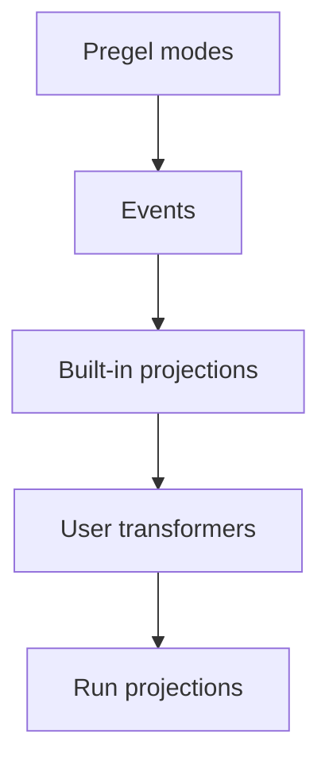

事件流是LangGraph应用代码中推荐的过程内流式模型。它返回一个可同时以多种方式消费的运行流对象。

## 快速开始

:::python
```py
stream = graph.stream_events({
    "messages": [{"role": "user", "content": "What is 42 * 17?"}],
}, version="v3")

for message in stream.messages:
    for token in message.text:
        print(token, end="", flush=True)

final_state = stream.output
```
:::

:::js
```ts
const stream = await graph.streamEvents(
  { messages: [{ role: "user", content: "What is 42 * 17?" }] },
  { version: "v3" }
);

for await (const message of stream.messages) {
  for await (const token of message.text) {
    process.stdout.write(token);
  }
}

const finalState = await stream.output;
```
:::

要针对部署在智能体服务器后的图进行流式操作，请参考[LangSmith流式API](https://docs.langchain.com/langsmith/streaming)。

## 模块组成

流式处理栈包含两个主要层级：

1. **流式处理** 从Pregel引擎发射原始图执行事件。
2. **事件流** 对事件进行标准化，通过流式转换器处理，并暴露类型化投影。

<div className="my-6 rounded-xl border bg-gray-50 p-4 dark:bg-gray-900">
  <div className="mx-auto max-w-2xl space-y-2 text-sm">
    <div className="rounded-lg border border-slate-300 bg-white p-3 text-center dark:border-slate-700 dark:bg-slate-950">
      <div className="font-semibold text-slate-900 dark:text-slate-100">Pregel引擎</div>
      <div className="mt-1 text-xs text-slate-600 dark:text-slate-300">执行图步骤</div>
    </div>
    <div className="text-center text-xs font-medium uppercase tracking-wide text-slate-500 dark:text-slate-400">发射</div>
    <div className="rounded-lg border border-orange-300 bg-orange-50 p-3 text-center dark:border-orange-800 dark:bg-orange-950">
      <div className="font-semibold text-orange-900 dark:text-orange-100">原始Pregel事件</div>
      <div className="mt-1 text-xs text-orange-700 dark:text-orange-300"><code>updates</code>, <code>values</code>, <code>messages</code>, <code>custom</code>, <code>checkpoints</code>, <code>tasks</code>, <code>debug</code></div>
    </div>
    <div className="text-center text-xs font-medium uppercase tracking-wide text-slate-500 dark:text-slate-400">发送到</div>
    <div className="rounded-lg border border-blue-300 bg-blue-50 p-3 text-center dark:border-blue-800 dark:bg-blue-950">
      <div className="font-semibold text-blue-900 dark:text-blue-100">事件路由器</div>
      <div className="mt-1 text-xs text-blue-700 dark:text-blue-300">将每个事件通过转换管道路由</div>
    </div>
    <div className="text-center text-xs font-medium uppercase tracking-wide text-slate-500 dark:text-slate-400">级联通过</div>
    <div className="rounded-lg border border-green-300 bg-green-50 p-3 dark:border-green-800 dark:bg-green-950">
      <div className="font-semibold text-green-900 dark:text-green-100">流式转换器</div>
      <div className="mt-2 grid gap-2 text-xs text-green-800 dark:text-green-200 sm:grid-cols-4">
        <div className="rounded border border-green-200 bg-white px-2 py-1 dark:border-green-800 dark:bg-green-950">值转换器</div>
        <div className="rounded border border-green-200 bg-white px-2 py-1 dark:border-green-800 dark:bg-green-950">消息转换器</div>
        <div className="px-2 py-1 text-center text-green-600 dark:text-green-300">...</div>
        <div className="rounded border border-green-200 bg-white px-2 py-1 dark:border-green-800 dark:bg-green-950">自定义转换器</div>
      </div>
    </div>
    <div className="text-center text-xs font-medium uppercase tracking-wide text-slate-500 dark:text-slate-400">生成</div>
    <div className="rounded-lg border border-purple-300 bg-purple-50 p-3 text-center dark:border-purple-800 dark:bg-purple-950">
      <div className="font-semibold text-purple-900 dark:text-purple-100">事件流</div>
      <div className="mt-1 text-xs text-purple-700 dark:text-purple-300">应用程序代码所需的投影事件</div>
    </div>
  </div>
</div>

事件路由器是两个层级的桥梁。它接收标准化的Pregel事件，并将每个事件通过已注册的流式转换器传递。内置转换器创建标准投影如`stream.messages`, `stream.values`, `stream.subgraphs`, 和`stream.output`。自定义转换器可在`stream.extensions`下添加应用特定投影。

## 事件流提供的服务

运行流在底层事件流上暴露类型化投影：

| 投影 | 用途 |
|------|-----|
| `stream` | 迭代每个协议事件。 |
| `stream.messages` | 流式聊天模型消息和token增量。 |
| `stream.values` | 迭代状态快照并等待最终值。 |
| `stream.output` | 等待最终输出。 |
| `stream.subgraphs` | 发现并观察嵌套图执行。 |
| `stream.interrupts` | 检查人工介入中断负载。 |
| `stream.interrupted` | 检查是否因人工输入而暂停。 |
| `stream.extensions` | 消费自定义流式转换器投影。 |

多个消费者可并发读取这些投影。读取`stream.messages`不会阻塞`stream.values`、`stream.subgraphs`或`stream.output`所需的后续事件。

事件流位于[流式处理](/langchain/oss/langgraph/streaming)之上，后者通过`stream_mode`模式（如`updates`、`values`、`messages`、`custom`、`checkpoints`、`tasks`、`debug`）暴露原始图执行事件。需要低级事件模式访问时使用流式处理；需要类型化投影时使用事件流。

## 流式消息

使用`stream.messages`处理聊天模型输出：

:::python
```py
stream = graph.stream_events(input, version="v3")

for message in stream.messages:
    text = str(message.text)
    usage = message.output.usage_metadata

    print(text)
    print(usage)
```
:::

:::js
```ts
const stream = await graph.streamEvents(input, { version: "v3" });

for await (const message of stream.messages) {
  const text = await message.text;
  const usage = await message.usage;

  console.log(text);
  console.log(usage);
}
```
:::

:::python
`message.text`在同步代码中是可迭代的。迭代以逐token输出，或调用`str(message.text)`获取完整文本。

`message.reasoning`暴露推理增量。`message.tool_calls`暴露工具调用片段。每个片段包含调用的`id`、其`name`，以及更新部分的`args`。若需严格按到达顺序获取文本、推理和工具调用片段，应直接迭代消息流原始事件而非单独投影。

:::js
`message.text`既是异步可迭代对象也是 promise-like 值。迭代以逐token输出，或 await 获取完整文本。
:::

## 流式子图

使用`stream.subgraphs`观察嵌套图执行而无需解析命名空间字符串：

:::python
```py
stream = graph.stream_events(input, version="v3")

for subgraph in stream.subgraphs:
    print(subgraph.graph_name, subgraph.path)

    for message in subgraph.messages:
        print(message.text)
```
:::

:::js
```ts
const stream = await graph.streamEvents(input, { version: "v3" });

for await (const subgraph of stream.subgraphs) {
  console.log(subgraph.name, subgraph.path);

  for await (const message of subgraph.messages) {
    console.log(await message.text);
  }
}
```
:::

`subgraph.graph_name`是编译后的图或智能体的`name`。通过工具（例如通过Deep Agents `task`工具调用的 `create_agent(name=...)`）派生的命名智能体在此处以该名称显示，打开作用域的事件`cause`包含回溯到调用工具的`lifecycle`链接。详见[Lifecycle](#生命周期)。

针对产品特定流式操作，请参考[Deep Agents流式](/langchain/oss/deepagents/event-streaming)（子智能体流式）和[LangChain智能体流式](/langchain/oss/langchain/streaming)（工具调用和中间件事件）。

## 流式状态

使用`stream.values`在每一步后流式完整状态快照：

:::python
```py
stream = graph.stream_events(input, version="v3")

for snapshot in stream.values:
    print(snapshot)

final_state = stream.output
```
:::

:::js
```ts
const stream = await graph.streamEvents(input, { version: "v3" });

for await (const snapshot of stream.values) {
  console.log(snapshot);
}

const finalState = await stream.output;
```
:::

## 流式多投影

:::python
对于异步代码中的并发消费，使用`astream_events`与`asyncio.gather`：

```py
import asyncio

stream = await graph.astream_events(input, version="v3")

async def consume_messages():
    async for message in stream.messages:
        print(f"[llm] node={message.node}")

async def consume_subgraphs():
    async for subgraph in stream.subgraphs:
        print(f"[subgraph] path={subgraph.path}")

await asyncio.gather(consume_messages(), consume_subgraphs())
```

对于同步代码，使用`stream.interleave(...)`按严格到达顺序消费多投影：

```py
stream = graph.stream_events(input, version="v3")

for name, item in stream.interleave("values", "messages", "subgraphs"):
    if name == "values":
        print(f"[state] keys={list(item)}")
    elif name == "messages":
        print(f"[llm] node={item.node}")
    elif name == "subgraphs":
        print(f"[subgraph] path={item.path}")
```
:::

:::js
使用并发消费者以在JavaScript中按需多投影：

```ts
await Promise.all([
  (async () => {
    for await (const message of stream.messages) {
      console.log(await message.text);
    }
  })(),
  (async () => {
    for await (const subgraph of stream.subgraphs) {
      console.log(subgraph.path);
    }
  })(),
]);
```
:::

## 中断后恢复

当图因人工输入暂停时，检查`stream.interrupted`和`stream.interrupts`，然后通过调用`stream_events(..., version="v3")`和`Command`恢复执行。

恢复需要编译时包含检查点功能的图，以及携带线程ID的配置——详见[persistence](/langchain/oss/langgraph/persistence)。

:::python
```py
from langgraph.types import Command

stream = graph.stream_events(input, version="v3")

for message in stream.messages:
    print(message.text)

if stream.interrupted:
    print(stream.interrupts)

stream = graph.stream_events(
    Command(resume={"decisions": [{"type": "approve"}]}),
    version="v3",
)
final_state = stream.output
```
:::

:::js
```ts
import { Command } from "@langchain/langgraph";

let stream = await graph.streamEvents(input, { version: "v3" });

for await (const message of stream.messages) {
  console.log(await message.text);
}

if (stream.interrupted) {
  console.log(stream.interrupts);
}

stream = await graph.streamEvents(
  new Command({ resume: { decisions: [{ type: "approve" }] } }),
  { version: "v3" }
);
const finalState = await stream.output;
```
:::

## 流式所有协议事件

使用运行对象本身以获取原始协议事件流：

:::python
```py
stream = graph.stream_events({
    "messages": [{"role": "user", "content": "What is 42 * 17?"}],
}, version="v3")

for event in stream:
    namespace = event["params"]["namespace"]
    print(namespace, event["method"], event["params"]["data"])
```
:::

:::js
```ts
const stream = await graph.streamEvents(
  { messages: [{ role: "user", content: "What is 42 * 17?" }] },
  { version: "v3" }
);

for await (const event of stream) {
  const namespace = event.params.namespace;
  console.log(namespace, event.method, event.params.data);
}
```
:::

每个事件是一个`ProtocolEvent`封装的通道特定负载。转换器的`process(event)`接收相同结构。

:::python
```py
class ProtocolEvent(TypedDict):
    seq: int                    # strictly increasing within a run; use for ordering
    method: str                 # channel name: "messages", "values", "updates", "custom", "tools", "lifecycle", ...
    params: ProtocolEventParams


class ProtocolEventParams(TypedDict):
    namespace: list[str]        # path of "<name>:<runtime_id>" segments from the root graph; [] is the root
    timestamp: int              # wall-clock milliseconds; can drift, don't rely on for ordering
    data: Any                   # channel-specific payload; shape depends on `method`
```
:::

:::js
```ts
interface ProtocolEvent {
  readonly seq: number;         // strictly increasing within a run; use for ordering
  readonly method: string;      // channel name: "messages", "values", "updates", "custom", "tools", "lifecycle", ...
  readonly params: {
    readonly namespace: string[];  // path of "<name>:<runtime_id>" segments from the root graph; [] is the root
    readonly timestamp: number;    // wall-clock milliseconds; can drift, don't rely on for ordering
    readonly node?: string;        // graph node that emitted this event, when applicable
    readonly data: unknown;        // channel-specific payload; shape depends on `method`
  };
}
```
:::

`namespace`是从根图到事件发射作用域的路径。根是空数组`[]`。每个子执行添加一个`"name:runtime_id"`段，因此嵌套工具调用在子图内显示为`["researcher:6f4d", "tools:91ac"]`。名称在`:`前的部分是稳定的图/节点名称，后缀是单次调用的运行ID。若仅需关注特定子树，`stream.subgraphs`已实现此过滤。

## 通道与事件生命周期

原始事件通过通道流动。通道名称显示在事件的`method`中，每个通道发射特定形态的事件。

| 渠道 | 目的 |
|-------|-------|
| `values` | 完整图状态快照。 |
| `updates` | 节点级状态增量。 |
| `messages` | 内容块中心的对话模型输出。 |
| `tools` | 工具调用开始、流式输出、完成和错误事件。 |
| `lifecycle` | 运行、子图和子智能体状态变更。 |
| `checkpoints` | 分支和时序回溯的轻量级检查点封装。 |
| `input` | 人机交互输入请求和响应。 |
| `tasks` | Pregel任务创建和结果事件。 |
| `custom` | 图代码定义的自定义负载。 |
| `custom:<name>` | 应用定义的流式转换输出。 |

类型化投影（`stream.messages`、`stream.values`等）基于这些渠道构建。渠道名称在遍历运行对象时直接显示为原始事件的`method`字段。

### 消息

`messages`渠道建模内容块输出。其数据中的`event`字段为以下之一：

- `message-start`
- `content-block-start`
- `content-block-delta`
- `content-block-finish`
- `message-finish`

内容块有明确边界：一个块开始后，可追加零个或多个增量，并在下一个块开始前完成。这使得Token流式输出、推理块、工具调用块和多媒体内容无需依赖特定提供者格式即可显式表达。`message-finish`可能包含Token使用量；不可恢复的模型调用失败会作为消息错误事件出现。

每个`content-block-delta`事件携带其`index`处的内容块的`type`：

| Delta `type` | 对块的影响 |
| ------------ | ------------------- |
| `text-delta` | 将其`text`追加到块的`text`。 |
| `reasoning-delta` | 将其`reasoning`追加到块的`reasoning`。 |
| `data-delta` | 将其`data`追加到块的`base64`。 |
| `tool-call-delta` | 将其`args`追加到块的`args`。 |
| `block-delta` | 为块的`fields`设置每个键，替换先前的值。 |

`content-block-finish`携带完整块。忽略您不认识的Delta类型，并持续读取流。

直接消费原始内容块事件而非使用`stream.messages`投影：

:::python
```py
for event in stream:
    if event["method"] != "messages":
        continue

    data = event["params"]["data"][0]
    if not isinstance(data, dict):
        continue
    if data.get("event") != "content-block-delta":
        continue

    block = data.get("delta") or {}
    if block.get("type") == "text-delta":
        print(block.get("text", ""), end="", flush=True)
    elif block.get("type") == "reasoning-delta":
        print(f"[thinking]{block.get('reasoning', '')}", end="", flush=True)
    elif block.get("type") == "tool-call-delta":
        print(f"[args]{block.get('args', '')}", end="", flush=True)
```
:::

:::js
```ts
for await (const event of stream) {
  if (event.method !== "messages") continue;

  const data = event.params.data;
  if (data.event !== "content-block-delta") continue;

  const block = data.delta ?? {};
  if (block.type === "text-delta") {
    process.stdout.write(block.text ?? "");
  } else if (block.type === "reasoning-delta") {
    process.stdout.write(`[thinking]${block.reasoning ?? ""}`);
  } else if (block.type === "tool-call-delta") {
    process.stdout.write(`[args]${block.args ?? ""}`);
  }
}
```
:::

### 工具

`tools`渠道暴露工具执行。其数据中的`event`字段为以下之一：

- `tool-started`
- `tool-output-delta`
- `tool-finished`
- `tool-error`

工具事件通过工具调用ID关联，因此可在`messages`渠道将工具执行与原始工具调用内容块关联。

### 生命周期

`lifecycle`渠道跟踪根运行、子图和子智能体的状态。其数据中的`event`字段为以下之一：

- `started`
- `running`
- `completed`
- `failed`
- `interrupted`

除`event`外，生命周期数据可能包含可选的`graph_name`、`error`和`cause`，描述子作用域的启动原因（父工具调用、扇出发送或边过渡）。

## 自定义投影

流式转换器是事件流中的投影层。它们观察协议事件，维护自身状态，并暴露运行派生的视图（如工具活动、Token总量、进度事件、产物或消息）。`StreamChannel`是转换器用于发布这些视图的投影原语。

内置投影（`stream.messages`、`stream.values`、`stream.subgraphs`、`stream.output`）和产品特定投影（LangChain的`stream.tool_calls`、Deep Agents的`stream.subagents`）自身也是使用相同契约的转换器。用户转换器通过编译时或运行时注册叠加在顶层，其投影显示在`stream.extensions`下。

当现有投影无法匹配应用需求时，编写自定义投影。

### 转换器工作原理

事件流从LangGraph Pregel引擎的流式输出开始。运行时将 chunks 规范化为协议事件，然后流处理器通过转换器栈路由每个事件。



流处理器是单流的中心调度器。对于每个协议事件，它执行以下操作：

1. 按顺序调用已注册转换器的`process(event)`钩子。
2. 将命名的`StreamChannel`推送回协议事件流。
3. 除非转换器抑制，否则将事件存储在运行流中。
4. 在运行结束时调用每个转换器的`finalize()`或`fail()`。

转换器是观察性的。它们不调用回图运行时。而是消费事件，并将派生值推送到`StreamChannel`、承诺或其他投影对象。

### 转换器结构

转换器实现`StreamTransformer`接口：

:::python
```py
from langgraph.stream import ProtocolEvent, StreamTransformer


class MyTransformer(StreamTransformer):
    def init(self) -> dict:
        ...

    def process(self, event: ProtocolEvent) -> bool:
        ...

    def finalize(self) -> None:
        ...

    def fail(self, err: BaseException) -> None:
        ...
```
:::

:::js
```ts
interface StreamTransformer<TProjection = unknown> {
  init(): TProjection;
  process(event: ProtocolEvent): boolean;
  finalize?(): void | PromiseLike<void>;
  fail?(err: unknown): void;
}
```
:::

- `init()`创建投影对象。用户转换器投影显示在`stream.extensions`下。
- `process()`观察每个协议事件。参见[流式所有协议事件](#流式所有协议事件)的`ProtocolEvent`结构。仅在有意抑制原始事件时返回`false`。
- `finalize()`在流成功结束时关闭或解决非通道投影。
- `fail()`向非通道投影传播错误。

### 声明必需的流模式

`required_stream_modes`控制底层图在流期间发出的Pregel模式。运行时将每个转换器的`required_stream_modes`的并集作为`stream_mode`参数传递给图的`.stream()`调用。**未声明的模式永不发出**——声明`("custom",)`是触发`custom`事件流的原因。

:::python
```py
class CustomTransformer(StreamTransformer):
    required_stream_modes = ("custom",)  # [!code highlight]

    def process(self, event: ProtocolEvent) -> bool:
        if event["method"] == "custom":
            ...
        return True
```
:::

`process()`接收图发出的所有事件并负责按`event["method"]`过滤。声明开启上游发射，但不会缩小`process()`的视野。有效值是Pregel流模式：`"messages"`、`"tools"`、`"custom"`、`"values"`、`"updates"`、`"checkpoints"`、`"tasks"`、`"debug"`。每个转换器必须声明其作用的每个模式——未声明的模式不会由图发出，且不会到达`process()`。

### StreamChannel

`StreamChannel`是转换器用于流式输出的投影原语。它始终在`stream.extensions.<name>`暴露可迭代的流。构造函数参数决定是否将每个`push()`也作为`custom:<name>`事件注入运行的主事件流——即投影的值是否在遍历原始协议事件时可见。

:::js
| 需求 | 使用 |
| ---- | --- |
| 仅侧边投影 | `new StreamChannel<T>()` |
| 同时将每个推送注入主事件流 | `new StreamChannel<T>(name)` |
:::

:::python
| 需求 | 使用 |
| ---- | --- |
| 仅侧信道投影 | `StreamChannel()` |
| 同时将每个推送流到主事件流 | `StreamChannel(name)` |
:::

命名通道的有效载荷必须可序列化，因为每个推送的值也会成为主流中的 `custom:<name>` 协议事件。将承诺、异步可迭代对象、类实例和其他进程内句柄保存在无名通道中。

流处理器拥有通道生命周期。一旦 `init()` 返回一个通道，处理器将在运行结束时为你关闭或失败它。转换器仅推送值。

### 示例：命名通道

向 `StreamChannel` 传递一个字符串名称，通过 `stream.extensions` *和* 将每个推送的值作为 `custom:<name>` 协议事件转发到运行的 main 事件流：

:::python
```py
from typing import TypedDict

from langgraph.stream import ProtocolEvent, StreamChannel, StreamTransformer


class ToolActivity(TypedDict):
    name: str
    status: str


class ToolActivityTransformer(StreamTransformer):
    required_stream_modes = ("tools",)

    def __init__(self, scope: tuple[str, ...] = ()) -> None:
        super().__init__(scope)
        self.activity = StreamChannel[ToolActivity]("tool_activity")

    def init(self) -> dict:
        return {"tool_activity": self.activity}

    def process(self, event: ProtocolEvent) -> bool:
        if event["method"] != "tools":
            return True

        data = event["params"]["data"]
        if isinstance(data, dict) and data.get("tool_name") and data.get("event"):
            status = "error" if data["event"] == "tool-error" else "started"
            self.activity.push({"name": data["tool_name"], "status": status})
        return True
```
:::

:::js
```ts
import { StreamChannel } from "@langchain/langgraph";

const toolActivityTransformer = () => {
  const activity = new StreamChannel<{
    name: string;
    status: "started" | "finished" | "error";
  }>("toolActivity");

  return {
    init: () => ({ toolActivity: activity }),
    process(event) {
      if (event.method === "tools") {
        const data = event.params.data as { tool_name?: string; event?: string };
        if (data.tool_name && data.event) {
          activity.push({
            name: data.tool_name,
            status: data.event === "tool-error" ? "error" : "started",
          });
        }
      }
      return true;
    },
  };
};
```
:::

### 示例：无名通道

没有名称，通道仅是侧信道投影——可通过 `stream.extensions` 访问，但消费者迭代原始事件时不可见。这对于持有无法序列化到主事件流的进程内句柄（承诺、异步可迭代对象、类实例）的投影是正确的选择。

下面的示例将无名通道与 `get_stream_writer` 配合使用，该通道允许图节点发出 `custom`-通道事件，转换器随后将其排入投影：

:::python
```py
from langgraph.config import get_stream_writer
from langgraph.stream import ProtocolEvent, StreamChannel, StreamTransformer


def node(state):
    writer = get_stream_writer()
    writer({"kind": "progress", "message": "retrieving context"})
    return state


class CustomTransformer(StreamTransformer):
    required_stream_modes = ("custom",)

    def __init__(self, scope: tuple[str, ...] = ()) -> None:
        super().__init__(scope)
        self.log = StreamChannel()

    def init(self) -> dict:
        return {"custom": self.log}

    def process(self, event: ProtocolEvent) -> bool:
        if event["method"] == "custom":
            self.log.push(event["params"]["data"])
        return True


stream = graph.stream_events(input, version="v3", transformers=[CustomTransformer])

for item in stream.extensions["custom"]:
    print(item)
```
:::

:::js
```ts
import { StreamChannel } from "@langchain/langgraph";

const customTransformer = () => {
  const custom = new StreamChannel<unknown>();

  return {
    init: () => ({ custom }),
    process(event) {
      if (event.method === "custom") {
        custom.push(event.params.data);
      }
      return true;
    },
  };
};
```
:::

### 示例：最终值投影

当投影不应流入主事件流时，使用无名流、承诺或其他进程内对象：

:::python
```py
from langgraph.stream import ProtocolEvent, StreamChannel, StreamTransformer


class StatsTransformer(StreamTransformer):
    required_stream_modes = ("messages",)

    def __init__(self, scope: tuple[str, ...] = ()) -> None:
        super().__init__(scope)
        self.total_tokens = 0
        self.total_tokens_log = StreamChannel[int]()

    def init(self) -> dict:
        return {"total_tokens": self.total_tokens_log}

    def process(self, event: ProtocolEvent) -> bool:
        data = event["params"]["data"]
        if isinstance(data, dict):
            usage = data.get("usage") or {}
            self.total_tokens += usage.get("output_tokens") or 0
        return True

    def finalize(self) -> None:
        self.total_tokens_log.push(self.total_tokens)
        self.total_tokens_log.close()
```
:::

:::js
```ts
const statsTransformer = () => {
  let totalTokens = 0;
  let resolveTotal!: (value: number) => void;
  const totalTokensPromise = new Promise<number>((resolve) => {
    resolveTotal = resolve;
  });

  return {
    init: () => ({ totalTokens: totalTokensPromise }),
    process(event) {
      if (event.method === "messages") {
        const data = event.params.data as { usage?: { output_tokens?: number } };
        totalTokens += data.usage?.output_tokens ?? 0;
      }
      return true;
    },
    finalize: () => resolveTotal(totalTokens),
  };
};
```
:::

### 在调用时注册或编译时注册

在调用时传递 transformers 以进行本地实验：

:::python
```py
stream = graph.stream_events(
    input,
    version="v3",
    transformers=[StatsTransformer, ToolActivityTransformer],
)
```
:::

:::js
```ts
const stream = await graph.streamEvents(input, {
  version: "v3",
  transformers: [statsTransformer, toolActivityTransformer],
});
```
:::

当每次运行该图都应该产生投影时，将 transformers 编译到图中：

:::python
```py
graph = builder.compile(
    transformers=[StatsTransformer, ToolActivityTransformer],
)
```
:::

:::js
```ts
const graph = builder.compile({
  transformers: [statsTransformer, toolActivityTransformer],
});
```
:::

### 内置：`ToolCallTransformer`

:::python
LangGraph 将 `ToolCallTransformer` 作为内置功能提供。注册它以在普通的 `StateGraph` 上暴露 `stream.tool_calls`：

```py
from langgraph.prebuilt import ToolCallTransformer

stream = graph.stream_events(input, version="v3", transformers=[ToolCallTransformer])

for tool_call in stream.tool_calls:
    print(tool_call.tool_name, tool_call.input)
```
:::

## 相关

LangGraph 定义了流式输出的基础。要使用 LangChain 或 Deep Agents 的流式输出，请查阅相关产品文档：

- [LangChain agent streaming](/langchain/oss/langchain/event-streaming) 涵盖 ReAct 风格的智能体消息、工具调用和中间件更新。
- [Deep Agents streaming](/langchain/oss/deepagents/event-streaming) 涵盖子智能体、嵌套消息和子智能体工具调用。
- [LangChain frontend patterns](/langchain/oss/langchain/frontend/overview) 和 [LangGraph frontend patterns](/langchain/oss/langgraph/frontend/overview) 展示了基于流式状态构建的 UI 用例。
- [LangSmith Streaming API](https://docs.langchain.com/langsmith/streaming) 涵盖了在背后部署 Agent Server 的图中进行流式输出的情况。

线级事件和命令格式在 [Agent Protocol](https://github.com/langchain-ai/agent-protocol) 存储库中定义，可作为 [`langchain-protocol`](https://pypi.org/project/langchain-protocol/) 在 PyPI 和 [`@langchain/protocol`](https://www.npmjs.com/package/@langchain/protocol) 在 npm 上使用。

---

> 官方原文：[src/oss/langgraph/event-streaming.mdx](https://github.com/langchain-ai/docs/blob/main/src/oss/langgraph/event-streaming.mdx) · 译文由 AI 生成，以英文原文为准。
