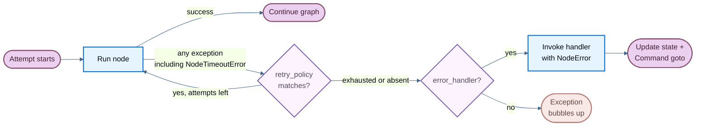

当节点失败时——无论是由于缓慢的外部 API、瞬态网络错误还是未处理的异常——LangGraph 提供三种可组合的机制来响应：

- [**重试**](#重试)：根据异常类型和退避设置自动重新运行失败的尝试
- [**超时**](#超时)：限制单个尝试的最长运行时间
- [**错误处理**](#错误处理)：在所有重试尝试耗尽后运行恢复函数

:::python
使用 [**`set_node_defaults`**](#图默认值) 一次性为所有节点配置这些机制，而不是在每个 `add_node` 调用中重复它们。
:::

:::js
使用 [**`setNodeDefaults`**](#图默认值) 一次性为所有节点配置这些机制，而不是在每个 `addNode` 调用中重复它们。
:::

这些按固定顺序组合：当节点尝试引发任何异常（包括来自 @[`NodeTimeoutError`] 的超时异常）时，重试策略决定是否重试。只有在重试尝试耗尽后，错误处理程序才会运行。

要在一个超级步骤边界处干净地停止运行并在稍后恢复，请参阅 [优雅停机](#平稳关闭)。

:::python
<Note>
每个节点的超时和节点级错误处理程序需要 `langgraph>=1.2`。
</Note>
:::

:::js
<Note>
每个节点的超时和节点级错误处理程序需要 `@langchain/langgraph>=1.4.0`。
</Note>
:::



## 重试

重试策略根据异常类型和退避设置自动重新运行失败的节点尝试。

:::python
将 `retry_policy=` 传递给 @[`add_node`]：

```python
from langgraph.types import RetryPolicy

builder.add_node(
    "call_api",
    call_api,
    retry_policy=RetryPolicy(max_attempts=3),
)
```
:::

:::js
将 `retryPolicy` 传递给 @[`addNode`]：

```typescript
import { StateGraph } from "@langchain/langgraph";

const graph = new StateGraph(State)
  .addNode("callApi", callApi, { retryPolicy: { maxAttempts: 3 } })
  .compile();
```
:::

### 默认行为

:::python
默认情况下，`retry_on` 使用 `default_retry_on`，它在除以下异常及其子类之外的任何异常上重试：

- `ValueError`
- `TypeError`
- `ArithmeticError`
- `ImportError`
- `LookupError`
- `NameError`
- `SyntaxError`
- `RuntimeError`
- `ReferenceError`
- `StopIteration`
- `StopAsyncIteration`
- `OSError`

对于来自流行 HTTP 库（如 `requests` 和 `httpx`）的异常，它仅在 5xx 状态码上重试。@[`NodeTimeoutError`] 默认可重试。
:::

:::js
重试是可选的。节点只有在配置了 `retryPolicy` 时才会重试，可以直接配置或通过 [`setNodeDefaults`](#图默认值) 使用图默认值。一个空策略（`{}`）就足够了。如果没有策略，第一次失败将结束尝试，LangGraph 不会调用 `retryOn`。

如果策略省略了 `retryOn`，LangGraph 使用内置的处理程序，除了以下异常外会重试抛出的错误：

- 中止和取消错误：`error.name === "AbortError"`，或 `error.message` 以 `"Cancel"` 或 `"AbortError"` 开头
- `GraphValueError`，匹配 `error.name`
- 中止的连接：`error.code === "ECONNABORTED"`
- HTTP 客户端错误，状态码为 400、401、402、403、404、405、406、407 或 409，从 `error.response?.status` 或 `error.status` 读取（针对 `fetch`、Axios 和类似客户端）
- OpenAI 风格的配额错误：`error.error?.code === "insufficient_quota"`

其他 HTTP 状态码，包括 408 和 5xx 响应，除非您覆盖了 `retryOn`，否则都是可重试的。@[`NodeTimeoutError`] 不在此黑名单中，因此当配置了重试策略时它是可重试的。

某些失败会绕过 `retryOn`。图控制流错误，如 `GraphInterrupt` 和 `Command` 路由，会直接冒泡而不会重试。中止运行信号也会停止重试循环，即使 `retryOn` 会返回 `true`。

### 参数

:::python
| 参数 | 类型 | 默认值 | 描述 |
| ---- | ---- | ------ | ---- |
| `max_attempts` | `int` | `3` | 最大尝试次数，包括第一次。 |
| `initial_interval` | `float` | `0.5` | 第一次重试前的秒数。 |
| `backoff_factor` | `float` | `2.0` | 每次重试后应用于间隔的乘数。 |
| `max_interval` | `float` | `128.0` | 重试之间的最大秒数。 |
| `jitter` | `bool` | `True` | 向间隔添加随机抖动。 |
| `retry_on` | `type[Exception] \| Sequence[type[Exception]] \| Callable[[Exception], bool]` | `default_retry_on` | 要重试的异常，或返回重试异常的 `True` 的可调用对象。 |
:::

:::js
| 参数 | 类型 | 默认值 | 描述 |
| ---- | ---- | ------ | ---- |
| `maxAttempts` | `number` | `3` | 最大尝试次数，包括第一次。 |
| `initialInterval` | `number` | `500` | 第一次重试前的毫秒数。 |
| `backoffFactor` | `number` | `2.0` | 每次重试后应用于间隔的乘数。 |
| `maxInterval` | `number` | `128000` | 重试之间的最大毫秒数。 |
| `jitter` | `boolean` | `true` | 向间隔添加随机抖动。 |
| `retryOn` | `(error: unknown) => boolean` | built-in handler (when policy is set) | 返回重试异常的 `true` 的可调用对象。 仅在 `retryPolicy` 配置时使用。 |
| `logWarning` | `boolean` | `true` | 当尝试重试时是否记录警告。 |
:::

### 自定义重试逻辑

:::python
将可调用对象或异常类型传递给 `retry_on`。导入 `default_retry_on` 以扩展默认行为：

```python
from langgraph.types import RetryPolicy, default_retry_on

def custom_retry_on(exc: BaseException) -> bool:
    if isinstance(exc, MyCustomError):
        return False
    return default_retry_on(exc)

builder.add_node(
    "call_api",
    call_api,
    retry_policy=RetryPolicy(max_attempts=3, retry_on=custom_retry_on),
)
```
:::

:::js
将可调用对象传递给 `retryOn`。与 Python 不同，没有导出的 `defaultRetryOn` 辅助函数——请自行实现自己的谓词：

```typescript
import { StateGraph } from "@langchain/langgraph";

class MyCustomError extends Error {}

const graph = new StateGraph(State)
  .addNode("callApi", callApi, {
    retryPolicy: {
      maxAttempts: 3,
      retryOn: (error: unknown) => {
        if (error instanceof MyCustomError) return false;
        // Retry on other errors
        return true;
      },
    },
  })
  .compile();
```
:::

### 检查重试状态

使用节点内的执行信息来检查当前尝试次数。这对于在主调用持续失败时切换到备用方案很有用：

:::python
```python
from langgraph.graph import StateGraph, START, END
from langgraph.runtime import Runtime
from langgraph.types import RetryPolicy
from typing_extensions import TypedDict

class State(TypedDict):
    result: str

def my_node(state: State, runtime: Runtime) -> State:
    if runtime.execution_info.node_attempt > 1:  # [!code highlight]
        return {"result": call_fallback_api()}
    return {"result": call_primary_api()}

builder = StateGraph(State)
builder.add_node("my_node", my_node, retry_policy=RetryPolicy(max_attempts=3))
builder.add_edge(START, "my_node")
builder.add_edge("my_node", END)
```

`execution_info` 暴露以下字段：

| 属性 | 类型 | 描述 |
| ---- | ---- | ---- |
| `node_attempt` | `int` | 当前尝试次数（1 索引）。`1` 在第一次尝试时，`2` 在第一次重试时，以此类推。 |
| `node_first_attempt_time` | `float \| None` | 第一次尝试开始的 Unix 时间戳。跨重试保持不变。 |
| `thread_id` | `str \| None` | 当前执行的线程 ID。`None` 没有检查点时。 |
| `run_id` | `str \| None` | 当前执行的运行 ID。`None` 当未在配置中提供时。 |
| `checkpoint_id` | `str` | 当前执行的检查点 ID。 |
| `task_id` | `str` | 当前执行的任务 ID。 |

`execution_info` 即使没有重试策略也可用——`node_attempt` 默认为 `1`。
:::

:::js
```typescript
import { StateGraph, StateSchema, START, END, type Runtime } from "@langchain/langgraph";
import * as z from "zod";

const State = new StateSchema({
  result: z.string(),
});

const myNode = async (state: typeof State.State, runtime: Runtime<typeof State>) => {
  if ((runtime.executionInfo?.nodeAttempt ?? 1) > 1) {  // [!code highlight]
    return { result: await callFallbackApi() };
  }
  return { result: await callPrimaryApi() };
};

const graph = new StateGraph(State)
  .addNode("myNode", myNode, { retryPolicy: { maxAttempts: 3 } })
  .addEdge(START, "myNode")
  .addEdge("myNode", END)
  .compile();
```

`executionInfo` 暴露以下字段：

| 属性 | 类型 | 描述 |
| ---- | ---- | ---- |
| `nodeAttempt` | `number` | 当前尝试次数（1 索引）。`1` 在第一次尝试时，`2` 在第一次重试时，以此类推。 |
| `nodeFirstAttemptTime` | `number \| undefined` | 第一次尝试开始的 Unix 时间戳（毫秒）。跨重试保持不变。 |
| `threadId` | `string \| undefined` | 当前执行的线程 ID。`undefined` 没有检查点时。 |
| `runId` | `string \| undefined` | 当前执行的运行 ID。`undefined` 当未在配置中提供时。 |
| `checkpointId` | `string` | 当前执行的检查点 ID。 |
| `checkpointNs` | `string` | 当前执行的检查点命名空间。 |
| `taskId` | `string` | 当前执行的任务 ID。 |

`executionInfo` 即使没有重试策略也可用——`nodeAttempt` 默认为 `1`。
:::

## 超时

:::python
<Note>
需要 `langgraph>=1.2`。
</Note>

@[`add_node`] 上的 `timeout=` 参数限制单个节点尝试的运行时长。传入数字（秒）、`timedelta` 或 @[`TimeoutPolicy`] 以设置独立的运行和空闲限制：

```python
from datetime import timedelta
from langgraph.types import TimeoutPolicy

# Simple wall-clock cap
builder.add_node("call_model", call_model, timeout=60)
builder.add_node("call_model", call_model, timeout=timedelta(minutes=2))

# Separate run and idle limits
builder.add_node(
    "call_model",
    call_model,
    timeout=TimeoutPolicy(run_timeout=120, idle_timeout=30),
)
```

<Warning>
节点超时仅适用于 **异步** 节点。同步节点若带有 `timeout` 将在编译时被拒绝。要包装阻塞 I/O，请在异步节点内使用 `asyncio.to_thread`。
</Warning>
:::

:::js
<Note>
需要 `@langchain/langgraph>=1.4.0`。
</Note>

@[`addNode`] 上的 `timeout` 参数限制单个节点尝试的运行时长。传入数字（毫秒）或 @[`TimeoutPolicy`] 以设置独立的运行和空闲限制：

```typescript
import { StateGraph, type TimeoutPolicy } from "@langchain/langgraph";

// Simple wall-clock cap (60 seconds)
new StateGraph(State).addNode("callModel", callModel, { timeout: 60_000 });

// Separate run and idle limits
new StateGraph(State).addNode("callModel", callModel, {
  timeout: { runTimeout: 120_000, idleTimeout: 30_000 },
});
```
:::

### 运行超时

:::python
`run_timeout` 是单次尝试的硬性时钟限制。无论节点活动如何，它永不刷新：

```python
from langgraph.types import TimeoutPolicy

builder.add_node(
    "call_model",
    call_model,
    timeout=TimeoutPolicy(run_timeout=120),
)
```
:::

:::js
`runTimeout` 是单次尝试的硬性时钟限制。无论节点活动如何，它永不刷新：

```typescript
const graph = new StateGraph(State)
  .addNode("callModel", callModel, {
    timeout: { runTimeout: 120_000 },
  })
  .compile();
```
:::

当超出限制时，LangGraph 触发 @[`NodeTimeoutError`]，清除失败尝试的任何写入，并让重试策略决定是否重试。

### 空闲超时

:::python
`idle_timeout` 是进度重置限制。仅在节点停止在指定时长内产生可观察进度时触发——与 `run_timeout` 不同，时钟会在节点产生进度信号时重置：

```python
builder.add_node(
    "call_model",
    call_model,
    timeout=TimeoutPolicy(idle_timeout=30),
)
```
:::

:::js
`idleTimeout` 是进度重置限制。仅在节点停止在指定时长内产生可观察进度时触发——与 `runTimeout` 不同，时钟会在节点产生进度信号时重置：

```typescript
const graph = new StateGraph(State)
  .addNode("callModel", callModel, {
    timeout: { idleTimeout: 30_000 },
  })
  .compile();
```
:::

:::python
可以同时设置 `run_timeout` 和 `idle_timeout`。先触发的限制将取消尝试。
:::

:::js
可以同时设置 `runTimeout` 和 `idleTimeout`。先触发的限制将取消尝试。
:::

#### 进度信号

:::python
在默认 `refresh_on="auto"` 下，空闲时钟会在以下任一情况下重置：

- 通过 `CONFIG_KEY_SEND` 的状态写入
- 流输出（异步流块）
- 子任务调度
- 运行时流写入器调用
- 节点或其子节点的任何 LangChain 回调事件（LLM Token、工具调用、链开始/结束等）
:::

:::js
在默认 `refreshOn: "auto"` 下，空闲时钟会在以下任一情况下重置：

- 通过图写入路径的状态写入
- 通过 `runtime.writer` 的自定义流输出
- 子任务调度
- 节点或其子节点的任何 LangChain 回调事件（LLM Token、工具调用、链开始/结束等）
:::

#### 心跳模式

:::python
将 `refresh_on="heartbeat"` 设置为仅对显式 `runtime.heartbeat()` 调用进行刷新。这在您希望严格定义空闲且不被健谈的子节点重置时很有用：

```python
builder.add_node(
    "call_model",
    call_model,
    timeout=TimeoutPolicy(idle_timeout=30, refresh_on="heartbeat"),
)
```
:::

:::js
将 `refreshOn: "heartbeat"` 设置为仅对显式 `runtime.heartbeat()` 调用进行刷新。这在您希望严格定义空闲且不被健谈的子节点重置时很有用：

```typescript
const graph = new StateGraph(State)
  .addNode("callModel", callModel, {
    timeout: { idleTimeout: 30_000, refreshOn: "heartbeat" },
  })
  .compile();
```
:::

#### 手动心跳

对于不自然发出进度信号的长时间运行工作，调用 `runtime.heartbeat()` 手动重置空闲时钟：

:::python
```python
from langgraph.graph import StateGraph, START, END
from langgraph.runtime import Runtime
from langgraph.types import TimeoutPolicy
from typing_extensions import TypedDict

class State(TypedDict):
    result: str

async def long_running_node(state: State, runtime: Runtime) -> State:
    for batch in fetch_batches():
        process(batch)
        runtime.heartbeat()  # [!code highlight]
    return {"result": "done"}

builder = StateGraph(State)
builder.add_node(
    "long_running_node",
    long_running_node,
    timeout=TimeoutPolicy(idle_timeout=30, refresh_on="heartbeat"),
)
builder.add_edge(START, "long_running_node")
builder.add_edge("long_running_node", END)
```
:::

:::js
```typescript
import {
  StateGraph,
  StateSchema,
  START,
  END,
  type Runtime,
} from "@langchain/langgraph";
import * as z from "zod";

const State = new StateSchema({
  result: z.string(),
});

const longRunningNode = async (
  state: typeof State.State,
  runtime: Runtime<typeof State>
) => {
  for (const batch of fetchBatches()) {
    process(batch);
    runtime.heartbeat?.(); // [!code highlight]
  }
  return { result: "done" };
};

const graph = new StateGraph(State)
  .addNode("longRunningNode", longRunningNode, {
    timeout: { idleTimeout: 30_000, refreshOn: "heartbeat" },
  })
  .addEdge(START, "longRunningNode")
  .addEdge("longRunningNode", END)
  .compile();
```
:::

`runtime.heartbeat()` 在空闲超时尝试外是无操作的，因此您可以无条件调用它。

### NodeTimeoutError

当触发超时时，LangGraph 触发 @[`NodeTimeoutError`]，并提供关于哪个限制被触发的结构化上下文：

:::python
| 属性 | 类型 | 描述 |
| ---- | ---- | ---- |
| `node` | `str` | 执行超时的节点名称。 |
| `elapsed` | `float` | 超时触发前的秒数。 |
| `kind` | `Literal["idle", "run"]` | 触发了哪个超时。 |
| `idle_timeout` | `float \| None` | 配置的空闲超时（秒），如果有的话。 |
| `run_timeout` | `float \| None` | 配置的运行超时（秒），如果有的话。 |
:::

:::js
| 属性 | 类型 | 描述 |
| ---- | ---- | ---- |
| `node` | `string` | 执行超时的节点名称。 |
| `elapsed` | `number` | 超时触发前的毫秒数。 |
| `kind` | `"idle" \| "run"` | 触发了哪个超时。 |
| `timeout` | `number` | 触发超时的限制值（毫秒）。 |
| `idleTimeout` | `number \| undefined` | 配置的空闲超时（毫秒），如果有的话。 |
| `runTimeout` | `number \| undefined` | 配置的运行超时（毫秒），如果有的话。 |

使用 `isNodeTimeoutError(error)` 可在 TypeScript 中缩小捕获的错误。
:::

`NodeTimeoutError` 默认可重试。将 `timeout` 与重试策略结合使用即可无缝工作——超时时钟在每个新尝试中重置，并在下次重试前清除超时尝试的写入：

:::python
```python
from langgraph.types import RetryPolicy, TimeoutPolicy

builder.add_node(
    "call_model",
    call_model,
    timeout=TimeoutPolicy(idle_timeout=30),
    retry_policy=RetryPolicy(max_attempts=3),
)
```
:::

:::js
```typescript
const graph = new StateGraph(State)
  .addNode("callModel", callModel, {
    timeout: { idleTimeout: 30_000 },
    retryPolicy: { maxAttempts: 3 },
  })
  .compile();
```
:::

### 使用 Send 的动态超时

在使用 @[`Send`] 动态分发节点（例如在 map-reduce 模式）时，可以直接在 `Send` 上传入超时，以覆盖目标节点的静态超时，仅对该特定推送有效：

:::python
```python
from langgraph.types import Send, TimeoutPolicy

def fan_out(state: OverallState):
    return [
        Send("process_item", {"item": item}, timeout=TimeoutPolicy(idle_timeout=15))
        for item in state["items"]
    ]
```
:::

:::js
```typescript
import { Send } from "@langchain/langgraph";

const fanOut = (state: typeof State.State) =>
  state.items.map(
    (item) =>
      new Send("processItem", { item }, { timeout: { idleTimeout: 15_000 } })
  );
```
:::

:::python
如果在 `Send` 上省略超时，则应用目标节点的超时（在 @[`add_node`] 设置时）。这允许您为节点设置默认超时，并在单个调用中收紧它。
:::

:::js
如果在 `Send` 上省略超时，则应用目标节点的超时（在 @[`addNode`] 设置时）。这允许您为节点设置默认超时，并在单个调用中收紧它。
:::

## 错误处理

:::python
<Note>
需要 `langgraph>=1.2`。
</Note>
:::

:::js
<Note>
需要 `@langchain/langgraph>=1.4.0`。
</Note>
:::

错误处理器在节点失败且所有重试都耗尽后运行。它接收当前状态并可以使用 @[`Command`] 更新状态或路由到不同节点。这对于补偿流（Saga 模式）很有用，您希望优雅地恢复而不是中止整个图。

:::python
将 `error_handler=` 传递给 @[`add_node`]：

```python
from langgraph.errors import NodeError
from langgraph.types import Command, RetryPolicy
from langgraph.graph import StateGraph, START
from typing_extensions import TypedDict

class State(TypedDict):
    status: str

def charge_payment(state: State) -> State:
    raise RuntimeError("payment gateway timeout")

def payment_error_handler(state: State, error: NodeError) -> Command:
    return Command(
        update={"status": f"compensated: {error.error}"},
        goto="finalize",
    )

def finalize(state: State) -> State:
    return state

graph = (
    StateGraph(State)
    .add_node(
        "charge_payment",
        charge_payment,
        retry_policy=RetryPolicy(max_attempts=3, retry_on=ConnectionError),
        error_handler=payment_error_handler,
    )
    .add_node("finalize", finalize)
    .add_edge(START, "charge_payment")
    .compile()
)
```
:::

:::js
仅在 @[`StateGraph`] 上（而非基础 `Graph` 类）将 `errorHandler` 传递给 @[`addNode`]：

```typescript
import {
  StateGraph,
  StateSchema,
  START,
  Command,
  NodeError,
} from "@langchain/langgraph";
import * as z from "zod";

class ConnectionError extends Error {}

const State = new StateSchema({
  status: z.string(),
});

const chargePayment = () => {
  throw new Error("payment gateway timeout");
};

const paymentErrorHandler = (
  state: typeof State.State,
  error: NodeError
) =>
  new Command({
    update: { status: `compensated: ${error.error.message}` },
    goto: "finalize",
  });

const finalize = (state: typeof State.State) => state;

const graph = new StateGraph(State)
  .addNode("chargePayment", chargePayment, {
    retryPolicy: {
      maxAttempts: 3,
      retryOn: (err) => err instanceof ConnectionError,
    },
    errorHandler: paymentErrorHandler,
  })
  .addNode("finalize", finalize)
  .addEdge(START, "chargePayment")
  .compile();
```
:::

处理器仅在重试策略耗尽后才触发，或立即触发（如果未配置重试策略）。重试策略和错误处理器保持解耦：独立配置何时重试和何时补偿。

### NodeError

:::python
错误处理器通过类型注解（与 `runtime: Runtime` 相同的模式）注入的 `error: NodeError` 参数接收失败上下文：

```python
from langgraph.errors import NodeError

def my_handler(state: State, error: NodeError) -> Command:
    print(f"Node {error.node} failed with: {error.error}")
    return Command(update={"status": "recovered"}, goto="next_step")
```

@[`NodeError`] 是一个冻结的数据类，包含两个字段：

| 属性 | 类型 | 描述 |
| ---- | ---- | ---- |
| `node` | `str` | 执行失败的节点名称。 |
| `error` | `BaseException` | 失败节点引发的异常。 |

`error: NodeError` 参数是可选的。不需要失败上下文的处理器可以使用更简单的签名如 `(state)` 或 `(state, runtime)`。
:::

:::js
错误处理器通过一个类型为 `error: NodeError` 的参数接收失败上下文：

```typescript
import { Command, NodeError } from "@langchain/langgraph";

const myHandler = (state: typeof State.State, error: NodeError) => {
  console.log(`Node ${error.node} failed with: ${error.error.message}`);
  return new Command({
    update: { status: "recovered" },
    goto: "nextStep",
  });
};
```

@[`NodeError`] 是一个包含两个字段的类：

| 属性 | 类型 | 描述 |
| ---- | ---- | ---- |
| `node` | `string` | 执行失败的节点的名称。 |
| `error` | `Error` | 失败节点抛出的异常。 |

`error: NodeError` 参数是可选的。不需要失败上下文的处理器可以省略第二个参数，只接受 `state`。
:::

### 带命令的路由

错误处理器可以返回一个 @[`Command`] 来更新状态并路由到特定节点，从而启用 Saga / 补偿模式：

:::python
```python
from langgraph.errors import NodeError
from langgraph.types import Command, RetryPolicy
from langgraph.graph import StateGraph, START
from typing_extensions import TypedDict

class State(TypedDict):
    status: str

def reserve_inventory(state: State) -> State:
    return {"status": "reserved"}

def charge_payment(state: State) -> State:
    raise RuntimeError("payment timeout")

def payment_error_handler(state: State, error: NodeError) -> Command:
    return Command(
        update={"status": f"compensated_after_{error.node}: {error.error}"},
        goto="finalize",
    )

def finalize(state: State) -> State:
    return state

graph = (
    StateGraph(State)
    .add_node("reserve_inventory", reserve_inventory)
    .add_node(
        "charge_payment",
        charge_payment,
        retry_policy=RetryPolicy(max_attempts=3, retry_on=ConnectionError),
        error_handler=payment_error_handler,
    )
    .add_node("finalize", finalize)
    .add_edge(START, "reserve_inventory")
    .add_edge("reserve_inventory", "charge_payment")
    .compile()
)
```

`charge_payment` 在 `ConnectionError` 上最多重试 3 次。如果重试次数耗尽（或错误不是 `ConnectionError`），处理器通过更新状态并路由到 `finalize` 来补偿，而不是中止图。
:::

:::js
```typescript
import {
  StateGraph,
  StateSchema,
  START,
  Command,
  NodeError,
} from "@langchain/langgraph";
import * as z from "zod";

class ConnectionError extends Error {}

const State = new StateSchema({
  status: z.string(),
});

const reserveInventory = () => ({ status: "reserved" });

const chargePayment = () => {
  throw new Error("payment timeout");
};

const paymentErrorHandler = (
  state: typeof State.State,
  error: NodeError
) =>
  new Command({
    update: {
      status: `compensated_after_${error.node}: ${error.error.message}`,
    },
    goto: "finalize",
  });

const finalize = (state: typeof State.State) => state;

const graph = new StateGraph(State)
  .addNode("reserveInventory", reserveInventory)
  .addNode("chargePayment", chargePayment, {
    retryPolicy: {
      maxAttempts: 3,
      retryOn: (err) => err instanceof ConnectionError,
    },
    errorHandler: paymentErrorHandler,
  })
  .addNode("finalize", finalize)
  .addEdge(START, "reserveInventory")
  .addEdge("reserveInventory", "chargePayment")
  .compile();
```

`chargePayment` 在 `ConnectionError` 上最多重试 3 次。如果重试次数耗尽（或错误不是 `ConnectionError`），处理器通过更新状态并路由到 `finalize` 来补偿，而不是中止图。
:::

### 可恢复的失败

<Note>
失败溯源被检查点记录。如果图被中断或在节点失败但处理器完成之前进程崩溃，当图从检查点恢复时，处理器会看到相同的 `NodeError` 上下文。
</Note>

### 与 `interrupt()` 的行为

<Warning>
`interrupt()` 在节点内抛出时**不会**路由到错误处理器。中断使用 `GraphBubbleUp` 机制暂停图执行以供人机协作工作流，绕过重试策略和错误处理器。图按常规暂停。
</Warning>

### 子图失败

如果一个节点包装了子图并且子图抛出未处理的异常，该异常会传递到父节点。如果父节点有错误处理器，处理器会以子图的异常作为 `error.error` 触发。

:::python

## 图默认值

<Note>
需要 `langgraph>=1.2`。
</Note>

与其在每次 `add_node` 调用中重复相同的 `retry_policy=`、`error_handler=`、`timeout=` 或 `cache_policy=`，不如使用 @[`set_node_defaults`] 在一个地方配置全局默认值：

```python
from langgraph.errors import NodeError
from langgraph.types import RetryPolicy, TimeoutPolicy
from langgraph.graph import StateGraph, START
from typing_extensions import TypedDict

class State(TypedDict):
    status: str

def default_error_handler(state: State, error: NodeError) -> State:
    return {"status": f"handled: {error.error}"}

graph = (
    StateGraph(State)
    .set_node_defaults(
        retry_policy=RetryPolicy(max_attempts=3),
        error_handler=default_error_handler,
        timeout=TimeoutPolicy(run_timeout=30),
    )
    .add_node("step_a", step_a)
    .add_node("step_b", step_b)
    .add_edge(START, "step_a")
    .compile()
)
```

`step_a` 和 `step_b` 现在共享相同的重试策略、错误处理器和超时，无需任何重复。

### 优先级

直接传递给 `add_node()` 的每个节点值始终覆盖 `set_node_defaults()` 设置的默认值。默认值在 `compile()` 时解析，因此你可以在任何顺序中调用 `set_node_defaults()` 之前或之后 `add_node()`：

```python
graph = (
    StateGraph(State)
    .set_node_defaults(error_handler=default_error_handler)
    .add_node("step_a", step_a)                                     # uses default_error_handler
    .add_node("step_b", step_b, error_handler=custom_error_handler) # uses custom_error_handler
    .add_edge(START, "step_a")
    .compile()
)
```

### 默认错误处理器

`error_handler` 默认值在每次图运行映射到外部进程（例如后台作业行）时特别有价值，并且任何未处理的节点失败都应将该进程标记为失败，而无需在每次 `add_node` 中重复 `error_handler=`。当步骤需要自己的逻辑时，每个节点的处理器仍然优先：

```python
from langgraph.errors import NodeError
from langgraph.graph import StateGraph, START
from langgraph.types import Command, RetryPolicy
from typing_extensions import TypedDict

class State(TypedDict):
    process_id: str
    status: str

def fetch_data(state: State) -> State:
    return {"status": "fetched"}

def charge_payment(state: State) -> State:
    raise RuntimeError("payment timeout")

def finalize(state: State) -> State:
    return state

def mark_process_failed(state: State, error: NodeError) -> State:
    # Persist failure on the external process row keyed by process_id.
    return {"status": f"failed at {error.node}: {error.error}"}

def refund_payment(state: State, error: NodeError) -> Command:
    return Command(
        update={"status": f"compensated after {error.node}"},
        goto="finalize",
    )

graph = (
    StateGraph(State)
    .set_node_defaults(
        retry_policy=RetryPolicy(max_attempts=3),
        error_handler=mark_process_failed,
    )
    .add_node("fetch_data", fetch_data)  # uses mark_process_failed
    .add_node(
        "charge_payment",
        charge_payment,
        error_handler=refund_payment,  # overrides the graph-wide default
    )
    .add_node("finalize", finalize)
    .add_edge(START, "fetch_data")
    .add_edge("fetch_data", "charge_payment")
    .compile()
)
```

如果 `fetch_data` 重试后失败，`mark_process_failed` 运行。如果 `charge_payment` 重试后失败，`refund_payment` 运行，因为每个节点的处理器覆盖了默认值。

处理器接受 [错误处理](#错误处理) 中描述的相同 `(state, error: NodeError)` 签名。它还接受 `RunnableConfig` 作为可选的第三个参数，如果你需要访问配置值如 `thread_id`：

```python
from langchain_core.runnables import RunnableConfig

def mark_process_failed(
    state: State, error: NodeError, config: RunnableConfig
) -> State:
    thread_id = config["configurable"].get("thread_id")
    return {"status": f"failed on thread {thread_id}: {error.error}"}
```

### 适用性矩阵

并非所有默认值都适用于所有节点类型。错误处理器节点（通过 `add_node(error_handler=...)` 注册的）被排除在某些默认值之外以防止不安全行为：

| `set_node_defaults` 参数 | 适用于常规节点 | 适用于错误处理器节点 | 原因 |
| ----------------------------- | ------------------------ | ------------------------------ | ---- |
| `retry_policy` | ✅ | ✅ | 处理器应在瞬态失败时重试 |
| `timeout` | ✅ | ✅ | 卡住的处理器应像卡住的常规节点一样取消 |
| `error_handler` | ✅ | ❌ | 处理器绝不能捕获自身 |
| `cache_policy` | ✅ | ❌ | 缓存处理器结果是危险的 |

### 范围

在父图上设置的默认值**不会**被子图继承。每个图维护自己的默认值。

:::

:::js

## 图默认值

<Note>
需要 `@langchain/langgraph>=1.4.0`。
</Note>

与其在每次 `addNode` 调用中重复相同的 `retryPolicy`、`errorHandler`、`timeout` 或 `cachePolicy`，不如使用 [`setNodeDefaults`](https://reference.langchain.com/javascript/langchain-langgraph/index/StateGraph#member-setNodeDefaults) 在一个地方配置全局默认值：

```typescript
import { StateGraph, START, NodeError } from "@langchain/langgraph";

const defaultErrorHandler = (
  state: typeof State.State,
  error: NodeError
) => ({ status: `handled: ${error.error.message}` });

const graph = new StateGraph(State)
  .setNodeDefaults({
    retryPolicy: { maxAttempts: 3 },
    errorHandler: defaultErrorHandler,
    timeout: { runTimeout: 30_000 },
    cachePolicy: { ttl: 60 },
  })
  .addNode("stepA", stepA)
  .addNode("stepB", stepB)
  .addEdge(START, "stepA")
  .compile();
```

`stepA` 和 `stepB` 现在共享相同的重试策略、错误处理器、超时和缓存策略，无需任何重复。

### 优先级

直接传递给 `addNode()` 的每个节点值始终覆盖 `setNodeDefaults()` 设置的默认值。默认值在 `compile()` 时解析，因此你可以在任何顺序中调用 `setNodeDefaults()` 之前或之后 `addNode()`：

```typescript
import { StateGraph, START } from "@langchain/langgraph";

const graph = new StateGraph(State)
  .setNodeDefaults({ errorHandler: defaultErrorHandler })
  .addNode("stepA", stepA) // uses defaultErrorHandler
  .addNode("stepB", stepB, { errorHandler: customErrorHandler }) // overrides default
  .addEdge(START, "stepA")
  .compile();
```

### 默认错误处理器

`errorHandler` 默认值在每次图运行映射到外部进程（例如后台作业行）时特别有价值，并且任何未处理的节点失败都应将该进程标记为失败，而无需在每次 `addNode` 中重复 `errorHandler`。当步骤需要自己的补偿逻辑时，每个节点的处理器仍然优先：

```typescript
import { Command, NodeError, StateGraph, START } from "@langchain/langgraph";

const markProcessFailed = (
  state: typeof State.State,
  error: NodeError
) => {
  // Persist failure on the external process row keyed by processId.
  return { status: `failed at ${error.node}: ${error.error.message}` };
};

const refundPayment = (state: typeof State.State, error: NodeError) =>
  new Command({
    update: { status: `compensated after ${error.node}` },
    goto: "finalize",
  });

const graph = new StateGraph(State)
  .setNodeDefaults({
    retryPolicy: { maxAttempts: 3 },
    errorHandler: markProcessFailed,
  })
  .addNode("fetchData", fetchData) // uses markProcessFailed
  .addNode("chargePayment", chargePayment, {
    errorHandler: refundPayment, // overrides the graph-wide default
  })
  .addNode("finalize", finalize)
  .addEdge(START, "fetchData")
  .addEdge("fetchData", "chargePayment")
  .compile();
```

如果 `fetchData` 重试后失败，`markProcessFailed` 运行。如果 `chargePayment` 重试后失败，`refundPayment` 运行，因为每个节点的处理器覆盖了默认值。

### 适用性矩阵

并非所有默认值都适用于所有节点类型。错误处理器节点（通过 `addNode(..., { errorHandler })` 注册的）被排除在某些默认值之外以防止不安全行为：

| `setNodeDefaults` 参数 | 适用于常规节点 | 适用于错误处理器节点 | 原因 |
| ----------------------------- | ------------------------ | ------------------------------ | ---- |
| `retryPolicy` | ✅ | ✅ | 处理器应在瞬态失败时重试 |
| `timeout` | ✅ | ✅ | 卡住的处理器应像卡住的常规节点一样取消 |
| `errorHandler` | ✅ | ❌ | 处理器绝不能捕获自身 |
| `cachePolicy` | ✅ | ❌ | 缓存处理器结果是危险的 |

### 范围

在父图上设置的默认值**不会**被子图继承。每个图维护自己的默认值。

:::

## 函数式 API

:::python
函数式 API 中的 `timeout=` 和 `retry_policy=` 参数在 `@task` 和 `@entrypoint` 中可用：

```python
from langgraph.func import entrypoint, task
from langgraph.types import RetryPolicy, TimeoutPolicy

@task(
    timeout=TimeoutPolicy(idle_timeout=30),
    retry_policy=RetryPolicy(max_attempts=3),
)
async def call_api(url: str) -> str:
    response = await fetch(url)
    return response.text

@entrypoint(timeout=60)
async def my_workflow(inputs: dict) -> str:
    result = await call_api("https://api.example.com/data")
    return result
```

行为与 `add_node` 相同：`NodeTimeoutError` 在超时抛出，缓冲写入被清除，重试策略决定是否重试。

:::js
`timeout` 选项在 `task` 和 `entrypoint` 上可用；`task` 也接受一个 `retry` 选项（不是 `retryPolicy`）：

```typescript
import { entrypoint, task } from "@langchain/langgraph";

const callApi = task(
  {
    name: "callApi",
    timeout: { idleTimeout: 30_000 },
    retry: { maxAttempts: 3 },
  },
  async (url: string) => {
    const response = await fetch(url);
    return response.text();
  }
);

const myWorkflow = entrypoint(
  { name: "myWorkflow", timeout: 60_000 },
  async (inputs: { url: string }) => {
    return await callApi(inputs.url);
  }
);
```

行为与 `addNode` 匹配：`NodeTimeoutError` 在超时时会触发，缓冲写入会被清除，重试策略决定是否重试。JavaScript/TypeScript SDK 中 `task` / `entrypoint` 上不可用错误处理器——请使用 `StateGraph.addNode(..., { errorHandler })` 替代。
::~

## 平稳关闭

协作式关闭允许你在当前超级步骤完成后停止正在运行的图运行，并保存可恢复的检查点。这对于处理 SIGTERM 信号或任何需要回收资源而不丢失工作的外部监督者很有用。

:::python
<Note>
需要 `langgraph>=1.2`。
</Note>

创建一个 @[`RunControl`] 并将其作为 `control=` 传递给 `invoke` 或 `stream`。从任何线程调用 `request_drain()` 来指示运行应停止：

```python
from langgraph.runtime import RunControl
from langgraph.errors import GraphDrained

control = RunControl()

# In a signal handler or supervisor:
# control.request_drain("sigterm")

try:
    result = graph.invoke(inputs, config, control=control)
except GraphDrained as e:
    # The graph stopped early and saved a checkpoint.
    # Resume later with the same config.
    print(f"Drained: {e.reason}")
```
::~

:::js
<Note>
需要 `@langchain/langgraph>=1.4.0`。
</Note>

创建一个 @[`RunControl`] 并将其作为 `control` 传递给 `invoke` 或 `stream`。从任何上下文调用 `requestDrain()` 来指示运行应停止：

```typescript
import { RunControl, GraphDrained } from "@langchain/langgraph";

const control = new RunControl();

// In a signal handler or supervisor:
// control.requestDrain("sigterm");

try {
  const result = await graph.invoke(inputs, { ...config, control });
} catch (e) {
  if (e instanceof GraphDrained) {
    // The graph stopped early and saved a checkpoint.
    // Resume later with the same config.
    console.log(`Drained: ${e.reason}`);
  } else {
    throw e;
  }
}
```
::~

### 语义

Drain 是协作式的，在超级步骤之间操作，从不抢占已运行的工作：

:::python
| 场景 | 行为 |
| ---- | ---- |
| 节点正在执行中 | 运行至完成。Drain 在下一个超级步骤生效。 |
| 节点当前正在重试策略中重试 | 重试循环运行至耗尽或成功。Drain 在之后生效。 |
| 图在同一滴答中自然完成与 drain | 正常返回。检查 `control.drain_requested` 以区分于正常运行。 |
| 剩余更多超级步骤 | 触发 `GraphDrained(reason)`。检查点被保存且可恢复。 |
| 子图请求 drain | `GraphDrained` 通过父级冒泡并停止它在自己的下一个超级步骤边界。 |
::~

:::js
| 场景 | 行为 |
| ---- | ---- |
| 节点正在执行中 | 运行至完成。Drain 在下一个超级步骤生效。 |
| 节点当前正在重试策略中重试 | 重试循环运行至耗尽或成功。Drain 在之后生效。 |
| 图在同一滴答中自然完成与 drain | 正常返回。检查 `control.drainRequested` 以区分于正常运行。 |
| 剩余更多超级步骤 | 触发 `GraphDrained(reason)`。检查点被保存且可恢复。 |
| 子图请求 drain | `GraphDrained` 通过父级冒泡并停止它在自己的下一个超级步骤边界。 |
::~

### Drain 后恢复

:::python
使用 `invoke(None, config)` 继续执行耗尽的运行，使用相同的 `thread_id`：

```python
result = graph.invoke(None, config)
```
:::

:::js
使用 `invoke(null, config)` 继续执行耗尽的运行，使用相同的 `thread_id`：

```typescript
const result = await graph.invoke(null, config);
```
:::

### 在节点内读取耗尽状态

通过 `runtime` 参数访问耗尽状态，在超步边界到达前调整节点行为：

:::python
```python
from langgraph.runtime import Runtime

async def my_node(state: State, runtime: Runtime) -> State:
    if runtime.drain_requested:
        # Skip expensive work and return a minimal result
        return {"status": "skipped", "reason": runtime.drain_reason}
    return {"status": await do_work()}
```
:::

:::js
```typescript
import { type Runtime } from "@langchain/langgraph";

const myNode = async (state: typeof State.State, runtime: Runtime<typeof State>) => {
  if (runtime.control?.drainRequested) {
    // Skip expensive work and return a minimal result
    return { status: "skipped", reason: runtime.control.drainReason };
  }
  return { status: await doWork() };
};
```
:::

### SIGTERM 钩子模式

处理进程退出的推荐模式：

:::python
```python
import signal
from langgraph.runtime import RunControl
from langgraph.errors import GraphDrained

control = RunControl()
signal.signal(signal.SIGTERM, lambda *_: control.request_drain("sigterm"))

try:
    result = graph.invoke(inputs, config, control=control)
except GraphDrained as e:
    log.info("graph drained: %s", e.reason)
    # Resume on next startup with the same config
```

<Note>
`request_drain()` 不会取消正在运行的 asyncio 任务或杀死线程。为了设置一个硬性上限，将 drain 与优雅的超时和任务取消结合使用。
</Note>
:::

:::js
```typescript
import process from "node:process";
import { RunControl, GraphDrained } from "@langchain/langgraph";

const control = new RunControl();
process.on("SIGTERM", () => control.requestDrain("sigterm"));

try {
  const result = await graph.invoke(inputs, { ...config, control });
} catch (e) {
  if (e instanceof GraphDrained) {
    console.log(`graph drained: ${e.reason}`);
    // Resume on next startup with the same config
  } else {
    throw e;
  }
}
```
:::

:::js
<Note>
`requestDrain()` 不会取消正在进行的异步任务。为了设置一个硬性上限，请将 drain 与一个优雅的定时器以及一个 `AbortSignal` 配合使用。
</Note>
:::

## 限制

:::python
- **超时仅支持异步**：与 `timeout` 的同步节点在编译时会被拒绝。
- **每个节点最多一个处理器**：每个节点最多只能有一个 `error_handler`。
- **处理器错误向上冒泡**：如果错误处理器本身抛出异常，该异常会像节点没有处理器一样传播。
- **`set_node_defaults`不会被子图继承**：每个图独立管理自己的默认值。
:::

- **`setNodeDefaults`不会被子图继承**:每个图独立管理自己的默认值。
- **错误处理器是`StateGraph`专属**:将`errorHandler`传递给`StateGraph.addNode`，而不是基础`Graph`类。错误处理器在`task` / `entrypoint`上不可用。
- **每个节点最多一个处理器**:每个节点最多只能有一个`errorHandler`。
- **处理器失败会冒泡**:如果错误处理器本身抛出异常，该异常会像节点没有处理器一样传播。

---

> 官方原文：[src/oss/langgraph/fault-tolerance.mdx](https://github.com/langchain-ai/docs/blob/main/src/oss/langgraph/fault-tolerance.mdx) · 译文由 AI 生成，以英文原文为准。
