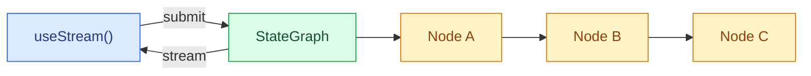

构建实时可视化 LangGraph 管道的前端界面。这些模式展示了如何通过自定义 `StateGraph` 工作流渲染多步图执行过程，并显示每个节点的状态和流式内容。

LangGraph 前端的核心优势在于 UI 可以与图结构保持一致。节点、状态键、检查点、中断、子图和流式消息都是运行时可见的概念，因此可以构建解释系统行为的界面，而非将执行过程隐藏在一个助手消息背后。

<Note>
这些模式使用 v1 前端 SDK 包。如果您使用的是更早版本，请参考 [React](https://github.com/langchain-ai/langgraphjs/blob/main/libs/sdk-react/docs/v1-migration.md)、[Vue](https://github.com/langchain-ai/langgraphjs/blob/main/libs/sdk-vue/docs/v1-migration.md)、[Svelte](https://github.com/langchain-ai/langgraphjs/blob/main/libs/sdk-svelte/docs/v1-migration.md) 和 [Angular](https://github.com/langchain-ai/langgraphjs/blob/main/libs/sdk-angular/docs/v1-migration.md) 的迁移指南。
</Note>

## 架构

LangGraph 图由命名的节点通过边连接而成。每个节点执行一个步骤（分类、研究、分析、合成），并将输出写入特定的状态键。在前端，SDK 的流处理句柄提供对节点输出、流式 Token 和发现子图的响应式访问，从而可以按每个节点映射 UI 卡片。



:::python

```python
from langgraph.graph import StateGraph, MessagesState, START, END

class State(MessagesState):
    classification: str
    research: str
    analysis: str
    synthesis: str

graph = StateGraph(State)
graph.add_node("classify", classify_node)
graph.add_node("do_research", research_node)
graph.add_node("analyze", analyze_node)
graph.add_node("synthesize", synthesize_node)
graph.add_edge(START, "classify")
graph.add_edge("classify", "do_research")
graph.add_edge("do_research", "analyze")
graph.add_edge("analyze", "synthesize")
graph.add_edge("synthesize", END)

app = graph.compile()
```

:::

:::js

```ts
import { Annotation, MessagesAnnotation, StateGraph, START, END } from "@langchain/langgraph";

const State = Annotation.Root({
  ...MessagesAnnotation.spec,
  classification: Annotation<string>(),
  research: Annotation<string>(),
  analysis: Annotation<string>(),
  synthesis: Annotation<string>(),
});

const graph = new StateGraph(State)
  .addNode("classify", classifyNode)
  .addNode("do_research", researchNode)
  .addNode("analyze", analyzeNode)
  .addNode("synthesize", synthesizeNode)
  .addEdge(START, "classify")
  .addEdge("classify", "do_research")
  .addEdge("do_research", "analyze")
  .addEdge("analyze", "synthesize")
  .addEdge("synthesize", END)
  .compile();
```

:::

在前端，@[`useStream`] 提供 `stream.subgraphs` 以支持图节点发现和选择器辅助功能，例如 `useMessages(stream, node)` 用于节点级流式内容展示。当需要获取最终 `synthesis` 等字段时，`stream.values` 仍持有完整的图状态。Angular 通过 @[`injectStream`] 使用相同的流 API 结构。

```ts
import { useStream } from "@langchain/react";

function Pipeline() {
  const stream = useStream<typeof graph>({
    apiUrl: "http://localhost:2024",
    assistantId: "pipeline",
  });

  const classification = stream.values?.classification;
  const research = stream.values?.research;
  const analysis = stream.values?.analysis;
  const graphNodes = [...stream.subgraphs.values()];
}
```

## 与聊天流式的区别

自定义图常用于产品工作流：研究流水线、审批流程、数据流水线、数据增强、代码审查、规划和多步分析。前端 SDK 通过图原生信号渲染这些工作流：

| 运行时概念 | 前端 UX |
| --- | --- |
| **命名节点** | 为每个图节点提供卡片、时间线步骤或状态徽章 |
| **状态键** | 专用 UI 区域展示分类、来源、分析和最终合成等结构化输出 |
| **流式元数据** | 将部分消息路由至生成它们的节点 |
| **检查点** | 调试或审计时可查看/恢复历史图状态 |
| **中断** | 暂停节点以获取人工输入、审批或修正后继续 |
| **子图** | 仅在用户需要时展示嵌套执行细节 |

由于 SDK 直接暴露这些概念，您可以从简单聊天面板扩展为完整工作流调试器，而无需修改后端协议。

## 模式

<CardGroup cols={2}>
  <Card title="Graph execution" icon="chart-dots" href="/langchain/oss/langgraph/frontend/graph-execution">
    可视化多步图管道，显示每个节点的状态和流式内容
  </Card>
  <Card title="Custom stream channels" icon="broadcast" href="/langchain/oss/langgraph/frontend/custom-stream-channels">
    将自定义服务端数据流式传输至前端，通过 `useExtension` 和 `useChannel` 读取
  </Card>
</CardGroup>

## 相关模式

[LangChain 前端模式](/langchain/oss/langchain/frontend/overview)（支持markdown消息、工具调用、人工介入、可续流、时间旅行）可与任何 LangGraph 图配合使用。流 API 无论使用 `createAgent`、`createDeepAgent` 还是自定义 `StateGraph`，都基于相同的内核数据模型。

※IMPORTANT: 在您之前的输出中占位符集有误。缺失 ids: [29]; 未预期的额外 ids: []。请重新翻译完整文本，严格保留所有占位符（六边形括号+数字）的原位、原数量。

---

> 官方原文：[src/oss/langgraph/frontend/overview.md](https://github.com/langchain-ai/docs/blob/main/src/oss/langgraph/frontend/overview.md) · 非官方翻译，译文由 AI 生成，以英文原文为准。
