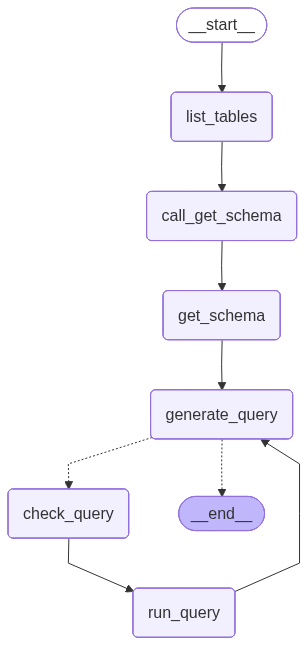

import ChatModelTabsPy from '/langchain/snippets/chat-model-tabs.mdx';
import ChatModelTabsJS from '/langchain/snippets/chat-model-tabs-js.mdx';
import SqlAgentDownloadChinookPy from '/langchain/snippets/code-samples/sql-agent-download-chinook-py.mdx';
import SqlAgentExploreDatabasePy from '/langchain/snippets/code-samples/sql-agent-explore-database-py.mdx';
import LanggraphSqlAgentToolsPy from '/langchain/snippets/code-samples/langgraph-sql-agent-tools-py.mdx';
import LanggraphSqlAgentDefineStepsPy from '/langchain/snippets/code-samples/langgraph-sql-agent-define-steps-py.mdx';
import LanggraphSqlAgentAssembleAgentPy from '/langchain/snippets/code-samples/langgraph-sql-agent-assemble-agent-py.mdx';
import LanggraphSqlAgentVisualizeGraphPy from '/langchain/snippets/code-samples/langgraph-sql-agent-visualize-graph-py.mdx';
import LanggraphSqlAgentStreamAgentPy from '/langchain/snippets/code-samples/langgraph-sql-agent-stream-agent-py.mdx';
import LanggraphSqlAgentHitlInterruptPy from '/langchain/snippets/code-samples/langgraph-sql-agent-hitl-interrupt-py.mdx';
import LanggraphSqlAgentHitlAssemblePy from '/langchain/snippets/code-samples/langgraph-sql-agent-hitl-assemble-py.mdx';
import LanggraphSqlAgentHitlStreamPy from '/langchain/snippets/code-samples/langgraph-sql-agent-hitl-stream-py.mdx';
import LanggraphSqlAgentHitlResumePy from '/langchain/snippets/code-samples/langgraph-sql-agent-hitl-resume-py.mdx';
import LanggraphSqlAgentDownloadChinookJs from '/langchain/snippets/code-samples/langgraph-sql-agent-download-chinook-js.mdx';
import LanggraphSqlAgentExploreDatabaseJs from '/langchain/snippets/code-samples/langgraph-sql-agent-explore-database-js.mdx';
import LanggraphSqlAgentToolsJs from '/langchain/snippets/code-samples/langgraph-sql-agent-tools-js.mdx';
import LanggraphSqlAgentDefineStepsJs from '/langchain/snippets/code-samples/langgraph-sql-agent-define-steps-js.mdx';
import LanggraphSqlAgentAssembleAgentJs from '/langchain/snippets/code-samples/langgraph-sql-agent-assemble-agent-js.mdx';
import LanggraphSqlAgentVisualizeGraphJs from '/langchain/snippets/code-samples/langgraph-sql-agent-visualize-graph-js.mdx';
import LanggraphSqlAgentStreamAgentJs from '/langchain/snippets/code-samples/langgraph-sql-agent-stream-agent-js.mdx';
import LanggraphSqlAgentHitlInterruptJs from '/langchain/snippets/code-samples/langgraph-sql-agent-hitl-interrupt-js.mdx';
import LanggraphSqlAgentHitlAssembleJs from '/langchain/snippets/code-samples/langgraph-sql-agent-hitl-assemble-js.mdx';
import LanggraphSqlAgentHitlStreamJs from '/langchain/snippets/code-samples/langgraph-sql-agent-hitl-stream-js.mdx';
import LanggraphSqlAgentHitlResumeJs from '/langchain/snippets/code-samples/langgraph-sql-agent-hitl-resume-js.mdx';

在本教程中，我们将使用 LangGraph 构建一个自定义智能体，该智能体能够回答有关 SQL 数据库的问题。

LangChain 提供了内置的 [智能体](/langchain/oss/langchain/agents) 实现，这些实现使用 [LangGraph](/langchain/oss/langgraph/overview) 基本结构实现。如果需要更深入的定制，智能体可以直接在 LangGraph 中实现。本指南演示了一个 SQL 智能体的示例实现。有关实际入门介绍，请参阅 [使用更高层次的 LangChain 抽象构建 SQL 智能体](/langchain/oss/langchain/sql-agent)。

<Warning>
构建 SQL 数据库的 Q&A 系统需要执行模型生成的 SQL 查询。这样做存在固有的风险。确保您的数据库连接权限始终尽可能狭窄地限制在智能体的需求范围内。这将减轻（尽管不能完全消除）构建模型驱动系统的风险。
</Warning>

[预构建的智能体](/langchain/oss/langchain/sql-agent) 可以让我们快速上手，但我们依赖于系统提示词来约束其行为——例如，我们指示智能体始终从 "列出表" 工具开始，并在执行查询之前始终运行查询检查器工具。

我们可以通过自定义智能体在 LangGraph 中实现更高程度的控制。在这里，我们实现了一个简单的 ReAct 智能体设置，为特定的工具调用设置了专用节点。我们将使用与预构建智能体相同的 [状态]。

### 概念

我们将涵盖以下概念：

- 用于从 SQL 数据库读取的 [工具](/langchain/oss/langchain/tools)
- LangGraph 的 [图 API](/langchain/oss/langgraph/graph-api)，包括状态、节点、边和条件边。
- [人工参与](/langchain/oss/langgraph/interrupts) 流程

## 设置

### 安装

    :::python
    <CodeGroup>
    ```bash pip
    pip install langchain langgraph
    ```
    </CodeGroup>
    :::
    :::js
    <CodeGroup>
    ```bash npm
    npm i langchain @langchain/core @langchain/langgraph @langchain/openai sqlite3 zod
    ```
    ```bash yarn
    yarn add langchain @langchain/core @langchain/langgraph @langchain/openai sqlite3 zod
    ```
    ```bash pnpm
    pnpm add langchain @langchain/core @langchain/langgraph @langchain/openai sqlite3 zod
    ```
    </CodeGroup>
    :::

### LangSmith
设置 [LangSmith](https://smith.langchain.com) 以检查链或智能体内部的运行情况。然后设置以下环境变量：

    ```shell
    export LANGSMITH_TRACING="true"
    export LANGSMITH_API_KEY="..."
    ```

## 1. 选择 LLM

选择一个支持 [工具调用](/langchain/oss/python/integrations/providers/overview) 的模型：

:::python
<ChatModelTabsPy />
:::
:::js
<ChatModelTabsJS />
:::

示例中的输出使用了 OpenAI。

## 2. 配置数据库

在本教程中，您将创建一个 [SQLite 数据库](https://www.sqlitetutorial.net/sqlite-sample-database/)。SQLite 是一个轻量级数据库，易于设置和使用。我们将加载 `chinook` 数据库，这是一个表示数字媒体商店的示例数据库。

为了方便起见，我们将数据库（`Chinook.db`）托管在公共 GCS 存储桶上。

:::python

<SqlAgentDownloadChinookPy />

我们将使用 Python 的内置 `sqlite3` 模块与数据库交互：

<SqlAgentExploreDatabasePy />
```
Dialect: sqlite
Available tables: ['Album', 'Artist', 'Customer', 'Employee', 'Genre', 'Invoice', 'InvoiceLine', 'MediaType', 'Playlist', 'PlaylistTrack', 'Track']
Sample output: [(1, 'AC/DC'), (2, 'Accept'), (3, 'Aerosmith'), (4, 'Alanis Morissette'), (5, 'Alice In Chains')]
```
:::
:::js

<LanggraphSqlAgentDownloadChinookJs />

我们将使用 `sqlite3` 库与数据库交互：

<LanggraphSqlAgentExploreDatabaseJs />
```
Dialect: sqlite
Available tables: Album, Artist, Customer, Employee, Genre, Invoice, InvoiceLine, MediaType, Playlist, PlaylistTrack, Track
Sample output: [{"ArtistId":1,"Name":"AC/DC"},{"ArtistId":2,"Name":"Accept"},{"ArtistId":3,"Name":"Aerosmith"},{"ArtistId":4,"Name":"Alanis Morissette"},{"ArtistId":5,"Name":"Alice In Chains"}]
```
:::

## 3. 添加用于数据库交互的工具

<Warning>
以下数据库工具仅用于演示目的，是极简的包装器。它们不打算用于生产环境或保证安全性。在使用模型生成的 SQL 之前，请使用狭窄范围的数据库权限并添加应用程序特定的验证。
</Warning>

:::python
我们可以使用 `@tool` 装饰器从 `langchain.tools` 实现数据库 [工具](/langchain/oss/langchain/tools) 作为薄包装器：

<LanggraphSqlAgentToolsPy />
```
sql_db_list_tables: Input is an empty string, output is a comma-separated list of tables in the database.

sql_db_schema: Input to this tool is a comma-separated list of tables, output is the schema and sample rows for those tables.
    Be sure that the tables actually exist by calling sql_db_list_tables first!
    Example Input: table1, table2, table3

sql_db_query: Input to this tool is a detailed and correct SQL query, output is a result from the database.
    If the query is not correct, an error message will be returned.
    If an error is returned, rewrite the query, check the query, and try again.
    If you encounter an issue with Unknown column 'xxxx' in 'field list', use sql_db_schema to query the correct table fields.
```
:::
:::js
我们将创建自定义工具来与数据库交互：

<LanggraphSqlAgentToolsJs />
```
sql_db_list_tables: Input is an empty string, output is a comma-separated list of tables in the database.

sql_db_schema: Input to this tool is a comma-separated list of tables, output is the schema and sample rows for those tables. Be sure that the tables actually exist by calling sql_db_list_tables first! Example Input: table1, table2, table3

sql_db_query: Input to this tool is a detailed and correct SQL query, output is a result from the database. If the query is not correct, an error message will be returned. If an error is returned, rewrite the query, check the query, and try again.
```
:::

## 4. 定义应用步骤

我们为以下步骤构建专用节点：

- 列出数据库表
- 调用 "获取架构" 工具
- 生成查询
- 检查查询

将这些步骤放入专用节点让我们能够（1）在需要时强制执行工具调用，以及（2）自定义与每个步骤关联的提示词。

:::python

<LanggraphSqlAgentDefineStepsPy />

:::
:::js

<LanggraphSqlAgentDefineStepsJs />

:::

## 5. 实现智能体

现在我们可以使用 [Graph API](/langchain/oss/langgraph/graph-api) 将这些步骤组装成一个工作流。我们在查询生成步骤定义了一个 [条件边](/langchain/oss/langgraph/graph-api#条件边缘)，如果生成了查询则路由到查询检查器，如果没有工具调用则结束，这样 LLM 就能对查询做出响应。

:::python

<LanggraphSqlAgentAssembleAgentPy />

我们在下方可视化应用：

<LanggraphSqlAgentVisualizeGraphPy />

:::
:::js

<LanggraphSqlAgentAssembleAgentJs />

我们在下方可视化应用：

<LanggraphSqlAgentVisualizeGraphJs />

:::


现在我们可以调用图：
:::python

<LanggraphSqlAgentStreamAgentPy />

:::
:::js

<LanggraphSqlAgentStreamAgentJs />

:::
```
================================ Human Message =================================

Which genre on average has the longest tracks?
================================== Ai Message ==================================

Available tables: Album, Artist, Customer, Employee, Genre, Invoice, InvoiceLine, MediaType, Playlist, PlaylistTrack, Track
================================== Ai Message ==================================
Tool Calls:
  sql_db_schema (call_yzje0tj7JK3TEzDx4QnRR3lL)
 Call ID: call_yzje0tj7JK3TEzDx4QnRR3lL
  Args:
    table_names: Genre, Track
================================= Tool Message =================================
Name: sql_db_schema


CREATE TABLE "Genre" (
	"GenreId" INTEGER NOT NULL,
	"Name" NVARCHAR(120),
	PRIMARY KEY ("GenreId")
)

/*
3 rows from Genre table:
GenreId	Name
1	Rock
2	Jazz
3	Metal
*/


CREATE TABLE "Track" (
	"TrackId" INTEGER NOT NULL,
	"Name" NVARCHAR(200) NOT NULL,
	"AlbumId" INTEGER,
	"MediaTypeId" INTEGER NOT NULL,
	"GenreId" INTEGER,
	"Composer" NVARCHAR(220),
	"Milliseconds" INTEGER NOT NULL,
	"Bytes" INTEGER,
	"UnitPrice" NUMERIC(10, 2) NOT NULL,
	PRIMARY KEY ("TrackId"),
	FOREIGN KEY("MediaTypeId") REFERENCES "MediaType" ("MediaTypeId"),
	FOREIGN KEY("GenreId") REFERENCES "Genre" ("GenreId"),
	FOREIGN KEY("AlbumId") REFERENCES "Album" ("AlbumId")
)

/*
3 rows from Track table:
TrackId	Name	AlbumId	MediaTypeId	GenreId	Composer	Milliseconds	Bytes	UnitPrice
1	For Those About To Rock (We Salute You)	1	1	1	Angus Young, Malcolm Young, Brian Johnson	343719	11170334	0.99
2	Balls to the Wall	2	2	1	U. Dirkschneider, W. Hoffmann, H. Frank, P. Baltes, S. Kaufmann, G. Hoffmann	342562	5510424	0.99
3	Fast As a Shark	3	2	1	F. Baltes, S. Kaufman, U. Dirkscneider & W. Hoffman	230619	3990994	0.99
*/
================================== Ai Message ==================================
Tool Calls:
  sql_db_query (call_cb9ApLfZLSq7CWg6jd0im90b)
 Call ID: call_cb9ApLfZLSq7CWg6jd0im90b
  Args:
    query: SELECT Genre.Name, AVG(Track.Milliseconds) AS AvgMilliseconds FROM Track JOIN Genre ON Track.GenreId = Genre.GenreId GROUP BY Genre.GenreId ORDER BY AvgMilliseconds DESC LIMIT 5;
================================== Ai Message ==================================
Tool Calls:
  sql_db_query (call_DMVALfnQ4kJsuF3Yl6jxbeAU)
 Call ID: call_DMVALfnQ4kJsuF3Yl6jxbeAU
  Args:
    query: SELECT Genre.Name, AVG(Track.Milliseconds) AS AvgMilliseconds FROM Track JOIN Genre ON Track.GenreId = Genre.GenreId GROUP BY Genre.GenreId ORDER BY AvgMilliseconds DESC LIMIT 5;
================================= Tool Message =================================
Name: sql_db_query

[('Sci Fi & Fantasy', 2911783.0384615385), ('Science Fiction', 2625549.076923077), ('Drama', 2575283.78125), ('TV Shows', 2145041.0215053763), ('Comedy', 1585263.705882353)]
================================== Ai Message ==================================

The genre with the longest tracks on average is "Sci Fi & Fantasy," with an average track length of approximately 2,911,783 milliseconds. Other genres with relatively long tracks include "Science Fiction," "Drama," "TV Shows," and "Comedy."
```
:::python
<Tip>
参见 [LangSmith 跟踪](https://smith.langchain.com/public/94b8c9ac-12f7-4692-8706-836a1f30f1ea/r) 了解上述运行情况。
</Tip>
:::
:::js
<Tip>
参见 [LangSmith 跟踪](https://smith.langchain.com/public/a6a96896-686a-4040-b9b5-28d701453d6f/r) 了解上述运行情况。
</Tip>
:::

## 6. 实现人工审核

在执行任何可能产生意外行为或低效性的 SQL 查询之前，检查智能体的 SQL 查询是明智的。

这里我们利用 LangGraph 的 [人工审核](/langchain/oss/langgraph/interrupts) 功能在执行 SQL 查询前暂停运行并等待人工审核。使用 LangGraph 的 [持久化层](/langchain/oss/langgraph/persistence)，我们可以无限期地暂停运行（至少只要持久化层存活）。

让我们将 `sql_db_query` 工具封装在一个接收人类输入的节点中。我们可以使用 [中断](/langchain/oss/langgraph/interrupts) 函数实现这一点。下面，我们允许输入以批准工具调用、编辑其参数或提供用户反馈。

:::python

<LanggraphSqlAgentHitlInterruptPy />

:::
:::js

<LanggraphSqlAgentHitlInterruptJs />

:::

<Note>
上述实现遵循了 [工具中断示例](/langchain/oss/langgraph/interrupts#工具中的中断) 在更广泛的 [人工审核](/langchain/oss/langgraph/interrupts) 指南中的内容。参考该指南了解详情和替代方案。
</Note>

现在让我们重新组装我们的图。我们将程序化检查替换为人工审核。注意我们现在包含了一个 [检查点](/langchain/oss/langgraph/persistence)；这是暂停和恢复运行所必需的。

:::python

<LanggraphSqlAgentHitlAssemblePy />

:::
:::js

<LanggraphSqlAgentHitlAssembleJs />

:::

我们可以像之前一样调用图。这次执行被中断：

:::python

<LanggraphSqlAgentHitlStreamPy />

:::
:::js

<LanggraphSqlAgentHitlStreamJs />

:::

```
...

INTERRUPTED:
{
  "action": "sql_db_query",
  "args": {
    "query": "SELECT Genre.Name, AVG(Track.Milliseconds) AS AvgLength FROM Track JOIN Genre ON Track.GenreId = Genre.GenreId GROUP BY Genre.Name ORDER BY AvgLength DESC LIMIT 5;"
  },
  "description": "Please review the tool call"
}
```
我们可以使用 [Command](/langchain/oss/langgraph/use-graph-api#结合控制流和状态更新与-command) 接受或编辑工具调用：

:::python

<LanggraphSqlAgentHitlResumePy />

:::
:::js

<LanggraphSqlAgentHitlResumeJs />

:::

```
================================== Ai Message ==================================
Tool Calls:
  sql_db_query (call_t4yXkD6shwdTPuelXEmY3sAY)
 Call ID: call_t4yXkD6shwdTPuelXEmY3sAY
  Args:
    query: SELECT Genre.Name, AVG(Track.Milliseconds) AS AvgLength FROM Track JOIN Genre ON Track.GenreId = Genre.GenreId GROUP BY Genre.Name ORDER BY AvgLength DESC LIMIT 5;
================================= Tool Message =================================
Name: sql_db_query

[('Sci Fi & Fantasy', 2911783.0384615385), ('Science Fiction', 2625549.076923077), ('Drama', 2575283.78125), ('TV Shows', 2145041.0215053763), ('Comedy', 1585263.705882353)]
================================== Ai Message ==================================

The genre with the longest average track length is "Sci Fi & Fantasy" with an average length of about 2,911,783 milliseconds. Other genres with long average track lengths include "Science Fiction," "Drama," "TV Shows," and "Comedy."
```

参考 [人工审核指南](/langchain/oss/langgraph/interrupts) 了解详情。

## 下一步
查阅 [评估图](https://docs.langchain.com/langsmith/evaluate-graph) 指南，了解如何使用 LangSmith 评估 LangGraph 应用，包括像这样的 SQL 智能体。

---

> 官方原文：[src/oss/langgraph/sql-agent.mdx](https://github.com/langchain-ai/docs/blob/main/src/oss/langgraph/sql-agent.mdx) · 非官方翻译，译文由 AI 生成，以英文原文为准。
