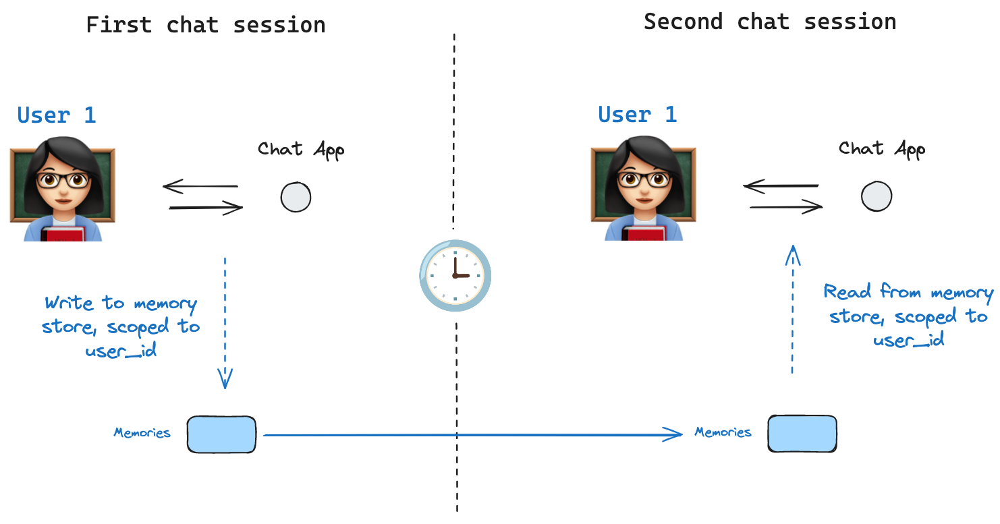

import StoreListNamespaceSearchPy from '/langchain/snippets/code-samples/store-list-namespace-search-py.mdx';
import StoreListNamespaceSearchJs from '/langchain/snippets/code-samples/store-list-namespace-search-js.mdx';
import StoreListNamespacePaginatePy from '/langchain/snippets/code-samples/store-list-namespace-paginate-py.mdx';
import StoreListNamespacePaginateJs from '/langchain/snippets/code-samples/store-list-namespace-paginate-js.mdx';
import StoreListNamespaceListPy from '/langchain/snippets/code-samples/store-list-namespace-list-py.mdx';
import StoreListNamespaceListJs from '/langchain/snippets/code-samples/store-list-namespace-list-js.mdx';

Stores 允许智能体跨线程持久化信息，包括用户偏好、积累的知识以及应该超越单次对话而存活的事实。与 [checkpointers](/langchain/oss/langgraph/checkpointers) 不同，后者保存的是限定于单个线程的完整图状态，而 stores 则持有可从任何线程访问的任意键值对数据。



<Info>
**Agent Server 自动处理 stores**
使用 [Agent Server](https://docs.langchain.com/langsmith/agent-server) 时，您无需手动实现或配置 stores。API 会在幕后为您处理所有存储基础设施。
</Info>

<Note>
@[InMemoryStore] 适用于开发和测试。在生产环境中，请使用持久化存储，如 `PostgresStore`、`MongoDBStore`、`RedisStore` 或 `UpstashStore`。所有实现都扩展自 @[BaseStore]，这是在节点函数签名中使用的类型注解。
</Note>

<Note>
查看 [store integrations](/langchain/oss/python/integrations/long-term-memory/index) 以获取可用提供商的完整列表。
</Note>

## 基本用法

以下代码片段展示了在不使用 LangGraph 的情况下，单独使用 @[InMemoryStore]：

:::python
```python
from langgraph.store.memory import InMemoryStore
store = InMemoryStore()
```
:::

:::js
```typescript
import { InMemoryStore } from "@langchain/langgraph";

const memoryStore = new InMemoryStore();
```
:::

Memories 通过 `tuple` 进行命名空间划分，在下面的示例中，`(<user_id>, "memories")`。命名空间可以是任意长度并代表任何内容，不必特定于用户。

:::python
```python
user_id = "1"
namespace_for_memory = (user_id, "memories")
```
:::

:::js
```typescript
const userId = "1";
const namespaceForMemory = [userId, "memories"];
```
:::

使用 `store.put` 方法将 memories 保存到 store 中的命名空间。指定上面定义的命名空间以及记忆的键值对：键只是记忆的唯一标识符 (`memory_id`)，而值（字典）就是记忆本身。

:::python
```python
memory_id = str(uuid7())
memory = {"food_preference" : "I like pizza"}
store.put(namespace_for_memory, memory_id, memory)
```
:::

:::js
```typescript
import { v7 as uuid7 } from "uuid";
const memoryId = uuid7();
const memory = { food_preference: "I like pizza" };
await memoryStore.put(namespaceForMemory, memoryId, memory);
```
:::

使用 `store.search` 方法从命名空间中读取 memories，该方法将给定用户的 memories 作为列表返回，最多返回 `limit` 个参数（默认 `10`）。使用 `InMemoryStore` 时，项目按插入顺序返回，因此最新的 memory 位于列表末尾；其他后端可能会以不同方式对 memories 进行排序（参见 [Listing items in a namespace](#列出命名空间中的项目)）。

:::python
```python
memories = store.search(namespace_for_memory)
memories[-1].dict()
{'value': {'food_preference': 'I like pizza'},
 'key': '07e0caf4-1631-47b7-b15f-65515d4c1843',
 'namespace': ['1', 'memories'],
 'created_at': '2024-10-02T17:22:31.590602+00:00',
 'updated_at': '2024-10-02T17:22:31.590605+00:00'}
```

每个 memory type 都是一个具有特定属性的 Python 类 ([`Item`](https://reference.langchain.com/python/langgraph.store/base/Item))。我们可以通过使用 `.dict` 进行转换，将其作为字典访问。

它具有以下属性：

* `value`: 此 memory 的值（本身是一个字典）
* `key`: 此 memory 在此命名空间中的唯一键
* `namespace`: 字符串元组，此 memory type 的命名空间

<Note>
    当类型为 `tuple[str, ...]` 时，在转换为 JSON 时可能被序列化为列表（例如，`['1', 'memories']`）。
    </Note>

* `created_at`: 此 memory 创建的时间戳
* `updated_at`: 此 memory 更新的时间戳

:::

:::js
```typescript
const memories = await memoryStore.search(namespaceForMemory);
memories[memories.length - 1];

// {
//   value: { food_preference: 'I like pizza' },
//   key: '07e0caf4-1631-47b7-b15f-65515d4c1843',
//   namespace: ['1', 'memories'],
//   createdAt: '2024-10-02T17:22:31.590602+00:00',
//   updatedAt: '2024-10-02T17:22:31.590605+00:00'
// }
```

它具有以下属性：

* `value`: 此 memory 的值
* `key`: 此 memory 在此命名空间中的唯一键
* `namespace`: 字符串元组，此 memory type 的命名空间

<Note>
    当类型为 `tuple` 时，在转换为 JSON 时可能被序列化为列表（例如，`['1', 'memories']`）。
    </Note>

* `createdAt`: 此 memory 创建的时间戳
* `updatedAt`: 此 memory 更新的时间戳

:::

## 列出命名空间中的项目

:::python
调用 [`store.search`](https://reference.langchain.com/python/langgraph/store)（或异步的 [`store.asearch`](https://reference.langchain.com/python/langgraph/store)）而不带 `query` 和 `filter` 会返回存储在 `namespace_prefix` 下的项目，最多返回 `limit` 个。当你不需要语义排序时，用它来枚举命名空间中的所有内容。
:::

:::js
调用 `store.search` 而不提供 `query` 和 `filter` 将返回在命名空间前缀下存储的项目，最多返回 `limit` 个。当您不需要语义排序时，使用此方法来枚举命名空间中的所有内容。
:::

:::python

<StoreListNamespaceSearchPy />

:::

:::js

<StoreListNamespaceSearchJs />

:::

需要注意的三种行为：

- **`namespace_prefix` 通过前缀匹配，而非精确匹配。** `("alice",)` 也会返回 `("alice", "memories")`、`("alice", "preferences")` 等子项。若要限制为单一层级，请传递完整命名空间或在 `item.namespace` 客户端过滤返回项。
- **超过 `limit` 的结果会被静默截断。** 没有溢出信号—将 `limit` 设置为预期最大值以上，或使用 `offset` 进行分页。
- **默认排序取决于存储后端。** `PostgresStore` 和 `AsyncPostgresStore` 按 `updated_at` 降序返回结果（最近更新优先）。`InMemoryStore` 按插入顺序返回结果（最近插入的排在最后）。不要依赖跨实现的特定顺序；若顺序重要，请在 `item.updated_at` 客户端进行排序。

:::python
To page through a large namespace:

<StoreListNamespacePaginatePy />

:::

:::js
To page through a large namespace:

<StoreListNamespacePaginateJs />

:::

:::python
要发现哪些命名空间存在（例如，在列出每个用户的记忆之前迭代每个用户），使用 [`store.list_namespaces`](https://reference.langchain.com/python/langgraph/store) 或 [`store.alist_namespaces`](https://reference.langchain.com/python/langgraph/store):

<StoreListNamespaceListPy />

:::

:::js
要发现哪些命名空间存在（例如，在列出每个用户的记忆之前迭代每个用户），使用 `store.listNamespaces`：

<StoreListNamespaceListJs />

:::

## 语义搜索

除了简单的检索外，store 还支持语义搜索，允许您根据含义而非精确匹配来查找 memories。要启用此功能，请使用嵌入模型配置 store：

:::python
```python
from langchain.embeddings import init_embeddings

store = InMemoryStore(
    index={
        "embed": init_embeddings("openai:text-embedding-3-small"),  # Embedding provider
        "dims": 1536,                              # Embedding dimensions
        "fields": ["food_preference", "$"]              # Fields to embed
    }
)
```
:::

:::js
```typescript
import { OpenAIEmbeddings } from "@langchain/openai";

const store = new InMemoryStore({
  index: {
    embeddings: new OpenAIEmbeddings({ model: "text-embedding-3-small" }),
    dims: 1536,
    fields: ["food_preference", "$"], // Fields to embed
  },
});
```
:::

现在在搜索时，您可以使用自然语言查询来查找相关的 memories：

:::python
```python
# Find memories about food preferences
# (This can be done after putting memories into the store)
memories = store.search(
    namespace_for_memory,
    query="What does the user like to eat?",
    limit=3  # Return top 3 matches
)
```
:::

:::js
```typescript
// Find memories about food preferences
// (This can be done after putting memories into the store)
const memories = await store.search(namespaceForMemory, {
  query: "What does the user like to eat?",
  limit: 3, // Return top 3 matches
});
```
:::

您可以通过配置 `fields` 参数或在存储 memories 时指定 `index` 参数来控制 memories 的哪些部分被嵌入：

:::python
```python
# Store with specific fields to embed
store.put(
    namespace_for_memory,
    str(uuid7()),
    {
        "food_preference": "I love Italian cuisine",
        "context": "Discussing dinner plans"
    },
    index=["food_preference"]  # Only embed "food_preferences" field
)

# Store without embedding (still retrievable, but not searchable)
store.put(
    namespace_for_memory,
    str(uuid7()),
    {"system_info": "Last updated: 2024-01-01"},
    index=False
)
```
:::

:::js
```typescript
// Store with specific fields to embed
await store.put(
  namespaceForMemory,
  uuid7(),
  {
    food_preference: "I love Italian cuisine",
    context: "Discussing dinner plans",
  },
  { index: ["food_preference"] } // Only embed "food_preferences" field
);

import { v7 as uuid7 } from "uuid";
// Store without embedding (still retrievable, but not searchable)
await store.put(
  namespaceForMemory,
  uuid7(),
  { system_info: "Last updated: 2024-01-01" },
  { index: false }
);
```
:::

## 在 LangGraph 中使用

:::python
store 与 checkpointer 紧密配合工作：checkpointer 将状态保存到线程（如上所述），而 store 允许您存储任意信息以供 _跨_ 线程访问。请按如下方式同时使用 checkpointer 和 store 编译图。

```python
from dataclasses import dataclass
from langgraph.checkpoint.memory import InMemorySaver

@dataclass
class Context:
    user_id: str

# We need this because we want to enable threads (conversations)
checkpointer = InMemorySaver()

# ... Define the graph ...

# Compile the graph with the checkpointer and store
builder = StateGraph(MessagesState, context_schema=Context)
# ... add nodes and edges ...
graph = builder.compile(checkpointer=checkpointer, store=store)
```
:::

:::js
`memoryStore` 与检查点协同工作：检查点将状态保存到线程中（如前所述），而 `memoryStore` 允许您存储任意信息以跨线程访问。以下是如何编译包含检查点和 `memoryStore` 的图。

```typescript
import { MemorySaver } from "@langchain/langgraph";

// We need this because we want to enable threads (conversations)
const checkpointer = new MemorySaver();

// ... Define the graph ...

// Compile the graph with the checkpointer and store
const graph = workflow.compile({ checkpointer, store: memoryStore });
```
:::

然后像之前一样使用 `thread_id` 调用图，并使用 `user_id`，它作为此特定用户的记忆命名空间，如前所述。

:::python
```python
# Invoke the graph
config = {"configurable": {"thread_id": "1"}}

# First let's just say hi to the AI
for update in graph.stream(
    {"messages": [{"role": "user", "content": "hi"}]},
    config,
    stream_mode="updates",
    context=Context(user_id="1"),
):
    print(update)
```
:::

:::js
```typescript
// Invoke the graph
const userId = "1";
const config = { configurable: { thread_id: "1" }, context: { userId } };

// First let's just say hi to the AI
for await (const update of await graph.stream(
  { messages: [{ role: "user", content: "hi" }] },
  { ...config, streamMode: "updates" }
)) {
  console.log(update);
}
```
:::

:::python
您可以通过使用 `Runtime` 对象从 _任何节点_ 访问存储和 `user_id`。当您将 `Runtime` 作为参数添加到节点函数时，LangGraph 会自动注入 `Runtime`。您可以使用它来保存记忆：

```python
from langgraph.runtime import Runtime
from dataclasses import dataclass

@dataclass
class Context:
    user_id: str

async def update_memory(state: MessagesState, runtime: Runtime[Context]):

    # Get the user id from the runtime context
    user_id = runtime.context.user_id

    # Namespace the memory
    namespace = (user_id, "memories")

    # ... Analyze conversation and create a new memory

    # Create a new memory ID
    memory_id = str(uuid7())

    # We create a new memory
    await runtime.store.aput(namespace, memory_id, {"memory": memory})

```


:::

:::js
您可以通过 `runtime` 参数从 _任何节点_ 访问存储和 `userId`。您可以使用它来保存记忆：

```typescript
import { StateSchema, MessagesValue, Runtime } from "@langchain/langgraph";
import { v7 as uuid7 } from "uuid";

const MessagesState = new StateSchema({
  messages: MessagesValue,
});

const updateMemory: GraphNode<typeof MessagesState> = async (state, runtime) => {
  // Get the user id from the config
  const userId = runtime.context?.user_id;
  if (!userId) throw new Error("User ID is required");

  // Namespace the memory
  const namespace = [userId, "memories"];

  // ... Analyze conversation and create a new memory
  const memory = "Some memory content";

  // Create a new memory ID
  const memoryId = uuid7();

  // We create a new memory
  await runtime.store?.put(namespace, memoryId, { memory });
};
```
:::

您还可以从任何节点访问存储，并使用 `store.search` 方法获取记忆。记忆以对象列表的形式返回，可以转换为字典。

:::python
```python
memories[-1].dict()
{'value': {'food_preference': 'I like pizza'},
 'key': '07e0caf4-1631-47b7-b15f-65515d4c1843',
 'namespace': ['1', 'memories'],
 'created_at': '2024-10-02T17:22:31.590602+00:00',
 'updated_at': '2024-10-02T17:22:31.590605+00:00'}
```
:::

:::js
```typescript
memories[memories.length - 1];
// {
//   value: { food_preference: 'I like pizza' },
//   key: '07e0caf4-1631-47b7-b15f-65515d4c1843',
//   namespace: ['1', 'memories'],
//   createdAt: '2024-10-02T17:22:31.590602+00:00',
//   updatedAt: '2024-10-02T17:22:31.590605+00:00'
// }
```
:::

您访问记忆并在模型调用中使用它们。

:::python
```python
from dataclasses import dataclass
from langgraph.runtime import Runtime

@dataclass
class Context:
    user_id: str

async def call_model(state: MessagesState, runtime: Runtime[Context]):
    # Get the user id from the runtime context
    user_id = runtime.context.user_id

    # Namespace the memory
    namespace = (user_id, "memories")

    # Search based on the most recent message
    memories = await runtime.store.asearch(
        namespace,
        query=state["messages"][-1].content,
        limit=3
    )
    info = "\n".join([d.value["memory"] for d in memories])

    # ... Use memories in the model call
```
:::

:::js
```typescript
const callModel: GraphNode<typeof MessagesState> = async (state, runtime) => {
  // Get the user id from the config
  const userId = runtime.context?.user_id;

  // Namespace the memory
  const namespace = [userId, "memories"];

  // Search based on the most recent message
  const memories = await runtime.store?.search(namespace, {
    query: state.messages[state.messages.length - 1].content,
    limit: 3,
  });
  const info = memories.map((d) => d.value.memory).join("\n");

  // ... Use memories in the model call
};
```
:::

如果您创建新线程，只要 `user_id` 相同，您仍然可以访问相同的记忆。

:::python
```python
# Invoke the graph on a new thread
config = {"configurable": {"thread_id": "2"}}

# Let's say hi again
for update in graph.stream(
    {"messages": [{"role": "user", "content": "hi, tell me about my memories"}]},
    config,
    stream_mode="updates",
    context=Context(user_id="1"),
):
    print(update)
```
:::

:::js
```typescript
// Invoke the graph
const config = { configurable: { thread_id: "2" }, context: { userId: "1" } };

// Let's say hi again
for await (const update of await graph.stream(
  { messages: [{ role: "user", content: "hi, tell me about my memories" }] },
  { ...config, streamMode: "updates" }
)) {
  console.log(update);
}
```
:::

当您在本地使用 LangSmith（例如，在 [Studio](https://docs.langchain.com/langsmith/studio)) 或 [hosted](https://docs.langchain.com/langsmith/platform-setup) 中时，基础存储默认可用，编译图时无需指定。然而，要启用语义搜索，您确实需要在 `langgraph.json` 文件中配置索引设置。例如：

```json
{
    ...
    "store": {
        "index": {
            "embed": "openai:text-embeddings-3-small",
            "dims": 1536,
            "fields": ["$"]
        }
    }
}
```

参见 [部署指南](https://docs.langchain.com/langsmith/semantic-search) 获取更多详细信息和配置选项。

:::python
## 构建自定义存储

要使用除内置实现之外的存储后端，请继承 @[BaseStore] 并实现其所需方法。内置 @[InMemoryStore] 是最简单的参考实现。

### 基本协议

所有五个异步方法都是必需的。同步对应方法（`put`、`get`、`delete`、`search`、`list_namespaces`）是可选的但建议与同步图执行兼容。

| 方法 | 描述 |
|--------|-------------|
| `aput(namespace, key, value, index=None)` | 存储或覆盖单个项 |
| `aget(namespace, key)` | 通过键检索单个项；如果缺失则返回 `None` |
| `adelete(namespace, key)` | 删除单个项 |
| `asearch(namespace_prefix, *, query=None, filter=None, limit=10, offset=0)` | 在命名空间前缀下搜索项；可选地通过语义查询 |
| `alist_namespaces(*, prefix=None, suffix=None, max_depth=None, limit=100, offset=0)` | 列出匹配前缀/后缀模式的所有命名空间 |

实现前请查找确切签名：

```python
import inspect
from langgraph.store.base import BaseStore
print(inspect.getsource(BaseStore))
```

### 命名空间设计

命名空间是字符串元组，例如 `("user_id", "memories")`。存储实现必须支持：

- **前缀匹配**：`asearch(("alice",))` 返回 `("alice",)`、`("alice", "memories")` 和任何其他子命名空间下的项。
- **精确键查找**：`aget(("alice", "memories"), "some-key")` 必须是 O(1) 或接近 O(1)。

对于 SQL 后端，常见的架构：

```sql
CREATE TABLE store_items (
    namespace   TEXT[] NOT NULL,
    key         TEXT NOT NULL,
    value       JSONB NOT NULL,
    created_at  TIMESTAMPTZ DEFAULT now(),
    updated_at  TIMESTAMPTZ DEFAULT now(),
    PRIMARY KEY (namespace, key)
);

CREATE INDEX ON store_items USING gin(namespace);
```

### 序列化

存储值是普通的 Python 字典——无需特殊序列化器。使用 `json.dumps` / `json.loads` 或直接使用 JSONB 列进行序列化。不要存储非 JSON-可序列化的原始 Python 对象。

### 语义搜索支持

如果您的后端支持向量搜索，请在 `asearch` 上实现 `query` 参数：

- 接受一个 `query: str | None` 参数。
- 当 `query` 不为 `None` 时，嵌入它并按余弦相似度对结果进行排序。
- 当提供 `query` 时，结果应在每个 `Item` 中包含 `score` 字段。

如果您的后端不支持向量搜索，当 `query` 被传递时，请引发 `NotImplementedError`。

### 测试

目前还没有自定义存储的兼容性套件。将 @[InMemoryStore] 作为参考进行测试：

```python
import pytest
from langgraph.store.memory import InMemoryStore
from your_module import YourStore

@pytest.fixture
async def store():
    async with YourStore.create() as s:
        yield s

@pytest.fixture
def reference():
    return InMemoryStore()

async def test_put_and_get(store, reference):
    ns = ("test", "ns")
    for s in [store, reference]:
        await s.aput(ns, "k1", {"val": 1})
        item = await s.aget(ns, "k1")
        assert item is not None
        assert item.value == {"val": 1}

async def test_delete(store, reference):
    ns = ("test", "ns")
    for s in [store, reference]:
        await s.aput(ns, "k1", {"val": 1})
        await s.adelete(ns, "k1")
        assert await s.aget(ns, "k1") is None

async def test_search_prefix(store, reference):
    for s in [store, reference]:
        await s.aput(("user", "memories"), "m1", {"text": "likes pizza"})
        results = await s.asearch(("user",))
        assert any(r.key == "m1" for r in results)
```
:::

### 下一步

- [向 Agent Server 添加自定义存储](https://docs.langchain.com/langsmith/custom-store) — 部署您的实现
- [检查点](/langchain/oss/langgraph/checkpointers) — 线程范围状态持久化

---

> 官方原文：[src/oss/langgraph/stores.mdx](https://github.com/langchain-ai/docs/blob/main/src/oss/langgraph/stores.mdx) · 译文由 AI 生成，以英文原文为准。
