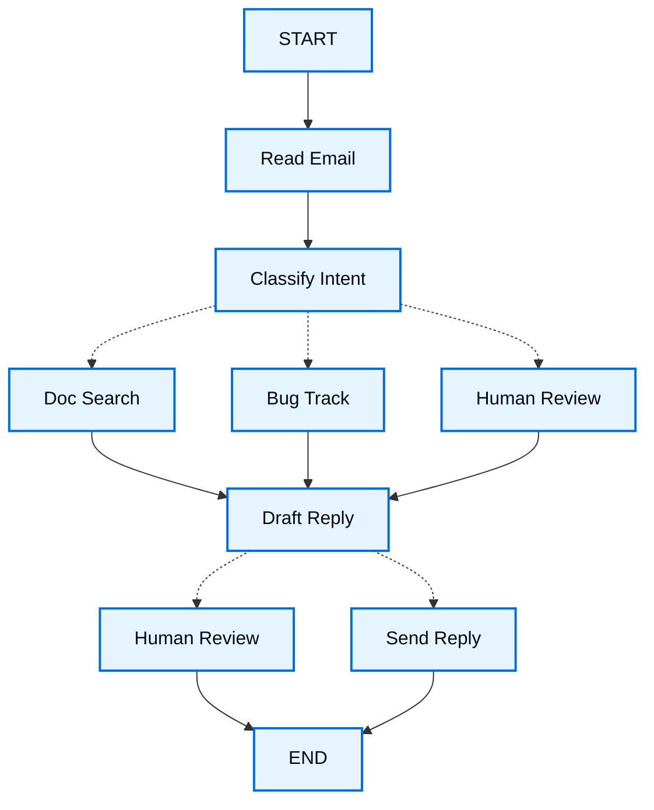

import LanggraphThinkingHitlV2Py from '/langchain/snippets/code-samples/langgraph-thinking-hitl-v2-py.mdx';

当你使用 LangGraph 构建智能体时，首先需要将其分解为离散的步骤，这些步骤称为 **节点**。然后，你需要描述每个节点之间的不同决策和转换。最后，通过一个共享的 **状态** 将节点连接起来，每个节点都可以从中读取和写入。

在这个快速入门指南中，我们将引导你了解使用 LangGraph 构建客户支持邮件智能体的思考过程。

## 从你想要自动化的流程开始

想象一下，你需要构建一个处理客户支持邮件的 AI 智能体。你的产品团队给你提出了以下需求：

```txt
The agent should:

- Read incoming customer emails
- Classify them by urgency and topic
- Search relevant documentation to answer questions
- Draft appropriate responses
- Escalate complex issues to human agents
- Schedule follow-ups when needed

Example scenarios to handle:

1. Simple product question: "How do I reset my password?"
2. Bug report: "The export feature crashes when I select PDF format"
3. Urgent billing issue: "I was charged twice for my subscription!"
4. Feature request: "Can you add dark mode to the mobile app?"
5. Complex technical issue: "Our API integration fails intermittently with 504 errors"
```

要在 LangGraph 中实现智能体，你通常会遵循五个相同的步骤。

## 第 1 步：将你的工作流程分解为离散的步骤

首先，识别你流程中的不同步骤。每个步骤将是一个 **节点**（执行特定任务的函数）。然后，勾勒出这些步骤如何相互连接。



此图中的箭头显示了可能的路径，但实际选择哪条路径的决定发生在每个节点内部。

现在我们已经确定了工作流程中的组件，让我们了解每个节点需要做什么：

- `Read Email`：提取和解析邮件内容
- `Classify Intent`：使用 LLM 对紧急程度和主题进行分类，然后路由到适当的操作
- `Doc Search`：查询你的知识库以获取相关信息
- `Bug Track`：在跟踪系统中创建或更新问题
- `Draft Reply`：生成适当的回复
- `Human Review`：升级到人类智能体以获得批准或处理
- `Send Reply`：发送邮件回复

<Tip>
注意，一些节点会做出关于下一步去哪里的决策（`Classify Intent`、`Draft Reply`、`Human Review`），而另一些节点总是执行相同的下一步（`Read Email` 总是转到 `Classify Intent`，`Doc Search` 总是转到 `Draft Reply`）。
</Tip>

## 第 2 步：确定每个步骤需要做什么

对于图中的每个节点，确定它代表哪种类型的操作以及它需要哪些上下文才能正常运行。

<CardGroup cols={2}>
    <Card title="LLM steps" icon="brain" href="#llm-steps">
        当你需要理解、分析、生成文本或做出推理决策时使用
    </Card>
    <Card title="Data steps" icon="database" href="#data-steps">
        当你需要从外部来源检索信息时使用
    </Card>
    <Card title="Action steps" icon="bolt" href="#action-steps">
        当你需要执行外部操作时使用
    </Card>
    <Card title="User input steps" icon="user" href="#user-input-steps">
        当你需要人工干预时使用
    </Card>
</CardGroup>

### LLM 步骤

当一个步骤需要理解、分析、生成文本或做出推理决策时：

<AccordionGroup>
    <Accordion title="Classify intent">
        - 静态上下文（提示词）：分类类别、紧急程度定义、响应格式
        - 动态上下文（来自状态）：邮件内容、发件人信息
        - 期望结果：结构化分类以确定路由
    </Accordion>

    <Accordion title="Draft reply">
        - 静态上下文（提示词）：语气指南、公司政策、响应模板
        - 动态上下文（来自状态）：分类结果、搜索结果、客户历史
        - 期望结果：准备审核的专业邮件响应
    </Accordion>
</AccordionGroup>

### 数据步骤

当某个步骤需要从外部源检索信息时：

<AccordionGroup>
    <Accordion title="Document search">
        - 参数：基于意图和主题构建的查询
        - 重试策略：是，对暂时性故障使用指数退避
        - 缓存：可以缓存常见查询以减少 API 调用
    </Accordion>

    <Accordion title="Customer history lookup">
        - 参数：来自状态的用户邮件或 ID
        - 重试策略：是，如果不可用则回退到基本信息
        - 缓存：是，带有时效性以平衡新鲜度和性能
    </Accordion>
</AccordionGroup>

### 操作步骤

当某个步骤需要执行外部操作时：

<AccordionGroup>
    <Accordion title="Send reply">
        - 执行节点时机：批准后（人工或自动）
        - 重试策略：是，对网络问题使用指数退避
        - 不应缓存：每次发送都是唯一操作
    </Accordion>

    <Accordion title="Bug track">
        - 执行节点时机：意图为 "bug" 时始终执行
        - 重试策略：是，关键不能丢失 bug 报告
        - 返回：包含在响应中的工单 ID
    </Accordion>
</AccordionGroup>

### 用户输入步骤

当某个步骤需要人工干预时：

<AccordionGroup>
    <Accordion title="Human review node">
        - 决策上下文：原始邮件、草稿响应、紧急程度、分类
        - 期望输入格式：批准布尔值加上可选的编辑后响应
        - 触发时机：高紧急程度、复杂问题或质量问题
    </Accordion>
</AccordionGroup>

## 第 3 步：设计你的状态

状态是所有智能体节点可访问的共享 [记忆](/langchain/oss/concepts/memory)。将其视为智能体在处理过程中记录所有学习和决策的笔记本。

### 状态中应包含什么？

关于每份数据，问自己以下问题：

<CardGroup cols={2}>
    <Card title="Include in state" icon="check">
        是否需要跨步骤持久化？如果是，则放入状态。
    </Card>

    <Card title="Don't store" icon="code">
        是否可以从其他数据推导出？如果是，按需计算而不是存储在状态中。
    </Card>
</CardGroup>

为我们的电子邮件智能体，我们需要跟踪：

- 原始邮件和发件人信息（后期无法重建）
- 分类结果（多个后续节点需要）
- 搜索结果和客户数据（重新获取成本高）
- 草稿回复（需要贯穿审核过程）
- 执行元数据（用于调试和恢复）

### 保持状态原始，按需格式化提示词

<Tip>
    一个关键原则：你的状态应存储原始数据，而不是格式化文本。在需要时在节点内部格式化提示词。
</Tip>

这种分离意味着：

- 不同的节点可以根据需要以不同的方式格式化相同的数据
- 你可以更改提示词模板，而无需修改你的状态模式
- 调试更清晰——你能确切看到每个节点接收到的数据
- 你的智能体可以演进，而不会破坏现有状态

让我们定义我们的状态：

:::python

```python
from typing import TypedDict, Literal

# Define the structure for email classification
class EmailClassification(TypedDict):
    intent: Literal["question", "bug", "billing", "feature", "complex"]
    urgency: Literal["low", "medium", "high", "critical"]
    topic: str
    summary: str

class EmailAgentState(TypedDict):
    # Raw email data
    email_content: str
    sender_email: str
    email_id: str

    # Classification result
    classification: EmailClassification | None

    # Raw search/API results
    search_results: list[str] | None  # List of raw document chunks
    customer_history: dict | None  # Raw customer data from CRM

    # Generated content
    draft_response: str | None
    messages: list[str] | None
```

:::

:::js

```typescript
import { StateSchema } from "@langchain/langgraph";
import * as z from "zod";

// Define the structure for email classification
const EmailClassificationSchema = z.object({
  intent: z.enum(["question", "bug", "billing", "feature", "complex"]),
  urgency: z.enum(["low", "medium", "high", "critical"]),
  topic: z.string(),
  summary: z.string(),
});

const EmailAgentState = new StateSchema({
  // Raw email data
  emailContent: z.string(),
  senderEmail: z.string(),
  emailId: z.string(),

  // Classification result
  classification: EmailClassificationSchema.optional(),

  // Raw search/API results
  searchResults: z.array(z.string()).optional(),  // List of raw document chunks
  customerHistory: z.record(z.string(), z.any()).optional(),  // Raw customer data from CRM

  // Generated content
  responseText: z.string().optional(),
});

type EmailClassificationType = z.infer<typeof EmailClassificationSchema>;
```

:::

注意状态只包含原始数据——没有提示词模板，没有格式化字符串，没有指令。分类输出作为来自 LLM 的单个字典存储。

## 第 4 步：构建你的节点

:::python

现在我们将每一步实现为一个函数。LangGraph 中的节点只是一个接受当前状态并返回其更新的 Python 函数。

:::

:::js

现在我们将每一步实现为一个函数。LangGraph 中的节点只是一个接受当前状态并返回其更新的 JavaScript 函数。

:::

### 合理处理错误

不同的错误需要不同的处理策略：

| 错误类型 | 谁修复它 | 策略 | 使用场景 |
|------------|--------------|----------|-------------|
| 暂时性错误（网络问题、速率限制） | 系统（自动） | 重试策略 | 通常重试后会解决的临时故障 |
| LLM 可恢复错误（工具故障、解析问题） | LLM | 将错误存储在状态中并回环 | LLM 可以看到错误并调整其方法 |
| 用户可修复错误（缺失信息、不明确的指令） | 人类 | 使用 `interrupt()` 暂停 | 需要用户输入才能继续 |
| 重试后可恢复的失败 | 开发者（声明式） | `error_handler` | 在重试耗尽后运行补偿/恢复分支 |
| 意外错误 | 开发者 | 让它们冒泡 | 需要调试的未知问题 |

<Tabs>
    <Tab title="Transient errors" icon="rotate">
        添加重试策略以自动重试网络问题和速率限制。

    :::python

    结合 `timeout=` 以限制每次尝试。参见 [容错](/langchain/oss/langgraph/fault-tolerance) 的完整生命周期。

    ```python
    from langgraph.types import RetryPolicy

    workflow.add_node(
        "search_documentation",
        search_documentation,
        retry_policy=RetryPolicy(max_attempts=3, initial_interval=1.0)
    )
    ```

    :::

    :::js

    ```typescript
    import type { RetryPolicy } from "@langchain/langgraph";

    workflow.addNode(
      "searchDocumentation",
      searchDocumentation,
      {
        retryPolicy: { maxAttempts: 3, initialInterval: 1.0 },
      },
    );
    ```

    :::

    </Tab>

<Tab title="LLM-recoverable" icon="brain">
        将错误存储在状态中并循环回退，以便大语言模型（LLM）可以看到出错原因并尝试重新执行：

    :::python

    ```python
    from langgraph.types import Command


    def execute_tool(state: State) -> Command[Literal["agent", "execute_tool"]]:
        try:
            result = run_tool(state['tool_call'])
            return Command(update={"tool_result": result}, goto="agent")
        except ToolError as e:
            # Let the LLM see what went wrong and try again
            return Command(
                update={"tool_result": f"Tool error: {str(e)}"},
                goto="agent"
            )
    ```

    :::

    :::js

    ```typescript
    import { Command, GraphNode } from "@langchain/langgraph";

    const executeTool: GraphNode<typeof State> = async (state, config) => {
      try {
        const result = await runTool(state.toolCall);
        return new Command({
          update: { toolResult: result },
          goto: "agent",
        });
      } catch (error) {
        // Let the LLM see what went wrong and try again
        return new Command({
          update: { toolResult: `Tool error: ${error}` },
          goto: "agent"
        });
      }
    }
    ```

    :::

    </Tab>

    <Tab title="User-fixable" icon="user">
        在需要时暂停并从用户收集信息（如账户ID、订单号或澄清信息）：

    :::python

    ```python
    from langgraph.types import Command


    def lookup_customer_history(
        state: State
    ) -> Command[Literal["lookup_customer_history", "draft_response"]]:
        if not state.get('customer_id'):
            user_input = interrupt({
                "message": "Customer ID needed",
                "request": "Please provide the customer's account ID to look up their subscription history"
            })
            return Command(
                update={"customer_id": user_input['customer_id']},
                goto="lookup_customer_history"
            )
        # Now proceed with the lookup
        customer_data = fetch_customer_history(state['customer_id'])
        return Command(update={"customer_history": customer_data}, goto="draft_response")
    ```

    :::

    :::js

    ```typescript
    import { Command, GraphNode, interrupt } from "@langchain/langgraph";

    const lookupCustomerHistory: GraphNode<typeof State> = async (state, config) => {
      if (!state.customerId) {
        const userInput = interrupt({
          message: "Customer ID needed",
          request: "Please provide the customer's account ID to look up their subscription history",
        });
        return new Command({
          update: { customerId: userInput.customerId },
          goto: "lookupCustomerHistory",
        });
      }
      // Now proceed with the lookup
      const customerData = await fetchCustomerHistory(state.customerId);
      return new Command({
        update: { customerHistory: customerData },
        goto: "draftResponse",
      });
    }
    ```

    :::

    </Tab>

    <Tab title="Unexpected" icon="alert-triangle">
        让错误信息冒泡用于调试。不要捕获无法处理的错误：

    :::python

    ```python
    def send_reply(state: EmailAgentState):
        try:
            email_service.send(state["draft_response"])
        except Exception:
            raise  # Surface unexpected errors
    ```

    :::

    :::js

    ```typescript
    import { Command, GraphNode } from "@langchain/langgraph";

    const sendReply: GraphNode<typeof EmailAgentState> = async (state, config) => {
      try {
        await emailService.send(state.responseText);
      } catch (error) {
        throw error;  // Surface unexpected errors
      }
    }
    ```

    :::

    </Tab>

    <Tab title="Saga / compensation" icon="arrows-exchange">
        在重试次数耗尽后，运行恢复函数，该函数更新状态并路由到补偿分支。

    :::python

    参考 [容错](/langchain/oss/langgraph/fault-tolerance#错误处理) 了解完整模式。

    <Note>
    `error_handler` 需要 `langgraph>=1.2`。
    </Note>

    ```python
    from langgraph.errors import NodeError
    from langgraph.types import Command, RetryPolicy

    def payment_error_handler(state: State, error: NodeError) -> Command:
        return Command(
            update={"status": f"compensated: {error.error}"},
            goto="finalize",
        )

    workflow.add_node(
        "charge_payment",
        charge_payment,
        retry_policy=RetryPolicy(max_attempts=3, retry_on=ConnectionError),
        error_handler=payment_error_handler,
    )
    ```

    要将相同的 `retry_policy`、`timeout` 或 `error_handler` 应用于图中的每个节点，同时避免在每个 `add_node` 中重复它们，请使用 `StateGraph.set_node_defaults(...)`。节点值仍优先级更高。参考 [容错](/langchain/oss/langgraph/fault-tolerance#图默认值)。

    :::

    </Tab>
</Tabs>

### 实现我们的电子邮件智能体节点

我们将每个节点实现为一个简单的函数。记住：节点接收状态、执行工作并返回更新。

<AccordionGroup>
    <Accordion title="Read and classify nodes" icon="brain">

    :::python

    ```python
    from typing import Literal
    from langgraph.graph import StateGraph, START, END
    from langgraph.types import interrupt, Command, RetryPolicy
    from langchain_openai import ChatOpenAI
    from langchain.messages import HumanMessage

    llm = ChatOpenAI(model="gpt-5-nano")

    def read_email(state: EmailAgentState) -> dict:
        """Extract and parse email content"""
        # In production, this would connect to your email service
        return {
            "messages": [HumanMessage(content=f"Processing email: {state['email_content']}")]
        }

    def classify_intent(state: EmailAgentState) -> Command[Literal["search_documentation", "human_review", "draft_response", "bug_tracking"]]:
        """Use LLM to classify email intent and urgency, then route accordingly"""

        # Create structured LLM that returns EmailClassification dict
        structured_llm = llm.with_structured_output(EmailClassification)

        # Format the prompt on-demand, not stored in state
        classification_prompt = f"""
        Analyze this customer email and classify it:

        Email: {state['email_content']}
        From: {state['sender_email']}

        Provide classification including intent, urgency, topic, and summary.
        """

        # Get structured response directly as dict
        classification = structured_llm.invoke(classification_prompt)

        # Determine next node based on classification
        if classification['intent'] == 'billing' or classification['urgency'] == 'critical':
            goto = "human_review"
        elif classification['intent'] in ['question', 'feature']:
            goto = "search_documentation"
        elif classification['intent'] == 'bug':
            goto = "bug_tracking"
        else:
            goto = "draft_response"

        # Store classification as a single dict in state
        return Command(
            update={"classification": classification},
            goto=goto
        )
    ```

    :::

    :::js

    ```typescript
    import { StateGraph, START, END, GraphNode, Command } from "@langchain/langgraph";
    import { HumanMessage } from "@langchain/core/messages";
    import { ChatAnthropic } from "@langchain/anthropic";

    const llm = new ChatAnthropic({ model: "claude-sonnet-4-6" });

    const readEmail: GraphNode<typeof EmailAgentState> = async (state, config) => {
      // Extract and parse email content
      // In production, this would connect to your email service
      console.log(`Processing email: ${state.emailContent}`);
      return {};
    }

    const classifyIntent: GraphNode<typeof EmailAgentState> = async (state, config) => {
      // Use LLM to classify email intent and urgency, then route accordingly

      // Create structured LLM that returns EmailClassification object
      const structuredLlm = llm.withStructuredOutput(EmailClassificationSchema);

      // Format the prompt on-demand, not stored in state
      const classificationPrompt = `
      Analyze this customer email and classify it:

      Email: ${state.emailContent}
      From: ${state.senderEmail}

      Provide classification including intent, urgency, topic, and summary.
      `;

      // Get structured response directly as object
      const classification = await structuredLlm.invoke(classificationPrompt);

      // Determine next node based on classification
      let nextNode: "searchDocumentation" | "humanReview" | "draftResponse" | "bugTracking";

      if (classification.intent === "billing" || classification.urgency === "critical") {
        nextNode = "humanReview";
      } else if (classification.intent === "question" || classification.intent === "feature") {
        nextNode = "searchDocumentation";
      } else if (classification.intent === "bug") {
        nextNode = "bugTracking";
      } else {
        nextNode = "draftResponse";
      }

      // Store classification as a single object in state
      return new Command({
        update: { classification },
        goto: nextNode,
      });
    }
    ```

    :::

    </Accordion>

    <Accordion title="Search and tracking nodes" icon="database">

    :::python

    ```python
    def search_documentation(state: EmailAgentState) -> Command[Literal["draft_response"]]:
        """Search knowledge base for relevant information"""

        # Build search query from classification
        classification = state.get('classification', {})
        query = f"{classification.get('intent', '')} {classification.get('topic', '')}"

        try:
            # Implement your search logic here
            # Store raw search results, not formatted text
            search_results = [
                "Reset password via Settings > Security > Change Password",
                "Password must be at least 12 characters",
                "Include uppercase, lowercase, numbers, and symbols"
            ]
        except SearchAPIError as e:
            # For recoverable search errors, store error and continue
            search_results = [f"Search temporarily unavailable: {str(e)}"]

        return Command(
            update={"search_results": search_results},  # Store raw results or error
            goto="draft_response"
        )

    def bug_tracking(state: EmailAgentState) -> Command[Literal["draft_response"]]:
        """Create or update bug tracking ticket"""

        # Create ticket in your bug tracking system
        ticket_id = "BUG-12345"  # Would be created via API

        return Command(
            update={
                "search_results": [f"Bug ticket {ticket_id} created"],
                "current_step": "bug_tracked"
            },
            goto="draft_response"
        )
    ```

    :::

    :::js

    ```typescript
    import { Command, GraphNode } from "@langchain/langgraph";

    const searchDocumentation: GraphNode<typeof EmailAgentState> = async (state, config) => {
      // Search knowledge base for relevant information

      // Build search query from classification
      const classification = state.classification!;
      const query = `${classification.intent} ${classification.topic}`;

      let searchResults: string[];

      try {
        // Implement your search logic here
        // Store raw search results, not formatted text
        searchResults = [
          "Reset password via Settings > Security > Change Password",
          "Password must be at least 12 characters",
          "Include uppercase, lowercase, numbers, and symbols",
        ];
      } catch (error) {
        // For recoverable search errors, store error and continue
        searchResults = [`Search temporarily unavailable: ${error}`];
      }

      return new Command({
        update: { searchResults },  // Store raw results or error
        goto: "draftResponse",
      });
    }

    const bugTracking: GraphNode<typeof EmailAgentState> = async (state, config) => {
      // Create or update bug tracking ticket

      // Create ticket in your bug tracking system
      const ticketId = "BUG-12345";  // Would be created via API

      return new Command({
        update: { searchResults: [`Bug ticket ${ticketId} created`] },
        goto: "draftResponse",
      });
    }
    ```
    :::
    </Accordion>

    <Accordion title="Response nodes" icon="edit">

    :::python

    ```python
    def draft_response(state: EmailAgentState) -> Command[Literal["human_review", "send_reply"]]:
        """Generate response using context and route based on quality"""

        classification = state.get('classification', {})

        # Format context from raw state data on-demand
        context_sections = []

        if state.get('search_results'):
            # Format search results for the prompt
            formatted_docs = "\n".join([f"- {doc}" for doc in state['search_results']])
            context_sections.append(f"Relevant documentation:\n{formatted_docs}")

        if state.get('customer_history'):
            # Format customer data for the prompt
            context_sections.append(f"Customer tier: {state['customer_history'].get('tier', 'standard')}")

        # Build the prompt with formatted context
        draft_prompt = f"""
        Draft a response to this customer email:
        {state['email_content']}

        Email intent: {classification.get('intent', 'unknown')}
        Urgency level: {classification.get('urgency', 'medium')}

        {chr(10).join(context_sections)}

        Guidelines:
        - Be professional and helpful
        - Address their specific concern
        - Use the provided documentation when relevant
        """

        response = llm.invoke(draft_prompt)

        # Determine if human review needed based on urgency and intent
        needs_review = (
            classification.get('urgency') in ['high', 'critical'] or
            classification.get('intent') == 'complex'
        )

        # Route to appropriate next node
        goto = "human_review" if needs_review else "send_reply"

        return Command(
            update={"draft_response": response.content},  # Store only the raw response
            goto=goto
        )

    def human_review(state: EmailAgentState) -> Command[Literal["send_reply", END]]:
        """Pause for human review using interrupt and route based on decision"""

        classification = state.get('classification', {})

        # interrupt() must come first - any code before it will re-run on resume
        human_decision = interrupt({
            "email_id": state.get('email_id',''),
            "original_email": state.get('email_content',''),
            "draft_response": state.get('draft_response',''),
            "urgency": classification.get('urgency'),
            "intent": classification.get('intent'),
            "action": "Please review and approve/edit this response"
        })

        # Now process the human's decision
        if human_decision.get("approved"):
            return Command(
                update={"draft_response": human_decision.get("edited_response", state.get('draft_response',''))},
                goto="send_reply"
            )
        else:
            # Rejection means human will handle directly
            return Command(update={}, goto=END)

    def send_reply(state: EmailAgentState) -> dict:
        """Send the email response"""
        # Integrate with email service
        print(f"Sending reply: {state['draft_response'][:100]}...")
        return {}
    ```

    :::

    :::js

    ```typescript
    import { Command, interrupt } from "@langchain/langgraph";

    const draftResponse: GraphNode<typeof EmailAgentState> = async (state, config) => {
      // Generate response using context and route based on quality

      const classification = state.classification!;

      // Format context from raw state data on-demand
      const contextSections: string[] = [];

      if (state.searchResults) {
        // Format search results for the prompt
        const formattedDocs = state.searchResults.map(doc => `- ${doc}`).join("\n");
        contextSections.push(`Relevant documentation:\n${formattedDocs}`);
      }

      if (state.customerHistory) {
        // Format customer data for the prompt
        contextSections.push(`Customer tier: ${state.customerHistory.tier ?? "standard"}`);
      }

      // Build the prompt with formatted context
      const draftPrompt = `
      Draft a response to this customer email:
      ${state.emailContent}

      Email intent: ${classification.intent}
      Urgency level: ${classification.urgency}

      ${contextSections.join("\n\n")}

      Guidelines:
      - Be professional and helpful
      - Address their specific concern
      - Use the provided documentation when relevant
      `;

      const response = await llm.invoke([new HumanMessage(draftPrompt)]);

      // Determine if human review needed based on urgency and intent
      const needsReview = (
        classification.urgency === "high" ||
        classification.urgency === "critical" ||
        classification.intent === "complex"
      );

      // Route to appropriate next node
      const nextNode = needsReview ? "humanReview" : "sendReply";

      return new Command({
        update: { responseText: response.content.toString() },  // Store only the raw response
        goto: nextNode,
      });
    }

    const humanReview: GraphNode<typeof EmailAgentState> = async (state, config) => {
      // Pause for human review using interrupt and route based on decision
      const classification = state.classification!;

      // interrupt() must come first - any code before it will re-run on resume
      const humanDecision = interrupt({
        emailId: state.emailId,
        originalEmail: state.emailContent,
        draftResponse: state.responseText,
        urgency: classification.urgency,
        intent: classification.intent,
        action: "Please review and approve/edit this response",
      });

      // Now process the human's decision
      if (humanDecision.approved) {
        return new Command({
          update: { responseText: humanDecision.editedResponse || state.responseText },
          goto: "sendReply",
        });
      } else {
        // Rejection means human will handle directly
        return new Command({ update: {}, goto: END });
      }
    }

    const sendReply: GraphNode<typeof EmailAgentState> = async (state, config) => {
      // Send the email response
      // Integrate with email service
      console.log(`Sending reply: ${state.responseText!.substring(0, 100)}...`);
      return {};
    }
    ```

    :::

    </Accordion>
</AccordionGroup>

## 第 5 步：连接起来

现在我们将节点连接成一个可工作的图。由于节点自行处理路由决策，我们只需要几个基本边。

要启用 [人机协作](/langchain/oss/langgraph/interrupts) 与 `interrupt()`，我们需要使用 [检查点](/langchain/oss/langgraph/persistence) 在运行之间保存状态：

<Accordion title="Graph compilation code" icon="sitemap" defaultOpen={true}>

:::python

```python
from langgraph.checkpoint.memory import MemorySaver
from langgraph.types import RetryPolicy

# Create the graph
workflow = StateGraph(EmailAgentState)

# Add nodes with appropriate error handling
workflow.add_node("read_email", read_email)
workflow.add_node("classify_intent", classify_intent)

# Add retry policy for nodes that might have transient failures
workflow.add_node(
    "search_documentation",
    search_documentation,
    retry_policy=RetryPolicy(max_attempts=3)
)
workflow.add_node("bug_tracking", bug_tracking)
workflow.add_node("draft_response", draft_response)
workflow.add_node("human_review", human_review)
workflow.add_node("send_reply", send_reply)

# Add only the essential edges
workflow.add_edge(START, "read_email")
workflow.add_edge("read_email", "classify_intent")
workflow.add_edge("send_reply", END)

# Compile with checkpointer for persistence, in case run graph with Local_Server --> Please compile without checkpointer
memory = MemorySaver()
app = workflow.compile(checkpointer=memory)
```

:::

:::js

```typescript
import { MemorySaver, RetryPolicy } from "@langchain/langgraph";

// Create the graph
const workflow = new StateGraph(EmailAgentState)
  // Add nodes with appropriate error handling
  .addNode("readEmail", readEmail)
  .addNode("classifyIntent", classifyIntent)
  // Add retry policy for nodes that might have transient failures
  .addNode(
    "searchDocumentation",
    searchDocumentation,
    { retryPolicy: { maxAttempts: 3 } },
  )
  .addNode("bugTracking", bugTracking)
  .addNode("draftResponse", draftResponse)
  .addNode("humanReview", humanReview)
  .addNode("sendReply", sendReply)
  // Add only the essential edges
  .addEdge(START, "readEmail")
  .addEdge("readEmail", "classifyIntent")
  .addEdge("sendReply", END);

// Compile with checkpointer for persistence
const memory = new MemorySaver();
const app = workflow.compile({ checkpointer: memory });
```
:::

</Accordion>

:::python
图结构很简单，因为路由通过 @[`Command`] 对象在节点内部发生。每个节点使用类型提示（如 `Command[Literal["node1", "node2"]]`）声明它可以去哪里，使流程显式且可追踪。
:::

:::js
图结构很简单，因为路由通过 `Command` 对象在节点内部发生。每个节点声明它可以去哪里，使流程显式且可追踪。
:::

### 尝试运行你的智能体

让我们用需要人工审核的紧急账单问题来运行我们的智能体：

<Accordion title="Testing the agent" icon="flask">

:::python

<LanggraphThinkingHitlV2Py />

:::

:::js

```typescript
// Test with an urgent billing issue
const initialState: EmailAgentStateType = {
  emailContent: "I was charged twice for my subscription! This is urgent!",
  senderEmail: "customer@example.com",
  emailId: "email_123"
};

// Run with a thread_id for persistence
const config = { configurable: { thread_id: "customer_123" } };
const result = await app.invoke(initialState, config);
// The graph will pause at human_review
console.log(`Draft ready for review: ${result.responseText?.substring(0, 100)}...`);
```
```typescript
import { Command } from "@langchain/langgraph";

// When ready, provide human input to resume
const humanResponse = new Command({
  resume: {
    approved: true,
    editedResponse: "We sincerely apologize for the double charge. I've initiated an immediate refund...",
  }
});

// Resume execution
const finalResult = await app.invoke(humanResponse, config);
console.log("Email sent successfully!");
```

:::

</Accordion>

图在遇到 `interrupt()` 时暂停，将所有内容保存到检查点，然后等待。它可以几天后继续，从上次停止的地方恢复。`thread_id` 确保此对话的所有状态都一起保存。

## 总结和下一步

### 核心洞察

构建这个邮件智能体让我们领悟了 LangGraph 的思维方式：

<CardGroup cols={2}>
    <Card title="Break into discrete steps" icon="sitemap" href="#step-1-map-out-your-workflow-as-discrete-steps">
        每个节点专注于做一件事。这种解构使得可以流式输出进度更新、具有可暂停和恢复的持久化执行，以及清晰的调试，因为可以在步骤之间检查状态。
    </Card>

    <Card title="State is shared memory" icon="database" href="#step-3-design-your-state">
        存储原始数据，而非格式化文本。这允许不同的节点以不同方式使用相同信息。
    </Card>

    <Card title="Nodes are functions" icon="code" href="#step-4-build-your-nodes">
        它们接收状态、执行工作并返回更新。当需要做出路由决策时，它们会指定状态更新和下一个目的地。
    </Card>

    <Card title="Errors are part of the flow" icon="alert-triangle" href="#handle-errors-appropriately">
        持久性故障会重试，LLM 可恢复的错误会带上下文回环，用户可解决的问题会暂停等待输入，意外错误会冒泡用于调试。
    </Card>

    <Card title="Human input is first-class" icon="user" href="/langchain/oss/langgraph/interrupts">
        `interrupt()` 函数会无限期暂停执行、保存所有状态，并在提供输入时从停止处精确恢复。当与其他节点操作结合时，它必须最先执行。
    </Card>

    <Card title="Graph structure emerges naturally" icon="sitemap" href="#step-5-wire-it-together">
        你定义核心连接，节点自行处理路由逻辑。这使控制流显式且可追踪——通过查看当前节点，你总能理解智能体下一步会做什么。
    </Card>
</CardGroup>

### 高级考量

<Accordion title="Node granularity trade-offs" icon="adjustments">
<Info>
本节探讨了节点粒度设计的权衡。大多数应用可以跳过本节，直接使用上述模式。
</Info>

你可能会疑惑：为什么不让 `Read Email` 和 `Classify Intent` 合并成一个节点？

或者为什么将文档搜索与草拟回复分开？

答案涉及在弹性和可观测性之间的权衡。

**弹性考量：** LangGraph 的 [持久化层](/langchain/oss/langgraph/persistence) 在节点边界创建检查点。当工作流在中断或故障后恢复时，它会从停止执行的节点开头开始。更小的节点意味着更频繁的检查点，这意味着如果出问题，需要重复的工作更少。如果你将多个操作合并到一个大节点中，末尾附近的失败意味着需要从头开始重新执行该节点。

我们选择为邮件智能体采用这种拆分的原因：

- **外部服务的隔离：** 文档搜索和 Bug Track 是独立的节点，因为它们调用外部 API。如果搜索服务缓慢或失败，我们希望将其与 LLM 调用隔离。我们可以为这些特定节点添加重试策略，而不会影响其他节点。

- **中间可见性**：将 `Classify Intent` 作为独立节点，使我们能够检查智能体在采取行动之前 LLM 的决策。这对于调试和监控非常有价值——您可以精确看到何时以及为何智能体路由到人工审核。

- **不同的故障模式**：LLM 调用、数据库查找和发送电子邮件具有不同的重试策略。分离节点允许您独立配置这些策略。

- **可重用性和测试**：更小的节点更容易独立测试并在其他工作流中重用。

另一种有效的方案：您可以将 `Read Email` 和 `Classify Intent` 合并成一个节点。这将失去在分类之前检查原始电子邮件的能力，并且在该节点中的任何失败都会重复执行这两个操作。对于大多数应用程序，分离节点的可观察性和调试优势是值得权衡的。

应用级考虑：步骤 2 中关于是否缓存搜索结果的讨论是一个应用级决策，而不是 LangGraph 框架功能。您根据特定需求在节点函数中实现缓存——LangGraph 并不规定这一点。

性能考虑：更多节点并不意味着执行更慢。LangGraph 默认在后台写入检查点（[异步持久化模式](/langchain/oss/langgraph/checkpointers#持久化模式)），因此您的图可以继续运行而无需等待检查点完成。这意味着您可以频繁地获取检查点，且性能影响最小。如果需要，您可以调整此行为——使用 `"exit"` 模式仅在完成时检查点，或使用 `"sync"` 模式阻塞执行直到每个检查点写入完毕。
</Accordion>

### 下一步该怎么做

这是关于使用 LangGraph 构建智能体的入门介绍。您可以在此基础上扩展：

<CardGroup cols={2}>
    <Card title="Human-in-the-loop patterns" icon="user-check" href="/langchain/oss/langgraph/interrupts">
        学习如何在执行前添加工具审批、批量审批和其他模式
    </Card>

    <Card title="Subgraphs" icon="hierarchy" href="/langchain/oss/langgraph/use-subgraphs">
        创建子图以处理复杂的多步骤操作
    </Card>

    <Card title="Streaming" icon="broadcast" href="/langchain/oss/langgraph/streaming">
        添加流式输出以向用户展示实时进度
    </Card>

    <Card title="Observability" icon="chart-line" href="/langchain/oss/langgraph/observability">
        使用 LangSmith 添加可观察性以进行调试和监控
    </Card>

    <Card title="Tool Integration" icon="tool" href="/langchain/oss/langchain/tools">
        集成更多工具以进行网络搜索、数据库查询和 API 调用
    </Card>

    <Card title="Retry Logic" icon="rotate" href="/langchain/oss/langgraph/use-graph-api#添加重试策略">
        为失败操作实现具有指数退避的重试逻辑
    </Card>
</CardGroup>

---

> 官方原文：[src/oss/langgraph/thinking-in-langgraph.mdx](https://github.com/langchain-ai/docs/blob/main/src/oss/langgraph/thinking-in-langgraph.mdx) · 译文由 AI 生成，以英文原文为准。
