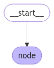
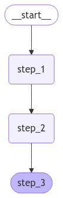
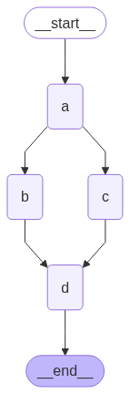
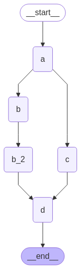
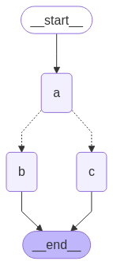
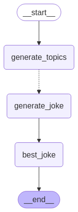
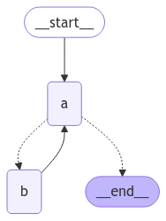
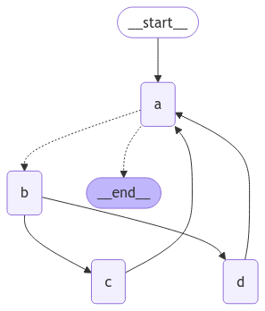
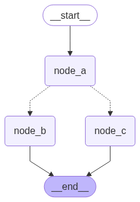
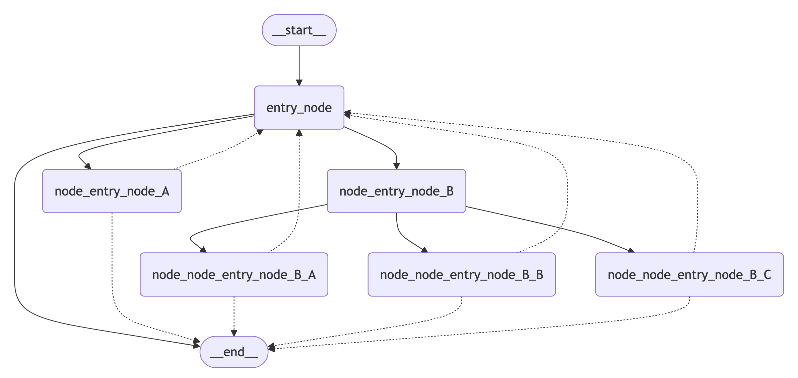

import ChatModelTabs from '/langchain/snippets/chat-model-tabs.mdx';

本指南展示了 LangGraph 图 API 的基础知识。它将介绍 [状态](#定义和更新状态)，以及如何构建常见的图结构，如 [序列](#创建步骤序列)、[分支](#创建分支) 和 [循环](#创建和控制循环)。此外，本指南还涵盖了 LangGraph 的控制功能，包括用于 map-reduce 工作流的 [发送 API](#map-reduce-和-send-api)，以及用于将状态更新与跨节点的 "跳转" 结合的 [命令 API](#结合控制流和状态更新与-command)。

## 安装

:::python
安装 `langgraph`:

<CodeGroup>
```bash pip
pip install -U langgraph
```

```bash uv
uv add langgraph
```
</CodeGroup>
:::

:::js
安装 `langgraph`:

```bash
npm install @langchain/langgraph
```
:::

<Tip>
**为更好的调试设置 LangSmith**

注册 [LangSmith](https://smith.langchain.com)，以便快速发现问题并提升您的 LangGraph 项目的性能。LangSmith 允许您使用跟踪数据来调试、测试和监控使用 LangGraph 构建的 LLM 应用——有关如何开始使用的更多信息，请阅读 [文档](https://docs.langchain.com/langsmith/observability)。
</Tip>

## 定义和更新状态

这里我们展示如何在 LangGraph 中定义和更新 [状态](/langchain/oss/langgraph/graph-api#状态)。我们将演示：

1. 如何使用状态来定义图的 [架构](/langchain/oss/langgraph/graph-api#模式)
2. 如何使用 [状态更新器](/langchain/oss/langgraph/graph-api#归约器) 来控制状态更新的处理方式。

### 定义状态

:::python
[LangGraph 中的 State](/langchain/oss/langgraph/graph-api#状态) 可以是一个 `TypedDict`、`Pydantic` 模型，或数据类。下面我们将使用 `TypedDict`。有关使用 Pydantic 的详细信息，请参阅 [使用 Pydantic 模型作为图状态](#使用-pydantic-模型定义图状态)。
:::

:::js
[LangGraph 中的 State](/langchain/oss/langgraph/graph-api#状态) 是使用 `StateSchema` 类定义的。这提供了一个统一的 API，它接受 [标准模式](https://standardschema.dev/)（如 [Zod](https://zod.dev/)）作为单个字段的模式，以及特殊值类型如 `ReducedValue`、`MessagesValue` 和 `UntrackedValue`。
:::

默认情况下，图将具有相同的输入和输出模式，状态决定了该模式。有关如何定义不同的输入和输出模式的详细信息，请参阅 [定义输入和输出模式](#定义输入和输出模式)。

:::python
让我们考虑一个使用 [消息](/langchain/oss/langgraph/graph-api#消息状态) 的简单示例。这代表了许多 LLM 应用中状态的通用形式。有关更多详细信息，请参阅我们的 [概念页面](/langchain/oss/langgraph/graph-api#在图状态中处理消息)。
:::
:::js
让我们考虑一个使用 [消息](/langchain/oss/langgraph/graph-api#在图状态中处理消息) 的简单示例。这代表了许多 LLM 应用中状态的通用形式。有关更多详细信息，请参阅我们的 [概念页面](/langchain/oss/langgraph/graph-api#在图状态中处理消息)。
:::

:::python
```python
from langchain.messages import AnyMessage
from typing_extensions import TypedDict

class State(TypedDict):
    messages: list[AnyMessage]
    extra_field: int
```

此状态跟踪一个 [消息](/langchain/oss/langchain/messages) 对象的列表，以及一个额外的整数字段。
:::

:::js
```typescript
import { StateSchema, MessagesValue } from "@langchain/langgraph";
import * as z from "zod";

const State = new StateSchema({
  messages: MessagesValue,
  extraField: z.number(),
});
```

此状态跟踪一个 [消息](/langchain/oss/langchain/messages) 对象的列表，以及一个额外的整数字段。

### 更新状态

:::python
让我们构建一个只有一个节点的示例图。我们的 [node](/langchain/oss/langgraph/graph-api#节点) 只是一个读取图状态的 Python 函数，并对状态进行更新。这个函数的第一个参数始终是状态：

```python
from langchain.messages import AIMessage

def node(state: State):
    messages = state["messages"]
    new_message = AIMessage("Hello!")
    return {"messages": messages + [new_message], "extra_field": 10}
```

这个节点简单地将一条消息追加到我们的消息列表中，并填充一个额外的字段。
:::

:::js
让我们构建一个只有一个节点的示例图。我们的 [node](/langchain/oss/langgraph/graph-api#节点) 只是一个读取图状态的 TypeScript 函数，并对状态进行更新。这个函数的第一个参数始终是状态：

```typescript
import { AIMessage } from "@langchain/core/messages";
import { GraphNode } from "@langchain/langgraph";

const node: GraphNode<typeof State> = (state) => {
  const messages = state.messages;
  const newMessage = new AIMessage("Hello!");
  return { messages: [newMessage], extraField: 10 };
};
```

这个节点简单地将一条消息追加到我们的消息列表中（reducer 处理拼接），并填充一个额外的字段。
:::

<Warning>
节点应直接返回对状态的更新，而不是修改状态。
</Warning>

:::python
接下来，我们定义一个包含此节点的简单图。我们使用 [`StateGraph`](/langchain/oss/langgraph/graph-api#stategraph) 来定义一个操作此状态的图。然后我们使用 [`add_node`](/langchain/oss/langgraph/graph-api#节点) 来填充我们的图。

```python
from langgraph.graph import StateGraph

builder = StateGraph(State)
builder.add_node(node)
builder.set_entry_point("node")
graph = builder.compile()
```
:::

:::js
接下来，我们定义一个包含此节点的简单图。我们使用 [`StateGraph`](/langchain/oss/langgraph/graph-api#stategraph) 来定义一个操作此状态的图。然后我们使用 [`addNode`](/langchain/oss/langgraph/graph-api#节点) 来填充我们的图。

```typescript
import { StateGraph } from "@langchain/langgraph";

const graph = new StateGraph(State)
  .addNode("node", node)
  .addEdge("__start__", "node")
  .compile();
```
:::

LangGraph 提供了内置工具来可视化你的图。让我们检查一下我们的图。有关可视化的详细信息，请参阅 [Visualize your graph](#可视化你的图)。

:::python
```python
from IPython.display import Image, display

display(Image(graph.get_graph().draw_mermaid_png()))
```


:::

:::js
```typescript
import * as fs from "node:fs/promises";

const drawableGraph = await graph.getGraphAsync();
const image = await drawableGraph.drawMermaidPng();
const imageBuffer = new Uint8Array(await image.arrayBuffer());

await fs.writeFile("graph.png", imageBuffer);
```
:::

在这种情况下，我们的图只执行一个节点。让我们继续进行简单的调用：

:::python
```python
from langchain.messages import HumanMessage

result = graph.invoke({"messages": [HumanMessage("Hi")]})
result
```

```
{'messages': [HumanMessage(content='Hi'), AIMessage(content='Hello!')], 'extra_field': 10}
```
:::

:::js
```typescript
import { HumanMessage } from "@langchain/core/messages";

const result = await graph.invoke({ messages: [new HumanMessage("Hi")], extraField: 0 });
console.log(result);
```

```
{ messages: [HumanMessage { content: 'Hi' }, AIMessage { content: 'Hello!' }], extraField: 10 }
```
:::

注意：

* 我们通过更新状态的一个键来启动调用。
* 我们在调用结果中接收整个状态。

:::python
为了方便起见，我们经常通过美化打印来检查 [消息对象](/langchain/oss/langchain/messages) 的内容：

```python
for message in result["messages"]:
    message.pretty_print()
```

```
================================ Human Message ================================

Hi
================================== Ai Message ==================================

Hello!
```
:::

:::js
为了方便起见，我们经常通过日志记录来检查 [消息对象](/langchain/oss/langchain/messages) 的内容：

```typescript
for (const message of result.messages) {
  console.log(`${message.getType()}: ${message.content}`);
}
```

```
human: Hi
ai: Hello!
```
:::

### 使用 reducer 更新状态

状态中的每个键都可以有自己的独立 [reducer](/langchain/oss/langgraph/graph-api#归约器) 函数，该函数控制节点更新如何应用。如果没有显式指定 reducer 函数，则假定所有对键的更新都应该覆盖它。

:::python
对于 `TypedDict` 状态模式，我们可以通过在状态的相关字段上注解 reducer 函数来定义 reducer。

在之前的示例中，我们的节点通过向 `"messages"` 键追加消息来更新状态。下面，我们为这个键添加一个 reducer，以便自动追加更新：

```python
from typing_extensions import Annotated

def add(left, right):
    """Can also import `add` from the `operator` built-in."""
    return left + right

class State(TypedDict):
    messages: Annotated[list[AnyMessage], add]  # [!code highlight]
    extra_field: int
```

现在我们的节点可以简化：

```python
def node(state: State):
    new_message = AIMessage("Hello!")
    return {"messages": [new_message], "extra_field": 10}  # [!code highlight]
```
:::

:::js
在之前的示例中，我们使用了 `MessagesValue`，它已经具有内置的 reducer。对于自定义字段，你可以使用 `ReducedValue` 来定义如何应用更新。

在之前的示例中，我们的节点通过向 `"messages"` 键追加消息来更新状态。`MessagesValue` reducer 自动处理这一点：

```typescript
import { StateSchema, MessagesValue, ReducedValue } from "@langchain/langgraph";
import * as z from "zod";

// MessagesValue already has a built-in reducer
const State = new StateSchema({
  messages: MessagesValue,  // [!code highlight]
  extraField: z.number(),
});
```

我们的节点可以简单地返回新消息（reducer 处理追加）：

```typescript
import { GraphNode } from "@langchain/langgraph";

const node: GraphNode<typeof State> = (state) => {
  const newMessage = new AIMessage("Hello!");
  return { messages: [newMessage], extraField: 10 };  // [!code highlight]
};
```
:::

:::python
```python
from langgraph.graph import START

graph = StateGraph(State).add_node(node).add_edge(START, "node").compile()

result = graph.invoke({"messages": [HumanMessage("Hi")]})

for message in result["messages"]:
    message.pretty_print()
```

```
================================ Human Message ================================

Hi
================================== Ai Message ==================================

Hello!
```
:::

:::js
```typescript
import { START } from "@langchain/langgraph";

const graph = new StateGraph(State)
  .addNode("node", node)
  .addEdge(START, "node")
  .compile();

const result = await graph.invoke({ messages: [new HumanMessage("Hi")] });

for (const message of result.messages) {
  console.log(`${message.getType()}: ${message.content}`);
}
```

```
human: Hi
ai: Hello!
```
:::

:::python

#### 消息状态

在实际应用中，更新消息列表时需要考虑以下额外因素：

* 我们可能希望更新状态中的现有消息。
* 我们可能希望接受 [消息格式](/langchain/oss/langgraph/graph-api#在你的图中使用消息) 的简写，例如 [OpenAI 格式](/langchain/oss/langchain/messages#消息内容)。

LangGraph 包含一个内置的 reducer @[`add_messages`]，用于处理这些考虑因素：

```python
from langgraph.graph.message import add_messages

class State(TypedDict):
    messages: Annotated[list[AnyMessage], add_messages]  # [!code highlight]
    extra_field: int

def node(state: State):
    new_message = AIMessage("Hello!")
    return {"messages": [new_message], "extra_field": 10}

graph = StateGraph(State).add_node(node).set_entry_point("node").compile()
```

```python
input_message = {"role": "user", "content": "Hi"}  # [!code highlight]

result = graph.invoke({"messages": [input_message]})

for message in result["messages"]:
    message.pretty_print()
```

```
================================ Human Message ================================

Hi
================================== Ai Message ==================================

Hello!
```

这是一种适用于涉及 [对话模型](/langchain/oss/langchain/models) 应用的灵活状态表示。LangGraph 提供了一个预构建的 `MessagesState` 以方便使用，因此我们可以实现：

```python
from langgraph.graph import MessagesState

class State(MessagesState):
    extra_field: int
```
:::

:::js

#### 消息值

在实际应用中，更新消息列表时需要考虑以下几点：

* 我们可能希望更新状态中的现有消息。
* 我们可能希望接受 [消息格式](/langchain/oss/langgraph/graph-api#在你的图中使用消息) 的简写，例如 [OpenAI 格式](/langchain/oss/langchain/messages#消息内容)。

LangGraph 包含内置的 `MessagesValue` 来处理这些考虑：

```typescript
import { StateSchema, StateGraph, MessagesValue, GraphNode, START } from "@langchain/langgraph";
import * as z from "zod";

const State = new StateSchema({  // [!code highlight]
  messages: MessagesValue,
  extraField: z.number(),
});

const node: GraphNode<typeof State> = (state) => {
  const newMessage = new AIMessage("Hello!");
  return { messages: [newMessage], extraField: 10 };
};

const graph = new StateGraph(State)
  .addNode("node", node)
  .addEdge(START, "node")
  .compile();
```

```typescript
const inputMessage = { role: "user", content: "Hi" };  // [!code highlight]

const result = await graph.invoke({ messages: [inputMessage] });

for (const message of result.messages) {
  console.log(`${message.getType()}: ${message.content}`);
}
```

```
human: Hi
ai: Hello!
```

这是一种适用于涉及 [对话模型](/langchain/oss/langchain/models) 应用的通用状态表示。LangGraph 提供了预构建的 `MessagesValue` 以方便使用，因此我们可以实现：

```typescript
import { StateSchema, MessagesValue } from "@langchain/langgraph";
import * as z from "zod";

const State = new StateSchema({
  messages: MessagesValue,
  extraField: z.number(),
});
```
:::

:::python

### 使用 `Overwrite` 跳过 reducer

在某些情况下，您可能希望跳过 reducer 并直接覆盖状态值。LangGraph 提供了用于此目的的 [`Overwrite`](https://reference.langchain.com/python/langgraph/types/) 类型。当节点返回一个用 `Overwrite` 包装的值时，reducer 会被跳过，并且通道会直接设置为该值。

当您希望重置或替换累积状态，而不是将其与现有值合并时，这很有用。

```python
from langgraph.graph import StateGraph, START, END
from langgraph.types import Overwrite
from typing_extensions import Annotated, TypedDict
import operator

class State(TypedDict):
    messages: Annotated[list, operator.add]

def add_message(state: State):
    return {"messages": ["first message"]}

def replace_messages(state: State):
    # Bypass the reducer and replace the entire messages list
    return {"messages": Overwrite(["replacement message"])}

builder = StateGraph(State)
builder.add_node("add_message", add_message)
builder.add_node("replace_messages", replace_messages)
builder.add_edge(START, "add_message")
builder.add_edge("add_message", "replace_messages")
builder.add_edge("replace_messages", END)

graph = builder.compile()

result = graph.invoke({"messages": ["initial"]})
print(result["messages"])
```

```
['replacement message']
```

您还可以使用带有特殊键 `"__overwrite__"` 的 JSON 格式：

```python
def replace_messages(state: State):
    return {"messages": {"__overwrite__": ["replacement message"]}}
```

<Warning>
当节点并行执行时，在给定的超步中，只有一个节点可以在相同的状态键上使用 `Overwrite`。如果多个节点尝试在同一超步中覆盖相同的键，将引发 `InvalidUpdateError`。

</Warning>
:::

:::js

### 使用 `Overwrite` 跳过 reducer

在某些情况下，您可能希望跳过 reducer 并直接覆盖状态值。LangGraph 提供了 `Overwrite` 类型用于此目的。当节点返回一个用 `Overwrite` 包装的值时，reducer 会被跳过，并且通道会直接设置为该值。

当您希望重置或替换累积状态，而不是将其与现有值合并时，这很有用。

```typescript
import {
  END,
  Overwrite,
  ReducedValue,
  START,
  StateGraph,
  StateSchema,
} from "@langchain/langgraph";
import { z } from "zod/v4";

const State = new StateSchema({
  messages: new ReducedValue(
    z.array(z.string()).default(() => []),
    {
      reducer: (current: string[], update: string[]) => current.concat(update),
    },
  ),
});

const addMessage = () => {
  return { messages: ["first message"] };
};

const replaceMessages = () => {
  // Bypass the reducer and replace the entire messages list
  return { messages: new Overwrite(["replacement message"]) };
};

const graph = new StateGraph(State)
  .addNode("add_message", addMessage)
  .addNode("replace_messages", replaceMessages)
  .addEdge(START, "add_message")
  .addEdge("add_message", "replace_messages")
  .addEdge("replace_messages", END)
  .compile();

const result = await graph.invoke({ messages: ["initial"] });
console.log(result.messages);
```

```
["replacement message"]
```

您也可以使用带有特殊键 `"__overwrite__"` 的 JSON 格式：

```typescript
const replaceMessages = () => {
  return { messages: { __overwrite__: ["replacement message"] } };
};
```

<Warning>
当节点并行执行时，在给定的超步中，只有一个节点可以在相同的状态键上使用 `Overwrite`。如果多个节点尝试在同一超步中覆盖相同的键，会引发 `InvalidUpdateError`。

</Warning>
:::

### 定义输入和输出模式

默认情况下，`StateGraph` 使用单一模式进行操作，所有节点都预期使用该模式进行通信。然而，也可以为图定义不同的输入和输出模式。

当指定不同的模式时，节点之间的通信仍然会使用内部模式。输入模式确保提供的输入符合预期结构，而输出模式则过滤内部数据，仅返回根据定义的输出模式相关的信息。

下面，我们将展示如何定义不同的输入和输出模式。

:::python
```python
from langgraph.graph import StateGraph, START, END
from typing_extensions import TypedDict

# Define the schema for the input
class InputState(TypedDict):
    question: str

# Define the schema for the output
class OutputState(TypedDict):
    answer: str

# Define the overall schema, combining both input and output
class OverallState(InputState, OutputState):
    pass

# Define the node that processes the input and generates an answer
def answer_node(state: InputState):
    # Example answer and an extra key
    return {"answer": "bye", "question": state["question"]}

# Build the graph with input and output schemas specified
builder = StateGraph(OverallState, input_schema=InputState, output_schema=OutputState)
builder.add_node(answer_node)  # Add the answer node
builder.add_edge(START, "answer_node")  # Define the starting edge
builder.add_edge("answer_node", END)  # Define the ending edge
graph = builder.compile()  # Compile the graph

# Invoke the graph with an input and print the result
print(graph.invoke({"question": "hi"}))
```

```
{'answer': 'bye'}
```
:::

:::js
```typescript
import { StateGraph, StateSchema, GraphNode, START, END } from "@langchain/langgraph";
import * as z from "zod";

// Define the schema for the input
const InputState = new StateSchema({
  question: z.string(),
});

// Define the schema for the output
const OutputState = new StateSchema({
  answer: z.string(),
});

// Define the overall schema, combining both input and output
const OverallState = new StateSchema({
  question: z.string(),
  answer: z.string(),
});

// Define the node that processes the input
const answerNode: GraphNode<typeof OverallState> = (state) => {
  // Example answer and an extra key
  return { answer: "bye", question: state.question };
};

// Build the graph with input and output schemas specified
const graph = new StateGraph({
  input: InputState,
  output: OutputState,
  state: OverallState,
})
  .addNode("answerNode", answerNode)
  .addEdge(START, "answerNode")
  .addEdge("answerNode", END)
  .compile();

// Invoke the graph with an input and print the result
console.log(await graph.invoke({ question: "hi" }));
```

```
{ answer: 'bye' }
```
:::

请注意，invoke 的输出仅包含输出模式。

### 在节点间传递私有状态

在某些情况下，你可能希望节点之间交换对中间逻辑至关重要但不需要成为图主要模式一部分的信息。这种私有数据与图的整体输入/输出无关，并且只应在特定节点之间共享。

下面，我们将创建一个由三个节点（node_1、node_2 和 node_3）组成的顺序图示例，其中私有数据在第一步（node_1）和第二步（node_2）之间传递，而第三步（node_3）仅能访问公开的整体状态。

:::python
```python
from langgraph.graph import StateGraph, START, END
from typing_extensions import TypedDict

# The overall state of the graph (this is the public state shared across nodes)
class OverallState(TypedDict):
    a: str

# Output from node_1 contains private data that is not part of the overall state
class Node1Output(TypedDict):
    private_data: str

# The private data is only shared between node_1 and node_2
def node_1(state: OverallState) -> Node1Output:
    output = {"private_data": "set by node_1"}
    print(f"Entered node `node_1`:\n\tInput: {state}.\n\tReturned: {output}")
    return output

# Node 2 input only requests the private data available after node_1
class Node2Input(TypedDict):
    private_data: str

def node_2(state: Node2Input) -> OverallState:
    output = {"a": "set by node_2"}
    print(f"Entered node `node_2`:\n\tInput: {state}.\n\tReturned: {output}")
    return output

# Node 3 only has access to the overall state (no access to private data from node_1)
def node_3(state: OverallState) -> OverallState:
    output = {"a": "set by node_3"}
    print(f"Entered node `node_3`:\n\tInput: {state}.\n\tReturned: {output}")
    return output

# Connect nodes in a sequence
# node_2 accepts private data from node_1, whereas
# node_3 does not see the private data.
builder = StateGraph(OverallState).add_sequence([node_1, node_2, node_3])
builder.add_edge(START, "node_1")
graph = builder.compile()

# Invoke the graph with the initial state
response = graph.invoke(
    {
        "a": "set at start",
    }
)

print()
print(f"Output of graph invocation: {response}")
```

```
Entered node `node_1`:
    Input: {'a': 'set at start'}.
    Returned: {'private_data': 'set by node_1'}
Entered node `node_2`:
    Input: {'private_data': 'set by node_1'}.
    Returned: {'a': 'set by node_2'}
Entered node `node_3`:
    Input: {'a': 'set by node_2'}.
    Returned: {'a': 'set by node_3'}

Output of graph invocation: {'a': 'set by node_3'}
```
:::

:::js
```typescript
import { StateGraph, StateSchema, GraphNode, START, END } from "@langchain/langgraph";
import * as z from "zod";

// The overall state of the graph (this is the public state shared across nodes)
const OverallState = new StateSchema({
  a: z.string(),
});

// Output from node1 contains private data that is not part of the overall state
const Node1Output = new StateSchema({
  privateData: z.string(),
});

// Node 2 input only requests the private data available after node1
const Node2Input = new StateSchema({
  privateData: z.string(),
});

// The private data is only shared between node1 and node2
const node1: GraphNode<typeof OverallState> = (state) => {
  const output = { privateData: "set by node1" };
  console.log(`Entered node 'node1':\n\tInput: ${JSON.stringify(state)}.\n\tReturned: ${JSON.stringify(output)}`);
  return output;
};

const node2: GraphNode<typeof Node2Input> = (state) => {
  const output = { a: "set by node2" };
  console.log(`Entered node 'node2':\n\tInput: ${JSON.stringify(state)}.\n\tReturned: ${JSON.stringify(output)}`);
  return output;
};

// Node 3 only has access to the overall state (no access to private data from node1)
const node3: GraphNode<typeof OverallState> = (state) => {
  const output = { a: "set by node3" };
  console.log(`Entered node 'node3':\n\tInput: ${JSON.stringify(state)}.\n\tReturned: ${JSON.stringify(output)}`);
  return output;
};

// Connect nodes in a sequence
// node2 accepts private data from node1, whereas
// node3 does not see the private data.
const graph = new StateGraph(OverallState)
  .addNode("node1", node1)
  .addNode("node2", node2, { input: Node2Input })
  .addNode("node3", node3)
  .addEdge(START, "node1")
  .addEdge("node1", "node2")
  .addEdge("node2", "node3")
  .addEdge("node3", END)
  .compile();

// Invoke the graph with the initial state
const response = await graph.invoke({ a: "set at start" });

console.log(`\nOutput of graph invocation: ${JSON.stringify(response)}`);
```

```
Entered node 'node1':
	Input: {"a":"set at start"}.
	Returned: {"privateData":"set by node1"}
Entered node 'node2':
	Input: {"privateData":"set by node1"}.
	Returned: {"a":"set by node2"}
Entered node 'node3':
	Input: {"a":"set by node2"}.
	Returned: {"a":"set by node3"}

Output of graph invocation: {"a":"set by node3"}
```
:::

:::python

### 使用 pydantic 模型定义图状态

一个 @[StateGraph] 在初始化时接受一个 @[`state_schema`] 参数，用于指定图中节点可以访问和更新的状态的"结构"。

在我们的示例中，我们通常使用一个原生 `TypedDict` 或 [`dataclass`](https://docs.python.org/3/library/dataclasses.html)（用于 `state_schema`），但 @[`state_schema`] 可以是任何 [类型](https://docs.python.org/3/library/stdtypes.html#type-objects)。

在这里，我们将看到如何使用 [Pydantic BaseModel](https://docs.pydantic.dev/latest/api/base_model/) 作为 @[`state_schema`] 来为 **输入** 添加运行时验证。

<Note>
**已知限制**
* 目前，图的输出**不会**是 pydantic 模型的实例。
* 运行时验证仅发生在图中第一个节点的输入上，而不是后续节点或输出。
* pydantic 的验证错误跟踪不会显示错误发生在哪个节点。
* Pydantic 的递归验证可能很慢。对于性能敏感的应用，您可能希望考虑使用一个 `dataclass` 代替。
</Note>

```python
from langgraph.graph import StateGraph, START, END
from typing_extensions import TypedDict
from pydantic import BaseModel

# The overall state of the graph (this is the public state shared across nodes)
class OverallState(BaseModel):
    a: str

def node(state: OverallState):
    return {"a": "goodbye"}

# Build the state graph
builder = StateGraph(OverallState)
builder.add_node(node)  # node_1 is the first node
builder.add_edge(START, "node")  # Start the graph with node_1
builder.add_edge("node", END)  # End the graph after node_1
graph = builder.compile()

# Test the graph with a valid input
graph.invoke({"a": "hello"})
```

使用一个**无效**的输入调用图

```python
try:
    graph.invoke({"a": 123})  # Should be a string
except Exception as e:
    print("An exception was raised because `a` is an integer rather than a string.")
    print(e)
```

```
An exception was raised because `a` is an integer rather than a string.
1 validation error for OverallState
a
  Input should be a valid string [type=string_type, input_value=123, input_type=int]
    For further information visit https://errors.pydantic.dev/2.9/v/string_type
```

有关 Pydantic 模型状态的更多功能，请参见下文：

<Accordion title="Serialization Behavior">
  当使用 Pydantic 模型作为状态模式时，了解序列化工作原理非常重要，尤其是在以下情况：

  * 将 Pydantic 对象作为输入传递
  * 接收来自图的输出
  * 处理嵌套的 Pydantic 模型

  让我们看看这些行为的具体表现。

  ```python
  from langgraph.graph import StateGraph, START, END
  from pydantic import BaseModel

  class NestedModel(BaseModel):
      value: str

  class ComplexState(BaseModel):
      text: str
      count: int
      nested: NestedModel

  def process_node(state: ComplexState):
      # Node receives a validated Pydantic object
      print(f"Input state type: {type(state)}")
      print(f"Nested type: {type(state.nested)}")
      # Return a dictionary update
      return {"text": state.text + " processed", "count": state.count + 1}

  # Build the graph
  builder = StateGraph(ComplexState)
  builder.add_node("process", process_node)
  builder.add_edge(START, "process")
  builder.add_edge("process", END)
  graph = builder.compile()

  # Create a Pydantic instance for input
  input_state = ComplexState(text="hello", count=0, nested=NestedModel(value="test"))
  print(f"Input object type: {type(input_state)}")

  # Invoke graph with a Pydantic instance
  result = graph.invoke(input_state)
  print(f"Output type: {type(result)}")
  print(f"Output content: {result}")

  # Convert back to Pydantic model if needed
  output_model = ComplexState(**result)
  print(f"Converted back to Pydantic: {type(output_model)}")
  ```
</Accordion>

<Accordion title="Runtime Type Coercion">
  Pydantic 对某些数据类型执行运行时类型强制转换。这可能会很有帮助，但如果您不了解它，也可能导致意外行为。

  ```python
  from langgraph.graph import StateGraph, START, END
  from pydantic import BaseModel

  class CoercionExample(BaseModel):
      # Pydantic will coerce string numbers to integers
      number: int
      # Pydantic will parse string booleans to bool
      flag: bool

  def inspect_node(state: CoercionExample):
      print(f"number: {state.number} (type: {type(state.number)})")
      print(f"flag: {state.flag} (type: {type(state.flag)})")
      return {}

  builder = StateGraph(CoercionExample)
  builder.add_node("inspect", inspect_node)
  builder.add_edge(START, "inspect")
  builder.add_edge("inspect", END)
  graph = builder.compile()

  # Demonstrate coercion with string inputs that will be converted
  result = graph.invoke({"number": "42", "flag": "true"})

  # This would fail with a validation error
  try:
      graph.invoke({"number": "not-a-number", "flag": "true"})
  except Exception as e:
      print(f"\nExpected validation error: {e}")
  ```
</Accordion>

<Accordion title="Working with Message Models">
  当在状态模式中使用 LangChain 消息类型时，序列化方面有一些重要的注意事项。在使用消息对象进行网络传输时，您应该使用 `AnyMessage`（而不是 `BaseMessage`）进行正确的序列化/反序列化。

  ```python
  from langgraph.graph import StateGraph, START, END
  from pydantic import BaseModel
  from langchain.messages import HumanMessage, AIMessage, AnyMessage
  from typing import List

  class ChatState(BaseModel):
      messages: List[AnyMessage]
      context: str

  def add_message(state: ChatState):
      return {"messages": state.messages + [AIMessage(content="Hello there!")]}

  builder = StateGraph(ChatState)
  builder.add_node("add_message", add_message)
  builder.add_edge(START, "add_message")
  builder.add_edge("add_message", END)
  graph = builder.compile()

  # Create input with a message
  initial_state = ChatState(
      messages=[HumanMessage(content="Hi")], context="Customer support chat"
  )

  result = graph.invoke(initial_state)
  print(f"Output: {result}")

  # Convert back to Pydantic model to see message types
  output_model = ChatState(**result)
  for i, msg in enumerate(output_model.messages):
      print(f"Message {i}: {type(msg).__name__} - {msg.content}")
  ```
</Accordion>
:::

:::js

### 可选的状态定义方式

虽然 `StateSchema` 是定义状态推荐的方法，但 LangGraph 支持多种其他方式。本节涵盖所有可用选项。

#### 通道 API

通道 API 提供了对状态管理的底层控制。LangGraph 提供了多种内置通道类型：

| 通道类型 | 行为 | 用例 |
|----------|------|------|
| `LastValue` | 存储最新值 | 简单字段，会被覆盖 |
| `BinaryOperatorAggregate` | 使用归约函数组合值 | 累积值（计数器、列表） |
| `Topic` | 将所有值收集到序列中 | 事件流、审计日志 |
| `EphemeralValue` | 在超级步骤之间重置的值 | 临时计算状态 |

**使用对象简写：**

当你传递包含 `reducer` 和 `default` 的对象时，它会创建一个 `BinaryOperatorAggregate` 通道。传递 `null` 创建一个 `LastValue` 通道：

```typescript
import { BaseMessage } from "@langchain/core/messages";
import { StateGraph } from "@langchain/langgraph";

interface WorkflowState {
  messages: BaseMessage[];
  question: string;
  answer: string;
}

const workflow = new StateGraph<WorkflowState>({
  channels: {
    // BinaryOperatorAggregate: combines values with a reducer
    messages: {
      reducer: (current, update) => current.concat(update),
      default: () => [],
    },
    // LastValue: stores the most recent value (null = no reducer)
    question: null,
    answer: null,
  },
});
```

**直接使用通道类：**

为了更精细的控制，你可以直接实例化通道类：

```typescript
import { BaseMessage } from "@langchain/core/messages";
import { StateGraph, LastValue, BinaryOperatorAggregate, Topic } from "@langchain/langgraph";

interface WorkflowState {
  messages: BaseMessage[];
  question: string;
  events: string[];
}

const workflow = new StateGraph<WorkflowState>({
  channels: {
    messages: new BinaryOperatorAggregate<BaseMessage[]>(
      (current, update) => current.concat(update),
      () => []
    ),
    question: new LastValue<string>(),
    // Topic collects all values pushed during execution
    events: new Topic<string>(),
  },
});
```

#### Annotation.Root

`Annotation.Root` 提供了一种声明式的方式来定义带有 reducer 的状态。它与 `StateSchema` 类似，但使用了不同的语法：

```typescript
import { BaseMessage } from "@langchain/core/messages";
import { Annotation, StateGraph, messagesStateReducer } from "@langchain/langgraph";

const State = Annotation.Root({
  messages: Annotation<BaseMessage[]>({
    reducer: messagesStateReducer,
    default: () => [],
  }),
  question: Annotation<string>(),
  count: Annotation<number>({
    reducer: (current, update) => current + update,
    default: () => 0,
  }),
});

const graph = new StateGraph(State);
```

#### Zod v3 中的 Zod 对象

在使用 Zod v3 时，您可以使用纯 `z.object()` 模式定义状态。LangGraph 通过 `.langgraph` 插件扩展 Zod v3，该插件提供 `.reducer()` 和 `.metadata()` 方法：

```typescript
import { z } from "zod/v3";
import { BaseMessage } from "@langchain/core/messages";
import { StateGraph, messagesStateReducer } from "@langchain/langgraph";

const State = z.object({
  // Use .langgraph.reducer() to attach a reducer function
  messages: z
    .array(z.custom<BaseMessage>())
    .default([])
    .langgraph.reducer(messagesStateReducer),
  // Simple fields work directly (last-write-wins)
  question: z.string().optional(),
  answer: z.string().optional(),
  // Custom reducer for accumulating values
  count: z
    .number()
    .default(0)
    .langgraph.reducer((current, update) => current + update),
});

const graph = new StateGraph(State);
```

#### Zod v4 中的 Zod 对象

Zod v4 使用基于注册表的方法。使用 LangGraph 注册表将元数据附加到模式字段：

```typescript
import * as z from "zod";
import { BaseMessage } from "@langchain/core/messages";
import { StateGraph, MessagesZodMeta, messagesStateReducer } from "@langchain/langgraph";
import { registry } from "@langchain/langgraph/zod";

const State = z.object({
  // Use .register() with the LangGraph registry and MessagesZodMeta
  messages: z
    .array(z.custom<BaseMessage>())
    .default([])
    .register(registry, MessagesZodMeta),
  // Simple fields work directly (last-write-wins)
  question: z.string().optional(),
  answer: z.string().optional(),
  // Custom reducer via registry metadata
  count: z
    .number()
    .default(0)
    .register(registry, { reducer: (current: number, update: number) => current + update }),
});

const graph = new StateGraph(State);
```

#### 对比表格

| 方法 | Reducers | 类型安全 | Zod 版本 | 推荐 |
|------|----------|----------|----------|------|
| `StateSchema` | ✅ 内置 | ✅ 完整 | v3 或 v4 | ✅ 是 |
| Channels API | ✅ 手动 | ⚠️ 部分支持 | N/A | 适用于高级场景 |
| `Annotation.Root` | ✅ 内置 | ✅ 完整 | N/A | 遗留方案 |
| Zod v3 + `.langgraph` | ✅ 通过插件 | ✅ 完整 | 仅限 v3 | 遗留方案 |
| Zod v4 + registry | ✅ 通过注册中心 | ✅ 完整 | 仅限 v4 | 遗留方案 |

## 添加运行时配置

有时您希望在调用图时能够配置它。例如，您可能希望能够在运行时指定要使用的 LLM 或系统提示词，_而不会用这些参数污染图状态_。

要添加运行时配置：

1. 为您的配置指定一个架构
2. 将配置添加到节点或条件边的函数签名中
3. 将配置传递给图。

以下是一个简单的示例：

:::python
```python
from langgraph.graph import END, StateGraph, START
from langgraph.runtime import Runtime
from typing_extensions import TypedDict

# 1. Specify config schema
class ContextSchema(TypedDict):
    my_runtime_value: str

# 2. Define a graph that accesses the config in a node
class State(TypedDict):
    my_state_value: str

def node(state: State, runtime: Runtime[ContextSchema]):  # [!code highlight]
    if runtime.context["my_runtime_value"] == "a":  # [!code highlight]
        return {"my_state_value": 1}
    elif runtime.context["my_runtime_value"] == "b":  # [!code highlight]
        return {"my_state_value": 2}
    else:
        raise ValueError("Unknown values.")

builder = StateGraph(State, context_schema=ContextSchema)  # [!code highlight]
builder.add_node(node)
builder.add_edge(START, "node")
builder.add_edge("node", END)

graph = builder.compile()

# 3. Pass in configuration at runtime:
print(graph.invoke({}, context={"my_runtime_value": "a"}))  # [!code highlight]
print(graph.invoke({}, context={"my_runtime_value": "b"}))  # [!code highlight]
```

```
{'my_state_value': 1}
{'my_state_value': 2}
```
:::

:::js
```typescript
import { StateGraph, StateSchema, GraphNode, END, START } from "@langchain/langgraph";
import * as z from "zod";

// 1. Specify config schema
const ContextSchema = z.object({
  myRuntimeValue: z.string(),
});

// 2. Define a graph that accesses the config in a node
const State = new StateSchema({
  myStateValue: z.number(),
});

const node: GraphNode<typeof State> = (state, runtime) => {
  if (runtime?.context?.myRuntimeValue === "a") {  // [!code highlight]
    return { myStateValue: 1 };
  } else if (runtime?.context?.myRuntimeValue === "b") {  // [!code highlight]
    return { myStateValue: 2 };
  } else {
    throw new Error("Unknown values.");
  }
};

const graph = new StateGraph(State, ContextSchema)
  .addNode("node", node)
  .addEdge(START, "node")
  .addEdge("node", END)
  .compile();

// 3. Pass in configuration at runtime:
console.log(await graph.invoke({}, { context: { myRuntimeValue: "a" } }));  // [!code highlight]
console.log(await graph.invoke({}, { context: { myRuntimeValue: "b" } }));  // [!code highlight]
```

```
{ myStateValue: 1 }
{ myStateValue: 2 }
```
:::

<Accordion title="Extended example: specifying LLM at runtime">
  :::python
  下面我们演示了一个实际示例，其中我们在运行时配置要使用的 LLM。我们将使用 OpenAI 和 Anthropic 模型。

  ```python
  from dataclasses import dataclass

  from langchain.chat_models import init_chat_model
  from langgraph.graph import MessagesState, END, StateGraph, START
  from langgraph.runtime import Runtime
  from typing_extensions import TypedDict

  @dataclass
  class ContextSchema:
      model_provider: str = "anthropic"

  MODELS = {
      "anthropic": init_chat_model("claude-haiku-4-5-20251001"),
      "openai": init_chat_model("gpt-5.4-mini"),
  }

  def call_model(state: MessagesState, runtime: Runtime[ContextSchema]):
      model = MODELS[runtime.context.model_provider]
      response = model.invoke(state["messages"])
      return {"messages": [response]}

  builder = StateGraph(MessagesState, context_schema=ContextSchema)
  builder.add_node("model", call_model)
  builder.add_edge(START, "model")
  builder.add_edge("model", END)

  graph = builder.compile()

  # Usage
  input_message = {"role": "user", "content": "hi"}
  # With no configuration, uses default (Anthropic)
  response_1 = graph.invoke({"messages": [input_message]}, context=ContextSchema())["messages"][-1]
  # Or, can set OpenAI
  response_2 = graph.invoke({"messages": [input_message]}, context={"model_provider": "openai"})["messages"][-1]

  print(response_1.response_metadata["model_name"])
  print(response_2.response_metadata["model_name"])
  ```

  ```
  claude-haiku-4-5-20251001
  gpt-5.4-mini
  ```
  :::

  :::js
  下面我们演示了一个实际示例，其中我们在运行时配置要使用的 LLM。我们将使用 OpenAI 和 Anthropic 模型。

  ```typescript
  import { ChatOpenAI } from "@langchain/openai";
  import { ChatAnthropic } from "@langchain/anthropic";
  import { StateGraph, StateSchema, MessagesValue, GraphNode, START, END } from "@langchain/langgraph";
  import * as z from "zod";

  const ConfigSchema = z.object({
    modelProvider: z.string().default("anthropic"),
  });

  const State = new StateSchema({
    messages: MessagesValue,
  });

  const MODELS = {
    anthropic: new ChatAnthropic({ model: "claude-haiku-4-5-20251001" }),
    openai: new ChatOpenAI({ model: "gpt-5.4-mini" }),
  };

  const callModel: GraphNode<typeof State> = async (state, config) => {
    const modelProvider = config?.configurable?.modelProvider || "anthropic";
    const model = MODELS[modelProvider as keyof typeof MODELS];
    const response = await model.invoke(state.messages);
    return { messages: [response] };
  };

  const graph = new StateGraph(State, ConfigSchema)
    .addNode("model", callModel)
    .addEdge(START, "model")
    .addEdge("model", END)
    .compile();

  // Usage
  const inputMessage = { role: "user", content: "hi" };
  // With no configuration, uses default (Anthropic)
  const response1 = await graph.invoke({ messages: [inputMessage] });
  // Or, can set OpenAI
  const response2 = await graph.invoke(
    { messages: [inputMessage] },
    { configurable: { modelProvider: "openai" } },
  );

  console.log(response1.messages.at(-1)?.response_metadata?.model);
  console.log(response2.messages.at(-1)?.response_metadata?.model);
  ```

  ```
  claude-haiku-4-5-20251001
  gpt-5.4-mini
  ```
  :::
</Accordion>

<Accordion title="Extended example: specifying model and system message at runtime">
  :::python
  下面我们演示了一个实际示例，其中我们配置了两个参数：运行时要使用的 LLM 和系统消息。

  ```python
  from dataclasses import dataclass
  from langchain.chat_models import init_chat_model
  from langchain.messages import SystemMessage
  from langgraph.graph import END, MessagesState, StateGraph, START
  from langgraph.runtime import Runtime
  from typing_extensions import TypedDict

  @dataclass
  class ContextSchema:
      model_provider: str = "anthropic"
      system_message: str | None = None

  MODELS = {
      "anthropic": init_chat_model("claude-haiku-4-5-20251001"),
      "openai": init_chat_model("gpt-5.4-mini"),
  }

  def call_model(state: MessagesState, runtime: Runtime[ContextSchema]):
      model = MODELS[runtime.context.model_provider]
      messages = state["messages"]
      if (system_message := runtime.context.system_message):
          messages = [SystemMessage(system_message)] + messages
      response = model.invoke(messages)
      return {"messages": [response]}

  builder = StateGraph(MessagesState, context_schema=ContextSchema)
  builder.add_node("model", call_model)
  builder.add_edge(START, "model")
  builder.add_edge("model", END)

  graph = builder.compile()

  # Usage
  input_message = {"role": "user", "content": "hi"}
  response = graph.invoke({"messages": [input_message]}, context={"model_provider": "openai", "system_message": "Respond in Italian."})
  for message in response["messages"]:
      message.pretty_print()
  ```

  ```
  ================================ Human Message ================================

  hi
  ================================== Ai Message ==================================

  Ciao! Come posso aiutarti oggi?
  ```
  :::

  :::js
  下面我们演示了一个实际示例，其中我们配置了两个参数：运行时要使用的 LLM 和系统消息。

  ```typescript
  import { ChatOpenAI } from "@langchain/openai";
  import { ChatAnthropic } from "@langchain/anthropic";
  import { SystemMessage } from "@langchain/core/messages";
  import { StateGraph, StateSchema, MessagesValue, GraphNode, START, END } from "@langchain/langgraph";
  import * as z from "zod";

  const ConfigSchema = z.object({
    modelProvider: z.string().default("anthropic"),
    systemMessage: z.string().optional(),
  });

  const State = new StateSchema({
    messages: MessagesValue,
  });

  const MODELS = {
    anthropic: new ChatAnthropic({ model: "claude-haiku-4-5-20251001" }),
    openai: new ChatOpenAI({ model: "gpt-5.4-mini" }),
  };

  const callModel: GraphNode<typeof State> = async (state, config) => {
    const modelProvider = config?.configurable?.modelProvider || "anthropic";
    const systemMessage = config?.configurable?.systemMessage;

    const model = MODELS[modelProvider as keyof typeof MODELS];
    let messages = state.messages;

    if (systemMessage) {
      messages = [new SystemMessage(systemMessage), ...messages];
    }

    const response = await model.invoke(messages);
    return { messages: [response] };
  };

  const graph = new StateGraph(State, ConfigSchema)
    .addNode("model", callModel)
    .addEdge(START, "model")
    .addEdge("model", END)
    .compile();

  // Usage
  const inputMessage = { role: "user", content: "hi" };
  const response = await graph.invoke(
    { messages: [inputMessage] },
    {
      configurable: {
        modelProvider: "openai",
        systemMessage: "Respond in Italian."
      }
    }
  );

  for (const message of response.messages) {
    console.log(`${message.getType()}: ${message.content}`);
  }
  ```

  ```
  human: hi
  ai: Ciao! Come posso aiutarti oggi?
  ```
  :::
</Accordion>

## 添加重试策略

在许多场景中，您可能希望您的节点具有自定义的重试策略，例如调用 API、查询数据库或调用大型语言模型（LLM）等。LangGraph 允许您为节点添加重试策略。

:::python
要配置重试策略，将 `retry_policy` 参数传递给 @[`add_node`]。`retry_policy` 参数接收一个 `RetryPolicy` 命名元组对象。下面我们使用默认参数实例化一个 `RetryPolicy` 对象，并将其与节点关联：

```python
from langgraph.types import RetryPolicy

builder.add_node(
    "node_name",
    node_function,
    retry_policy=RetryPolicy(),
)
```

默认情况下，`retry_on` 参数使用 `default_retry_on` 函数，该函数会在除以下异常之外的所有异常上进行重试：

* `ValueError`
* `TypeError`
* `ArithmeticError`
* `ImportError`
* `LookupError`
* `NameError`
* `SyntaxError`
* `RuntimeError`
* `ReferenceError`
* `StopIteration`
* `StopAsyncIteration`
* `OSError`

此外，对于 `requests` 和 `httpx` 等流行 HTTP 请求库的异常，它仅在 5xx 状态码时进行重试。
:::

:::js
要配置重试策略，将 `retryPolicy` 参数传递给 [`addNode`](https://reference.langchain.com/javascript/langchain-langgraph/index/Graph)。`retryPolicy` 参数接收一个 `RetryPolicy` 对象。下面我们使用默认参数实例化一个 `RetryPolicy` 对象，并将其与节点关联：

```typescript
import { RetryPolicy } from "@langchain/langgraph";

const graph = new StateGraph(State)
  .addNode("nodeName", nodeFunction, { retryPolicy: {} })
  .compile();
```

默认情况下，重试策略会在除以下异常之外的所有异常上进行重试：

* `TypeError`
* `SyntaxError`
* `ReferenceError`
:::

<Accordion title="Extended example: customizing retry policies">
  :::python
  考虑一个从 SQL 数据库读取的示例。下面我们将两种不同的重试策略传递给节点：

  ```python
  import sqlite3
  from typing_extensions import TypedDict
  from langchain.chat_models import init_chat_model
  from langgraph.graph import END, MessagesState, StateGraph, START
  from langgraph.types import RetryPolicy
  from langchain.messages import AIMessage

  con = sqlite3.connect(":memory:")
  model = init_chat_model("claude-haiku-4-5-20251001")

  def query_database(state: MessagesState):
      cursor = con.cursor()
      cursor.execute("SELECT * FROM Artist LIMIT 10;")
      query_result = str(cursor.fetchall())
      return {"messages": [AIMessage(content=query_result)]}

  def call_model(state: MessagesState):
      response = model.invoke(state["messages"])
      return {"messages": [response]}

  # Define a new graph
  builder = StateGraph(MessagesState)
  builder.add_node(
      "query_database",
      query_database,
      retry_policy=RetryPolicy(retry_on=sqlite3.OperationalError),
  )
  builder.add_node("model", call_model, retry_policy=RetryPolicy(max_attempts=5))
  builder.add_edge(START, "model")
  builder.add_edge("model", "query_database")
  builder.add_edge("query_database", END)
  graph = builder.compile()
  ```
  :::

  :::js
  考虑一个从 SQL 数据库读取的示例。下面我们将两种不同的重试策略传递给节点：

  ```typescript
  import Database from "better-sqlite3";
  import { ChatAnthropic } from "@langchain/anthropic";
  import { StateGraph, StateSchema, MessagesValue, GraphNode, START, END } from "@langchain/langgraph";
  import { AIMessage } from "@langchain/core/messages";

  const State = new StateSchema({
    messages: MessagesValue,
  });

  // Create an in-memory database
  const db: typeof Database.prototype = new Database(":memory:");

  const model = new ChatAnthropic({ model: "claude-sonnet-4-6" });

  const callModel: GraphNode<typeof State> = async (state) => {
    const response = await model.invoke(state.messages);
    return { messages: [response] };
  };

  const queryDatabase: GraphNode<typeof State> = async (state) => {
    const queryResult: string = JSON.stringify(
      db.prepare("SELECT * FROM Artist LIMIT 10;").all(),
    );

    return { messages: [new AIMessage({ content: "queryResult" })] };
  };

  const workflow = new StateGraph(State)
    // Define the two nodes we will cycle between
    .addNode("call_model", callModel, { retryPolicy: { maxAttempts: 5 } })
    .addNode("query_database", queryDatabase, {
      retryPolicy: {
        retryOn: (e: any): boolean => {
          if (e instanceof Database.SqliteError) {
            // Retry on "SQLITE_BUSY" error
            return e.code === "SQLITE_BUSY";
          }
          return false; // Don't retry on other errors
        },
      },
    })
    .addEdge(START, "call_model")
    .addEdge("call_model", "query_database")
    .addEdge("query_database", END);

  const graph = workflow.compile();
  ```
  :::
</Accordion>

:::python

## 设置节点超时

使用 `timeout` 参数与 @[`add_node`] 限制单个异步节点调用的运行时长。以秒为单位提供超时时间或作为 `datetime.timedelta`。

```python
import asyncio
from typing_extensions import TypedDict

from langgraph.errors import NodeTimeoutError
from langgraph.graph import END, START, StateGraph


class State(TypedDict):
    value: str


async def call_model(state: State) -> State:
    await asyncio.sleep(2)
    return {"value": "done"}


builder = StateGraph(State)
builder.add_node("model", call_model, timeout=1.0)
builder.add_edge(START, "model")
builder.add_edge("model", END)
graph = builder.compile()

try:
    await graph.ainvoke({"value": "start"})
except NodeTimeoutError:
    print("Node timed out")
```

仅异步节点支持节点超时。如果在同步节点上设置 `timeout`，LangGraph 在图编译时会抛出错误，因为同步 Python 执行无法在进程内安全取消。

当节点超出其超时时，LangGraph 会抛出 `NodeTimeoutError`，该异常继承自 Python 的内置 `TimeoutError`。如果节点具有 `retry_policy` 并重试 `TimeoutError` 或 `NodeTimeoutError`，超时的尝试会被重试。超时独立应用于每次尝试，因此计时器会在每次重试时重置。

超时的尝试不会提交其缓存的写入。这防止了状态更新或子任务调度在超时边界后泄漏。

## 配置节点超时

@[`add_node`] 上的 `timeout=` 参数控制单个异步节点尝试运行的最长时间。传递一个数字（秒）、一个 `timedelta` 或一个 @[`TimeoutPolicy`] 以对运行和空闲超时进行更精细的控制。当超出限制时，LangGraph 会引发 @[`NodeTimeoutError`] 并让重试策略决定是否重试。

<Note>
节点级超时需要 `langgraph>=1.2`。
</Note>

```python
from langgraph.types import TimeoutPolicy

builder.add_node(
    "call_model",
    call_model,
    timeout=TimeoutPolicy(run_timeout=120, idle_timeout=30),
)
```

请参阅 [容错](/langchain/oss/langgraph/fault-tolerance#超时) 了解完整的超时生命周期、空闲超时刷新源和 `runtime.heartbeat()`。

## 处理节点错误

在 @[`add_node`] 上的 `error_handler=` 参数注册一个函数，该函数在节点失败且所有重试均耗尽后执行。该处理器接收当前状态和一个带有失败上下文的 typed @[`NodeError`]，可以通过 @[`Command`] 路由到恢复分支：

<Note>
节点级错误处理器需要 `langgraph>=1.2`。
</Note>

```python
from langgraph.errors import NodeError
from langgraph.types import Command, RetryPolicy

def payment_error_handler(state: State, error: NodeError) -> Command:
    return Command(
        update={"status": f"compensated: {error.error}"},
        goto="finalize",
    )

builder.add_node(
    "charge_payment",
    charge_payment,
    retry_policy=RetryPolicy(max_attempts=3, retry_on=ConnectionError),
    error_handler=payment_error_handler,
)
```

参见 [容错](/langchain/oss/langgraph/fault-tolerance#错误处理) 的补偿模式和 `Command` 路由。

## 设置全局节点默认值

<Note>
需要 `langgraph>=1.2`。
</Note>

使用 @[`set_node_defaults`] 为图中的每个节点设置 `retry_policy`、`timeout`、`cache_policy` 或 `error_handler`，而不是在每个 @[`add_node`] 调用中重复它们。每个节点的值总是优先，默认值在 @[`StateGraph.compile`] 时应用：

```python
from langgraph.types import RetryPolicy, TimeoutPolicy

graph = (
    StateGraph(State)
    .set_node_defaults(
        retry_policy=RetryPolicy(max_attempts=3),
        timeout=TimeoutPolicy(run_timeout=30),
        error_handler=fallback_handler,
    )
    .add_node("a", node_a)
    .add_node("b", node_b, retry_policy=RetryPolicy(max_attempts=5))  # overrides default
    .add_edge(START, "a")
    .compile()
)
```

`retry_policy` 和 `timeout` 默认值适用于每个节点，包括错误处理节点。`cache_policy` 和 `error_handler` 默认值仅适用于常规节点——处理程序从不捕获自身，并且缓存处理程序结果是不安全的。默认值不会被子图继承。

参见 [容错](/langchain/oss/langgraph/fault-tolerance#图默认值) 了解完整的优先级规则和应用性表。

:::

:::python

### 在节点内访问执行信息

您可以通过 `runtime.execution_info` 访问执行身份和重试信息。这会显示线程、运行和检查点标识符以及重试状态，而无需直接从 `config` 读取。

| 属性 | 类型 | 描述 |
| --------- | ---- | ----------- |
| `thread_id` | `str \| None` | 当前执行的线程 ID。`None` 没有检查点时。 |
| `run_id` | `str \| None` | 当前执行的运行 ID。`None` 当未在配置中提供时。 |
| `checkpoint_id` | `str` | 当前执行的检查点 ID。 |
| `checkpoint_ns` | `str` | 当前执行的检查点命名空间。 |
| `task_id` | `str` | 当前执行的任务 ID。 |
| `node_attempt` | `int` | 当前执行尝试次数（1 索引）。`1` 在第一次尝试时，`2` 在第一次重试时，等等。 |
| `node_first_attempt_time` | `float \| None` | 第一次尝试开始时的 Unix 时间戳（秒）。在重试中保持不变。 |

#### 访问线程和运行 ID

使用 `execution_info` 在节点内访问线程 ID、运行 ID 和其他身份字段：

```python
from langgraph.graph import StateGraph, START, END
from langgraph.runtime import Runtime
from typing_extensions import TypedDict

class State(TypedDict):
    result: str

def my_node(state: State, runtime: Runtime):
    info = runtime.execution_info
    print(f"Thread: {info.thread_id}, Run: {info.run_id}")  # [!code highlight]
    return {"result": "done"}

builder = StateGraph(State)
builder.add_node("my_node", my_node)
builder.add_edge(START, "my_node")
builder.add_edge("my_node", END)
graph = builder.compile()
```

#### 根据重试状态调整行为

当节点具有重试策略时，使用 `execution_info` 检查当前尝试次数，并在第一次尝试失败后切换到回退：

```python
from langgraph.graph import StateGraph, START, END
from langgraph.runtime import Runtime
from langgraph.types import RetryPolicy
from typing_extensions import TypedDict

class State(TypedDict):
    result: str

def my_node(state: State, runtime: Runtime):
    info = runtime.execution_info
    if info.node_attempt > 1:  # [!code highlight]
        # use a fallback on retries
        return {"result": call_fallback_api()}
    return {"result": call_primary_api()}

builder = StateGraph(State)
builder.add_node("my_node", my_node, retry_policy=RetryPolicy(max_attempts=3))
builder.add_edge(START, "my_node")
builder.add_edge("my_node", END)
graph = builder.compile()
```

`execution_info` 即使没有重试策略，也存在于 `Runtime` 对象上 — `node_attempt` 默认为 `1`，`node_first_attempt_time` 设置为节点开始执行的时间。

### 在节点内访问服务器信息

当您的图在 LangGraph Server 上运行时，您可以通过 `runtime.server_info` 访问服务器特定的元数据。这会显示助手 ID、图 ID 和经过身份验证的用户，而无需直接从配置元数据或可配置键读取。

| 属性 | 类型 | 描述 |
| --------- | ---- | ----------- |
| `assistant_id` | `str` | 当前部署的助手 ID。 |
| `graph_id` | `str` | 当前部署的图 ID。 |
| `user` | `BaseUser \| None` | 如果配置了 [自定义认证](https://docs.langchain.com/langsmith/custom-auth)，则为经过身份验证的用户。 |

```python
from langgraph.graph import StateGraph, START, END
from langgraph.runtime import Runtime
from typing_extensions import TypedDict

class State(TypedDict):
    result: str

def my_node(state: State, runtime: Runtime):
    server = runtime.server_info
    if server is not None:
        print(f"Assistant: {server.assistant_id}, Graph: {server.graph_id}")  # [!code highlight]
        if server.user is not None:
            print(f"User: {server.user.identity}")
    return {"result": "done"}

builder = StateGraph(State)
builder.add_node("my_node", my_node)
builder.add_edge(START, "my_node")
builder.add_edge("my_node", END)
graph = builder.compile()
```

`server_info` 是 `None`，当图不在 LangGraph Server 上运行时（例如，在本地开发或测试期间）。

<Note>
需要 `deepagents>=0.5.0`（或 `langgraph>=1.1.5`）用于 `runtime.execution_info` 和 `runtime.server_info`。
</Note>

### 在节点内部访问排空状态

当请求了 [优雅关闭](/langchain/oss/langgraph/fault-tolerance#平稳关闭) 时，`runtime.drain_requested` 是 `True`。在节点内部读取此状态以在下一个超级步骤边界之前跳过昂贵的操作：

```python
from langgraph.runtime import Runtime

def my_node(state: State, runtime: Runtime) -> State:
    if runtime.drain_requested:  # [!code highlight]
        return {"status": "skipped", "reason": runtime.drain_reason}
    return {"status": do_work()}
```

| 属性 | 类型 | 描述 |
| ---- | ---- | ---- |
| `drain_requested` | `bool` | 如果为本次运行调用了 `RunControl.request_drain()`，则为 `True`。 |
| `drain_reason` | `str \| None` | 传递给 `request_drain()` 的原因字符串，或 `None`（如果未请求排空）。 |

<Note>
需要 `langgraph>=1.2`。参见 [优雅关闭](/langchain/oss/langgraph/fault-tolerance#平稳关闭) 获取完整的 `RunControl` API。
</Note>

:::

:::js

### 在节点内部访问执行信息

您可以通过 `runtime.executionInfo` 访问执行身份和重试信息。这会暴露线程、运行和检查点标识符以及重试状态，而无需直接从 `config` 读取。

| 属性 | 类型 | 描述 |
| ---- | ---- | ---- |
| `threadId` | `string \| undefined` | 当前执行的线程 ID。 |
| `runId` | `string \| undefined` | 当前执行的运行 ID。 |
| `checkpointId` | `string` | 当前执行的检查点 ID。 |
| `checkpointNs` | `string` | 当前执行的检查点命名空间。 |
| `taskId` | `string` | 当前执行的任务 ID。 |
| `nodeAttempt` | `number` | 当前执行尝试次数（从 1 开始计数）。 |
| `nodeFirstAttemptTime` | `number \| undefined` | 第一个尝试开始时的 Unix 时间戳（秒）。在重试期间保持不变。 |

#### 访问线程和运行 ID

使用 `executionInfo` 在节点内部访问线程 ID、运行 ID 和其他身份字段：

```ts
import { StateGraph, StateSchema, START, END } from "@langchain/langgraph";
import * as z from "zod";

const State = new StateSchema({
  result: z.string(),
});

const myNode: GraphNode<typeof State> = async (state, runtime) => {
  const info = runtime.executionInfo;
  console.log(`Thread: ${info.threadId}, Run: ${info.runId}`);  // [!code highlight]
  return { result: "done" };
};

const graph = new StateGraph(State)
  .addNode("my_node", myNode)
  .addEdge(START, "my_node")
  .addEdge("my_node", END)
  .compile();
```

#### 根据重试状态调整行为

当节点具有重试策略时，使用 `executionInfo` 检查当前尝试次数，并在第一次尝试失败后切换到回退方案：

```ts
import { StateGraph, StateSchema, START, END } from "@langchain/langgraph";
import * as z from "zod";

const State = new StateSchema({
  result: z.string(),
});

const myNode: GraphNode<typeof State> = async (state, runtime) => {
  const info = runtime.executionInfo;
  if (info.nodeAttempt > 1) {  // [!code highlight]
    // use a fallback on retries
    return { result: await callFallbackApi() };
  }
  return { result: await callPrimaryApi() };
};

const graph = new StateGraph(State)
  .addNode("my_node", myNode, { retryPolicy: { maxAttempts: 3 } })
  .addEdge(START, "my_node")
  .addEdge("my_node", END)
  .compile();
```

`executionInfo` 即使没有重试策略，也存在于 `Runtime` 对象上 — `nodeAttempt` 默认为 `1`，`nodeFirstAttemptTime` 设置为节点开始执行的时间。

### 在节点内部访问服务器信息

当您的图在 LangGraph Server 上运行时，您可以通过 `runtime.serverInfo` 访问服务器特定的元数据。

| 属性 | 类型 | 描述 |
| ---- | ---- | ---- |
| `assistantId` | `string` | 当前部署的助手 ID。 |
| `graphId` | `string` | 当前部署的图 ID。 |
| `user` | `BaseUser \| null` | 如果配置了 [自定义认证](https://docs.langchain.com/langsmith/custom-auth)，则为认证用户。 |

```ts
const myNode: GraphNode<typeof State> = async (state, runtime) => {
  const server = runtime.serverInfo;
  if (server != null) {
    console.log(`Assistant: ${server.assistantId}, Graph: ${server.graphId}`);  // [!code highlight]
    if (server.user != null) {
      console.log(`User: ${server.user.identity}`);
    }
  }
  return { result: "done" };
};
```

`serverInfo` 是 `null`，当图不在 LangGraph Server 上运行时。

<Note>
需要 `deepagents>=1.9.0`（或 `@langchain/langgraph>=1.2.8`）用于 `runtime.executionInfo` 和 `runtime.serverInfo`。
</Note>

:::

:::python

## 添加节点缓存

在需要避免重复操作的场景中，节点缓存非常有用，例如执行耗时或成本高昂的操作时。LangGraph 允许您为图中的节点添加个性化的缓存策略。

要配置缓存策略，请将 `cache_policy` 参数传递给 @[`add_node`] 函数。在以下示例中，使用 120 秒的生存时间和默认的 `key_func` 生成器实例化了一个 @[`CachePolicy`] 对象，然后将其与一个节点关联：

```python
from langgraph.types import CachePolicy

builder.add_node(
    "node_name",
    node_function,
    cache_policy=CachePolicy(ttl=120),
)
```

然后，要为图启用节点级缓存，在编译图时设置 `cache` 参数。下面的示例使用 `InMemoryCache` 设置了一个具有内存缓存的图，`SqliteCache` 也是可用的。

```python
from langgraph.cache.memory import InMemoryCache

graph = builder.compile(cache=InMemoryCache())
```
:::

## 创建步骤序列

<Info>
**前提条件**
本指南假定您熟悉上一节关于 [状态](#定义和更新状态) 的内容。
</Info>

这里我们演示如何构建一个简单的步骤序列。我们将展示：

1. 如何构建顺序图
2. 构建类似图的内置简写方式。

:::python
要添加一系列节点，我们使用 [图](/langchain/oss/langgraph/graph-api#stategraph) 的 @[`add_node`] 和 @[`add_edge`] 方法：

```python
from langgraph.graph import START, StateGraph

builder = StateGraph(State)

# Add nodes
builder.add_node(step_1)
builder.add_node(step_2)
builder.add_node(step_3)

# Add edges
builder.add_edge(START, "step_1")
builder.add_edge("step_1", "step_2")
builder.add_edge("step_2", "step_3")
```

我们也可以使用内置简写 `.add_sequence`：

```python
builder = StateGraph(State).add_sequence([step_1, step_2, step_3])
builder.add_edge(START, "step_1")
```
:::

:::js
要添加一系列节点，我们使用 [图](/langchain/oss/langgraph/graph-api#stategraph) 的 `.addNode` 和 `.addEdge` 方法：

```typescript
import { START, StateGraph } from "@langchain/langgraph";

const builder = new StateGraph(State)
  .addNode("step1", step1)
  .addNode("step2", step2)
  .addNode("step3", step3)
  .addEdge(START, "step1")
  .addEdge("step1", "step2")
  .addEdge("step2", "step3");
```
:::

<Accordion title="Why split application steps into a sequence with LangGraph?">

LangGraph 可以轻松地为您的应用程序添加底层持久化层。
这允许在节点执行之间检查点状态，因此您的 LangGraph 节点控制：

* 状态更新如何 [检查点](/langchain/oss/langgraph/persistence)
* 如何在 [人机交互](/langchain/oss/langgraph/interrupts) 工作流中恢复中断
* 如何使用 LangGraph 的 [时间旅行](/langchain/oss/langgraph/use-time-travel) 功能进行“回溯”和分支执行

它们还决定了执行步骤如何 [流式输出](/langchain/oss/langgraph/streaming)，以及您的应用程序如何使用 [Studio](https://docs.langchain.com/langsmith/studio) 进行可视化和调试。

让我们演示一个端到端的示例。我们将创建一个包含三个步骤的序列：

1. 在状态的一个键中填充一个值
2. 更新相同的值
3. 填充不同的值

首先，我们定义我们的 [状态](/langchain/oss/langgraph/graph-api#状态)。这控制了 [图 schema](/langchain/oss/langgraph/graph-api#模式)，还可以指定如何应用更新。有关更多详细信息，请参阅 [使用 reducer 处理状态更新](#使用-reducer-更新状态)。

在我们的案例中，我们只需跟踪两个值：

:::python
```python
from typing_extensions import TypedDict

class State(TypedDict):
    value_1: str
    value_2: int
```
:::

:::js
```typescript
import { StateSchema, GraphNode } from "@langchain/langgraph";
import * as z from "zod";

const State = new StateSchema({
  value1: z.string(),
  value2: z.number(),
});
```
:::

:::python
我们的 [节点](/langchain/oss/langgraph/graph-api#节点) 只是读取图状态并对其进行更新的 Python 函数。此函数的第一个参数始终是状态：

```python
def step_1(state: State):
    return {"value_1": "a"}

def step_2(state: State):
    current_value_1 = state["value_1"]
    return {"value_1": f"{current_value_1} b"}

def step_3(state: State):
    return {"value_2": 10}
```
:::

:::js
我们的 [节点](/langchain/oss/langgraph/graph-api#节点) 只是读取图状态并对其进行更新的 TypeScript 函数。此函数的第一个参数始终是状态：

```typescript
const step1: GraphNode<typeof State> = (state) => {
  return { value1: "a" };
};

const step2: GraphNode<typeof State> = (state) => {
  const currentValue1 = state.value1;
  return { value1: `${currentValue1} b` };
};

const step3: GraphNode<typeof State> = (state) => {
  return { value2: 10 };
};
```
:::

<Note>
注意，在向状态发布更新时，每个节点只需指定它希望更新的键的值。

默认情况下，这将 **覆盖** 对应键的值。您也可以使用 [reducer](/langchain/oss/langgraph/graph-api#归约器) 来控制更新如何处理——例如，您可以追加连续的更新到键中。有关更多详细信息，请参阅 [使用 reducer 处理状态更新](#使用-reducer-更新状态)。
</Note>

最后，我们定义图。我们使用 [StateGraph](/langchain/oss/langgraph/graph-api#stategraph) 来定义一个在状态上操作的图。

:::python
然后我们将使用 [`add_node`](/langchain/oss/langgraph/graph-api#消息状态) 和 [`add_edge`](/langchain/oss/langgraph/graph-api#边缘) 来填充我们的图并定义其控制流。

```python
from langgraph.graph import START, StateGraph

builder = StateGraph(State)

# Add nodes
builder.add_node(step_1)
builder.add_node(step_2)
builder.add_node(step_3)

# Add edges
builder.add_edge(START, "step_1")
builder.add_edge("step_1", "step_2")
builder.add_edge("step_2", "step_3")
```
:::

我们将使用 `[addNode](/langchain/oss/langgraph/graph-api#节点)` 和 `[addEdge](/langchain/oss/langgraph/graph-api#边缘)` 来填充我们的图并定义其控制流。

```typescript
import { START, StateGraph } from "@langchain/langgraph";

const graph = new StateGraph(State)
  .addNode("step1", step1)
  .addNode("step2", step2)
  .addNode("step3", step3)
  .addEdge(START, "step1")
  .addEdge("step1", "step2")
  .addEdge("step2", "step3")
  .compile();
```
:::

:::python
<Tip>
**指定自定义名称**
您可以使用 @[`add_node`] 为节点指定自定义名称：

```python
builder.add_node("my_node", step_1)
```
</Tip>
:::

:::js
<Tip>
**指定自定义名称**
您可以使用 `.addNode` 为节点指定自定义名称：

```typescript
const graph = new StateGraph(State)
.addNode("myNode", step1)
.compile();
```
</Tip>
:::

注意：

:::python
* @[`add_edge`] 接收节点的名称，对于函数默认为 `node.__name__`。
* 我们必须指定图的入口点。为此，我们添加一个指向 `[START node](/langchain/oss/langgraph/graph-api#start-节点)` 的边。
* 当没有更多节点可执行时，图将停止。

接下来我们 `[compile](/langchain/oss/langgraph/graph-api#编译您的图)` 图。这会提供一些关于图结构的基本检查（例如，识别孤立节点）。如果我们通过 `[checkpointer](/langchain/oss/langgraph/persistence)` 为应用程序添加持久化，它也会在这里传递。

```python
graph = builder.compile()
```
:::

:::js
* `.addEdge` 接收节点的名称，对于函数默认为 `node.name`。
* 我们必须指定图的入口点。为此，我们添加一个指向 `[START node](/langchain/oss/langgraph/graph-api#start-节点)` 的边。
* 当没有更多节点可执行时，图将停止。

接下来我们 `[compile](/langchain/oss/langgraph/graph-api#编译您的图)` 图。这会提供一些关于图结构的基本检查（例如，识别孤立节点）。如果我们通过 `[checkpointer](/langchain/oss/langgraph/persistence)` 为应用程序添加持久化，它也会在这里传递。
:::

LangGraph 提供了内置工具来可视化您的图。让我们检查我们的序列。有关可视化的详细信息，请参阅 `[Visualize your graph](#可视化你的图)`。

:::python
```python
from IPython.display import Image, display

display(Image(graph.get_graph().draw_mermaid_png()))
```


:::

:::js
```typescript
import * as fs from "node:fs/promises";

const drawableGraph = await graph.getGraphAsync();
const image = await drawableGraph.drawMermaidPng();
const imageBuffer = new Uint8Array(await image.arrayBuffer());

await fs.writeFile("graph.png", imageBuffer);
```
:::

让我们进行一个简单的调用：

:::python
```python
graph.invoke({"value_1": "c"})
```

```
{'value_1': 'a b', 'value_2': 10}
```
:::

:::js
```typescript
const result = await graph.invoke({ value1: "c" });
console.log(result);
```

```
{ value1: 'a b', value2: 10 }
```
:::

注意：

* 我们通过为单个状态键提供值来启动调用。我们必须始终至少提供一个键的值。
* 我们传递的值被第一个节点覆盖。
* 第二个节点更新了值。
* 第三个节点填充了不同的值。

:::python
<Tip>
**内置简写**
`langgraph>=0.2.46` 包括一个内置的简写 `add_sequence` 用于添加节点序列。您可以按以下方式编译相同的图：

```python
builder = StateGraph(State).add_sequence([step_1, step_2, step_3])  # [!code highlight]
builder.add_edge(START, "step_1")

graph = builder.compile()

graph.invoke({"value_1": "c"})
```
</Tip>
:::

</Accordion>

## 创建分支

并行执行节点对于加速整体图操作至关重要。LangGraph 提供了对节点并行执行的本地支持，这可以显著提升基于图的流程的性能。这种并行化是通过扇出（fan-out）和扇入（fan-in）机制实现的，同时利用标准边和 @[conditional_edges][add_conditional_edges]。以下是一些示例，展示如何添加适合您的分支化数据流。

### 并行运行图节点

在这个示例中，我们从 `Node A` 分叉到 `B and C`，然后汇聚到 `D`。通过我们的状态，[我们指定了 reducer 添加操作](/langchain/oss/langgraph/graph-api#归约器)。这将组合或累积状态中特定键的值，而不是简单地覆盖现有值。对于列表，这意味着将新列表与现有列表连接起来。有关使用 reducer 更新状态的更多详细信息，请参阅上一节关于 [状态 reducer](#使用-reducer-更新状态) 的内容。

:::python
```python
import operator
from typing import Annotated, Any
from typing_extensions import TypedDict
from langgraph.graph import StateGraph, START, END

class State(TypedDict):
    # The operator.add reducer fn makes this append-only
    aggregate: Annotated[list, operator.add]

def a(state: State):
    print(f'Adding "A" to {state["aggregate"]}')
    return {"aggregate": ["A"]}

def b(state: State):
    print(f'Adding "B" to {state["aggregate"]}')
    return {"aggregate": ["B"]}

def c(state: State):
    print(f'Adding "C" to {state["aggregate"]}')
    return {"aggregate": ["C"]}

def d(state: State):
    print(f'Adding "D" to {state["aggregate"]}')
    return {"aggregate": ["D"]}

builder = StateGraph(State)
builder.add_node(a)
builder.add_node(b)
builder.add_node(c)
builder.add_node(d)
builder.add_edge(START, "a")
builder.add_edge("a", "b")
builder.add_edge("a", "c")
builder.add_edge("b", "d")
builder.add_edge("c", "d")
builder.add_edge("d", END)
graph = builder.compile()
```
:::

:::js
```typescript
import { StateGraph, StateSchema, ReducedValue, GraphNode, START, END } from "@langchain/langgraph";
import * as z from "zod";

const State = new StateSchema({
  // The reducer makes this append-only
  aggregate: new ReducedValue(
    z.array(z.string()).default(() => []),
    { reducer: (x, y) => x.concat(y) }
  ),
});

const nodeA: GraphNode<typeof State> = (state) => {
  console.log(`Adding "A" to ${state.aggregate}`);
  return { aggregate: ["A"] };
};

const nodeB: GraphNode<typeof State> = (state) => {
  console.log(`Adding "B" to ${state.aggregate}`);
  return { aggregate: ["B"] };
};

const nodeC: GraphNode<typeof State> = (state) => {
  console.log(`Adding "C" to ${state.aggregate}`);
  return { aggregate: ["C"] };
};

const nodeD: GraphNode<typeof State> = (state) => {
  console.log(`Adding "D" to ${state.aggregate}`);
  return { aggregate: ["D"] };
};

const graph = new StateGraph(State)
  .addNode("a", nodeA)
  .addNode("b", nodeB)
  .addNode("c", nodeC)
  .addNode("d", nodeD)
  .addEdge(START, "a")
  .addEdge("a", "b")
  .addEdge("a", "c")
  .addEdge("b", "d")
  .addEdge("c", "d")
  .addEdge("d", END)
  .compile();
```
:::

:::python
```python
from IPython.display import Image, display

display(Image(graph.get_graph().draw_mermaid_png()))
```


:::

:::js
```typescript
import * as fs from "node:fs/promises";

const drawableGraph = await graph.getGraphAsync();
const image = await drawableGraph.drawMermaidPng();
const imageBuffer = new Uint8Array(await image.arrayBuffer());

await fs.writeFile("graph.png", imageBuffer);
```
:::

通过 reducer，你可以看到每个节点中添加的值被累积。

:::python
```python
graph.invoke({"aggregate": []}, {"configurable": {"thread_id": "foo"}})
```

```
Adding "A" to []
Adding "B" to ['A']
Adding "C" to ['A']
Adding "D" to ['A', 'B', 'C']
```
:::

:::js
```typescript
const result = await graph.invoke({
  aggregate: [],
});
console.log(result);
```

```
Adding "A" to []
Adding "B" to ['A']
Adding "C" to ['A']
Adding "D" to ['A', 'B', 'C']
{ aggregate: ['A', 'B', 'C', 'D'] }
```
:::

<Note>
在上述示例中，节点 `"b"` 和 `"c"` 在同一个 [超步](/langchain/oss/langgraph/graph-api#图) 中并发执行。因为它们处于同一步骤中，所以节点 `"d"` 在 `"b"` 和 `"c"` 都完成后执行。

重要的是，并行超步中的更新可能不会按一致的顺序进行。如果你需要一个一致的、预定的并行超步中的更新顺序，你应该将输出写入状态中的单独字段，并附带一个用于排序它们的值。
</Note>

<Accordion title="Exception handling?">
  LangGraph 在 [超步](/langchain/oss/langgraph/graph-api#图) 内执行节点，这意味着虽然并行分支会并行执行，但整个超步是 **事务性** 的。如果这些分支中的任何一个引发异常，**没有任何** 更新会被应用到状态（整个超步出错）。

  重要的是，当使用 [检查点器](/langchain/oss/langgraph/persistence) 时，超步中成功节点的结果会被保存，并且在恢复时不会重复。

  如果你处理的是易出错的（也许想处理不可靠的 API 调用），LangGraph 提供了两种方法来解决这个问题：

  1. 你可以在节点内编写常规的 python 代码来捕获和处理异常。
  2. 你可以设置一个 **[`RetryPolicy`](https://reference.langchain.com/python/langgraph/types)** 来指示图重试引发特定类型异常的节点。只有失败的分支会被重试，因此你无需担心执行冗余工作。

  一起，这些让你能够执行并行执行并完全控制异常处理。
</Accordion>

:::python
<Tip>
**设置最大并发数**
你可以通过在调用图时在 [配置](https://reference.langchain.com/python/langchain-core/runnables/config/RunnableConfig) 中设置 `max_concurrency` 来控制最大并发任务数。`max_concurrency` 是一个独立的配置键，因此将其设置在配置的顶层，而不是在 `configurable` 内部。

```python
graph.invoke({"value_1": "c"}, {"max_concurrency": 10})
```
</Tip>
:::

:::js
<Tip>
**设置最大并发数**
您可以通过在调用图时在 [配置](https://reference.langchain.com/javascript/langchain-langgraph/index/LangGraphRunnableConfig) 中设置 `maxConcurrency` 来控制并发任务的最大数量。`maxConcurrency` 是一个独立的配置键，因此请将其设置在配置的顶层，而不是在 `configurable` 内部。

```typescript
const result = await graph.invoke({ value1: "c" }, { maxConcurrency: 10 });
```
</Tip>
:::

:::python

### 延迟节点执行

延迟节点执行在你想要将节点的执行推迟到所有其他挂起的任务都完成时非常有用。这在分支长度不同的情况下尤其相关，这在 map-reduce 流等工作流中很常见。

上面的例子展示了当每个路径只有一个步骤时如何进行发散和收敛。但如果一个分支有多个步骤怎么办？让我们在 `"b"` 分支中添加一个节点 `"b_2"`：

```python
import operator
from typing import Annotated, Any
from typing_extensions import TypedDict
from langgraph.graph import StateGraph, START, END

class State(TypedDict):
    # The operator.add reducer fn makes this append-only
    aggregate: Annotated[list, operator.add]

def a(state: State):
    print(f'Adding "A" to {state["aggregate"]}')
    return {"aggregate": ["A"]}

def b(state: State):
    print(f'Adding "B" to {state["aggregate"]}')
    return {"aggregate": ["B"]}

def b_2(state: State):
    print(f'Adding "B_2" to {state["aggregate"]}')
    return {"aggregate": ["B_2"]}

def c(state: State):
    print(f'Adding "C" to {state["aggregate"]}')
    return {"aggregate": ["C"]}

def d(state: State):
    print(f'Adding "D" to {state["aggregate"]}')
    return {"aggregate": ["D"]}

builder = StateGraph(State)
builder.add_node(a)
builder.add_node(b)
builder.add_node(b_2)
builder.add_node(c)
builder.add_node(d, defer=True)  # [!code highlight]
builder.add_edge(START, "a")
builder.add_edge("a", "b")
builder.add_edge("a", "c")
builder.add_edge("b", "b_2")
builder.add_edge("b_2", "d")
builder.add_edge("c", "d")
builder.add_edge("d", END)
graph = builder.compile()
```

```python
from IPython.display import Image, display

display(Image(graph.get_graph().draw_mermaid_png()))
```



```python
graph.invoke({"aggregate": []})
```

```
Adding "A" to []
Adding "B" to ['A']
Adding "C" to ['A']
Adding "B_2" to ['A', 'B', 'C']
Adding "D" to ['A', 'B', 'C', 'B_2']
```

在上面的例子中，节点 `"b"` 和 `"c"` 在同一个超级步骤中并发执行。我们在节点 `d` 上设置了 `defer=True`，所以它会在所有挂起的任务完成之前不会执行。在这种情况下，这意味着 `"d"` 会等待 `"b"` 分支完全完成后才执行。

当每个分支总是运行时，你可以使用列表形式的边代替 `defer=True` 来等待。`add_edge` 也接受一个起始节点列表。这不是简写为多个 `add_edge` 调用；这两种形式的行为不同：

```python
builder.add_edge(["b_2", "c"], "d")  # d runs once, after both b_2 and c complete
```

- **起始节点列表** 运行 `d` 一次，在列出的所有节点都完成后。如果其中一个永远不会运行（例如，条件边没有选择其分支），`d` 从不运行，也不会抛出错误。已完成分支的状态更新仍然保留在图状态中，但 `d` 不会消费它们。
- **单独的边** 在任何传入分支完成的超级步骤中运行 `d` 一次。对于等长的分支，这是一个单次运行；对于不同长度的分支，`d` 会运行多次。
- **带有 `defer=True` 的单独边**（上面例子中的模式）在所有选定的分支都完成后运行 `d` 一次，无论发散是否选择了所有分支还是仅选择了一些分支。

`defer=True` 将节点推迟到图中任何地方都没有挂起的任务时，而不仅仅是为其提供输入的分支。一个指向该节点的 `Send` 仍然会单独调用它。
:::

### 条件分支

:::python
如果您的 fan-out 应该在运行时根据状态变化，您可以使用 @[`add_conditional_edges`] 通过图状态选择一个或多个路径。以下示例中，节点 `a` 生成一个状态更新，该更新决定了后续节点。

```python
import operator
from typing import Annotated, Literal, Sequence
from typing_extensions import TypedDict
from langgraph.graph import StateGraph, START, END

class State(TypedDict):
    aggregate: Annotated[list, operator.add]
    # Add a key to the state. We will set this key to determine
    # how we branch.
    which: str

def a(state: State):
    print(f'Adding "A" to {state["aggregate"]}')
    return {"aggregate": ["A"], "which": "c"}  # [!code highlight]

def b(state: State):
    print(f'Adding "B" to {state["aggregate"]}')
    return {"aggregate": ["B"]}

def c(state: State):
    print(f'Adding "C" to {state["aggregate"]}')
    return {"aggregate": ["C"]}

builder = StateGraph(State)
builder.add_node(a)
builder.add_node(b)
builder.add_node(c)
builder.add_edge(START, "a")
builder.add_edge("b", END)
builder.add_edge("c", END)

def conditional_edge(state: State) -> Literal["b", "c"]:
    # Fill in arbitrary logic here that uses the state
    # to determine the next node
    return state["which"]

builder.add_conditional_edges("a", conditional_edge)  # [!code highlight]

graph = builder.compile()
```

```python
from IPython.display import Image, display

display(Image(graph.get_graph().draw_mermaid_png()))
```



```python
result = graph.invoke({"aggregate": []})
print(result)
```

```
Adding "A" to []
Adding "C" to ['A']
{'aggregate': ['A', 'C'], 'which': 'c'}
```
:::

:::js
如果您的 fan-out 应该在运行时根据状态变化，您可以使用 [`addConditionalEdges`](https://reference.langchain.com/javascript/langchain-langgraph/index/StateGraph) 通过图状态选择一个或多个路径。以下示例中，节点 `a` 生成一个状态更新，该更新决定了后续节点。

```typescript
import { StateGraph, StateSchema, ReducedValue, GraphNode, ConditionalEdgeRouter, START, END } from "@langchain/langgraph";
import * as z from "zod";

const State = new StateSchema({
  aggregate: new ReducedValue(
    z.array(z.string()).default(() => []),
    { reducer: (x, y) => x.concat(y) }
  ),
  // Add a key to the state. We will set this key to determine
  // how we branch.
  which: z.string(),  // [!code highlight]
});

const nodeA: GraphNode<typeof State> = (state) => {
  console.log(`Adding "A" to ${state.aggregate}`);
  return { aggregate: ["A"], which: "c" };
};

const nodeB: GraphNode<typeof State> = (state) => {
  console.log(`Adding "B" to ${state.aggregate}`);
  return { aggregate: ["B"] };
};

const nodeC: GraphNode<typeof State> = (state) => {
  console.log(`Adding "C" to ${state.aggregate}`);
  return { aggregate: ["C"] };  // [!code highlight]
};

const conditionalEdge: ConditionalEdgeRouter<{ InputSchema: typeof State; Nodes: "b" | "c" }> = (state) => {
  // Fill in arbitrary logic here that uses the state
  // to determine the next node
  return state.which as "b" | "c";
};

const graph = new StateGraph(State)
  .addNode("a", nodeA)
  .addNode("b", nodeB)
  .addNode("c", nodeC)
  .addEdge(START, "a")
  .addEdge("b", END)
  .addEdge("c", END)
  .addConditionalEdges("a", conditionalEdge)
  .compile();
```

```typescript
import * as fs from "node:fs/promises";

const drawableGraph = await graph.getGraphAsync();
const image = await drawableGraph.drawMermaidPng();
const imageBuffer = new Uint8Array(await image.arrayBuffer());

await fs.writeFile("graph.png", imageBuffer);
```

```typescript
const result = await graph.invoke({ aggregate: [] });
console.log(result);
```

```
Adding "A" to []
Adding "C" to ['A']
{ aggregate: ['A', 'C'], which: 'c' }
```
:::

<Tip>
您的条件边可以路由到多个目标节点。例如：

:::python
```python
def route_bc_or_cd(state: State) -> Sequence[str]:
    if state["which"] == "cd":
        return ["c", "d"]
    return ["b", "c"]
```
:::

:::js
```typescript
const routeBcOrCd: ConditionalEdgeRouter<{ InputSchema: typeof State; Nodes: "b" | "c" | "d" }> = (state) => {
  if (state.which === "cd") {
    return ["c", "d"];
  }
  return ["b", "c"];
};
```
:::
</Tip>

## Map-Reduce 和 send API

LangGraph 支持使用 Send API 实现 map-reduce 和其他高级分支模式。以下是如何使用它的示例：

:::python
```python
from langgraph.graph import StateGraph, START, END
from langgraph.types import Send
from typing_extensions import TypedDict, Annotated
import operator

class OverallState(TypedDict):
    topic: str
    subjects: list[str]
    jokes: Annotated[list[str], operator.add]
    best_selected_joke: str

def generate_topics(state: OverallState):
    return {"subjects": ["lions", "elephants", "penguins"]}

def generate_joke(state: OverallState):
    joke_map = {
        "lions": "Why don't lions like fast food? Because they can't catch it!",
        "elephants": "Why don't elephants use computers? They're afraid of the mouse!",
        "penguins": "Why don't penguins like talking to strangers at parties? Because they find it hard to break the ice."
    }
    return {"jokes": [joke_map[state["subject"]]]}

def continue_to_jokes(state: OverallState):
    return [Send("generate_joke", {"subject": s}) for s in state["subjects"]]

def best_joke(state: OverallState):
    return {"best_selected_joke": "penguins"}

builder = StateGraph(OverallState)
builder.add_node("generate_topics", generate_topics)
builder.add_node("generate_joke", generate_joke)
builder.add_node("best_joke", best_joke)
builder.add_edge(START, "generate_topics")
builder.add_conditional_edges("generate_topics", continue_to_jokes, ["generate_joke"])
builder.add_edge("generate_joke", "best_joke")
builder.add_edge("best_joke", END)
graph = builder.compile()
```

```python
from IPython.display import Image, display

display(Image(graph.get_graph().draw_mermaid_png()))
```



```python
# Call the graph: here we call it to generate a list of jokes
stream = graph.stream_events({"topic": "animals"}, version="v3")
for message in stream.messages:
    for token in message.text:
        print(token, end="", flush=True)
```

```
{'generate_topics': {'subjects': ['lions', 'elephants', 'penguins']}}
{'generate_joke': {'jokes': ["Why don't lions like fast food? Because they can't catch it!"]}}
{'generate_joke': {'jokes': ["Why don't elephants use computers? They're afraid of the mouse!"]}}
{'generate_joke': {'jokes': ['Why don't penguins like talking to strangers at parties? Because they find it hard to break the ice.']}}
{'best_joke': {'best_selected_joke': 'penguins'}}
```
:::

:::js
```typescript
import { StateGraph, StateSchema, ReducedValue, GraphNode, START, END, Send } from "@langchain/langgraph";
import * as z from "zod";

const OverallState = new StateSchema({
  topic: z.string(),
  subjects: z.array(z.string()),
  jokes: new ReducedValue(
    z.array(z.string()).default(() => []),
    { reducer: (x, y) => x.concat(y) }
  ),
  bestSelectedJoke: z.string(),
});

const generateTopics: GraphNode<typeof OverallState> = (state) => {
  return { subjects: ["lions", "elephants", "penguins"] };
};

const generateJoke: GraphNode<typeof OverallState> = (state) => {
  const jokeMap: Record<string, string> = {
    lions: "Why don't lions like fast food? Because they can't catch it!",
    elephants: "Why don't elephants use computers? They're afraid of the mouse!",
    penguins: "Why don't penguins like talking to strangers at parties? Because they find it hard to break the ice."
  };
  return { jokes: [jokeMap[state.subject]] };
};

const continueToJokes: ConditionalEdgeRouter<{ InputSchema: typeof OverallState; Nodes: "generateJoke" }> = (state) => {
  return state.subjects.map((subject) => new Send("generateJoke", { subject }));
};

const bestJoke: GraphNode<typeof OverallState> = (state) => {
  return { bestSelectedJoke: "penguins" };
};

const graph = new StateGraph(OverallState)
  .addNode("generateTopics", generateTopics)
  .addNode("generateJoke", generateJoke)
  .addNode("bestJoke", bestJoke)
  .addEdge(START, "generateTopics")
  .addConditionalEdges("generateTopics", continueToJokes)
  .addEdge("generateJoke", "bestJoke")
  .addEdge("bestJoke", END)
  .compile();
```

```typescript
import * as fs from "node:fs/promises";

const drawableGraph = await graph.getGraphAsync();
const image = await drawableGraph.drawMermaidPng();
const imageBuffer = new Uint8Array(await image.arrayBuffer());

await fs.writeFile("graph.png", imageBuffer);
```

```typescript
// Call the graph: here we call it to generate a list of jokes
const stream = await graph.streamEvents({ topic: "animals" }, { version: "v3" });
for await (const message of stream.messages) {
  for await (const token of message.text) {
    process.stdout.write(token);
  }
}
```

```
{ generateTopics: { subjects: [ 'lions', 'elephants', 'penguins' ] } }
{ generateJoke: { jokes: [ "Why don't lions like fast food? Because they can't catch it!" ] } }
{ generateJoke: { jokes: [ "Why don't elephants use computers? They're afraid of the mouse!" ] } }
{ generateJoke: { jokes: [ "Why don't penguins like talking to strangers at parties? Because they find it hard to break the ice." ] } }
{ bestJoke: { bestSelectedJoke: 'penguins' } }
```
:::

## 创建和控制循环

在创建包含循环的图时，我们需要一种终止执行的方法。这通常通过添加一个 [条件边](/langchain/oss/langgraph/graph-api#条件边缘) 来实现，该边在满足某些终止条件时将路由到 [END](/langchain/oss/langgraph/graph-api#end-节点) 节点。

您也可以在调用或流式传输图时设置图的循环限制。循环限制设置了图允许执行的 [超步](/langchain/oss/langgraph/graph-api#图) 数量，之后会引发错误。了解更多关于 [循环限制概念](/langchain/oss/langgraph/graph-api#递归限制) 的信息。

让我们考虑一个简单的带循环的图，以更好地理解这些机制的工作原理。

<Tip>
要返回状态的最后值而不是接收循环限制错误，请参阅 [下一节](#强制循环限制)。
</Tip>

在创建循环时，您可以包含一个指定终止条件的条件边：

:::python
```python
builder = StateGraph(State)
builder.add_node(a)
builder.add_node(b)

def route(state: State) -> Literal["b", END]:
    if termination_condition(state):
        return END
    else:
        return "b"

builder.add_edge(START, "a")
builder.add_conditional_edges("a", route)
builder.add_edge("b", "a")
graph = builder.compile()
```
:::

:::js
```typescript
const route: ConditionalEdgeRouter<{ InputSchema: typeof State; Nodes: "b" }> = (state) => {
  if (terminationCondition(state)) {
    return END;
  } else {
    return "b";
  }
};

const graph = new StateGraph(State)
  .addNode("a", nodeA)
  .addNode("b", nodeB)
  .addEdge(START, "a")
  .addConditionalEdges("a", route)
  .addEdge("b", "a")
  .compile();
```
:::

:::python
要控制循环限制，请在配置中指定 `"recursion_limit"`。这将引发一个 `GraphRecursionError`，您可以捕获并处理：
```python
from langgraph.errors import GraphRecursionError

try:
    graph.invoke(inputs, {"recursion_limit": 3})
except GraphRecursionError:
    print("Recursion Error")
```
:::

:::js
要控制循环限制，请在配置中指定 `"recursionLimit"`。这将引发一个 `GraphRecursionError`，您可以捕获并处理：
```typescript
import { GraphRecursionError } from "@langchain/langgraph";

try {
  await graph.invoke(inputs, { recursionLimit: 3 });
} catch (error) {
  if (error instanceof GraphRecursionError) {
    console.log("Recursion Error");
  }
}
```
:::

让我们定义一个简单的带循环的图。请注意，我们使用条件边来实现终止条件。

:::python
```python
import operator
from typing import Annotated, Literal
from typing_extensions import TypedDict
from langgraph.graph import StateGraph, START, END

class State(TypedDict):
    # The operator.add reducer fn makes this append-only
    aggregate: Annotated[list, operator.add]

def a(state: State):
    print(f'Node A sees {state["aggregate"]}')
    return {"aggregate": ["A"]}

def b(state: State):
    print(f'Node B sees {state["aggregate"]}')
    return {"aggregate": ["B"]}

# Define nodes
builder = StateGraph(State)
builder.add_node(a)
builder.add_node(b)

# Define edges
def route(state: State) -> Literal["b", END]:
    if len(state["aggregate"]) < 7:
        return "b"
    else:
        return END

builder.add_edge(START, "a")
builder.add_conditional_edges("a", route)
builder.add_edge("b", "a")
graph = builder.compile()
```

```python
from IPython.display import Image, display

display(Image(graph.get_graph().draw_mermaid_png()))
```


:::

:::js
```typescript
import { StateGraph, StateSchema, ReducedValue, GraphNode, ConditionalEdgeRouter, START, END } from "@langchain/langgraph";
import * as z from "zod";

const State = new StateSchema({
  // The reducer makes this append-only
  aggregate: new ReducedValue(
    z.array(z.string()).default(() => []),
    { reducer: (x, y) => x.concat(y) }
  ),
});

const nodeA: GraphNode<typeof State> = (state) => {
  console.log(`Node A sees ${state.aggregate}`);
  return { aggregate: ["A"] };
};

const nodeB: GraphNode<typeof State> = (state) => {
  console.log(`Node B sees ${state.aggregate}`);
  return { aggregate: ["B"] };
};

// Define edges
const route: ConditionalEdgeRouter<{ InputSchema: typeof State; Nodes: "b" }> = (state) => {
  if (state.aggregate.length < 7) {
    return "b";
  } else {
    return END;
  }
};

const graph = new StateGraph(State)
  .addNode("a", nodeA)
  .addNode("b", nodeB)
  .addEdge(START, "a")
  .addConditionalEdges("a", route)
  .addEdge("b", "a")
  .compile();
```

```typescript
import * as fs from "node:fs/promises";

const drawableGraph = await graph.getGraphAsync();
const image = await drawableGraph.drawMermaidPng();
const imageBuffer = new Uint8Array(await image.arrayBuffer());

await fs.writeFile("graph.png", imageBuffer);
```
:::

这种架构类似于一个 [ReAct 智能体](/langchain/oss/langgraph/workflows-agents)，其中节点 `"a"` 是一个工具调用模型，节点 `"b"` 表示工具。

在我们的 `route` 条件边中，我们指定在状态中的 `"aggregate"` 列表达到阈值长度后应结束。

调用图时，我们看到我们在节点 `"a"` 和 `"b"` 之间交替，直到达到终止条件。

:::python
```python
graph.invoke({"aggregate": []})
```

```
Node A sees []
Node B sees ['A']
Node A sees ['A', 'B']
Node B sees ['A', 'B', 'A']
Node A sees ['A', 'B', 'A', 'B']
Node B sees ['A', 'B', 'A', 'B', 'A']
Node A sees ['A', 'B', 'A', 'B', 'A', 'B']
```
:::

:::js
```typescript
const result = await graph.invoke({ aggregate: [] });
console.log(result);
```

```
Node A sees []
Node B sees ['A']
Node A sees ['A', 'B']
Node B sees ['A', 'B', 'A']
Node A sees ['A', 'B', 'A', 'B']
Node B sees ['A', 'B', 'A', 'B', 'A']
Node A sees ['A', 'B', 'A', 'B', 'A', 'B']
{ aggregate: ['A', 'B', 'A', 'B', 'A', 'B', 'A'] }
```
:::

### 强制循环限制

在某些应用中，我们可能无法保证会达到给定的终止条件。在这些情况下，我们可以设置图的 [循环限制](/langchain/oss/langgraph/graph-api#递归限制)。这将在一个给定的 [超步](/langchain/oss/langgraph/graph-api#图) 数量后引发一个 `GraphRecursionError`。然后我们可以捕获并处理此异常：

:::python
```python
from langgraph.errors import GraphRecursionError

try:
    graph.invoke({"aggregate": []}, {"recursion_limit": 4})
except GraphRecursionError:
    print("Recursion Error")
```

```
Node A sees []
Node B sees ['A']
Node C sees ['A', 'B']
Node D sees ['A', 'B']
Node A sees ['A', 'B', 'C', 'D']
Recursion Error
```
:::

:::js
```typescript
import { GraphRecursionError } from "@langchain/langgraph";

try {
  await graph.invoke({ aggregate: [] }, { recursionLimit: 4 });
} catch (error) {
  if (error instanceof GraphRecursionError) {
    console.log("Recursion Error");
  }
}
```

```
Node A sees []
Node B sees ['A']
Node A sees ['A', 'B']
Node B sees ['A', 'B', 'A']
Node A sees ['A', 'B', 'A', 'B']
Recursion Error
```
:::

:::python
<Accordion title="Extended example: return state on hitting recursion limit">
  与引发 `GraphRecursionError` 相比，我们可以向状态引入一个新的键来跟踪达到循环限制前的剩余步数。然后我们可以使用此键来确定是否应结束运行。

  LangGraph 实现了一个特殊的 `RemainingSteps` 注释。在底层，它创建了一个 `ManagedValue` 通道——一个状态通道，它将在我们的图运行期间存在，之后不再存在。

  ```python
  import operator
  from typing import Annotated, Literal
  from typing_extensions import TypedDict
  from langgraph.graph import StateGraph, START, END
  from langgraph.managed.is_last_step import RemainingSteps

  class State(TypedDict):
      aggregate: Annotated[list, operator.add]
      remaining_steps: RemainingSteps

  def a(state: State):
      print(f'Node A sees {state["aggregate"]}')
      return {"aggregate": ["A"]}

  def b(state: State):
      print(f'Node B sees {state["aggregate"]}')
      return {"aggregate": ["B"]}

  # Define nodes
  builder = StateGraph(State)
  builder.add_node(a)
  builder.add_node(b)

  # Define edges
  def route(state: State) -> Literal["b", END]:
      if state["remaining_steps"] <= 2:
          return END
      else:
          return "b"

  builder.add_edge(START, "a")
  builder.add_conditional_edges("a", route)
  builder.add_edge("b", "a")
  graph = builder.compile()

  # Test it out
  result = graph.invoke({"aggregate": []}, {"recursion_limit": 4})
  print(result)
  ```

  ```
  Node A sees []
  Node B sees ['A']
  Node A sees ['A', 'B']
  {'aggregate': ['A', 'B', 'A']}
  ```
</Accordion>
:::

:::python
<Accordion title="Extended example: loops with branches">
  为了更好地理解递归限制的工作原理，让我们考虑一个更复杂的例子。下面我们实现了一个循环，但其中一步会扩展成两个节点：

  ```python
  import operator
  from typing import Annotated, Literal
  from typing_extensions import TypedDict
  from langgraph.graph import StateGraph, START, END

  class State(TypedDict):
      aggregate: Annotated[list, operator.add]

  def a(state: State):
      print(f'Node A sees {state["aggregate"]}')
      return {"aggregate": ["A"]}

  def b(state: State):
      print(f'Node B sees {state["aggregate"]}')
      return {"aggregate": ["B"]}

  def c(state: State):
      print(f'Node C sees {state["aggregate"]}')
      return {"aggregate": ["C"]}

  def d(state: State):
      print(f'Node D sees {state["aggregate"]}')
      return {"aggregate": ["D"]}

  # Define nodes
  builder = StateGraph(State)
  builder.add_node(a)
  builder.add_node(b)
  builder.add_node(c)
  builder.add_node(d)

  # Define edges
  def route(state: State) -> Literal["b", END]:
      if len(state["aggregate"]) < 7:
          return "b"
      else:
          return END

  builder.add_edge(START, "a")
  builder.add_conditional_edges("a", route)
  builder.add_edge("b", "c")
  builder.add_edge("b", "d")
  builder.add_edge(["c", "d"], "a")
  graph = builder.compile()
  ```

  ```python
  from IPython.display import Image, display

  display(Image(graph.get_graph().draw_mermaid_png()))
  ```

  

  这个图看起来很复杂，但可以概念化为一个 [超步](/langchain/oss/langgraph/graph-api#图) 的循环：

  1. 节点 A
  2. 节点 B
  3. 节点 C 和 D
  4. 节点 A
  5. ...

  我们有一个由四个超步组成的循环，其中节点 C 和 D 是并行执行的。列表形式边在等待两个 `"c"` 和 `"d"` 之后再返回到 `"a"`。关于列表形式边与进入同一节点的单独边有何不同，请参阅 [延迟节点执行](#延迟节点执行)。

  如之前调用图所示，我们看到我们在达到终止条件之前完成了两次完整的“圈”：

  ```python
  result = graph.invoke({"aggregate": []})
  ```

  ```
  Node A sees []
  Node B sees ['A']
  Node D sees ['A', 'B']
  Node C sees ['A', 'B']
  Node A sees ['A', 'B', 'C', 'D']
  Node B sees ['A', 'B', 'C', 'D', 'A']
  Node D sees ['A', 'B', 'C', 'D', 'A', 'B']
  Node C sees ['A', 'B', 'C', 'D', 'A', 'B']
  Node A sees ['A', 'B', 'C', 'D', 'A', 'B', 'C', 'D']
  ```

  但是，如果我们将递归限制设置为四，我们只会完成一次圈，因为每次圈包含四个超步：

  ```python
  from langgraph.errors import GraphRecursionError

  try:
      result = graph.invoke({"aggregate": []}, {"recursion_limit": 4})
  except GraphRecursionError:
      print("Recursion Error")
  ```

  ```
  Node A sees []
  Node B sees ['A']
  Node C sees ['A', 'B']
  Node D sees ['A', 'B']
  Node A sees ['A', 'B', 'C', 'D']
  Recursion Error
  ```
</Accordion>
:::

:::python

## 异步

使用异步编程范式可以在运行 [IO密集](https://en.wikipedia.org/wiki/I/O_bound) 代码并发时（例如，向对话模型提供者并发发起 API 请求）带来显著的性能提升。

要将一个 `sync` 的图实现转换为 `async` 的实现，您需要执行以下操作：

1. 更新 `nodes` 使用 `async def` 而不是 `def`。
2. 更新代码内部以适当使用 `await`。
3. 根据需要使用 `.ainvoke` 或 `.astream` 调用图。

由于许多 LangChain 对象实现了 [可运行协议](https://reference.langchain.com/python/langchain-core/runnables/base/Runnable)，该协议具有 `async` 种所有 `sync` 方法的变体，因此将一个 `sync` 图升级为 `async` 图通常相当快速。

下方是示例。为了演示底层 LLM 的异步调用，我们将包含一个对话模型：

<ChatModelTabs />

```python
from langchain.chat_models import init_chat_model
from langgraph.graph import MessagesState, StateGraph

async def node(state: MessagesState):  # [!code highlight]
    new_message = await llm.ainvoke(state["messages"])  # [!code highlight]
    return {"messages": [new_message]}

builder = StateGraph(MessagesState).add_node(node).set_entry_point("node")
graph = builder.compile()

input_message = {"role": "user", "content": "Hello"}
result = await graph.ainvoke({"messages": [input_message]})  # [!code highlight]
```

<Tip>
**异步流式输出**
请参阅 [流式输出指南](/langchain/oss/langgraph/streaming) 以获取异步流式输出的示例。
</Tip>
:::

## 结合控制流和状态更新与 `Command`

将控制流（边）和状态更新（节点）结合起来可能很有用。例如，你可能希望在同一个节点中同时执行状态更新并决定下一步要前往哪个节点。LangGraph 通过从节点函数返回一个 @[Command] 对象提供了一种实现方式：

:::python
```python
def my_node(state: State) -> Command[Literal["my_other_node"]]:
    return Command(
        # state update
        update={"foo": "bar"},
        # control flow
        goto="my_other_node"
    )
```
:::

:::js
```typescript
import { Command } from "@langchain/langgraph";

const myNode = (state: State): Command => {
  return new Command({
    // state update
    update: { foo: "bar" },
    // control flow
    goto: "myOtherNode"
  });
};
```
:::

我们将在下方展示一个端到端的示例。让我们创建一个包含 A、B 和 C 三个节点的简单图。我们将首先执行节点 A，然后根据节点 A 的输出决定下一步是前往节点 B 还是节点 C。

:::python
```python
import random
from typing_extensions import TypedDict, Literal
from langgraph.graph import StateGraph, START
from langgraph.types import Command

# Define graph state
class State(TypedDict):
    foo: str

# Define the nodes

def node_a(state: State) -> Command[Literal["node_b", "node_c"]]:
    print("Called A")
    value = random.choice(["b", "c"])
    # this is a replacement for a conditional edge function
    if value == "b":
        goto = "node_b"
    else:
        goto = "node_c"

    # note how Command allows you to BOTH update the graph state AND route to the next node
    return Command(
        # this is the state update
        update={"foo": value},
        # this is a replacement for an edge
        goto=goto,
    )

def node_b(state: State):
    print("Called B")
    return {"foo": state["foo"] + "b"}

def node_c(state: State):
    print("Called C")
    return {"foo": state["foo"] + "c"}
```

现在我们可以使用上述节点创建 @[`StateGraph`]。请注意，这个图没有 [用于路由的条件边](/langchain/oss/langgraph/graph-api#条件边缘)！这是因为控制流是在 `node_a` 内部使用 @[`Command`] 定义的。

```python
builder = StateGraph(State)
builder.add_edge(START, "node_a")
builder.add_node(node_a)
builder.add_node(node_b)
builder.add_node(node_c)
# NOTE: there are no edges between nodes A, B and C!

graph = builder.compile()
```

<Warning>
你可能已经注意到我们使用了 @[`Command`] 作为返回类型注解，例如 `Command[Literal["node_b", "node_c"]]`。这对于图渲染是必要的，它告诉 LangGraph `node_a` 可以导航到 `node_b` 和 `node_c`。
</Warning>

```python
from IPython.display import display, Image

display(Image(graph.get_graph().draw_mermaid_png()))
```



如果我们多次运行这个图，我们会看到它根据节点 A 中的随机选择走不同的路径（A -> B 或 A -> C）。

```python
graph.invoke({"foo": ""})
```

```
Called A
Called C
```
:::

:::js
```typescript
import { StateGraph, StateSchema, GraphNode, Command, START } from "@langchain/langgraph";
import * as z from "zod";

// Define graph state
const State = new StateSchema({
  foo: z.string(),
});

// Define the nodes

const nodeA: GraphNode<{ InputSchema: typeof State; Nodes: "nodeB" | "nodeC" }> = (state) => {
  console.log("Called A");
  const value = Math.random() > 0.5 ? "b" : "c";
  // this is a replacement for a conditional edge function
  const goto = value === "b" ? "nodeB" : "nodeC";

  // note how Command allows you to BOTH update the graph state AND route to the next node
  return new Command({
    // this is the state update
    update: { foo: value },
    // this is a replacement for an edge
    goto,
  });
};

const nodeB: GraphNode<typeof State> = (state) => {
  console.log("Called B");
  return { foo: state.foo + "b" };
};

const nodeC: GraphNode<typeof State> = (state) => {
  console.log("Called C");
  return { foo: state.foo + "c" };
};
```

现在我们可以使用上述节点创建 `StateGraph`。请注意，这个图没有 [用于路由的条件边](/langchain/oss/langgraph/graph-api#条件边缘)！这是因为控制流是在 `Command` 内部使用 `nodeA` 定义的。

```typescript
const graph = new StateGraph(State)
  .addNode("nodeA", nodeA, {
    ends: ["nodeB", "nodeC"],
  })
  .addNode("nodeB", nodeB)
  .addNode("nodeC", nodeC)
  .addEdge(START, "nodeA")
  .compile();
```

<Warning>
你可能已经注意到我们使用了 `ends` 来指定 `nodeA` 可以导航到的节点。这对于图渲染是必要的，它告诉 LangGraph `nodeA` 可以导航到 `nodeB` 和 `nodeC`。
</Warning>

```typescript
import * as fs from "node:fs/promises";

const drawableGraph = await graph.getGraphAsync();
const image = await drawableGraph.drawMermaidPng();
const imageBuffer = new Uint8Array(await image.arrayBuffer());

await fs.writeFile("graph.png", imageBuffer);
```

如果我们多次运行这个图，我们会看到它根据节点 A 中的随机选择走不同的路径（A -> B 或 A -> C）。

```typescript
const result = await graph.invoke({ foo: "" });
console.log(result);
```

```
Called A
Called C
{ foo: 'cc' }
```
:::

### 在父图导航至节点

如果你在使用 [子图](/langchain/oss/langgraph/use-subgraphs)，你可能需要从子图内的一个节点导航到不同的子图（即父图中的不同节点）。为此，你可以在 `Command` 中指定 `graph=Command.PARENT`：

:::python
```python
def my_node(state: State) -> Command[Literal["other_subgraph"]]:
    return Command(
        update={"foo": "bar"},
        goto="other_subgraph",  # where `other_subgraph` is a node in the parent graph
        graph=Command.PARENT
    )
```
:::

:::js
```typescript
const myNode = (state: State): Command => {
  return new Command({
    update: { foo: "bar" },
    goto: "otherSubgraph",  // where `otherSubgraph` is a node in the parent graph
    graph: Command.PARENT
  });
};
```
:::

让我们使用上述示例来演示这一点。我们将通过将上述示例中的 `nodeA` 更改为一个单节点图，并将其作为子图添加到我们的父图中来实现。

<Warning>
**使用 `Command.PARENT` 进行状态更新**
当你从子图节点向父图节点发送共享于父图和子图 [状态模式](/langchain/oss/langgraph/graph-api#模式) 的键的状态更新时，你必须为父图状态中要更新的键定义一个 [reducer](/langchain/oss/langgraph/graph-api#归约器)。请参阅以下示例。
</Warning>

:::python
```python
import operator
from typing_extensions import Annotated

class State(TypedDict):
    # NOTE: we define a reducer here
    foo: Annotated[str, operator.add]  # [!code highlight]

def node_a(state: State):
    print("Called A")
    value = random.choice(["a", "b"])
    # this is a replacement for a conditional edge function
    if value == "a":
        goto = "node_b"
    else:
        goto = "node_c"

    # note how Command allows you to BOTH update the graph state AND route to the next node
    return Command(
        update={"foo": value},
        goto=goto,
        # this tells LangGraph to navigate to node_b or node_c in the parent graph
        # NOTE: this will navigate to the closest parent graph relative to the subgraph
        graph=Command.PARENT,  # [!code highlight]
    )

subgraph = StateGraph(State).add_node(node_a).add_edge(START, "node_a").compile()

def node_b(state: State):
    print("Called B")
    # NOTE: since we've defined a reducer, we don't need to manually append
    # new characters to existing 'foo' value. instead, reducer will append these
    # automatically (via operator.add)
    return {"foo": "b"}  # [!code highlight]

def node_c(state: State):
    print("Called C")
    return {"foo": "c"}  # [!code highlight]

builder = StateGraph(State)
builder.add_edge(START, "subgraph")
builder.add_node("subgraph", subgraph)
builder.add_node(node_b)
builder.add_node(node_c)

graph = builder.compile()
```

```python
graph.invoke({"foo": ""})
```

```
Called A
Called C
```
:::

:::js
```typescript
import { StateGraph, StateSchema, ReducedValue, GraphNode, Command, START } from "@langchain/langgraph";
import * as z from "zod";

const State = new StateSchema({
  // NOTE: we define a reducer here
  foo: new ReducedValue(  // [!code highlight]
    z.string().default(""),
    { reducer: (x, y) => x + y }
  ),
});

const nodeA: GraphNode<{ InputSchema: typeof State; Nodes: "nodeB" | "nodeC" }> = (state) => {
  console.log("Called A");
  const value = Math.random() > 0.5 ? "nodeB" : "nodeC";

  // note how Command allows you to BOTH update the graph state AND route to the next node
  return new Command({
    update: { foo: "a" },  // [!code highlight]
    goto: value,
    // this tells LangGraph to navigate to nodeB or nodeC in the parent graph
    // NOTE: this will navigate to the closest parent graph relative to the subgraph
    graph: Command.PARENT,
  });
};

const subgraph = new StateGraph(State)
  .addNode("nodeA", nodeA, { ends: ["nodeB", "nodeC"] })
  .addEdge(START, "nodeA")
  .compile();

const nodeB: GraphNode<typeof State> = (state) => {
  console.log("Called B");  // [!code highlight]
  // NOTE: since we've defined a reducer, we don't need to manually append
  // new characters to existing 'foo' value. instead, reducer will append these
  // automatically
  return { foo: "b" };
};  // [!code highlight]

const nodeC: GraphNode<typeof State> = (state) => {
  console.log("Called C");
  return { foo: "c" };
};

const graph = new StateGraph(State)
  .addNode("subgraph", subgraph, { ends: ["nodeB", "nodeC"] })
  .addNode("nodeB", nodeB)
  .addNode("nodeC", nodeC)
  .addEdge(START, "subgraph")
  .compile();
```

```typescript
const result = await graph.invoke({ foo: "" });
console.log(result);
```

```
Called A
Called C
{ foo: 'ac' }
```
:::

### 在工具内部使用

一个常见的用例是从工具内部更新图状态。例如，在客户支持应用程序中，您可能希望在对话开始时根据客户的账户号或ID查找客户信息。要从工具更新图状态，您可以从工具返回 `Command(update={"my_custom_key": "foo", "messages": [...]})`：

:::python
```python
from langchain.tools import ToolRuntime

@tool
def lookup_user_info(runtime: ToolRuntime):
    """Use this to look up user information to better assist them with their questions."""
    user_info = get_user_info(runtime.server_info.user.identity)  # [!code highlight]
    return Command(
        update={
            # update the state keys
            "user_info": user_info,
            # update the message history
            "messages": [ToolMessage("Successfully looked up user information", tool_call_id=runtime.tool_call_id)]
        }
    )
```
:::

:::js
```typescript
import { tool } from "@langchain/core/tools";
import { Command } from "@langchain/langgraph";
import * as z from "zod";

const lookupUserInfo = tool(
  async (input, runtime) => {
    const userId = runtime.serverInfo?.user?.identity;  // [!code highlight]
    const userInfo = getUserInfo(userId);
    return new Command({
      update: {
        // update the state keys
        userInfo: userInfo,
        // update the message history
        messages: [{
          role: "tool",
          content: "Successfully looked up user information",
          tool_call_id: runtime.toolCall.id
        }]
      }
    });
  },
  {
    name: "lookupUserInfo",
    description: "Use this to look up user information to better assist them with their questions.",
    schema: z.object({}),
  }
);
```
:::

<Warning>
当您从工具返回 @[`Command`] 并在 `Command.update` 中包含 `messages`（或用于消息历史的任何状态键）时，`messages` 中的消息列表必须包含一个 `ToolMessage`。这是为了确保生成的消息历史有效（LLM 提供商要求带有工具调用的 AI 消息后必须跟工具结果消息）。
</Warning>

如果您使用的是通过 @[`Command`] 更新状态的工具，我们建议使用预构建的 @[`ToolNode`]，它自动处理返回 @[`Command`] 对象的工具并将它们传播到图状态。如果您正在编写一个调用工具的自定义节点，您需要手动将工具返回的 @[`Command`] 对象作为节点的更新进行传播。

## 可视化你的图

这里我们展示了如何可视化你创建的图。

你可以可视化任何任意的 [图](https://reference.langchain.com/python/langgraph/graphs/)，包括 @[`StateGraph`]。

:::python
让我们通过绘制分形图案来玩点有趣的东西 :).

```python
import random
from typing import Annotated, Literal
from typing_extensions import TypedDict
from langgraph.graph import StateGraph, START, END
from langgraph.graph.message import add_messages

class State(TypedDict):
    messages: Annotated[list, add_messages]

class MyNode:
    def __init__(self, name: str):
        self.name = name
    def __call__(self, state: State):
        return {"messages": [("assistant", f"Called node {self.name}")]}

def route(state) -> Literal["entry_node", END]:
    if len(state["messages"]) > 10:
        return END
    return "entry_node"

def add_fractal_nodes(builder, current_node, level, max_level):
    if level > max_level:
        return
    # Number of nodes to create at this level
    num_nodes = random.randint(1, 3)  # Adjust randomness as needed
    for i in range(num_nodes):
        nm = ["A", "B", "C"][i]
        node_name = f"node_{current_node}_{nm}"
        builder.add_node(node_name, MyNode(node_name))
        builder.add_edge(current_node, node_name)
        # Recursively add more nodes
        r = random.random()
        if r > 0.2 and level + 1 < max_level:
            add_fractal_nodes(builder, node_name, level + 1, max_level)
        elif r > 0.05:
            builder.add_conditional_edges(node_name, route, node_name)
        else:
            # End
            builder.add_edge(node_name, END)

def build_fractal_graph(max_level: int):
    builder = StateGraph(State)
    entry_point = "entry_node"
    builder.add_node(entry_point, MyNode(entry_point))
    builder.add_edge(START, entry_point)
    add_fractal_nodes(builder, entry_point, 1, max_level)
    # Optional: set a finish point if required
    builder.add_edge(entry_point, END)  # or any specific node
    return builder.compile()

app = build_fractal_graph(3)
```
:::

:::js
让我们创建一个简单的示例图来演示可视化。

```typescript
import { StateGraph, StateSchema, MessagesValue, ReducedValue, GraphNode, ConditionalEdgeRouter, START, END } from "@langchain/langgraph";
import * as z from "zod";

const State = new StateSchema({
  messages: MessagesValue,
  value: new ReducedValue(
    z.number().default(0),
    { reducer: (x, y) => x + y }
  ),
});

const node1: GraphNode<typeof State> = (state) => {
  return { value: state.value + 1 };
};

const node2: GraphNode<typeof State> = (state) => {
  return { value: state.value * 2 };
};

const router: ConditionalEdgeRouter<{ InputSchema: typeof State; Nodes: "node2" }> = (state) => {
  if (state.value < 10) {
    return "node2";
  }
  return END;
};

const app = new StateGraph(State)
  .addNode("node1", node1)
  .addNode("node2", node2)
  .addEdge(START, "node1")
  .addConditionalEdges("node1", router)
  .addEdge("node2", "node1")
  .compile();
```
:::

### Mermaid

我们也可以将图类转换为 Mermaid 语法。

:::python
```python
print(app.get_graph().draw_mermaid())
```

```
%%{init: {'flowchart': {'curve': 'linear'}}}%%
graph TD;
    tart__([<p>__start__</p>]):::first
    ry_node(entry_node)
    e_entry_node_A(node_entry_node_A)
    e_entry_node_B(node_entry_node_B)
    e_node_entry_node_B_A(node_node_entry_node_B_A)
    e_node_entry_node_B_B(node_node_entry_node_B_B)
    e_node_entry_node_B_C(node_node_entry_node_B_C)
    nd__([<p>__end__</p>]):::last
    tart__ --> entry_node;
    ry_node --> __end__;
    ry_node --> node_entry_node_A;
    ry_node --> node_entry_node_B;
    e_entry_node_B --> node_node_entry_node_B_A;
    e_entry_node_B --> node_node_entry_node_B_B;
    e_entry_node_B --> node_node_entry_node_B_C;
    e_entry_node_A -.-> entry_node;
    e_entry_node_A -.-> __end__;
    e_node_entry_node_B_A -.-> entry_node;
    e_node_entry_node_B_A -.-> __end__;
    e_node_entry_node_B_B -.-> entry_node;
    e_node_entry_node_B_B -.-> __end__;
    e_node_entry_node_B_C -.-> entry_node;
    e_node_entry_node_B_C -.-> __end__;
    ssDef default fill:#f2f0ff,line-height:1.2
    ssDef first fill-opacity:0
    ssDef last fill:#bfb6fc
```
:::

:::js
```typescript
const drawableGraph = await app.getGraphAsync();
console.log(drawableGraph.drawMermaid());
```

```
%%{init: {'flowchart': {'curve': 'linear'}}}%%
graph TD;
    tart__([<p>__start__</p>]):::first
    e1(node1)
    e2(node2)
    nd__([<p>__end__</p>]):::last
    tart__ --> node1;
    e1 -.-> node2;
    e1 -.-> __end__;
    e2 --> node1;
    ssDef default fill:#f2f0ff,line-height:1.2
    ssDef first fill-opacity:0
    ssDef last fill:#bfb6fc
```
:::

### PNG

:::python
如果需要，我们可以将图渲染为 `.png`。这里我们可以使用三种选项：

* 使用 Mermaid.ink API（不需要额外的包）
* 使用 Mermaid + Pyppeteer（需要 `pip install pyppeteer`）
* 使用 graphviz（这需要 `pip install graphviz`）

**使用 Mermaid.Ink**

默认情况下，`draw_mermaid_png()` 使用 Mermaid.Ink 的 API 来生成图表。

```python
from IPython.display import Image, display
from langchain_core.runnables.graph import CurveStyle, MermaidDrawMethod, NodeStyles

display(Image(app.get_graph().draw_mermaid_png()))
```



**使用 Mermaid + Pyppeteer**

```python
import nest_asyncio

nest_asyncio.apply()  # Required for Jupyter Notebook to run async functions

display(
    Image(
        app.get_graph().draw_mermaid_png(
            curve_style=CurveStyle.LINEAR,
            node_colors=NodeStyles(first="#ffdfba", last="#baffc9", default="#fad7de"),
            wrap_label_n_words=9,
            output_file_path=None,
            draw_method=MermaidDrawMethod.PYPPETEER,
            background_color="white",
            padding=10,
        )
    )
)
```

**使用 Graphviz**

```python
try:
    display(Image(app.get_graph().draw_png()))
except ImportError:
    print(
        "You likely need to install dependencies for pygraphviz, see more here https://github.com/pygraphviz/pygraphviz/blob/main/INSTALL.txt"
    )
```
:::

:::js
如果需要，我们可以将图渲染为 `.png`。这使用 Mermaid.ink API 来生成图表。

```typescript
import * as fs from "node:fs/promises";

const drawableGraph = await app.getGraphAsync();
const image = await drawableGraph.drawMermaidPng();
const imageBuffer = new Uint8Array(await image.arrayBuffer());

await fs.writeFile("graph.png", imageBuffer);
```
:::

---

> 官方原文：[src/oss/langgraph/use-graph-api.mdx](https://github.com/langchain-ai/docs/blob/main/src/oss/langgraph/use-graph-api.mdx) · 非官方翻译，译文由 AI 生成，以英文原文为准。
