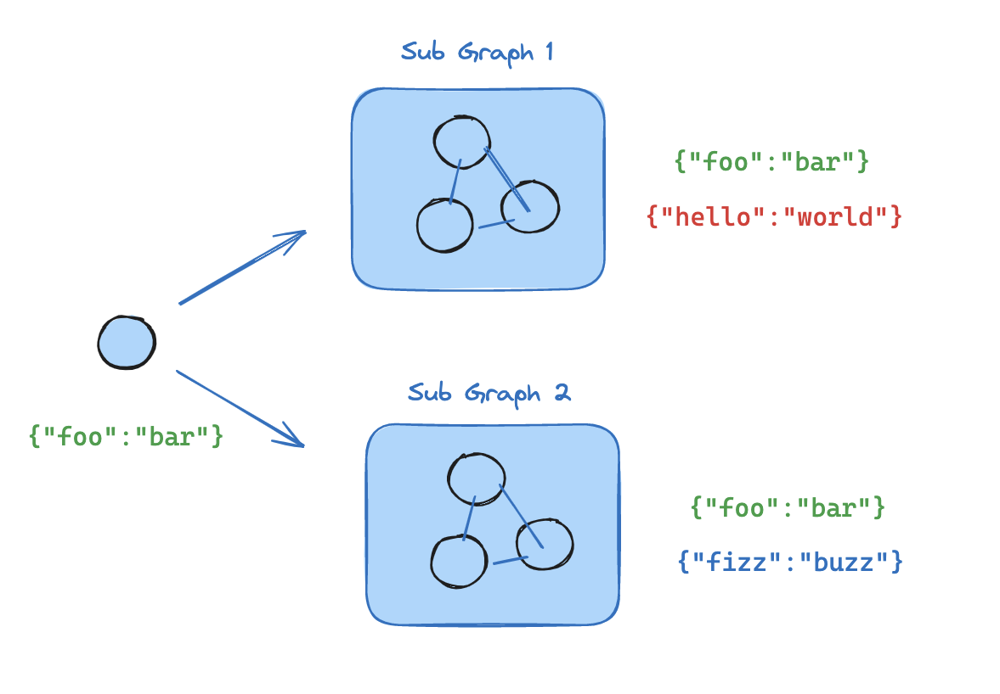

import LanggraphSubgraphsInterruptV2Py from '/langchain/snippets/code-samples/langgraph-subgraphs-interrupt-v2-py.mdx';

本指南解释了使用子图（subgraph）的机制。子图是一个[图](/langchain/oss/langgraph/graph-api#图)，它被用作另一个图中的[节点](/langchain/oss/langgraph/graph-api#节点)。

子图很有用：
- 构建[多智能体系统](/langchain/oss/langchain/multi-agent)
- 在多个图中重用一组节点
- 分散开发：当你希望不同团队独立地处理图的不同部分时，你可以将每个部分定义为一个子图，只要子图接口（输入和输出模式）得到尊重，父图就可以在不了解子图任何细节的情况下构建

## 设置

:::python
<CodeGroup>
```bash pip
pip install -U langgraph
```

```bash uv
uv add langgraph
```
</CodeGroup>
:::

:::js
```bash
npm install @langchain/langgraph
```
:::

<Tip>
**为 LangGraph 开发设置 LangSmith**
注册[LangSmith](https://smith.langchain.com)，以便快速发现问题并提高你的 LangGraph 项目的性能。LangSmith 允许你使用跟踪数据来调试、测试和监控用 LangGraph 构建的 LLM 应用——阅读更多关于[如何开始使用 LangSmith](https://docs.langchain.com/langsmith/observability)的信息。
</Tip>

## 定义子图通信

添加子图时，你需要定义父图和子图如何通信：

| 模式 | 使用场景 | 状态模式 |
|---------|------------|--------------|
| [在节点中调用子图](#在节点中调用子图) | 父图和子图具有**不同的状态模式**（没有共享键），或者你需要在这些状态之间进行转换 | 你编写一个包装函数，该函数将父图状态映射到子图输入，并将子图输出映射回父图状态 |
| [将子图作为节点添加](#将子图作为节点添加) | 父图和子图**共享状态键**——子图从与父图相同的通道读取和写入 | 你将编译好的子图直接传递给 `add_node`——不需要包装函数 |

<a id="invoke-a-graph-from-a-node"></a>
### 在节点中调用子图

当父图和子图具有**不同的状态模式**（没有共享键）时，在节点函数中调用子图。这在你想为[多智能体](/langchain/oss/langchain/multi-agent)系统中的每个智能体保留一个私有的消息历史记录时很常见。

节点函数在调用子图之前将父图状态转换为子图状态，并在返回之前将结果转换回父图状态。

:::python
```python
from typing_extensions import TypedDict
from langgraph.graph.state import StateGraph, START

class SubgraphState(TypedDict):
    bar: str

# Subgraph

def subgraph_node_1(state: SubgraphState):
    return {"bar": "hi! " + state["bar"]}

subgraph_builder = StateGraph(SubgraphState)
subgraph_builder.add_node(subgraph_node_1)
subgraph_builder.add_edge(START, "subgraph_node_1")
subgraph = subgraph_builder.compile()

# Parent graph

class State(TypedDict):
    foo: str

def call_subgraph(state: State):
    # Transform the state to the subgraph state
    subgraph_output = subgraph.invoke({"bar": state["foo"]})  # [!code highlight]
    # Transform response back to the parent state
    return {"foo": subgraph_output["bar"]}

builder = StateGraph(State)
builder.add_node("node_1", call_subgraph)
builder.add_edge(START, "node_1")
graph = builder.compile()
```
:::

:::js
```typescript
import { StateGraph, StateSchema, START } from "@langchain/langgraph";
import * as z from "zod";

const SubgraphState = new StateSchema({
  bar: z.string(),
});

// Subgraph
const subgraphBuilder = new StateGraph(SubgraphState)
  .addNode("subgraphNode1", (state) => {
    return { bar: "hi! " + state.bar };
  })
  .addEdge(START, "subgraphNode1");

const subgraph = subgraphBuilder.compile();

// Parent graph
const State = new StateSchema({
  foo: z.string(),
});

// Transform the state to the subgraph state and back
const builder = new StateGraph(State)
  .addNode("node1", async (state) => {
    const subgraphOutput = await subgraph.invoke({ bar: state.foo });
    return { foo: subgraphOutput.bar };
  })
  .addEdge(START, "node1");

const graph = builder.compile();
```
:::

<Accordion title="Full example: different state schemas">
  :::python
  ```python
  from typing_extensions import TypedDict
  from langgraph.graph.state import StateGraph, START
  from langgraph.stream import UpdatesTransformer

  # Define subgraph
  class SubgraphState(TypedDict):
      # note that none of these keys are shared with the parent graph state
      bar: str
      baz: str

  def subgraph_node_1(state: SubgraphState):
      return {"baz": "baz"}

  def subgraph_node_2(state: SubgraphState):
      return {"bar": state["bar"] + state["baz"]}

  subgraph_builder = StateGraph(SubgraphState)
  subgraph_builder.add_node(subgraph_node_1)
  subgraph_builder.add_node(subgraph_node_2)
  subgraph_builder.add_edge(START, "subgraph_node_1")
  subgraph_builder.add_edge("subgraph_node_1", "subgraph_node_2")
  subgraph = subgraph_builder.compile()

  # Define parent graph
  class ParentState(TypedDict):
      foo: str

  def node_1(state: ParentState):
      return {"foo": "hi! " + state["foo"]}

  def node_2(state: ParentState):
      # Transform the state to the subgraph state
      response = subgraph.invoke({"bar": state["foo"]})
      # Transform response back to the parent state
      return {"foo": response["bar"]}


  builder = StateGraph(ParentState)
  builder.add_node("node_1", node_1)
  builder.add_node("node_2", node_2)
  builder.add_edge(START, "node_1")
  builder.add_edge("node_1", "node_2")
  graph = builder.compile()

  stream = graph.stream_events({"foo": "foo"}, version="v3", transformers=[UpdatesTransformer])
  for event in stream:
      if event["method"] == "updates":
          print(event["params"]["namespace"], event["params"]["data"])
  ```

  ```
  [] {'node_1': {'foo': 'hi! foo'}}
  ['node_2:577b710b-64ae-31fb-9455-6a4d4cc2b0b9'] {'subgraph_node_1': {'baz': 'baz'}}
  ['node_2:577b710b-64ae-31fb-9455-6a4d4cc2b0b9'] {'subgraph_node_2': {'bar': 'hi! foobaz'}}
  [] {'node_2': {'foo': 'hi! foobaz'}}
  ```
  :::

  :::js
  ```typescript
  import { StateGraph, StateSchema, START } from "@langchain/langgraph";
  import * as z from "zod";

  // Define subgraph
  const SubgraphState = new StateSchema({
    // note that none of these keys are shared with the parent graph state
    bar: z.string(),
    baz: z.string(),
  });

  const subgraphBuilder = new StateGraph(SubgraphState)
    .addNode("subgraphNode1", (state) => {
      return { baz: "baz" };
    })
    .addNode("subgraphNode2", (state) => {
      return { bar: state.bar + state.baz };
    })
    .addEdge(START, "subgraphNode1")
    .addEdge("subgraphNode1", "subgraphNode2");

  const subgraph = subgraphBuilder.compile();

  // Define parent graph
  const ParentState = new StateSchema({
    foo: z.string(),
  });

  const builder = new StateGraph(ParentState)
    .addNode("node1", (state) => {
      return { foo: "hi! " + state.foo };
    })
    .addNode("node2", async (state) => {
      const response = await subgraph.invoke({ bar: state.foo });   // [!code highlight]
      return { foo: response.bar };   // [!code highlight]
    })
    .addEdge(START, "node1")
    .addEdge("node1", "node2");

  const graph = builder.compile();

  const stream = await graph.streamEvents(
    { foo: "foo" },
    { subgraphs: true, version: "v3" }
  );
  for await (const message of stream.messages) {
    for await (const token of message.text) {
      process.stdout.write(token);
    }
  }
  ```

  1. 将状态转换为子图状态
  2. 将响应转换回父图状态

  ```
  [[], { node1: { foo: 'hi! foo' } }]
  [['node2:9c36dd0f-151a-cb42-cbad-fa2f851f9ab7'], { subgraphNode1: { baz: 'baz' } }]
  [['node2:9c36dd0f-151a-cb42-cbad-fa2f851f9ab7'], { subgraphNode2: { bar: 'hi! foobaz' } }]
  [[], { node2: { foo: 'hi! foobaz' } }]
  ```
  :::
</Accordion>


<Accordion title="Full example: different state schemas (two levels of subgraphs)">
  这是一个具有两级子图的示例：父图 -> 子图 -> 孙图。

  :::python
  ```python
  # Grandchild graph
  from typing_extensions import TypedDict
  from langgraph.graph.state import StateGraph, START, END
  from langgraph.stream import UpdatesTransformer

  class GrandChildState(TypedDict):
      my_grandchild_key: str

  def grandchild_1(state: GrandChildState) -> GrandChildState:
      # NOTE: child or parent keys will not be accessible here
      return {"my_grandchild_key": state["my_grandchild_key"] + ", how are you"}


  grandchild = StateGraph(GrandChildState)
  grandchild.add_node("grandchild_1", grandchild_1)

  grandchild.add_edge(START, "grandchild_1")
  grandchild.add_edge("grandchild_1", END)

  grandchild_graph = grandchild.compile()

  # Child graph
  class ChildState(TypedDict):
      my_child_key: str

  def call_grandchild_graph(state: ChildState) -> ChildState:
      # NOTE: parent or grandchild keys won't be accessible here
      grandchild_graph_input = {"my_grandchild_key": state["my_child_key"]}
      grandchild_graph_output = grandchild_graph.invoke(grandchild_graph_input)
      return {"my_child_key": grandchild_graph_output["my_grandchild_key"] + " today?"}

  child = StateGraph(ChildState)
  # We're passing a function here instead of just compiled graph (`grandchild_graph`)
  child.add_node("child_1", call_grandchild_graph)
  child.add_edge(START, "child_1")
  child.add_edge("child_1", END)
  child_graph = child.compile()

  # Parent graph
  class ParentState(TypedDict):
      my_key: str

  def parent_1(state: ParentState) -> ParentState:
      # NOTE: child or grandchild keys won't be accessible here
      return {"my_key": "hi " + state["my_key"]}

  def parent_2(state: ParentState) -> ParentState:
      return {"my_key": state["my_key"] + " bye!"}

  def call_child_graph(state: ParentState) -> ParentState:
      child_graph_input = {"my_child_key": state["my_key"]}
      child_graph_output = child_graph.invoke(child_graph_input)
      return {"my_key": child_graph_output["my_child_key"]}

  parent = StateGraph(ParentState)
  parent.add_node("parent_1", parent_1)
  # We're passing a function here instead of just a compiled graph (`child_graph`)
  parent.add_node("child", call_child_graph)
  parent.add_node("parent_2", parent_2)

  parent.add_edge(START, "parent_1")
  parent.add_edge("parent_1", "child")
  parent.add_edge("child", "parent_2")
  parent.add_edge("parent_2", END)

  parent_graph = parent.compile()

  stream = parent_graph.stream_events({"my_key": "Bob"}, version="v3", transformers=[UpdatesTransformer])
  for event in stream:
      if event["method"] == "updates":
          print(event["params"]["namespace"], event["params"]["data"])
  ```

  ```
  [] {'parent_1': {'my_key': 'hi Bob'}}
  ['child:2e26e9ce-602f-862c-aa66-1ea5a4655e3b', 'child_1:781bb3b1-3971-84ce-810b-acf819a03f9c'] {'grandchild_1': {'my_grandchild_key': 'hi Bob, how are you'}}
  ['child:2e26e9ce-602f-862c-aa66-1ea5a4655e3b'] {'child_1': {'my_child_key': 'hi Bob, how are you today?'}}
  [] {'child': {'my_key': 'hi Bob, how are you today?'}}
  [] {'parent_2': {'my_key': 'hi Bob, how are you today? bye!'}}
  ```
  :::

  :::js
  ```typescript
  import { StateGraph, StateSchema, START, END } from "@langchain/langgraph";
  import * as z from "zod";

  // Grandchild graph
  const GrandChildState = new StateSchema({
    myGrandchildKey: z.string(),
  });

  const grandchild = new StateGraph(GrandChildState)
    .addNode("grandchild1", (state) => {
      // NOTE: child or parent keys will not be accessible here
      return { myGrandchildKey: state.myGrandchildKey + ", how are you" };
    })
    .addEdge(START, "grandchild1")
    .addEdge("grandchild1", END);

  const grandchildGraph = grandchild.compile();

  // Child graph
  const ChildState = new StateSchema({
    myChildKey: z.string(),
  });

  const child = new StateGraph(ChildState)
    .addNode("child1", async (state) => {
      // NOTE: parent or grandchild keys won't be accessible here
      const grandchildGraphInput = { myGrandchildKey: state.myChildKey };   // [!code highlight]
      const grandchildGraphOutput = await grandchildGraph.invoke(grandchildGraphInput);
      return { myChildKey: grandchildGraphOutput.myGrandchildKey + " today?" };   // [!code highlight]
    })   // [!code highlight]
    .addEdge(START, "child1")
    .addEdge("child1", END);

  const childGraph = child.compile();

  // Parent graph
  const ParentState = new StateSchema({
    myKey: z.string(),
  });

  const parent = new StateGraph(ParentState)
    .addNode("parent1", (state) => {
      // NOTE: child or grandchild keys won't be accessible here
      return { myKey: "hi " + state.myKey };
    })
    .addNode("child", async (state) => {
      const childGraphInput = { myChildKey: state.myKey };   // [!code highlight]
      const childGraphOutput = await childGraph.invoke(childGraphInput);
      return { myKey: childGraphOutput.myChildKey };   // [!code highlight]
    })   // [!code highlight]
    .addNode("parent2", (state) => {
      return { myKey: state.myKey + " bye!" };
    })
    .addEdge(START, "parent1")
    .addEdge("parent1", "child")
    .addEdge("child", "parent2")
    .addEdge("parent2", END);

  const parentGraph = parent.compile();

  const stream = await parentGraph.streamEvents(
    { myKey: "Bob" },
    { subgraphs: true, version: "v3" }
  );
  for await (const message of stream.messages) {
    for await (const token of message.text) {
      process.stdout.write(token);
    }
  }
  ```

  1. 我们将状态从子状态通道（`myChildKey`）转换到孙状态通道（`myGrandchildKey`）
  2. 我们将状态从孙状态通道（`myGrandchildKey`）转换回子状态通道（`myChildKey`）
  3. 我们在这里传递一个函数，而不是直接传递编译后的图（`grandchildGraph`）
  4. 我们将状态从父状态通道（`myKey`）转换到子状态通道（`myChildKey`）
  5. 我们将状态从子状态通道（`myChildKey`）转换回父状态通道（`myKey`）
  6. 我们在这里传递一个函数，而不是直接传递编译后的图（`childGraph`）

  ```
  [[], { parent1: { myKey: 'hi Bob' } }]
  [['child:2e26e9ce-602f-862c-aa66-1ea5a4655e3b', 'child1:781bb3b1-3971-84ce-810b-acf819a03f9c'], { grandchild1: { myGrandchildKey: 'hi Bob, how are you' } }]
  [['child:2e26e9ce-602f-862c-aa66-1ea5a4655e3b'], { child1: { myChildKey: 'hi Bob, how are you today?' } }]
  [[], { child: { myKey: 'hi Bob, how are you today?' } }]
  [[], { parent2: { myKey: 'hi Bob, how are you today? bye!' } }]
  ```
  :::
</Accordion>

<a id="add-a-graph-as-a-node"></a>
### 将子图作为节点添加

当父图和子图 **共享状态键** 时，可以直接将编译后的子图传递给 `add_node`。不需要包装函数——子图会自动从父图的状态通道中读取和写入。例如，在 [多智能体](/langchain/oss/langchain/multi-agent)系统中，智能体通常通过共享的 [消息](/langchain/oss/langgraph/graph-api#为什么使用消息？)键进行通信。



如果您的子图与父图共享状态键，可以按照以下步骤将其添加到您的图中：

:::python
1. 定义子图工作流（示例中的 `subgraph_builder`）并编译它
2. 在定义父图工作流时，将编译后的子图传递给 @[`add_node`] 方法

```python
from typing_extensions import TypedDict
from langgraph.graph.state import StateGraph, START

class State(TypedDict):
    foo: str

# Subgraph

def subgraph_node_1(state: State):
    return {"foo": "hi! " + state["foo"]}

subgraph_builder = StateGraph(State)
subgraph_builder.add_node(subgraph_node_1)
subgraph_builder.add_edge(START, "subgraph_node_1")
subgraph = subgraph_builder.compile()

# Parent graph

builder = StateGraph(State)
builder.add_node("node_1", subgraph)  # [!code highlight]
builder.add_edge(START, "node_1")
graph = builder.compile()
```
:::

:::js
1. 定义子图工作流（示例中的 `subgraphBuilder`）并编译它
2. 在定义父图工作流时，将编译后的子图传递给 `.addNode` 方法

```typescript
import { StateGraph, StateSchema, START } from "@langchain/langgraph";
import * as z from "zod";

const State = new StateSchema({
  foo: z.string(),
});

// Subgraph
const subgraphBuilder = new StateGraph(State)
  .addNode("subgraphNode1", (state) => {
    return { foo: "hi! " + state.foo };
  })
  .addEdge(START, "subgraphNode1");

const subgraph = subgraphBuilder.compile();

// Parent graph
const builder = new StateGraph(State)
  .addNode("node1", subgraph)
  .addEdge(START, "node1");

const graph = builder.compile();
```
:::

<Accordion title="Full example: shared state schemas">
  :::python
  ```python
  from typing_extensions import TypedDict
  from langgraph.graph.state import StateGraph, START
  from langgraph.stream import UpdatesTransformer

  # Define subgraph
  class SubgraphState(TypedDict):
      foo: str  # shared with parent graph state
      bar: str  # private to SubgraphState

  def subgraph_node_1(state: SubgraphState):
      return {"bar": "bar"}

  def subgraph_node_2(state: SubgraphState):
      # note that this node is using a state key ('bar') that is only available in the subgraph
      # and is sending update on the shared state key ('foo')
      return {"foo": state["foo"] + state["bar"]}

  subgraph_builder = StateGraph(SubgraphState)
  subgraph_builder.add_node(subgraph_node_1)
  subgraph_builder.add_node(subgraph_node_2)
  subgraph_builder.add_edge(START, "subgraph_node_1")
  subgraph_builder.add_edge("subgraph_node_1", "subgraph_node_2")
  subgraph = subgraph_builder.compile()

  # Define parent graph
  class ParentState(TypedDict):
      foo: str

  def node_1(state: ParentState):
      return {"foo": "hi! " + state["foo"]}

  builder = StateGraph(ParentState)
  builder.add_node("node_1", node_1)
  builder.add_node("node_2", subgraph)
  builder.add_edge(START, "node_1")
  builder.add_edge("node_1", "node_2")
  graph = builder.compile()

  stream = graph.stream_events({"foo": "foo"}, version="v3", transformers=[UpdatesTransformer])
  for event in stream:
      if event["method"] == "updates" and not event["params"]["namespace"]:
          print(event["params"]["data"])
  ```

  ```
  {'node_1': {'foo': 'hi! foo'}}
  {'node_2': {'foo': 'hi! foobar'}}
  ```
  :::

  :::js
  ```typescript
  import { StateGraph, StateSchema, START } from "@langchain/langgraph";
  import * as z from "zod";

  // Define subgraph
  const SubgraphState = new StateSchema({
    foo: z.string(),    // [!code highlight]
    bar: z.string(),    // [!code highlight]
  });

  const subgraphBuilder = new StateGraph(SubgraphState)
    .addNode("subgraphNode1", (state) => {
      return { bar: "bar" };
    })
    .addNode("subgraphNode2", (state) => {
      // note that this node is using a state key ('bar') that is only available in the subgraph
      // and is sending update on the shared state key ('foo')
      return { foo: state.foo + state.bar };
    })
    .addEdge(START, "subgraphNode1")
    .addEdge("subgraphNode1", "subgraphNode2");

  const subgraph = subgraphBuilder.compile();

  // Define parent graph
  const ParentState = new StateSchema({
    foo: z.string(),
  });

  const builder = new StateGraph(ParentState)
    .addNode("node1", (state) => {
      return { foo: "hi! " + state.foo };
    })
    .addNode("node2", subgraph)
    .addEdge(START, "node1")
    .addEdge("node1", "node2");

  const graph = builder.compile();

  const stream = await graph.streamEvents({ foo: "foo" }, { version: "v3" });
  for await (const message of stream.messages) {
    for await (const token of message.text) {
      process.stdout.write(token);
    }
  }
  ```

  1. 此键与父图状态共享
  2. 此键是 `SubgraphState` 的私有键，父图不可见

  ```
  { node1: { foo: 'hi! foo' } }
  { node2: { foo: 'hi! foobar' } }
  ```
  :::
</Accordion>

## 子图持久化

使用子图时，您需要决定在调用之间其内部数据会发生什么。考虑一个将任务委托给专业子智能体的客服机器人：当“账单专家”子智能体被调用时，它应该记住客户之前的提问，还是每次调用时都重新开始？

`.compile()` 上的 `checkpointer` 参数控制子图持久化：

| 模式 | `checkpointer=` | 行为 |
|------|-----------------|----------|
| [按调用](#按调用-默认) | `None` (默认) | 每次调用都从新开始，并继承父调用的检查点器以支持[中断](/langchain/oss/langgraph/interrupts)和[durable execution](/langchain/oss/langgraph/persistence)在单个调用内。 |
| [按线程](#按线程) | `True` | 状态在同一个线程的调用间累积。每次调用从上次调用结束的地方继续。 |
| [无状态](#无状态) | `False` | 完全没有检查点——像普通函数调用一样运行。没有中断或durable execution。 |

按调用是大多数应用程序的正确选择，包括[多智能体](/langchain/oss/langchain/multi-agent)系统，其中子智能体处理独立请求。当子智能体需要多轮对话记忆时使用按线程（例如，一个在几次交流中构建上下文的研究助理）。

<Note>
父图必须使用检查点器编译，以便子图持久化功能（中断、状态检查、按线程记忆）正常工作。参见[persistence](/langchain/oss/langgraph/persistence)。
</Note>

<Info>
下面的示例使用LangChain的@[`create_agent`]，这是构建智能体的常用方法。`create_agent`在底层生成[LangGraph图](/langchain/oss/langgraph/graph-api)，因此所有子图持久化概念都直接适用。如果你使用原始LangGraph `StateGraph`构建，相同的模式和配置选项也适用——有关详细信息，请参阅[Graph API](/langchain/oss/langgraph/graph-api)。
</Info>

### 有状态

有状态子图继承父图的检查点器，这启用了[中断](/langchain/oss/langgraph/interrupts)、[persistence](/langchain/oss/langgraph/persistence)和状态检查。这两种有状态模式的不同之处在于状态保留的时间长度。

#### 按调用 (默认)

<Tip>
这是大多数应用程序推荐的模式，包括[多智能体](/langchain/oss/langchain/multi-agent)系统，其中子智能体作为工具被调用。它支持[中断](/langchain/oss/langgraph/interrupts)、[persistence](/langchain/oss/langgraph/persistence)和并行调用，同时保持每次调用独立。
</Tip>

当子图的每次调用都是独立且子智能体不需要记住任何先前调用内容时使用按调用持久化。这是最常见的模式，特别是对于[多智能体](/langchain/oss/langchain/multi-agent)系统，其中子智能体处理一次性请求，如“查找此客户的订单”或“总结此文档。”

省略`checkpointer`或将其设置为`None`。每次调用都从新开始，但在单个调用内子图继承父检查点器，并可以使用`interrupt()`暂停和恢复。

以下示例使用两个子智能体（水果专家、蔬菜专家）作为外部智能体的工具包装：

:::python

```python
from langchain.agents import create_agent
from langchain.tools import tool
from langgraph.checkpoint.memory import MemorySaver
from langgraph.types import Command, interrupt

@tool
def fruit_info(fruit_name: str) -> str:
    """Look up fruit info."""
    return f"Info about {fruit_name}"

@tool
def veggie_info(veggie_name: str) -> str:
    """Look up veggie info."""
    return f"Info about {veggie_name}"

# Subagents - no checkpointer setting (inherits parent)
fruit_agent = create_agent(
    model="gpt-5.4-mini",
    tools=[fruit_info],
    prompt="You are a fruit expert. Use the fruit_info tool. Respond in one sentence.",
)

veggie_agent = create_agent(
    model="gpt-5.4-mini",
    tools=[veggie_info],
    prompt="You are a veggie expert. Use the veggie_info tool. Respond in one sentence.",
)

# Wrap subagents as tools for the outer agent
@tool
def ask_fruit_expert(question: str) -> str:
    """Ask the fruit expert. Use for ALL fruit questions."""
    response = fruit_agent.invoke(
        {"messages": [{"role": "user", "content": question}]},
    )
    return response["messages"][-1].content

@tool
def ask_veggie_expert(question: str) -> str:
    """Ask the veggie expert. Use for ALL veggie questions."""
    response = veggie_agent.invoke(
        {"messages": [{"role": "user", "content": question}]},
    )
    return response["messages"][-1].content

# Outer agent with checkpointer
agent = create_agent(
    model="gpt-5.4-mini",
    tools=[ask_fruit_expert, ask_veggie_expert],
    prompt=(
        "You have two experts: ask_fruit_expert and ask_veggie_expert. "
        "ALWAYS delegate questions to the appropriate expert."
    ),
    checkpointer=MemorySaver(),
)
```

<Tabs>
  <Tab title="Interrupts">
  每次调用可以使用 `interrupt()` 来暂停和继续。向工具函数添加 `interrupt()` 以在继续之前要求用户批准：

  ```python
  @tool
  def fruit_info(fruit_name: str) -> str:
      """Look up fruit info."""
      interrupt("continue?")  # [!code highlight]
      return f"Info about {fruit_name}"
  ```

  <LanggraphSubgraphsInterruptV2Py />
  </Tab>
  <Tab title="Multi-turn">
  每次调用都以全新的子智能体状态开始。子智能体不会记住之前的调用：

  ```python
  config = {"configurable": {"thread_id": "1"}}

  # First call
  response = agent.invoke(
      {"messages": [{"role": "user", "content": "Tell me about apples"}]},
      config=config,
  )
  # Subagent message count: 4

  # Second call - subagent starts fresh, no memory of apples
  response = agent.invoke(
      {"messages": [{"role": "user", "content": "Now tell me about bananas"}]},
      config=config,
  )
  # Subagent message count: 4 (still fresh!)
  ```
  </Tab>
  <Tab title="Multiple subgraph calls">
  对同一子图的多次调用不会产生冲突，因为每次调用都有自己的检查点命名空间：

  ```python
  config = {"configurable": {"thread_id": "1"}}

  # LLM calls ask_fruit_expert for both apples and bananas
  response = agent.invoke(
      {"messages": [{"role": "user", "content": "Tell me about apples and bananas"}]},
      config=config,
  )
  # Subagent message count: 4 (apples - fresh)
  # Subagent message count: 4 (bananas - fresh)
  ```
  </Tab>
</Tabs>
:::

:::js

```typescript
import { createAgent, tool } from "langchain";
import { MemorySaver, Command, interrupt } from "@langchain/langgraph";
import * as z from "zod";

const fruitInfo = tool(
  (input) => `Info about ${input.fruitName}`,
  {
    name: "fruit_info",
    description: "Look up fruit info.",
    schema: z.object({ fruitName: z.string() }),
  }
);

const veggieInfo = tool(
  (input) => `Info about ${input.veggieName}`,
  {
    name: "veggie_info",
    description: "Look up veggie info.",
    schema: z.object({ veggieName: z.string() }),
  }
);

// Subagents - no checkpointer setting (inherits parent)
const fruitAgent = createAgent({
  model: "gpt-5.4-mini",
  tools: [fruitInfo],
  prompt: "You are a fruit expert. Use the fruit_info tool. Respond in one sentence.",
});

const veggieAgent = createAgent({
  model: "gpt-5.4-mini",
  tools: [veggieInfo],
  prompt: "You are a veggie expert. Use the veggie_info tool. Respond in one sentence.",
});

// Wrap subagents as tools for the outer agent
const askFruitExpert = tool(
  async (input) => {
    const response = await fruitAgent.invoke({
      messages: [{ role: "user", content: input.question }],
    });
    return response.messages[response.messages.length - 1].content;
  },
  {
    name: "ask_fruit_expert",
    description: "Ask the fruit expert. Use for ALL fruit questions.",
    schema: z.object({ question: z.string() }),
  }
);

const askVeggieExpert = tool(
  async (input) => {
    const response = await veggieAgent.invoke({
      messages: [{ role: "user", content: input.question }],
    });
    return response.messages[response.messages.length - 1].content;
  },
  {
    name: "ask_veggie_expert",
    description: "Ask the veggie expert. Use for ALL veggie questions.",
    schema: z.object({ question: z.string() }),
  }
);

// Outer agent with checkpointer
const agent = createAgent({
  model: "gpt-5.4-mini",
  tools: [askFruitExpert, askVeggieExpert],
  prompt:
    "You have two experts: ask_fruit_expert and ask_veggie_expert. " +
    "ALWAYS delegate questions to the appropriate expert.",
  checkpointer: new MemorySaver(),
});
```

<Tabs>
  <Tab title="Interrupts">
  每次调用可以使用 `interrupt()` 来暂停和继续。向工具函数添加 `interrupt()` 以在继续之前要求用户批准：

  ```typescript
  const fruitInfo = tool(
    (input) => {
      interrupt("continue?");  // [!code highlight]
      return `Info about ${input.fruitName}`;
    },
    {
      name: "fruit_info",
      description: "Look up fruit info.",
      schema: z.object({ fruitName: z.string() }),
    }
  );
  ```

  ```typescript
  const config = { configurable: { thread_id: "1" } };

  // Invoke - the subagent's tool calls interrupt()
  let response = await agent.invoke(
    { messages: [{ role: "user", content: "Tell me about apples" }] },
    config,
  );
  // response contains __interrupt__

  // Resume - approve the interrupt
  response = await agent.invoke(new Command({ resume: true }), config);  // [!code highlight]
  // Subagent message count: 4
  ```
  </Tab>
  <Tab title="Multi-turn">
  每次调用都以全新的子智能体状态开始。子智能体不会记住之前的调用：

  ```typescript
  const config = { configurable: { thread_id: "1" } };

  // First call
  let response = await agent.invoke(
    { messages: [{ role: "user", content: "Tell me about apples" }] },
    config,
  );
  // Subagent message count: 4

  // Second call - subagent starts fresh, no memory of apples
  response = await agent.invoke(
    { messages: [{ role: "user", content: "Now tell me about bananas" }] },
    config,
  );
  // Subagent message count: 4 (still fresh!)
  ```
  </Tab>
  <Tab title="Multiple subgraph calls">
  对同一子图的多次调用不会产生冲突，因为每次调用都有自己的检查点命名空间：

  ```typescript
  const config = { configurable: { thread_id: "1" } };

  // LLM calls ask_fruit_expert for both apples and bananas
  const response = await agent.invoke(
    { messages: [{ role: "user", content: "Tell me about apples and bananas" }] },
    config,
  );
  // Subagent message count: 4 (apples - fresh)
  // Subagent message count: 4 (bananas - fresh)
  ```
  </Tab>
</Tabs>
:::

#### 按线程

当子智能体需要记住之前的交互时，使用按线程持久化。例如，一个在多次交流中逐步构建上下文的研究助理，或一个跟踪已编辑文件编码助理。子智能体的对话历史和数据在同一线程上的多次调用中累积。每次调用都会从上次调用的地方继续。

使用 `checkpointer=True` 编译以启用此行为。

<Warning>
按线程子图不支持并行工具调用。当 LLM 可以将按线程子智能体作为工具访问时，它可能会并行调用该工具多次（例如，同时询问水果专家关于苹果和香蕉）。这会导致检查点冲突，因为两次调用都写入相同的命名空间。

下面的示例使用 LangChain 的 `ToolCallLimitMiddleware` 来防止这种情况。如果你使用纯 LangGraph `StateGraph` 构建，你需要自己防止并行工具调用——例如，通过配置模型禁用并行工具调用，或添加逻辑确保同一子图不会被并行多次调用。
</Warning>

以下示例使用编译了 `checkpointer=True` 的水果专家子智能体：

:::python

```python
from langchain.agents import create_agent
from langchain.agents.middleware import ToolCallLimitMiddleware
from langchain.tools import tool
from langgraph.checkpoint.memory import MemorySaver
from langgraph.types import Command, interrupt

@tool
def fruit_info(fruit_name: str) -> str:
    """Look up fruit info."""
    return f"Info about {fruit_name}"

# Subagent with checkpointer=True for persistent state
fruit_agent = create_agent(
    model="gpt-5.4-mini",
    tools=[fruit_info],
    prompt="You are a fruit expert. Use the fruit_info tool. Respond in one sentence.",
    checkpointer=True,  # [!code highlight]
)

# Wrap subagent as a tool for the outer agent
@tool
def ask_fruit_expert(question: str) -> str:
    """Ask the fruit expert. Use for ALL fruit questions."""
    response = fruit_agent.invoke(
        {"messages": [{"role": "user", "content": question}]},
    )
    return response["messages"][-1].content

# Outer agent with checkpointer
# Use ToolCallLimitMiddleware to prevent parallel calls to per-thread subagents,
# which would cause checkpoint conflicts.
agent = create_agent(
    model="gpt-5.4-mini",
    tools=[ask_fruit_expert],
    prompt="You have a fruit expert. ALWAYS delegate fruit questions to ask_fruit_expert.",
    middleware=[  # [!code highlight]
        ToolCallLimitMiddleware(tool_name="ask_fruit_expert", run_limit=1),  # [!code highlight]
    ],  # [!code highlight]
    checkpointer=MemorySaver(),
)
```

<Tabs>
  <Tab title="Interrupts">
  按线程子智能体支持 `interrupt()`，就像按调用一样。向工具函数添加 `interrupt()` 以在继续之前要求用户批准：

  ```python
  @tool
  def fruit_info(fruit_name: str) -> str:
      """Look up fruit info."""
      interrupt("continue?")  # [!code highlight]
      return f"Info about {fruit_name}"
  ```

  <LanggraphSubgraphsInterruptV2Py />
  </Tab>
  <Tab title="Multi-turn">
  状态跨调用累积——子智能体会记住过去的对话：

  ```python
  config = {"configurable": {"thread_id": "1"}}

  # First call
  response = agent.invoke(
      {"messages": [{"role": "user", "content": "Tell me about apples"}]},
      config=config,
  )
  # Subagent message count: 4

  # Second call - subagent REMEMBERS apples conversation
  response = agent.invoke(
      {"messages": [{"role": "user", "content": "Now tell me about bananas"}]},
      config=config,
  )
  # Subagent message count: 8 (accumulated!)
  ```
  </Tab>
  <Tab title="Multiple subgraph calls">

当您有多个**不同**的线程级子图（例如，一个水果专家和一个蔬菜专家）时，每个子图都需要自己的存储空间，这样它们的检查点就不会互相覆盖。这称为**命名空间隔离**。

[如果您在节点](#在节点中调用子图)内部调用子图，LangGraph 会根据调用顺序分配命名空间（第一次调用、第二次调用等）。这意味着重新排序您的调用可能会混淆哪个子图加载哪个状态。为了避免这种情况，请将每个子智能体包裹在具有唯一节点名称的 `StateGraph` 中——这为每个子图提供了一个稳定、唯一的命名空间：

  ```python
  from langgraph.graph import MessagesState, StateGraph

  def create_sub_agent(model, *, name, **kwargs):
      """Wrap an agent with a unique node name for namespace isolation."""
      agent = create_agent(model=model, name=name, **kwargs)
      return (
          StateGraph(MessagesState)
          .add_node(name, agent)  # unique name → stable namespace  # [!code highlight]
          .add_edge("__start__", name)
          .compile()
      )

  fruit_agent = create_sub_agent(
      "gpt-5.4-mini", name="fruit_agent",
      tools=[fruit_info], prompt="...", checkpointer=True,
  )
  veggie_agent = create_sub_agent(
      "gpt-5.4-mini", name="veggie_agent",
      tools=[veggie_info], prompt="...", checkpointer=True,
  )

  config = {"configurable": {"thread_id": "1"}}

  # First call - LLM calls both fruit and veggie experts
  response = agent.invoke(
      {"messages": [{"role": "user", "content": "Tell me about cherries and broccoli"}]},
      config=config,
  )
  # Fruit subagent message count: 4
  # Veggie subagent message count: 4

  # Second call - both agents accumulate independently
  response = agent.invoke(
      {"messages": [{"role": "user", "content": "Now tell me about oranges and carrots"}]},
      config=config,
  )
  # Fruit subagent message count: 8 (remembers cherries!)
  # Veggie subagent message count: 8 (remembers broccoli!)
  ```

子图 [作为节点](#将子图作为节点添加)添加的已经自动获得基于名称的命名空间，因此不需要这个包装。
</Tab>
</Tabs>
:::

:::js

```typescript
import { createAgent, tool, toolCallLimitMiddleware } from "langchain";
import { MemorySaver, Command, interrupt } from "@langchain/langgraph";
import * as z from "zod";

const fruitInfo = tool(
  (input) => `Info about ${input.fruitName}`,
  {
    name: "fruit_info",
    description: "Look up fruit info.",
    schema: z.object({ fruitName: z.string() }),
  }
);

// Subagent with checkpointer=true for persistent state
const fruitAgent = createAgent({
  model: "gpt-5.4-mini",
  tools: [fruitInfo],
  prompt: "You are a fruit expert. Use the fruit_info tool. Respond in one sentence.",
  checkpointer: true,  // [!code highlight]
});

// Wrap subagent as a tool for the outer agent
const askFruitExpert = tool(
  async (input) => {
    const response = await fruitAgent.invoke({
      messages: [{ role: "user", content: input.question }],
    });
    return response.messages[response.messages.length - 1].content;
  },
  {
    name: "ask_fruit_expert",
    description: "Ask the fruit expert. Use for ALL fruit questions.",
    schema: z.object({ question: z.string() }),
  }
);

// Outer agent with checkpointer
// Use toolCallLimitMiddleware to prevent parallel calls to per-thread subagents,
// which would cause checkpoint conflicts.
const agent = createAgent({
  model: "gpt-5.4-mini",
  tools: [askFruitExpert],
  prompt: "You have a fruit expert. ALWAYS delegate fruit questions to ask_fruit_expert.",
  middleware: [  // [!code highlight]
    toolCallLimitMiddleware({ toolName: "ask_fruit_expert", runLimit: 1 }),  // [!code highlight]
  ],  // [!code highlight]
  checkpointer: new MemorySaver(),
});
```

<Tabs>
  <Tab title="Interrupts">
  线程级子智能体支持 `interrupt()`，就像调用级一样。向工具函数添加 `interrupt()` 以要求用户批准：

  ```typescript
  const fruitInfo = tool(
    (input) => {
      interrupt("continue?");  // [!code highlight]
      return `Info about ${input.fruitName}`;
    },
    {
      name: "fruit_info",
      description: "Look up fruit info.",
      schema: z.object({ fruitName: z.string() }),
    }
  );
  ```

  ```typescript
  const config = { configurable: { thread_id: "1" } };

  // Invoke - the subagent's tool calls interrupt()
  let response = await agent.invoke(
    { messages: [{ role: "user", content: "Tell me about apples" }] },
    config,
  );
  // response contains __interrupt__

  // Resume - approve the interrupt
  response = await agent.invoke(new Command({ resume: true }), config);  // [!code highlight]
  // Subagent message count: 4
  ```
  </Tab>
  <Tab title="Multi-turn">
  状态跨调用累积——子智能体记得过去的对话：

  ```typescript
  const config = { configurable: { thread_id: "1" } };

  // First call
  let response = await agent.invoke(
    { messages: [{ role: "user", content: "Tell me about apples" }] },
    config,
  );
  // Subagent message count: 4

  // Second call - subagent REMEMBERS apples conversation
  response = await agent.invoke(
    { messages: [{ role: "user", content: "Now tell me about bananas" }] },
    config,
  );
  // Subagent message count: 8 (accumulated!)
  ```
  </Tab>
  <Tab title="Multiple subgraph calls">

当您有多个**不同**的线程级子图（例如，一个水果专家和一个蔬菜专家）时，每个子图都需要自己的存储空间，这样它们的检查点就不会互相覆盖。这称为**命名空间隔离**。

[如果您在节点](#在节点中调用子图)内部调用子图，LangGraph 会根据调用顺序分配命名空间（第一次调用、第二次调用等）。这意味着重新排序您的调用可能会混淆哪个子图加载哪个状态。为了避免这种情况，请将每个子智能体包裹在具有唯一节点名称的 `StateGraph` 中——这为每个子图提供了一个稳定、唯一的命名空间：

  ```typescript
  import { StateGraph, StateSchema, MessagesValue, START } from "@langchain/langgraph";

  function createSubAgent(model: string, { name, ...kwargs }: { name: string; [key: string]: any }) {
    const agent = createAgent({ model, name, ...kwargs });
    return new StateGraph(new StateSchema({ messages: MessagesValue }))
      .addNode(name, agent)  // unique name → stable namespace  // [!code highlight]
      .addEdge(START, name)
      .compile();
  }

  const fruitAgent = createSubAgent("gpt-5.4-mini", {
    name: "fruit_agent", tools: [fruitInfo], prompt: "...", checkpointer: true,
  });
  const veggieAgent = createSubAgent("gpt-5.4-mini", {
    name: "veggie_agent", tools: [veggieInfo], prompt: "...", checkpointer: true,
  });
  const config = { configurable: { thread_id: "1" } };

  // First call - LLM calls both fruit and veggie experts
  let response = await agent.invoke(
    { messages: [{ role: "user", content: "Tell me about cherries and broccoli" }] },
    config,
  );
  // Fruit subagent message count: 4
  // Veggie subagent message count: 4

  // Second call - both agents accumulate independently
  response = await agent.invoke(
    { messages: [{ role: "user", content: "Now tell me about oranges and carrots" }] },
    config,
  );
  // Fruit subagent message count: 8 (remembers cherries!)
  // Veggie subagent message count: 8 (remembers broccoli!)
  ```

子图 [作为节点](#将子图作为节点添加)添加的已经自动获得基于名称的命名空间，因此不需要这个包装。
</Tab>
</Tabs>
:::

### 无状态

当您希望像普通函数调用一样运行子智能体，且没有检查点开销时使用。子图无法暂停/恢复，也无法从 [持久执行](/langchain/oss/langgraph/persistence)中获益。使用 `checkpointer=False` 编译。

<Warning>
没有检查点，子图没有持久执行。如果进程在运行中途崩溃，子图无法恢复，必须从头重新运行。
</Warning>

:::python
```python
subgraph_builder = StateGraph(...)
subgraph = subgraph_builder.compile(checkpointer=False)  # [!code highlight]
```
:::

:::js
```typescript
const subgraphBuilder = new StateGraph(...);
const subgraph = subgraphBuilder.compile({ checkpointer: false });  // [!code highlight]
```
:::

### 检查点引用

使用 `checkpointer` 参数在 `.compile()` 上控制子图持久性：

:::python
```python
subgraph = builder.compile(checkpointer=False)  # or True / None
```
:::

:::js
```typescript
const subgraph = builder.compile({ checkpointer: false });  // or true, or null
```
:::

| 功能 | 每次调用（默认） | 每个线程 | 无状态 |
|---|---|---|---|
| `checkpointer=` | `None` | `True` | `False` |
| 中断（HITL） | ✅ | ✅ | ❌ |
| 多轮记忆 | ❌ | ✅ | ❌ |
| 多次调用（不同子图） | ✅ | <Tooltip tip="Calls to multiple per-thread subgraphs in the same node can cause namespace conflicts. Workarounds are available.">⚠️</Tooltip> | ✅ |
| 多次调用（相同子图） | ✅ | ❌ | ✅ |
| 状态检查 | <Tooltip tip="State inspection with per-invocation persistence is available for the current invocation only (while interrupted). Each invocation starts fresh, so there is no accumulated state to inspect after the invocation completes.">⚠️</Tooltip> | ✅ | ❌ |

- **中断（HITL）**: 子图可以使用 [interrupt()](/langchain/oss/langgraph/interrupts) 暂停执行并等待用户输入，然后从停止的地方继续。
- **多轮记忆**: 子图可以在同一个 [线程](/langchain/oss/langgraph/checkpointers#线程) 内的多次调用之间保持状态。每次调用都会从上一次调用的地方继续，而不是从头开始。
- **多次调用（不同子图）**: 多个不同的子图实例可以在单个节点内被调用，而不会产生检查点命名空间冲突。
- **多次调用（相同子图）**: 相同的子图实例可以在单个节点内被多次调用。在有状态持久化的情况下，这些调用会写入相同的检查点命名空间并产生冲突——请使用每次调用持久化方式。
- **状态检查**: 子图的状态可以通过 `get_state(config, subgraphs=True)` 进行调试和监控。

## 查看子图状态

当你启用 [持久化](/langchain/oss/langgraph/persistence) 时，可以使用子图选项查看子图状态。使用 [无状态](#无状态) 检查点（`checkpointer=False`），不会保存子图检查点，因此子图状态不可用。

<Note>
查看子图状态需要 LangGraph 能够 **静态发现** 子图——即它被 [作为节点](#将子图作为节点添加) 添加或 [在节点内调用](#在节点中调用子图)。当子图在 [工具](/langchain/oss/langchain/tools) 函数内调用或其他间接引用（例如 [子智能体](/langchain/oss/langchain/multi-agent/subagents) 模式）时，中断仍然会传播到顶层图，无论嵌套情况如何。
</Note>

:::python
<Tabs>
  <Tab title="Per-invocation">
  返回 **当前调用** 的子图状态。每次调用都从新开始。

  ```python
  from langgraph.graph import START, StateGraph
  from langgraph.checkpoint.memory import MemorySaver
  from langgraph.types import interrupt, Command
  from typing_extensions import TypedDict

  class State(TypedDict):
      foo: str

  # Subgraph
  def subgraph_node_1(state: State):
      value = interrupt("Provide value:")
      return {"foo": state["foo"] + value}

  subgraph_builder = StateGraph(State)
  subgraph_builder.add_node(subgraph_node_1)
  subgraph_builder.add_edge(START, "subgraph_node_1")
  subgraph = subgraph_builder.compile()  # inherits parent checkpointer

  # Parent graph
  builder = StateGraph(State)
  builder.add_node("node_1", subgraph)
  builder.add_edge(START, "node_1")

  checkpointer = MemorySaver()
  graph = builder.compile(checkpointer=checkpointer)

  config = {"configurable": {"thread_id": "1"}}

  graph.invoke({"foo": ""}, config)

  # View subgraph state for the current invocation
  subgraph_state = graph.get_state(config, subgraphs=True).tasks[0].state  # [!code highlight]

  # Resume the subgraph
  graph.invoke(Command(resume="bar"), config)
  ```
  </Tab>
  <Tab title="Per-thread">
  返回此线程上所有调用中 **累积** 的子图状态。

  ```python
  from langgraph.graph import START, StateGraph, MessagesState
  from langgraph.checkpoint.memory import MemorySaver

  # Subgraph with its own persistent state
  subgraph_builder = StateGraph(MessagesState)
  # ... add nodes and edges
  subgraph = subgraph_builder.compile(checkpointer=True)  # [!code highlight]

  # Parent graph
  builder = StateGraph(MessagesState)
  builder.add_node("agent", subgraph)
  builder.add_edge(START, "agent")

  checkpointer = MemorySaver()
  graph = builder.compile(checkpointer=checkpointer)

  config = {"configurable": {"thread_id": "1"}}

  graph.invoke({"messages": [{"role": "user", "content": "hi"}]}, config)
  graph.invoke({"messages": [{"role": "user", "content": "what did I say?"}]}, config)

  # View accumulated subgraph state (includes messages from both invocations)
  subgraph_state = graph.get_state(config, subgraphs=True).tasks[0].state  # [!code highlight]
  ```
  </Tab>
</Tabs>
:::

:::js
<Tabs>
  <Tab title="Per-invocation">
  返回 **当前调用** 的子图状态。每次调用都从新开始。

  ```typescript
  import { StateGraph, StateSchema, START, MemorySaver, interrupt, Command } from "@langchain/langgraph";
  import * as z from "zod";

  const State = new StateSchema({
    foo: z.string(),
  });

  // Subgraph
  const subgraphBuilder = new StateGraph(State)
    .addNode("subgraphNode1", (state) => {
      const value = interrupt("Provide value:");
      return { foo: state.foo + value };
    })
    .addEdge(START, "subgraphNode1");

  const subgraph = subgraphBuilder.compile();  // inherits parent checkpointer

  // Parent graph
  const builder = new StateGraph(State)
    .addNode("node1", subgraph)
    .addEdge(START, "node1");

  const checkpointer = new MemorySaver();
  const graph = builder.compile({ checkpointer });

  const config = { configurable: { thread_id: "1" } };

  await graph.invoke({ foo: "" }, config);

  // View subgraph state for the current invocation
  const subgraphState = (await graph.getState(config, { subgraphs: true })).tasks[0].state;  // [!code highlight]

  // Resume the subgraph
  await graph.invoke(new Command({ resume: "bar" }), config);
  ```
  </Tab>
  <Tab title="Per-thread">
  返回此线程上所有调用中 **累积** 的子图状态。

  ```typescript
  import { StateGraph, StateSchema, MessagesValue, START, MemorySaver } from "@langchain/langgraph";

  // Subgraph with its own persistent state
  const SubgraphState = new StateSchema({
    messages: MessagesValue,
  });

  const subgraphBuilder = new StateGraph(SubgraphState);
  // ... add nodes and edges
  const subgraph = subgraphBuilder.compile({ checkpointer: true });  // [!code highlight]

  // Parent graph
  const builder = new StateGraph(SubgraphState)
    .addNode("agent", subgraph)
    .addEdge(START, "agent");

  const checkpointer = new MemorySaver();
  const graph = builder.compile({ checkpointer });

  const config = { configurable: { thread_id: "1" } };

  await graph.invoke({ messages: [{ role: "user", content: "hi" }] }, config);
  await graph.invoke({ messages: [{ role: "user", content: "what did I say?" }] }, config);

  // View accumulated subgraph state (includes messages from both invocations)
  const subgraphState = (await graph.getState(config, { subgraphs: true })).tasks[0].state;  // [!code highlight]
  ```
  </Tab>
</Tabs>
:::

## 流式输出子图结果

为了观察嵌套图执行情况，我们推荐使用 [事件流式传输](/langchain/oss/langgraph/event-streaming)：`stream.subgraphs` 投影会发现每个嵌套运行并暴露其 `path`、`messages` 和 `values`，而无需解析命名空间字符串。

:::python
```python
stream = graph.stream_events({"foo": "foo"}, version="v3")  # [!code highlight]

for subgraph in stream.subgraphs:
    print(subgraph.graph_name, subgraph.path)

    for snapshot in subgraph.values:
        print(subgraph.path, snapshot)
```

如果您需要原始协议事件，直接迭代流并过滤 `event["method"]` 和 `event["params"]["namespace"]`：

```python
from langgraph.stream import UpdatesTransformer

stream = graph.stream_events({"foo": "foo"}, version="v3", transformers=[UpdatesTransformer])
for event in stream:
    if event["method"] == "updates":
        print(event["params"]["namespace"], event["params"]["data"])
```
:::

:::js
```typescript
const stream = await graph.streamEvents(
  { foo: "foo" },
  {
    subgraphs: true,   // [!code highlight]
    version: "v3",
  }
);
for await (const snapshot of stream.values) {
  console.log(snapshot);
}
```

1. 将 `subgraphs: true` 设置为子图流输出。

:::

<Accordion title="Stream from subgraphs">
  :::python
  ```python
  from typing_extensions import TypedDict
  from langgraph.graph.state import StateGraph, START
  from langgraph.stream import UpdatesTransformer

  # Define subgraph
  class SubgraphState(TypedDict):
      foo: str
      bar: str

  def subgraph_node_1(state: SubgraphState):
      return {"bar": "bar"}

  def subgraph_node_2(state: SubgraphState):
      # note that this node is using a state key ('bar') that is only available in the subgraph
      # and is sending update on the shared state key ('foo')
      return {"foo": state["foo"] + state["bar"]}

  subgraph_builder = StateGraph(SubgraphState)
  subgraph_builder.add_node(subgraph_node_1)
  subgraph_builder.add_node(subgraph_node_2)
  subgraph_builder.add_edge(START, "subgraph_node_1")
  subgraph_builder.add_edge("subgraph_node_1", "subgraph_node_2")
  subgraph = subgraph_builder.compile()

  # Define parent graph
  class ParentState(TypedDict):
      foo: str

  def node_1(state: ParentState):
      return {"foo": "hi! " + state["foo"]}

  builder = StateGraph(ParentState)
  builder.add_node("node_1", node_1)
  builder.add_node("node_2", subgraph)
  builder.add_edge(START, "node_1")
  builder.add_edge("node_1", "node_2")
  graph = builder.compile()

  stream = graph.stream_events({"foo": "foo"}, version="v3", transformers=[UpdatesTransformer])  # [!code highlight]
  for event in stream:
      if event["method"] == "updates":
          print(event["params"]["namespace"], event["params"]["data"])
  ```

  ```
  [] {'node_1': {'foo': 'hi! foo'}}
  ['node_2:e58e5673-a661-ebb0-70d4-e298a7fc28b7'] {'subgraph_node_1': {'bar': 'bar'}}
  ['node_2:e58e5673-a661-ebb0-70d4-e298a7fc28b7'] {'subgraph_node_2': {'foo': 'hi! foobar'}}
  [] {'node_2': {'foo': 'hi! foobar'}}
  ```
  :::

  :::js
  ```typescript
  import { StateGraph, StateSchema, START } from "@langchain/langgraph";
  import * as z from "zod";

  // Define subgraph
  const SubgraphState = new StateSchema({
    foo: z.string(),
    bar: z.string(),
  });

  const subgraphBuilder = new StateGraph(SubgraphState)
    .addNode("subgraphNode1", (state) => {
      return { bar: "bar" };
    })
    .addNode("subgraphNode2", (state) => {
      // note that this node is using a state key ('bar') that is only available in the subgraph
      // and is sending update on the shared state key ('foo')
      return { foo: state.foo + state.bar };
    })
    .addEdge(START, "subgraphNode1")
    .addEdge("subgraphNode1", "subgraphNode2");

  const subgraph = subgraphBuilder.compile();

  // Define parent graph
  const ParentState = new StateSchema({
    foo: z.string(),
  });

  const builder = new StateGraph(ParentState)
    .addNode("node1", (state) => {
      return { foo: "hi! " + state.foo };
    })
    .addNode("node2", subgraph)
    .addEdge(START, "node1")
    .addEdge("node1", "node2");

  const graph = builder.compile();

  const stream = await graph.streamEvents(
    { foo: "foo" },
    {
      subgraphs: true,   // [!code highlight]
      version: "v3",
    }
  );
  for await (const snapshot of stream.values) {
    console.log(snapshot);
  }
  ```

  1. 将 `subgraphs: true` 设置为子图流输出。

  ```
  [[], { node1: { foo: 'hi! foo' } }]
  [['node2:e58e5673-a661-ebb0-70d4-e298a7fc28b7'], { subgraphNode1: { bar: 'bar' } }]
  [['node2:e58e5673-a661-ebb0-70d4-e298a7fc28b7'], { subgraphNode2: { foo: 'hi! foobar' } }]
  [[], { node2: { foo: 'hi! foobar' } }]
  ```
  :::
</Accordion>

---

> 官方原文：[src/oss/langgraph/use-subgraphs.mdx](https://github.com/langchain-ai/docs/blob/main/src/oss/langgraph/use-subgraphs.mdx) · 非官方翻译，译文由 AI 生成，以英文原文为准。
