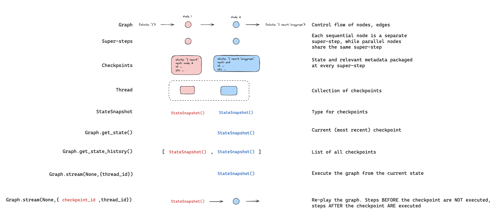
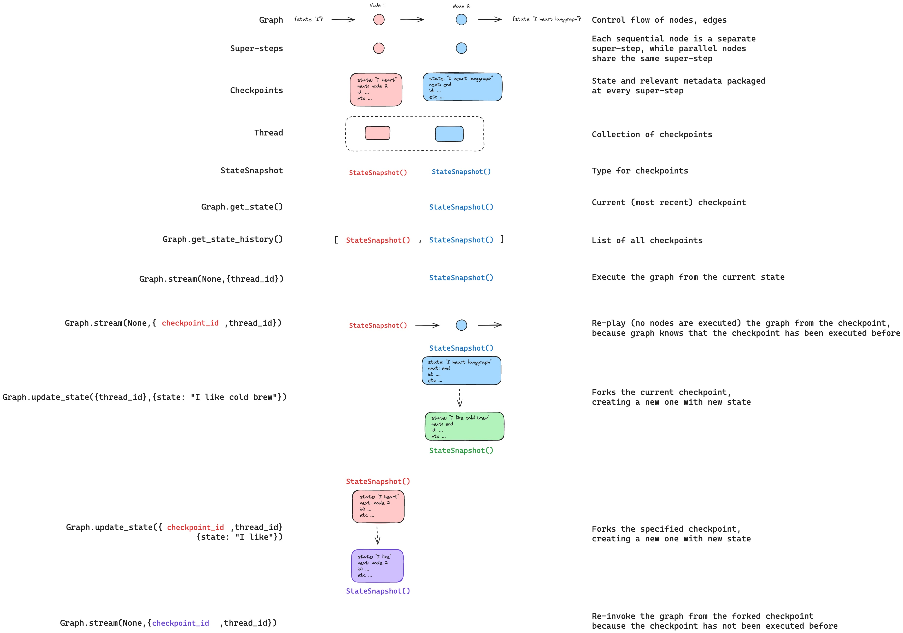

## 概述

LangGraph 支持通过 [检查点](/langchain/oss/langgraph/checkpointers#检查点) 实现时间旅行：

- **[重放](#重放)**：从先前的检查点重新尝试。
- **[分支](#分支)**：从先前的检查点分支，并修改状态以探索替代路径。

这两种方式都通过从先前的检查点恢复执行。检查点之前的节点不会重新执行（结果已经保存）。检查点之后的节点会重新执行，包括任何 LLM 调用、API 请求和 [中断](/langchain/oss/langgraph/interrupts)（可能产生不同的结果）。

## 重放

使用先前的检查点配置调用图，从该点重放。

<Warning>

重放会重新执行节点——它不仅仅是从缓存中读取。LLM 调用、API 请求和 [中断](/langchain/oss/langgraph/interrupts) 会再次触发，并可能返回不同的结果。从最终检查点（没有 `next` 节点）重放是无操作的。

</Warning>



:::python
使用 @[`get_state_history`] 找到你想重放的那个检查点，然后使用该检查点的配置调用 @[`invoke`][CompiledStateGraph.invoke]：

```python
from langgraph.graph import StateGraph, START
from langgraph.checkpoint.memory import InMemorySaver
from typing_extensions import TypedDict, NotRequired
from langchain_core.utils.uuid import uuid7

class State(TypedDict):
    topic: NotRequired[str]
    joke: NotRequired[str]


def generate_topic(state: State):
    return {"topic": "socks in the dryer"}


def write_joke(state: State):
    return {"joke": f"Why do {state['topic']} disappear? They elope!"}


checkpointer = InMemorySaver()
graph = (
    StateGraph(State)
    .add_node("generate_topic", generate_topic)
    .add_node("write_joke", write_joke)
    .add_edge(START, "generate_topic")
    .add_edge("generate_topic", "write_joke")
    .compile(checkpointer=checkpointer)
)

# Step 1: Run the graph
config = {"configurable": {"thread_id": str(uuid7())}}
result = graph.invoke({}, config)

# Step 2: Find a checkpoint to replay from
history = list(graph.get_state_history(config))
# History is in reverse chronological order
for state in history:
    print(f"next={state.next}, checkpoint_id={state.config['configurable']['checkpoint_id']}")

# Step 3: Replay from a specific checkpoint
# Find the checkpoint before write_joke
before_joke = next(s for s in history if s.next == ("write_joke",))
replay_result = graph.invoke(None, before_joke.config)
# write_joke re-executes (runs again), generate_topic does not
```
:::

:::js
使用 @[`getStateHistory`] 找到你想重放的那个检查点，然后使用该检查点的配置调用 @[`invoke`][CompiledStateGraph.invoke]：

```typescript
import { v7 as uuid7 } from "uuid";
import { StateGraph, MemorySaver, START } from "@langchain/langgraph";

const StateAnnotation = Annotation.Root({
  topic: Annotation<string>(),
  joke: Annotation<string>(),
});

function generateTopic(state: typeof StateAnnotation.State) {
  return { topic: "socks in the dryer" };
}

function writeJoke(state: typeof StateAnnotation.State) {
  return { joke: `Why do ${state.topic} disappear? They elope!` };
}

const checkpointer = new MemorySaver();
const graph = new StateGraph(StateAnnotation)
  .addNode("generateTopic", generateTopic)
  .addNode("writeJoke", writeJoke)
  .addEdge(START, "generateTopic")
  .addEdge("generateTopic", "writeJoke")
  .compile({ checkpointer });

// Step 1: Run the graph
const config = { configurable: { thread_id: uuid7() } };
const result = await graph.invoke({}, config);

// Step 2: Find a checkpoint to replay from
const states = [];
for await (const state of graph.getStateHistory(config)) {
  states.push(state);
}

// Step 3: Replay from a specific checkpoint
const beforeJoke = states.find((s) => s.next.includes("writeJoke"));
const replayResult = await graph.invoke(null, beforeJoke.config);
// writeJoke re-executes (runs again), generateTopic does not
```
:::

## 分支

分支从过去的检查点创建一个带有修改状态的分支。在先前的检查点上调用 @[`update_state`] 来创建分支，然后使用 `None` 调用 @[`invoke`][CompiledStateGraph.invoke] 来继续执行。



<Warning>

`update_state` **不会** 回滚线程。它会创建一个新的检查点，该检查点从指定的点分支。原始执行历史保持完整。

</Warning>

:::python
```python
# Find checkpoint before write_joke
history = list(graph.get_state_history(config))
before_joke = next(s for s in history if s.next == ("write_joke",))

# Fork: update state to change the topic
fork_config = graph.update_state(
    before_joke.config,
    values={"topic": "chickens"},
)

# Resume from the fork — write_joke re-executes with the new topic
fork_result = graph.invoke(None, fork_config)
print(fork_result["joke"])  # A joke about chickens, not socks
```
:::

:::js
```typescript
// Find checkpoint before writeJoke
const states = [];
for await (const state of graph.getStateHistory(config)) {
  states.push(state);
}
const beforeJoke = states.find((s) => s.next.includes("writeJoke"));

// Fork: update state to change the topic
const forkConfig = await graph.updateState(
  beforeJoke.config,
  { topic: "chickens" },
);

// Resume from the fork — writeJoke re-executes with the new topic
const forkResult = await graph.invoke(null, forkConfig);
console.log(forkResult.joke); // A joke about chickens, not socks
```
:::

### 从特定节点开始

当你调用 @[`update_state`] 时，值会使用指定节点的写入器（包括 [归约器](/langchain/oss/langgraph/graph-api#归约器)）应用。检查点记录该节点已生成更新，然后从该节点的后继节点继续执行。

默认情况下，LangGraph 从检查点的版本历史中推断 `as_node`。从特定检查点分支时，这种推断几乎总是正确的。

在以下情况下显式指定 `as_node`：

- **并行分支**：多个节点在同一步骤中更新状态，而 LangGraph 无法确定哪个是最后一个（`InvalidUpdateError`）。
- **没有执行历史**：在新鲜线程上设置状态（在 [测试](/langchain/oss/langgraph/test) 中很常见）。
- **跳过节点**：将 `as_node` 设置为较后的节点，使图认为该节点已经运行。

:::python
```python
# graph: generate_topic -> write_joke

# Treat this update as if generate_topic produced it.
# Execution resumes at write_joke (the successor of generate_topic).
fork_config = graph.update_state(
    before_joke.config,
    values={"topic": "chickens"},
    as_node="generate_topic",
)
```
:::

:::js
```typescript
// graph: generateTopic -> writeJoke

// Treat this update as if generateTopic produced it.
// Execution resumes at writeJoke (the successor of generateTopic).
const forkConfig = await graph.updateState(
  beforeJoke.config,
  { topic: "chickens" },
  { asNode: "generateTopic" },
);
```
:::

## 中断

如果你的图使用 @[`interrupt`] 用于 [人机交互](/langchain/oss/langgraph/interrupts) 工作流，在时间旅行期间中断总是会重新触发。包含中断的节点会重新执行，`interrupt()` 会暂停以等待新的 `Command(resume=...)`。

:::python
```python
from langgraph.types import interrupt, Command

class State(TypedDict):
    value: list[str]

def ask_human(state: State):
    answer = interrupt("What is your name?")
    return {"value": [f"Hello, {answer}!"]}

def final_step(state: State):
    return {"value": ["Done"]}

graph = (
    StateGraph(State)
    .add_node("ask_human", ask_human)
    .add_node("final_step", final_step)
    .add_edge(START, "ask_human")
    .add_edge("ask_human", "final_step")
    .compile(checkpointer=InMemorySaver())
)

config = {"configurable": {"thread_id": "1"}}

# First run: hits interrupt
graph.invoke({"value": []}, config)
# Resume with answer
graph.invoke(Command(resume="Alice"), config)

# Replay from before ask_human
history = list(graph.get_state_history(config))
before_ask = [s for s in history if s.next == ("ask_human",)][-1]

replay_result = graph.invoke(None, before_ask.config)
# Pauses at interrupt — waiting for new Command(resume=...)

# Fork from before ask_human
fork_config = graph.update_state(before_ask.config, {"value": ["forked"]})
fork_result = graph.invoke(None, fork_config)
# Pauses at interrupt — waiting for new Command(resume=...)

# Resume the forked interrupt with a different answer
graph.invoke(Command(resume="Bob"), fork_config)
# Result: {"value": ["forked", "Hello, Bob!", "Done"]}
```
:::

:::js
```typescript
import { interrupt, Command } from "@langchain/langgraph";

function askHuman(state: { value: string[] }) {
  const answer = interrupt("What is your name?");
  return { value: [`Hello, ${answer}!`] };
}

function finalStep(state: { value: string[] }) {
  return { value: ["Done"] };
}

// ... build graph with checkpointer ...

// First run: hits interrupt
await graph.invoke({ value: [] }, config);
// Resume with answer
await graph.invoke(new Command({ resume: "Alice" }), config);

// Replay from before askHuman
const states = [];
for await (const state of graph.getStateHistory(config)) {
  states.push(state);
}
const beforeAsk = states.filter((s) => s.next.includes("askHuman")).pop();

const replayResult = await graph.invoke(null, beforeAsk.config);
// Pauses at interrupt — waiting for new Command({ resume: ... })

// Fork from before askHuman
const forkConfig = await graph.updateState(beforeAsk.config, { value: ["forked"] });
const forkResult = await graph.invoke(null, forkConfig);
// Pauses at interrupt — waiting for new Command({ resume: ... })

// Resume the forked interrupt with a different answer
await graph.invoke(new Command({ resume: "Bob" }), forkConfig);
// Result: { value: ["forked", "Hello, Bob!", "Done"] }
```
:::

### 多个中断

如果你的图在多个点收集输入（例如，多步骤表单），你可以从中断之间分支，以更改后续答案而不重新询问早期问题。

:::python
```python
def ask_name(state):
    name = interrupt("What is your name?")
    return {"value": [f"name:{name}"]}

def ask_age(state):
    age = interrupt("How old are you?")
    return {"value": [f"age:{age}"]}

# Graph: ask_name -> ask_age -> final
# After completing both interrupts:

# Fork from BETWEEN the two interrupts (after ask_name, before ask_age)
history = list(graph.get_state_history(config))
between = [s for s in history if s.next == ("ask_age",)][-1]

fork_config = graph.update_state(between.config, {"value": ["modified"]})
result = graph.invoke(None, fork_config)
# ask_name result preserved ("name:Alice")
# ask_age pauses at interrupt — waiting for new answer
```
:::

:::js
```typescript
// Fork from BETWEEN the two interrupts (after askName, before askAge)
const states = [];
for await (const state of graph.getStateHistory(config)) {
  states.push(state);
}
const between = states.filter((s) => s.next.includes("askAge")).pop();

const forkConfig = await graph.updateState(between.config, { value: ["modified"] });
const result = await graph.invoke(null, forkConfig);
// askName result preserved ("name:Alice")
// askAge pauses at interrupt — waiting for new answer
```
:::

## 子图

使用 [子图](/langchain/oss/langgraph/use-subgraphs) 的时间旅行取决于子图是否有自己的检查点器。这决定了你可以从哪个粒度进行时间旅行的检查点。

<Tabs>
<Tab title="Inherited checkpointer (default)">

默认情况下，子图继承父检查点器。父级将整个子图视为一个 **单个超级步骤**——整个子图执行只有一个父级检查点。从子图之前进行时间旅行会使其从头开始重新执行。

你不能时间旅行到默认子图中节点之间的点——你只能从父级进行时间旅行。

:::python
```python
# Subgraph without its own checkpointer (default)
subgraph = (
    StateGraph(State)
    .add_node("step_a", step_a)       # Has interrupt()
    .add_node("step_b", step_b)       # Has interrupt()
    .add_edge(START, "step_a")
    .add_edge("step_a", "step_b")
    .compile()  # No checkpointer — inherits from parent
)

graph = (
    StateGraph(State)
    .add_node("subgraph_node", subgraph)
    .add_edge(START, "subgraph_node")
    .compile(checkpointer=InMemorySaver())
)

config = {"configurable": {"thread_id": "1"}}

# Complete both interrupts
graph.invoke({"value": []}, config)            # Hits step_a interrupt
graph.invoke(Command(resume="Alice"), config)  # Hits step_b interrupt
graph.invoke(Command(resume="30"), config)     # Completes

# Time travel from before the subgraph
history = list(graph.get_state_history(config))
before_sub = [s for s in history if s.next == ("subgraph_node",)][-1]

fork_config = graph.update_state(before_sub.config, {"value": ["forked"]})
result = graph.invoke(None, fork_config)
# The entire subgraph re-executes from scratch
# You cannot time travel to a point between step_a and step_b
```
:::

:::js
```typescript
// Subgraph without its own checkpointer (default)
const subgraph = new StateGraph(StateAnnotation)
  .addNode("stepA", stepA)       // Has interrupt()
  .addNode("stepB", stepB)       // Has interrupt()
  .addEdge(START, "stepA")
  .addEdge("stepA", "stepB")
  .compile();  // No checkpointer — inherits from parent

const graph = new StateGraph(StateAnnotation)
  .addNode("subgraphNode", subgraph)
  .addEdge(START, "subgraphNode")
  .compile({ checkpointer });

// Complete both interrupts
await graph.invoke({ value: [] }, config);
await graph.invoke(new Command({ resume: "Alice" }), config);
await graph.invoke(new Command({ resume: "30" }), config);

// Time travel from before the subgraph
const states = [];
for await (const state of graph.getStateHistory(config)) {
  states.push(state);
}
const beforeSub = states.filter((s) => s.next.includes("subgraphNode")).pop();

const forkConfig = await graph.updateState(beforeSub.config, { value: ["forked"] });
const result = await graph.invoke(null, forkConfig);
// The entire subgraph re-executes from scratch
// You cannot time travel to a point between stepA and stepB
```
:::

</Tab>
<Tab title="Subgraph checkpointer">

在子图上设置 `checkpointer=True` 以给它自己的检查点历史。这会在子图内部的每一步创建检查点，允许你从子图内的特定点进行时间旅行——例如，在两个中断之间。

使用 @[`get_state`] 与 `subgraphs=True` 来访问子图自己的检查点配置，然后从它分支：

:::python
```python
# Subgraph with its own checkpointer
subgraph = (
    StateGraph(State)
    .add_node("step_a", step_a)       # Has interrupt()
    .add_node("step_b", step_b)       # Has interrupt()
    .add_edge(START, "step_a")
    .add_edge("step_a", "step_b")
    .compile(checkpointer=True)  # Own checkpoint history
)

graph = (
    StateGraph(State)
    .add_node("subgraph_node", subgraph)
    .add_edge(START, "subgraph_node")
    .compile(checkpointer=InMemorySaver())
)

config = {"configurable": {"thread_id": "1"}}

# Run until step_a interrupt
graph.invoke({"value": []}, config)

# Resume step_a -> hits step_b interrupt
graph.invoke(Command(resume="Alice"), config)

# Get the subgraph's own checkpoint (between step_a and step_b)
parent_state = graph.get_state(config, subgraphs=True)
sub_config = parent_state.tasks[0].state.config

# Fork from the subgraph checkpoint
fork_config = graph.update_state(sub_config, {"value": ["forked"]})
result = graph.invoke(None, fork_config)
# step_b re-executes, step_a's result is preserved
```
:::

:::js
```typescript
// Subgraph with its own checkpointer
const subgraph = new StateGraph(StateAnnotation)
  .addNode("stepA", stepA)       // Has interrupt()
  .addNode("stepB", stepB)       // Has interrupt()
  .addEdge(START, "stepA")
  .addEdge("stepA", "stepB")
  .compile({ checkpointer: true });  // Own checkpoint history

const graph = new StateGraph(StateAnnotation)
  .addNode("subgraphNode", subgraph)
  .addEdge(START, "subgraphNode")
  .compile({ checkpointer });

// Run until stepA interrupt, then resume -> hits stepB interrupt
await graph.invoke({ value: [] }, config);
await graph.invoke(new Command({ resume: "Alice" }), config);

// Get the subgraph's own checkpoint (between stepA and stepB)
const parentState = await graph.getState(config, { subgraphs: true });
const subConfig = parentState.tasks[0].state.config;

// Fork from the subgraph checkpoint
const forkConfig = await graph.updateState(subConfig, { value: ["forked"] });
const result = await graph.invoke(null, forkConfig);
// stepB re-executes, stepA's result is preserved
```
:::

</Tab>
</Tabs>

有关配置子图检查点器的更多信息，请参阅 [子图持久化](/langchain/oss/langgraph/use-subgraphs#子图持久化)。

---

> 官方原文：[src/oss/langgraph/use-time-travel.mdx](https://github.com/langchain-ai/docs/blob/main/src/oss/langgraph/use-time-travel.mdx) · 译文由 AI 生成，以英文原文为准。
