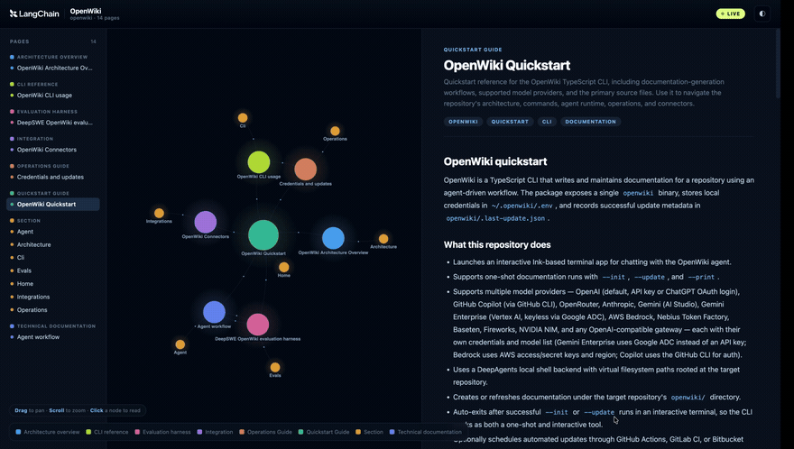

为探索 OpenWiki Markdown 维基，`openwiki visualize` 在浏览器中提供了一个本地交互式节点图，与实时 Markdown 阅读器并列。您还可以将相同的图和阅读器导出为静态目录进行托管。

## 打开可视化器

从已包含 `openwiki/` 目录的仓库：

```bash
openwiki visualize
```

此命令将 `./openwiki` 在 `127.0.0.1:4321` 上启动服务并打开浏览器访问图界面。在服务器运行期间，对维基文件的修改会自动生效。可视化面板与 Markdown 阅读器并列，支持调整大小和折叠。

## 选项

```bash
openwiki visualize openwiki --port 4400 --no-open
```

| 参数/标志 | 描述 |
| --- | --- |
| `[path]` | 维基目录路径。默认值 `./openwiki` |
| `--port <port>` | 预设端口。默认值 `4321`。若端口被占用则自动递增 |
| `--no-open` | 禁止自动打开浏览器 |
| `--export <dir>` | 导出静态可视化目录而非启动本地服务器。不可与 `--port` 或 `--no-open` 组合使用 |

要探索个人维基：

```bash
openwiki visualize ~/.openwiki/wiki
```

<Frame>
    
</Frame>

可视化器显示：

- 维基概念及其 Markdown 链接的交互式节点图
- 与所选页面并列的实时 Markdown 阅读器

节点图不显示 `INSTRUCTIONS.md` 和其他脚手架文件。

## 导出静态站点

要将其与生成文档一同发布，请导出静态目录而非启动服务器：

```bash
openwiki visualize <PATH> --export docs/openwiki-visualizer
```

导出包包含 `index.html`、`client.js`、`client-lib.js`、`styles.css` 和 `graph.json`。客户端通过读取兄弟节点文件运行，无需实时刷新，因此可托管于 GitHub Pages、MkDocs 或任何静态主机。

<Note>
    页面从公共 CDN 加载图、Markdown 和图表库，因此本地和静态视图均需网络连接。
</Note>

## 参考文档

- [快速入门](/langchain/oss/openwiki/quickstart)
- [代码模式](/langchain/oss/openwiki/code-mode)
- [CLI 参考文档](/langchain/oss/openwiki/cli-reference)

---

> 官方原文：[src/oss/openwiki/visualize.mdx](https://github.com/langchain-ai/docs/blob/main/src/oss/openwiki/visualize.mdx) · 译文由 AI 生成，以英文原文为准。
