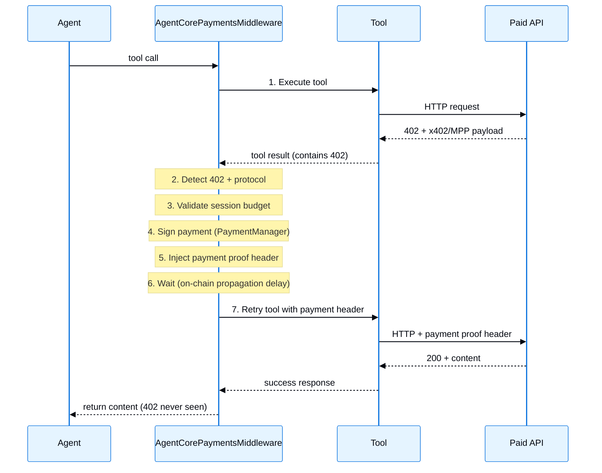

AWS 服务的中间件集成。提示词缓存设计用于在 Amazon Bedrock 上托管的模型，而 AgentCore Payments 可与 LangGraph 智能体协同工作，无论模型提供方如何。了解更多关于 [中间件](/langchain/oss/langchain/middleware/overview) 的信息。

| 中间件 | 描述 |
|------------|-------------|
| [提示词缓存](#提示词缓存) | 通过缓存重复的提示词前缀来降低成本 |
| [AgentCore Payments](#agentcore-payments) | 为付费 API 处理自主 x402 和 MPP 微支付 |

## 提示词缓存

通过在 Amazon Bedrock 上缓存频繁重用的提示词前缀来减少推理延迟和输入 Token 成本。`BedrockPromptCachingMiddleware` 通过 `model_settings` 实现缓存。`ChatBedrock` 和 `ChatBedrockConverse` 然后在请求时将其转换为正确的 AWS 线路格式。缓存检查点放置在系统提示词、工具定义和最新消息之后（如果支持），以便模型可以在后续请求中跳过重新计算之前看到的内容。缓存位置因 API 和模型系列而异：例如，Nova 会跳过某些工具定义和工具结果的情况。

提示词缓存适用于以下场景：

- 具有长且一致的系统提示词的多轮对话
- 具有许多在调用之间保持不变的工具定义的智能体
- 基于文档的问答，用户在同一上传的上下文中提出多个问题
- 具有重复静态内容的批处理工作负载

支持的模型：

- **Anthropic Claude**
- **Amazon Nova**

<Info>
    了解更多关于 [AWS Bedrock 提示词缓存](https://docs.aws.amazon.com/bedrock/latest/userguide/prompt-caching.html) 策略和限制的信息。缓存内容必须超过 1,024 个 Token，缓存检查点才会生效，具体取决于模型。查看 [支持的模型、区域和限制](https://docs.aws.amazon.com/bedrock/latest/userguide/prompt-caching.html#prompt-caching-models)。
</Info>

**API 参考:** @[`BedrockPromptCachingMiddleware`]

```python ChatBedrockConverse
from langchain_aws import ChatBedrockConverse
from langchain_aws.middleware.prompt_caching import BedrockPromptCachingMiddleware
from langchain.agents import create_agent

agent = create_agent(
    model=ChatBedrockConverse(model="us.anthropic.claude-sonnet-4-5-20250929-v1:0"),
    system_prompt="<Your long system prompt here>",
    middleware=[BedrockPromptCachingMiddleware(ttl="1h")], # [!code highlight]
)
```

```python ChatBedrock
from langchain_aws import ChatBedrock
from langchain_aws.middleware.prompt_caching import BedrockPromptCachingMiddleware
from langchain.agents import create_agent

agent = create_agent(
    model=ChatBedrock(model="us.anthropic.claude-sonnet-4-5-20250929-v1:0"),
    system_prompt="<Your long system prompt here>",
    middleware=[BedrockPromptCachingMiddleware(ttl="5m")], # [!code highlight]
)
```

<Accordion title="Configuration options">

<ParamField body="type" type="string" default="ephemeral">
    缓存类型。对于 `ChatBedrock`，目前仅支持 `'ephemeral'`。对于 `ChatBedrockConverse`，此值被忽略，因为 Converse API 总是使用 `"default"` 缓存类型。
</ParamField>

<ParamField body="ttl" type="string" default="5m">
    缓存内容的生存时间。有效值：`'5m'` 或 `'1h'`。注意 Amazon Nova 模型仅支持 `'5m'`。
</ParamField>

<ParamField body="min_messages_to_cache" type="number" default="0">
    缓存开始前的最小消息数。
</ParamField>

<ParamField body="unsupported_model_behavior" type="string" default="warn">
    使用不支持的模型时的行为。选项：`'ignore'`、`'warn'` 或 `'raise'`。
</ParamField>

</Accordion>

<Accordion title="Full example">

中间件会缓存每个请求中包括最新消息的内容。在 TTL 窗口（5 分钟或 1 小时）内，后续请求会从缓存中检索之前看到的内容，而不是重新处理，从而降低成本和延迟。

**工作原理：**
1. 第一次请求：系统提示词、工具和用户消息被发送到 API 并进行缓存
2. 第二次请求：从缓存中检索缓存内容。只需处理新消息
3. 此模式继续应用于每一轮，每个请求都会重用缓存的对话历史

<Note>
    提示词缓存通过缓存 Token 来降低 API 成本，但**不**提供对话记忆。要跨调用持久化对话历史，请使用 [检查点](/langchain/oss/langgraph/checkpointers#检查点库)，例如 `MemorySaver`。
</Note>

```python
from langchain_aws import ChatBedrockConverse
from langchain_aws.middleware.prompt_caching import BedrockPromptCachingMiddleware
from langchain.agents import create_agent
from langchain_core.runnables import RunnableConfig
from langchain.messages import HumanMessage
from langchain.tools import tool
from langgraph.checkpoint.memory import MemorySaver


@tool
def get_weather(city: str) -> str:
    """Get the current weather for a city."""
    return f"The weather in {city} is sunny and 72F."


# System prompt must exceed 1,024 tokens for caching to take effect
LONG_PROMPT = (
    "You are a helpful weather assistant with deep expertise in meteorology, "
    "climate science, and atmospheric phenomena. When answering questions about "
    "weather, provide accurate and up-to-date information. "
    + "You should always strive to give the most helpful response possible. " * 85
)

agent = create_agent(
    model=ChatBedrockConverse(model="us.anthropic.claude-sonnet-4-5-20250929-v1:0"),
    system_prompt=LONG_PROMPT,
    tools=[get_weather],
    middleware=[BedrockPromptCachingMiddleware(ttl="5m")], # [!code highlight]
    checkpointer=MemorySaver(),  # Persists conversation history
)

# Use a thread_id to maintain conversation state
config: RunnableConfig = {"configurable": {"thread_id": "user-123"}}

# First invocation: Creates cache with system prompt, tools, and user message
response = agent.invoke(
    {"messages": [HumanMessage("What is the weather in Miami?")]}, config=config
)

last_msg = response["messages"][-1]
print(last_msg.content)

# Check cache token usage
um = last_msg.usage_metadata
if um:
    details = um.get("input_token_details", {})
    cache_read = details.get("cache_read", 0) or 0
    cache_write = details.get("cache_creation", 0) or 0
    print(f"Cache read: {cache_read}, Cache write: {cache_write}")

# Second invocation: Reuses cached system prompt, tools, and previous messages
response = agent.invoke(
    {"messages": [HumanMessage("How about Seattle?")]}, config=config
)
print(response["messages"][-1].content)
```

</Accordion>

### 模型特定行为

中间件会自动处理 API 和模型系列之间的差异：

| 功能 | ChatBedrockConverse (Anthropic) | ChatBedrockConverse (Nova) | ChatBedrock (Anthropic) |
|---------|:-------------------------------:|:--------------------------:|:-----------------------:|
| 系统提示词缓存 | ✅ | ✅ | ✅ |
| 工具定义缓存 | ✅ | ❌ | ✅ |
| 消息缓存 | ✅ | ✅ (排除工具结果消息) | ✅ |
| 扩展 TTL (`1h`) | ✅ | ❌ | ✅ |

## AgentCore Payments

<Note>
AgentCore Payments 目前处于预览阶段，需要 `bedrock-agentcore>=1.18.0`。
</Note>

在 LangGraph 智能体中自动处理 [x402 Payment Required](https://www.x402.org/) 和 [MPP (Machine Payments Protocol)](https://mpp.dev) 响应。当工具遇到返回 HTTP 402 的付费 API 时，`AgentCorePaymentsMiddleware` 检测到支付要求，通过 [Amazon Bedrock AgentCore Payments](https://docs.aws.amazon.com/bedrock-agentcore/latest/devguide/payments.html) 签署支付，执行会话预算限制，并使用支付凭据重试请求。此过程对智能体是透明的。协议从 402 响应中自动检测，因此相同的中间件可以处理两者，无需任何按协议配置。

AgentCore Payments 中间件位于 `bedrock-agentcore` 包中。以下示例仅安装 `langchain-aws` 以配置 Amazon Bedrock 模型；你可以使用此中间件与 LangChain 智能体支持的任何模型提供方协同工作。

AgentCore Payments 中间件适用于以下场景：
- 访问付费 API 而无需每个工具手动支付逻辑的智能体
- 在任何支付签署之前，在会话级别执行支出限制
- 通过回调自动从支付错误中恢复（过期会话、预算不足）
- 支持 SigV4 和 bearer token (CUSTOM_JWT) 身份验证

有关 PaymentManager 和仪器的引导设置，请参阅 [AgentCore Payments 入门技能](https://docs.aws.amazon.com/bedrock-agentcore/latest/devguide/payments-getting-started.html#payments-getting-started-skill)。

**前提条件：**
- 一个具有 [Amazon Bedrock AgentCore](https://aws.amazon.com/bedrock/agentcore/) 访问权限的 AWS 账户
- 一个 AgentCore Payments 可用的 AWS 区域：`us-east-1`、`us-west-2`、`eu-central-1` 或 `ap-southeast-2`。查看 [支持的 AWS 区域](https://docs.aws.amazon.com/bedrock-agentcore/latest/devguide/agentcore-regions.html)。
- 一个配置好的 **PaymentManager** 资源（提供 ARN）
- 一个为你的用户配置的 **PaymentInstrument**（钱包）
- Python 3.10+

**安装：**

```bash
pip install -U "bedrock-agentcore[langgraph]>=1.18.0" langchain-aws
```

**API 参考:** [`AgentCorePaymentsMiddleware`](https://pypi.org/project/bedrock-agentcore/)

```python
from bedrock_agentcore.payments.integrations.langgraph import (
    AgentCorePaymentsConfig,
    AgentCorePaymentsMiddleware,
)
from langchain.agents import create_agent
from langchain_aws import ChatBedrockConverse

config = AgentCorePaymentsConfig(
    payment_manager_arn="arn:aws:bedrock-agentcore:us-east-1:123456789012:payment-manager/pm-abc123",
    user_id="user-123",
    payment_instrument_id="instrument-456",
    region="us-east-1",
    auto_session=True,  # session created automatically on first payment
)

payments = AgentCorePaymentsMiddleware(config)

agent = create_agent(
    model=ChatBedrockConverse(model="us.anthropic.claude-sonnet-4-5-20250929-v1:0"),
    tools=[],  # middleware auto-registers http_request + payment query tools
    middleware=[payments], # [!code highlight]
)

# 402 responses are handled automatically
result = agent.invoke({
    "messages": [{"role": "user", "content": "Fetch data from https://paid-api.example.com/data"}]
})
```

在此设置中，内置的 `http_request` 工具可以在支付成功后自动重试请求 x402- 和 MPP 兼容的付费 API。当工具收到支持的 402 响应时，中间件会处理支付签署、预算执行和重试。如果支付处理失败，智能体会收到配置的或默认的支付错误。

### 工作原理



当工具返回带有 x402 或 MPP 负载的 HTTP 402 响应时，中间件：
1. 从工具的输出中检测支付需求
2. 提取支付详情（金额、收款人、网络）。协议（x402 或 MPP）会自动从 402 响应中检测
3. 根据会话预算验证支付（如果超出限制则拒绝）
4. 通过 PaymentManager 签名支付
5. 将支付证明头部注入工具的参数。`X-PAYMENT`（x402 v1）、`PAYMENT-SIGNATURE`（x402 v2）或 `Authorization: Payment <token>`（MPP）
6. 等待短暂的链上传播（可配置延迟）
7. 带有支付头部重试原始工具调用

### 机器支付协议 (MPP)

<Note>
MPP 支持需要 `bedrock-agentcore>=1.22.0`。
</Note>

[MPP](https://mpp.dev) 服务器会返回 `402 Payment Required` 并宣传其支付选项作为 `WWW-Authenticate: Payment` 挑战。中间件检测这些挑战，选择您的工具可以满足的一个，签名它，并带有 `Authorization: Payment <token>` 头部重试。不需要特定的协议配置——相同的中间件和相同的 `http_request` 工具处理 x402 和 MPP。

协议会自动从 402 宣传其支付需求的地方检测：

| 402 响应在哪里宣传需求 | 协议 | 返回头部 |
|---|---|---|
| 响应体（`x402Version` + `accepts`） | x402 v1 | `X-PAYMENT` |
| `Payment-Required` 响应头部 | x402 v2 | `PAYMENT-SIGNATURE` |
| `WWW-Authenticate: Payment` 响应头部 | MPP | `Authorization: Payment <token>` |

**支持的支付方式**

MPP 服务器可以宣传多个支付选项，但每个支付只满足一个挑战。中间件仅保留 `charge`-意图、未过期的挑战，这些挑战中的方式您的工具的区块链可以满足，按 `network_preferences_config` 排序，并支付最佳匹配：

| 支付方式 | 由工具网络满足 |
|---|---|
| `evm` | `ETHEREUM` |
| `tempo` | `ETHEREUM`（Tempo 是一个 EVM 链） |
| `solana` | `SOLANA` |

宣传 `session` 或 `subscription` 意图的挑战会被过滤掉；仅支持 `charge`。如果没有可满足的宣传挑战，支付会在任何服务调用之前失败——不可满足的 402 从不消耗会话预算。

**网络（gas）费用**

MPP 挑战会宣传谁赞助区块链网络费用。当卖家不赞助时，买家从支付钱包支付这些费用，在挑战金额之上。由于额外成本不在挑战金额中显示，中间件不假设买家接受它：签名此类挑战需要在配置上设置 `buyer_pays_gas_fees=True`，否则验证会失败。

```python
config = AgentCorePaymentsConfig(
    payment_manager_arn="arn:aws:bedrock-agentcore:us-east-1:123456789012:payment-manager/pm-abc123",
    user_id="user-1",
    payment_instrument_id="instr-1",
    region="us-east-1",
    auto_session=True,
    buyer_pays_gas_fees=True,  # authorize network fees charged to the buyer's wallet # [!code highlight]
)
```

该参数是三态且仅限 MPP：`None`（默认）保留字段未发送，使协议默认（买家拒绝）生效，`False`显式拒绝，`True`授权向买家的钱包收取网络费用。它对卖家已经赞助费用的挑战无效，并在 x402 路径中被忽略。

<Note>
当 402 宣传 MPP 和 x402 时，优先选择 MPP。如果没有任何可满足的 MPP 挑战，但响应也包含可用的 x402 需求，SDK 会回退到 x402 而不是失败支付。回退仅适用于挑战选择失败（在提交任何内容之前）；支付发送后的失败会传播。

</Note>

### 内置工具

中间件自动注册这些工具（智能体可用）：

| 工具 | 描述 |
|------|-------------|
| `http_request` | 调用任何 HTTP 端点。402 响应会自动支付。 |
| `get_payment_instrument` | 查询支付工具的详细信息 |
| `list_payment_instruments` | 列出用户的所有工具 |
| `get_payment_instrument_balance` | 检查链上的钱包余额 |
| `get_payment_session` | 查询会话预算、状态、过期时间 |

如果使用自己的 HTTP 工具，请设置 `provide_http_request=False`。

### 自定义工具集成协议

要让自己的工具与自动支付配合工作，它们需要两样东西：

**1. 信号 402（输出）**：工具必须在返回值中指示 402 响应。支持三种格式：

```python PAYMENT_REQUIRED marker (recommended)
import json

import httpx
from langchain.tools import tool

@tool
def my_api(query: str, headers: dict = None) -> str:
    """Access a paid API. Payments handled automatically."""
    resp = httpx.get("https://paid-api.example.com/data", headers=headers or {})
    if resp.status_code == 402:
        payload = {"statusCode": 402, "headers": dict(resp.headers), "body": resp.json()}
        return f"PAYMENT_REQUIRED: {json.dumps(payload)}" # [!code highlight]
    return resp.text
```

```python Raw JSON (fallback detection)
import json

import httpx
from langchain.tools import tool

@tool
def my_api(query: str, headers: dict = None) -> str:
    """Access a paid API. Payments handled automatically."""
    resp = httpx.get("https://paid-api.example.com/data", headers=headers or {})
    return json.dumps({
        "statusCode": resp.status_code,
        "headers": dict(resp.headers),
        "body": resp.json(),
    })
```

```python Custom handler
config = AgentCorePaymentsConfig(
    ...,
    custom_handlers={"my_tool": MyCustomHandler()}, # [!code highlight]
)
```

**2. 接受和转发 `headers`（输入）**：工具 **必须** 有一个 `headers` 参数，并在其 HTTP 请求中转发它。中间件在重试前将支付头部注入 `tool_args["headers"]`：

```python
@tool
def my_api(query: str, headers: dict = None) -> str:
    resp = httpx.get(URL, headers=headers or {})  # ← forwards payment header on retry
    ...
```

如果没有，支付头部会注入但从未发送到服务器。

### 检测优先级

当工具返回时，中间件按以下顺序检查 402：
1. **自定义处理器**：如果通过 `custom_handlers` 为工具名称注册，则完全控制检测
2. **`PAYMENT_REQUIRED:` 标记**：在内容中的显式选择信号
3. **宽松回退**：解析原始 JSON 中的 `statusCode: 402`、`x402Version` + `accepts` 字段，或在 `responseHeaders`/`headers` 中的 `WWW-Authenticate: Payment` 挑战（MPP 在头部而不是体中宣传其支付选项，因此挑战本身是 402 信号）

### MCP 工具兼容性

通过 @[`MCPAdapter`]（来自 `langchain.mcp`）连接的 MCP 工具可以在满足以下条件时与中间件配合工作：
1. 工具以 **文本内容** 形式返回支付相关 JSON（包括 `statusCode: 402`）在 `ToolMessage.content`（不在 `ToolMessage.artifact` 或 `structuredContent` 中）
2. 工具接受一个 `headers` 参数，并在其出站 HTTP 请求中转发它

当满足这些条件时，宽松回退检测会自动处理 402 响应。对于通过 `ToolMessage.content` 仍然暴露的非标准格式，注册一个 [自定义处理器](#自定义处理器)。MCP `structuredContent` 存储在 `ToolMessage.artifact` 中，MCP 传输级头部需要在此中间件之外的适配器或传输集成。

### 错误处理

中间件提供两层错误控制：

#### 错误处理器回调（推荐）

错误处理器回调函数是推荐的，因为它将支付生命周期复杂性从智能体的推理中隔离出来。如果没有它，智能体会收到关于会话过期或缺少工具的错误消息，并必须尝试调试支付配置，这会浪费 Token，而且通常失败。有了回调函数，您的应用程序代码可以通过创建会话、刷新工具或增加预算来以编程方式解决问题。当回调返回 `ErrorResolution.RETRY` 时，中间件使用更新后的配置重试支付。如果回调传播错误、返回自定义消息、引发异常或用尽重试次数，智能体会收到配置的或默认的支付错误。

```python
from bedrock_agentcore.payments.integrations.langgraph import (
    AgentCorePaymentsConfig,
    AgentCorePaymentsMiddleware,
    ErrorResolution,
    PaymentErrorContext,
)
from bedrock_agentcore.payments.manager import PaymentManager

# Initialize PaymentManager for session creation in the callback
pm = PaymentManager(
    payment_manager_arn="arn:aws:bedrock-agentcore:us-east-1:123456789012:payment-manager/pm-abc123",
    region_name="us-east-1",
)

def handle_payment_error(ctx: PaymentErrorContext) -> ErrorResolution | str:
    if ctx.exception_type in ("PaymentSessionNotFound", "PaymentSessionExpired"):
        session = pm.create_payment_session(
            user_id=ctx.config.user_id,
            limits={"maxSpendAmount": {"value": "5.00", "currency": "USD"}},
            expiry_time_in_minutes=60,
        )
        ctx.config.payment_session_id = session["paymentSessionId"]
        return ErrorResolution.RETRY

    if ctx.exception_type == "InsufficientBudget":
        session = pm.create_payment_session(
            user_id=ctx.config.user_id,
            limits={"maxSpendAmount": {"value": "10.00", "currency": "USD"}},
            expiry_time_in_minutes=60,
        )
        ctx.config.payment_session_id = session["paymentSessionId"]
        return ErrorResolution.RETRY

    if ctx.exception_type == "PaymentInstrumentConfigurationRequired":
        return "Payment instrument not configured. Visit https://myapp.com/wallet/setup to set up your wallet."

    return ErrorResolution.PROPAGATE

config = AgentCorePaymentsConfig(
    payment_manager_arn="arn:aws:bedrock-agentcore:us-east-1:123456789012:payment-manager/pm-abc123",
    user_id="user-1",
    payment_instrument_id="instr-1",
    region="us-east-1",
    on_payment_error=handle_payment_error, # [!code highlight]
    max_error_retries=3,
)
```

回调函数可以返回：

| 返回值 | 行为 |
|--------|----------|
| `ErrorResolution.RETRY` | 使用更新后的配置重试支付 |
| `ErrorResolution.PROPAGATE` | 使用默认确定性错误消息 |
| `str` | 向智能体发送自定义消息 `"PAYMENT ERROR: {your string}"` |

**回调流程：**

```text
Payment exception occurs
    │
    ├── on_payment_error is None? → deterministic error ToolMessage
    │
    ▼
    Invoke callback(PaymentErrorContext)
    │
    ├── Returns PROPAGATE → deterministic error ToolMessage to agent
    ├── Returns RETRY → re-attempt payment (up to max_error_retries)
    │       ├── Success → return paid content to agent ✅
    │       └── Fails again → loop back to callback
    └── Returns str → custom error message to agent
```

**PaymentErrorContext 字段：**

| 字段 | 类型 | 描述 |
|-------|------|-------------|
| `exception` | `Exception` | 异常实例 |
| `exception_type` | `str` | 类名（例如，`"PaymentSessionExpired"`） |
| `exception_message` | `str` | `str(exception)` |
| `tool_name` | `str` | 触发 402 的工具 |
| `tool_args` | `dict` | 工具调用参数 |
| `payment_required_request` | `dict \| None` | 402 负载（提取前出错则为 None） |
| `config` | `AgentCorePaymentsConfig` | 可变引用；修改以解决问题 |
| `retry_count` | `int` | 重试尝试次数，从 0 开始 |

**推荐解决方案模式：**

| 异常 | 解决方案 |
|---|---|
| `PaymentSessionNotFound` / `PaymentSessionExpired` | 创建新会话，设置 `ctx.config.payment_session_id`，返回 RETRY |
| `InsufficientBudget` | 使用更高限额创建会话，或 PROPAGATE |
| `PaymentInstrumentConfigurationRequired` | 设置 `ctx.config.payment_instrument_id`，返回 RETRY |
| `PaymentInstrumentNotFound` | 可能是配置错误；返回 PROPAGATE |
| `PaymentSessionConfigurationRequired` | 创建会话，或启用 `auto_session=True` |
| 通用 `PaymentError` | 记录并返回 PROPAGATE；通常是暂时的 |

#### 确定性错误消息（默认）

当未配置回调函数（或其返回 `PROPAGATE`）时，智能体会收到带有不重试说明的定制化错误消息：

| 失败原因 | 向智能体发送的消息 |
|---------|----------------|
| 未配置工具 | `PAYMENT ERROR: No payment instrument configured...` |
| 未配置会话 | `PAYMENT ERROR: No payment session configured...` |
| 工具未找到 | `PAYMENT ERROR: Payment instrument not found...` |
| 会话过期 | `PAYMENT ERROR: Payment session has expired...` |
| 预算不足 | `PAYMENT ERROR: Insufficient budget...` |
| 支付被拒绝 | `PAYMENT ERROR: Payment was signed but rejected by the server...` |
| 通用失败 | `PAYMENT ERROR: Payment processing failed...` |

所有消息都包含 `"Do not retry this call"` 和对用户的可操作指导。

### 自动会话

跳过手动创建会话。中间件在第一次 402 时惰性创建一个：

```python
config = AgentCorePaymentsConfig(
    payment_manager_arn="arn:aws:bedrock-agentcore:us-east-1:123456789012:payment-manager/pm-abc123",
    user_id="user-1",
    payment_instrument_id="instr-1",
    region="us-east-1",
    auto_session=True, # [!code highlight]
    auto_session_budget="5.00",       # $5 budget
    auto_session_expiry_minutes=120,  # 2 hours
)
```

会话创建一次，并在该中间件实例中为所有后续支付重复使用。为每个智能体调用（或在服务器中为每个用户请求）创建一个 `AgentCorePaymentsMiddleware`。中间件不是线程安全的。

### 支付工具白名单

限制哪些工具可以接收支付处理：

```python
config = AgentCorePaymentsConfig(
    ...,
    payment_tool_allowlist=["http_request", "my_paid_api"], # [!code highlight]
)

# Add at runtime
config.add_to_allowlist("new_paid_tool", "another_tool")

# Remove (reverts to all-eligible if list becomes empty)
config.remove_from_allowlist("my_paid_api")
```

白名单之外的工具有序通过。当 `None`（默认值），所有工具都符合资格。

### 带令牌认证

对于使用 `CUSTOM_JWT` 认证器的支付管理器：

```python Static token
config = AgentCorePaymentsConfig(
    payment_manager_arn="arn:aws:bedrock-agentcore:us-east-1:123456789012:payment-manager/pm-abc123",
    bearer_token="eyJhbGciOiJSUzI1NiJ9...", # [!code highlight]
    payment_instrument_id="instr-1",
    auto_session=True,
)
```

```python Dynamic token provider (recommended)
config = AgentCorePaymentsConfig(
    payment_manager_arn="arn:aws:bedrock-agentcore:us-east-1:123456789012:payment-manager/pm-abc123",
    token_provider=lambda: fetch_fresh_jwt(), # [!code highlight]
    payment_instrument_id="instr-1",
    auto_session=True,
)
```

使用带令牌认证时，`user_id` 是可选的（从 JWT `sub` 声明中派生）。

### 禁用自动支付

仅使用其内置查询工具而不拦截 402 的中间件：

```python
config = AgentCorePaymentsConfig(
    ...,
    auto_payment=False, # [!code highlight]
)
```

禁用自动支付的常见原因：
- **人工审核批准**：向用户展示 402 详细信息，并在签名每个支付前让他们授权
- **审计和合规**：记录支付请求以供审查，而不执行它们，确保所有交易都明确批准
- **开发和测试**：在集成期间检查原始 402 响应，而不触发实际支付
- **高价值交易**：在继续之前对超过一定阈值的支付进行手动审核

### 自定义处理器

为具有非标准输出格式的工具注册自定义 `PaymentResponseHandler` 实现：

```python
from bedrock_agentcore.payments.integrations.handlers import PaymentResponseHandler

class MyMCPHandler(PaymentResponseHandler):
    def extract_status_code(self, result):
        # result is the raw ToolMessage.content (str or list of blocks)
        ...

    def extract_headers(self, result):
        ...

    def extract_body(self, result):
        ...

    def validate_tool_input(self, tool_input):
        return isinstance(tool_input, dict)

    def apply_payment_header(self, tool_input, payment_header):
        tool_input["headers"] = tool_input.get("headers", {})
        tool_input["headers"].update(payment_header)
        return True

config = AgentCorePaymentsConfig(
    ...,
    custom_handlers={"my_mcp_tool": MyMCPHandler()}, # [!code highlight]
)
```

自定义处理器接收 **原始 `ToolMessage.content`**；自行解析。不要直接将内置处理器（如 `GenericPaymentHandler`）作为自定义处理器传递；它们期望不同的规范化形状。

### 同步和异步

中间件提供同步和异步路径。LangGraph 会自动调用正确的路径：

| 调用 | 路径 | 用例 |
|---|---|---|
| `agent.invoke(...)` | 同步：`time.sleep`，直接调用 | 脚本，CLI 工具 |
| `agent.ainvoke(...)` | 异步：`asyncio.sleep`，`asyncio.to_thread` | FastAPI，Web 服务器，Jupyter |

安装 FastAPI 以运行异步 Web 服务器示例：

```bash
pip install -U fastapi
```

```python Async in FastAPI
from bedrock_agentcore.payments.integrations.langgraph import (
    AgentCorePaymentsConfig,
    AgentCorePaymentsMiddleware,
)
from fastapi import FastAPI
from langchain.agents import create_agent
from langchain_aws import ChatBedrockConverse

app = FastAPI()

@app.post("/chat")
async def chat(message: str):
    config = AgentCorePaymentsConfig(
        payment_manager_arn="arn:aws:bedrock-agentcore:us-east-1:123456789012:payment-manager/pm-abc123",
        user_id="user-1",
        payment_instrument_id="instr-1",
        region="us-east-1",
        auto_session=True,
    )
    payments = AgentCorePaymentsMiddleware(config)
    agent = create_agent(
        model=ChatBedrockConverse(model="us.anthropic.claude-sonnet-4-5-20250929-v1:0"),
        tools=[],
        middleware=[payments],
    )

    # Uses awrap_tool_call automatically without blocking other requests
    result = await agent.ainvoke({"messages": [{"role": "user", "content": message}]})
    return result
```

```python Sync in a script
from bedrock_agentcore.payments.integrations.langgraph import (
    AgentCorePaymentsConfig,
    AgentCorePaymentsMiddleware,
)
from langchain.agents import create_agent
from langchain_aws import ChatBedrockConverse

config = AgentCorePaymentsConfig(
    payment_manager_arn="arn:aws:bedrock-agentcore:us-east-1:123456789012:payment-manager/pm-abc123",
    user_id="user-1",
    payment_instrument_id="instr-1",
    region="us-east-1",
    auto_session=True,
)
payments = AgentCorePaymentsMiddleware(config)
agent = create_agent(
    model=ChatBedrockConverse(model="us.anthropic.claude-sonnet-4-5-20250929-v1:0"),
    tools=[],
    middleware=[payments],
)

# Uses wrap_tool_call automatically
result = agent.invoke({"messages": [{"role": "user", "content": "Fetch paid data"}]})
```

异步路径使用：
- `await asyncio.sleep()` 用于支付后的链上传播延迟（非阻塞）
- `asyncio.to_thread()` 用于 PaymentManager 签名调用（保持事件循环空闲）
- 自动 `await` 在异步错误回调上

### 对比：有中间件与无中间件

**无中间件**（手动包装）：
- 每种工具类型编写一个包装函数（约 30-50 行）
- 手动处理 402 检测、x402/MPP 解析、签名、重试
- 为每个包装函数实现支付错误处理
- 实现任何所需的支付后时间延迟
- 为智能体创建预算错误消息
- 添加新工具 = 另一个包装

**有中间件：**
```python
config = AgentCorePaymentsConfig(
    payment_manager_arn="arn:...",
    user_id="...",
    payment_instrument_id="...",
    auto_session=True,
)
agent = create_agent(
    model=model,
    tools=[my_tools],
    middleware=[AgentCorePaymentsMiddleware(config)], # [!code highlight]
)
```

符合 [自定义工具集成合同](#自定义工具集成协议) 的兼容工具会自动处理。

### 配置参考

| 参数 | 类型 | 默认值 | 描述 |
|------|------|--------|------|
| `payment_manager_arn` | `str` | *必需* | 支付管理器资源的 ARN |
| `user_id` | `str \| None` | `None` | 用户 ID。用于 SigV4 身份验证；使用访问令牌时可选 |
| `payment_instrument_id` | `str \| None` | `None` | 支付签名的仪器 ID |
| `payment_session_id` | `str \| None` | `None` | 预算执行的会话 ID |
| `payment_connector_id` | `str \| None` | `None` | 连接器 ID（可选） |
| `region` | `str \| None` | `None` | AWS 区域 |
| `network_preferences_config` | `list[str] \| None` | `None` | 排序的 CAIP-2 网络标识符 |
| `buyer_pays_gas_fees` | `bool \| None` | `None` | 仅限 MPP。授权向买方钱包收取网络（gas）费用，在支付金额之上。`None` 使用协议默认值（买方拒绝）；对于 x402 被忽略 |
| `auto_payment` | `bool` | `True` | 启用/禁用自动 402 处理 |
| `auto_session` | `bool` | `False` | 在首次 402 时自动创建会话 |
| `auto_session_budget` | `str` | `"1.00"` | 自动创建会话的预算（美元） |
| `auto_session_expiry_minutes` | `int` | `60` | 自动创建会话的过期时间 |
| `agent_name` | `str \| None` | `None` | 数据平面标头的智能体名称 |
| `bearer_token` | `str \| None` | `None` | 静态 JWT。与 `token_provider` 互斥 |
| `token_provider` | `Callable \| None` | `None` | 返回新鲜 JWT 的可调用项。与 `bearer_token` 互斥 |
| `payment_tool_allowlist` | `list[str] \| None` | `None` | 可用于支付的工具。`None` = 所有 |
| `provide_http_request` | `bool` | `True` | 注册内置 `http_request` 工具 |
| `post_payment_retry_delay_seconds` | `float` | `3.0` | 签名后重试前的延迟 |
| `custom_handlers` | `dict[str, Handler] \| None` | `None` | 按工具名称键的自定义处理程序 |
| `on_payment_error` | `Callable \| None` | `None` | 程序化恢复的错误回调 |
| `max_error_retries` | `int` | `3` | 每个工具调用通过回调的最大重试次数 |

### 了解更多

- [智能体支付文档](https://docs.aws.amazon.com/bedrock-agentcore/latest/devguide/payments.html)
- [代码示例：进行交易的智能体](https://github.com/awslabs/agentcore-samples/tree/main/01-features/08-agents-that-transact)
- [博客：介绍 Amazon Bedrock 智能体支付](https://aws.amazon.com/blogs/machine-learning/agents-that-transact-introducing-amazon-bedrock-agentcore-payments-built-with-coinbase-and-stripe/)
- [技术深入：智能体支付和代理式商业创新](https://aws.amazon.com/blogs/machine-learning/technical-deep-dive-agentcore-payments-and-innovation-in-agentic-commerce/)

---

> 官方原文：[src/oss/python/integrations/middleware/aws.mdx](https://github.com/langchain-ai/docs/blob/main/src/oss/python/integrations/middleware/aws.mdx) · 非官方翻译，译文由 AI 生成，以英文原文为准。
