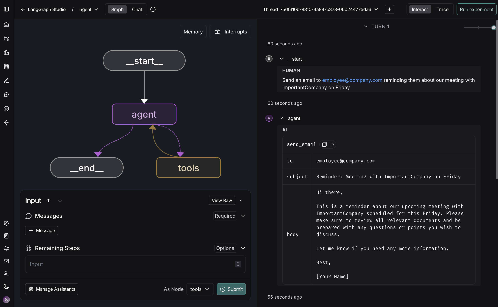

import AgentTracingPrerequisite from '/langchain/snippets/langsmith/agent-tracing-prerequisite.mdx';

在本地使用 LangChain 构建智能体时，可视化智能体内部的工作流程、实时交互以及调试问题非常有帮助。**LangSmith Studio** 是一个免费的图形界面，用于从本地计算机开发和测试您的 LangChain 智能体。

Studio 连接到您本地运行的智能体，以展示智能体执行的每一步：发送给模型的提示词、工具调用及其结果，以及最终输出。您可以测试不同的输入、检查中间状态，并在无需额外代码或部署的情况下迭代智能体的行为。

本页面介绍了如何将 Studio 设置与您的本地 LangChain 智能体。

## 前置条件

开始之前，请确保您已具备以下条件：

- **一个 LangSmith 账户**：在 [smith.langchain.com](https://smith.langchain.com) 注册（免费）或登录。
- **一个 LangSmith API 密钥**：遵循 [创建 API 密钥](https://docs.langchain.com/langsmith/create-account-api-key) 指南。
- 如果您不希望数据 [追踪](https://docs.langchain.com/langsmith/observability-concepts#traces) 到 LangSmith，请在您的智能体的 `.env` 文件中设置 `LANGSMITH_TRACING=false`。禁用追踪后，没有数据会离开您的本地服务器。

## 设置本地智能体服务器

### 1. 安装 LangGraph CLI

[LangGraph CLI](https://docs.langchain.com/langsmith/cli) 提供了一个本地开发服务器（也称为 [智能体服务器](https://docs.langchain.com/langsmith/agent-server)），将您的智能体连接到 Studio。

```shell
npx @langchain/langgraph-cli
```

### 2. 准备您的智能体

如果您已经有一个 LangChain 智能体，可以直接使用它。本示例使用一个简单的邮件智能体：

```typescript title="agent.ts"
import { createAgent } from "@langchain/agents";

function sendEmail(to: string, subject: string, body: string): string {
  const email = {
    to,
    subject,
    body,
  };
  // ... email sending logic

  return `Email sent to ${to}`;
}

const agent = createAgent({
  model: "gpt-5.5",
  tools: [sendEmail],
  systemPrompt: "You are an email assistant. Always use the send_email tool.",
});
```

### 3. 环境变量

<AgentTracingPrerequisite />

Studio 需要一个 LangSmith API 密钥来连接您的本地智能体。在您的项目的根目录中创建一个 `.env` 文件，并添加您从 [LangSmith](https://smith.langchain.com/settings) 获取的 API 密钥。

<Warning>
    确保您的 `.env` 文件不会被提交到版本控制，例如 Git。
</Warning>

```bash .env
LANGSMITH_API_KEY=lsv2...
LANGSMITH_AGENT_ID="<your-agent-id>"
LANGSMITH_AGENT_ENVIRONMENT="production"
```

### 4. 创建 LangGraph 配置文件

LangGraph CLI 使用配置文件定位您的智能体并管理依赖项。在您的应用程序目录中创建一个 `langgraph.json` 文件：

```json title="langgraph.json"
{
  "dependencies": ["."],
  "graphs": {
    "agent": "./src/agent.ts:agent"
  },
  "env": ".env"
}
```

@[`createAgent`] 函数会自动返回一个编译好的 LangGraph 图，这是配置文件中 `graphs` 键所期望的。

<Info>
有关配置文件中 JSON 对象每个键的详细说明，请参阅 [LangGraph 配置文件参考](https://docs.langchain.com/langsmith/cli#configuration-file)。
</Info>

此时，项目结构将如下所示：

```bash
my-app/
├── src
│   └── agent.ts
├── .env
└── langgraph.json
```

### 5. 安装依赖项

```shell
yarn install
```

### 6. 在 Studio 中查看您的智能体

启动开发服务器以将您的智能体连接到 Studio：

```shell
npx @langchain/langgraph-cli dev
```

<Warning>
Safari 会阻止 `localhost` 连接到 Studio。为解决这个问题，请使用 `--tunnel` 运行上述命令，通过安全隧道访问 Studio。
</Warning>

服务器运行后，您的智能体可以通过 API 在 `http://127.0.0.1:2024` 访问，也可以通过 Studio UI 在 `https://smith.langchain.com/studio/?baseUrl=http://127.0.0.1:2024` 访问：

<Frame>

</Frame>

将 Studio 连接到您的本地智能体后，您可以快速迭代智能体的行为。运行测试输入，检查包含提示词、工具参数、返回值和 Token/延迟指标的完整执行追踪。当出现问题时，Studio 会捕获异常及其周围状态，以帮助您理解发生了什么。

开发服务器支持热重载——在您的代码中更改提示词或工具签名，Studio 会立即反映这些更改。从任何步骤重新运行对话线程以测试您的更改，而无需从头开始。此工作流程可扩展，从简单的单工具智能体到复杂的多节点图。

有关如何运行 Studio 的更多信息，请参阅 [LangSmith 文档](https://docs.langchain.com/langsmith/observability) 中的以下指南：

- [运行智能体](https://docs.langchain.com/langsmith/use-studio#run-application)
- [管理智能体](https://docs.langchain.com/langsmith/use-studio#manage-assistants)
- [管理对话线程](https://docs.langchain.com/langsmith/use-studio#manage-threads)
- [迭代提示词](https://docs.langchain.com/langsmith/observability-studio)
- [调试 LangSmith 追踪](https://docs.langchain.com/langsmith/observability-studio#debug-langsmith-traces)
- [向数据集添加节点](https://docs.langchain.com/langsmith/observability-studio#add-node-to-dataset)

## 视频指南

<Frame>
<iframe
  className="w-full aspect-video rounded-xl"
  src="https://www.youtube.com/embed/Mi1gSlHwZLM?si=zA47TNuTC5aH0ahd"
  title="Studio"
  frameBorder="0"
  allow="accelerometer; autoplay; clipboard-write; encrypted-media; gyroscope; picture-in-picture"
  allowFullScreen
>

</iframe>
</Frame>